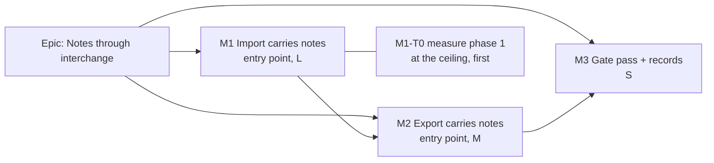

# Implementation Plan: Carry activity notes through XER and MSPDI

- **Feature spec:** [`./feature-spec.md`](./feature-spec.md) (Draft, awaiting product-owner approval)
- **Status:** Draft — awaiting product-owner approval
- **Owner:** James Ewbank (product owner). The builder agent builds it one milestone at a time
  (CLAUDE.md §19.14). The plan is written to the defaults of the spec's Q1 to Q4.

## Breakdown

### Epic

**Notes through interchange.** An activity's remarks travel with the schedule file in both
directions, for P6 XER and MS Project MSPDI. This closes the carry half of #543 under ADR-0050's
interchange theme.

**No feature flag** (ADR-0088 D1). Each milestone is a commit boundary, and rollback is a revert.

**Schema:** none with the defaults. **If Q1 is answered "mark imported notes", M1 is blocked on a
database-architect pass (CLAUDE.md §19.3), which becomes M1-T0b.**

---

### Milestone 1: Import carries notes (shippable slice)

**Outcome:** a Planner imports an XER with `TASKMEMO` rows, or an MSPDI with task `<Notes>`, and each
remark is an activity note on the new plan. The report counts what came across and states what
changed.

**Entry point:** Project page → **Import from file…** → dialog **Import schedule from file**, which
shows **Notes** under _Mapped_. After **Confirm import**, the selection bar's **Notes** button on an
imported activity shows the remark.

**Journey:** `apps/web/e2e-interchange/interchange.spec.ts`, new test:

1. Import a `.xer` fixture carrying a `TASKMEMO`.
2. Assert the report's **Notes** count.
3. Confirm the import.
4. Select the activity and press **Notes**.
5. Assert the remark text is visible as text and the thread passes axe (`wcag2a`, `wcag2aa`).

---

#### Feature: Import notes end to end

> **Description:** read notes in both adapters, convert them to plain text through one pure module,
> persist them atomically with the graph, remove them on compensation, and report them.
> **Complexity:** L
> **Dependencies:** none
> **Risks:** phase-1 transaction timeout at the ceiling → measured first (T0). A hostile memo → bounded
> length, NUL and control removal, CHECK backstop, render as text only.
> **Testing requirements:** unit (pure); API e2e (commit, compensation, engine parity, hostile text);
> one Playwright journey.

##### Task M1-T0 — Measure phase 1 with notes at the ceiling (≈ one PR, dark)

- **Description:** before any production write, measure `persistGraph`'s wall time at 5,000
  activities, first with no notes and then with 20,000 notes of 1,000 characters (about 20 MB). Use a
  throwaway harness against the local database: call the repositories directly inside one
  `$transaction` with the default options, as `interchange.service.ts:257` does. Record p50 and max
  over 5 runs in the PR and in the spec's FC-6. No product code changes.
- **Complexity:** S
- **Dependencies:** none
- **Risks:**
  - The reading exceeds about 2.5 s, half of Prisma's 5 s default. Then decide from the numbers, in
    the PR, between: lowering `MAX_NOTES`; writing notes in a second phase-1b transaction that
    compensation also covers; or an explicit `timeout` on the import transaction. The choice is
    recorded in the spec's §4.8 before T2 starts (ADR-0142).
  - The harness measures the wrong thing → backend-performance-reviewer reads the harness before the
    reading is trusted.
- **Testing:** none shipped; the reading is the artefact.
- **Development steps:**
  1. Generate a 5,000-activity graph with the seed builders (`@repo/seed` scale builder).
  2. Time `createMany` for activities and dependencies alone, then with notes.
  3. Record the readings and the decision in the PR description and the spec's FC-6. No changeset.

##### Task M1-T1 — Pure: the text step, canonical notes, both adapters, mapper, report (≈ one PR)

- **Description:** all in `packages/interchange/src`.
  - New `note-text.ts`, which is the only place the conversion and escaping rules live:
    - `decodeXmlEntities`: the five predefined entities plus numeric references.
    - `htmlToText`: the linear tokenizer of spec §4.5.
    - `cleanNoteText`: remove `\p{Cc}` except `\n` and `\t`, remove unpaired surrogates, normalise
      line breaks, trim.
    - `splitNoteBody`: at most 5,000 UTF-16 units, at a paragraph, then line, then whitespace
      boundary, never splitting a surrogate pair.
    - The export helpers `noteBodiesToMemoHtml` and `noteBodiesToPlainNotes` land here too, so M2
      only wires them.
  - `canonicalModelSchema` gains `notes?: { activityId, body }[]`.
  - `importGraphSchema` gains `notes?: { activityKey, body (1..5000) }[]` with `.max(MAX_NOTES)`.
    `ExportGraph` inherits it (`export-graph.ts:68-69`).
  - `xer-adapter.ts`:
    - Read `TASKMEMO` for the first project, and the `MEMOTYPE.memo_type` topic only when that column
      exists. The exact label `SchedulePoint notes v1` means split on `
` and add no prefix.
    - **Replace** the aggregate drop at `:445-461` with the findings of spec §4.7.
    - `TABLE.taskMemo`'s comment changes from "read only to COUNT" to the mapping.
  - `mspdi-adapter.ts`: read `<Notes>`, entity-decode it, drop RTF, and replace the counter and drop at
    `:414` and `:565-575`. A summary task's note attaches to its `WBS_SUMMARY`.
  - `mapper.ts`: map notes to `ImportGraph.notes`, and drop and count notes whose activity did not
    survive validation.
  - `report.ts`: `mapped.notes` optional (absent = 0), declared once in `buildReportSchemas`.
  - Export `MAX_NOTES` beside `MAX_ASSIGNMENTS`, at the value T0 confirmed.
- **Complexity:** L
- **Dependencies:** M1-T0 (the ceiling value)
- **Risks:**
  - A conversion bug corrupts text → table-driven unit cases. Each rule has a case that fails against
    a deliberately broken version.
  - Quadratic regex on hostile input → no backtracking patterns, plus a unit case with a 1,000,000-
    character memo of `<` characters that must finish under a stated bound.
  - The XER parser's continuation rule (`xer-parser.ts:402-407`) puts lines in the wrong field when
    `task_memo` is not the last column, and a continuation line starting `%` rejects the file
    (`:398-400`). **Do not change the parser in this task.** Add two unit cases that **pin today's
    behaviour** and record the risk in the ADR. A real file showing either becomes a `docs/TECH_DEBT.md`
    row.
  - The adapter remains "the only place P6's vocabulary lives" (`xer-adapter.ts:23-30`). Topic and
    label strings live in the adapter or in `note-text.ts`, never in the API.
- **Testing:**
  - `note-text.spec.ts`: entities, HTML (`script`/`style` removed, blocks to newlines, lists, unpaired
    `<` kept), controls, NUL, surrogates, split boundaries at 4,999 / 5,000 / 5,001, and a
    hostile-length case.
  - `import-xer.spec.ts`:
    - rewrite `:774-815`: one note per memo, several memos per task, topic prefix, the SchedulePoint
      label splitting, blank memos ignored, another project ignored, orphan task dropped and counted;
    - continuation pins;
    - FC-3 parity: a file with no `TASKMEMO` gives a report and graph deep-equal to a snapshot taken
      on `main` before the change, with no `notes` key.
  - `mspdi-adapter.spec.ts`: rewrite `:392-416` (entity decode, RTF drop, summary note); FC-3 parity.
  - `mapper.spec.ts`: orphan drop.
  - `report.spec.ts`: the strict producer schema accepts `mapped.notes`.
- **Development steps:**
  1. Write `note-text.ts` and its spec first. Every rule gets a failing case first.
  2. Extend the canonical, import-graph and report schemas additively, as optional fields.
  3. Change both adapters and the mapper, and rewrite the two #543 test blocks.
  4. Changeset: `@repo/interchange` minor (the package is versioned, 0.15.0). The user-visible bump
     lands with T2.

##### Task M1-T2 — API: persist, compensate, audit, DTO (≈ one PR)

- **Description:** in `apps/api/src/modules/interchange/interchange.service.ts`:
  - `persistGraph`: after `dependencies.createMany` (`:774`), one `tx.note.createMany` (through
    `NoteRepository`; add `createManyForImport(rows, tx)` on the repository, the
    `createManyForImport` idiom of calendars and resources). Rows carry `organizationId`,
    `entityType: 'ACTIVITY'`, `planId`, `activityId` resolved through `activityIdByKey`, the body,
    `createdBy`/`updatedBy` from the existing `stamp` (`:528`), and an explicit `createdAt` of the
    commit instant plus 1 ms per note in source order (spec §2 Edge cases). A key that does not
    resolve throws `INCONSISTENT_GRAPH`, as dependencies do (`:756-762`).
  - `compensate`: `tx.note.deleteMany({ where: { planId } })` **before** `tx.activity.deleteMany`
    (`:1521`).
  - Audit: `after.noteCount`, plus the `audit-redactor.ts:179-187` allow-list entry and any census
    assertion that pins the payload keys.
  - Logs: `notes` count in "interchange commit persisted a plan". Never a body.
  - `InterchangeReportResponseDto` gains `mapped.notes?`, mapped in the `:262-267` block.
  - `docs/API.md` and the OpenAPI description are updated.
- **Complexity:** M
- **Dependencies:** M1-T1
- **Risks:**
  - The compensation order is wrong → FC-4 test. It fails with `23503` against an implementation
    that deletes the notes after the activities, and the PR states that this was observed.
  - Silent author mismatch → the test asserts that the importer can `PATCH` the imported note and
    another Planner gets 403.
  - The phase-1 budget → the T0 decision is applied here.
- **Testing:** `apps/api/test/interchange.e2e-spec.ts`:
  - Commit an XER with memos: the notes exist, `entityType = ACTIVITY`, `createdBy` = importer, and
    `GET …/activities/:id/notes` returns them in source order (newest first).
  - FC-4: spy `ScheduleService.recalculate` to throw, as in the `:586` precedent. Plan, activities
    and notes are all gone.
  - FC-5: a hostile memo is stored as inert text containing no `<script` substring, and a memo
    containing a NUL commits.
  - Engine parity: the same file with and without `TASKMEMO` gives identical early and late dates and
    critical flags per activity code.
  - Audit: `noteCount` is on the row.
  - Dry-run: `mapped.notes` equals the commit's.
  - Also run the structural suites `soft-delete-filter.structural.spec.ts`,
    `audit-coverage.structural.spec.ts` and `activity-history-coverage.structural.spec.ts`.
- **Development steps:**
  1. Repository method, then the service write, then compensation, then the audit.
  2. API e2e via `scripts/e2e-local.sh api`, then `pnpm prepush`.
  3. Changeset: `api` **minor** (the report gains a field and the import gains capability).
  4. Reviews: **security-reviewer** (hostile text path, author rule), **backend-performance-reviewer**
     (the batched write, T0's reading applied), **api-reviewer** (DTO and OpenAPI).

##### Task M1-T3 — Web: the Notes count and the journey (≈ one PR)

- **Description:** `InterchangeReportTable.tsx` gains the optional **Notes** row in the existing
  pattern (`:30-41`). A fixture `.xer` with a `TASKMEMO` is added beside the existing e2e fixtures,
  and the M1 journey is written.
- **Complexity:** S
- **Dependencies:** M1-T2 (the journey drives the real API)
- **Risks:** a locator or accessible-name mismatch → run `scripts/e2e-local.sh web:interchange`
  locally before pushing (CLAUDE.md §19.8).
- **Testing:**
  - `InterchangeReportTable.test.tsx`: the row is present when defined and absent when undefined.
  - The journey with axe.
- **Development steps:**
  1. Component change and unit test.
  2. Fixture and journey, then `pnpm prepush` and the local e2e run.
  3. Changeset: `web` **minor** (a new visible count).
  4. Reviews: **component-reviewer** and **accessibility-reviewer** (light: one existing row pattern).

---

### Milestone 2: Export carries notes (shippable slice)

**Outcome:** any member exports a plan to XER or MSPDI and its activity notes travel in the file. A
SchedulePoint XER re-imports with the notes split back exactly.

**Entry point:** plan canvas → **Share & export ▾** → **Primavera P6 (XER)** or **Microsoft Project**.

**Journey:** extend `interchange.spec.ts`'s "an exported .xer re-imports with its placed starts and
lanes" (`:360`). Seed a note on one activity through the UI (**Notes** → compose → save). After the
re-import, read the note back through the API by activity code (the ADR-0070 rule that test already
follows).

#### Feature: Export notes

> **Description:** read active activity notes once, emit `MEMOTYPE` and `TASKMEMO` (XER) and `<Notes>`
> (MSPDI), and report what was and was not written.
> **Complexity:** M
> **Dependencies:** M1 released (an importer that reads what this writes)
> **Risks:**
>
> - P6 rejects or misreads the memo tables (FC-7, unobserved) → the export of everything else is
>   unaffected, and the ADR records the assumption.
> - A large note volume → `MAX_NOTES` read cap, with the rest reported.
>   **Testing requirements:** unit round trips; API e2e round trip; journey.

##### Task M2-T1 — API: read notes into the export graph (≈ one PR, with T2)

- **Description:** `ExportService.readGraph` (`export.service.ts:168`) adds one read to its
  `Promise.all`: active `ACTIVITY` notes for the plan, `deletedAt: null` stated at the query
  (ADR-0172), restricted to the activity ids already read, ordered `createdAt ASC, id ASC`, with
  `take: MAX_NOTES + 1`. They are mapped to `ExportGraph.notes` by activity id. Plan notes are
  **counted** only (`count`), for the report.
- **Complexity:** S
- **Dependencies:** M1
- **Risks:** a slow read on a large plan → record `EXPLAIN (ANALYZE, BUFFERS)` in the PR on the scale
  catalogue plan, and confirm it uses `notes_plan_id_created_at_id_idx`.
- **Testing:** `export.service.spec.ts`: soft-deleted notes and notes on deleted activities are
  excluded; the cap is applied.
- **Development steps:**
  1. Add the read and the plan-note count.
  2. Record the EXPLAIN output.
  3. Review: **backend-performance-reviewer**.

##### Task M2-T2 — Pure: the two emitters and their findings (≈ one PR, with T1)

- **Description:**
  - `export-mapper.ts` carries the notes.
  - `xer-emit.ts` writes `MEMOTYPE` (`SPNOTES`, `SchedulePoint notes v1`) and `TASKMEMO` after `TASK`,
    only when notes exist, with `task_memo` as the last column, built with `noteBodiesToMemoHtml`.
    Notes on a `WBS_SUMMARY` are dropped and counted.
  - `mspdi-emit.ts` writes the `<Notes>` leaf with `noteBodiesToPlainNotes`, removing XML-forbidden
    characters.
  - Findings as in spec §4.7, all aggregate.
- **Complexity:** M
- **Dependencies:** M1-T1 (the helpers)
- **Risks:**
  - The XER serialiser collapses tabs and newlines (`xer-serialiser.ts:36-39`) → bodies are HTML-
    escaped before they reach it. A unit case asserts that no raw `\t` or `\n` is in the emitted
    `task_memo`.
  - Byte-identical output for plans without notes (FC-3, export half) → snapshot the existing
    `export-xer.spec.ts` and `mspdi-export.spec.ts` outputs before the change.
- **Testing:**
  - `export-xer.spec.ts` and `mspdi-export.spec.ts`: emission, escaping (`&`, `<`, `
` typed
    literally, tab, newline, non-Latin text), XML-forbidden characters.
  - FC-1 unit round trip: export → `importSchedule` gives the same note multiset per activity code.
  - FC-2 MSPDI join.
  - A plan with no notes produces byte-identical output.
- **Development steps:**
  1. Emitters, then findings, then the round-trip specs.
  2. Changeset: `api` **minor** (export content). `@repo/interchange` minor.

##### Task M2-T3 — Round trip against Postgres, and the journey (≈ one PR)

- **Description:** extend `apps/api/test/interchange-roundtrip.e2e-spec.ts` (`:155`) or
  `interchange-export.e2e-spec.ts`: import, add notes through the API, export XER and MSPDI,
  re-import, and compare per code (FC-1, FC-2). Extend the M2 journey.
- **Complexity:** S
- **Dependencies:** M2-T1, M2-T2
- **Risks:** a flaky journey → read back through the API, not the canvas.
- **Testing:** as described. Run `scripts/e2e-local.sh api` and `web:interchange` locally.
- **Development steps:**
  1. API e2e.
  2. Journey.
  3. `pnpm prepush`.
  4. Changeset: none extra.

---

### Milestone 3: Gate pass and records

**Outcome:** the epic is reviewed as a whole and the documents say what shipped.
**Entry point:** ships dark. These are records only; the user-facing surfaces are M1's and M2's.
**Journey:** none new. M1's and M2's journeys are the gate.

##### Task M3-T1 — Reviews, ADR, documents (≈ one PR)

- **Description:**
  - Run **security-reviewer**, **api-reviewer**, **backend-performance-reviewer** and
    **test-engineer** over the M1 and M2 diff.
  - File the ADR outlined in spec §4.9 and add its one line to CLAUDE.md §16 (`check:adr-coverage`).
  - Update the ADR count in CLAUDE.md §1's banner (`check:counts` fails otherwise).
  - Rewrite ADR-0050's `TASKMEMO` row (`0050-…md:129`).
  - Remove the `docs/BACKLOG.md` row.
  - Set this spec's and plan's status to `Accepted — shipped (ADR-NNNN)` (`check:spec-status` S3).
  - Optionally add a seeded catalogue case (`docs/TEST_PLAYBOOK.md`, `check:playbook`).
  - Record the blocking findings and their fixes in the ADR. Non-blocking ones go to
    `docs/TECH_DEBT.md`.
- **Complexity:** S
- **Dependencies:** M2
- **Risks:** a stale banner or register → `pnpm prepush` derives every gate.
- **Testing:** `pnpm prepush`.
- **Development steps:**
  1. Reviews, then fixes, each with a regression test.
  2. ADR and register updates.
  3. Hand-off in `docs/HANDOFF.md` (CLAUDE.md §19.14).

## Sequencing & slices

1. **M1-T0**: a reading, nothing shipped.
2. **M1-T1**: pure, released; the API does not yet use it.
3. **M1-T2**: notes import; the report gains `mapped.notes`. A browser one release behind strips the
   key (ADR-0162 D9), so this is safe to release first.
4. **M1-T3**: the count is visible, and the journey is the M1 gate.
5. **M2-T1 + T2**: export writes notes. M1 is already released, so every SchedulePoint importer reads
   them.
6. **M2-T3**: round trip proven against Postgres and in the browser.
7. **M3**: reviews and records.

Each step leaves `main` releasable. A file without notes behaves exactly as on `main` at every step
(FC-3).

**Version impact.**

- `api` minor twice (M1-T2, M2-T2).
- `web` minor once (M1-T3).
- `@repo/interchange` minor.
- All are additive. Pre-1.0, nothing is breaking: the report gains an optional key, and the exported
  XER gains two tables only when notes exist.
- No migration, so ADR-0018's self-migrating image and ADR-0192's pre-update backup are untouched.

**Agents during the build.**

- **builder**: each task.
- **security-reviewer**: M1-T1, M1-T2, M3.
- **backend-performance-reviewer**: M1-T0, M1-T2, M2-T1.
- **api-reviewer**: M1-T2, M3.
- **test-engineer**: M1-T2, M2-T3.
- **component-reviewer** and **accessibility-reviewer**: M1-T3.
- **database-architect**: **only** if Q1 takes the provenance option, and then **mandatory before
  M1-T2**.

## Definition of Done (per task)

Each task's PR must satisfy the Feature Completion Criteria in
[`docs/PROCESS.md`](../../PROCESS.md): code, tests, docs, security, performance, accessibility,
Docker build, CI, changelog and version impact. "Tests" means `pnpm prepush` was **run**, plus
`scripts/e2e-local.sh api` for M1-T2, M2-T1 and M2-T3, and `scripts/e2e-local.sh web:interchange` for
M1-T3 and M2-T3.

## Risks & assumptions (rollup)

| Risk / assumption                                                                                                     | Likelihood     | Impact | Mitigation                                                                                                           |
| --------------------------------------------------------------------------------------------------------------------- | -------------- | ------ | -------------------------------------------------------------------------------------------------------------------- |
| Phase 1 exceeds Prisma's 5 s interactive-transaction default with 20,000 notes (`interchange.service.ts:257`, `:483`) | med            | high   | M1-T0 measures before the write lands; the remedy is chosen from the reading (spec §4.8)                             |
| Compensation leaves notes behind and fails `23503` (notes RESTRICT into activities and plans)                         | med if missed  | high   | `note.deleteMany` before `activity.deleteMany`; the FC-4 e2e is observed failing against the wrong order             |
| P6 writes memos in a shape not assumed here (HTML or not, line breaks, column order)                                  | med            | med    | Detection, not assumption (§4.5); continuation pins; optional owner sample; a TECH_DEBT row if a real file disagrees |
| A multi-line memo line starting `%` rejects a whole XER (`xer-parser.ts:398-400`)                                     | low            | high   | Pinned by a unit case; not changed without a real file; recorded in the ADR                                          |
| P6 refuses or misreads the exported `MEMOTYPE` and `TASKMEMO` (FC-7)                                                  | med            | med    | Unobserved and stated so; the rest of the export is unaffected; the ADR names what would settle it                   |
| Imported HTML reaches a renderer                                                                                      | low            | high   | Stored as text only; no `dangerouslySetInnerHTML` in `apps/web/src`; FC-5 in API e2e and the journey                 |
| A NUL or forbidden character rolls back the whole import or breaks the MSPDI XML                                      | med            | high   | `cleanNoteText` on import; XML-forbidden removal on export; unit and e2e cases                                       |
| Thread order of imported notes is random (v4 ids, one timestamp)                                                      | high if missed | low    | Explicit staggered `createdAt`; e2e asserts the order                                                                |
| Exported internal remarks reach an outside party (Q4)                                                                 | med            | med    | Export report states the count; an "Include notes" choice is Q4's alternative                                        |
| Imported notes are editable only by the importer (Q1)                                                                 | certain        | low    | The ADR-0046 rule, stated in the ADR; Org-Admin moderation remains out of scope as in ADR-0046                       |
