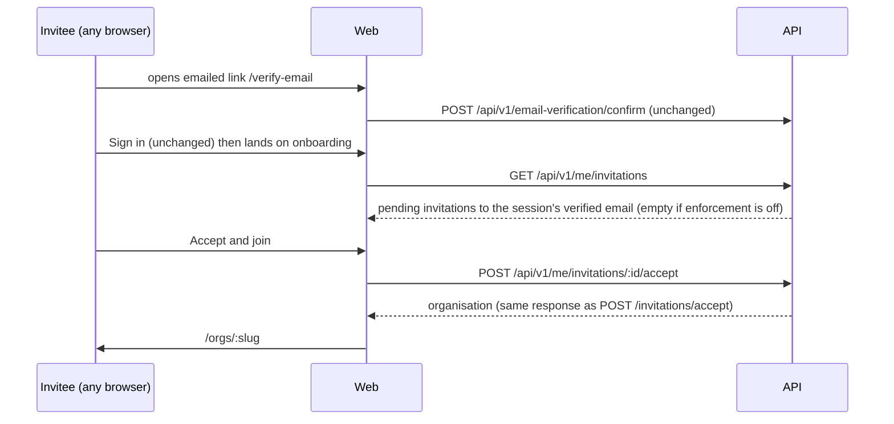

# Feature Spec: An invitation survives email confirmation

- **Status:** Approved — by the product owner, 2026-11-13: Q1 answered yes, the invitation waits on the first screen after sign-in (option C). Not yet built.
- **Author(s):** feature-analyst (Claude Code), for the product owner
- **Date:** 2026-11-13
- **Tracking issue / epic:** the product owner's request of 2026-11-13 (an invitee loses the invitation at the
  emailed confirmation link); follows web 1.9.x PR #1359
- **Roadmap link:** none; an onboarding defect on hosts that set `AUTH_REQUIRE_EMAIL_VERIFICATION`
- **Related ADR(s):** ADR-0016 section 5 (amended by a new ADR, section 4.6), ADR-0003, ADR-0012, ADR-0072 and
  ADR-0073 (audit), ADR-0074 (verification and recovery), ADR-0075 (mail is best-effort), ADR-0081 (entry point and
  journey), ADR-0088 D1 (no flag), ADR-0172 (soft-delete filter at the query), ADR-0202 (loading shape)

---

## In plain English

Today, on a host that asks new people to confirm their email address, someone invited to an organisation creates
their account from the invitation, confirms their address from the email, signs in, and lands on "Create your
organisation". Their invitation is gone from view, and they must find the invitation email and click it again.

After this change, the first screen after signing in shows **"You've been invited"**, with each invitation waiting
for their confirmed address (organisation name and role) and an **Accept and join** button. It works whichever
browser or device they confirm on or sign in from, because nothing is carried in the link: the server simply looks
up invitations sent to the address they have just proved they own. Hosts that do not ask for confirmation see no
change at all.

---

## 1. Business understanding

### Problem

Verified against the code in this checkout (what was read, file and line):

1. **The emailed link is ours, and carries only the token.** `apps/api/src/common/auth/better-auth.ts:285-290`
   composes `{verifyPageUrl}#token=…` and ignores Better Auth's `url`. Nothing else rides in it.
2. **The confirmed screen offers plain Sign in.** `apps/web/src/routes/verify-email.tsx:134-158`: on success a
   signed-out reader gets `<Link to="/sign-in">` with no `redirect`. Sign-in then pushes `search.redirect ?? '/'`
   (`routes/sign-in.tsx:26`), so `/`.
3. **`/` for a new account is onboarding.** `routes/onboarding.tsx:10-41` ("Create your organisation") has no
   knowledge of invitations.
4. **The journey pins the defect.** `apps/web/e2e-account/verification.spec.ts:177-190`: confirm, sign in, expect
   the "Create your organisation" heading (line 184), then `invitee.goto(acceptUrl)` a second time (line 190).
5. **The invitation token cannot be recovered server-side.** Only its hash is stored (`schema.prisma:277`,
   `tokenHash @unique`; `invitations.service.ts:81`, `generateOpaqueToken`), so the server cannot rebuild the
   accept link later.

**About PR #1359.** This checkout (`fix/plan-setup`, web 1.9.1) does not contain it: `apps/web/CHANGELOG.md:3-22`
lists #1357, #1358 and #1355; `sameOriginRedirect` appears nowhere under `apps/web/src`; `sign-up.tsx:30-33` drops
any redirect; and `AcceptInvitationCard.tsx:146` sends "Create an account" without one. I therefore could not read
#1359's code. The recommended design does **not** depend on it (section 4.3), and plan M0 re-reads `main` before
building.

### Users

The **invitee**: any person who has just confirmed their address, before they belong to any organisation. No
organisation role applies yet (ADR-0016). Org Admins (who send invitations) see no change. External guests are not
involved.

### Primary use cases

1. Invited, creates an account, confirms, signs in: the invitation is on the first screen; one press joins.
2. Same, but the confirmation email is opened on a phone and sign-in happens on a laptop: same result.
3. An existing account holder confirms an address and has two invitations from two organisations: both are offered.

### Expected outcomes and success criteria

- The journey at `verification.spec.ts:177-194` reaches the organisation **without** `goto(acceptUrl)`.
- No invitation token appears in any email other than the invitation itself, any log line, audit row or mail event.
- On a host with `AUTH_REQUIRE_EMAIL_VERIFICATION=false` the onboarding screen and every API answer are unchanged.

### Open questions

**Critical (one):**

- **Q1. Is "your invitation is waiting on the first screen after you sign in" good enough, or must the person be
  returned to the invitation page itself?** Recommended: the first screen (option C, section 4.4). Returning to the
  exact page means putting the invitation's secret into the confirmation email (option A), which costs more and still
  fails when the person asks for a fresh confirmation link.

**Defaults (no answer needed; say if you disagree):**

- D1. Offered on the onboarding screen only (people with no organisation yet). Someone already in an organisation who
  is invited to a second one keeps using the invitation link, as today.
- D2. The confirmed-address screen is unchanged; its **Sign in** leads to the offer.
- D3. Invitations whose organisation the person already belongs to, expired, revoked or accepted ones are not shown.
- D4. The audit rows say which way the invitation was accepted (section 4.5).

## 2. Functional requirements

> **US-1.** As an invitee on a host that requires confirmation, I want my invitation offered after I confirm and sign
> in, so I do not have to find the email again.
>
> - **Given** a pending, unexpired invitation to `a@x.test` for "Acme" as Planner, and I signed up as `a@x.test`,
>   confirmed and signed in, **when** I land on the first screen, **then** I see "Join Acme" with "Planner" and an
>   **Accept and join** button, above "Create your organisation".
> - **When** I press it, **then** I become a Planner of Acme and land in it (`/orgs/$orgSlug`), as the link's Accept
>   does (`AcceptInvitationCard.tsx:261-267`).
> - **Given** I confirmed in another browser or device, **then** the same holds.
> - **Given** no invitation is waiting, **then** the screen is exactly today's.
> - **Given** the host does not require confirmation, **then** the screen is exactly today's, even if invitations
>   exist for my address.

### Edge cases

- Expired between showing and pressing: the server answers 410; the card says "This invitation has expired. Ask for a
  new one." and the list refetches.
- Accepted in another tab, or revoked meanwhile: 410 or 404; same handling.
- Already a member (race): 409 "You are already a member of this organisation."; list refetches (it then omits it).
- Signed up with a different address than the one invited: nothing is offered (today's behaviour; the link's
  wrong-account card still applies).
- The confirmation link (1 hour, `email-verification.mjs:14` default `expiresIn = 3600`) expires: today's resend path;
  the invitation (7 days, `invitations.service.ts:27`) still waits.
- A session from before the host turned enforcement on, unverified: nothing offered.

### Permissions

Authenticated, no organisation role (the person is not yet a member). Both endpoints act only on invitations whose
email equals the session user's own email **and** only when the host enforces verification **and** that user's
`emailVerified` is true. Anything else is 404 for accept and an empty list for read: deny by default, no oracle.

### Validation rules

`:invitationId` is a UUID (`ParseUUIDPipe`); list query `limit` / `cursor` per `docs/API.md`.

### Error scenarios

| Scenario                             | Detection       | User-facing result                                |
| ------------------------------------ | --------------- | ------------------------------------------------- |
| Not mine / unknown / enforcement off | 404 from accept | "This invitation is no longer available."         |
| Expired or no longer pending         | 410             | "This invitation has expired. Ask for a new one." |
| Already a member                     | 409             | Server message; list refetches                    |
| Rate limited                         | 429             | `throttledMessage()` (as the link's card)         |
| List read fails                      | query error     | Onboarding shown as today; error logged           |

## 3. Technical analysis

| Area           | Impact | Notes                                                                                       |
| -------------- | ------ | ------------------------------------------------------------------------------------------- |
| Frontend       | low    | Onboarding gains an invitations section; one query hook, one mutation                       |
| Backend        | med    | Two service methods on `InvitationsService`, one new controller (`me/invitations`)          |
| Database       | none   | **No schema change**: a read by `email`, `status`, `expires_at`, `deleted_at` (section 4.7) |
| API            | med    | Two new authenticated endpoints; OpenAPI and `docs/API.md`                                  |
| Security       | high   | A second way to accept: needs an ADR amending ADR-0016 section 5 (section 4.6)              |
| Performance    | low    | One small read per onboarding view                                                          |
| Infrastructure | none   | No env var, no flag (ADR-0088 D1)                                                           |
| Observability  | low    | Info log on accept with ids only, as `invitations.service.ts:300-307`                       |
| Testing        | med    | Unit, Supertest (enforcing and non-enforcing), the verification journey                     |

**Recalculation parity / the pen.** Not a scheduling input and not a plan write; `computeSchedule` and the pen are
untouched.

## 4. Solution design

### 4.1 Recommended flow (option C)

### 4.2 Options

| Option | What                                                                                                                                                                   | Verdict                 |
| ------ | ---------------------------------------------------------------------------------------------------------------------------------------------------------------------- | ----------------------- |
| A      | Pass `callbackURL=/accept-invite?token=…` on sign-up; in `sendVerificationEmail` read it back out of Better Auth's `url`, re-validate, and add it to our fragment link | Not recommended         |
| B      | Store the pending destination server-side (a column on the user, or on the verification row)                                                                           | Rejected: schema change |
| C      | After confirmation and sign-in, look up pending invitations for the verified email and offer them; no link change                                                      | **Recommended**         |

**Why not A.** It works only through Better Auth internals: sign-up builds `url` with `callbackURL` in its query
(`better-auth/dist/api/routes/sign-up.mjs:243-244`), the resend endpoint likewise (`email-verification.mjs:30-31`),
and the global origin check validates `body.callbackURL` against `trustedOrigins` (`middlewares/origin-check.mjs:43-66`)
but accepts any trusted absolute URL, so we would still need our own relative-path allowlist on the server and again
on the client. It puts the invitation token into a **second** email and into the non-production log line that prints
`verifyUrl` (`common/mail/logging-mail.service.ts:72-75`). And it is lost on every resend: the "send a new link" paths
send no `callbackURL` (`features/auth/api/use-session.ts:231`, `:277`), and the invitation card's own resend
(`AcceptInvitationCard.tsx:183`) is exactly the path an invitee uses. Its one advantage, landing on the invitation page
itself, is Q1. If the owner chooses A, the three Better Auth claims above must be registered in
`scripts/dependency-claims.json` (package `better-auth` 1.7.18, path, lines, anchor) before code cites them.

**Why not B.** It needs a column (database-architect, a migration in every environment) and still needs either A's
link change or C's lookup to use it. Strictly more than C.

**Why C.** No schema change; no Better Auth internals (it uses our own confirm endpoint and the session); no token
anywhere new, because there is none to carry; and it survives a different browser, a different device and a resent
confirmation link. The cost is an authenticated read and a second accept door (section 4.6).

### 4.3 How C relates to PR #1359

#1359 carries a same-origin `redirect` through sign-up, sign-in and verify-email **in one browser tab**. C is
complementary: when that redirect survives (same tab), the person returns to `/accept-invite` as #1359 intended;
when it does not (the emailed link opens a new tab, another browser or another device), `/` now offers the invitation.
C adds no redirect and needs no open-redirect validation of its own. M0 confirms #1359's `sameOriginRedirect` on `main`
rejects absolute and protocol-relative values (`https://…`, `//…`, `/\…`) on both sign-in and verify-email; if it does
not, that is reported as a separate defect, not fixed here.

### 4.4 API

- `GET /api/v1/me/invitations?limit&cursor` → `{ data: MyInvitationDto[], meta }`.
  `MyInvitationDto = { id, organizationName, role, expiresAt }`. No token (the server does not have it), no inviter.
  Returns `data: []` when `config.requireEmailVerification` is false or the user's `emailVerified` is false.
  Query: `email = user.email` (both stored lower-case: `create-invitation.dto.ts:9-10`, Better Auth
  `sign-up.mjs:158`), `status = PENDING`, `expiresAt > now`, `deletedAt: null` stated at the query (ADR-0172),
  organisation not deleted, and no active membership for this user in that organisation.
- `POST /api/v1/me/invitations/:invitationId/accept` → `OrganizationResponseDto` (same as
  `invitations.controller.ts:59-66`). Same checks and status codes as `InvitationsService.accept`
  (`invitations.service.ts:214-298`), with the token lookup replaced by "this id, addressed to my email", and the two
  extra conditions above. Any failure of ownership or of the host condition is **404**, never 403, so the endpoint
  says nothing about other people's invitations.
- Implementation: extract the membership-and-audit transaction of `accept()` (lines 235-307) into one private method
  both doors call, so they cannot drift. New controller `my-invitations.controller.ts` in the invitations module.

### 4.5 Security

- **Authority.** ADR-0016 section 5 already states that, with enforcement on, the verified email match is the real
  proof of mailbox ownership and the token is "possession [that] already implies mailbox access". C relies on exactly
  that proof and only where it holds; with enforcement off the token stays the only key (list empty, accept 404).
- **Open redirect.** None introduced: no URL is accepted from any client. Navigation after accept is to
  `/orgs/$orgSlug` from the server's response.
- **Token exposure.** No invitation token is read, written, logged, emailed or audited by the new path. Log lines carry
  `organizationId`, `invitationId`, `userId` only. Audit: the same `invitation.accepted` and `member.joined` rows
  (ADR-0073), with `after.acceptedVia: 'verified-address'` on the new door only. Mail events (ADR-0075) and crash
  reports (ADR-0211) are untouched: no mail is sent and no new client error carries an id beyond the UUID.
- **Enumeration / IDOR.** Read is scoped to the session's own email; accept checks the id against that email; a
  foreign id is 404. Supertest proves user B cannot list or accept user A's invitation.
- **Lifetimes.** Unchanged: invitation 7 days, confirmation link 1 hour. Expiry is checked at accept.
- **Rate limit.** The global throttler applies; accept additionally gets the confirm endpoint's
  `@Throttle({ default: { ttl: 60_000, limit: 10 } })` (`email-verification.controller.ts:37`).

### 4.6 ADR

**A new ADR is required** (next free number), titled along the lines of "An invitation waits for the address it was
sent to". Outline: **Context** the token is unrecoverable and confirmation breaks the link chain; **Decision** where
verification is enforced, a verified email match is sufficient to accept a pending invitation addressed to it, offered
in-app; where it is not, the token remains the only key; **Alternatives** A and B above; **Consequences** two accept
doors sharing one transaction; amends ADR-0016 section 5. One line in CLAUDE.md section 16, and ADR-0016's line gains
"amended by ADR-NNNN".

### 4.7 Database

**No schema change.** Existing indexes on `invitations` are `token_hash` (unique), `(organization_id, status)` and the
partial unique `(organization_id, email) WHERE status = 'PENDING' AND deleted_at IS NULL`
(`prisma/migrations/20261109000000_baseline_1_1/migration.sql:1038`, `:1041`, `:1827`). None leads with `email`, so the
read is a sequential scan of a table that holds a few rows per organisation. That is accepted for a read made once per
onboarding view. If a reviewer asks for an `email` index, that **is** a schema change and the database-architect agent
designs it; it is not added by hand.

### 4.8 Web

`routes/onboarding.tsx` gains a "You've been invited" section above the existing card, rendered from a new
`useMyInvitations()` query (features/members). One card per invitation: "Join {organisation}", "You've been invited as
{role}.", **Accept and join** (the `AcceptInvitationCard` button pattern: `aria-disabled`, `aria-busy`, guarded
`onClick`, `ServerError` with `isRateLimited`). The card is vertically centred (`onboarding.tsx:18`), so a section
arriving late would move the form under the reader's pointer. Default: the screen shows a `LoadingShape` (as
`AcceptInvitationCard.tsx:78-90`) until the read settles, then draws both at once; a failed read settles as "no
invitations". The ux and accessibility reviews confirm this choice against ADR-0202. The resolved state is announced once ("You have 1 invitation waiting.") via `useAnnounce`, as the link's card does.
On accept, `setLastActiveOrg` and navigate, as `onboarding.tsx:29-34` does after create.

## 5. Links

- Implementation plan: [`implementation-plan.md`](implementation-plan.md)
- Docs updated by this change: the new ADR, ADR-0016 (dated pointer), CLAUDE.md section 16, `docs/API.md`, the
  `verification.spec.ts` journey's docblock, `docs/TEST_PLAYBOOK.md` if a catalogue entry covers invitations.
