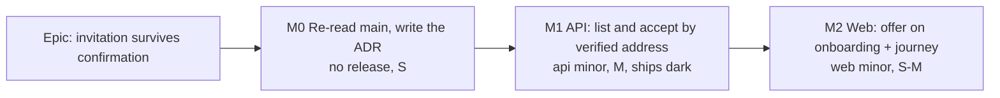

# Implementation Plan: An invitation survives email confirmation

- **Status:** Approved (2026-11-13); Q1 yes, option C
- **Feature spec:** [`feature-spec.md`](feature-spec.md)
- **Owner:** product owner; built by the `builder` agent, one milestone per pull request

## Breakdown

### Epic

Recommended option C (spec section 4.2), subject to Q1. No flag (ADR-0088 D1): each milestone is a commit boundary,
and that is the rollback. No schema change (spec section 4.7), so no database-architect run is required; if any task
discovers it needs one, it **stops** and that agent designs it (CLAUDE.md section 19.3).

---

### Milestone M0: re-read `main`, write the ADR (no release)

**Outcome:** the spec's premises confirmed on `main`, and the ADR in Proposed state. **Ships dark:** documentation only.

- **M0-T1 (S).** On `main` (not this checkout, which lacks #1359): read `sameOriginRedirect` and its call sites in
  `routes/sign-in.tsx`, `sign-up.tsx`, `verify-email.tsx`. Record file:line in the spec's section 4.3. Confirm it
  refuses `https://…`, `//…`, `/\…` and `javascript:` on both sign-in and verify-email; a gap is filed as its own
  defect row, not fixed here. Confirm `verification.spec.ts:177-194` still pins the second `goto(acceptUrl)`.
- **M0-T2 (S).** Draft the ADR from spec section 4.6 (next free number); one line in CLAUDE.md section 16; ADR-0016's
  line gains "amended by ADR-NNNN". `pnpm check:adr-coverage`.
- **Claims registry.** The recommendation cites no Better Auth internals in code. If the owner picks option A instead,
  register `sign-up.mjs:243-244`, `email-verification.mjs:30-31` and `origin-check.mjs:43-66` (better-auth 1.7.18) in
  `scripts/dependency-claims.json` here, before any code comment cites them; `pnpm check:claims`.

---

### Milestone M1: the API (api minor, ships dark)

**Outcome:** a verified invitee can list and accept invitations addressed to them without the token.
**Entry point:** none yet; **declared dark** (ADR-0081). M2 is its entry point.
**Journey:** none in this milestone; Supertest is the gate.

#### Feature: two endpoints, one transaction

> **Complexity:** M
> **Dependencies:** M0 (ADR merged or in the same PR)
> **Risks:** the two accept doors drift → one shared private method for the membership transaction and audit rows.
> An ownership failure answering 403 tells a caller an invitation exists → every ownership or host-condition failure is 404. A missing soft-delete filter → stated at the query; `check` for ADR-0172 stays green.
> **Testing requirements:** unit (service), Supertest (both host settings, IDOR), OpenAPI snapshot if one exists.

##### Task M1-T1: service

- **Description:** `InvitationsService.listForVerifiedUser(principal, page)` and
  `acceptForVerifiedUser(principal, invitationId, context)`; repository method
  `findPendingForEmail(email, { take, cursor })` with `deletedAt: null`, organisation not deleted, `status: PENDING`,
  `expiresAt > now`. Extract `accept()` lines 235-307 into `joinFromInvitation(invitation, principal, context, via)`;
  `via` sets `after.acceptedVia: 'verified-address'` on the new door only.
- **Complexity:** M
- **Testing:** `invitations.service.spec.ts` gains: enforcement off → `[]` and accept 404; unverified → `[]` and 404;
  other user's invitation → 404; expired → 410; revoked/accepted → 410; already member → excluded from list, 409 on
  accept; audit rows identical to the link door except `acceptedVia`; logger called with ids only (assert no field
  named `token` or containing the token shape). The existing `accept()` cases stay green unchanged.

##### Task M1-T2: controller, DTO, docs

- **Description:** `my-invitations.controller.ts` at `me/invitations` (version 1), `@ApiCookieAuth`, `GET` paginated
  per `docs/API.md`, `POST :invitationId/accept` with `ParseUUIDPipe` and `@Throttle({ default: { ttl: 60_000,
limit: 10 } })`. `MyInvitationDto { id, organizationName, role, expiresAt }`. Update `docs/API.md`; the
  public-routes census (`common/http/public-routes-census.structural.spec.ts`) must show neither route as public.
- **Complexity:** S
- **Testing:** new `apps/api/test/my-invitations.e2e-spec.ts`, booted with `AUTH_REQUIRE_EMAIL_VERIFICATION=true`
  following `email-verification-confirm.e2e-spec.ts`'s setup, plus one describe with it false: list and accept happy
  path; B cannot list or accept A's (404); unauthenticated 401; expired 410; non-UUID 400; enforcement off → `[]` and
  404; `audit_events` rows contain no token; the link door (`POST /invitations/accept`) unchanged.
- **Development steps:** changeset `@repo/api` **minor**: "Add endpoints that let a person with a confirmed address see
  and accept invitations sent to it."

**Reviews before merge:** **security-reviewer** (authority change, IDOR, 404-not-403, no token anywhere, throttling),
**api-reviewer** (paths under `me/`, envelope, pagination, status codes, OpenAPI), **backend-performance-reviewer**
(the unindexed email read; spec section 4.7 accepts a scan, and an index request routes to database-architect).

**Suites:** `pnpm prepush`, `scripts/e2e-local.sh api`.

---

### Milestone M2: the offer on onboarding (web minor)

**Outcome:** after confirming and signing in, the invitee sees their invitation on the first screen and joins in one
press, in any browser.
**Entry point:** the onboarding screen (`/` for a signed-in person with no organisation), section "You've been
invited", button **Accept and join**.
**Journey:** `apps/web/e2e-account/verification.spec.ts` (config `playwright.account-verify.config.ts`, which reads
the mailed link from its SMTP sink via `sink.waitFor(email, /\/verify-email#/)` and `firstUrlIn`).

#### Feature: invitations on onboarding

> **Complexity:** S to M
> **Dependencies:** M1 released (or in the same deploy)
> **Risks:** the centred card jumps when the list arrives → hold one `LoadingShape` until settled (spec 4.8). A
> failed read hides a real invitation → it settles as "none" and the emailed link still works; logged.
> **Testing requirements:** unit (hook, screen states), journey, browser accessibility review.

##### Task M2-T1: hook and screen

- **Description:** `features/members/api/use-my-invitations.ts` (query and accept mutation, invalidating `me` and the
  list); `routes/onboarding.tsx` renders the section per spec 4.8; one announcement on settle.
- **Complexity:** S to M
- **Testing:** `onboarding.test.tsx`: none → today's screen exactly; one and two invitations; loading shape then both
  at once; accept navigates and sets last active org; 410/404/409/429 messages; announcement once.

##### Task M2-T2: journey, reviews, release

- **Description:** change `verification.spec.ts:177-194`: after sign-in, expect "Join {orgName}" on onboarding, press
  **Accept and join**, expect `/orgs/`; delete the `goto(acceptUrl)`. Add a case where the mailed link is opened in a
  **fresh browser context** (another device), confirmed there, and sign-in happens in a third context: the offer
  appears. Keep the existing assertion that the link's own card still works (a separate short case). Add an axe check
  on the onboarding screen with the section showing, as the suite's other journeys do.
- **Reviews:** **accessibility-reviewer in Chromium** (heading order with two cards, button names unique per
  organisation, focus after accept and after a 410, the announcement), **ux-reviewer** (copy, placement above create).
- **Development steps:** changeset `@repo/web` **minor**: "After confirming your email, any invitation sent to you is
  waiting on the first screen when you sign in, with Accept and join." Update the journey's docblock.

**Suites:** `pnpm prepush`, `scripts/e2e-local.sh web:account-verify`, `web:account`, then read every CI shard on the
current head.

## Sequencing and slices

1. **M0** (docs): after approval.
2. **M1** (api minor, dark): releasable alone; nothing calls it.
3. **M2** (web minor): the user-visible change.

## Definition of Done (per milestone)

Feature Completion Criteria in [`docs/PROCESS.md`](../../PROCESS.md): `pnpm prepush` run, the listed e2e suites run
locally, every check on the current head green after deduping by name, a changeset, the docs named above in the same
pull request, and the reviews listed before merge.

## Risks and assumptions (rollup)

| Risk / assumption                                 | Likelihood | Impact | Mitigation                                                      |
| ------------------------------------------------- | ---------- | ------ | --------------------------------------------------------------- |
| #1359's redirect check has a gap on `main`        | low        | high   | M0-T1 reads it; filed separately if found                       |
| Owner wants the exact invitation page (Q1 = A)    | med        | med    | Spec 4.2 costs A; claims registered in M0 before any code       |
| A second accept door weakens the invitation model | low        | high   | Only where enforcement is on and verified; ADR; security review |
| Unindexed email read grows slow                   | low        | low    | Small table; index only via database-architect                  |
| Late-arriving section shifts the onboarding form  | med        | low    | One loading shape until settled; browser review                 |
