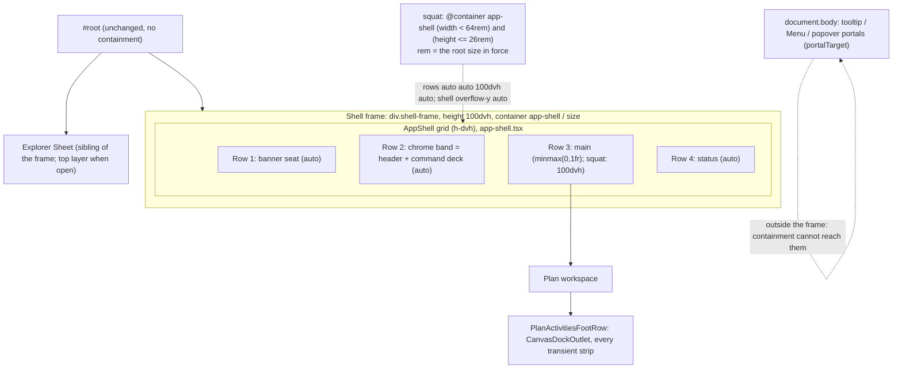
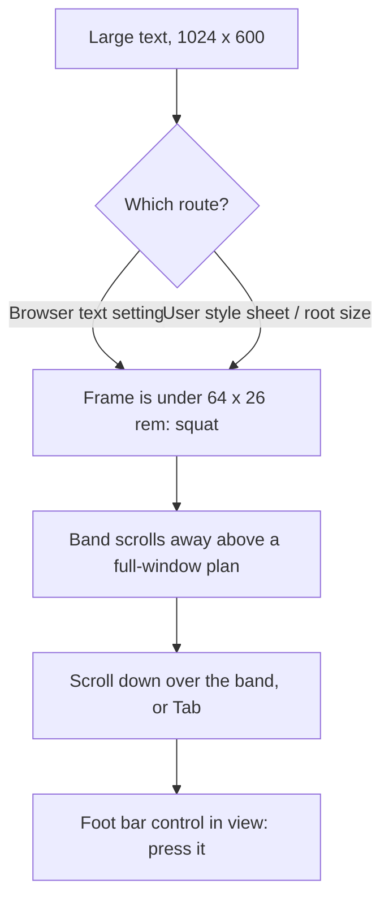

# Feature Spec: The dock stays reachable under large text at the floor

- **Status:** Approved 2026-11-07 (product owner; Q1 B — every way of enlarging text; Q2 A — leave an arriving message in place). Remedy revised after M0 (2026-11-07, ui-architect): R2, `squat` answered by the shell's own frame, replaces R1. The product decisions are unchanged.
- **Author(s):** Claude Code (feature-analyst; §4.6–§4.9 revised by ui-architect after M0), for James Ewbank (product owner)
- **Date:** 2026-11-07
- **Tracking issue / epic:** `docs/TECH_DEBT.md` #569 ("At text-only 200 % in a 1024 × 600 window the toolbar covers the viewport, so no dock strip can be pressed with a pointer"). The product owner approved building it on 2026-11-07.
- **Roadmap link:** none. A register row the product owner chose to build.
- **Related ADR(s):** ADR-0185 D5 (the `squat` variant; **amended** by ADR-0213), ADR-0179 (1024 × 600 floor; 1.4.4 and 1.4.10 still hold), ADR-0180 (panel takes the body), ADR-0092 (canvas dock, vertical budget; **not** amended any more, see §4.8), ADR-0189, ADR-0109, ADR-0114, ADR-0115, ADR-0111 (primitive keyboard review), ADR-0113 and ADR-0142 (measure first), ADR-0081 (entry point and journey), ADR-0088 D1 (no flag). **ADR-0213 is proposed**: [`docs/adr/0213-the-shell-asks-its-own-frame-whether-it-is-short.md`](../../adr/0213-the-shell-asks-its-own-frame-whether-it-is-short.md).

Implementation plan: [`implementation-plan.md`](./implementation-plan.md), beside this spec. M0 record: [`m0-measurement.md`](./m0-measurement.md).

**Why this is a full spec and not a register fold.** The remedy changes how the authenticated shell decides to scroll, which every route renders through, and changes a journey's assertion. A layout contract shared by every screen is an ADR-0105 trigger (CLAUDE.md §19.1), and so is the shared gate the journey is. The change adds no schema, no endpoint, no Playwright config and no flag.

---

## 0. What was verified, and what was not

CLAUDE.md §19.11 says the problem statement is re-checked as well as the design. The row's reading holds, but **the row measured with the route this repository has twice ruled is not the one a real text-size setting takes**. M0 (`m0-measurement.md`) then measured both routes.

| Claim                                                            | Status                                 | Evidence (read or run)                                                                                                                                                                                                                                                                                                                                                                                                                                                                             |
| ---------------------------------------------------------------- | -------------------------------------- | -------------------------------------------------------------------------------------------------------------------------------------------------------------------------------------------------------------------------------------------------------------------------------------------------------------------------------------------------------------------------------------------------------------------------------------------------------------------------------------------------- |
| The journey sees every strip probe land on the toolbar at 200 %  | **Holds, under the route it used**     | `apps/web/e2e-toolbar/touch-gestures.spec.ts:234-241` and `:310-314` set `document.documentElement.style.fontSize = '200%'` and call `probeStrip(…, { pointerHit: false })`.                                                                                                                                                                                                                                                                                                                       |
| That route is "text-only 200 %"                                  | **Not the faithful route**             | An inline root size moves `rem` lengths and **not** `rem` media queries. `narrow-shell.spec.ts:1240` and `:1248-1263` use CDP `Page.setFontSizes` instead. `docs/specs/a11y-touch-sweep/m0-measurement.md:112-113`: "The inline-root `200%` is a real configuration only through a user stylesheet … no browser setting produces it."                                                                                                                                                              |
| Under the faithful route the shell already scrolls at 1024 × 600 | **Holds, measured (M0 H1)**            | `m0-measurement.md` result table, H1: fine and coarse, all three views, tip and selection bar, 10/10, 55/55 and 45/45 points self-hit once scrolled into view. `squat` matches; `main` is 600.                                                                                                                                                                                                                                                                                                     |
| Why the inline route covers the dock                             | **Holds, measured (M0 H2)**            | `m0-measurement.md` H2 and Readings §1: media queries answer at 16 px, so `squat` is off and `lg` on; the band is **707 px** fine and **931 px** coarse in a 600 px window, `main` is **0**, and after `scrollIntoView` every probed point is outside the window.                                                                                                                                                                                                                                  |
| "Every dock strip" is affected                                   | **Holds by reading**                   | All transient strips portal into one outlet in the foot row: `canvas-dock.tsx:89-152`, hosted by `PlanActivitiesFootRow` (`activity-bottom-panel.tsx:494-508`). M0 read the touch tip and the selection bar. The armed Add-tool statement **no longer exists** (`TsldPanel.tsx`, "withdrawing three of its six statements"); the one linking statement left is text with no controls, in the same outlet.                                                                                          |
| 1.4.4 holds through the keyboard                                 | **Holds**                              | `tabReachesStrip` (`touch-gestures.spec.ts:127-146`) passes in both tests.                                                                                                                                                                                                                                                                                                                                                                                                                         |
| The guest share view is affected                                 | **No**                                 | `CanvasDockProvider` and `AppShell` are rendered only under `routes/authed-layout.tsx` and the workspace (grep, 9 files).                                                                                                                                                                                                                                                                                                                                                                          |
| The shell already overflows at 100 % on the organisation landing | **New, measured (M0)**                 | `m0-measurement.md` result table and Readings §4: `scrollHeight` 793 px fine / 797 px coarse against `clientHeight` 500–720 in 1024–1408 × ≤ 720 windows, and 833–1098 under 1024 wide. Hidden today by the shell's `overflow-hidden`. This is what disqualifies R1 (§4.8).                                                                                                                                                                                                                        |
| The `position: fixed` 159 × 26 box in two coarse R2 readings     | **A tooltip, not an R2 effect (read)** | `tooltip.tsx:514-531`: the tooltip is `position: fixed`, `text-xs px-2 py-1` with a 1 px border (16 + 8 + 2 = 26 px high), `max-w-64`, portalled by `portalTarget()` (`overlay-position.ts:175-178`) to `document.body` or the topmost open modal `<dialog>`, so **no ancestor in `#root` can be its containing block**. It was open in the R2 reading and closed in the base one (a coarse long-press or focus tooltip). M1 confirms it by attribute (`[data-tooltip]`) in the post-build re-run. |

### Heights on record (M0)

| Reading                                       | Value                                           | Source                          |
| --------------------------------------------- | ----------------------------------------------- | ------------------------------- |
| `main` at 1024 × 600, 100 %                   | 461 fine, 337 coarse                            | `m0-measurement.md` Readings §1 |
| Band at 1024 × 600, inline 200 %              | 707 fine, 931 coarse (`main` 0)                 | same                            |
| Coarse selection bar's foot row, inline 200 % | 667 (Diagram), 571 (Gantt)                      | same                            |
| Smallest non-squat 100 % body                 | 329 fine (320 × 568), 237 coarse (1024 × 500)   | `m0-measurement.md` Readings §4 |
| `main` under R2, inline 200 %, 1024 × 600     | 600 (the window), stage 381 Diagram / 118 Gantt | `m0-measurement.md` Readings §3 |

---

## 1. Business understanding

### Problem

A planner who enlarges text so that the page's root size doubles, in a 1024 × 600 window, cannot press anything in the bar at the foot of the plan with a mouse or a finger. The toolbar grows until it covers that bar. The bar is where the product shows every short-lived message and its buttons: an edit conflict, the selection's actions, the history result, the empty-plan prompt, the Arrange offer and the touch tip. The keyboard still reaches them, so nothing is lost outright, but a pointer user is stuck.

M0 narrowed who that is. A browser's own text-size setting does **not** cause it: the shell already switches to its scrolling form (`squat`) when the text is large for the window. What causes it is enlarging the root size without the browser's media queries following: a user style sheet or extension that sets `html { font-size: 200% }`, and possibly some browsers' text-only zoom, which this repository cannot measure headlessly. The reason is that `squat` is a **media** query, and a `rem` in a media query is the browser's initial 16 px, not the root size in force.

### Users

Every role that opens a plan in the authenticated app: Org Admin, Planner, Contributor and Viewer. External Guests use a different layout and are not affected.

The people who feel it are low-vision users who enlarge text, on a small laptop or an 11-inch tablet.

### Primary use cases

1. A planner with large text sees a conflict banner or the selection's actions at the foot of the plan, and presses one with a mouse or a finger.
2. A touch user with large text dismisses the one-time touch tip with a tap.

### User journeys

The text is large and the window is small. The frame does what it already does at that size under a browser setting: the toolbar is at the top, the plan below it fills the window, and the planner scrolls the frame to bring the plan, with its foot bar, into view. Every foot-bar button is then under their pointer. Tab still reaches them in the same order as today.

### Expected outcomes

- No route to large text leaves the foot bar covered: the frame scrolls instead, the same way under a user style sheet as under the browser's setting.
- The touch-tip journey asserts a real pointer hit at 200 % again, under both text routes.
- `docs/TECH_DEBT.md` #569 closes with readings.

### Success criteria

- **SC-1.** At 1024 × 600, fine and coarse, Diagram (panel collapsed) and Gantt, under CDP 200 % and under inline-root 200 %, every dock-strip control is the topmost element at its centre and four corners **once that control is scrolled into view** (`block: 'nearest'`). The corner inset scales with the root size (4 px per 16 px of root, so 8 px at 32 px). With the panel expanded (ADR-0180's swap) the selection bar is not shown, so only the tip is read there. **Exception, pre-existing and recorded:** on the coarse selection bar the corners of `open-logic` and `clear-visual-placement` meet an `absolute z-10 inset-y-0` span already at 100 % (`m0-measurement.md` Readings §2, 51/55 and 41/45); SC-1 for that strip is "equal to its 100 % reading, and no point covered by anything outside the strip".
- **SC-2.** Under both 200 % routes, nothing scrolls sideways (the existing `probeStrip` overflow walk), and Tab reaches every strip control (`tabReachesStrip`, kept).
- **SC-3.** Under a coarse pointer, strip controls stay at least 44 × 44 px (WCAG 2.5.8, ADR-0118); unchanged by construction, asserted by `probeStrip` as today.
- **SC-4.** At 100 % text the layout is **unchanged**, in M0's sweep (49 cells: widths 1024 to 1912 in 128 px steps at heights 600, 720, 800, 948 and 1097, plus 640 × 480, 640 × 360, 640 × 300, 320 × 720, 320 × 256, 1280 × 520, 1024 × 500, 320 × 568 and 320 × 640), both pointers, plan and organisation landing: the band, `<main>` and foot-row rects equal the base reading **and the shell's computed `overflow-y` equals the base reading in every cell** (it is `hidden` except in squat cells). The guard is on overflow semantics, not only on `scrollHeight == clientHeight`, because base already overflows on the landing and `overflow-hidden` hides it (`m0-measurement.md` correction 3).
- **SC-5.** Under CDP 200 % the layout is unchanged from today.
- **SC-6.** View ▾ still measures at most 420 px at 1024 × 600 (`assertViewPanelFitsTheFloor`), and no overlay moves: the rects of the activity editor `Dialog`, the Explorer `Sheet`, the View ▾ popover, a row `Menu` and a tooltip are equal with and without the shell's size container at 1024 × 600 (and the `Sheet` at 1000 × 600, below `lg`).
- **SC-7.** No keyboard contract changes: same keys, same focus destinations, no change to `Deck`, `Toolbar` or any primitive (ADR-0111).

### Open questions

**Critical (answered by the owner, 2026-11-07):**

- **Q1. How wide the fix reaches.** Answered **B**: guarantee the foot bar for any way of enlarging text.
- **Q2. A message that arrives off-screen.** Answered **A**: leave it in place; it is there when the planner scrolls down, and focus always brings it into view. Filed as `docs/TECH_DEBT.md` **#570** with a trigger (M0 found the foot row below the window at rest in every 200 % state, both routes, as it already is under CDP today).

**Defaults (decided by analyst and ui-architect; the owner need not answer):** listed in §4.8.

---

## 2. Functional requirements

### User stories & acceptance criteria

> **US-1.** As a planner who enlarges text, I want to press the foot bar's buttons with my mouse or finger in a small window, so that large text costs me no function.
>
> - **Given** a 1024 × 600 window and the browser's default font at 32 px (CDP), **when** a dock strip is showing and I scroll a control into view, **then** it is the topmost element at its centre and corners (SC-1).
> - **Given** the same window and an inline root size of 200 %, **when** a dock strip is showing and I scroll a control into view, **then** the same holds (SC-1).
> - **Given** either 200 % route, **when** I press Tab from the plan surface, **then** focus reaches each strip control, and the focused control is not hidden by anything the product draws (WCAG 2.4.11).
> - **Given** 100 % text in any cell of SC-4, **then** the layout is as it is today, including whether the shell can scroll.

> **US-2.** As a touch user with large text, I want to dismiss the touch tip with a tap.
>
> - **Given** the coarse Gantt test at 1024 × 600 under either 200 % route, **when** the tip is up and its controls are scrolled into view, **then** "Dismiss this tip" and "Touch gestures" pass the pointer hit-test.

### Workflows

1. Text is enlarged. The shell's frame (a size container exactly the window) answers `squat` in the root size **in force**: under a browser setting and under a user style sheet alike, 1024 × 600 at a 32 px root is 32 × 18.75 rem, so `squat` matches, row 3 becomes `100dvh` and the shell scrolls.
2. The planner scrolls the frame by wheel or drag over the band, or by Tab. The wheel over the canvas does not scroll the frame (`docs/TECH_DEBT.md` #477, unchanged).
3. The foot bar comes into view; its buttons take pointer presses.

### Edge cases

- **Panel expanded at the floor** (ADR-0180 swap). `main` is 600 under both 200 % routes, under ADR-0180's 611 line, so the swap applies as it does under CDP today. The selection bar is not shown in that state; the tip reads the same as collapsed.
- **Two strips at once** (the outlet wraps, `canvas-dock.tsx:80-87`). The foot row grows inside a 600 px `main`; a strip taller than the body (the coarse selection bar, 571–667 px) is reached control by control, which is what SC-1 asserts.
- **Viewport notice** (ADR-0179). The notice is a `showModal()` dialog, so it is in the top layer and its containing block is the initial containing block whatever the shell's containment. Under either 200 % route a 1024 window is below 64 rem only for the `squat` container; the notice itself still keys on `DESIGNED_MIN_WIDTH_QUERY` (a media query), so under the inline route it does **not** appear. That is today's behaviour and is unchanged.
- **Non-plan routes.** They render through the same frame, so `squat` behaves identically there. At 100 % SC-4 reads the landing; the landing's existing overflow stays hidden because `overflow-y` is unchanged outside squat cells.
- **Wide short windows** (1280 × 520 at 100 %). Not squat (80 rem wide); unchanged, read in SC-4.
- **A root size smaller than 16 px** (a user style sheet shrinking text). The frame answers in the smaller rem, so `squat` matches in fewer windows than today. That is the correct reading (the band shrinks with the text) and no journey runs it.
- **Firefox and Safari text-only zoom.** Not measurable headlessly here. The container query makes the outcome independent of whether a browser's media queries follow the text, which is the reason Q1 = B is met.

### Permissions

No change. No write, endpoint or RBAC rule is touched. The pen (ADR-0028) is not involved. The recalc parity gate does not apply.

### Validation rules

None (no input).

### Error scenarios

| Scenario                                               | Detection                                                                                | User-facing result                                                                       | Status |
| ------------------------------------------------------ | ---------------------------------------------------------------------------------------- | ---------------------------------------------------------------------------------------- | ------ |
| CDP `Page.setFontSizes` silently fails in a run        | Journey asserts root `32px` before measuring                                             | Test fails loudly instead of a green run at 16 px                                        | n/a    |
| The size container is placed on an auto-height element | Its height is 0, so `squat` matches in every window under 64 rem (M0 `r2_literal`)       | Structural test pins `height: 100dvh` in the frame utility; SC-4 re-run catches it       | n/a    |
| A `squat:` class is used outside the frame             | It never matches (no `app-shell` container ancestor)                                     | Structural test lists the files allowed to use `squat:`                                  | n/a    |
| A browser without size container queries               | `squat` never matches, so a narrow-and-short window keeps a held band and clips the body | Outside the supported envelope (container queries: Chromium 105, Safari 16, Firefox 110) | n/a    |

---

## 3. Technical analysis

| Area           | Impact | Notes                                                                                                                                                                                                                              |
| -------------- | ------ | ---------------------------------------------------------------------------------------------------------------------------------------------------------------------------------------------------------------------------------- |
| Frontend       | low    | One wrapper element round the shell grid in `app-shell.tsx`, one `@utility` and the `squat` variant's definition in `globals.css`, one constant in `lib/breakpoints.ts`. No component, primitive or state change, no JS behaviour. |
| Backend        | none   |                                                                                                                                                                                                                                    |
| Database       | none   | No schema change, so no database-architect run.                                                                                                                                                                                    |
| API            | none   |                                                                                                                                                                                                                                    |
| Security       | none   | No input, no auth surface.                                                                                                                                                                                                         |
| Performance    | none   | Size containment on a viewport-sized box can only shorten layout work (its size never depends on content). No observer, no JS.                                                                                                     |
| Infrastructure | none   | No Playwright config or CI step. The M0 harness is re-run, not added to CI (ADR-0081 §3).                                                                                                                                          |
| Observability  | none   |                                                                                                                                                                                                                                    |
| Testing        | med    | Journey change in `touch-gestures.spec.ts`; structural assertions beside `app-shell.test.tsx` and in `breakpoints.test.ts`; the e2e suites in §3.2 re-run; the M0 harness re-run against the built tree.                           |

### 3.1 Dependencies

- None to land first. M0 (PR 1) has the harness and the record.
- Reviewers: **ui-architect** (ADR-0213; done in design, re-run on the diff only if it departs from §4.6), **accessibility-reviewer** (1.4.4, 1.4.10, 2.4.11, 2.5.8), **component-reviewer** (the utility, the variant and the shell class string), **ux-reviewer** (the scrolling form under a user style sheet). No backend reviewers.

### 3.2 The e2e suites the change can affect

The frame wraps the authenticated shell, which every authenticated suite renders through. By construction it changes nothing at 100 % text (SC-4) or under CDP 200 % (SC-5), because there the container condition and the old media condition give the same answer: the container is the window, and `rem` is the same value in both.

**Must run locally before push:**

| Suite (directory)      | Why                                                                                                                                                                                           |
| ---------------------- | --------------------------------------------------------------------------------------------------------------------------------------------------------------------------------------------- |
| `e2e-toolbar`          | `touch-gestures.spec.ts` is the subject; `toolbar.spec.ts` has the explicit 1280 × 520 case.                                                                                                  |
| `e2e-narrow-shell`     | SC-5 "the band is held to 40 % or scrolls away" at 640 × 480 / 360 / 300, 320 × 720 / 256 (this is the squat behaviour itself); SC-7 at CDP 200 % 1280 × 800; the focus-into-band test.       |
| `e2e-workspace-fit`    | `conflict-reason.spec.ts` (inline-root 200 % at 1024 × 600; its docblock at `:231-236` becomes stale), `command-surface.spec.ts`, `floor-states`, `promotion`, `dividers`, `deck-focus-ring`. |
| `e2e-workspace-chrome` | `dock.spec.ts` and `activities-panel-scroll.spec.ts` (small heights).                                                                                                                         |
| `e2e-minimap`          | `viewport-cluster.spec.ts` holds the 120 px stage floor at coarse 1024 × 600 and runs 1024 × 500.                                                                                             |
| `e2e-overview`         | Inline-root 200 % landing cells (`overview.spec.ts:296-309`, `:596-624`): under the inline route the landing now takes the squat form at 1024 wide. Read what they assert before running.     |
| `e2e-swimlanes`        | View ▾ fit at the floor and small-height cells.                                                                                                                                               |
| `e2e-gantt`            | `month-labels.spec.ts` at CDP 200 %.                                                                                                                                                          |
| `e2e-axis-markers`     | `markers.spec.ts` at CDP 200 %.                                                                                                                                                               |
| `e2e-shell`            | Explorer `Sheet` and skip link: the wrapper sits between `#root` and the grid, so the skip link must still be the first focusable element.                                                    |

**Run in CI, unaffected by construction:** every other `apps/web/e2e*/` suite. `e2e-public` does not render the authenticated shell.

---

## 4. Solution design

### 4.1 Architecture overview



### 4.2 Data flow (layout, under an inline 200 % root)

```mermaid
sequenceDiagram
  participant U as User style sheet
  participant B as Browser layout
  participant C as Shell frame (size container)
  participant G as Shell grid
  participant F as Foot row / dock
  U->>B: html font-size 200% (media queries still at 16 px)
  B->>C: frame is 1024 x 600 px = 32 x 18.75 rem at the 32 px root
  C->>G: squat matches (width < 64rem, height <= 26rem)
  G->>G: rows auto auto 100dvh auto, overflow-y auto
  G->>F: main is 600 px; band scrolls away above it
  Note over F: Pointer hits each control once scrolled into view
```

### 4.3 User flow



### 4.4 Database changes

None.

### 4.5 API changes

None.

### 4.6 Component changes (R2, decided after M0)

**The decision.** `squat` stops being a media query and becomes a **named size-container query on a frame that is exactly the window**. A `rem` in a container query resolves against the root element's actual font size, so the shell's scrolling form follows the text the reader has, by whatever route it was enlarged. Nothing else about `squat` changes: same condition, same rows, same scroll, same single consumer.

1. **`apps/web/src/styles/globals.css`.**
   - Add the frame utility beside the other `@utility` rules, with its justification comment:

     ```css
     @utility shell-frame {
       container: app-shell / size;
       height: 100dvh;
     }
     ```

     `height: 100dvh` is load-bearing: size containment makes an auto-height block 0 px high, so without it the query's height is 0 and `squat` matches in every window under 64 rem (M0 `r2_literal`, `m0-measurement.md` correction 4).

   - **Replace** (not coexist with) the `squat` variant:

     ```css
     @custom-variant squat {
       @container app-shell (width < 64rem) and (height <= 26rem) {
         @slot;
       }
     }
     ```

     Use the block form; if the shorthand `@custom-variant squat (@container app-shell …);` is preferred, confirm in the built CSS that Tailwind emits an `@container app-shell` rule, and pin whichever form ships in `breakpoints.test.ts`. Rewrite the variant's comment (`globals.css:38-47`): the height is in rem **of the root in force**, so a browser setting and a user style sheet both land a 1024 × 600 window inside it; it matches only inside `.shell-frame`.

   - **Why replace rather than coexist.** No JS reads the media form (`SQUAT_QUERY` is used only by `breakpoints.test.ts`; grep). Inside the frame the container answer equals the media answer whenever the media `rem` equals the root (100 % text and every browser setting), and differs only when a style sheet moved the root, where the container is the correct one. A coexisting media rule could only re-introduce the wrong answer for a root smaller than 16 px.
2. **`apps/web/src/components/layout/navigator/app-shell.tsx`.** Wrap the shell grid (`:150`) — and nothing else — in `<div className="shell-frame">`. The grid's own class string is **unchanged** (`h-dvh`, `overflow-hidden`, both `squat:` classes). The `Sheet` and every other sibling after the grid stay outside the frame. The skip link stays the grid's first child, so it is still the first focusable element (WCAG 2.4.1). Update the docblock at `:133-149`: `squat` is still the one place the shell scrolls, and it is now answered by the frame in the root size in force (ADR-0213); the source-order note at `:142-146` still holds (variant rules are emitted after base utilities).
3. **Where the container goes, and why not `#root`.** On the dedicated wrapper, never on `#root`. `#root` also hosts the public screens, the auth shell and the guest share view, which scroll the document and which M0 did not sweep; size containment and a fixed height there would change every one of them. The wrapper's effects are confined to the authenticated shell, whose box is already exactly the window (`h-dvh`), so the wrapper adds a box of the same size at the same origin.
4. **`apps/web/src/lib/breakpoints.ts`.** Add `export const SQUAT_CONTAINER = 'app-shell';` and say in `SQUAT_QUERY`'s docblock that it is now a container condition evaluated on the shell frame, not a media query. `breakpoints.test.ts` asserts the stylesheet contains `@container ${SQUAT_CONTAINER} ${SQUAT_QUERY}` and **does not** contain `@custom-variant squat (@media`. The height-bound assertions stay.
5. **Docs in code and in `docs/`.** `Deck.tsx:50-56` (the `squat` scroll-away sentence), `DESIGN_SYSTEM.md:384-388` and `UX_STANDARDS.md:509-512` (state that `squat` is a container query on the shell frame in the root size in force; "at 1024 and up" reads as 64 rem of that root). `narrow-shell.spec.ts:1232`'s `matchMedia` mirror of `squat` stays valid in every cell it runs (100 % text and CDP, where the two agree); add one comment line saying so.
6. **No change** to `CanvasDock`, `CanvasDockOutlet`, `PlanActivitiesFootRow`, `Deck`, `Toolbar`, any primitive, the toolbar registry, promotion (ADR-0185 and ADR-0189 key on media width, unchanged), View ▾, the viewport notice, or any other media variant (`lg`, `short`, `tall`, `xs`, the promotion stages). Those still follow the browser setting and not a user style sheet; converting them is not part of this epic (§4.8).

**What size containment does and does not touch** (the frame applies size, layout and style containment):

| Effect                                                | Consequence here                                                                                                                                                                                                                                                                                                                                   |
| ----------------------------------------------------- | -------------------------------------------------------------------------------------------------------------------------------------------------------------------------------------------------------------------------------------------------------------------------------------------------------------------------------------------------- |
| Intrinsic size ignores content                        | The frame's size is explicit (`100dvh`, block width). Nothing measures the frame's content size; the grid inside is `h-dvh` itself.                                                                                                                                                                                                                |
| Containing block for `position: fixed` descendants    | The frame sits at the window's origin, is exactly the window's size and never scrolls, so a fixed descendant resolves to the same rect. And there are none in normal flow: tooltips, `Menu` and `ToolbarPopover` portal to `document.body` or the topmost open dialog (`overlay-position.ts:175-178`); the perf-probe overlay portals to the body. |
| Modal `<dialog>` (`Dialog`, `Sheet`, viewport notice) | All are `showModal()` (`escape-rungs.ts:4`), so they are in the top layer, whose containing block is the initial containing block whatever an ancestor's containment (CSS Positioned Layout 4, top layer). The `Sheet` is also a sibling of the frame. SC-6 measures all of them.                                                                  |
| Stacking context                                      | The frame becomes one, at `z-index: auto`. Portalled overlays at `z-50` in the body already paint above everything in `#root` by DOM order, so no paint order changes. Nothing inside the shell is meant to cover a body portal.                                                                                                                   |
| Nearer containers                                     | `@container/deck`, `PageGrid` and `StatGrid` are inline-size containers inside the shell; `squat` names `app-shell`, so they cannot intercept it.                                                                                                                                                                                                  |
| Style containment                                     | Scopes counters and quotes only; none cross the frame.                                                                                                                                                                                                                                                                                             |

**Keyboard contract (ADR-0111): unchanged.** No key, no focus destination and no primitive changes. Native focus scrolls the shell to the focused control under `squat`, as it does today. Accessibility-reviewer still runs at review.

**WCAG 2.2 AA.**

- 1.4.4: pointer function at 200 % is restored under both routes.
- 1.4.10: no horizontal scroll is introduced (no overflow-x change; `probeStrip` walks every ancestor).
- 2.4.11: nothing sticky or overlaid is added.
- 2.5.8: control sizes are unchanged.

**Journey.** `touch-gestures.spec.ts`:

- The 200 % branch uses CDP `Page.setFontSizes` (attached session, root asserted `32px`, viewport notice acknowledged), as `narrow-shell.spec.ts:1248-1263` does.
- A second 200 % cell keeps the inline-root route as ADR-0213's guard, and also asserts the shell's computed `overflow-y` is `auto` there (the frame answered `squat`).
- `probeStrip` scrolls **each control** into view (`block: 'nearest'`) and waits one frame before its hit-test; it records the at-rest foot-row top (ADR-0142).
- The corner inset is `4 × rootPx / 16` (8 px at a 32 px root), read from `getComputedStyle(document.documentElement).fontSize`. A fixed 4 px lies outside the controls' rem-sized corner radius at a 32 px root and reports a false cover (`m0-measurement.md` correction 6).
- The `pointerHit` option is removed, so the pointer hit-test runs in every cell.
- `tabReachesStrip` stays in every 200 % cell.
- The docblock's #569 sentence is deleted.

`conflict-reason.spec.ts:231-236`'s claim that "the 200 % command band takes the whole 1024 x 600 window" is corrected: under the inline route the band now scrolls away above a full-window body.

### 4.7 ADR-0213 (Proposed)

Drafted at [`docs/adr/0213-the-shell-asks-its-own-frame-whether-it-is-short.md`](../../adr/0213-the-shell-asks-its-own-frame-whether-it-is-short.md). In outline:

**ADR-0213: The shell asks its own frame whether it is short, in the text the reader has.**

- **Status:** Proposed. **Amends** ADR-0185 D5 (how `squat` is measured: on the shell frame, in the root size in force, not by a media query). **Builds on** ADR-0179 (1.4.4 still holds below the floor), ADR-0114 (the band is never asked to scroll inside itself), ADR-0115 (a bound governs what it encloses: the question is asked of the box the rows divide), ADR-0113/0142 (measured first), ADR-0088 D1 (no flag). **Does not amend** ADR-0092: no floor is added to the body.
- **Context:** #569; M0's readings for both routes; R1's exposure of the landing's hidden overflow.
- **Decision:** D1, the shell grid sits in a frame that is a named size container (`app-shell`) exactly the window high. D2, `squat` is a container query on that frame, replacing the media query. D3, the container is the frame, never `#root`. D4, `squat:` is used only inside the frame, pinned by a structural test. D5, no other media variant is converted by this decision.
- **Alternatives:** R1 (a floor on row 3 and a scrolling shell); R1 plus fixing the landing overflow; a band that scrolls inside itself; the dock pinned to the window; the container on `#root`; coexisting media and container `squat`; A (test and register only).
- **Consequences:** both text routes take the same scrolling form; the landing's existing overflow stays hidden at 100 %; a new `squat:` consumer must live in the frame; the remaining media variants still answer at the browser's initial size under a user style sheet.

### 4.8 Approach and alternatives

**Chosen: R2, `squat` as a container query on a sized shell frame.** It removes the cause rather than adding a second guard: the scrolling form exists for exactly this situation and failed only because a media query cannot see a root size set by a style sheet. M0 shows it is equal to base at 100 % in every fine cell and every coarse cell except two readings that differ by a tooltip portalled outside the frame, equal to base under CDP 200 %, gives `main` = 600 under inline 200 %, reaches every control including the coarse selection bar, and keeps the shell's `overflow-hidden` at 100 %.

**Alternatives considered:**

| Option                                                                           | Why not                                                                                                                                                                                                                                                                                                                                                                                                                                                                                                                             |
| -------------------------------------------------------------------------------- | ----------------------------------------------------------------------------------------------------------------------------------------------------------------------------------------------------------------------------------------------------------------------------------------------------------------------------------------------------------------------------------------------------------------------------------------------------------------------------------------------------------------------------------- |
| **R1: row 3 keeps `minmax(min(100dvh, 12rem), 1fr)` and the shell scrolls on y** | Passes the rect sweep at 12 rem (15 rem fails at coarse 1024 × 500, body 237 < 240). But changing the shell to `overflow-y: auto` exposes the organisation landing's existing overflow (793–797 px against 500–720, and up to 1098 under 1024 wide) as a classic scrollbar on Windows at 100 % text, which SC-4 forbids. It also leaves 12 of the coarse selection bar's 55 points below the window when the strip is scrolled as a whole, because the strip (667 px) is taller than R1's 384 px body. And it would amend ADR-0092. |
| **R1 plus a fix to the landing's overflow**                                      | Two changes, one of them to a screen outside this epic, to reach a result R2 reaches with none; the coarse residual stays. The landing's hidden overflow is a separate finding; with R2 it stays exactly as hidden as today and is not made worse.                                                                                                                                                                                                                                                                                  |
| **The container on `#root`**                                                     | M0's R2 reading put it on the shell's parent. On `#root` it would also contain the public screens, auth shell and guest view, which scroll the document and were not swept. The dedicated frame gives the same shell geometry with none of that reach.                                                                                                                                                                                                                                                                              |
| **Media and container `squat` coexisting**                                       | Redundant wherever they agree; where they disagree (a style-sheet root under 16 px) the media answer is the wrong one. Two definitions of one variant also double what `breakpoints.test.ts` must pin.                                                                                                                                                                                                                                                                                                                              |
| **Toolbar yields:** the band gets a max height and scrolls inside itself         | A vertical scroller inside the deck, with its clip and focus-ring rules and portalled anchors: nested scrolling on touch and an ADR-0111 review. Against ADR-0114.                                                                                                                                                                                                                                                                                                                                                                  |
| **Dock lifts (C):** the foot row is sticky at the window's bottom                | Overlays the scene or the band and creates a 2.4.11 risk; at 200 % the coarse selection bar alone is taller than the window.                                                                                                                                                                                                                                                                                                                                                                                                        |
| **Convert every rem media variant to container queries**                         | Each (`lg`, `short`, `tall`, `xs`, promotion stages) has its own consumers outside the shell and its own sweep. Only `squat` decides whether the foot bar is reachable; the rest change density, not reach. Out of scope; ADR-0213 D5 records it.                                                                                                                                                                                                                                                                                   |
| **A (test and register only)**                                                   | Rejected by the owner (Q1 = B).                                                                                                                                                                                                                                                                                                                                                                                                                                                                                                     |
| A `VITE_*` flag                                                                  | Withdrawn by ADR-0088 D1. The rollback is the commit.                                                                                                                                                                                                                                                                                                                                                                                                                                                                               |

**Decided by analyst and ui-architect** (engineering defaults; the owner need not answer):

1. The faithful 200 % route is CDP `Page.setFontSizes`. The inline route is kept as ADR-0213's guard.
2. Pointer reach means "once that control is scrolled into view" (`m0-measurement.md` correction 8).
3. The container is a dedicated frame inside `AppShell`, named `app-shell`, `height: 100dvh`; `squat` is replaced, not duplicated.
4. No floor on row 3, no change to the shell's overflow classes.
5. No flag (ADR-0088 D1). Entry point: none new. The surface is the existing foot bar, reached from any plan, and the journey drives it (ADR-0081).
6. Two PRs: M0 (measure), then M1 (build).
7. Register rows: **#570**, "A strip that arrives while the frame is scrolled to the band lands below the window" (Q2 = A; filed by M0, renumbered from #572). No row for the inline route (Q1 = B). The coarse selection bar's pre-existing corner cover (SC-1 exception) is recorded in #569's closing note and filed as a new row only if the orchestrator confirms the next free number.
8. Nothing requires the owner to test on a device.

### 4.9 Risks

| Risk                                                                                              | Likelihood | Impact | Mitigation                                                                                                                                          |
| ------------------------------------------------------------------------------------------------- | ---------- | ------ | --------------------------------------------------------------------------------------------------------------------------------------------------- |
| The frame loses its height (a refactor drops `100dvh`), so `squat` matches in every narrow window | low        | high   | Structural test on the utility's declarations; `e2e-narrow-shell` SC-5 (640 × 480 must keep a held band)                                            |
| A top-layer dialog or portalled overlay moves under containment                                   | low        | med    | Read by spec (top layer → initial containing block; portals outside the frame); measured in T1.1 step 6 (SC-6)                                      |
| `squat:` used outside the frame never matches                                                     | low        | med    | Structural test: the set of files using `squat:` is `app-shell.tsx` only, so a new consumer is a decision                                           |
| Tailwind emits the block-form variant differently from expected                                   | low        | med    | Read the built CSS; `breakpoints.test.ts` pins the source; `e2e-narrow-shell` guards behaviour                                                      |
| Inline-root 200 % landing journeys (`e2e-overview`) asserted the old held-band geometry           | med        | low    | Run locally; if a cell asserted the band held at 1024 × 600 under the inline route, update it with the reason (the frame now answers `squat` there) |
| Firefox/Safari evaluate `rem` in container queries differently                                    | low        | med    | Spec-defined (root element's font size); Chromium-first e2e (CLAUDE.md §17); the CDP route is unchanged either way                                  |
| The landing's existing 100 % overflow, still hidden                                               | n/a        | low    | Unchanged by R2; noted in #569's closing note as a separate finding                                                                                 |

---

## 5. Links

- Implementation plan: [`./implementation-plan.md`](./implementation-plan.md)
- M0 record: [`./m0-measurement.md`](./m0-measurement.md)
- Related docs updated by this change: `docs/TECH_DEBT.md` (#569 closed), `docs/adr/0213-the-shell-asks-its-own-frame-whether-it-is-short.md` and its CLAUDE.md §16 line, ADR-0185's header ("D5 amended by ADR-0213"), `DESIGN_SYSTEM.md` and `UX_STANDARDS.md` `squat` paragraphs, `app-shell.tsx`, `Deck.tsx`, `globals.css` and `breakpoints.ts` docblocks, `conflict-reason.spec.ts` and `narrow-shell.spec.ts` comments.
