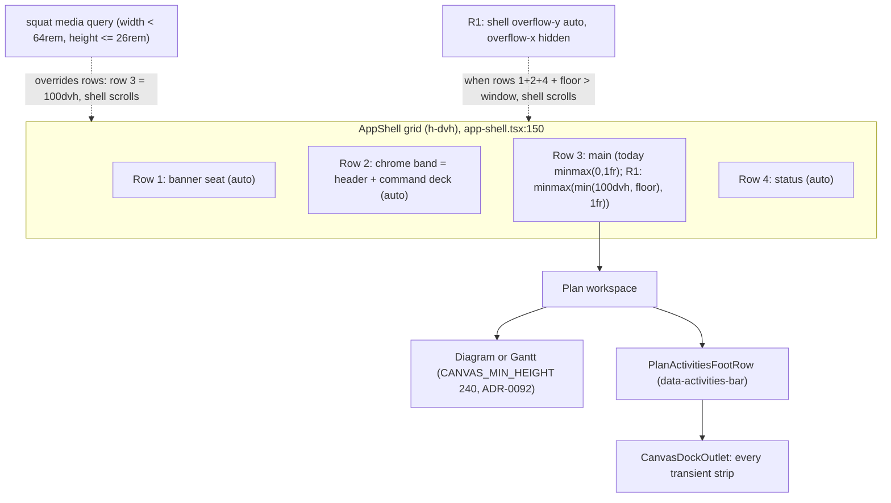
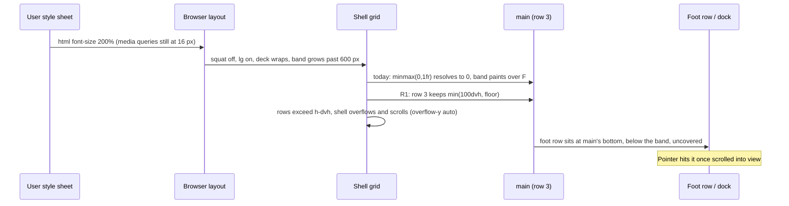
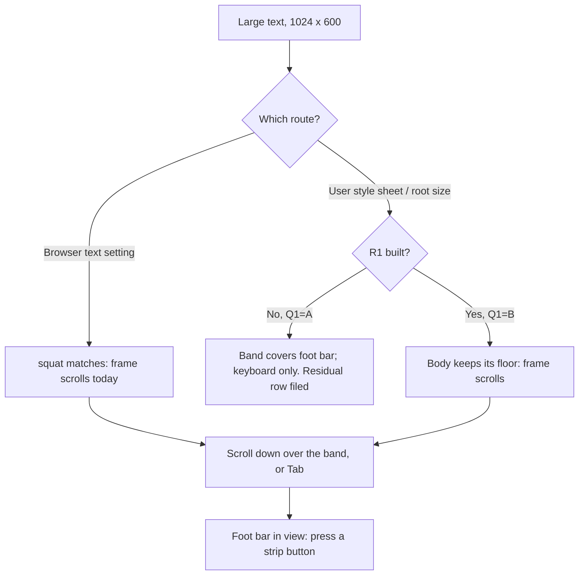

# Feature Spec: The dock stays reachable under large text at the floor

- **Status:** Approved 2026-11-07 (product owner; Q1 B — every way of enlarging text; Q2 A — leave an arriving message in place)
- **Author(s):** Claude Code (feature-analyst), for James Ewbank (product owner)
- **Date:** 2026-11-07
- **Tracking issue / epic:** `docs/TECH_DEBT.md` #569 ("At text-only 200 % in a 1024 × 600 window the toolbar covers the viewport, so no dock strip can be pressed with a pointer"). The product owner approved building it on 2026-11-07.
- **Roadmap link:** none. A register row the product owner chose to build.
- **Related ADR(s):** ADR-0092 (canvas dock, vertical budget), ADR-0180 (panel takes the body), ADR-0179 (1024 × 600 floor; 1.4.4 and 1.4.10 still hold), ADR-0185 and ADR-0189 (toolbar promotes what fits), ADR-0109, ADR-0114, ADR-0115, ADR-0091 D3, ADR-0111 (primitive keyboard review), ADR-0113 and ADR-0142 (measure first), ADR-0081 (entry point and journey), ADR-0088 D1 (no flag). **ADR-0213 is proposed** (outline in §4.7), and only if Q1 is answered B.

Implementation plan: [`implementation-plan.md`](./implementation-plan.md), beside this spec.

**Why this is a full spec and not a register fold.** The remedy changes the authenticated shell's scroll rule, which every route renders through, and changes a journey's assertion. A layout contract shared by every screen is an ADR-0105 trigger (CLAUDE.md §19.1), and so is the shared gate the journey is. The change adds no schema, no endpoint, no Playwright config and no flag.

---

## 0. What was verified, and what was not

CLAUDE.md §19.11 says the problem statement is re-checked as well as the design. The row's reading holds, but **the row measured with the route this repository has twice ruled is not the one a real text-size setting takes**. That changes the design.

| Claim                                                            | Status                                    | Evidence (read, not inferred)                                                                                                                                                                                                                                                                                                                                                                                                                                                                                                                                                                                         |
| ---------------------------------------------------------------- | ----------------------------------------- | --------------------------------------------------------------------------------------------------------------------------------------------------------------------------------------------------------------------------------------------------------------------------------------------------------------------------------------------------------------------------------------------------------------------------------------------------------------------------------------------------------------------------------------------------------------------------------------------------------------------- |
| The journey sees every strip probe land on the toolbar at 200 %  | **Holds, under the route it used**        | `apps/web/e2e-toolbar/touch-gestures.spec.ts:234-241` and `:310-314` set `document.documentElement.style.fontSize = '200%'` and call `probeStrip(…, { pointerHit: false })`. The row's Verified field says the same.                                                                                                                                                                                                                                                                                                                                                                                                  |
| That route is "text-only 200 %"                                  | **Not the faithful route**                | An inline root size moves `rem` lengths and **not** `rem` media queries. `narrow-shell.spec.ts:1240` ("so rem media queries answer (a CSS `html { font-size }` would not)") and `:1248-1263` use CDP `Page.setFontSizes` instead. `docs/specs/a11y-touch-sweep/m0-measurement.md:112-113`: "The inline-root `200%` is a real configuration only through a user stylesheet … no browser setting produces it." `docs/specs/selection-bar-fit/m0-measurement.md:40-50`: at 1024 × 600 under CDP, "0 / 0" controls outside or obscured in the foot row, fine and coarse; under the inline route, "all (vertical, below)". |
| Under the faithful route the shell already scrolls at 1024 × 600 | **Holds by reading; not run here**        | `globals.css:48` `@custom-variant squat (@media (width < 64rem) and (height <= 26rem))`. At a 32 px default font, 1024 × 600 is 32 × 18.75 rem, inside it. `app-shell.tsx:150` then sets `squat:grid-rows-[auto_auto_100dvh_auto] squat:overflow-y-auto`: the band scrolls away above a full-viewport `<main>` (`:133-140`).                                                                                                                                                                                                                                                                                          |
| Why the inline route covers the dock                             | **Mechanism read, geometry not measured** | Media queries answer at 16 px, so `squat` is off and `lg` is on. The deck wraps (`Deck.tsx:45-48`) with doubled text, the band grows past the window, and row 3 is `minmax(0,1fr)` (`app-shell.tsx:150`) inside an `h-dvh overflow-hidden` grid, so the body resolves to zero and the foot row sits under the band. How tall the band is there was never recorded.                                                                                                                                                                                                                                                    |
| "Every dock strip" is affected                                   | **Holds by reading**                      | All transient strips portal into one outlet in the foot row: `canvas-dock.tsx:89-152`, hosted by `PlanActivitiesFootRow` (`activity-bottom-panel.tsx:494-508`). Geometry is the outlet's, so one strip per outlet state is a fair sample.                                                                                                                                                                                                                                                                                                                                                                             |
| 1.4.4 holds through the keyboard                                 | **Holds**                                 | `tabReachesStrip` (`touch-gestures.spec.ts:127-146`) passes in both tests.                                                                                                                                                                                                                                                                                                                                                                                                                                                                                                                                            |
| The guest share view is affected                                 | **No**                                    | `CanvasDockProvider` and `AppShell` are rendered only under `routes/authed-layout.tsx` and the workspace (grep, 9 files). The guest view has its own layout.                                                                                                                                                                                                                                                                                                                                                                                                                                                          |

**No browser was run for this spec** (the analyst has no shell). The numbers below are cited from earlier records. M0 takes the ones that are missing before anything is built (ADR-0113, ADR-0142).

### Heights already on record

| Reading                                          | Value                            | Source                                                                               |
| ------------------------------------------------ | -------------------------------- | ------------------------------------------------------------------------------------ |
| Workspace body at 1024 × 600, 100 % text         | 365 px fine, 329 px coarse       | ADR-0180 Context                                                                     |
| So header + band + status at that cell           | about 235 px fine, 271 px coarse | 600 minus the above                                                                  |
| Header at 1024 × 600 under CDP 200 %             | 176 px, 3 lines, `lg` off        | `a11y-touch-sweep/m0-measurement.md` §4 table                                        |
| Foot row with a selection bar, 1024 × 600, 100 % | 107 to 227 px (2 to 5 lines)     | `selection-bar-fit/m0-measurement.md` #485 table                                     |
| Diagram's own minimum                            | 240 px (`CANVAS_MIN_HEIGHT`)     | `use-activity-panel-prefs.ts:56`                                                     |
| Stage floor a journey holds at the coarse floor  | 120 px                           | `e2e-minimap/viewport-cluster.spec.ts`, cited at `activity-bottom-panel.tsx:544-547` |

### Heights that are missing, and that M0 must take

At 1024 × 600, fine and coarse, Diagram (panel collapsed), Diagram (panel expanded, which is ADR-0180's body swap) and Gantt, under **three text states**: 100 %, CDP 200 %, inline-root 200 %:

1. Header, band, status row and `<main>` heights; the foot row's height with no strip and with a strip.
2. The shell's `scrollHeight` and `clientHeight`, its `scrollTop` at rest, and the foot row's top relative to the window at rest.
3. Whether `squat` and `lg` match, and the root's computed font size (asserted 32 px for both 200 % states).
4. For three strips (the touch tip, the selection bar, the armed Add-tool statement), the `elementFromPoint` result at the centre and four corners of each control, **at rest and after `scrollIntoView({ block: 'nearest' })` on the strip**.
5. The candidate remedy (§4.6, R1) injected as a style, under all three text states, with readings 1 to 4 repeated.
6. The smallest 100 % body across the 100 % sweep (§2 SC-4), to set R1's floor with a stated margin.

---

## 1. Business understanding

### Problem

A planner who enlarges text so that the page's root size doubles, in a 1024 × 600 window, cannot press anything in the bar at the foot of the plan with a mouse or a finger. The toolbar grows until it covers that bar. The bar is where the product shows every short-lived message and its buttons: an edit conflict, the selection's actions, the armed tool, the history result, the empty-plan prompt, the Arrange offer and the touch tip. The keyboard still reaches them, so nothing is lost outright, but a pointer user is stuck.

The record above narrows who that is. A browser's own text-size setting probably does **not** cause it, because the shell already switches to a scrolling form when the text is large for the window. What causes it is enlarging the root size without the browser's media queries following: a user style sheet or extension that sets `html { font-size: 200% }`, and possibly some browsers' text-only zoom, which this repository cannot measure headlessly. M0 confirms the first half of that before anything is built.

### Users

Every role that opens a plan in the authenticated app: Org Admin, Planner, Contributor and Viewer. The strips carry write actions only where the role and the pen allow them, which is unchanged. External Guests use a different layout and are not affected.

The people who feel it are low-vision users who enlarge text, on a small laptop or an 11-inch tablet.

### Primary use cases

1. A planner with large text sees a conflict banner or the selection's actions at the foot of the plan, and presses one with a mouse or a finger.
2. A touch user with large text dismisses the one-time touch tip with a tap.

### User journeys

The text is large and the window is small. The frame does what it already does at that size under a browser setting: the toolbar is at the top, the plan is below it, and the planner scrolls the frame to bring the plan, with its foot bar, fully into view. Every foot-bar button is then under their pointer. Tab still reaches them in the same order as today.

### Expected outcomes

- No route to large text leaves the foot bar covered: the frame scrolls instead.
- The touch-tip journey asserts a real pointer hit at 200 % again, under both text routes.
- `docs/TECH_DEBT.md` #569 closes with readings.

### Success criteria

- **SC-1.** At 1024 × 600, fine and coarse, Diagram and Gantt, under CDP 200 % and under inline-root 200 %, every dock-strip control is the topmost element at its centre and four corners once the strip is scrolled into view.
- **SC-2.** Under both 200 % routes, nothing scrolls sideways (the existing `probeStrip` overflow walk), and Tab reaches every strip control (`tabReachesStrip`, kept).
- **SC-3.** Under a coarse pointer, strip controls stay at least 44 × 44 px (WCAG 2.5.8, ADR-0118); unchanged by construction, asserted by `probeStrip` as today.
- **SC-4.** At 100 % text the layout is **unchanged**: in M0's sweep (widths 1024 to 1912 in 128 px steps at heights 600, 720, 800, 948 and 1097, plus every 100 % cell an existing journey runs: 640 × 480, 640 × 360, 640 × 300, 320 × 720, 320 × 256, 1280 × 520), both pointers, the band, `<main>` and foot-row rects equal the base reading, and the shell's `scrollHeight` equals its `clientHeight` wherever it did before.
- **SC-5.** Under CDP 200 % the layout is unchanged from today (`squat` still governs it).
- **SC-6.** View ▾ still measures at most 420 px at 1024 × 600 (`assertViewPanelFitsTheFloor`); unchanged by construction, since the panel is portalled and the run is at 100 % text.
- **SC-7.** No keyboard contract changes: same keys, same focus destinations, no change to `Deck`, `Toolbar` or any primitive (ADR-0111).

### Open questions

**Critical (the owner decides):**

- **Q1. How wide the fix reaches.** (A) Fix what a browser's own text setting does, which M0 is expected to show is already fine, so the change is to the test and the register only. (B) Also guarantee the foot bar for any way of enlarging text, with a one-line change to the frame that M0 shows changes nothing at normal text size. (C) Pin the foot bar to the bottom of the window whenever text is large. **Recommended: B.**
- **Q2. A message that arrives off-screen.** In the scrolling form, if the planner has scrolled up to the toolbar, a new message at the foot lands below the window. (A) Leave it: it is there when they scroll down, and focus always brings it into view. (B) Scroll the page down to it when it appears. **Recommended: A.**

**Defaults (decided by analyst; the owner need not answer):** listed in §4.8.

---

## 2. Functional requirements

### User stories & acceptance criteria

> **US-1.** As a planner who enlarges text, I want to press the foot bar's buttons with my mouse or finger in a small window, so that large text costs me no function.
>
> - **Given** a 1024 × 600 window and the browser's default font at 32 px (CDP), **when** a dock strip is showing and I scroll it into view, **then** each of its controls is the topmost element at its centre and corners (SC-1).
> - **Given** the same window and an inline root size of 200 % (Q1 = B only), **when** a dock strip is showing and I scroll it into view, **then** the same holds (SC-1).
> - **Given** either 200 % route, **when** I press Tab from the plan surface, **then** focus reaches each strip control, and the focused control is not hidden by anything the product draws (WCAG 2.4.11).
> - **Given** 100 % text in any cell of SC-4, **then** the layout is as it is today.

> **US-2.** As a touch user with large text, I want to dismiss the touch tip with a tap.
>
> - **Given** the coarse Gantt test at 1024 × 600 under either 200 % route, **when** the tip is up and scrolled into view, **then** "Dismiss this tip" and "Touch gestures" pass the pointer hit-test.

### Workflows

1. Text is enlarged. Under a browser setting, `squat` matches and the frame scrolls (today). Under an inline root size, with R1 (Q1 = B), the body cannot shrink below its floor, so the frame overflows and scrolls.
2. The planner scrolls the frame by wheel or drag over the band, or by Tab. The wheel over the canvas does not scroll the frame (`docs/TECH_DEBT.md` #477, unchanged).
3. The foot bar comes into view; its buttons take pointer presses.

### Edge cases

- **Panel expanded at the floor** (ADR-0180 swap). The outlet moves into the panel header. M0 reads it; R1 applies the same way, since the floor is on row 3, not on the diagram.
- **Two strips at once** (the outlet wraps, `canvas-dock.tsx:80-87`). The foot row grows. R1's floor is on `<main>`, so the extra lines come out of the stage, as today.
- **Viewport notice** (ADR-0179). Under CDP 200 % a 1024 window is 32 rem, below the designed width, so the notice appears and is acknowledged first (the `acknowledgeViewportNotice` fixture `narrow-shell.spec.ts` uses). With the notice up, the banner row adds height. R1 still holds because row 1 is `auto`.
- **Non-plan routes.** Row 2 is empty there and the rows are short, so the floor never binds at 100 %. Under an inline 200 % root it can bind on a tall page header; the page then scrolls in the frame rather than in `<main>`, which is correct.
- **Wide short windows** (1280 × 520 at 100 %, `e2e-toolbar`). SC-4 reads them; R1's floor value is chosen so it does not bind there.
- **Firefox and Safari text-only zoom.** Not measurable headlessly here. R1 makes the outcome independent of whether a browser's media queries follow the text, which is the reason to prefer B.

### Permissions

No change. No write, endpoint or RBAC rule is touched. The pen (ADR-0028) is not involved: nothing here is a plan write. The recalc parity gate does not apply: no scheduling input is added.

### Validation rules

None (no input).

### Error scenarios

| Scenario                                                                      | Detection                                    | User-facing result                                                                              | Status |
| ----------------------------------------------------------------------------- | -------------------------------------------- | ----------------------------------------------------------------------------------------------- | ------ |
| CDP `Page.setFontSizes` silently fails in a run                               | Journey asserts root `32px` before measuring | Test fails loudly instead of a green run at 16 px (pattern from `command-surface.spec.ts:1912`) | n/a    |
| R1's floor binds at 100 % in a cell a journey asserts as "held"               | M0 SC-4 sweep; the narrow-shell SC-5 journey | Stop; choose a smaller floor (implementation plan M0 decision rule)                             | n/a    |
| Windows classic scrollbar appears at 100 % because the shell overflows by 1px | SC-4 asserts `scrollHeight == clientHeight`  | Stop; a 1px overflow would steal about 17 px of width on the owner's Windows machines           | n/a    |

---

## 3. Technical analysis

| Area           | Impact             | Notes                                                                                                                                    |
| -------------- | ------------------ | ---------------------------------------------------------------------------------------------------------------------------------------- |
| Frontend       | low (B) / none (A) | B: one class change on the shell grid in `app-shell.tsx:150`, plus a named token for the floor. No component, primitive or state change. |
| Backend        | none               |                                                                                                                                          |
| Database       | none               | No schema change, so no database-architect run.                                                                                          |
| API            | none               |                                                                                                                                          |
| Security       | none               | No input, no auth surface.                                                                                                               |
| Performance    | none               | No JS, no observer. One `minmax()` track. The canvas is sized by its own `ResizeObserver`, which already handles any body height.        |
| Infrastructure | none               | No Playwright config or CI step; the M0 harness goes in `apps/web/measure-toolbar/`, which is not in CI (ADR-0081 §3).                   |
| Observability  | none               |                                                                                                                                          |
| Testing        | med                | Journey change in `touch-gestures.spec.ts`; a structural assertion beside `app-shell.test.tsx`; the e2e suites in §3.2 re-run.           |

### 3.1 Dependencies

- None to land first. The long-press-hint epic (which added the journey) has shipped.
- Reviewers: **ui-architect** (the shell scroll rule and ADR-0213), **accessibility-reviewer** (1.4.4, 1.4.10, 2.4.11, 2.5.8), **component-reviewer** (the token and the shell class string), **ux-reviewer** (the scrolling form at large text). No database-architect, api-reviewer, security-reviewer or backend-performance-reviewer: nothing in their scope changes.

### 3.2 The e2e suites the change can affect

R1 changes the authenticated shell, which every authenticated suite renders through. By construction it changes nothing where the floor does not bind, which at 100 % is every cell SC-4 reads. The suites split as follows.

**Must run locally before push (they assert geometry at the floor, at small heights, or at 200 %):**

| Suite (directory)      | Why                                                                                                                                                                                                                                                     |
| ---------------------- | ------------------------------------------------------------------------------------------------------------------------------------------------------------------------------------------------------------------------------------------------------- |
| `e2e-toolbar`          | `touch-gestures.spec.ts` is the subject; `toolbar.spec.ts` has the explicit 1280 × 520 case.                                                                                                                                                            |
| `e2e-narrow-shell`     | SC-5 "the band is held to 40 % or scrolls away" at 640 × 480 / 360 / 300, 320 × 720 / 256; SC-7 at CDP 200 % 1280 × 800; the selection bar at 320 and 640.                                                                                              |
| `e2e-workspace-fit`    | `conflict-reason.spec.ts` (inline-root 200 % at 1024 × 600; its docblock at `:231-236` becomes stale under B), `command-surface.spec.ts` (View ▾ ≤ 420, CDP 200 % at 2560), `floor-states`, `promotion` (CDP 200 % E-2), `dividers`, `deck-focus-ring`. |
| `e2e-workspace-chrome` | `dock.spec.ts` (a docked strip costs the canvas nothing, as a delta) and `activities-panel-scroll.spec.ts` (small heights).                                                                                                                             |
| `e2e-minimap`          | `viewport-cluster.spec.ts` holds the 120 px stage floor at the coarse 1024 × 600.                                                                                                                                                                       |
| `e2e-overview`         | Inline-root 200 % landing cells (`overview.spec.ts:296-309`, `:596-624`).                                                                                                                                                                               |
| `e2e-swimlanes`        | View ▾ fit at the floor (`swimlanes-by-hand.spec.ts:598`) and small-height cells.                                                                                                                                                                       |
| `e2e-gantt`            | `month-labels.spec.ts` at CDP 200 % (unchanged by SC-5, run to prove it).                                                                                                                                                                               |
| `e2e-axis-markers`     | `markers.spec.ts` at CDP 200 % (same reason).                                                                                                                                                                                                           |

**Run in CI, unaffected by construction** (they run at 1280 × 800 or larger at 100 % text, where SC-4 shows the floor does not bind): every other `apps/web/e2e*/` suite, including `e2e-audit` (`rail-1024.spec.ts`), `e2e-staff`, `e2e-netpoint-grammar` (`nodes.spec.ts` has a short cell; SC-4 must include it if it is under 600 high), `e2e-gantt-editing`, `e2e-page-composition`, `e2e-shell` and the base `e2e`. `e2e-public` does not render the authenticated shell.

Under Q1 = A, only `e2e-toolbar` changes, and only `e2e-toolbar` and `e2e-workspace-fit` need a local run.

---

## 4. Solution design

### 4.1 Architecture overview

### 4.2 Data flow (layout, under an inline 200 % root, with R1)

### 4.3 User flow

### 4.4 Database changes

None.

### 4.5 API changes

None.

### 4.6 Component changes (Q1 = B)

- **`apps/web/src/components/layout/navigator/app-shell.tsx:150`.** Row 3 changes from `minmax(0,1fr)` to `minmax(min(100dvh, <floor>), 1fr)`, and the shell takes `overflow-x-hidden overflow-y-auto` in place of `overflow-hidden`. `squat:` keeps overriding the rows with `100dvh`, so the CDP route is unchanged (SC-5). The x-axis stays hidden so nothing that was clipped sideways becomes a horizontal scrollbar. The y-axis scrolls only when the rows really exceed the window, which by SC-4 is never at 100 % in any cell read.
- **The floor is a named token**, not an arbitrary value (the sizing ratchet in `token-architecture.test.ts`). The candidate is **15 rem**, which is `CANVAS_MIN_HEIGHT` (240 px) in rem, so the body is never smaller than the diagram's own declared minimum and grows with text (ADR-0151: a constant carries its justification). M0 confirms it or picks 12 rem; see the decision rule in the plan. The arithmetic so far: 240 px at 100 % is 89 px under the smallest recorded body at the floor (329 coarse), and 480 px at 200 % leaves the stage about 480 minus the foot row's height.
- **Docs in code.** Update the shell's docblock (`app-shell.tsx:133-149`: "squat is the one place the shell scrolls" becomes two cases) and `Deck.tsx:50-56` (its sentence on the way back to a band that scrolled away covers both).
- **No change** to `CanvasDock`, `CanvasDockOutlet`, `PlanActivitiesFootRow`, `Deck`, `Toolbar`, any primitive, the toolbar registry, promotion (ADR-0185 and ADR-0189 are keyed on width, and R1 changes no width) or View ▾.

**Keyboard contract (ADR-0111): unchanged.** No key, no focus destination and no primitive changes. Native focus scrolls the shell to the focused control; the deck's own focus handling (`Deck.tsx:292`, `:309-317`) either scrolls into view or relies on native focus scrolling, which reaches the shell scroller as it does in `squat` today. Accessibility-reviewer still runs at review, as for any layout change.

**WCAG 2.2 AA.**

- 1.4.4: pointer function at 200 % is restored under both routes.
- 1.4.10: no horizontal scroll is introduced (x stays hidden; `probeStrip` walks every ancestor).
- 2.4.11: nothing sticky or overlaid is added, so a focused control is never hidden by product content. That is why C was rejected.
- 2.5.8: control sizes are unchanged.

**Journey (both answers to Q1).** `touch-gestures.spec.ts`:

- The 200 % branch uses CDP `Page.setFontSizes` (attached session, root asserted `32px`, viewport notice acknowledged), as `narrow-shell.spec.ts:1248-1263` does.
- `probeStrip` scrolls the strip into view (`block: 'nearest'`) before the hit-test and records the at-rest foot-row top (ADR-0142).
- The `pointerHit` option is removed, so the pointer hit-test runs in every cell.
- Under B a second 200 % cell keeps the inline-root route, so R1 has a guard.
- `tabReachesStrip` stays in every 200 % cell.
- The docblock's #569 sentence is deleted.

`conflict-reason.spec.ts:231-236`'s claim that "the 200 % command band takes the whole 1024 x 600 window" is corrected under B.

### 4.7 ADR-0213 outline (Proposed; only if Q1 = B)

**ADR-0213: The work area keeps a floor, and the frame scrolls before chrome covers it.**

- **Status:** Proposed. **Amends** ADR-0092 (the vertical budget gains a floor under the body, not only under the diagram) and the shell scroll rule written in `app-shell.tsx` by toolbar-redesign M3 (squat is no longer the only case in which the shell scrolls). **Builds on** ADR-0179 (1.4.4 still holds below the floor), ADR-0115 (a bound governs what it encloses: the floor is stated on row 3, the row it bounds), ADR-0114 (the band is never asked to scroll inside itself), ADR-0151 (a constant carries its justification), ADR-0088 D1 (no flag).
- **Context:** #569. `squat` is a media query, so it follows the browser's text setting but not a root size set by a user style sheet. Under that route row 3 resolves to zero and the band paints over the foot row.
- **Decision:** D1, row 3's minimum is `min(100dvh, <floor>)`, with the floor in rem and equal to `CANVAS_MIN_HEIGHT` in rem unless M0 says otherwise. D2, the shell scrolls on y and clips on x. D3, `squat` keeps precedence. D4, the floor must not bind at 100 % in any cell a journey asserts (SC-4).
- **Alternatives:** a bounded band that scrolls inside itself; the dock pinned to the window; `squat` rewritten as a container query. See §4.8 for each and why it was not taken.
- **Consequences:** under an inline 200 % root the band scrolls away above a body of at least the floor. A future chrome addition cannot cover the body either. The wheel over the canvas still does not scroll the frame (#477).

### 4.8 Approach and alternatives

**Chosen (Q1 = B): R1, the body keeps a floor and the frame scrolls.** It states the guarantee the row is about (chrome never covers the body), not a guess about which text route a browser takes. It is one class on one element, with no JS and no primitive change, and it matches the scrolling form the product already uses under `squat`.

**Alternatives considered:**

| Option                                                                                             | Why not                                                                                                                                                                                                                                                                                                                                                                                          |
| -------------------------------------------------------------------------------------------------- | ------------------------------------------------------------------------------------------------------------------------------------------------------------------------------------------------------------------------------------------------------------------------------------------------------------------------------------------------------------------------------------------------ |
| **Toolbar yields:** the band gets a max height (for example 40 dvh) and scrolls inside itself      | It puts a vertical scroller inside the deck, which has `deck-row-clip` and focus-ring clip rules (`globals.css:128-150`), portalled popover anchors and a horizontal scroll line below `lg`. That means nested scrolling on touch and a change to a shared primitive's focus behaviour, an ADR-0111 review. Against ADR-0114: the band is a row that is not designed to shrink.                  |
| **Dock lifts (C):** the foot row is sticky at the window's bottom                                  | It overlays the scene or the band (against ADR-0064 / ADR-0092's "nothing overlays the scene") and creates a 2.4.11 risk for whatever scrolls under it. At 200 % a two-line foot row is about a quarter of a 600 px window, taken permanently.                                                                                                                                                   |
| **`squat` as a container query** on a wrapper (`rem` in container queries follows the actual root) | It would make the inline route behave exactly like the browser route, which is attractive. But `container-type: size` applies layout, style and size containment to a wrapper round the whole app, which makes it the containing block for fixed-position descendants and a stacking context. That is a broad side effect for a residual route. M0 measures it as the fallback if R1 fails SC-4. |
| **A (test and register only)**                                                                     | The right answer if the owner judges the user-style-sheet route out of scope, which is the precedent `a11y-touch-sweep` M4 set for #483. That was a cosmetic crumb collapse; this is every foot-bar button lost to a pointer, which is why B is recommended.                                                                                                                                     |
| A `VITE_*` flag                                                                                    | Withdrawn by ADR-0088 D1: every image carries every flag at its default. The rollback is the commit.                                                                                                                                                                                                                                                                                             |

**Decided by analyst** (engineering defaults; the owner need not answer):

1. The faithful 200 % route is CDP `Page.setFontSizes`. The inline route is kept only as R1's guard.
2. Pointer reach means "once scrolled into view", the standard narrow-shell SC-5 and SC-7 already accept.
3. The floor is 15 rem (`CANVAS_MIN_HEIGHT` in rem), falling back to 12 rem by the M0 rule.
4. The shell clips on x and scrolls on y; `squat` keeps precedence.
5. No flag (ADR-0088 D1). Entry point: none new. The surface is the existing foot bar, reached from any plan, and the journey drives it (ADR-0081).
6. Two PRs: M0 (measure), then M1 (build).
7. New register rows, filed only if their condition is met:
   - **#570**, "A strip that arrives while the frame is scrolled to the band lands below the window". Filed only if M0 reads the foot row below the window at rest, and Q2 = A.
   - **#573**, "An inline root size (user style sheet) covers the foot bar". Filed only if Q1 = A.
8. Nothing requires the owner to test on a device: every reading is taken in the container's Chromium, and the journeys run in CI.

---

## 5. Links

- Implementation plan: [`./implementation-plan.md`](./implementation-plan.md)
- Related docs updated by this change: `docs/TECH_DEBT.md` (#569 closed; #570 / #573 if their conditions are met), `docs/adr/0213-…` and its CLAUDE.md §16 line (Q1 = B), `app-shell.tsx` and `Deck.tsx` docblocks, `conflict-reason.spec.ts` docblock, `docs/specs/large-text-dock/m0-measurement.md` (new, M0).
