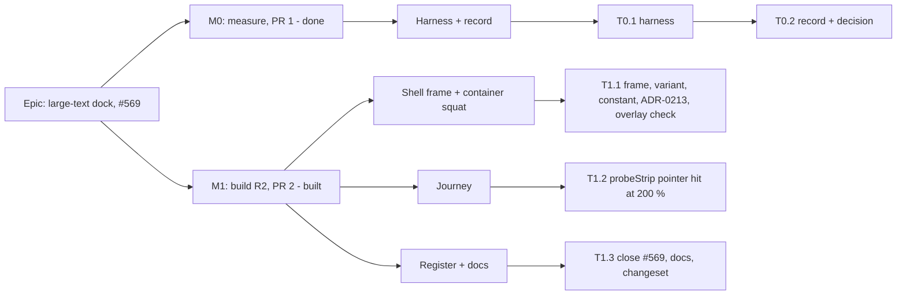

# Implementation Plan: The dock stays reachable under large text at the floor

- **Feature spec:** [`feature-spec.md`](./feature-spec.md)
- **Status:** Approved 2026-11-07 (product owner; Q1 B — every way of enlarging text; Q2 A — leave an arriving message in place). M1 revised after M0 (2026-11-07, ui-architect): R2 replaces R1; the product decisions are unchanged.
- **Owner:** James Ewbank (product owner); built by Claude Code (builder agent, Sonnet, after approval)

## Breakdown

### Epic

**Large-text dock (#569).** Under large text in a 1024 × 600 window, every foot-bar strip takes a pointer press again, whatever route enlarged the text, and the journey proves it. The theme is accessibility at the designed floor (ADR-0179).

### Sequencing in one paragraph

M0 measured and changed no product code; its record is `m0-measurement.md`. Applied to its readings, the decision rule picked R1 at 12 rem, and a finding outside the rule (the landing's hidden 100 % overflow) disqualified R1; ui-architect then settled **R2** (spec §4.6–§4.8, ADR-0213). M1 is one PR: the shell frame, the container `squat`, ADR-0213, the journey and docs. `main` stays releasable after each PR. There is no flag (ADR-0088 D1); the rollback is the M1 commit.

---

### Milestone M0: measure the problem and the candidate (PR 1) — done

**Outcome:** recorded in `m0-measurement.md`: H1 holds (CDP 200 % already works), H2 holds (#569 reproduces under the inline route only), H3 fails at 15 rem and passes the rule at 12 rem, R1 exposes the landing's hidden overflow, R2 with a sized container passes every reading. #570 filed (renumbered from #572). Nothing a user sees changed.
**Entry point:** `Ships dark: measurement only; no product change. M1 carries the journey.`
**Journey:** none (a measurement harness is not a gate, ADR-0081 §3).

The task text below is kept as the record of what M0 was asked to do. Two of its instructions turned out wrong and are corrected in M1, not here: the third strip ("the armed Add-tool statement") no longer exists, and the corner inset must scale with the root size.

#### Feature: M0 harness and record

> **Description:** `apps/web/measure-toolbar/large-text-dock-m0.spec.ts` (run by `playwright.measure-toolbar.config.ts`, not in CI), record `docs/specs/large-text-dock/m0-measurement.md`, raw readings `m0-readings.fine.json` and `m0-readings.coarse.json`.
> **Complexity:** M

##### Task T0.1: the harness (part of PR 1) — done

Cells 1024 × 600 fine and coarse; Diagram collapsed, Diagram expanded, Gantt; text 100 %, CDP 200 %, inline 200 %; strips: touch tip and selection bar; candidates R1 at 15 and 12 rem, R2 literal and R2 sized; the SC-4 sweep (49 cells, plan and landing, both pointers).

##### Task T0.2: the record and the decision (part of PR 1) — done

Decision rule applied in `m0-measurement.md` "The decision rule, applied". Outcome: M1 builds R2 (spec §4.6).

---

### Milestone M1: the foot bar is reachable under large text (PR 2)

**Built 2026-11-07.** Differences from the plan as written, found in the build: the overlay reading (step 7) is a second harness test with the same two-sitting shape as the equivalence reading, not a cell of the first; the equivalence reading found four differences in 250 readings, all `[data-tooltip]` (`m0-measurement.md`, "M1"); `touch-gestures.spec.ts` has no "two-route paragraph" in its file docblock, so step 6 was only the `tabReachesStrip` sentence; and the test's tip-strip file-level `test.use({ acknowledgeViewportNotice: true })` covers the help-sheet test too, where it changes nothing (the notice does not show at 1024 px at 100 %).

**Outcome:** under large text at 1024 × 600, by a browser setting or a user style sheet, a planner presses any foot-bar button with a mouse or finger once it is in view. At 100 % text nothing changes, including whether the shell can scroll.
**Entry point:** the existing foot bar of any plan (`[data-activities-bar]`), reached from the Project Explorer → a plan. The strips' accessible names, for example "Dismiss this tip", are unchanged.
**Journey:** `apps/web/e2e-toolbar/touch-gestures.spec.ts`, both tests: the pointer hit-test runs at 200 % again under CDP and under an inline root.

#### Feature: the shell frame and the container `squat`

> **Description:** The shell grid sits in a frame that is a named size container exactly the window high; `squat` becomes a container query on it (spec §4.6).
> **Complexity:** S
> **Dependencies:** T0.2
> **Risks:** the frame without `height: 100dvh` is 0 px high and makes `squat` match in every narrow window (M0 `r2_literal`) → structural test plus `e2e-narrow-shell`. A `squat:` class outside the frame never matches → structural test on its consumers. Tailwind's output for the block-form variant → read the built CSS once.
> **Testing requirements:** structural unit tests; the M0 harness re-run (step 6–7); the journey (T1.2); the spec §3.2 must-run suites locally.

##### Task T1.1: frame, variant, constant, ADR-0213, and the equivalence reading — built

- **Description:** Spec §4.6 items 1–5, exactly. ADR-0213 is drafted at `docs/adr/0213-the-shell-asks-its-own-frame-whether-it-is-short.md` (Proposed); add its CLAUDE.md §16 line.
- **Complexity:** S
- **Dependencies:** T0.2
- **Risks:** as above.
- **Testing:**
  - `apps/web/src/lib/breakpoints.test.ts`:
    - replace the "declared as the stylesheet's `squat` variant, word for word" assertion with: `globals.css` contains `@container ${SQUAT_CONTAINER} ${SQUAT_QUERY}` and does **not** contain `@custom-variant squat (@media`;
    - `globals.css` contains an `@utility shell-frame` block declaring `container: ${SQUAT_CONTAINER} / size` and `height: 100dvh` (parse the block; do not match a single line, so reordering the two declarations stays green);
    - keep the `SQUAT_QUERY` composition and `SQUAT_MAX_HEIGHT_REM` bounds tests.
  - `app-shell.test.tsx` (or a new `app-shell.structural.test.ts`):
    - the element carrying `squat:grid-rows-[auto_auto_100dvh_auto]` and `squat:overflow-y-auto` has a parent element whose class list contains `shell-frame`;
    - that grid still carries `h-dvh` and `overflow-hidden`, and **not** `overflow-y-auto` or `overflow-x-hidden` (R1 was not built);
    - the skip link is the first focusable element in the rendered shell;
    - a source scan of `apps/web/src/**/*.tsx` finds `squat:` only in `components/layout/navigator/app-shell.tsx` (so a new consumer outside the frame is a conscious edit to this test). Follow the scan shape of `components/ui/container-query.structural.test.ts`, including its "the scan found nothing" guard.
  - `token-architecture.test.ts` and the arbitrary-value ratchet: run, expect no change (the utility is named; no arbitrary value is added).
- **Development steps:**
  1. `globals.css`: add `@utility shell-frame` beside `deck-edge-fade` with its comment (why a size container, why `100dvh`, why not `#root`, ADR-0213). Replace `@custom-variant squat (@media …)` with the block form in spec §4.6 item 1, and rewrite the comment at `:38-47`.
  2. `lib/breakpoints.ts`: add `SQUAT_CONTAINER = 'app-shell'`; update `SQUAT_QUERY`'s and `SQUAT_MAX_HEIGHT_REM`'s docblocks (container condition on the shell frame, rem of the root in force; a user style sheet's 200 % now lands a 1024 × 600 window inside it as a browser setting does).
  3. `app-shell.tsx`: wrap the grid `
` at `:150`, and only it, in `
`. Leave the grid's class string byte-for-byte as it is. Update the docblock at `:133-149` (still the one place the shell scrolls; now answered by the frame; ADR-0213) and the row-1 comment at `:170-177` if it still says the shell is the outermost box.
  4. `Deck.tsx:50-56`: the `squat` sentence now names the frame.
  5. Build once (`pnpm --filter @repo/web build`) and read the emitted CSS: there is an `@container app-shell (width<64rem) and (height<=26rem)` rule holding both `squat:` utilities, emitted after `.overflow-hidden` and the base `grid-rows-[…]`. If the block form does not emit, switch to the shorthand and update the test.
  6. **Equivalence reading** (evidence, not a gate; ADR-0142). Re-run the M0 harness on the M1 tree with `LTD_VARIANTS=base`, both pointers (`playwright.measure-toolbar.config.ts`, the `large-text-dock-m0` spec). Compare against M0's `r2` readings in `m0-readings.*.json`: every band, `main`, foot-row rect and every shell `overflow-y` equal, in every cell and text state; any difference must be a `[data-tooltip]` element. Append the comparison to `m0-measurement.md` under a new heading "M1: the built frame against M0's R2", including the identification of the 159 × 26 box (a tooltip, `tooltip.tsx:514-531`, portalled to the body).
  7. **Overlay reading** (SC-6). In the same harness run, add one cell (a short `test` beside the existing ones, same file) at 1024 × 600 fine and coarse, 100 % text, reading each overlay's `getBoundingClientRect()` twice on the same page: as built, and with an injected `.shell-frame{container-type:normal}` (which restores today's containment state; at 1024 × 600 `squat` is off either way). Overlays: the activity editor `Dialog` (open an activity), the View ▾ popover, a row `Menu` in the Explorer, a long-pressed tooltip (coarse), and the Explorer `Sheet` at 1000 × 600 (below `lg`). All rects equal. Record in the same section.
  8. Write ADR-0213 from the draft (it is already written as Proposed; update only if steps 5–7 change a fact), add the CLAUDE.md §16 line (`check:adr-coverage`), and add "D5 amended by ADR-0213" to ADR-0185's header and its §16 line.
  9. Run component-reviewer and accessibility-reviewer on the diff.

#### Feature: the journey

> **Description:** Restore the pointer hit-test at 200 % in `probeStrip`, on the faithful route and on the inline route.
> **Complexity:** S
> **Dependencies:** T1.1
> **Risks:** `setFontSizes` dropped across a navigation → set it on the live page, assert `32px`, and if it reads 16 px re-apply and reload, then re-raise the tip with a touch press (`touch-gestures.spec.ts:276-284`: the tip stays hidden only after **Dismiss**). The viewport notice appears under CDP at 32 rem wide → `test.use({ acknowledgeViewportNotice: true })` or acknowledge it in the test; it does **not** appear under the inline route (it keys on a media query).
> **Testing requirements:** this is the test.

##### Task T1.2: `touch-gestures.spec.ts` — built

- **Description:** Spec §4.6, "Journey".
- **Complexity:** S
- **Dependencies:** T1.1
- **Testing:**
  - The test itself, under `scripts/e2e-local.sh web:toolbar`.
  - Then the must-run list in spec §3.2: `web:narrow-shell`, `web:workspace-fit`, `web:workspace-chrome`, `web:minimap`, `web:overview`, `web:swimlanes`, `web:gantt`, `web:axis-markers`, `web:shell` and `web:promotion` (`playwright.promotion.config.ts` runs `e2e-workspace-fit/promotion.spec.ts`; check whether `web:workspace-fit` excludes it).
- **Development steps:**
  1. Add a `setDefaultFontSize` helper (attached CDP session, returned for detaching in `finally`), copied from `narrow-shell.spec.ts:1248-1263` (a copy, as `promotion.spec.ts` and `month-labels.spec.ts` do; no shared helper in this PR).
  2. In `probeStrip`:
     - delete the `pointerHit` option;
     - read `rootPx = parseFloat(getComputedStyle(document.documentElement).fontSize)` and set the corner inset to `4 * rootPx / 16` (replacing the fixed `x + 4` / `y + 4`);
     - for **each** control: `scrollIntoView({ block: 'nearest' })`, wait one frame, then the centre-and-four-corners `elementFromPoint` test (a hit is the control or a descendant);
     - before probing, set any open `[data-tooltip]` to `pointer-events: none` (as the M0 harness does), so a leftover tooltip cannot report a cover;
     - return `{ height, footTopAtRest }`, so the report records what the reader saw before scrolling (ADR-0142).
  3. Strips: the touch tip only, as today. Do not add the armed Add-tool statement (it no longer exists) or the selection bar with the panel expanded (it is not shown there). The selection bar's SC-1 evidence is T1.1 step 6, not this journey.
  4. In each test, replace the inline-root block with a CDP 200 % cell: assert root `32px`, `probeStrip`, then `tabReachesStrip`.
  5. Add an inline-root 200 % cell after it: set `documentElement.style.fontSize = '200%'`, assert root `32px`, assert the shell (`main#main`'s parent) has computed `overflow-y: auto` (the frame answered `squat`; ADR-0213's guard), then `probeStrip` and `tabReachesStrip`. Reset in `finally`.
  6. Delete the #569 sentence from the `tabReachesStrip` docblock (`:121-126`) and update the file docblock's two-route paragraph.
  7. Correct `conflict-reason.spec.ts:231-236`: under the inline route the band now scrolls away above a full-window body; the select-at-100 % step stays harmless.
  8. Add one comment line at `narrow-shell.spec.ts:1232`: the `matchMedia` mirror equals the frame's container condition in every cell this suite runs (100 % and CDP), and would not under an inline root.
  9. If an `e2e-overview` inline-root 200 % cell (`overview.spec.ts:296-309`, `:596-624`) asserted geometry that assumed a held band at 1024 × 600, update the assertion and its comment with the reason; do not weaken what it checks.

#### Feature: register and docs

##### Task T1.3: close #569, docs, changeset — built

- **Description:** Close #569 citing M0's record, the M1 equivalence reading and the journey. #570 is already filed (M0). No row for the inline route (Q1 = B).
- **Complexity:** S
- **Dependencies:** T1.1, T1.2
- **Risks:** none.
- **Testing:**
  - `pnpm prepush` (covers `check:adr-coverage`, `check:spec-status`, `check:counts`; ADR-0213 moves the CLAUDE.md banner's ADR count);
  - the e2e runs listed in T1.2.
- **Development steps:**
  1. `docs/TECH_DEBT.md` #569: Status closed, with the readings, the PR, and two notes: the landing's existing 100 % overflow (793–797 px, hidden by `overflow-hidden`, unchanged by this fix) and the coarse selection bar's pre-existing corner cover. File either as a new row only with a number the orchestrator confirms free.
  2. `DESIGN_SYSTEM.md:384-388` and `UX_STANDARDS.md:509-512`: `squat` is a container query on the shell frame (`.shell-frame`, `app-shell`), in the root size in force (ADR-0213).
  3. `.changeset` entry for `@repo/web` at **patch**: "Under large text in a small window, the bar at the foot of a plan is no longer covered by the toolbar, whichever way the text was enlarged; the page scrolls instead."
  4. Update the CLAUDE.md §1 banner's ADR count (`check:counts` will say so).
  5. Set this plan's and the spec's Status per ADR-0131 at merge; ADR-0213 moves to Accepted at merge with the owner's approval recorded.

## Sequencing & slices

1. **PR 1 (M0).** Harness, record, #569's Verified field, #570. No product change, no changeset.
2. **PR 2 (M1).** T1.1, T1.2, T1.3. One commit boundary is the rollback.

No feature flag (ADR-0088 D1). Nothing requires the product owner to test on a device: every reading is container Chromium, and the journeys run in CI's four `e2e-web` shards. A release ships on the owner's host through the Watchtower auto-pull (ADR-0047) and is reviewed there in ordinary use.

## Definition of Done (per task)

Each PR meets the Feature Completion Criteria in [`docs/PROCESS.md`](../../PROCESS.md):

- `pnpm prepush` run, plus the e2e runs in T1.2;
- accessibility-reviewer and component-reviewer on PR 2, ux-reviewer on the scrolling form under the inline route;
- the Docker build and CI green, read by the dedupe rule in CLAUDE.md §19.9;
- the changeset as in T1.3;
- version impact: `web` patch.

## Risks & assumptions (rollup)

| Risk / assumption                                                             | Likelihood | Impact | Mitigation                                                                                                  |
| ----------------------------------------------------------------------------- | ---------- | ------ | ----------------------------------------------------------------------------------------------------------- |
| The frame loses `height: 100dvh`, so `squat` matches in every narrow window   | low        | high   | `breakpoints.test.ts` parses the utility; `e2e-narrow-shell` SC-5 at 640 × 480                              |
| `squat:` used outside the frame silently never matches                        | low        | med    | Source-scan structural test (T1.1)                                                                          |
| A top-layer dialog or portalled overlay moves under containment               | low        | med    | Spec §4.6 table; T1.1 step 7 measures five overlays with and without the container                          |
| `squat:` loses to `overflow-hidden` by source order                           | low        | high   | T1.1 step 5 reads the built CSS; `e2e-narrow-shell` SC-5 guards behaviour                                   |
| The built frame differs from M0's injected R2                                 | low        | med    | T1.1 step 6 re-runs the harness and compares against `r2` readings                                          |
| `e2e-overview`'s inline-root cells assumed a held band                        | med        | low    | Run locally; update with the reason (T1.2 step 9)                                                           |
| Firefox/Safari text-only zoom behave differently from both measured routes    | unknown    | med    | Container `rem` follows the root by specification, so the result no longer depends on the media-query route |
| CDP `setFontSizes` silently ignored in CI                                     | med        | med    | Root `32px` asserted before measuring, session kept attached                                                |
| The landing's hidden 100 % overflow is mistaken for something this fix caused | low        | low    | Recorded in #569's closing note as pre-existing and unchanged                                               |
