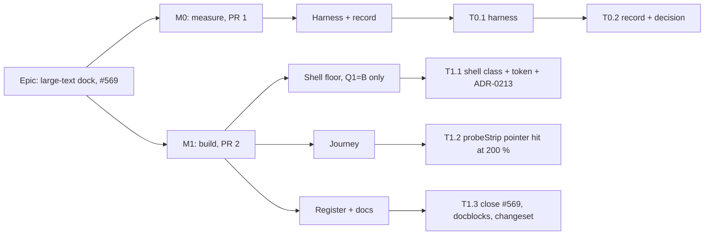

# Implementation Plan: The dock stays reachable under large text at the floor

- **Feature spec:** [`feature-spec.md`](./feature-spec.md)
- **Status:** Approved 2026-11-07 (product owner; Q1 B — every way of enlarging text; Q2 A — leave an arriving message in place)
- **Owner:** James Ewbank (product owner); built by Claude Code (builder agent, Sonnet, after approval)

## Breakdown

### Epic

**Large-text dock (#569).** Under large text in a 1024 × 600 window, every foot-bar strip takes a pointer press again, and the journey proves it. The theme is accessibility at the designed floor (ADR-0179).

### Sequencing in one paragraph

M0 measures and changes no product code. It decides, by the rule in T0.2, what M1 builds. M1 is one PR whatever the answer: under Q1 = B it is the shell floor, ADR-0213, the journey and docs; under Q1 = A it is the journey and the register only. `main` stays releasable after each PR. There is no flag (ADR-0088 D1); the rollback is the M1 commit.

---

### Milestone M0: measure the problem and the candidate (PR 1)

**Outcome:** the missing heights from spec §0 are on record, with a decision on what M1 builds. Nothing a user sees changes.
**Entry point:** `Ships dark: measurement only; no product change. M1 carries the journey.`
**Journey:** none (a measurement harness is not a gate, ADR-0081 §3).

#### Feature: M0 harness and record

> **Description:** One Playwright harness in `apps/web/measure-toolbar/` (run by `playwright.measure-toolbar.config.ts`, not in CI) that takes spec §0's six readings. The record is `docs/specs/large-text-dock/m0-measurement.md`.
> **Complexity:** M
> **Dependencies:** none
> **Risks:** CDP `Page.setFontSizes` fails silently → assert root `32px` before every 200 % reading, keep the CDP session attached, and re-apply and reload if it reads 16 px (`narrow-shell.spec.ts:1242-1263`, `:1385-1393`). An injected candidate style does not move the canvas's `ResizeObserver` within one synchronous read → nudge the viewport (1030 → 1024) and wait one frame before reading, as `conflict-reason.spec.ts:248-251` does.
> **Testing requirements:** none beyond the harness itself. It is evidence, not a gate.

##### Task T0.1: the harness (part of PR 1)

- **Description:** `apps/web/measure-toolbar/large-text-dock-m0.spec.ts`. Real sign-up, real API, real Chromium in the container (ADR-0128 caveat: fonts differ from CI and from the owner's machines, and the record says so).
- **Complexity:** M
- **Dependencies:** none
- **Risks:** the viewport notice (ADR-0179) appears under CDP 200 % → use the `acknowledgeViewportNotice` fixture (`e2e-support/test.ts`).
- **Testing:** n/a
- **Development steps:**
  1. Seed a plan with two activities, one placed before its logic allows, so a conflict exists and the selection bar can be shown. Reuse the `conflict-reason-m0` or `selection-bar-fit-m0` harness's seeding.
  2. Cells: 1024 × 600, fine and coarse (`hasTouch`). States: Diagram with panel collapsed; Diagram with panel expanded (the ADR-0180 swap); Gantt.
  3. Text states: 100 %; CDP 200 % (root asserted `32px`); inline-root 200 % (`document.documentElement.style.fontSize = '200%'`, root asserted `32px`).
  4. Strips: the touch tip (dispatch a `pointerdown` with `pointerType: 'touch'`, as `touch-gestures.spec.ts:108-119` does), the selection bar (select at 100 % first, as `conflict-reason.spec.ts:242` does, because the inline route can cover the listbox), and the armed Add-tool statement.
  5. For each cell, state, text state and strip, read:
     - header, band, status and `<main>` heights;
     - the foot row's height with and without the strip;
     - the shell's `scrollHeight`, `clientHeight` and `scrollTop` at rest;
     - the foot row's top relative to `innerHeight` at rest;
     - `matchMedia` for `squat` and `lg`;
     - `elementFromPoint` at the centre and four corners (4 px in) of every strip control, at rest and after `strip.scrollIntoView({ block: 'nearest' })`.
  6. **Candidate R1**, injected as a `<style>`: on the shell (`main`'s parent), `grid-template-rows: auto auto minmax(min(100dvh, F), 1fr) auto; overflow-x: hidden; overflow-y: auto`, kept below the `squat` media rule so squat still wins. F is 15 rem, then 12 rem. Repeat step 5 under all three text states.
  7. **Fallback candidate R2** (squat as a container query), only if R1 fails SC-4 at both F: inject `container-type: size; container-name: shell` on the shell's parent and an `@container shell (width < 64rem) and (height <= 26rem)` rule reproducing squat's rows and `overflow-y`. Repeat step 5. Also check that no `position: fixed` descendant of the shell moves: compare the rects of every element whose computed position is `fixed`.
  8. **The SC-4 sweep at 100 %**, both pointers, base and each candidate:
     - widths 1024 to 1912 in 128 px steps at heights 600, 720, 800, 948 and 1097;
     - plus 640 × 480, 640 × 360, 640 × 300, 320 × 720, 320 × 256 and 1280 × 520;
     - plus any height under 600 that `e2e-netpoint-grammar/nodes.spec.ts`, `e2e-audit/rail-1024.spec.ts` or `e2e-staff/staff.spec.ts` uses (read their `setViewportSize` calls first).

     For each cell, read the band, `<main>` and foot-row rects, the shell's `scrollHeight` against its `clientHeight`, and the 100 % body height.

  9. Write the readings as JSON beside the record, and take the screenshots the record cites.

##### Task T0.2: the record and the decision (part of PR 1)

- **Description:** `docs/specs/large-text-dock/m0-measurement.md`, in the shape of `selection-bar-fit/m0-measurement.md`: a result table first, readings after, and a "Corrections to the spec" section. Update #569's Verified field with the readings. The row is not closed yet.
- **Complexity:** S
- **Dependencies:** T0.1
- **Risks:** a candidate passes at 200 % but moves a 100 % rect by a subpixel → SC-4 is exact equality of rounded px. A difference of ≥ 1 px fails the candidate, so no judgement call is left.
- **Testing:** n/a
- **Development steps:**
  1. Test the hypotheses, each with what falsifies it:
     - **H1.** Under CDP 200 % every strip control is self-hit after scrolling. _Falsified by:_ any non-self probe.
     - **H2.** Under the inline route the strip is covered at rest **and** after scrolling (#569 reproduces). _Falsified by:_ self-hits there, in which case #569's reading is wrong some other way and the spec is revised.
     - **H3.** R1 at F passes SC-1 under the inline route, is equal to base under CDP 200 % (SC-5), and is equal to base in every SC-4 cell. _Falsified by:_ any failing cell.
  2. **Decision rule:**
     - H1 holds, and Q1 = A → M1 = T1.2 (CDP route only) + T1.3. File #573.
     - H1 holds, Q1 = B, and H3 holds at 15 rem → M1 builds R1 at 15 rem.
     - H3 fails at 15 rem and holds at 12 rem → 12 rem, with the reason recorded.
     - H3 fails at both → R2 if it passes the same tests and moves no fixed element. Otherwise **stop** and return to the owner with the readings.
     - H1 fails (the faithful route is broken too) → **stop**. The remedy must address `squat` itself, so the spec is revised before building.
  3. If the foot row is below the window at rest in the scrolling form, and Q2 = A, file **#572** with a trigger ("a report of a missed strip at large text, or the next change to the shell's scroll rule").
  4. Record the smallest 100 % body and the floor's margin against it, in both pointers.

---

### Milestone M1: the foot bar is reachable under large text (PR 2)

**Outcome:** under large text at 1024 × 600, a planner presses any foot-bar button with a mouse or finger once it is in view. Under Q1 = B this holds whatever route enlarged the text.
**Entry point:** the existing foot bar of any plan (`[data-activities-bar]`), reached from the Project Explorer → a plan. The strips' own accessible names, for example "Dismiss this tip", are unchanged.
**Journey:** `apps/web/e2e-toolbar/touch-gestures.spec.ts`, both tests: the pointer hit-test runs at 200 % again (`probeStrip` without `pointerHit: false`).

#### Feature: the shell floor (Q1 = B only)

> **Description:** Row 3 of the shell keeps a minimum of `min(100dvh, floor)`, and the shell scrolls on y and clips on x.
> **Complexity:** S
> **Dependencies:** T0.2 decision = R1 (or R2)
> **Risks:** the class order matters: `squat:` must still win (`app-shell.tsx:142-146` records that it wins only by CSS source order) → a structural test pins both, and the narrow-shell SC-5 journey guards the behaviour. A 1 px overflow at 100 % would show a classic scrollbar on Windows → SC-4 in M0, and the journeys in spec §3.2 re-run.
> **Testing requirements:** structural unit test; the journey (T1.2); the spec §3.2 must-run suites locally.

##### Task T1.1: shell class, token and ADR-0213

- **Description:** Change `app-shell.tsx:150` as spec §4.6 describes. Add the floor as a named token in `globals.css` with its justification comment (ADR-0151). Write ADR-0213 from spec §4.7 as **Proposed** and add its one line to CLAUDE.md §16 (`check:adr-coverage`).
- **Complexity:** S
- **Dependencies:** T0.2
- **Risks:** the arbitrary-value ratchet → a token, not a literal. ui-architect may prefer a different token family → run ui-architect on the ADR before the PR opens.
- **Testing:**
  - `app-shell.test.tsx` (or a new `app-shell.structural.test.ts`) asserts:
    - the shell's class list carries the floor token in row 3;
    - it carries `overflow-x-hidden` and `overflow-y-auto`, and not `overflow-hidden`;
    - it carries `squat:grid-rows-[auto_auto_100dvh_auto]`.
  - `breakpoints.test.ts` is unchanged.
- **Development steps:**
  1. Edit the class string. Update the docblock at `:133-149` to two cases: `squat`, and "rows exceed the window because the body has reached its floor".
  2. Add the token and its comment.
  3. Update `Deck.tsx:50-56`'s sentence on the way back to a band that scrolled away.
  4. Write the ADR and the §16 line.
  5. Run component-reviewer and accessibility-reviewer on the diff, and ui-architect on the ADR.

#### Feature: the journey

> **Description:** Restore the pointer hit-test at 200 % in `probeStrip`, on the faithful route, and add the inline route under B.
> **Complexity:** S
> **Dependencies:** T0.2 (T1.1 under B)
> **Risks:** `setFontSizes` dropped across a navigation → set it on the live page, assert `32px`, and if it reads 16 px re-apply and reload, then re-raise the tip with a touch press. The tip is not dismissed by a reload (`touch-gestures.spec.ts:276-284` only stays hidden after **Dismiss**). The viewport notice appears at 32 rem wide → `test.use({ acknowledgeViewportNotice: true })`, or acknowledge it in the test.
> **Testing requirements:** this is the test.

##### Task T1.2: `touch-gestures.spec.ts`

- **Description:** Spec §4.6, "Journey".
- **Complexity:** S
- **Dependencies:** T0.2; T1.1 under B
- **Risks:** as above.
- **Testing:**
  - The test itself, under `scripts/e2e-local.sh web:toolbar`.
  - Then the must-run list in spec §3.2: `web:narrow-shell`, `web:workspace-fit`, `web:workspace-chrome`, `web:minimap`, `web:overview`, `web:swimlanes`, `web:gantt`, `web:axis-markers` and `web:promotion` (`playwright.promotion.config.ts` runs `e2e-workspace-fit/promotion.spec.ts`; check whether `web:workspace-fit` excludes it). Under A, only `web:toolbar` and `web:workspace-fit`.
- **Development steps:**
  1. Add a `setDefaultFontSize` helper (attached CDP session, returned for detaching in `finally`), copied from `narrow-shell.spec.ts:1248-1263` (a copy, as `promotion.spec.ts` and `month-labels.spec.ts` do; no shared helper is introduced in this PR).
  2. In `probeStrip`:
     - delete the `pointerHit` option;
     - before the hit-test, call `strip.scrollIntoView({ block: 'nearest' })` and wait one frame;
     - return `{ height, footTopAtRest }`, so the report records what the reader saw before scrolling (ADR-0142).
  3. In each test, replace the inline-root block with a CDP 200 % cell: assert root `32px`, `probeStrip`, then `tabReachesStrip`.
  4. Under B, add an inline-root 200 % cell after it: `probeStrip`, then `tabReachesStrip`. Reset in `finally`.
  5. Delete the #569 sentence from the `tabReachesStrip` docblock (`:121-126`).
  6. Under B, correct the docblock at `conflict-reason.spec.ts:231-236`: the band no longer covers the window under the inline route, but the select-at-100 % step stays harmless.

#### Feature: register and docs

##### Task T1.3: close #569, record, changeset

- **Description:** Close #569 citing M0's record and the journey. File #572 and #573 only if their conditions in T0.2 are met. These are the only numbers this work may use.
- **Complexity:** S
- **Dependencies:** T1.1, T1.2
- **Risks:** none.
- **Testing:**
  - `pnpm prepush` (it covers `check:adr-coverage`, `check:spec-status`, `check:counts`; a new ADR moves the CLAUDE.md banner's ADR count, which `check:counts` re-derives);
  - the e2e runs listed in T1.2.
- **Development steps:**
  1. Edit #569 in `docs/TECH_DEBT.md`: Status closed, with the readings and the PR.
  2. Under B, add a `.changeset` entry for `@repo/web` at **patch**: "Under large text in a small window, the bar at the foot of a plan is no longer covered by the toolbar; the page scrolls instead." Under A, add no changeset (test and docs only).
  3. Update the CLAUDE.md §1 banner's ADR count if B adds ADR-0213 (`check:counts` will say so).
  4. Set this plan's and the spec's Status per ADR-0131 at merge.

## Sequencing & slices

1. **PR 1 (M0).** Harness, record, #569's Verified field. No product change, no changeset. Mergeable on its own.
2. **PR 2 (M1).** T1.1 (B only), T1.2, T1.3. One commit boundary is the rollback.

No feature flag (ADR-0088 D1). Nothing requires the product owner to test on a device: every reading is container Chromium, and the journeys run in CI's four `e2e-web` shards. A change that ships on the owner's host through the Watchtower auto-pull (ADR-0047) is reviewed there in ordinary use, as every release is.

## Definition of Done (per task)

Each PR meets the Feature Completion Criteria in [`docs/PROCESS.md`](../../PROCESS.md):

- `pnpm prepush` run, plus the e2e runs in T1.2;
- accessibility-reviewer and component-reviewer on PR 2, ux-reviewer on the scrolling form, and ui-architect on ADR-0213;
- the Docker build and CI green, read by the dedupe rule in CLAUDE.md §19.9;
- the changeset as in T1.3;
- version impact: `web` patch under B, none under A.

## Risks & assumptions (rollup)

| Risk / assumption                                                                | Likelihood | Impact | Mitigation                                                                                              |
| -------------------------------------------------------------------------------- | ---------- | ------ | ------------------------------------------------------------------------------------------------------- |
| The faithful route already passes (H1), which makes A a test-only change         | high       | low    | Expected (`selection-bar-fit/m0-measurement.md:40-41`). Q1 decides whether B is still built             |
| H1 fails: the faithful route is also broken                                      | low        | high   | Stop rule in T0.2; the spec is revised before building                                                  |
| R1's floor binds at 100 % in a journey cell (640 × 480, 1280 × 520)              | low-med    | med    | SC-4 sweep; 12 rem fallback; stop if neither passes                                                     |
| A 1 px shell overflow at 100 % shows a Windows scrollbar on the owner's machines | low        | med    | SC-4 asserts `scrollHeight == clientHeight` in every cell; x stays hidden                               |
| `squat:` loses to the new overflow class by source order                         | low        | high   | Structural test; narrow-shell SC-5 journey                                                              |
| Firefox/Safari text-only zoom behave differently from both measured routes       | unknown    | med    | Not measurable headlessly here; B makes the result independent of whether media queries follow the text |
| CDP `setFontSizes` silently ignored in CI                                        | med        | med    | Root `32px` asserted before measuring, with the session kept attached                                   |
| A future spec reads "keyboard reach at 200 %" from the old docblock              | low        | low    | T1.2 step 5 deletes it                                                                                  |
