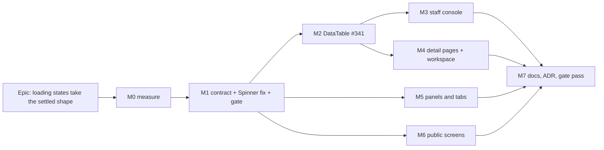

# Implementation Plan: Loading states take the settled shape (TECH_DEBT #234 + #341)

- **Feature spec:** [./spec.md](./spec.md)
- **Status:** Accepted — shipped ([ADR-0202](../../adr/0202-a-loading-state-is-the-settled-shape-and-says-one-sentence.md)). Approved with the spec, 2026-10-17
- **Owner:** product owner (approval); builder agent (implementation); reviewers per milestone

## Breakdown

### Epic

**Loading states take the settled shape** — one loading contract (material, archetype-owned shapes,
one sentence), applied to the 17 first-load sites the spec re-verified, with `DataTable`'s columns
sized by content. Theme: design-system maintenance; `docs/UX_STANDARDS.md` "every view" rule.

**No `VITE_*` flag (ADR-0088 D1).** Every milestone is a commit boundary; each PR is independently
revertible and leaves `main` releasable.

**Entry points are existing surfaces throughout.** No milestone adds a control; each changes what an
existing surface shows while it loads, so every milestone names the existing entry point and a journey
that **holds the real request** (`page.route` released by the test, the
`e2e-splitting/splitting.spec.ts:170-180` pattern — deterministic, no timers) and asserts the pending
state, then releases and asserts the settled one. **No new Playwright config or suite** (no CI change).

---

### Milestone M0: measure the problem (no product code)

**Outcome:** a committed baseline that SC-2/SC-3 are graded against, and a confirmed per-site
classification. ADR-0142: the remedy is measured before it is built.
**Entry point:** `Ships dark: an instrument only — nothing user-facing.`
**Journey:** none (no user-facing capability claimed).

#### Feature: the loading-shape instrument

> **Description:** `apps/web/scripts/measure-loading-shapes.mjs`, in the house measure-script style,
> holding each site's read and recording pending vs settled geometry and live-region state.
> **Complexity:** M
> **Dependencies:** none (local stack + seed catalogue, `pnpm check:playbook` for plan names)
> **Risks:** the instrument reads a skeleton as content (ADR-0146's M6 lesson) → it carries a pinned
> control asserting it examined a settled cell before any verdict.
> **Testing requirements:** a `*.judge.test.mjs` for its pure verdict logic, as
> `measure-activities-panel.judge.test.mjs` does.

##### Task 1 — build and run the instrument (≈ one PR)

- **Description:** for each group-A site (spec §1.1) at 1646 × 1000 and 1024 × 600: hold the read,
  record anchor rects (headings, labels, first row top, column headings), the list of
  `role=status`/`aria-live` elements and their text, and `getAnimations()` state under
  `reducedMotion: 'reduce'`; release; record the same settled. For the eight SC-3 tables, record every
  column's width pending vs settled.
- **Complexity:** M
- **Dependencies:** —
- **Risks:** a site is unreachable without a specific seed (EV needs cost; history needs edits) → use
  the catalogue's documented plans; record any site it cannot reach rather than skipping it silently.
- **Testing:** judge unit test; the control assertion above.
- **Development steps:**
  1. Write the script; reuse `measure-staff-console.mjs:279-291`'s hold technique.
  2. Run it; write `docs/specs/loading-skeletons/m0-measurement.md` (figures, screenshots, the live
     region census, any site whose classification the run changes).
  3. Confirm or re-argue SC-2's 1 px and SC-3's 8 px in writing; record the result for defect 5 as
     **open** until M1's screen-reader observation.

---

### Milestone M1: the loading contract, the Spinner fix, and the gate

**Outcome:** the five group-C panels and the WBS members tab announce the sentence they show, once;
the primitives exist and are reviewed; the gate is live.
**Entry point:** the plan workspace's **Float paths** dock (and **Health check**, **Compare
revisions**) — the existing toolbar commands that open them.
**Journey:** `e2e-float-paths/float-paths.spec.ts` — open the dock with the float-paths read held;
assert exactly one `role=status` whose text is "Calculating float paths…"; release; assert it is gone.

#### Feature: primitives

> **Description:** `LoadingShape`, `SkeletonText`, `Skeleton`'s `data-skeleton` + `surface` variant,
> the forced-colours rule, `useLateStatus`, and the `Spinner` contract (spec §4.6).
> **Complexity:** M
> **Dependencies:** M0
> **Risks:** (1) the ARIA 1.2 `aria-busy` reasoning is wrong in practice → mitigated by design, not by
> observation (approval amendment, 2026-10-17): the status is never inside an `aria-busy` subtree, and
> the accessibility reviewer checks that by reading and through the accessibility-tree assertions. (2) Making
> `label` required breaks every `<Spinner />` → that is the point: typecheck lists them (31 sites + tests).
> **Testing requirements:** unit per primitive — status mounted empty then filled (StrictMode),
> `announce="none"` renders no live region, material `aria-hidden`, axe `aria-hidden-focus` clean,
> `SkeletonText` uses `visibility:hidden` (not transparent); forced-colours journey in
> `e2e-forced-colors` asserting a held skeleton's computed outline.

##### Task 1 — `LoadingShape`, `SkeletonText`, `Skeleton` changes (≈ one PR)

- **Description:** new `page/loading-shape.tsx`, `useLateStatus` hook; `SkeletonText` in
  `page/skeleton.tsx`; `data-skeleton`; CVA `surface`; unlayered `globals.css` rule.
- **Complexity:** M
- **Dependencies:** M0
- **Risks:** a second live-region mechanism beside `useAnnounce` → `LoadingShape` is self-contained
  because guest, staff and public screens have no shell announcer (`route-pending.tsx:28-30`); stated
  in the docblock.
- **Testing:** unit tests above; `page-archetypes.test.tsx` extended.
- **Development steps:**
  1. Write the primitives with TSDoc and a usage example (COMPONENT_LIBRARY "Documentation").
  2. Export from `page/index.ts`; edit its count line.
  3. Run **component-reviewer** and **accessibility-reviewer** (executing, not reading).
  4. Changeset (`@repo/web` patch); update the CLAUDE.md banner counts (`pnpm check:counts`).

##### Task 2 — `Spinner` contract + group-C sites + `ActivityMembersPanel` label (≈ one PR)

- **Description:** `label` required, `showLabel`; `FloatPathsPanel:187`, `RevisionComparePanel:256/294/425`,
  `ScheduleHealthPanel:212` become `<Spinner label="…" showLabel />` replacing icon + loose text;
  every other caller passes its existing label explicitly. `RoutePending` moves its status out of the
  `aria-busy` container (or adopts `LoadingShape`).
- **Complexity:** S
- **Dependencies:** Task 1
- **Risks:** visible text moves into the status element and changes size → asserted by unit snapshot
  of the visible text and the journey.
- **Testing:** unit per site (one status, correct text); `route-pending.test.tsx` updated; journey above.
- **Development steps:**
  1. Change `Spinner`; fix the typecheck list.
  2. Convert the five + members; update tests asserting "Loading…".
  3. Changeset.

##### Task 3 — the gate (≈ one PR)

- **Description:** `apps/web/src/components/ui/page/loading-states.structural.test.ts`, G1–G3 (spec §4.8).
- **Complexity:** S
- **Dependencies:** Task 2
- **Risks:** a gate that passes vacuously → **verified red first** against the pre-M3 tree: G1 must name
  the 17 group-A sites as undeclared, G2 three files, G3 five sites (G3 is red until Task 2 lands, so it
  is verified on Task 2's parent commit). Record the red output in the PR.
- **Testing:** the gate itself, plus a fixture case per rule.
- **Development steps:**
  1. Write with the 14-entry declared map; **temporarily declare the 17 group-A sites as `pending:
'loading-skeletons Mn'`**, so each later milestone deletes its entries — a declaration the
     epic must empty, not an exemption list that lives on. M7's done-check is that the `pending`
     bucket is empty.
  2. G2 likewise lists its three files as `pending` until M4.

---

### Milestone M2: `DataTable` sized by content (#341)

**Outcome:** every resource table shows its real headings at once, and its `fit` columns start at
their settled width.
**Entry point:** any resource list — e.g. **Calendars** in the rail (the table #341 measured).
**Journey:** `e2e-library/library.spec.ts` — open Calendars with the list read held; assert the
`Working days` heading text is visible and its x-range is within 8 px of the settled heading's; assert
`getByRole('columnheader')` finds **nothing** while pending (the skeleton table is `aria-hidden`);
release; assert rows.

#### Feature: `DataTableSkeleton` and `Column.sample`

> **Description:** extract `DataTableSkeleton`; `Column.sample`; real header text; width classes on
> sampled cells; `LoadingShape` around it; samples on the eight SC-3 tables.
> **Complexity:** M
> **Dependencies:** M1 Task 1
> **Risks:** (1) e2e locators that wait on header **text** (not role) now match during loading → audit
> `getByText`/`has-text` on header strings across `e2e*/`; 30 `columnheader` role locators in 11 files
> are safe by construction (`aria-hidden`) but each suite touching a `DataTable` is re-run. (2)
> Instruments read the skeleton → `measure-column-fit.mjs:356-368` skips `[data-loading-shape]`; its
> control assertion is re-verified to still fail on a skeleton. (3) `data-col-width` leaks into the
> skeleton and the wrap gate reads it → `data-table.test.tsx:352-358` stays and is extended to sampled
> columns.
> **Testing requirements:** unit (sampled cell gets width classes; unsampled does not; header text
> present; table `aria-hidden`; one status); `measure-loading-shapes.mjs` SC-3 re-run; journey above.

##### Task 1 — the primitive change (≈ one PR)

- **Description:** `data-table.tsx` pending branch → `LoadingShape` + `DataTableSkeleton`; `Column.sample`;
  `skeletonClassesOf` gains the sampled path.
- **Complexity:** M
- **Dependencies:** M1
- **Risks:** as above.
- **Testing:** as above; `shoot.mjs` `clients-loading` re-shot.
- **Development steps:**
  1. Extract; keep `SKELETON_ROWS`; keep `loadingLabel`.
  2. Update instruments in the same PR.
  3. **component-reviewer**, **accessibility-reviewer**; changeset; banner counts.

##### Task 2 — samples on the eight tables + measurement (≈ one PR)

- **Description:** add `sample` to every `fit` column of Clients, Projects, Plans, Calendars, Resources,
  Members, Audit log, Recently deleted, formatted with the same formatter the cell uses (so a date
  sample is the locale's date, not a hand-typed string).
- **Complexity:** S
- **Dependencies:** Task 1
- **Risks:** SC-3 misses on a column → the withdrawal clause: re-argue in `m2-measurement.md`.
- **Testing:** SC-3 re-run recorded; the journey.
- **Development steps:**
  1. Add samples; 2. run the instrument at both widths; 3. record; 4. changeset.

---

### Milestone M3: the staff console

**Outcome:** each of six panels shows its shape; the page speaks one sentence on load, not six.
**Entry point:** `/staff` (the console's existing route, staff accounts only).
**Journey:** `e2e-staff/staff.spec.ts` — hold `/staff/health` and `/staff/installation`; assert no
`role=status` inside any panel section other than its `StatusSection` region (SC-4), the Mail panel's
three stat labels visible, the Accounts table headings visible; release; assert settled.

#### Feature: `QueryPanel` wraps; panel skeletons

> **Description:** `QueryPanel` gains required `loadingLabel` and wraps `skeleton` in
> `<LoadingShape announce="none">`; `StatGridSkeleton`, `KeyValueListSkeleton`; six panels pass a
> shape; panels with tables hoist their `columns` out of the body so the skeleton and the settled
> table share one definition (the #234 "not free" restructuring, `TECH_DEBT.md:2679-2686`).
> **Complexity:** M
> **Dependencies:** M2
> **Risks:** the staff identity gate is touched by mistake → it is G1-declared `'gate'` with the
> ADR-0086 reason; a review checklist item. Hoisted columns with closures over data (`now`) → keep
> data-dependent cells as functions of the row; `now` read at render as today.
> **Testing requirements:** unit per panel's pending branch; `query-panel.test.tsx` extended
> (`announce="none"`, `loadingLabel` present as plain text); journey above.

##### Task 1 — `QueryPanel`, `StatGridSkeleton`, `KeyValueListSkeleton` (≈ one PR)

- **Complexity:** S · **Dependencies:** M1 · **Testing:** unit + `page-archetypes.test.tsx`.
- **Development steps:** 1. share layout constants with `StatGrid`/`KeyValueList`; 2. correct the
  `QueryPanel` docblock; 3. component + accessibility review; 4. changeset.

##### Task 2 — six panels (≈ one PR)

- **Complexity:** M · **Dependencies:** Task 1 · **Testing:** unit + journey; delete six G1 `pending`
  entries.
- **Development steps:** 1. convert accounts, installation, mail, retention, alerting, security; 2.
  re-run `measure-staff-console.mjs`'s loading shot; 3. **ux-reviewer** on the photographs; 4. changeset.

---

### Milestone M4: detail pages and the workspace

**Outcome:** client, project and plan open in their own frame; the Gantt and canvas placeholders are
the shared material.
**Entry point:** the **Project Explorer** (click a client, a project, a plan).
**Journey:** `e2e-page-composition/composition.spec.ts` — hold the client read; assert the `Projects`
heading and table headings visible, one status "Loading projects…" (CQ-2 default), no spinner;
release; assert the `Projects` heading's top did not move (SC-2). Plan:
`e2e-workspace-chrome/plan-switch.spec.ts` — hold the plan read; assert the workspace frame and the
canvas placeholder; release.

#### Feature: page skeletons

> **Description:** `PageHeaderSkeleton`; client/project detail restructured to render the frame
> always and swap only the header (CQ-2); `WorkspaceSkeleton` shared by `plan-detail.tsx` and the
> workspace's `canvasLoading`; `GanttPanel.tsx:1053-1061` adopts `LoadingShape`.
> **Complexity:** L
> **Dependencies:** M2 (tables' skeletons), M1
> **Risks:** (1) CQ-2's concurrent request on a 404 subject flashes the table's own error before
> `EntityLoadFailure` → acceptable per CQ-2; if the owner picks the alternative, the body is a
> `SectionCard` frame + `DataTableSkeleton` with the table's exported columns instead. (2) The activity
> panel's split is not readable before the plan resolves → M0 records whether it is; if not, the
> skeleton uses the default split and the shift is recorded against SC-2 honestly. (3) Two
> announcements on the plan route (plan + activities phases) → the plan phase's shape speaks, the
> activities phase reuses the same element with `announce="none"`.
> **Testing requirements:** unit for each route's pending branch; `entity-not-found` paths unchanged;
> journeys above; `archetypes.structural.test.ts` (ADR-0145 D1) stays green — the skeleton renders no
> hand-rolled `<h1>`.

##### Task 1 — `PageHeaderSkeleton` + client and project detail (≈ one PR)

- **Complexity:** M · **Dependencies:** M2 · **Testing:** unit + composition journey.
- **Development steps:** 1. build the skeleton beside `PageHeader`, sharing its layout classes; 2.
  restructure both routes; 3. **performance-reviewer** confirms the waterfall is removed (network
  timeline in the journey trace), no bundle regression; 4. changeset; delete two G1 entries.

##### Task 2 — plan workspace, canvas placeholder, Gantt (≈ one PR)

- **Complexity:** M · **Dependencies:** Task 1 · **Testing:** unit + plan-switch journey; G2 `pending`
  bucket emptied (all three hand-rolled pulses gone).
- **Development steps:** 1. `WorkspaceSkeleton`; 2. replace `plan-detail.tsx:53-65`; 3. replace the
  `role=status` + `aria-label` empty div (`plan-workspace-toolbar.tsx:1340-1345`); 4. Gantt; 5. ux +
  accessibility review; 6. changeset.

---

### Milestone M5: panels and tabs

**Outcome:** earned value, schedule summary, notes, history, WBS members and calendar exceptions show
their shape while loading.
**Entry points:** the workspace's **Earned value…** command; the toolbar's **Summary** popover; the
activity editor's **Notes** and **History** tabs; a WBS summary's **Members** tab; **Calendars** →
a calendar's **Exceptions** section.
**Journeys:** `e2e/baselines.spec.ts` (EV dialog), `e2e-toolbar/toolbar.spec.ts` (Summary),
`e2e-notes/notes.spec.ts`, `e2e-activity-editor/activity-history.spec.ts`, the `wbs` suite (Members),
`e2e-calendar-shifts/calendar-shifts.spec.ts` (Exceptions) — each holds its read and asserts the
pending shape and one sentence.

#### Feature: six panel skeletons

> **Description:** `StatGridSkeleton` + `DataTableSkeleton` (EV, header strings mapped from its
> column spec); `ContextStripSkeleton` with the five fixed facts (Summary); feature-local
> `NoteItemSkeleton`, `HistoryEntrySkeleton`, `ExceptionRowSkeleton`, members field+list skeleton;
> `aria-busy` moved onto each persisting container.
> **Complexity:** L (six sites, each small)
> **Dependencies:** M1, M3 Task 1 (stat/strip skeletons)
> **Risks:** (1) `NoteThread`'s focus-sink identity (`NoteThread.tsx:58-74`) → the skeleton renders
> **inside** the stable region, never replacing it; its unit test asserts the same node before and
> after. (2) Summary's "not calculated" branch reflows → stated cost (spec §2 edge cases).
> **Testing requirements:** unit per site; journeys above; SC-2 re-run for these six.

##### Task 1 — EV + Summary (≈ one PR) · S

##### Task 2 — Notes + History + Exceptions (≈ one PR) · M

##### Task 3 — WBS Members (≈ one PR) · S

Each: build the skeleton beside the component it mirrors → convert the site → unit + journey →
component + accessibility review → changeset → delete its G1 entries.

---

### Milestone M6: public screens

**Outcome:** the guest view and the invitation card show their frame; neither varies by token.
**Entry points:** a **share link** (`/share#…`); an **invitation link** (`/accept-invite?token=…`).
**Journeys:** `e2e-share/share.spec.ts` — hold the guest plan read for a **live** and a **dead**
token; assert the two pending DOMs are identical (no oracle) and carry one status; release.
`e2e-public/public-screens.spec.ts` — hold the invitation preview; assert the header skeleton; release.

#### Feature: guest and invitation skeletons

> **Description:** `GuestSkeleton` (header line + canvas placeholder in `h-dvh`, one `main`, no
> `aria-live` on `main` — fixes defect 4); `AcceptInvitationCard` header skeleton inside `InviteShell busy`.
> **Complexity:** S
> **Dependencies:** M1
> **Risks:** an existence oracle through skeleton variation → the journey's DOM-identity assertion;
> **security-reviewer** reads the PR.
> **Testing requirements:** unit (`GuestPlanView.test.tsx:94`, `accept-invite.test.tsx:184`,
> `public-screens.landmarks.test.tsx:155` updated — one `main` landmark still); journeys above.

##### Task 1 — both screens (≈ one PR) · S

---

### Milestone M7: documentation, ADR, gate pass

**Outcome:** the standard is written where readers look; the epic is reviewed as a whole.
**Entry point:** `Ships dark: documentation and review only.`
**Journey:** none new; the full suite set touched by M1–M6 is re-run.

##### Task 1 — docs + ADR (≈ one PR) · S

- ADR-0202 from the spec §4.9 outline; one line in CLAUDE.md §16; banner counts.
- `DESIGN_SYSTEM.md`: inventory rows for `LoadingShape`, `SkeletonText`, the archetype skeletons;
  correct lines 963, 1009, 1211. `COMPONENT_LIBRARY.md`: a "Loading" section (contract, when a
  spinner, when a skeleton, the gate). `UX_STANDARDS.md:61`: the dominant-outcome rule.
  `FRONTEND_ARCHITECTURE.md:271-278`.
- `TECH_DEBT.md`: close #234 and #341 citing the PRs and `m0`/`m2` measurements; open the CQ-1 row
  (text-only loading states) and a row for `ScheduleHealthPanel` as a skeleton candidate (ADR-0116's
  fixed check set), each with a trigger.
- Spec and plan headers move to `Accepted — shipped (ADR-0202)` (`check:spec-status`).

##### Task 2 — gate pass

- Confirm G1's `pending` bucket and G2's are **empty**; re-run `measure-loading-shapes.mjs` at both
  widths and record the final SC table; run component, accessibility, ux and performance reviewers
  over the whole epic; `pnpm prepush` plus `scripts/e2e-local.sh web:<suite>` for every suite touched.

## Sequencing & slices

M0 → M1 (three PRs) → M2 (two) → then M3, M4, M5, M6 in any order (M3 and M5 share M3 Task 1's
skeletons, so M3 Task 1 lands first) → M7. Every PR is independently revertible: each site keeps its
error/empty/success branches unchanged and only its pending branch moves. **No feature flag**
(ADR-0088 D1). The gate's `pending` buckets make partial progress visible and make "done" a computed
fact rather than a claim.

**Recommended agents during build:** **builder** (implementation); **component-reviewer** and
**accessibility-reviewer** on every primitive PR (M1, M2, M3 T1, M4 T1) — the accessibility reviewer
**executing** in a real browser and a real screen reader for M1; **ux-reviewer** on M3–M6 photographs;
**performance-reviewer** on M4 T1 (waterfall) and M7; **security-reviewer** on M6 and on any PR
touching `staff-console-screen.tsx`; **test-engineer** for the M0 instrument and the held-response
journeys. **database-architect, api-reviewer, backend-performance-reviewer: not needed** — no schema,
endpoint or query change.

## Definition of Done (per task)

Each task's PR must satisfy the Feature Completion Criteria in [`docs/PROCESS.md`](../../PROCESS.md)
(code, tests, docs, security, performance, accessibility, Docker build, CI, changelog, version impact),
with "tests" meaning `pnpm prepush` **run**, plus `scripts/e2e-local.sh web:<suite>` for every suite
the PR changes (§19.8).

## Not in this epic

- The seven text-only first-load states (CQ-1 default: a new row).
- `ScheduleHealthPanel` as a skeleton (a new row; spec §1.1).
- A delay threshold or minimum display time for skeletons.
- Changing settled-state announcements (each site keeps what it announces today on settle).

## Risks & assumptions (rollup)

| Risk / assumption                                                                   | Likelihood | Impact | Mitigation                                                                                                                                        |
| ----------------------------------------------------------------------------------- | ---------- | ------ | ------------------------------------------------------------------------------------------------------------------------------------------------- |
| The `aria-busy`/live-region reasoning (defect 5) does not match real screen readers | med        | med    | Conservative contract: the status is never inside `aria-busy`; reviewed by reading and accessibility-tree assertions (no device observation owed) |
| E2E locators or measurement scripts match skeleton header text and pass early       | med        | med    | skeleton table `aria-hidden`; text-locator audit in M2; `measure-column-fit.mjs` skips `[data-loading-shape]` with its control re-verified        |
| `SkeletonText` samples mis-size `fit` columns                                       | med        | low    | SC-3 measured; withdrawal clause re-argues in writing                                                                                             |
| Forced colours render sample text as fake data                                      | low        | high   | `visibility:hidden`, never transparent; forced-colours journey                                                                                    |
| A console-shaped skeleton leaks the staff surface                                   | low        | high   | identity gate G1-declared `'gate'` with the ADR-0086 reason; security review                                                                      |
| Guest skeleton varies by token (oracle)                                             | low        | high   | DOM-identity assertion across live and dead tokens                                                                                                |
| CQ-2 concurrent request on a 404 subject                                            | med        | low    | page replaced by `EntityLoadFailure`; alternative documented if the owner declines                                                                |
| Activity-panel split unreadable before the plan loads                               | med        | low    | M0 establishes it; default split used and recorded against SC-2                                                                                   |
| Making `Spinner.label` required churns tests                                        | high       | low    | mechanical; typecheck lists every site                                                                                                            |
| Banner/ADR counts drift (`check:counts`)                                            | high       | low    | each PR updates CLAUDE.md's banner; `pnpm prepush` refuses otherwise                                                                              |
