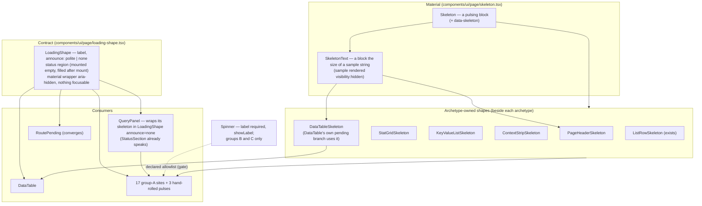
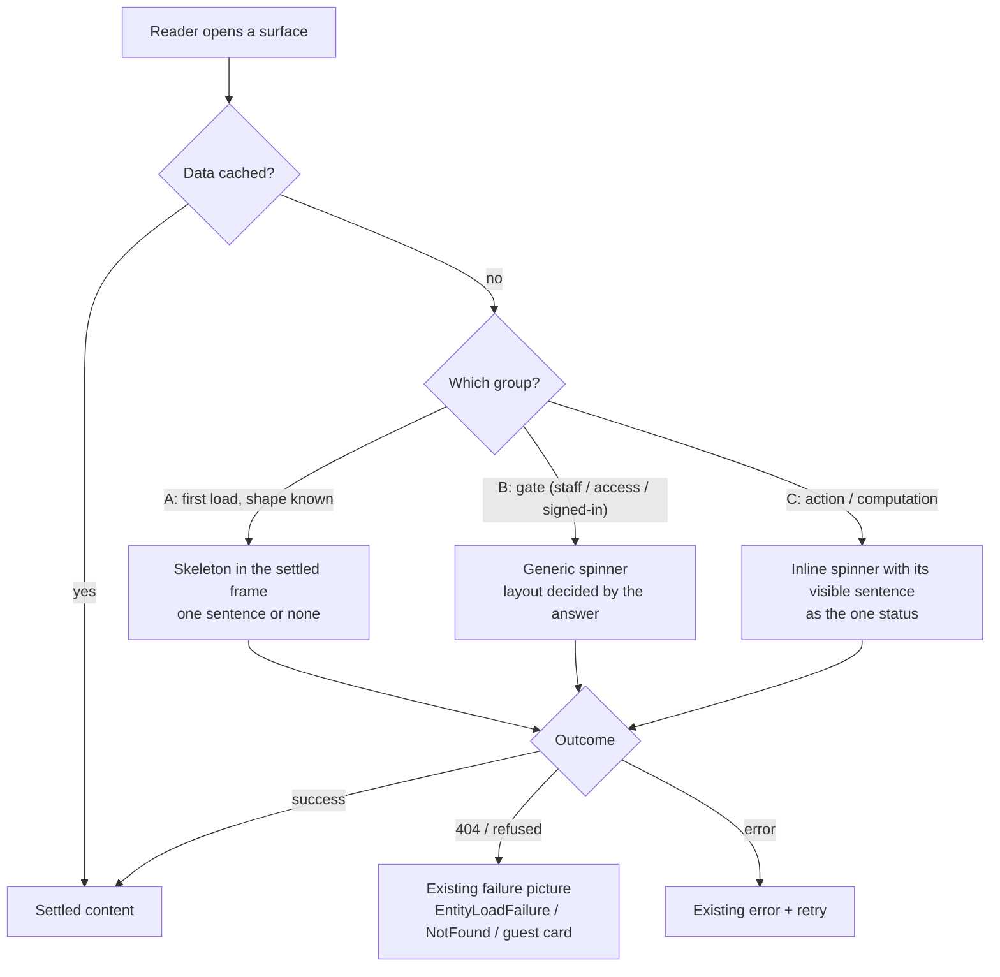

# Feature Spec: Loading states take the settled shape (TECH_DEBT #234 + #341)

- **Status:** Approved — by the product owner, 2026-10-17, with the recommended defaults (CQ-1: the seven text-only states become a new register row; CQ-2: yes, the table loads at once) and the conservative live-region contract (no real-screen-reader observation owed)
- **Author(s):** feature-analyst (Claude), for the product owner
- **Date:** 2026-10-17
- **Tracking:** `docs/TECH_DEBT.md` #234 (first-load spinners where the shape is known), #341 (a table
  skeleton's column widths do not match the settled table's)
- **Roadmap link:** none — design-system maintenance (`docs/UX_STANDARDS.md` "every view" rule)
- **Related ADR(s):** [ADR-0105](../../adr/0105-a-register-row-is-not-a-spec.md) (why this spec exists),
  [ADR-0145](../../adr/0145-a-screen-is-assembled-from-the-archetypes.md),
  [ADR-0146](../../adr/0146-a-page-has-one-measure-and-a-column-has-a-reason.md),
  [ADR-0165](../../adr/0165-a-long-table-renders-the-rows-in-view.md),
  [ADR-0178](../../adr/0178-a-console-is-grouped-by-what-the-reader-came-to-do.md),
  [ADR-0086](../../adr/0086-staff-principal.md), [ADR-0088](../../adr/0088-flag-classification.md) D1,
  [ADR-0081](../../adr/0081-milestone-entry-point-and-journey.md), [ADR-0142](../../adr/0142-a-remedy-is-measured-before-it-is-built.md).
  **New: ADR-0198 (number provisional) — outline in §4.9.**

## 0. How to read this

Two register rows, one design. #234 is "about fifteen surfaces show a spinner on first load where the
settled shape is known"; #341 is "the one surface that already has a skeleton (`DataTable`) does not
match its settled column widths". Both are answered by the same thing: **a loading contract** — one
accessibility mechanism, archetype-owned skeleton shapes, and content-shaped placeholder material —
then applied site by site.

It needs a spec rather than the rows because it **changes shared components' public contracts**
(`Spinner`, `DataTable`'s `Column`, `QueryPanel`, `Skeleton`), **adds new primitives**, and **adds a
shared gate** — three ADR-0105 triggers.

Common to everything here, stated once:

- **Users and roles.** Every role that reaches these surfaces today: Org Admin, Planner,
  Contributor, Viewer; External Guest (guest plan view); invitees with no membership yet (accept
  invitation); staff (ADR-0086 console). **No permission changes.**
- **No writes.** Nothing here adds or changes a mutation, so **the pen (ADR-0028) is not involved**
  and nothing is structural.
- **Recalc parity.** No scheduling input; no file touched here imports `computeSchedule`.
  `apps/api`, the schema and the engine are untouched.
- **No `VITE_*` flag** (ADR-0088 D1): every published image carries flags at their defaults, so a
  flag would be a second render path, not a rollback. Rollback is the commit boundary; each
  milestone lands as its own PR(s).
- **Version impact.** `@repo/web` patch per PR (visible polish, no contract a caller outside the
  repo depends on). No API, OpenAPI or DB change.

### 0.1 Where the brief was wrong (§19.11 — the brief is not evidence)

- **"There is no Skeleton primitive in `components/ui` yet" — false.** `Skeleton` exists at
  `apps/web/src/components/ui/page/skeleton.tsx:20-31` (exported from `page/index.ts:23`) and is used
  by `DataTable`'s pending branch (`data-table.tsx:461-515`), `ListRowSkeleton`
  (`page/list-row.tsx:142-159`) and the router's `RoutePending` (`app/route-pending.tsx:32-49`). Its
  own docblock (`skeleton.tsx:3-18`) already states the rule this spec builds on: _Skeleton is the
  material; each archetype owns its shape._ What is genuinely missing is (a) a shared **accessibility
  contract** for a pending surface — today there are five different hand-written ones — and (b)
  **shaped skeletons** for the archetypes these sites settle into (`PageHeader`, `StatGrid`,
  `KeyValueList`, `ContextStrip`, and a `DataTable` skeleton that can be used outside a
  `DataTable`).
- **`docs/DESIGN_SYSTEM.md` repeats the brief's error, three times.** Line 1211: _"Skeletons — (no
  shared primitive)"_; line 963: DataTable's loading state is _"a labelled spinner"_; line 1009:
  _"Loading is a spinner, not skeleton rows"_. All three have been false since the
  empty-state-consolidation M7 (`data-table.tsx:462-468`). They are corrected by this epic (plan M7).

## 1. Business understanding

### Problem (re-verified 2026-10-17 against the tree, not the rows)

`docs/UX_STANDARDS.md:61` asks for a **skeleton matching the final layout on first load** and an
**inline busy indicator for actions**. The discriminator is whether the content's **shape is known**.
Today a planner who opens a client, a plan, the staff console, the earned-value dialog or an
activity's notes sees a small centred spinner in an empty box, and then the page **jumps** into a
layout of a completely different size. On the one surface that does have a skeleton (every
`DataTable`), the columns **jump sideways** when rows arrive: #341 measured `Working days` at **16 px
loading vs 190 px settled** and `Name` moving **628 → 738 px** on Calendars at 1646 px.

There are also **accessibility defects** in the current loading states, found while re-verifying:

1. **Five "inline" spinners announce the wrong sentence.** `FloatPathsPanel.tsx:187`,
   `RevisionComparePanel.tsx:256/294/425` and `ScheduleHealthPanel.tsx:212` pass
   `aria-hidden="true"` to `<Spinner>`, intending a decorative icon beside visible text ("Calculating
   float paths…"). `Spinner` accepts only `{ className, label }` and spreads nothing
   (`spinner.tsx:9-25`), so the attribute is **silently dropped** (TypeScript does not check
   hyphenated JSX attributes) and each renders a `role="status"` saying the default **"Loading…"**,
   while the visible sentence is in no live region. _Read, not run_ — the a11y reviewer confirms in
   the browser at M1.
2. **`ActivityMembersPanel.tsx:207`** renders `<Spinner /> Loading the plan's activities…` — the same
   shape: a status saying "Loading…" beside visible text that is not announced.
3. **The staff console's six panels announce six times.** Each `QueryPanel` already owns a polite
   region (`StatusSection`), yet each passes `skeleton={<Spinner label=…>}` — a second, inserted
   `role="status"` per panel (`accounts-panel.tsx:112`, `installation-panel.tsx:25`,
   `mail-panel.tsx:41`, `retention-panel.tsx:52`, `alerting-panel.tsx:27`, `security-panel.tsx:64`).
   ADR-0178 D-6 exists to make that page speak **one** sentence on load. `QueryPanel`'s own docblock
   (`query-panel.tsx:28-30`) claims panels pass "a table-shaped skeleton for a `DataTable`" — **no
   call site does**; all six pass a spinner.
4. **`GuestLoading`** (`GuestPlanView.tsx:59-69`) is a `main` with `aria-live="polite"` _and_ a
   `Spinner` `role="status"` inside it — two live regions for one sentence.
5. **The live region is inside `aria-busy` in two primitives.** `DataTable`'s pending branch
   (`data-table.tsx:480-483`) and `RoutePending` (`route-pending.tsx:40-41`) put their status element
   inside an `aria-busy="true"` container. ARIA 1.2 §`aria-busy` permits assistive technology to
   **defer changes inside a busy element until it is no longer busy** — by which time this status has
   unmounted. So the loading sentence may never be spoken. _Reasoned from the specification, not
   observed_ (the same honest label ADR-0083 and ADR-0122 carry). **Approval amendment
   (2026-10-17):** no real screen reader runs in the build container and the owner does not test on
   their own devices, so the contract is built the conservative way rather than fixed by
   observation: the status sits outside every `aria-busy` subtree (§4 rule 2), which no reading of
   ARIA 1.2 lets a screen reader defer.
6. **`DataTable`'s status is inserted already holding its text** (`data-table.tsx:481-483`), the
   pattern `RoutePending`'s docblock (`route-pending.tsx:27-30`) records as commonly **not
   announced**. Two primitives, two mechanisms, one of them weaker.

And there is **drift**: three hand-rolled `animate-pulse` blocks bypass `Skeleton` —
`plan-detail.tsx:56,57,63`, `GanttPanel.tsx:1058`, `plan-workspace-toolbar.tsx:1344` — the last a
`role="status"` with an `aria-label` and no content, which names a status rather than giving it
anything to say. `docs/DESIGN_SYSTEM.md:818-822` forbids a one-off; nothing enforces it.

**Why now.** #341's own trigger is "the next change to `DataTable`'s loading state", which #234's
staff sites need; #234 has been fully enumerated since 2026-09-11 and its enumeration has now drifted
(below). Picking them up together costs one design instead of two.

### 1.1 The enumeration, re-verified site by site

Method: `Grep '<Spinner'` over non-test `apps/web/src` → **34 lines, 3 of them comments**
(`loading-probe-section.tsx:214`, `performance-probe-panel.tsx:294,305`), so **31 render sites**
(#234 counted 26 on 2026-09-13). Each was opened, not classified from a grep line. The row's
discriminator is applied, plus one refinement the row needed (see "dominant outcome" under the table).

**A. First load, shape known — skeleton (17 sites; the row said "about fifteen").**

| #   | Site (today)                                                  | Row cited                                  | Settles into                                                                                                                                    | Verdict                                                                                                            |
| --- | ------------------------------------------------------------- | ------------------------------------------ | ----------------------------------------------------------------------------------------------------------------------------------------------- | ------------------------------------------------------------------------------------------------------------------ |
| A1  | `routes/client-detail.tsx:22`                                 | `:20`                                      | breadcrumbs, `PageHeader` (+ `ChildCounts` aside, action), `SectionCard "Projects"` + table                                                     | skeleton; body renders live (CQ-2)                                                                                 |
| A2  | `routes/project-detail.tsx:45`                                | `:43`                                      | as A1 with `Plans` table + calendars section                                                                                                    | skeleton; Plans renders live, calendars section waits (needs `projectName`, `ProjectCalendarsSection.tsx:334-335`) |
| A3  | `routes/plan-detail.tsx:60`                                   | `:42`                                      | the plan workspace (toolbar band, canvas, activity panel, foot row)                                                                             | skeleton; **half-built already** (`:53-65` pulse bars + centred spinner) — finish it                               |
| A4  | `staff/ui/accounts-panel.tsx:112`                             | `staff.tsx` (file gone)                    | sentence + `DataTable`                                                                                                                          | skeleton (table)                                                                                                   |
| A5  | `staff/ui/installation-panel.tsx:25`                          | ″                                          | `KeyValueList` of 6 fixed labels                                                                                                                | skeleton                                                                                                           |
| A6  | `staff/ui/mail-panel.tsx:41`                                  | `staff.tsx:149`                            | condition line + `StatGrid` (3 fixed labels) + conditional table                                                                                | skeleton (condition line + stat grid; the table is conditional and not drawn)                                      |
| A7  | `staff/ui/retention-panel.tsx:52`                             | ″                                          | condition/sentence + `DataTable` + footnote                                                                                                     | skeleton                                                                                                           |
| A8  | `staff/ui/alerting-panel.tsx:27`                              | new since survey                           | `KeyValueList` + condition strip                                                                                                                | skeleton                                                                                                           |
| A9  | `staff/ui/security-panel.tsx:64`                              | new since survey                           | caveat + `DataTable`                                                                                                                            | skeleton                                                                                                           |
| A10 | `earned-value/…/EarnedValuePanel.tsx:101`                     | `:122`/`:121`                              | `StatGrid columns={3}` (6 fixed labels, 3 with `sub`) + 11-column table                                                                         | skeleton                                                                                                           |
| A11 | `schedule/…/ScheduleSummaryStrip.tsx:45`                      | `:54`                                      | `ContextStrip` with **5 always-present facts** + conditional facts; or a "not calculated" note                                                  | skeleton of the 5 fixed facts; the rarer branches reflow (stated, accepted)                                        |
| A12 | `notes/…/NoteThread.tsx:86`                                   | `:86`                                      | list of note items                                                                                                                              | skeleton (3 item shapes)                                                                                           |
| A13 | `activity-history/…/ActivityHistoryPanel.tsx:86`              | **not in row** (ADR-0174 shipped after it) | list of history entries                                                                                                                         | skeleton                                                                                                           |
| A14 | `wbs/…/ActivityMembersPanel.tsx:207`                          | `:140`                                     | search field + count line + checkbox list                                                                                                       | skeleton; fixes defect 2                                                                                           |
| A15 | `calendars/…/CalendarExceptionsEditor.tsx:433`                | `:433`                                     | list of exception rows                                                                                                                          | skeleton                                                                                                           |
| A16 | `members/…/AcceptInvitationCard.tsx:75`                       | `:75`                                      | **one of five** terminal states — but **every one opens with the same `CardHeader`** (title + description, `:84-87`, `:102-106`, `:118-123`, …) | skeleton of the **card header only**; nothing for the action area, whose shape differs per outcome                 |
| A17 | `share/…/GuestPlanView.tsx:66` (rendered from `:170`, `:177`) | `:64`                                      | guest header + read-only canvas                                                                                                                 | skeleton; fixes defect 4                                                                                           |

**B. A gate — the answer decides which layout renders at all; stays a spinner (6).**
`app/router.tsx:545`, `:562` (route-level guards/Suspense); `routes/forgot-password.tsx:42`
("Checking whether you are signed in…"); `routes/audit-log.tsx:96` and `routes/organization-export.tsx:75`
("Checking your access…" — the second is new since the survey); `staff/ui/staff-console-screen.tsx:74`.
**The staff identity gate must stay generic for a security reason, not a stylistic one:** its own
docblock (`:65-69`) records that anything console-shaped while pending "would be the tell the uniform
404 forbids" (ADR-0086, #459). A console skeleton there would disclose the surface to a non-staff
caller.

**C. Inline busy on an action or a computed result — stays a spinner (8), with defect 1 fixed.**
`FloatPathsPanel.tsx:187`, `RevisionComparePanel.tsx:256/294/425`, `ScheduleHealthPanel.tsx:212`,
`ImportScheduleDialog.tsx:291/346`, `staff/ui/diagnostics-panel.tsx:104`.

17 + 6 + 8 = 31. ✓

**The refinement: "dominant outcome".** The row's exclusion rule says a gate is where a skeleton
"guesses [a shape] and is wrong half the time — including on a refusal branch". Read literally that
excludes A1–A3 too, since each has a 404 branch (`EntityLoadFailure`). The honest rule is: **draw a
skeleton when the ordinary outcome has a known shape; keep a spinner where two or more outcomes are
each ordinary** (signed in or not; staff or not; has access or not). A 404 on a client the reader just
clicked is not ordinary; "you are not staff" on `/staff` is the ordinary answer for almost every
caller (`staff-console-screen.tsx:79-83`).

**Where the row contradicts itself.** Its prose (`TECH_DEBT.md:2650-2653`, `:2672-2675`) calls
`FloatPathsPanel` and `ScheduleHealthPanel` "genuine skeleton candidates"; its own per-line survey
(`:2617-2618`) puts both under inline busy. This spec keeps the survey's classification: both are a
**computation the reader is waiting for**, labelled with a visible verb ("Calculating…",
"Checking the plan…"). `ScheduleHealthPanel` is the nearer case — ADR-0116 says the report never
omits a check, so its row count is fixed — and is recorded as a follow-on candidate (plan §
"Not in this epic"), not folded in silently.

**Out of the row's enumeration and out of scope by default (CQ-1).** Seven first-load states use a
plain **text** "Loading…" rather than a spinner, so neither the row nor its survey counted them:
`routes/account.tsx:48`, `resource-strip-panel.tsx:324`, `ResourceHistogram.tsx:126`,
`ActivityResourcesPanel.tsx:306` and `:353`, `ActivityProgressPanels.tsx:501`, and
`ActivityLogicPanel`'s two ("Loading predecessors…/successors…", asserted at
`ActivityLogicPanel.test.tsx:78-79`). They want the same treatment; the default is a new register row,
not scope growth.

### Users

| Who                                        | Sees today                                            | Needs                                                                    |
| ------------------------------------------ | ----------------------------------------------------- | ------------------------------------------------------------------------ |
| Planner / Org Admin / Contributor / Viewer | spinner → jump on detail pages, dialogs, tabs         | the page's frame at once; nothing moves under the cursor when data lands |
| Screen-reader user (any role)              | duplicated or wrong announcements (defects 1–6)       | **one** sentence saying what is loading, then the content                |
| Reduced-motion user                        | already static (global rule, `globals.css:1770-1780`) | unchanged — and proven by a test rather than assumed                     |
| Windows High Contrast user                 | spinner icon visible (currentColor)                   | the skeleton must stay visible when backgrounds are forced (§4.6)        |
| External Guest                             | centred spinner on a bare page                        | the shared view's frame; the same frame for every token (no oracle)      |
| Staff                                      | six spinners, six announcements                       | panel-shaped skeletons and one page sentence (ADR-0178 D-6)              |

### Primary use cases

1. Open a client, project or plan: the page's frame appears immediately and fills in place.
2. Open a panel or dialog tab (earned value, notes, history, members, calendar exceptions, schedule
   summary): its labels and rows appear as placeholders and the figures fill in.
3. Load any resource table: headings appear at their settled positions; columns do not slide.
4. Load the staff console: each panel shows its shape; the page speaks once.
5. Open a share link or an invitation: the public card or plan frame appears, the same for every link.

### User journeys

Happy path (client detail, the flow diagram is §4.3): click a client in the Project Explorer → the
breadcrumb line, a title placeholder, the counts placeholder and the **Projects** section heading with
a three-row table skeleton appear in the same frame → a screen reader hears "Loading projects…" once →
the client name and counts fill in place; the rows replace the skeleton rows under headings that did not
move.

Alternates: the client 404s → the whole page is replaced by `EntityLoadFailure` exactly as today. The
read fails → today's error state. The data is cached → no skeleton at all (TanStack returns data
synchronously; `isPending` is false).

### Expected outcomes

- No first-load surface in group A shows a centred spinner.
- Content arriving does not move anything that was already on screen above or beside it.
- Every pending surface says exactly one correct sentence to assistive technology, or none where an
  enclosing region already speaks.

### Success criteria (measured, ADR-0142 — M0 records the baseline before anything is built)

- **SC-1 (sites).** Zero `<Spinner>` render sites in group A; groups B and C are a **declared** list
  the gate refuses to grow silently (§4.8).
- **SC-2 (no shift above the fill line).** For each group-A site, with its response **held** by
  Playwright, every _anchor_ — headings, field and fact labels, the first row's top edge, a table's
  column headings — sits at the same position pending and settled: **|Δ| ≤ 1 px** at 1646 × 1000 and
  1024 × 600. Growth **below** the last placeholder (more notes than three, more rows than three) is
  expected and not measured as a defect — a skeleton cannot know a count (`data-table.tsx:199-207`).
- **SC-3 (#341 columns).** For the eight highest-traffic `DataTable`s (Clients, Projects, Plans,
  Calendars, Resources, Members, Audit log, Recently deleted): every **`fit`** column's pending width is
  within **8 px** of settled on the seed catalogue's ordinary plans; **`auto`/`bounded`** columns are
  reported, not graded, because their settled width is a function of data the skeleton cannot have.
  Baseline from #341: `fit` 16 → 190 px, `auto` 628 → 738 px. **Withdrawal clause:** if M0 shows the
  sample-text remedy cannot reach 8 px on a `fit` column, the target is re-argued in writing in
  `m0-measurement.md`, not quietly relaxed.
- **SC-4 (one sentence).** While each group-A surface is pending: exactly one live region carries a
  sentence naming the subject ("Loading notes…"), or zero where an enclosing `StatusSection` /
  `RoutePending` speaks; axe reports no `aria-hidden-focus` and no new violations.
- **SC-5 (reduced motion).** Under `reducedMotion: 'reduce'`, no skeleton or spinner animation is
  running 100 ms after mount (`element.getAnimations()` all `finished`), on one journey per suite
  touched.
- **SC-6 (forced colours).** In `e2e-forced-colors`, a held skeleton has a visible boundary (§4.6).

### Open questions

**Critical (answers change scope or design):**

- **CQ-1 — scope.** Bring the seven **text-only** "Loading…" first-load states (§1.1, last
  paragraph) into this epic? **Default: no** — file them as a new register row the closing PR names;
  the epic stays the two rows it was asked for.
- **CQ-2 — detail pages render their body while the header loads.** On client and project detail the
  `Projects` / `Plans` table needs only the route params, not the client/project record
  (`ProjectsTable.tsx:34` calls `useProjects(orgSlug, clientId)`; `client-detail.tsx:69` mounts it
  only after the client resolves). **Default: render the real table immediately** beside a header
  skeleton, so its own skeleton is the exact shape _and_ its request starts in parallel instead of
  after the client read (today a waterfall). Cost: on a 404 client, one extra list request whose
  answer is discarded when `EntityLoadFailure` replaces the page. Alternative: a pure skeleton of the
  whole page, one request at a time, as now.

**Defaults stated (proceed unless told otherwise):**

- Table skeletons **show the real column headings** while loading (the headings are known; showing
  them is what fixes the header-width half of #341). The whole skeleton table is `aria-hidden`, so a
  `getByRole('columnheader')` locator cannot match it (30 such locators across 11 e2e files, none
  affected — they all wait on settled tables; M2 re-runs each).
- Stat and key-value skeletons **show the real labels** with placeholder values (owner's decision,
  2026-10-16: metric tiles use the shared `StatGrid` / `ContextStrip` look everywhere — so their
  skeletons mirror only those two, with no "boxed tile" variant).
- **The loading sentence is spoken at once** (no delay threshold), as `DataTable` and `RoutePending`
  do today. A "speak only if still loading after N ms" rule is quieter but adds a timer to every
  surface; revisit if the accessibility review asks.
- **No minimum display time** for a skeleton. TanStack Router already guards route chunks
  (`route-pending.tsx:9-15`); query loads have no such guard today and get none here.
- `AcceptInvitationCard` keeps a skeleton (header only) rather than being reclassified as a gate —
  §1.1 A16 is why.

## 2. Functional requirements

### User stories & acceptance criteria

> **US-1 — a page keeps its frame.** As any member, I want a client, project or plan to show its
> frame the moment I open it, so that nothing jumps when it loads.
>
> - **Given** a client whose read is held **when** I open it **then** the breadcrumb line, a title
>   placeholder, a counts placeholder and the `Projects` heading render inside `PageContainer`, and the
>   Projects table renders its own skeleton (CQ-2 default).
> - **Given** the read then resolves **when** the page settles **then** the `Projects` heading's top
>   edge has not moved (SC-2) and no spinner was rendered at any point.
> - **Given** the read 404s **then** `EntityLoadFailure` replaces the page exactly as today.
> - **Given** a plan whose read is held **when** I open it **then** the workspace frame renders —
>   toolbar band, canvas placeholder, activity panel at its persisted or default split, foot row — and
>   the canvas placeholder is the **same element** the workspace shows while its activities load
>   (`plan-workspace-toolbar.tsx:1340-1345`), so the two phases do not swap pictures.

> **US-2 — a panel shows its shape.** As a planner, I want the earned-value dialog, the schedule
> summary, notes, history, members and calendar exceptions to show their labels and rows while they
> load, so that I can see where the answer will appear.
>
> - **Given** earned value is pending **then** six stat labels (three with a sub-line placeholder) and
>   an 11-column table skeleton with its real headings render; the `Earned value` region exists.
> - **Given** a 403 (`cost:read` missing) **then** the restricted notice replaces the skeleton, as today.
> - **Given** notes / history / exceptions are pending **then** three item-shaped placeholders render
>   inside the region that will hold the list, and that region keeps its focus-sink identity (the
>   `NoteThread.tsx:58-74` invariant).

> **US-3 — tables do not slide.** As any member, I want a table's columns to start where they will
> end, so that my eye is not dragged sideways when rows arrive.
>
> - **Given** a `DataTable` whose column declares `sample` **when** it is pending **then** the
>   column's placeholder has the sample's rendered width and the column's declared `width` classes
>   apply to the skeleton (they are withheld today, `data-table.tsx:174-197`).
> - **Given** a column with no `sample` **then** it behaves exactly as today (even distribution) —
>   additive, no call site is forced to change.
> - **Given** a pending table **then** no element carries `data-col-width` (the wrap gate must not read
>   a skeleton; `data-table.test.tsx:352-358` stays green).

> **US-4 — one sentence.** As a screen-reader user, I want to hear what is loading once, and not
> "Loading…" when the screen says something more specific.
>
> - **Given** any group-A surface pending **then** one polite region says its label, or none where an
>   enclosing `StatusSection` speaks (all six staff panels).
> - **Given** a group-C inline spinner **then** its single status says the visible sentence
>   ("Calculating float paths…"), not "Loading…".
> - **Given** the skeleton **then** it contains nothing focusable and nothing a screen reader reads.

> **US-5 — motion and contrast.** As a reduced-motion or forced-colours user, I want the skeleton
> to be still and visible.
>
> - **Given** `prefers-reduced-motion: reduce` **then** no placeholder pulses (SC-5).
> - **Given** `forced-colors: active` **then** each placeholder block shows a `GrayText` outline (§4.6).

> **US-6 — guests and invitees.** As an External Guest or an invitee, I want the public frame
> immediately, without it telling me anything about the link before the server does.
>
> - **Given** any share token, live or dead **then** the identical guest skeleton renders until the
>   plan read settles (no existence oracle: the skeleton carries no plan data and does not vary).
> - **Given** an invitation token **then** the card renders a header skeleton, identical for all tokens.

### Workflows

Each site follows one shape (data flow, §4.2): `isPending` → render the site's **skeleton**, built from
archetype skeletons inside one `LoadingShape` → on success render the settled content in the **same
container** → on error render today's error state unchanged.

### Edge cases

- **Cached data:** no skeleton, no sentence (unchanged).
- **Refetch with data present:** never the skeleton (`QueryPanel` already enforces this,
  `query-panel.tsx:62-67`); `aria-busy` on the persisting container as today.
- **Very fast response:** the skeleton may paint for one frame. Accepted; no minimum display time.
- **Very slow response:** the skeleton stays; the sentence is said once, not repeated.
- **Narrow widths (below the 1024 floor, ADR-0179):** archetype skeletons reuse the archetypes' own
  container-query classes, so they reflow identically; `fit` columns apply only from `md:` up, as now.
- **Windowed `DataTable`** (`ActivitiesTable`, ADR-0165): the pending branch returns before windowing
  (`data-table.tsx:461`), so it gets the same skeleton; D1's frozen widths are measured from the first
  real window and are unaffected.
- **Surface scopes (ADR-0055):** `Skeleton` uses `bg-muted`, which rebinds per surface. Inside a
  **framed** `ContextStrip` (itself `bg-muted`, `form-layout.tsx:285`) a `bg-muted` block would be
  invisible; the skeleton uses the `border` token there (§4.6).
- **Conditional content** (mail failures table, extra summary facts, "not calculated"): not drawn in
  the skeleton; appears below or replaces the fixed facts on settle. Stated cost, not a defect.

### Permissions

No change. Every site keeps its existing role gating; the skeleton is shown to exactly the readers
who would see the loading spinner today. The staff identity gate (group B) keeps a generic spinner
**because** a console-shaped placeholder would confirm the surface to a non-staff caller.

### Validation rules

None (no input). Type-level: `Spinner`'s `label` becomes **required**; `Column.sample` is
`string | undefined`; `LoadingShape.label` is required — a primitive carries no default copy
(`docs/COMPONENT_LIBRARY.md:66`).

### Error scenarios

| Scenario                         | Detection        | User-facing result                                   | Status        |
| -------------------------------- | ---------------- | ---------------------------------------------------- | ------------- |
| Subject not found (client, plan) | query error, 404 | `EntityLoadFailure` replaces the page (unchanged)    | 404           |
| Read failed                      | query error      | the site's existing error + retry (unchanged)        | 5xx / network |
| EV without `cost:read`           | 403              | restricted notice (unchanged)                        | 403           |
| Dead share token / rate-limited  | 404 / 429        | uniform "no longer available" / "too many requests"  | 404 / 429     |
| Not staff                        | identity `null`  | the router's `NotFoundScreen` (unchanged, gate kept) | 404           |

## 3. Technical analysis

| Area           | Impact  | Notes                                                                                                                                                                                                                                 |
| -------------- | ------- | ------------------------------------------------------------------------------------------------------------------------------------------------------------------------------------------------------------------------------------- |
| Frontend       | **med** | New `LoadingShape`, `SkeletonText`, five archetype skeletons; contract changes to `Spinner`, `Column`, `QueryPanel` (wraps its `skeleton`), `Skeleton` (`data-skeleton`); 17 sites + 3 hand-rolled pulses + `RoutePending` converge.  |
| Backend        | none    | —                                                                                                                                                                                                                                     |
| Database       | none    | No schema change, so database-architect is not engaged (§19.3 applies to schema only).                                                                                                                                                |
| API            | none    | No endpoint, DTO or OpenAPI change. CQ-2 changes **when** an existing list request starts, not what it asks.                                                                                                                          |
| Security       | low     | Two invariants: the staff identity gate stays generic (ADR-0086/#459); guest and invitation skeletons are token-invariant (no existence oracle, ADR-0051). Skeletons render no server data.                                           |
| Performance    | low (+) | Skeleton DOM is tens of nodes per surface. CQ-2 removes a request waterfall on client/project detail (two sequential reads become concurrent). No new dependency; bundle delta expected < 1 kB gz (`check-bundle-size.mjs` confirms). |
| Infrastructure | none    | No new Playwright config, no CI step: journeys extend existing suites. The new structural gate is a Vitest file inside `pnpm test`.                                                                                                   |
| Observability  | none    | —                                                                                                                                                                                                                                     |
| Testing        | **med** | Unit (each primitive + each site's pending branch), structural gate, journeys with **held** responses in 8 existing suites, reduced-motion + forced-colours assertions, a measurement script for SC-2/SC-3.                           |

### Dependencies

- `StatGrid` `label` and `ContextStrip` `framed` from the shared-primitive tidy (#325) — **already
  shipped** (`stat-grid.tsx:56`, `form-layout.tsx:254`).
- The held-response technique exists: `e2e-splitting/splitting.spec.ts:170-180` holds a chunk with
  `page.route` and asserts `aria-busy`; `measure-staff-console.mjs:279-291` holds staff reads.
- Instruments that assume "a skeleton has no header text" must be updated in the same PR as M2:
  `measure-column-fit.mjs:356-368` and the ADR-0146 M6 journey assertion (ADR-0146 lines 161-165).
- `shoot.mjs:649-652` photographs `clients-loading` by `expectText: /Loading clients/` — the label
  stays, so it keeps working; its photograph changes and is re-taken.
- `pnpm check:counts`: new source files move the CLAUDE.md banner's web-file count, and ADR-0198
  moves the ADR count — each PR updates the banner (§19.8 `pnpm prepush` will refuse otherwise).

## 4. Solution design

### 4.1 Architecture overview



Fits the existing architecture rather than adding to it: `Skeleton`'s own docblock already assigns
shape to archetypes (`skeleton.tsx:11-14`) and `ListRowSkeleton` is the precedent for an archetype's
sibling skeleton. Everything new lives in `components/ui/page/` beside the archetype it mirrors, except
`ContextStripSkeleton` (beside `ContextStrip` in `form-layout.tsx`) and `DataTableSkeleton` (in
`data-table.tsx`). Dependencies point down the tiers only (`COMPONENT_LIBRARY.md:29`).

### 4.2 Data flow

```mermaid
sequenceDiagram
  participant R as Route / panel
  participant Q as TanStack Query
  participant LS as LoadingShape
  participant SR as Assistive tech
  participant API
  R->>Q: useX(orgSlug, id)
  alt cached
    Q-->>R: data (isPending=false)
    R->>R: render settled content
  else not cached
    Q-->>R: isPending=true
    R->>LS: render <LoadingShape label="Loading client…"> + archetype skeletons
    LS->>LS: mount empty role=status (outside any aria-busy subtree)
    LS->>LS: useEffect → write label into it
    LS-->>SR: polite: "Loading client…" (once)
    Q->>API: GET …
    API-->>Q: 200 data
    Q-->>R: isPending=false
    R->>R: settled content in the SAME container; anchors unmoved (SC-2)
    Note over LS,SR: status unmounts; settled announcements unchanged per site
  end
```

### 4.3 User flow



### 4.4 Database changes

None.

### 4.5 API changes

None. CQ-2's default changes request **timing** on two routes (the list read starts beside the
detail read); both endpoints already exist, are organisation-scoped and paginated, and are already
called by the same screen.

### 4.6 Component changes (the contracts — ADR-0105 trigger)

**`Skeleton`** (`page/skeleton.tsx`) — unchanged API; gains `data-skeleton=""` on its root. One
**unlayered** rule in `globals.css`, beside the #324 focus-ring rule and for the same reason
(ADR-0146 D5): `@media (forced-colors: active) { [data-skeleton] { outline: 1px solid GrayText; } }`.
Forced colours replace backgrounds, so today a skeleton is **invisible** in Windows High Contrast; an
outline survives. A **`surface`** variant (CVA) — `'default'` (`bg-muted`) or `'muted'` (`bg-border`)
— for placeholders drawn on a `bg-muted` ground (framed `ContextStrip`). Both are existing tokens; no
new token, no arbitrary value (the FC-7 sizing ratchet stays where it is).

**`SkeletonText`** (new, same file) — `{ sample: string; className? }`. Renders a `Skeleton` as an
`inline-block` around `<span class="invisible">{sample}</span>`, so its intrinsic size **is** the
sample's rendered size in the current font and text size. This is #341's "content-shaped placeholder".
`visibility: hidden` and **not** `color: transparent`: under forced colours a transparent text colour
is overridden to `CanvasText`, which would print the sample — fake data — on screen. `aria-hidden`
like all material. Sample strings are caller-supplied and never visible, so no primitive carries copy.

**`LoadingShape`** (new, `page/loading-shape.tsx`):

```ts
export interface LoadingShapeProps {
  /** One sentence naming what is loading: "Loading notes…". Required — no default copy. */
  label: string;
  /**
   * Who speaks it. 'polite' (default): a role="status" mounted EMPTY and filled after mount (the
   * RoutePending mechanism, route-pending.tsx:27-38), placed OUTSIDE any aria-busy subtree.
   * 'none': the sentence is present as plain sr-only text, not live — because an enclosing region
   * already speaks (QueryPanel's StatusSection, RoutePending, a sibling table's own shape).
   */
  announce?: 'polite' | 'none';
  className?: string;
  /** The shape. Rendered inside an aria-hidden wrapper; must contain nothing focusable. */
  children: React.ReactNode;
}
```

Renders `<div data-loading-shape className>` → `<span role="status" class="sr-only">` (or plain
`sr-only` text) → `<div aria-hidden="true">{children}</div>`. It deliberately does **not** set
`aria-busy` on itself (defect 5): **`aria-busy` belongs on the element that persists from pending to
settled and receives the content** — `NoteThread`'s region, `ActivityHistoryPanel`'s section,
`CalendarExceptionsEditor`'s list region, `QueryPanel`'s section (already, via `busy`) — and each
site sets it there. Where nothing persists (a whole route), no `aria-busy` is claimed; the status
sentence is the announcement. `data-loading-shape` is the hook instruments use to know they are
looking at a skeleton (M2 updates `measure-column-fit.mjs` to skip it).

**Archetype skeletons** — each renders its archetype's **own layout classes** (shared as constants
with the archetype so the two cannot drift — the `HEAD_DEFAULT`/`CELL_DEFAULT` precedent,
`data-table.tsx:130-136`), real labels where the labels are static copy, and `Skeleton`/`SkeletonText`
for values. Each sets `aria-hidden` on its own root too, so misuse outside `LoadingShape` is still
silent to assistive technology.

| Skeleton                                   | Props                                                               | Draws                                                                                                                    |
| ------------------------------------------ | ------------------------------------------------------------------- | ------------------------------------------------------------------------------------------------------------------------ |
| `PageHeaderSkeleton`                       | `description?: boolean`, `aside?: boolean`, `actions?: 0 \| 1 \| 2` | `h1`-line-height title block, description line, aside block, control-height action blocks — never live controls          |
| `StatGridSkeleton`                         | `items: { label: string; sub?: boolean }[]`, `columns?: 3 \| 4`     | real labels; `text-xl`-line-height value blocks; `text-xs` sub blocks                                                    |
| `KeyValueListSkeleton`                     | `items: { label: string; consequence?: boolean }[]`                 | real labels; value lines; consequence lines                                                                              |
| `ContextStripSkeleton` (`form-layout.tsx`) | `labels: string[]`, `framed?: boolean`                              | real micro-caps labels; value blocks; `surface="muted"` when framed                                                      |
| `DataTableSkeleton<T>` (`data-table.tsx`)  | `columns: Column<T>[]`, `rows?` (default 3, as `SKELETON_ROWS`)     | real header text (`srHeader`/`headerCell` columns: blank); per-cell `SkeletonText` when `sample` set, else today's block |

**`DataTable` / `Column` (#341)** — `Column.sample?: string`: one plausible value for the column
(`'12 Oct 2026'`, `'NL-HYDROPUMP'`, `'Mon, Tue, Wed, Thu, Fri'`). When a column has a `sample`, its
skeleton cell renders `SkeletonText` **and receives the column's declared `width` classes**, because
the cell now has intrinsic content for `fit` to fit; without `sample` it keeps today's
`skeletonClassesOf` (width withheld, even distribution). The header row renders the real header text,
which supplies the header half of the intrinsic width. The skeleton **still emits no
`data-col-width`**. `DataTable`'s pending branch becomes `<LoadingShape label={loadingLabel}>` around
`<DataTableSkeleton>`, keeping `loadingLabel` (`shoot.mjs` asserts it). Samples are added to the eight
SC-3 tables' `fit` columns; other call sites may follow at will.

Why a **sample string** and not the alternatives:

- **A width vocabulary** (`placeholder: 'date' | 'code'` → `w-[10ch]`) — arbitrary values the sizing
  ratchet refuses, and a number that must be re-derived when the typeface or size changes: the exact
  failure `data-table.tsx:56-65` records for ADR-0145's `md:w-44`.
- **Remembering last-settled widths** (ADR-0165 D1 style) — there is no settled table on a first load,
  which is the only load that shows a skeleton.
- **A sample string** sizes the placeholder with the same font, size and `fit`/`auto` arithmetic the
  settled cell will use. Its residual error is "the sample is shorter or longer than the real values",
  which SC-3 measures.

**`Spinner`** (`components/ui/spinner.tsx`) — `label: string` **required** (the `'Loading…'` default is
removed: hard-coded copy in a primitive, and the sentence defects 1–2 announced); `showLabel?: boolean`
renders the label visibly beside the icon **inside** the status, so a group-C site has one element that
is both the visible sentence and the announcement. Its status adopts `LoadingShape`'s mount-empty-then-
fill mechanism (one hook, `useLateStatus`, shared by both). `aria-hidden` on `<Spinner>` cannot be
refused by the type system (hyphenated JSX attributes are unchecked), so the gate refuses it (§4.8).

**`QueryPanel`** — `skeleton` keeps its name and type; `QueryPanel` now wraps it as
`<LoadingShape label={loadingLabel} announce="none">`, with a new **required** `loadingLabel: string`
prop (plain sr-only text for a reader who browses into the section). Its docblock's false claim
(`query-panel.tsx:28-30`) is corrected.

**Sites** — one PR per milestone group (plan M3–M6). Each site's skeleton is composed from the
archetype skeletons where its settled form is an archetype, and from `Skeleton`/`SkeletonText` in a
feature-local `*Skeleton` component where the settled form is a feature component (`NoteItemSkeleton`
beside `NoteItem`, `HistoryEntrySkeleton` beside `ActivityHistoryItem`, `ExceptionRowSkeleton`) — "the
shape lives with the component that knows it" (`list-row.tsx:131-137`). `plan-detail.tsx` and the
workspace's `canvasLoading` share one `WorkspaceSkeleton`/canvas placeholder; `GanttPanel.tsx:1053-1061`
becomes a `LoadingShape` around its eight row blocks.

States per site are unchanged except loading: empty, error, refused and success branches are
byte-for-byte what they are today.

### 4.7 Accessibility contract (summary)

1. Material is `aria-hidden` and contains **nothing focusable** (axe `aria-hidden-focus` in every unit
   test of a skeleton).
2. **One sentence per pending surface**, from a status region that exists empty before the sentence
   arrives and sits **outside** any `aria-busy` subtree — or **none** where an enclosing region
   speaks. Stated as reasoned from ARIA 1.2 and built conservatively so that no observation is
   owed (approval amendment, 2026-10-17); the accessibility reviewer checks it by reading and by
   the existing jsdom and Playwright accessibility-tree assertions.
3. `aria-busy` marks the **persisting** container that will receive the content, never a container
   that is about to unmount.
4. **Reduced motion:** already global (`globals.css:1770-1780`: `animation-duration: 0.01ms
!important; animation-iteration-count: 1 !important`), so `animate-pulse` runs one instantaneous
   iteration and rests at full opacity. No component-level code; SC-5 proves it in a real browser.
5. **Forced colours:** `[data-skeleton]` gets a `GrayText` outline (§4.6).
6. **No live control inside a skeleton** — breadcrumbs, actions and pickers appear as blocks.

### 4.8 The gate (`loading-states.structural.test.ts`, shared gate — ADR-0105 trigger)

A Vitest structural test in the house pattern (`field-gate.structural.test.ts`,
`archetypes.structural.test.ts`), refusing by **declaration** (ADR-0124):

- **G1** — every `<Spinner` render site is in a declared map `{ file → 'gate' | 'action', reason }`
  (groups B and C, 14 entries). A new spinner fails until somebody writes down which it is.
- **G2** — `animate-pulse` appears in no `.tsx` outside `page/skeleton.tsx`.
- **G3** — no `<Spinner` carries `aria-hidden`.
- **Verified red** against the pre-change tree in M1 (G1 names 17 undeclared sites, G2 three files, G3
  five sites) before it is made green — a gate is verified against the defect it names (ADR-0110).

### 4.9 Implementation approach, alternatives, and the ADR

**Chosen:** a contract-plus-archetypes approach — one accessibility primitive, shapes owned by the
component that knows them, content-shaped material — applied in thin site groups behind a gate.

**Alternatives rejected:**

- **One generic `<PageSkeleton>`** (title + lines + block, like `RoutePending`) for every site — what
  `skeleton.tsx:6-9` already refuses: a generic rectangle reflows into whatever arrives.
- **Fifteen bespoke skeletons, no primitive** — the "extract on the third time" threshold
  (`DESIGN_SYSTEM.md:1213-1214`) was passed long ago; five hand-written a11y mechanisms exist today.
- **Fix #341 by freezing measured widths** — impossible on first load (§4.6).
- **Delay threshold before showing any skeleton** — reasonable, but a separate decision with its own
  cost (a blank frame for N ms); not needed to meet SC-1–SC-6.

**ADR-0198 (draft outline, number provisional) — "A loading state is the settled shape, and says one
sentence."**

- _Context:_ #234/#341; five a11y mechanisms; the gate-vs-shape question; defects 1–6.
- _D1_ — The discriminator: skeleton where the **ordinary** outcome's shape is known; spinner for a
  gate (two or more ordinary outcomes) and for an action/computation. Security exception: a gate whose
  shape would disclose the surface (staff) stays generic.
- _D2_ — `Skeleton` is material, `SkeletonText` is content-shaped material, the archetype owns the shape.
- _D3_ — One sentence, live region mounted empty, outside `aria-busy`; `aria-busy` on the persisting
  container.
- _D4_ — A table skeleton is sized by a sample, not a number; real headings; still no `data-col-width`.
- _D5_ — Forced colours: an outline, unlayered.
- _D6_ — The gate (G1–G3).
- _Consequences:_ amends ADR-0146 D3's skeleton half (`fit` now applies to a sampled skeleton);
  corrects three `DESIGN_SYSTEM.md` sentences; reasoned-not-observed claims listed.

## 5. Links

- Implementation plan: [./plan.md](./implementation-plan.md)
- Docs updated by this change (plan M7): `docs/DESIGN_SYSTEM.md` (lines 808-809 inventory, 963, 1009,
  1211), `docs/COMPONENT_LIBRARY.md` (new "Loading" section), `docs/UX_STANDARDS.md` (Loading row:
  the dominant-outcome rule), `docs/FRONTEND_ARCHITECTURE.md:271-278`, `docs/TECH_DEBT.md` #234 and
  #341 (closed, with the re-verified enumeration), `apps/web/src/components/ui/page/index.ts` (the
  archetype count line), CLAUDE.md §16 (one line for ADR-0198) and the stage banner counts.
