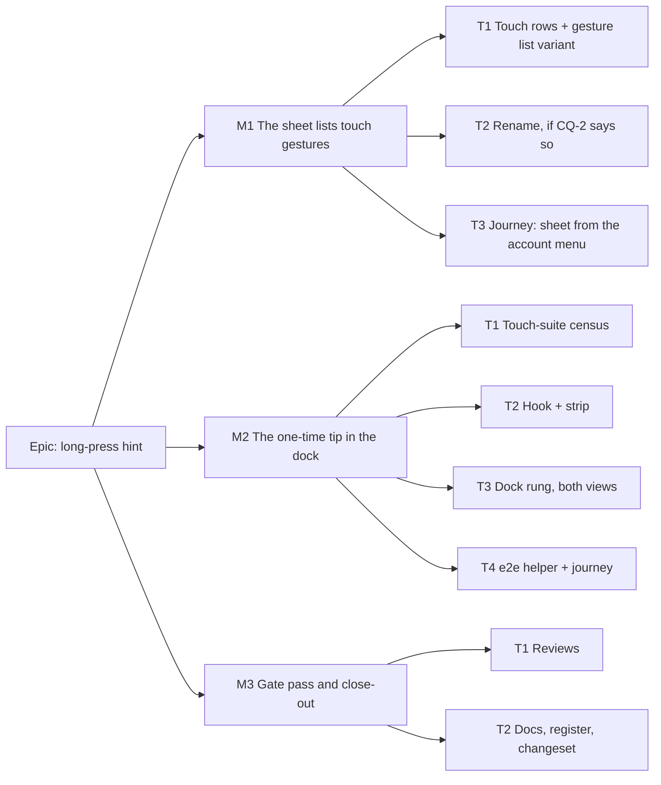

# Implementation Plan: Telling a touch user about press-and-hold

- **Feature spec:** [`./spec.md`](./spec.md)
- **Status:** Approved — by the product owner, 2026-11-01, every recommended answer: Q1 the tip stays until dismissed, then never returns on that device; Q2 rename the sheet "Diagram shortcuts and gestures" / "Gantt shortcuts and gestures" (account menu too); Q3 the Touch section is always shown. — awaiting approval before implementation.
- **Owner:** web (James Ewbank, product owner; built by the builder agent)

The plan is named `implementation-plan.md`, per the request, rather than the template's `implementation-plan.md`. `check:spec-status` P1 reads only `implementation-plan.md` (`scripts/check-spec-status.mjs:365`), so this file makes no claim that gate checks. The header above is a bare link, which is the form P1 treats as clean anyway.

## Breakdown

### Epic

**Long-press hint.** Close `docs/TECH_DEBT.md` #211's first item: a finger user is told, once, that holding a button names it, and can look the gestures up afterwards. No flag (ADR-0088 D1), no schema, no API.

---

### Milestone 1: The help sheet lists touch gestures (shippable slice)

**Outcome:** any member who opens the plan help sheet, in the diagram or the Gantt, sees a **Touch** section listing the finger gestures the product implements.
**Entry point:** account menu (the avatar chip in the header) → **"Diagram keyboard shortcuts"**, or **"Diagram shortcuts and gestures"** if CQ-2 renames it. The `?` key also opens it.
**Journey:** `apps/web/e2e-toolbar/touch-gestures.spec.ts` (new file in the existing `e2e-toolbar` suite, no new config). It opens a plan, opens the account menu, presses the item, and asserts the Touch section's rows by text in the diagram. It switches to the Gantt and asserts the Gantt rows. Then axe on the open dialog.

#### Feature: Touch section in `PlanShortcutsHelp`

> **Description:** `TOUCH_SHORTCUTS` (both views) and `GANTT_TOUCH_SHORTCUTS` (Gantt only), rendered as a `Touch` section in both branches of `PlanShortcutsHelp.tsx:196-298`.
> **Complexity:** S
> **Dependencies:** none
> **Risks:** a row describes a gesture the code does not implement → every row carries its evidence in a source comment (spec §2.5), and T1 step 1 reads the canvas handlers before deciding no canvas row exists.
> **Testing requirements:** unit (`PlanShortcutsHelp.test.tsx`), e2e journey, axe.

##### Task 1 — Touch rows and a gesture variant of `ShortcutList` (≈ one PR)

- **Description:** add the rows; add `variant: 'keys' | 'gesture'` to the file-local `ShortcutList`. `gesture` drops `font-mono whitespace-nowrap` (`PlanShortcutsHelp.tsx:183`) so a sentence wraps inside a `max-w-md` dialog at 1024. The Touch section shows read-only and editing alike (CQ-3 default: whatever the pointer). Exception: the Gantt's "Tap a bar, then drag it" and "Double-tap a cell" rows show only where the Edit section does (`:225`).
- **Complexity:** S
- **Dependencies:** —
- **Risks:** layout of a long gesture phrase in the two-column grid → `gesture` rows use the same grid; the journey checks no horizontal scroll inside the dialog at 1024 × 600.
- **Testing:** `PlanShortcutsHelp.test.tsx`: the Touch heading and rows in both views; the Gantt edit-only rows absent when `editingEnabled={false}`; no `font-mono` on a gesture `dt`.
- **Development steps:**
  1. Read `features/tsld/components/TsldCanvas.tsx` and its pointer hooks for any `pointerType === 'touch'` branch. Add a diagram row only for a behaviour the code proves; record the finding in the PR either way.
  2. Add the arrays with the evidence comments from spec §2.5.
  3. Add the variant and the two sections.
  4. Unit tests.

##### Task 2 — Rename the sheet and its menu item (only if CQ-2 = rename)

- **Description:** `PlanShortcutsHelp.tsx:217`, `:247` titles → "Gantt shortcuts and gestures" / "Diagram shortcuts and gestures". The `?` row's action at `:28` and `:157` → "Show this help". `account-chip.tsx:175` → "Diagram shortcuts and gestures". The menu item keeps the diagram's name in both views, as today.
- **Complexity:** S
- **Dependencies:** Task 1
- **Risks:** a locator by the old name breaks → known consumers are `e2e/tsld.spec.ts:126,128`, `PlanShortcutsHelp.test.tsx`, `account-chip.test.tsx` and `TsldPanel.a11y.test.tsx:194-197` (comment). Re-grep `keyboard shortcuts` across `apps/web/` before landing.
- **Testing:** the updated unit tests; `scripts/e2e-local.sh web` for `e2e/tsld.spec.ts`.
- **Development steps:**
  1. Grep, rename, update tests.
  2. The `Keyboard` icon on the menu item stays: the sheet is still mainly keys.

##### Task 3 — The M1 journey

- **Description:** `e2e-toolbar/touch-gestures.spec.ts`, test 1 (the M1 half). It opens the sheet **from the account menu**, not with `?` (ADR-0081: the seam between the entry point and the surface is what a unit suite cannot see), in both views, and runs axe on the dialog.
- **Complexity:** S
- **Dependencies:** Tasks 1–2
- **Risks:** none beyond the suite's own setup → reuse `e2e-toolbar/toolbar.spec.ts`'s `onboard` / `openNewPlan` helpers.
- **Testing:** `scripts/e2e-local.sh web:toolbar`.
- **Development steps:**
  1. Write the test.
  2. Run it red first by asserting a row that does not exist yet, then green.
  3. Changeset (`@repo/web` minor: "The plan help sheet lists the touch gestures").

---

### Milestone 2: The one-time tip in the dock (shippable slice)

**Outcome:** the first time a finger touches an open plan on a device, a strip in the foot row says that holding a button shows its name. It offers **Touch gestures** and **Dismiss this tip**, and once dismissed it never returns on that device.
**Entry point:** the strip itself, which appears on the first `pointerType: 'touch'` press in a plan workspace (diagram or Gantt). Its **Touch gestures** button opens M1's section.
**Journey:** `e2e-toolbar/touch-gestures.spec.ts`, test 2 (below, Task 4).

#### Feature: First-touch tip

> **Description:** a workspace hook that arms one capture listener while unseen, a `NoticeStrip` component, and a new lowest dock rung in both views.
> **Complexity:** M
> **Dependencies:** M1 (the button opens its section)
> **Risks:** (1) existing touch journeys see a new strip and change outcome → Task 1's census comes first; (2) focus lost when the strip unmounts itself → `restoreFocus={focusPlanSurface}` (the `PlacementMigrationNotice` contract); (3) the strip costs the diagram height at 1024 → measured and recorded by the journey; the cost is the same as every dock strip's and is transient.
> **Testing requirements:** unit (hook, `resolveDockStrip`, strip, host wiring); e2e journey in both views with axe; the census suites green.

##### Task 1 — Touch-suite census (no product code)

- **Description:** for each of the five spec files that deliver a real touch press, decide whether a dock strip appearing after the first touch changes an assertion. The files are `e2e-toolbar/toolbar.spec.ts:272-279`, `e2e-gantt-editing/touch.spec.ts`, `e2e-narrow-shell/narrow-shell.spec.ts:997,1724`, `e2e-workspace-fit/dividers.spec.ts:208,220` and `e2e-gantt/column-widths.spec.ts:552`. They are the complete grep for `.tap(`, `dispatchTouchEvent`, `touchscreen.` and `pointerType: 'touch'` across `apps/web/e2e*/`. Write the verdict per test in the PR description. Re-run the grep at the start of the task; if it has grown, the census grows with it.
- **Complexity:** S
- **Dependencies:** —
- **Risks:** a geometry assertion reads a box before the tap and acts after it → the remedy is the helper from Task 4 in that `describe`, never a widened tolerance.
- **Testing:** n/a (an analysis feeding Task 4).
- **Development steps:**
  1. Re-run the grep.
  2. Read each touching test: does it measure the foot row, the canvas height or a dock locator after its first touch?
  3. List the `describe`s that need `acknowledgeTouchHint`.

##### Task 2 — `useTouchGestureHint` and `TouchGestureHint`

- **Description:**
  - `components/layout/workspace/use-touch-gesture-hint.ts` returns `{ due, dismiss }`. It wraps `useFirstUseHint('touch-gestures')` (`features/tsld/toolbar/use-first-use-hint.ts:34-49`). The effect attaches `document.addEventListener('pointerdown', onDown, true)` only while `unseen && !due`. `onDown` acts only on `event.pointerType === 'touch'` and never calls `preventDefault` or `stopPropagation`. The listener is removed on the first touch and in cleanup.
  - `components/layout/workspace/touch-gesture-hint.tsx` is composed as `PlacementMigrationNotice.tsx:112-141`: a `NoticeStrip tone="info"` with no role, an outline `sm` **Touch gestures** (`aria-haspopup="dialog"`), and a ghost icon ✕ (`aria-label="Dismiss this tip"`) calling `onDismiss()` then `restoreFocus?.()`.
- **Complexity:** S
- **Dependencies:** none in code; Task 1's census is written first so it reads the suites before they move
- **Risks:** CQ-1 answered "once per session" → swap `useFirstUseHint` for a `sessionStorage` take like `touch-note.ts:21-29`; the hook's API is unchanged. CQ-1 answered "show once" → `markSeen()` at the moment `due` flips.
- **Testing:** hook unit tests, each verified red first:
  - a mouse or pen `pointerdown` leaves `due` false;
  - a touch press sets it;
  - the listener is gone after the first touch (spy on `removeEventListener`);
  - nothing is attached when already seen;
  - unmount removes the listener;
  - the press is not `defaultPrevented`.
  Strip unit tests: the accessible names, no `role`, dismiss calls both callbacks in order.
- **Development steps:**
  1. Write the hook and its tests.
  2. Write the strip and its tests.
  3. Copy per spec §6 default 4; the ux-reviewer may tune the words at the gate.

##### Task 3 — The dock rung, in both views

- **Description:** add `'touch-hint'` to `DockStrip` and `hasTouchHint` to `DockStripInput` in `features/tsld/model/dock-strip.ts`. Add the last rung after `placement-migration` (`:158`), with a docblock paragraph in the file's style. Add the `touchGestureHint` prop to `TsldPanel` (documented like `:372-386`), feed `resolveDockStrip` (`:1907-1918`), and render it beside `:3643`. In `plan-workspace-toolbar.tsx`, call the hook, build the node with `restoreFocus={focusPlanSurface}` (`:597`) and the open callback `showShortcuts` (`:1148`), pass it to `TsldPanel`, and append it to the Gantt chain (`:2088`).
- **Complexity:** S
- **Dependencies:** Task 2
- **Risks:** the Gantt chain and `resolveDockStrip` disagree on order → both put it last; a host wiring test renders each view with every other strip absent, then with each present, and asserts which one shows.
- **Testing:** `dock-strip.test.ts`: the new rung loses to every other input and wins alone (an exhaustive pairwise table, as the existing tests do). Host wiring test for both views.
- **Development steps:**
  1. Rung + tests (red first).
  2. `TsldPanel` prop.
  3. Host wiring in both branches + test.

##### Task 4 — e2e helper and the M2 journey

- **Description:**
  - `e2e-support/test.ts` gains `acknowledgeTouchHint(target: Page | BrowserContext)`. It is an `addInitScript` that writes `{"touch-gestures": true}` into `schedulepoint-hints`, modelled on `acknowledgeViewportNotice` (`:77-85`). It is a **function, not a fixture default**, because 71 spec files import `@playwright/test` directly. It is applied only to the `describe`s Task 1 listed.
  - `e2e-toolbar/touch-gestures.spec.ts`, test 2:
    1. Fresh context: dispatch a `mouse` and a `pen` `pointerdown` on the canvas → no strip.
    2. Dispatch a `touch` `pointerdown` on a deck glyph → the strip appears in the dock region; that glyph's own command outcome is unchanged (reuse the toolbar suite's data-date-marker oracle, `toolbar.spec.ts:266-288`).
    3. **Touch gestures** → the sheet's Touch section is visible → Escape → focus is on **Touch gestures** (asserts the native-dialog restore the spec does not assume).
    4. Record the foot-row height with the strip at 1024 × 600, fine, then under `hasTouch`. Assert every strip control is hit-testable at centre and corners and the foot row has no sideways scroll. Repeat at text-only 200 %.
    5. ✕ → strip gone; focus on the plan surface; reload; touch again → no strip.
    6. Same flow in the Gantt view in a fresh context → the strip appears in the Gantt dock.
    7. axe on the workspace with the strip up.
- **Complexity:** M
- **Dependencies:** Tasks 1–3
- **Risks:** Playwright has no native long-press, and `dispatchEvent` with `pointerType` is the method the suite already trusts (`toolbar.spec.ts:225-231`) → it exercises the real listeners in a real browser. **No device step is introduced**: the trigger keys on `pointerType`, which the journey sets exactly.
- **Testing:** `scripts/e2e-local.sh web:toolbar`, plus every suite Task 1 named (`web:gantt-editing`, `web:narrow-shell`, `web:workspace-fit`, `web:gantt`).
- **Development steps:**
  1. Helper.
  2. Apply it per the census.
  3. Journey, red first: run it before Task 3's wiring lands, and it must fail at step 2.
  4. Run the census suites locally and record the results.
  5. Changeset (`@repo/web` minor: "A finger's first touch in a plan explains press-and-hold, once").

---

### Milestone 3: Gate pass and close-out

**Outcome:** reviewed, documented and the register updated.
**Entry point:** M1's and M2's, unchanged. M3 adds no capability; it is the review and close-out of the two that do.
**Journey:** M1 and M2's, re-run on the final head.

##### Task 1 — Specialist reviews (before release)

- **Description:** run **ux-reviewer** (copy, rung placement, Touch rows); **accessibility-reviewer** (no live role for a condition, ADR-0132; focus on dismiss, ADR-0135; the dialog's restore; 2.5.8 target size under coarse; 1.4.4 and 1.4.10 at 1024); **component-reviewer** (the strip composes `NoticeStrip` and `Button` with no one-off styling; the `ShortcutList` variant). Run **performance-reviewer** only to confirm the listener lifetime. No backend reviewers: there is no API.
- **Complexity:** S
- **Dependencies:** M2
- **Risks:** a reviewer asks for a `useTooltip` signal ("already long-pressed") → that is the ADR-0111 path, and is declined by spec §2.3 unless the owner reopens it.
- **Testing:** fold blocking findings with regression tests.
- **Development steps:** 1. Run the reviewers. 2. Fold. 3. Re-run `pnpm prepush` and the e2e suites above.

##### Task 2 — Docs, register, changeset

- **Description:**
  - `docs/UX_STANDARDS.md:110-117`: one sentence — the product teaches the long-press once, on the first finger press in a plan, in the dock, and lists it in the help sheet's Touch section.
  - `docs/DESIGN_SYSTEM.md` §Tooltips (`:1579-1591`): the same, one sentence.
  - `docs/DECISIONS.md`: the decision and the three CQ answers.
  - `docs/TECH_DEBT.md` #211: strike the first item as **CLOSED** with the commit and the journey cited. The row stays **open** on its second item, its Size becomes `S ×1`, and the `Verified` line is updated.
  - Spec and plan headers → `Approved — shipped in PR #NNN (no ADR was proposed, so the header stays Approved …)`. This follows `docs/specs/edited-since-calculated/feature-spec.md:3`. `Accepted` without an ADR fails `check:spec-status` S4 (`scripts/check-spec-status.mjs:310-320`). If the owner asks for the optional ADR (spec §4.6), use `Accepted — shipped (ADR-NNNN)` instead.
- **Complexity:** S
- **Dependencies:** Task 1
- **Risks:** a stale cite in #211 → re-open every `path:line` the row keeps (its own convention).
- **Testing:** `pnpm prepush` (includes `check:doc-links`, `check:spec-status`, `check:debt-status`).
- **Development steps:** 1. Edit. 2. Prepush. 3. Push via `pnpm prepush:push`.

## Sequencing & slices

M1 → M2 → M3, one PR per task where practical (M1-T1–T3 can be one PR; M2-T2–T4 one PR after T1's census). Each milestone leaves `main` releasable.

- M1 alone is a strict improvement: the reference exists, reached as today.
- M2 needs M1's section for its button to land somewhere useful.

**No flag** (ADR-0088 D1). The rollback is the commit boundary between M1 and M2. Model routing (CLAUDE.md §19.14): build with the **builder** agent (Sonnet); reviews as listed. No **database-architect** run: there is no schema change.

## Definition of Done (per task)

Each task's PR must satisfy the Feature Completion Criteria in [`docs/PROCESS.md`](../../PROCESS.md): code, tests, docs, security, performance, accessibility, Docker build, CI, changelog and version impact. "Tests" means `pnpm prepush` was run, plus `scripts/e2e-local.sh web:<suite>` for every suite named above.

## Risks & assumptions (rollup)

| Risk / assumption                                                                                                     | Likelihood | Impact | Mitigation                                                                                                     |
| --------------------------------------------------------------------------------------------------------------------- | ---------- | ------ | -------------------------------------------------------------------------------------------------------------- |
| An existing touch journey changes outcome because a strip appears                                                     | med        | med    | M2-T1 census of the five files; `acknowledgeTouchHint` per `describe`; no widened tolerances                     |
| The strip costs the diagram a foot-row line at 1024 × 600                                                             | med        | low    | lowest rung, dismissible, never returns; height recorded by the journey (ADR-0142)                              |
| A Touch row names a gesture that does not exist (e.g. a canvas gesture)                                                | low        | med    | evidence comment per row; M1-T1 step 1 reads the canvas handlers first                                          |
| The tip shows to someone who already knew the gesture                                                                  | med        | low    | one dismissal; detecting it needs a `useTooltip` change (ADR-0111), declined                                     |
| Trigger keyed on the media query would miss the cover-on Surface                                                       | —          | —      | designed out: keyed on `pointerType` (ADR-0177 D1)                                                              |
| The owner is asked to verify on a device                                                                               | —          | —      | designed out: every behaviour keys on an event Playwright sets exactly                                          |
| `localStorage` blocked                                                                                                  | low        | low    | fail-open (`use-first-use-hint.ts:28-30`); the tip may reappear, never fails to show                              |
