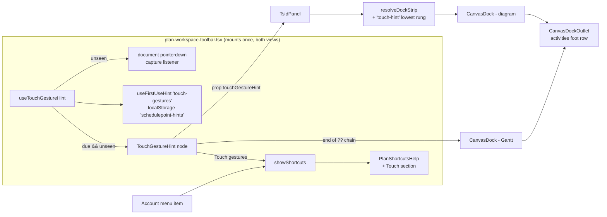
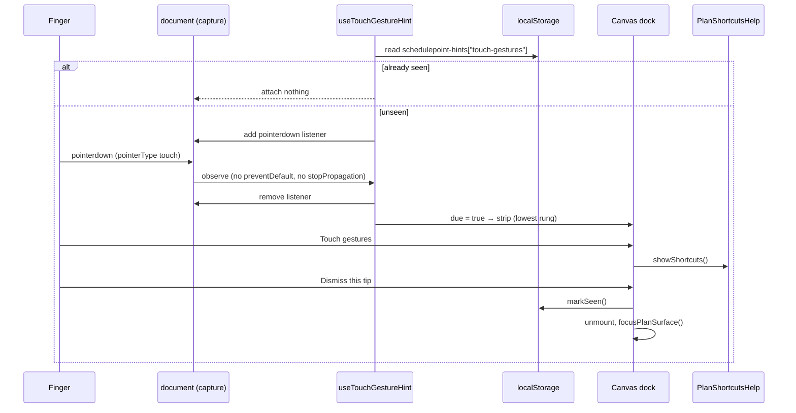
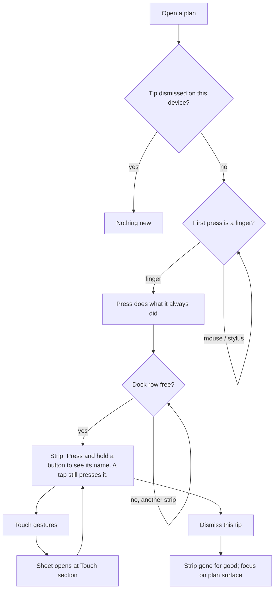

# Feature Spec: Telling a touch user about press-and-hold

- **Status:** Approved — by the product owner, 2026-11-01, every recommended answer: Q1 the tip stays until dismissed, then never returns on that device; Q2 rename the sheet "Diagram shortcuts and gestures" / "Gantt shortcuts and gestures" (account menu too); Q3 the Touch section is always shown. — awaiting approval before implementation.
- **Author(s):** Claude Code (feature-analyst), for James Ewbank (product owner)
- **Date:** 2026-11-01
- **Tracking issue / epic:** `docs/TECH_DEBT.md` #211, first surviving item ("The touch long-press has no visible affordance and no documentation a user would find")
- **Roadmap link:** none — a register row the product owner chose to build
- **Related ADR(s):** ADR-0117 (icon-only controls name themselves), ADR-0204 (shaded controls say why), ADR-0177 (a finger drags what it has selected — D1 posture independence, D2 the Gantt's touch hint), ADR-0179 (1024 × 600 floor), ADR-0092 (the canvas dock), ADR-0132 (event vs condition), ADR-0081 (entry point + journey), ADR-0088 D1 (no flag), ADR-0111 (primitive review before release). **No new ADR is required** (see §4.6); an optional outline is given in case the owner wants the teaching rule recorded as one.

Implementation plan: [`implementation-plan.md`](./implementation-plan.md), beside this spec.

**Why this is a full spec and not a register fold.** It adds a user-facing entry point (a dock strip that appears on its own) and changes copy in a shipped dialog. Both are ADR-0105 triggers (CLAUDE.md §19.1). It adds no schema, no endpoint and no Playwright config.

---

## 1. Business understanding

### Problem

The product has a "tell me about this" gesture for a finger, and it tells nobody that the gesture exists.

**What the gesture is.** `useTooltip` treats a touch press held for 500 ms (`TOOLTIP_LONG_PRESS_MS`, `apps/web/src/components/ui/tooltip.tsx:147`) as a request to show the control's name. It opens the tip and swallows the click that the lift would fire (`tooltip.tsx:457-463`, `:496-508`). A plain tap fires the command and shows nothing (`tooltip.tsx:31-35`, `:479-482`). Only `pointerType === 'touch'` takes this path. A stylus takes the hover path (`tooltip.tsx:436-443`).

**Who it matters to.** These controls have no visible label and no other way for a finger to learn their names:

| Population                                                                                                                                                                                      | Count today                                         | Evidence                                                                                                                                                                                                                                                                                                                                     |
| ----------------------------------------------------------------------------------------------------------------------------------------------------------------------------------------------- | --------------------------------------------------- | -------------------------------------------------------------------------------------------------------------------------------------------------------------------------------------------------------------------------------------------------------------------------------------------------------------------------------------------- |
| Toolbar items with `labelVisibility: 'never'` (icon-only at every width)                                                                                                                       | **13 production items** (16 non-test hits; 3 are comments) | `tsld-toolbar-items.tsx` `:479` Resource view, `:578` Minimap, `:2878` Undo, `:2895` Redo, `:3107` Zoom out, `:3119` Zoom in, `:3131` Fit to plan, `:3644` Plan summary, `:3673` Edit plan details, `:3732` Settings…, `:3795` Comments; `selection-actions.tsx` `:981` Make milestone…, `:1302` Float paths. The 3 comments are `selection-actions.tsx:966,1205` and `tsld-toolbar-items.tsx:3093`. |
| Items that are icon-only **only under a coarse pointer** (`'roomy-fine'` → `pointer-coarse:sr-only`, `toolbar-styles.ts:534`)                                                                    | 2                                                   | `tsld-toolbar-items.tsx:403` Baseline, `:3568` Apply levelled dates…                                                                                                                                                                                                                                                                         |
| Every production `useTooltip` call site (the long-press reaches all of them, not only the toolbar)                                                                                              | 18 call sites in 12 files; 17 with long-press live | grep `useTooltip(` outside tests. `GanttCell.tsx:314` uses `opensOn: 'request'`, which turns the long-press off (`tooltip.tsx:443`).                                                                                                                                                                                                          |

Some of the 13 are conditional. Comments needs `TOOLBAR_QUICK_WINS` and `NOTES` (`tsld-toolbar-items.tsx:3789-3797`). Float paths needs `FLOAT_PATHS` (`selection-actions.tsx:1293`). Resource view needs `CANVAS_RESOURCE_VIEW` (`:457`). Make milestone… appears only for a zero-duration task (`selection-actions.tsx:986`). The row's own 2026-10-31 note said "thirteen sites" and did not re-count the blast radius. This table is that re-count.

**The same class, one surface over.** `HierarchyTree` opens a row's menu on a touch long-press (`features/navigator/components/HierarchyTree.tsx:33-34`, `:174-178`, `:398-406`, `:573-584`). It is lower stakes because its `⋯` stays visible under a coarse pointer (`:675-678`). The Gantt's press-and-hold row menu (ADR-0177 D3) is the only gesture the product already names to a user: `TOUCH_ARM_HINT = 'Drag to move, or press and hold for actions'` (`features/gantt/model/touch-note.ts:10`). It appears once per session, in the Gantt's status line, when a finger selects a movable bar (`GanttPanel.tsx:512-538`, `:1528-1535`).

**The problem statement, re-verified (CLAUDE.md §19.11).** A grep of user-facing strings in `apps/web/src` for `hold`, `long press` and `long-press` finds exactly one gesture sentence, `TOUCH_ARM_HINT`. Nothing in the product mentions the tooltip long-press. The developer docs do describe it: `docs/UX_STANDARDS.md:110-117` and `docs/DESIGN_SYSTEM.md:1581-1587`. So the accurate finding is the one #211's 2026-09-11 note reached: no **user-facing** surface names it.

**Why the obvious home does not work on its own.** The shortcuts sheet is `PlanShortcutsHelp`. It is **defined** in `components/layout/workspace/PlanShortcutsHelp.tsx:196`; the brief placed it in `plan-workspace-toolbar.tsx`, which only **mounts** it, once for the workspace (`plan-workspace-toolbar.tsx:2724-2729`). The sheet has two entry points:

- the `?` key, which a finger does not have;
- an account-menu item named **"Diagram keyboard shortcuts"** (`components/layout/account-chip.tsx:172-177`), which a touch user has no reason to open.

Its titles say "keyboard" in both views (`PlanShortcutsHelp.tsx:217`, `:247`). A section added there alone would be documentation that a touch user would not find, which is the defect restated.

**Why it is not a defect.** It degrades gracefully: a tap still fires the command. That is why the row filed it as an unadvertised affordance. The owner has now chosen to build it.

### Users

All organisation roles who open a plan workspace: **Org Admin, Planner, Contributor, Viewer** (ADR-0016). Nothing here writes, so there is no role difference. **External Guest** is out of scope. The share view has no toolbar and no `useTooltip` consumer: a grep of `features/share` for `useTooltip|Toolbar` returns nothing.

The persona is the owner's own case: a Surface Pro used by finger, with and without the keyboard cover. **With the cover attached the Surface reports `pointer: fine`** (ADR-0177 Context, `docs/specs/gantt-coarse-pointer/device-results.md:18`). So anything keyed on the coarse-pointer media query would miss the owner in the posture they use most.

### Primary use cases

1. A planner touches the plan workspace with a finger for the first time on a device. They are told once, in a place that costs the diagram nothing, that holding a button shows its name without pressing it.
2. A planner who wants the full list of finger gestures (button names, the Explorer row menu, the Gantt's tap-then-drag, press-and-hold and double-tap) finds it in the help sheet. They reach it from the tip, or later from the account menu.
3. A planner who has read the tip dismisses it and never sees it again on that device.

### User journeys

**Happy path.** Open a plan → touch anything in the workspace (a bar, a toolbar glyph, the canvas) → whatever that touch does happens as before → a strip appears in the foot row: _"Press and hold a button to see its name. A tap still presses it."_ with **Touch gestures** and **✕ Dismiss this tip** → press **Touch gestures** → the help sheet opens and shows the **Touch** section → close it → press ✕ → the strip goes and focus lands on the plan surface. It does not come back on this device.

**Alternates.**

- **Mouse and keyboard only:** the strip never appears. The sheet's Touch section is reachable but nobody is pushed to it.
- **Another strip is showing** (a conflict, an armed tool, an undo result, an overlap notice, the Arrange offer, the migration notice): the tip waits on the dock's lowest rung and appears when the row is free.
- **Gantt view:** the same strip, in the Gantt's dock. The Gantt's own once-per-session bar hint (ADR-0177 D2) is unchanged and is a separate line in the Gantt's status row.

See the user-flow diagram in §4.3.

### Expected outcomes

A touch user learns, without looking for it, the one gesture that names every icon-only control. A permanent reference also exists, reached from a menu item whose name says it covers gestures (subject to CQ-2).

### Success criteria

- The strip appears after the **first touch** pointer press in a plan workspace on a device that has not dismissed it. It does not appear for a mouse or a stylus. Proved by the journey, which dispatches `pointerType: 'touch'` / `'mouse'` / `'pen'` events in a real browser (the method `e2e-toolbar/toolbar.spec.ts:272-279` already uses).
- After dismissal it never appears again on that browser profile, across reloads. Proved by the journey.
- The Touch section lists only gestures the code implements, each cited (§2.5).
- At 1024 × 600, fine and coarse, every control in the strip is hit-testable and the foot row does not scroll sideways. The foot-row height with the strip showing is **recorded** by the journey (ADR-0142: measured, not assumed).
- No existing journey changes outcome. Proved by the touch-suite census in plan M2-T1 and a green run of those suites.
- **No step requires the owner to try anything on a device.** Every claim above is proved in Playwright or a unit test.

### Open questions

Three **critical** questions for the owner are at the end of this document (§6). Everything else has a stated default (§6, "Engineering defaults").

---

## 2. Functional requirements

### 2.1 User stories & acceptance criteria

> **US-1 — the tip** — As any member who opens a plan on a touchscreen, I want to be told once that holding a button shows its name, so that the icon-only controls stop being a guessing game.
>
> - **Given** a plan workspace is open and this browser profile has not dismissed the tip, **when** a `pointerdown` with `pointerType === 'touch'` lands anywhere in the document, **then** the touch does exactly what it did before (it is observed in the capture phase, never prevented or stopped), and a strip appears in the dock reading _"Press and hold a button to see its name. A tap still presses it."_
> - **Given** the same, **when** the press is `pointerType` `'mouse'` or `'pen'`, **then** nothing appears. The stylus is excluded because `useTooltip`'s long-press is touch-only (`tooltip.tsx:443`), so the tip would teach a stylus a gesture it does not have.
> - **Given** the strip is showing, **when** a conflict, an undo/redo result, an armed tool, an overlap notice, the empty-plan notice, the Arrange offer or the migration notice wants the dock, **then** that strip shows and the tip waits (the lowest rung, §4.4).
> - **Given** the strip is showing, **when** the planner presses **Touch gestures**, **then** the help sheet for the current view opens, the strip stays, and on close focus returns to **Touch gestures**. `Dialog` is a native `<dialog>` (`components/ui/dialog.tsx:10-17`) and adds no restore logic of its own, so this rests on the browser's close behaviour. The journey asserts it rather than this spec assuming it.
> - **Given** the strip is showing, **when** the planner presses **Dismiss this tip**, **then** the strip unmounts, focus moves to the plan surface (`focusPlanSurface`, `plan-workspace-toolbar.tsx:597`, as `PlacementMigrationNotice` does at `PlacementMigrationNotice.tsx:127-136`), and the dismissal is written to device storage.
> - **Given** the tip was dismissed, **when** the planner reloads, opens another plan or switches view, **then** it does not appear, and no listener is attached at all.
> - **Given** storage is blocked or corrupt, **then** the tip still works for the session and may appear again next load. That is `useFirstUseHint`'s fail-open rule (`features/tsld/toolbar/use-first-use-hint.ts:5-8`, `:28-30`), the harmless direction.

> **US-2 — the reference** — As a planner who uses a finger, I want the help sheet to list the touch gestures, so that I can look them up after the tip has gone.
>
> - **Given** the diagram's sheet is open, **then** a **Touch** section lists: _Press and hold a button — see its name without pressing it_; _Press and hold a row in the Project Explorer — open its actions_.
> - **Given** the Gantt's sheet is open, **then** its **Touch** section lists those two rows plus: _Tap a bar, then drag it — move it_; _Press and hold a row — open its actions_; _Double-tap a cell — edit it_.
> - **Given** either sheet, **then** the Touch section is shown whatever the pointer (default for CQ-3), and it is shown read-only and editing alike, except that the Gantt's "tap a bar, then drag" row appears only where the Edit section does (`editingEnabled`, `PlanShortcutsHelp.tsx:225`).
> - **Given** CQ-2 is answered "rename", **then** the account-menu item and both sheet titles read "… shortcuts and gestures".

### 2.2 Workflows

1. **Arm.** The workspace host mounts. If `useFirstUseHint('touch-gestures').unseen`, it adds **one** `pointerdown` listener on `document` in the capture phase. Otherwise it adds nothing.
2. **Fire.** On the first `pointerType === 'touch'` press the hook sets `due = true` and removes the listener.
3. **Show.** The host builds `<TouchGestureHint>` while `due && unseen`. It passes the node to `TsldPanel` (diagram) as a prop, the way `placementMigrationNotice` is passed (`TsldPanel.tsx:372-386`). `resolveDockStrip` decides whether it is the strip on show. In the Gantt it joins the host's own `??` chain at the end (`plan-workspace-toolbar.tsx:2082-2088`).
4. **Open the reference.** **Touch gestures** calls the same `showShortcuts` callback the account menu uses (`plan-workspace-toolbar.tsx:1148-1152`).
5. **Dismiss.** `markSeen()`, then `restoreFocus()`.

### 2.3 Edge cases

- **The first touch opens a modal** (for example a tap on Settings…). The strip mounts behind the modal, in the dock, and is there when the modal closes. Nothing overlays the scene (ADR-0092).
- **The first touch is a long-press.** The planner already knows the gesture. The strip still appears once; one dismissal is the whole cost. Detecting "already knew" would need a signal out of `useTooltip`, which is a shared-primitive change (ADR-0111) bought for one strip. Declined.
- **Hybrid device** (touch, then the keyboard cover): the strip stays until dismissed. It never moves focus on mount, so a keyboard user is not interrupted.
- **Plan switch**: the hook lives in the workspace host, which does not remount on a plan change (`plan-workspace-toolbar.tsx:1224-1227`). `due` carries over, which is right, because the tip is about the device and not the plan.
- **Two tabs**: each tab reads storage at mount. Dismissing in one does not hide it live in the other until that tab reloads. Accepted; it is a courtesy strip.
- **1024 × 600, coarse**: the dock outlet wraps rather than clipping (`canvas-dock.tsx:80-88`). Its floors are capped at `min(…, 100%)` (`:125-132`), so the strip takes its own line where the facts are wide. That cost is the same one every dock strip already pays. It is recorded by the journey, not assumed.
- **200 % text** (WCAG 1.4.4): covered by the same outlet rules (`canvas-dock.tsx:125-132`). The journey adds a text-only 200 % reading of the strip at 1024.

### 2.4 Permissions

No permission. Nothing is fetched or written, and there is no API call. Available to every authenticated member inside a plan workspace, read-only and editing alike. The pen (ADR-0028) is irrelevant: there is no plan write, structural or otherwise.

### 2.5 Validation rules

None — no input. **Copy rule:** every Touch row must name a gesture the code implements, with its evidence in the source comment beside the row (CLAUDE.md §19.11):

| Row                                                       | View         | Evidence                                                                                                                          |
| --------------------------------------------------------- | ------------ | --------------------------------------------------------------------------------------------------------------------------------- |
| Press and hold a button — see its name without pressing it | both         | `tooltip.tsx:31-35`, `:457-463`, `:496-508`                                                                                         |
| Press and hold a row in the Project Explorer — open its actions | both         | `HierarchyTree.tsx:398-406`, `:573-584`                                                                                            |
| Tap a bar, then drag it — move it                          | Gantt, editing | ADR-0177 D2; `TOUCH_ARM_HINT` `touch-note.ts:10`                                                                                    |
| Press and hold a row — open its actions                    | Gantt        | ADR-0177 D3; `docs/UX_STANDARDS.md:197-203`                                                                                         |
| Double-tap a cell — edit it                                | Gantt, editing | ADR-0177 Consequences ("a double tap on a cell opened a text box on the device"); `PlanShortcutsHelp.tsx:162-165` (double-click) |

**No diagram-canvas gestures are listed.** The TSLD canvas owns every gesture (`touch-none`, `docs/UX_STANDARDS.md:203-205`) and nothing names a canvas finger gesture beyond what a mouse does. M1-T1 reads the canvas pointer handlers, and a row is added only if the code shows a finger-specific behaviour. Inventing one would be the wrong-claim class ADR-0076 names.

### 2.6 Error scenarios

| Scenario                              | Detection                         | User-facing result                                | Status |
| ------------------------------------- | --------------------------------- | ------------------------------------------------- | ------ |
| `localStorage` blocked / corrupt      | `try`/`catch` in `useFirstUseHint` | tip may reappear next load; dismiss still works for the session | n/a    |
| No dock outlet (legacy stacked layout, isolated unit mounts) | `CanvasDock` fallback (`canvas-dock.tsx:148-152`) | strip renders in place; parity contract unchanged | n/a    |
| Workspace unmounts with the listener armed | effect cleanup                     | listener removed; nothing leaks                   | n/a    |

---

## 3. Technical analysis

| Area           | Impact | Notes                                                                                                                                                                                                                                                                                                                          |
| -------------- | ------ | ------------------------------------------------------------------------------------------------------------------------------------------------------------------------------------------------------------------------------------------------------------------------------------------------------------------------------- |
| Frontend       | low    | One new hook, one new strip component, one new `DockStrip` value and `DockStripInput` field (`features/tsld/model/dock-strip.ts:4-58`), one `TsldPanel` prop, host wiring in two dock chains, a Touch section in `PlanShortcutsHelp`, and a gesture variant of its local `ShortcutList` (its `dt` is `font-mono whitespace-nowrap`, `PlanShortcutsHelp.tsx:183`, wrong for sentences). The CQ-2 rename touches `account-chip.tsx:175` and two titles. |
| Backend        | none   | —                                                                                                                                                                                                                                                                                                                               |
| Database       | none   | No schema change. Device storage reuses the existing `schedulepoint-hints` key (`use-first-use-hint.ts:19`). No new storage key.                                                                                                                                                                                         |
| API            | none   | —                                                                                                                                                                                                                                                                                                                               |
| Security       | none   | No input, no network, no secrets. Storage holds `{ "touch-gestures": true }` and nothing identifying.                                                                                                                                                                                                                             |
| Performance    | none   | One capture-phase `pointerdown` listener, only while unseen, removed on the first touch. Not on any render path. No bundle change beyond a few hundred bytes of copy and JSX, inside the existing workspace chunk.                                                                                                              |
| Infrastructure | none   | No flag (ADR-0088 D1), no config, no CI step.                                                                                                                                                                                                                                                                                       |
| Observability  | none   | —                                                                                                                                                                                                                                                                                                                               |
| Testing        | med    | Unit: hook, `resolveDockStrip`, strip, sheet. E2E: a new spec in the existing `e2e-toolbar` suite, plus a census of the five suite files that deliver real touch input (plan M2-T1).                                                                                                                                         |

**Recalc parity gate.** Not a scheduling input. `computeSchedule` is untouched and nothing here is imported by the engine. Parity holds trivially; no engine suite needs re-running for it.

**Shared primitives (ADR-0111).** The recommended design changes **no** shared primitive. `useTooltip`, `Dialog`, `NoticeStrip`, `Button`, `Menu` and `Toolbar` are used as they are. `PlanShortcutsHelp` and `ShortcutList` are feature-local. Accessibility-reviewer and component-reviewer still review the strip before release, because it is a new focusable surface that unmounts itself under focus (the ADR-0135 class). **If the owner instead picks the "tip anchored to the touched button" alternative (§4.7 B), that is a `useTooltip` change and ADR-0111 applies in full.**

### Dependencies

- None to land first. The dock rung pattern, `useFirstUseHint`, `focusPlanSurface` and `showShortcuts` all exist.
- M2's **Touch gestures** button opens the section M1 adds, so M1 lands first.

### E2E suites that cover the touched surface (grep of `apps/web/e2e*/`)

| Suite                                                    | What it covers here                                                                                                  | Effect                                                                                                    |
| -------------------------------------------------------- | -------------------------------------------------------------------------------------------------------------------- | --------------------------------------------------------------------------------------------------------- |
| `e2e/tsld.spec.ts:124-128`                               | opens the sheet with `?` and finds it **by name** "Diagram keyboard shortcuts"                                      | breaks only if CQ-2 renames; updated in the same task                                                     |
| `e2e-toolbar/toolbar.spec.ts:241-289`                    | the long-press journey: dispatches `pointerType: 'touch'`                                                            | **will now raise the tip**; census confirms the marker-x oracle is horizontal and unaffected               |
| `e2e-gantt-editing/touch.spec.ts`                        | CDP touch on the Gantt; reads the status line with a text filter (`:276`)                                           | tip raised; the strip has **no role** (§4.5), so no `getByRole('status')` collision                       |
| `e2e-narrow-shell/narrow-shell.spec.ts:997`, `:1724`     | `touchscreen.tap` at 320/640/1024 coarse, geometry asserted                                                         | tip raised mid-test; boxes are re-read per iteration — census confirms, else the suite acknowledges it     |
| `e2e-workspace-fit/dividers.spec.ts:208`, `:220`         | finger on the Explorer divider                                                                                       | tip raised; asserts focus and control size only                                                           |
| `e2e-gantt/column-widths.spec.ts:552`                    | CDP touch on a column divider                                                                                        | tip raised; census                                                                                        |
| `e2e-workspace-chrome/dock.spec.ts`                      | dock geometry and precedence                                                                                         | no touch input today (absent from the touch grep); unaffected; the new rung is asserted in unit tests      |
| `e2e-workspace-fit/command-surface.spec.ts` coarse describe (`:2523+`) | coarse 44 px sweep, deck lines                                                                       | no real touch press (absent from the touch grep); unaffected                                              |

Only five spec files deliver a real touch press. The grep for `.tap(`, `dispatchTouchEvent`, `touchscreen.` and `pointerType: 'touch'` across `e2e*/` returns exactly toolbar, gantt-editing/touch, narrow-shell, workspace-fit/dividers and gantt/column-widths. 71 spec files import `@playwright/test` directly rather than `e2e-support/test`, so a fixture default would not reach them. The opt-out is therefore a **helper function** like `acknowledgeViewportNotice` (`e2e-support/test.ts:77-85`), which `e2e-minimap/viewport-cluster.spec.ts:3,440` already imports from a direct-import file. It is applied only where the census finds an effect.

---

## 4. Solution design

### 4.1 Architecture overview

### 4.2 Data flow

### 4.3 User flow

### 4.4 Dock precedence

A new `DockStrip` value, `'touch-hint'`, and a `DockStripInput.hasTouchHint: boolean`. It sits **below `placement-migration`, the last rung**. The reason follows the function's own test (`dock-strip.ts:141-157`): every rung above is about the plan or the planner's last act, and this one is about the device. A courtesy must never cover a fact about the plan. It is dismissible and does not return, so it can afford to lose every contest.

The Gantt host's chain becomes `historyResultNotice?.node ?? layoutResolvedNotice ?? placementMigrationNotice ?? touchGestureHint`. That is the same order, last.

### 4.5 Component changes

- **`components/layout/workspace/use-touch-gesture-hint.ts`** (new). It returns `{ due: boolean; dismiss(): void }`. It wraps `useFirstUseHint('touch-gestures')` and owns the one listener: attached in an effect only while `unseen && !due`, removed on the first touch and on unmount. It does not import a `(pointer: …)` query, so `input-axis.structural.test.ts` is not engaged, and none is needed (ADR-0177 D1: gesture remedies key on `pointerType`).
- **`components/layout/workspace/touch-gesture-hint.tsx`** (new). A `NoticeStrip tone="info"`, composed exactly as `PlacementMigrationNotice.tsx:112-141`, with **no live-region role**. ADR-0132's discriminator classes it a condition: it states a standing fact about the product, not something that just happened. That also keeps it out of the Gantt's `role="status"` line. It has an outline `sm` button **Touch gestures** (`aria-haspopup="dialog"`) and a ghost icon button with `aria-label="Dismiss this tip"`. On dismiss it calls `onDismiss()` then `restoreFocus?.()`, in that order (`PlacementMigrationNotice.tsx:131-135`). It uses design-system parts only and no one-off styling. Coarse sizing comes from `Button`'s existing ADR-0118 axis.
- **`features/tsld/model/dock-strip.ts`**: the new value, the input and the rung, with a docblock paragraph in the file's style.
- **`features/tsld/components/TsldPanel.tsx`**: a `touchGestureHint?: React.ReactNode | null` prop, documented like `placementMigrationNotice` (`:372-386`). It is passed to `resolveDockStrip` and rendered beside `:3643`.
- **`components/layout/workspace/plan-workspace-toolbar.tsx`**: calls the hook, builds the node with `restoreFocus={focusPlanSurface}` and `onOpenGestures={showShortcuts}`, passes it to `TsldPanel`, and appends it to the Gantt chain.
- **`components/layout/workspace/PlanShortcutsHelp.tsx`**: `TOUCH_SHORTCUTS` and `GANTT_TOUCH_SHORTCUTS` arrays, with a `Touch` section in both branches; `ShortcutList` gains `variant: 'keys' | 'gesture'`, where `gesture` drops `font-mono whitespace-nowrap` so a sentence wraps at the 1024 floor. If CQ-2 is answered "rename", the titles change.
- **`components/layout/account-chip.tsx:175`**: menu copy, only if CQ-2 is answered "rename".

States: the strip has no loading, empty or error state; it either shows or does not. The sheet section is static.

### 4.6 Is this architecturally significant?

**No ADR by default.** Every mechanism is an existing one: a dock rung (ADR-0092 / `resolveDockStrip`), a first-use flag in the existing storage shape (`useFirstUseHint`'s docblock anticipates exactly this, `use-first-use-hint.ts:3-5`), and a section in an existing dialog. The decision is recorded in `docs/DECISIONS.md` and as one line in `docs/UX_STANDARDS.md` under "An icon-only control names itself" (`:110-117`).

**Optional ADR outline**, if the owner wants the teaching rule binding on future gestures: _"A gesture is taught once, on its input's first press, in the dock."_

- **Context:** #211; ADR-0177 D2's once-per-session precedent.
- **Decision:** keyed on `pointerType`, never on the media query (ADR-0177 D1); the dock's lowest rung; device-local; dismissed for good; the reference lives in the shortcuts sheet.
- **Consequences:** one storage key shared by all hints; e2e suites that touch must acknowledge it.

### 4.7 Approach & alternatives

**Recommended — A + B together, the least surface a finger would actually meet.** (A) the Touch section in the existing sheet, as the permanent reference. (B) a one-time dismissible strip on the first touch, as the discovery route, rendered in the existing dock and stored in the existing hints key. B without A teaches one gesture and leaves no reference once dismissed. A without B is the defect restated.

| Option                                                                                     | New surface                                                                   | Would a finger find it?                                                                                                     | Verdict                                                                                                                                                                                                 |
| ------------------------------------------------------------------------------------------ | ----------------------------------------------------------------------------- | --------------------------------------------------------------------------------------------------------------------------- | ------------------------------------------------------------------------------------------------------------------------------------------------------------------------------------------------------- |
| A alone — Touch section in the sheet, shown under a coarse pointer                         | one section                                                                   | **No.** Behind "Diagram keyboard shortcuts" and `?`. Also, gated on coarse it hides from the owner's Surface with the cover on (`pointer: fine`, ADR-0177 Context). | Necessary, not sufficient                                                                                                                                                                               |
| **B — one-time strip on first touch** (recommended, with A)                                | one dock strip, reusing the rung pattern and storage key                      | **Yes.** It arrives on the first touch, in either posture.                                                                  | Recommended                                                                                                                                                                                             |
| B′ — tip anchored to the button the finger just tapped, inside `useTooltip`                | a shared-primitive behaviour change                                            | Yes, very contextually                                                                                                      | Rejected. It changes the primitive's tap contract ("a tap fires and shows nothing", #131), the tapped command may open a dialog over it, and it needs ADR-0111 review for 17 call sites to teach one sentence. |
| C — a help/about page                                                                      | a route, a nav entry, a page                                                   | Only if someone goes looking                                                                                                 | Rejected: the most surface. No help or about route exists (a glob of `apps/web/src/routes` for `*help*`/`*about*` is empty).                                                                            |
| D — gate everything on `pointer: coarse`                                                   | —                                                                             | Misses the cover-on Surface                                                                                                  | Rejected by ADR-0177 D1. `input-axis.structural.test.ts` also refuses any second `(pointer:…)` / `(any-pointer:…)` spelling (`apps/web/src/styles/input-axis.structural.test.ts:79-109`).                  |

**No feature flag** (ADR-0088 D1): a `VITE_*` flag cannot be switched off in a published image, so it would be a second render path and never a rollback. The rollback is the commit boundary between M1 and M2.

---

## 5. Links

- Implementation plan: [`implementation-plan.md`](./implementation-plan.md)
- Register row: [`docs/TECH_DEBT.md`](../../TECH_DEBT.md) #211
- Docs this change updates: `docs/UX_STANDARDS.md` (interaction standards), `docs/DESIGN_SYSTEM.md` §Tooltips (one sentence: "the product teaches the long-press once, in the dock"), `docs/DECISIONS.md`, `docs/TECH_DEBT.md` #211.
- **#211's second item** (the blank 22 px marker strip on a no-marks export) is **out of scope and stays on the row**. It is a different surface (export paper, `features/tsld/export/render-export-image.ts:344`). Its only two remedies are new paper furniture (a design call) or reversing the geometry-stability decision in `docs/DECISIONS.md` that `export-image.test.ts:353-368` pins, per the row's own 2026-09-11 note. Neither shares a file, a reviewer or a journey with this work.

---

## 6. Critical questions for the owner

**CQ-1. Once someone has seen the touch tip, when should it stop appearing?**
_Recommended:_ it stays until they close it, and then never comes back on that device.
_Alternatives:_ (a) once per visit, like the Gantt's existing bar hint, so it comes back each time the browser is reopened; (b) it shows once and disappears by itself the next time the page loads, even if it was never closed.

**CQ-2. The help sheet is called "Diagram keyboard shortcuts". Should its name mention touch?**
_Recommended:_ yes. Rename it "Diagram shortcuts and gestures" (and "Gantt shortcuts and gestures"), in the account menu as well, so a finger user has a reason to open it after the tip has gone.
_Alternative:_ keep the current names and just add the Touch section inside.

**CQ-3. Should people using a mouse also see the Touch section in that sheet?**
_Recommended:_ yes, always. It is three to five short lines, and touchscreen laptops report themselves as a mouse.
_Alternative:_ show it only on a device where a finger has been used in the product.

### Engineering defaults (no answer needed)

1. The trigger is the first `pointerType === 'touch'` press anywhere while a plan is open. A stylus and a mouse never trigger it (ADR-0177 D1; `tooltip.tsx:443`).
2. Storage: the existing `schedulepoint-hints` localStorage key, entry `touch-gestures` (device-local, fail-open). No new key, nothing server-side, no schema.
3. Placement: the dock, lowest rung, in both views. It never overlays the scene, never takes focus on mount, and has no live-region role (ADR-0132 condition).
4. Copy: "Press and hold a button to see its name. A tap still presses it." / **Touch gestures** / "Dismiss this tip". The ux-reviewer may tune the words; the gestures may not change without code evidence.
5. **Touch gestures** opens the sheet for the current view and leaves the strip up. Only ✕ marks it seen. Focus goes to the plan surface on dismiss.
6. The Touch section lists only gestures the code implements (§2.5). No canvas gestures unless M1-T1 finds one.
7. Plan workspace only. The Explorer's long-press is listed in the sheet but triggers no tip on the Clients/Projects screens.
8. No flag (ADR-0088 D1). No ADR (§4.6). A changeset: `@repo/web` minor.
9. #211's export-strip item stays on the row.
10. Nothing in the plan asks the owner to check a device. Every behaviour is proved in a Playwright journey or a unit test.

**Awaiting approval before implementation.**
