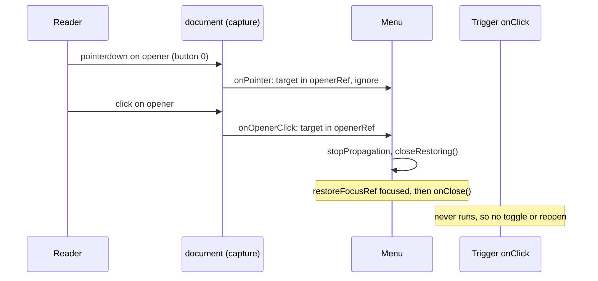

# Feature Spec + Plan: A menu's own trigger closes it (#229, Menu half)

- **Status:** Approved — by the product owner, 2026-10-17, with the recommended defaults (Q1: focus returns where Escape sends it; Q2: `openerRef` is a required prop, `null` allowed)
- **Author(s):** feature-analyst (Claude), for the product owner
- **Date:** 2026-10-17
- **Tracking:** `docs/TECH_DEBT.md` #229 (Menu half; the combobox half closed 2026-10-16)
- **Roadmap link:** none — maintenance of a shared primitive
- **Related ADR(s):** [ADR-0082](../../adr/0082-disabled-menu-items-stay-reachable.md), [ADR-0105](../../adr/0105-a-register-row-is-not-a-spec.md), [ADR-0111](../../adr/0111-a-primitives-keyboard-contract-is-reviewed-before-release.md), [ADR-0081](../../adr/0081-milestone-entry-point-and-journey.md), [ADR-0088](../../adr/0088-flag-classification.md)

## 0. How to read this

This is the sibling of [`shared-primitive-tidy` §D](../shared-primitive-tidy/spec.md), which
specified and shipped the combobox half of the same row. It is written in the same shape: problem
re-verified, acceptance criteria, design with alternatives, then a short plan.

Stated once:

- **Why a spec at all.** `Menu` gains a prop, which changes a shared component's public contract
  (an ADR-0105 trigger), and it changes where focus goes when a menu closes (ADR-0111 / CLAUDE.md
  §19.13: accessibility-reviewer before release).
- **Users and roles.** Every role that sees a menu today: Org Admin, Planner, Contributor, Viewer.
  External Guest sees no `Menu` (the guest view renders none — no `<Menu` under `features/share/`).
  No permission changes.
- **The pen (ADR-0028).** Not involved. No plan write is added, and nothing here is structural.
- **Recalc parity.** No scheduling input; no touched file imports `computeSchedule`.
- **No `VITE_*` flag** (ADR-0088 D1). The rollback is the commit boundary.
- **No API, schema, OpenAPI or migration change.** database-architect is not required.
- **Version impact.** `@repo/web` patch, one changeset.
- **Line numbers are as read on 2026-10-17.** The row warns its earlier citations were wrong when
  written; every citation below is also given by symbol.

### Critical questions for the owner

Only these two change what gets built. Everything else has a stated default in §3–§5.

1. **Where should the keyboard focus land after you close a menu by clicking its button?**
   **(a)** In the same place pressing Escape sends it — the button, or for a split button the
   main half, or for a row's `⋯` the row itself _(default)_. **(b)** Wherever the browser happens to
   put it, which differs between Chrome and Safari and, for the split buttons, lands on a part of
   the control the Tab key never visits.
2. **Should every menu be fixed in one change, with the code refusing to build if a future menu
   forgets?** **(a)** Yes: the new setting is mandatory on every menu, so all 15 menus are fixed
   together and a new one cannot be added without deciding _(default)_. **(b)** Make it optional
   and fix the 15 by hand; a future menu that forgets it silently gets today's flicker back.

---

## 1. Problem, re-verified

**The defect, read in `apps/web/src/components/ui/menu.tsx` (2026-10-17):**

- `Menu`'s global-listener effect (`menu.tsx:173-200`) registers `onPointer` as a **capture-phase**
  `pointerdown` listener on `document` (`:193`).
- `onPointer` (`:189-191`) calls `onClose()` for any target the panel (`ref.current`) does not
  contain. The trigger is never inside the panel — the panel is portalled to `portalTarget()`.
- So a press on the open menu's own trigger closes it at `pointerdown`, and the same press's
  `click` then reaches the trigger's `onClick`.

**What the click then does depends on the call site, and that matters for the fix:**

- **Toggle sites** call `useMenuTrigger().toggle` (`menu.tsx:113`), which reads `open` from the
  closure of the last render. Whether that render already reflects the `pointerdown` close depends
  on React flushing the discrete update before `click` arrives (reasoned: `pointerdown`, `mouseup`
  and `click` are separate tasks, so a microtask flush lands between them). If it has flushed,
  `toggle` reopens. **This is reasoned, not run** — T1 measures it in Chromium before anything
  claims it.
- **Open-only sites** reopen unconditionally, whatever React did. `RowActionsMenu`
  (`row-actions-menu.tsx:90-93`), `GanttRowMenu` (`GanttRowMenu.tsx:184-192`), the Project Explorer's
  `⋯` (`HierarchyTree.tsx:657-662`) and `ActivitiesTable`'s `RowActionsButton`
  (`ActivitiesTable.tsx:261-265`) all set an anchor on click; none of them reads the open state.

Either way the reader sees the menu blink and stay open, with focus jumped back to its first item.
The menu cannot be dismissed by the control that opened it, which is what `aria-expanded="true"` on
that control promises (APG Menu Button: activating the button toggles the menu).

**Why the obvious fix is wrong (the row's finding, confirmed).** The only related prop is
`restoreFocusRef` (`menu.tsx:122`, typed `:129`), which is where focus goes on Escape, Tab and
selection. It is **not always the opener**:

- **Split buttons** pass the main half: `selection-actions.tsx:363` (`IsolateControl`, Isolate logic
  path) and `tsld-toolbar-items.tsx:1012` and `:1187` (Add activity type, Link type). The caret
  opens the menu and is `tabIndex={-1}` (`selection-actions.tsx:332`; the `ToolbarSplitButton` caret
  via `caretRef={triggerRef}`, `tsld-toolbar-items.tsx:987`). `tsld-toolbar-authoring.test.tsx:262-297`
  records why focus must go to the main half.
- **Row menus restore to the row, not the `⋯`.** `HierarchyTree` sets `menuTriggerRef` to the
  treeitem (`HierarchyTree.tsx:373`). `GanttRowMenu` sets `restoreRef` to the `⋯` or, for a
  context-menu / long-press open, to the row (`GanttRowMenu.tsx:117-118`, `:136`, `:189`).

Excluding `restoreFocusRef` would therefore (a) leave the split-button caret broken, (b) make a press
on the split button's **main** half — a different command — fail to close the menu, and (c) for the
Gantt and Explorer, swallow a click on the **row** while its context menu is open.

**Population, measured** (`<Menu\b` in `apps/web/src`, tests excluded — 15 render sites, 10 files):

| #     | Site                                                     | Opener (what was pressed) | `restoreFocusRef` today    |
| ----- | -------------------------------------------------------- | ------------------------- | -------------------------- |
| 1     | `components/ui/row-actions-menu.tsx`                     | `triggerRef` (`⋯`)        | same                       |
| 2     | `components/layout/workspace/plan-actions-menu.tsx`      | `triggerRef`              | same                       |
| 3     | `components/layout/account-chip.tsx`                     | `triggerRef`              | same                       |
| 4     | `features/plan-actions/selection-actions.tsx` (Isolate)  | `triggerRef` (caret)      | `mainButtonRef`            |
| 5     | `features/gantt/components/GanttRowMenu.tsx`             | `triggerRef` (`⋯`)        | `restoreRef` (`⋯` or row)  |
| 6     | `features/navigator/components/HierarchyTree.tsx`        | the row's `⋯` (per row)   | `menuTriggerRef` (the row) |
| 7     | `features/activities/components/ActivitiesTable.tsx`     | `menuTriggerRef` (`⋯`)    | same                       |
| 8     | `features/organizations/components/OrgSwitcher.tsx`      | `triggerRef`              | same                       |
| 9–10  | `features/calendars/components/WeeklyShiftEditor.tsx` ×2 | `triggerRef`              | same                       |
| 11    | `tsld-toolbar-items.tsx` Add activity type               | `triggerRef` (caret)      | `mainButtonRef`            |
| 12    | `tsld-toolbar-items.tsx` Link type                       | `triggerRef` (caret)      | `mainButtonRef`            |
| 13–15 | `tsld-toolbar-items.tsx` Analysis, Export, History       | `triggerRef`              | same                       |

Six more files consume through `RowActionsMenu`/`MenuItem` and need no change of their own. Three
test files render `<Menu>` directly (`menu.test.tsx`, `menu.maxheight.test.tsx`,
`use-promotion-focus.test.tsx`; 26 renders).

**Nothing pins today's behaviour.** No unit or Playwright test was found that presses an open
menu's trigger a second time (grep of `*.test.tsx` and `e2e*/**/*.spec.ts` for second-press /
reopen wording; the `reopen` helpers under `measure-toolbar/` reopen the pen, not a menu). The
nearest case, `menu.test.tsx:235` "a pointer press outside closes the menu", stays true.

## 2. Outcome and acceptance criteria

- **Given** an open menu **when** the reader clicks or taps its trigger **then** the menu closes,
  stays closed, the trigger reads `aria-expanded="false"`, and focus is on the menu's
  `restoreFocusRef` target — the same place Escape puts it (question 1 default).
- **Given** a split button's menu is open from its caret **when** the reader presses the caret
  **then** the menu closes and focus is on the **main** half, never the `tabIndex={-1}` caret.
- **Given** that menu **when** the reader presses the **main** half instead **then** the menu
  closes (as today) **and** the main half's own command runs (as today).
- **Given** a Gantt or Explorer row menu opened by right-click or long-press **when** the reader
  presses that row's `⋯` **then** the menu closes (the `⋯` already says `aria-expanded="true"` —
  `GanttRowMenu.tsx:183`, `HierarchyTree.tsx:656`). **When** the reader instead clicks the row
  **then** the menu closes and the row's click proceeds, exactly as today.
- **Given** an open menu **when** an assistive-technology "click" activates the trigger (a
  synthesised `click` with no `pointerdown`) **then** the menu closes the same way. This is the
  keyboard/AT parity case: while a menu is open real keyboard focus is inside it, so the trigger
  can only be activated by pointer or by AT.
- **Unchanged, and pinned:** opening by click, Enter, Space and ArrowDown/ArrowUp; Escape, Tab and
  item selection; a press anywhere else closes without moving focus; a secondary-button
  (right-click) press on the trigger closes as today.
- **Accepted edge:** a primary press that starts on the trigger and is dragged off before release
  (or a touch that becomes a scroll, `pointercancel`) leaves the menu **open**, because no `click`
  arrives. Today it closes. This is the native button contract (a cancelled press does nothing) and
  is stated rather than engineered around.

## 3. Design



### 3.1 The contract

`Menu` gains one prop:

```ts
/** The control whose press opened this menu. A press on it closes the menu, as Escape does. */
openerRef: React.RefObject<HTMLElement | null> | null;
```

- **Required, with `null` allowed** (question 2 default). `null` means "this menu has no trigger
  control" — no current site, but the type admits a pure context menu. Required is what makes all
  15 sites decide in one PR and what stops a 16th site forgetting; TypeScript refuses the build
  rather than a reviewer noticing.
- **Read at event time** (`openerRef?.current`), never captured at open, so the sites that point
  one ref at a different `⋯` per open (`ActivitiesTable`, `HierarchyTree`) work.
- **Distinct from `restoreFocusRef`, deliberately.** One says where focus goes; the other says which
  press means "close". Split buttons and row menus are where they differ, and that is the whole
  defect. The docblocks of `Menu` and `useMenuTrigger` (`menu.tsx:23-24`, `:88-95`) say so.

### 3.2 Behaviour inside `Menu`

In the existing global-listener effect:

1. **`onPointer`** skips the close when `event.button === 0` and the target is inside
   `openerRef.current`. Any other button, and any other target, behaves as today.
2. **A new capture-phase `click` listener on `document`**: when the target is inside
   `openerRef.current`, call `event.stopPropagation()` and `closeRestoring()` (the existing
   focus-then-`onClose` closure, `menu.tsx:166-169`).

Why `Menu` swallows the click rather than letting each trigger toggle:

- **Call sites need no behaviour change.** The four open-only triggers (§1) would otherwise each
  become toggles — four edits, each a chance to diverge.
- **Focus is owned, not left to the browser.** Chromium focuses a pressed button on `mousedown`,
  including a `tabIndex={-1}` caret; WebKit on macOS does not focus buttons on click. Calling
  `closeRestoring()` during `click` (after `mousedown`'s default action) makes the final focus the
  `restoreFocusRef` target on every engine. This is reasoned from engine behaviour; T1 measures
  Chromium and the plan asks for a WebKit run of the new tests (§5).
- **Nothing beneath the trigger sees the press.** `GanttRowMenu` and `HierarchyTree` already
  `stopPropagation` on their `⋯` so the row does not select or toggle (`GanttRowMenu.tsx:187`,
  `HierarchyTree.tsx:659`); stopping at `document` capture is strictly earlier, so that guarantee
  holds without them. React 19 listens at the root container, below `document`, so a
  `document`-capture `stopPropagation` keeps the click from every React handler.
- **The opening click cannot close what it opened.** The listener exists only while `open`, and is
  added after the opening `click`'s capture phase at `document` has already passed. Adding a capture
  listener mid-dispatch does not make it fire in the bubble phase. This is DOM-spec dispatch, which
  jsdom implements, so T2's unit case can pin it.

No announcement is added. The trigger's `aria-expanded` flips to `false` and focus lands on a
control a screen reader names, which is what Escape already produces.

### 3.3 Per-site wiring (T3)

- Sites 1–3, 7–10, 13–15: `openerRef={triggerRef}` (or `menuTriggerRef` for 7) beside the existing
  `restoreFocusRef`.
- Split buttons 4, 11, 12: `openerRef={triggerRef}` (the caret), `restoreFocusRef={mainButtonRef}`
  unchanged. Written side by side, the difference is visible in review.
- **5, `GanttRowMenu`:** `openerRef={triggerRef}` on every open path. A row's `⋯` is per row
  (one `GanttRowMenu` per mounted row), so it is always that row's.
- **6, `HierarchyTree`:** the `⋯` is per row and the menu is shared, so the tree keeps a second ref
  map of `⋯` buttons keyed by node id (mirroring `rowRefs`), and `openMenu` sets
  `menuOpenerRef.current` from it on every open path (button, context menu, long-press, Shift+F10).
  If the row's `⋯` is not rendered (no `showActions`), it is `null` and the menu behaves as today.
- Test renders: `renderMenu` in `menu.test.tsx` defaults `openerRef={null}`; the other two files
  pass `null` or a real ref as the case needs.

### 3.4 Alternatives rejected

1. **Derive the opener from `restoreFocusRef`.** Breaks the split-button caret, stops the main half
   from closing the menu, and would swallow a row click under a Gantt/Explorer context menu (§1).
2. **Each trigger toggles; `Menu` only ignores the opener's `pointerdown`.** Four open-only sites
   change behaviour, and focus after the close is whatever each engine does — a `tabIndex={-1}`
   caret on Chromium, possibly `<body>` on WebKit. Rejected for unowned focus.
3. **A context (`MenuTrigger` component registering itself).** Triggers render as siblings of
   `<Menu>`, not inside it, so every site needs a new provider above both: a structural refactor of
   15 sites for the same information one ref carries.
4. **Find the opener by DOM** (`[aria-haspopup="menu"][aria-expanded="true"]`, or `aria-controls`).
   Implicit, fails when two triggers are expanded during a hand-over, and would add ids and
   `aria-controls` to 15 triggers. Rejected as cleverness.
5. **`preventDefault()` on the opener's `pointerdown`** to suppress the compatibility mouse events.
   Whether that also suppresses focus-on-press varies by engine and was not established here;
   §3.2's `click` listener does not depend on it.
6. **An optional prop plus a structural test** that every production `<Menu` passes `openerRef`.
   Equivalent coverage at a higher cost than the compiler; this is question 2's option (b) with a
   guard added, and it remains the fallback if the owner chooses (b).

### 3.5 ADR

**No new ADR.** The change implements the APG Menu Button contract the primitive already claims
(`menu.tsx:14`); it does not choose between architectures. It is recorded in:

- a dated line under ADR-0082's 2026-10-16 amendment, replacing "The `Menu` outside-press defect stays
  open" (`0082-…md:196`) with its closure and a link to this spec. **Doing so cites this directory,
  so this header must move off `Draft` in the same PR** (`check:spec-status` S3);
- `docs/DECISIONS.md`, one entry: opener and focus-restore target are two refs, and why.

## 4. Docs to amend

- `menu.tsx` — the `Menu` docblock (`:13-33`: "a click/tab away closes it" becomes "a press on the
  opener closes it, restoring focus; a press elsewhere closes without moving focus") and the
  `useMenuTrigger` docblock (`:88-95`, add `openerRef={triggerRef}` to the pairing sentence).
- `docs/COMPONENT_LIBRARY.md` §"Primitive: `Menu` / `MenuItem`" (`:134-154`) — one paragraph:
  the two refs, the split-button rule, the row-menu rule, and the drag-off edge.
- ADR-0082 dated line and its §16 line's parenthesis, per §3.5. `check:adr-coverage` reads §16.
- `docs/TECH_DEBT.md` #229 — closed, citing the PR.
- `docs/DECISIONS.md` — one entry.

## 5. Plan — size S–M, one PR (three commits)

**Milestone M1 — a menu's trigger closes it.** **Entry point:** every existing menu; named for the
journey as the toolbar's **Export** menu, the **Add** split button's caret, and the Gantt row's `⋯`.
Not dark: this changes shipped behaviour on every menu (ADR-0081).

- **T1. Measure first (S).** Add red-first Playwright tests, run against **today's** code:
  - `apps/web/e2e-toolbar/toolbar.spec.ts`: open **Export**, click its trigger again, assert the
    menu is gone after a settle, `aria-expanded="false"`, focus on the trigger. Then the **Add**
    caret: click twice, assert closed and focus on the main **Add** half.
  - `apps/web/e2e-gantt-editing/object-actions.spec.ts`: a row's `⋯` pressed twice (open-only site);
    and right-click a row, then press the row's `⋯`, assert closed.
  - Record in the PR whether the toggle sites actually reopened in Chromium (§1's reasoned claim).
    **Risk:** timing-sensitive. **Mitigation:** assert the settled outcome, never event order.
- **T2. The primitive (S), after T1.** `openerRef` prop, the two listener changes, docblocks.
  New `menu.test.tsx` cases:
  - primary `pointerdown` + `click` on the opener: `onClose` once, `restoreFocusRef` focused, the
    opener's own `onClick` spy **not** called;
  - opener ≠ restore target (split shape): pressing the restore target closes via the outside path
    **and** its `onClick` runs;
  - secondary-button `pointerdown` on the opener closes, as today;
  - `openerRef={null}` and `openerRef.current === null` behave exactly as today;
  - a `useMenuTrigger` harness: click opens, click closes, click opens (the opening click does not
    self-close);
  - a synthesised `click` with no `pointerdown` on the opener closes (AT parity);
  - existing Escape / Tab / outside-press / selection cases pass **unchanged**.
- **T3. The 15 sites (S), after T2.** Wire per §3.3, including the `HierarchyTree` `⋯` ref map.
  Extend site tests where the opener differs from the restore target or the trigger is open-only:
  `row-actions-menu.test.tsx`, `GanttRowMenu.test.tsx` (both open paths),
  `tsld-toolbar-authoring.test.tsx` (both carets — beside its existing restore cases at `:262-297`),
  and the `selection-actions` Isolate suite. T1's journeys go green.
- **Risks:**
  - **The `click` swallow hides a trigger side effect somebody relied on.** Likelihood low. The 15
    `onClick`s were read: each is toggle/open plus `stopPropagation` and anchor arithmetic, nothing
    else. Re-read in the PR.
  - **Toolbar roving gets out of step** because the trigger's `onClick` no longer runs. Likelihood
    low: the toolbar tracks its stop from `onFocus` (`api.itemProps.onFocus`,
    `tsld-toolbar-items.tsx:2629`), and `closeRestoring()` focuses. `web:toolbar` and
    `web:workspace-fit` (`promotion.spec.ts`) are the check.
  - **WebKit focus differs** from Chromium. Run T1's new tests with `--project=webkit` once;
    record the result. Chromium stays the gate (CLAUDE.md §17).
- **E2E to run** (`scripts/e2e-local.sh`): `web:toolbar`, `web:gantt-editing`, `web` (base —
  `navigator-crud.spec.ts` for the Explorer `⋯`), `web:multi-select` (Isolate split),
  `web:workspace-fit`, `web:undo` (History menu), `web:library` (row actions),
  `web:calendar-shifts` (week presets and copy), `web:account` (account chip), `web:shell`
  (org switcher), `web:workspace-chrome` (`activities-panel-scroll.spec.ts`, `ActivitiesTable`),
  `web:narrow-shell`, `web:edit` (`pen-handoff.spec.ts`). About 40 suites open a menu; these
  cover all 15 sites, and none of the 40 presses a trigger twice (§1).
- **Reviewers:**
  - **accessibility-reviewer before release (ADR-0111, mandatory).** It must execute the change in
    real Chromium: both carets, a row `⋯` opened by right-click, and focus after each close.
  - **component-reviewer** — a new prop on a primitive with 15 sites, and two refs that must not be
    confused.
  - **ux-reviewer** is advisory: the visible change is that a menu now closes when asked.
- **Done:** `pnpm prepush`, the e2e runs above, one `@repo/web` patch changeset, #229 closed.

## 6. Risks (roll-up)

| Risk                                            | Likelihood | Impact | Mitigation                                      |
| ----------------------------------------------- | ---------- | ------ | ----------------------------------------------- |
| §1's reopen reasoning is wrong for toggle sites | Medium     | Low    | T1 measures before T2; the fix holds either way |
| Click swallow hides a trigger side effect       | Low        | Medium | All 15 `onClick`s read; re-read in the PR       |
| Focus restore differs on WebKit                 | Low        | Medium | Owned by `closeRestoring()`; one WebKit run     |
| Drag-off-trigger now leaves the menu open       | Certain    | Low    | Stated as accepted (§2); native button parity   |
| A 16th menu forgets the opener                  | —          | —      | Removed by the required prop (question 2)       |

**Awaiting approval before implementation.**
