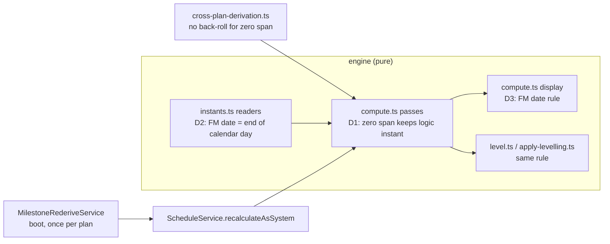
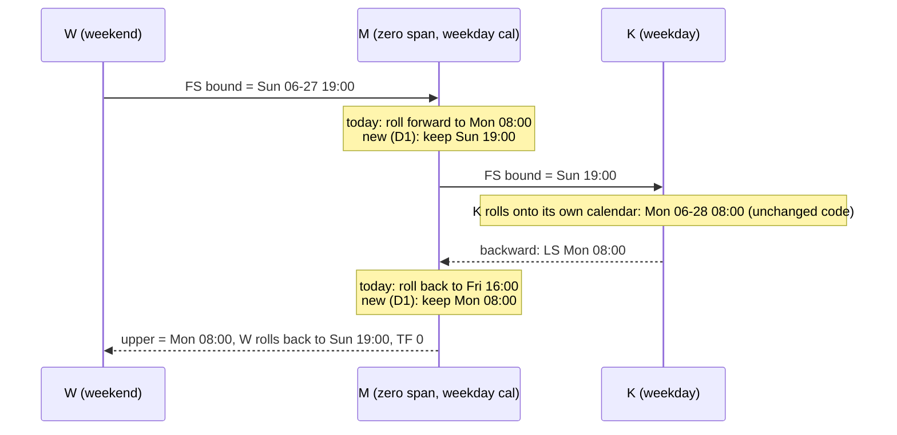
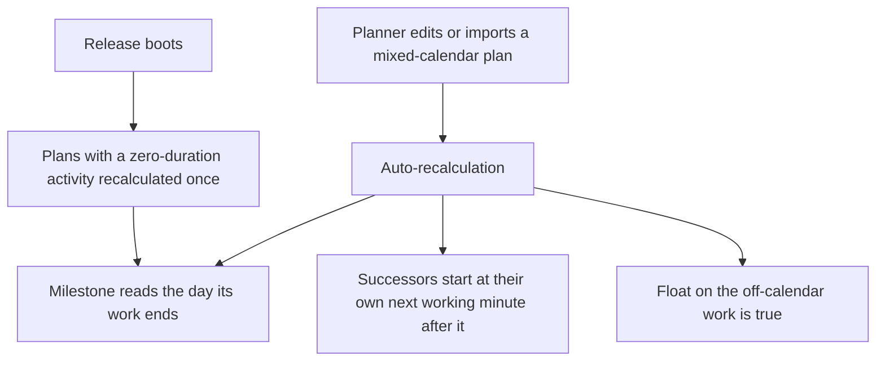

# Feature Spec: A milestone stays where its logic puts it, across calendars (#539)

- **Status:** Approved — by the product owner, 2026-10-26, with every default (Q1 A, Q2 A, Q3 A); the new ADR is ADR-0207
- **Author(s):** feature-analyst (Claude Code), for James Ewbank
- **Date:** 2026-10-26
- **Tracking issue / epic:** `docs/TECH_DEBT.md` #539
- **Roadmap link:** none (a defect in shipped engine semantics)
- **Related ADR(s):** a new ADR is required (outline in §4.7, provisionally ADR-0207). It amends
  ADR-0035 §12 and §22, ADR-0155 decisions 1, 3 and 4, and ADR-0162 decision 3's "the instant is
  kept". It relies on ADR-0037 (per-activity calendars and the instant axis), ADR-0034 (conformance)
  and ADR-0161 (a cross-plan link is the same link in one plan).

This is a defect fix that changes engine semantics, so the row cannot stand in for the spec (ADR-0105,
§19.1). It is kept short on purpose. Every claim about today's behaviour cites the code it was read
from, or is marked **predicted** with the task that confirms it (§19.11).

## 1. Business understanding

### Problem

Construction plans often put a weekend or shift shutdown on its own calendar and mark its end with a
finish milestone ("cutover complete") before weekday work resumes. With per-activity calendars the
milestone is wrong whichever calendar it is given. The row's fixture (#539, verified 2026-10-22 by
running `computeSchedule`) uses a Mon–Fri 08:00–16:00 plan calendar, a Sat–Sun 07:00–19:00 weekend
calendar, data date Mon 2027-06-14, and FS links with no lag: `A` (5 days, weekday) → `W` (1,440 min,
weekend, `SNET` 2027-06-26) → `M` (finish milestone) → `K` (5 days, weekday) → finish milestone with
`FNLT` 2027-07-09.

| `M`'s calendar    | Today (row, verified)                                                   |
| ----------------- | ----------------------------------------------------------------------- |
| Plan (weekday)    | `M` reads **Fri 06-25**, the day before `W` starts; `W` TF **−1,440**   |
| Weekend           | `M` reads Sun 06-27, but **`K` starts Mon 07-05**, a week late          |
| All-minutes       | correct: `M` Sun 06-27, `K` Mon 06-28, `W` TF 0                         |
| `START_MILESTONE` | right early date, **−1,440** float on the weekend task (full programme) |

**Why, from the code.** A zero-duration activity is snapped onto its own calendar in both passes:

- Forward: `compute.ts:266` sets `workStart = rollForwardToWorking(cal, lower)` and `:303` makes the
  finish the same instant for zero work. Sun 19:00 rolled onto the weekday calendar is Mon 08:00
  (harmless for `K`); onto the weekend calendar it is **Sat 07-03 07:00**, and `K`'s FS bound
  (`edge-bounds.ts:44-45`, lag 0 returns the anchor, `instants.ts:43`) is then Sat 07-03, rolled to
  Mon 07-05. That is the week.
- Backward: `compute.ts:510` sets `finish = rollBackwardToWorking(cal, dataDateAbs, upper)` and `:521`
  makes the late start the same. `K`'s late start Mon 06-28 08:00 rolled back onto the weekday
  calendar is **Fri 06-25 16:00**; `W`'s FS upper bound is that instant (`edge-bounds.ts:73-74`),
  which the weekend calendar rolls back to **Sun 06-20 19:00**, a whole weekend before `W` finishes.
  That is the −1,440. A `START_MILESTONE` goes through the same two lines, so it has the same late-pass
  fault (**predicted** for the fixture as well as the full programme; M1-T1 confirms).
- Display: `compute.ts:888-889` dates a finish milestone by `finishMilestoneDisplayIndex`
  (`instants.ts:78-80`), the working minute before its instant **on its own calendar**. On the weekday
  calendar the minute before Mon 08:00 is Fri 15:59, so `M` reads Friday.

ADR-0155 decided how a finish milestone is dated on one calendar. It rejected keeping the predecessor's
instant ("Alternatives considered", first bullet) because a 24-hour lag would then move successors; it
did not consider a predecessor on another calendar. This spec reverses that alternative for a stated
reason (§4.6, Q2).

### Users

Planners (Org Admin, Planner) who author mixed-calendar programmes or import them from XER; every role
that reads dates (Contributor, Viewer, External Guest through the share view), because the stored
dates are what they read. No role gains or loses a capability.

### Primary use cases

1. A weekend or night-shift shutdown ends in a milestone that weekday work follows.
2. A milestone hangs off off-calendar work with a constraint (`FNLT`, `MFO`) that reports float truthfully.
3. A cross-plan link out of such a milestone behaves as it would in one plan (ADR-0161).

### User journeys

The planner draws or imports the network, recalculates (automatic), and reads the milestone's date,
its successors' dates and the float on the work before it, in the diagram, the Gantt, the activity
panel, exports and the share view. No new control. The flow is §4.3.

### Expected outcomes

The row's workaround (link the off-calendar work straight to its weekday successors and hang the
milestone off it) is no longer needed. Weekend and shift tie-ins report the dates and float a planner
would compute by hand.

### Success criteria

- The row's fixture, on all three calendars, gives `M` Sun 2027-06-27, `K` early start Mon 2027-06-28,
  `W` total float 0, `A` total float 2,400 (5 weekday days) — **predicted by hand from the passes
  above; M1-T1 asserts it**. The `START_MILESTONE` variant gives `W` total float 0.
- Single-calendar networks: every reported output is unchanged, except the two cases §4.6 names
  (Q1, Q2), each pinned by a test.
- The ADR-0034 conformance suites pass, with every changed golden or scenario value explained in the
  PR that changes it.

### Open questions

**Critical (answers change scope):**

- **Q1 — Which date does a finish milestone show when its instant falls in its own calendar's
  non-working time?** (After weekend work on a weekday milestone; after an elapsed lag; or a date typed
  on a non-working day.) **A (recommended):** the day the work before it ends, so `M` on the plan
  calendar reads Sunday. **B:** its own calendar's last working day (Friday). B keeps ADR-0155's
  display untouched and drops D2 and D3 below, but leaves the row's first bullet half-fixed (float
  right, label still the day before `W` starts) and leaves the advice "give the milestone the
  calendar of the work it closes".
- **Q2 — A lag on another calendar (a 24-hour elapsed lag, or `PREDECESSOR`/`SUCCESSOR` resolving to
  a different calendar) is walked from the milestone's kept instant.** **A (recommended):**
  yes; `A → M → B` then equals `A → B` exactly. Consequence: in a single-calendar plan, a 24-hour lag
  out of a finish milestone after a Friday finish starts counting at Friday 16:00, not Monday 08:00, so
  its successor can start earlier. **B:** walk such a lag from the milestone's own next working
  minute, keeping those plans identical, at the cost of a second anchor per milestone.
- **Q3 — Has a baseline been captured on the installation since 2026-09-23?** Frozen dates are never
  rewritten (ADR-0155 decision 7, ADR-0125/0126), so a baseline captured before this ships will show
  the correction as variance on affected milestones and their neighbours. **A (recommended):** accept
  it and say so in the changelog. **B:** record a rule version on each baseline so the comparison can
  say "captured under the old rule": a schema change and more work.

**Defaults (stated, not asked):**

- The rule covers every activity with zero input duration that is not an LOE or a WBS summary:
  `START_MILESTONE`, `FINISH_MILESTONE` and zero-duration `TASK`. The fault is the zero span, not the
  type, and a zero-duration task after weekend work has the same late-pass fault.
- Existing plans are recalculated once, as the system, at the first boot of the release, by a
  marker-migration re-derivation service like the #421 and ADR-0155 decision 9 precedents
  (`progressed-visual-rederive.service.ts`).
- Planners are told through the changelog entry. No in-app notice: ADR-0155's nine decisions and the #421
  service's docblock name none, and a recalculated plan reads like any other.
- No `VITE_*` flag (ADR-0088 D1): there is no web change to flag. The rollback is the commit boundary
  plus a recalculation (§4.6).

## 2. Functional requirements

### User stories & acceptance criteria

> **US-1** — As a Planner, I want a milestone after off-calendar work to keep the moment that work
> ends, so that its successors start when they can and the work before it has true float.
>
> - **Given** the row's fixture with `M` on any calendar **when** the plan recalculates **then** `K`
>   starts Mon 2027-06-28 and `W` has total float 0.
> - **Given** a `START_MILESTONE` in `M`'s place **then** `W` has total float 0 and the milestone
>   reads Mon 2027-06-28 **when `M` is on the plan calendar**. On the weekend calendar the same
>   milestone reads Sat 2027-07-03, because a start milestone is dated by the day its next working
>   minute opens on ITS OWN calendar (ADR-0035 §22, unchanged); `K` and `W` are right in both. (This
>   bullet said the milestone "reads Mon 06-28" without the calendar until M2; M1's red run showed
>   Sat 07-03 today and the rule leaves it there.)
> - **Given** the mirror case (a weekday task → a milestone on the weekend calendar → weekend work)
>   **and a longer task elsewhere in the plan that sets the project finish** **then** the weekday
>   task's float is not reduced by a weekend: `A` 2,400, `W` 1,440 (measured negative today, `A` 0).
>   **Without that longer task every activity is on the finish and has float 0 whatever the fix does**,
>   which is why this bullet's first M1 draft predicted a number the network cannot give; the M1 case
>   carries the longer task `L`.

> **US-2** — As a Planner, I want the finish milestone to read the day its work ended (Q1 A).
>
> - **Given** `M` on the plan calendar after `W` **then** `M` reads Sun 2027-06-27, early and late.
> - **Given** a finish milestone after a weekday task ending Friday, on the same calendar, **then** it
>   still reads Friday (ADR-0155 unchanged).
> - **Given** a finish milestone at a working day's opening instant on its own calendar (a lead, an
>   `SS` link) **then** it reads the day before, as ADR-0155 decided.

> **US-3** — As a Planner, I want a constraint on the milestone to be judged against the moment its
> work ends.
>
> - **Given** `M` on the weekday calendar with `FNLT` Fri 2027-06-25 after `W` **then** `W` carries
>   −1,440 (its whole weekend: the work genuinely misses the date). `M`'s own float reads 0, because
>   float is measured on its own calendar (ADR-0035 §18) and no weekday minute lies between Saturday
>   00:00 and Sunday 19:00. Recorded as a consequence, not hidden: the miss shows on the work.
> - **Given** `FNLT` Sun 2027-06-27 **then** `W`'s float is 0.

> **US-4** — As a Planner linking plans, I want the same answer when `W` and `M` are in another plan
> (ADR-0161).
>
> - **Given** the fixture split at the `M → K` link into two plans **then** `K`'s dates and `W`'s
>   float match the one-plan run, within the cross-plan derivation's stated day-granularity domain
>   (`cross-plan-derivation.ts:53-56`).

### Workflows

Unchanged. The rule lives in the engine; every surface reads stored results.

### Edge cases

| Case                                                                  | Behaviour after the change                                                                                                                                              |
| --------------------------------------------------------------------- | ----------------------------------------------------------------------------------------------------------------------------------------------------------------------- |
| Nothing drives the milestone (open start)                             | Data-date floor rolled onto its own calendar exactly as today, so a free-standing milestone does not move.                                                              |
| `SNET`/`MSO`/`SNLT` on a start milestone or zero task                 | Read as today (first working minute of the day on its calendar, `instants.ts:103`).                                                                                     |
| Any constraint or external date on a finish milestone                 | Read as midnight at the end of that calendar day (D2); on its own calendar the same working position as today.                                                          |
| `MANDATORY_*` breaking logic                                          | Unchanged produce-and-flag (ADR-0035 §7).                                                                                                                               |
| Completed milestone                                                   | Frozen on actuals as today (`compute.ts:204-210`, `progress.ts:91-97`); reports actuals verbatim.                                                                       |
| Started-not-finished zero-duration activity                           | Its finish follows the same rule as a not-started one (`compute.ts:297`).                                                                                               |
| Expected Finish                                                       | Not applicable: guarded by `duration > 0` (`compute.ts:273`).                                                                                                           |
| A task resized to zero by Expected Finish                             | Not a zero-duration activity; unchanged.                                                                                                                                |
| LOE or WBS summary collapsed to a point                               | Out of scope: derived spans, never drive (`compute.ts:533-637`).                                                                                                        |
| Placed milestone (Pass 2)                                             | Logic-earliest follows D1; a finish milestone's placement is read by D2, so a Friday placement after Sunday work is now flagged as early.                               |
| Finish milestone placed on a non-working day of its calendar          | Reads back as typed (Q1 A). ADR-0155 migrated some placements to Sundays (its Consequences); those now read Sunday, not Friday. Position unchanged on its own calendar. |
| Levelling overlay                                                     | The link push and the zero-duration short-cut keep the instant (`level.ts:535`, `:733-735`); leveled dates use the D3 display.                                          |
| Data date inside the gap the off-calendar work fills                  | The link instant wins when it is later than the data date, so `M` still reads the day `W` ends.                                                                         |
| 24-hour predecessor ending exactly at the weekday opening (Mon 08:00) | Reads Friday (D3's own-calendar branch). Recorded, not fixed: the instant is indistinguishable from a rolled one.                                                       |

### Permissions

None change. Recalculation is the existing structural write under the pen (ADR-0028). The boot
re-derivation runs as the system with no pen and no audit row, as ADR-0155 decision 9 and the #421
service do (`progressed-visual-rederive.service.ts:57-60`).

### Validation rules

None added or changed.

### Error scenarios

| Scenario                                    | Detection               | User-facing result                     | Status |
| ------------------------------------------- | ----------------------- | -------------------------------------- | ------ |
| Boot re-derivation fails for one plan       | caught per plan, logged | plan keeps old dates until next recalc | n/a    |
| Organisation's cross-plan graph unorderable | caught per org, logged  | that org skipped, retried next boot    | n/a    |

## 3. Technical analysis

| Area           | Impact | Notes                                                                                                                                                                                                                                                                                   |
| -------------- | ------ | --------------------------------------------------------------------------------------------------------------------------------------------------------------------------------------------------------------------------------------------------------------------------------------- |
| Frontend       | none   | The web draws from dates; a finish milestone sits at the end of its date's day (`apps/web/src/lib/milestone-day.ts`), so a Sunday date draws at the end of Sunday. M3-T3 greps the twelve web files that name `FINISH_MILESTONE` for any working-day assumption before this is claimed. |
| Backend        | high   | `engine/compute.ts`, `engine/instants.ts`, `engine/level.ts`, `engine/apply-levelling.ts`, `cross-plan-derivation.ts`, a new re-derivation service. `computeSchedule` stays pure.                                                                                                       |
| Database       | low    | One marker-only migration (no statement), per `docs/DATABASE.md` "Re-derivation markers". Through database-architect (§19.3).                                                                                                                                                           |
| API            | low    | No contract change. Response values change for affected plans.                                                                                                                                                                                                                          |
| Security       | none   | No endpoint, no input, no scope change.                                                                                                                                                                                                                                                 |
| Performance    | low    | Removes one calendar roll per zero-duration activity in each pass; adds one cheap check in D3. The boot re-derivation recalculates every plan holding a zero-duration activity once; backend-performance-reviewer checks the pending query.                                             |
| Infrastructure | none   | —                                                                                                                                                                                                                                                                                       |
| Observability  | low    | The service logs `schedule.milestone_rederived` with counts, like `schedule.pv_rederived`.                                                                                                                                                                                              |
| Testing        | high   | Engine unit, conformance, cross-plan twin, levelling, API e2e for the service. No Playwright change (no web change; §4.5).                                                                                                                                                              |

### Dependencies

ADR-0037's instant axis (it is what makes keeping the instant possible); ADR-0155 and ADR-0162 (amended);
the #421 re-derivation pattern; the cross-plan derivation (#385) and twin (ADR-0161).

## 4. Solution design

### 4.1 Architecture overview

### 4.2 Data flow (forward pass for `W → M → K`, `M` on the plan calendar)

### 4.3 User flow

### 4.4 The rule

**D1 — A zero-span activity keeps the instant its logic gives it, in both passes.** For an activity
with `durationMinutes === 0` that is not an LOE or WBS summary:

- **Forward (Pass 1 and Pass 2):** the start and finish are the binding lower bound **as an instant**
  (after the external and constraint clamps, `compute.ts:252-259`, `:332-348`), not
  `rollForwardToWorking` of it. The single exception is a bound that is exactly the data date
  (`compute.ts:213`), which is rolled onto the activity's own calendar as today, so an open-start
  milestone is unchanged.
- **Backward:** the late finish and late start are the binding upper bound as an instant, whether it
  came from a successor, the project-finish seed (`compute.ts:481`) or a clamp, not
  `rollBackwardToWorking` of it (`compute.ts:510`).
- **Neighbours are untouched:** a non-zero activity still rolls onto its own calendar, so its
  arithmetic is the same code as today. That is why a milestone becomes transparent: `A → M → B`
  gives `B` what `A → B` gives it.
- **Driving flag (`compute.ts:411`):** an edge drives when `bound === successorStart` or
  `rollForwardToWorking(cal, bound) === successorStart`. For a non-zero successor the first clause
  cannot be true without the second (its start is a rolled instant), so its flags, and the longest
  path built from them, are unchanged.
- **Levelling:** the link push (`level.ts:535`) and the zero-duration short-cut in
  `earliestFeasibleStart` (`level.ts:733-735`) apply the same rule, so the overlay cannot push a
  milestone a calendar period either.

**Whose calendar measures a lag** is unchanged: the edge's resolved lag calendar
(`edge-bounds.ts:24-32`; plan calendar by default, `TWENTY_FOUR_HOUR` elapsed, or the endpoint's).
Only the anchor moves. When the lag calendar is the milestone's own calendar, a positive or negative
lag from the kept instant and from the rolled instant should land on the same instant, because no
working minute lies between them; **that is an argument, not a measurement**, and M2-T2 pins it with a
property test over 5-day, 24-hour, night-shift and holiday calendars before anything relies on it.
When the lag calendar differs (24-hour, or another endpoint's), the result can differ: Q2.

**D2 — A date given for a finish milestone means midnight at the end of that calendar day.**
`finishMilestoneDateInstant` (`instants.ts:68-71`) returns `D + 1 day, 00:00` (a timed value is the
instant it names) instead of rolling that forward onto the milestone's calendar. On the milestone's
own calendar the two are zero working minutes apart, because `rollForwardToWorking` returns the first
working-minute start at or after its argument (`instants.ts:21-26`), so its offsets, float and date
on that calendar are the same. They differ only to another calendar, which is the defect. Every
reader routes through this one function (`startDateInstant` `:102`, `finishDateInstant` `:129`), so
constraints (`constraints.ts:106-113`), external dates (`constraints.ts:225`, `:261`), placements
(`compute.ts:353-356`), the cross-plan derivation (`cross-plan-derivation.ts:225-228`) and the
levelling apply (`apply-levelling.ts:160`) change together. Without D2, D1 leaves the same week-long
push reachable through `FNET`, `MFO`, a placement or an external date on a weekday milestone, and a
Friday placement after Sunday work is not flagged as early (today it reads Mon 08:00, which logic
also reaches). **M2 alone leaves the cross-plan twin red on 40 rows** (a finish milestone as the local
end, or a finish-milestone remote, across calendars): the engine's one-plan answer changed and the
derivation's did not. They are `it.fails` in `cross-plan-twin.characterisation.spec.ts` until M3-T2,
which is why the release rule ships M2 and M3 together.

**D3 — How a finish milestone is dated (Q1 A).** If its instant is the start of a working minute on
its own calendar, the day of the working minute before it (ADR-0155 decision 1, today's
`finishMilestoneDisplayIndex`). Otherwise, the instant sits in its own calendar's non-working time,
which only another calendar's work, an elapsed lag or a date given for it can put it in; it is dated
by the day of the real minute before it. Never earlier than the data date (ADR-0155 decision 2).
**Late dates carry one more clause (found building M2).** A finish milestone's LATE instant is the
opening of the work it leads to (Mon 08:00 in the fixture), which the first branch dates Friday, so
the fixture's late date read Fri 06-25 beside an early date of Sun 06-27, and no instant rule can
tell the two apart. A finish milestone whose float on its own calendar is not negative therefore
never reads a late date before its early date: with no working minute between them the two are the
same moment on its calendar. Negative float keeps the plain rule, so a miss still reads earlier. One
helper in `instants.ts`, read from the instant (not the offset) at all six sites in `compute.ts`
(`:892-901`, `:997`, `:1000`) and `leveledDate` (`level.ts:852`). A start milestone and a zero-duration
task keep today's rule (the day their next working minute opens), which already reads Mon 06-28 for
the fixture.

Why the two branches, rather than "the real minute before" everywhere: on one calendar a finish
milestone can sit at a day's opening (a lead, an `SS` link into it), where ADR-0155 dates it the day
before; a single real-minute rule would move that label. With the branches, every single-calendar
case reads as today except Q1's own subject.

**Project finish date (found building M2).** The project finish date is decided among the activities
by their position on the finish axis (`compute.ts`, `inclusiveFinishInstant`). A zero-span activity is
ranked at the position it was ranked at before D1, rolled onto its own calendar, even though its
reported instant is now kept; ranked by the kept instant, a zero-duration task beat the finish
milestone at the same moment and moved the project finish to the Monday after (the
`capability-types-and-wbs` plan, 2026-03-13 to 03-16, in the harness's first run).

**What D1 also moves, in memory.** `passOnStartInstant`, `passOnFinishInstant` and a levelled
milestone's `leveledStartInstant` are instants the engine hands to levelling and never persists. They
change for every zero-span activity whose bound was not already a working minute, seam or no seam, so
they are not "reported outputs" in the success criterion above; the frozen levelling hashes
(`level.contended.parity.spec.ts`, `level.hot-resource.parity.spec.ts`) and the legacy levelling copy
carry that change, each diffed against the parent commit before it was replaced.

**Cross-plan (ADR-0161).** `remoteInstants` rolls a zero-duration remote's late date back onto its
calendar (`cross-plan-derivation.ts:229-240`) to mirror the old `compute.ts:510`. With D1 the engine no
longer does that, so the roll is dropped for a zero-duration remote; a task's finish is already an end
boundary and was a no-op (`:237`). A remote finish milestone dated Sunday (Q1 A) is read by D2 as
Mon 00:00, which a local weekday successor rolls to Mon 08:00 and a local weekend predecessor rolls back
to Sun 19:00, matching one plan. The derivation's stated limit stands: persisted dates carry no time of
day (`:53-56`).

**Levelling apply.** `targetDateFor` reports `rounded` when the placement instant is later than the
levelled one (`apply-levelling.ts:171`). With D2, a Friday placement (Sat 00:00) is later than a
Friday 16:00 levelled instant with no working time between, so `rounded` is decided by working time
on the activity's calendar instead.

### 4.5 Database, API and component changes

- **Database:** one marker-only migration whose `_prisma_migrations.finished_at` marks when the fixed
  engine took over (`docs/DATABASE.md` "Re-derivation markers"; precedent
  `PROGRESSED_VISUAL_MIGRATION`, `progressed-visual-rederive.service.ts:15`). database-architect
  reviews it and the pending query.
- **Re-derivation service:** pending = a live plan with a data date, computed before the marker, with
  a live activity of zero duration that is not an LOE or summary; walked upstream-first per
  organisation, with the downstream extension, exactly as `ProgressedVisualRederiveService`
  (`:42-49`). Never awaited, never fails the boot, no pen, not audited.
- **API:** no endpoint or DTO change; OpenAPI untouched.
- **Components:** none. **Entry point:** none new; the corrected dates appear in every existing date
  surface. The ADR-0081 obligation is met by an API e2e that recalculates the fixture through the real
  REST path and reads the persisted dates, because nothing in the web changes.

### 4.6 What changes for existing plans, and how a planner notices

After the release boots, each affected plan is recalculated once. A planner sees:

1. A finish milestone after off-calendar work reads the day the work ends (Sunday, not Friday).
2. Successors of a milestone on a calendar that works the gap start up to a calendar period earlier;
   the project finish can move earlier.
3. Negative float on off-calendar work feeding a milestone disappears; critical and near-critical
   counts change.
4. An open-end activity on a calendar that works a gap after a final milestone can lose float it
   never had: the project-finish seed is now the milestone's kept instant (`compute.ts:425`, `:466`).
5. With Q2 A, a successor reached through an elapsed or other-calendar lag from a milestone can start
   earlier, in single-calendar plans too.
6. A finish milestone whose own date is on a non-working day of its calendar reads that day.
7. With Q3 A, baseline variance shows the correction on those rows.

**Byte-identical** (the parity statement): a plan in which every zero-span activity's link neighbours
share its calendar, every lag touching it is measured on that calendar, and no finish milestone carries
a date on a non-working day of its calendar, reports the same dates, offsets, float, criticality and
driving flags. The internal pass-on instants (`compute.ts:946-947`) may move inside a non-working gap.
M1-T2's harness checks this over the seed catalogue and the torture fixture: every row that moves must
be downstream or upstream of a zero-span activity meeting one of the three conditions (the ADR-0155
FC-5 shape).

**Rollback** is the previous images plus a recalculation of affected plans. No data is rewritten, so
there is no reverse migration (unlike ADR-0155, `docs/DEPLOYMENT.md`).

**Version impact:** `@repo/api` **minor** (engine semantics; pre-1.0 rule, CLAUDE.md §10).
`@repo/web`: none, unless M3-T3 finds a web assumption, then a patch with its own changeset.

### 4.7 ADR outline and the ADR-0035 amendment

**New ADR (provisionally 0207) — "A milestone stays where its logic puts it".** Context: #539 and the
fixture. Decision: D1–D3, the cross-plan and levelling consequences, the re-derivation. Alternatives:
the three in §4.8. Consequences: §4.6. It amends ADR-0155 (decisions 1 and 4, and its first rejected
alternative), ADR-0162 decision 3 ("the instant is kept" becomes "the position on its own calendar is
kept", because D2 moves a finish milestone's reading within the gap, `zero-duration-reexpression.ts:15-21`),
and ADR-0035 as below. One line in CLAUDE.md §16.

**ADR-0035 amendment text** (appended under "Amendments", and a pointer note at §12 and §22):

> ### Amendment (ADR-0207, 2026-MM-DD) — a zero-duration activity keeps the instant its logic gives it
>
> A `START_MILESTONE`, a `FINISH_MILESTONE` and a zero-duration `TASK` occupy no working time, so they
> are not snapped onto their own calendar. In the forward pass each takes its binding lower bound as an
> instant, except that the data date alone is rolled onto its calendar; in the backward pass each takes
> its binding upper bound as an instant. Its neighbours still roll onto their own calendars, so a
> milestone between two activities is transparent: `A → M → B` schedules `B` as `A → B` does, whatever
> calendars `A`, `M` and `B` use. A lag is measured on the calendar its edge resolves to, from that
> instant.
>
> §12 is amended for a finish milestone: a date given for one means midnight at the end of that
> calendar day and is not rolled; on its own calendar this is the same working position as before.
> A finish milestone whose instant is a working-minute start on its calendar is dated by the working
> minute before it (ADR-0155); one whose instant lies in its calendar's non-working time is dated by
> the real minute before it; neither earlier than the data date. A start milestone and a zero-duration
> task are dated by the day their next working minute opens, as before (§22).
>
> Float is still measured on the activity's own calendar (§18, ADR-0037 §4). The golden and scenario
> values this changed are listed in the conformance PR.

### 4.8 Implementation approach & alternatives

Chosen: D1 + D2 + D3, one engine rule applied at every site that places or dates a zero-span activity.

- **D1 only (no D2/D3).** Fixes the row's float and the week, keeps ADR-0155's labels. Rejected under
  Q1 A: `M` on the plan calendar still reads Friday, and the week-long push stays reachable through a
  finish milestone's own dates. This is what Q1 B selects.
- **Roll only when the neighbour is on another calendar.** Rejected: the answer would depend on which
  neighbour is examined, and an elapsed lag still crosses calendars inside one.
- **Keep the instant for the successor's bound but roll for the lag anchor (Q2 B).** Viable; costs a
  second anchor per milestone. Recommended against, not excluded.

## 5. Links

- Implementation plan: [./implementation-plan.md](./implementation-plan.md)
- Related docs updated by this change: ADR-0035 (amendment), ADR-0155 and ADR-0162 (notes), new ADR,
  CLAUDE.md §16, `docs/specs/engine-conformance-framework/CAPABILITY_MATRIX.md`, `docs/DATABASE.md`
  (marker), `docs/TECH_DEBT.md` #539 (closed), `docs/DECISIONS.md`.
