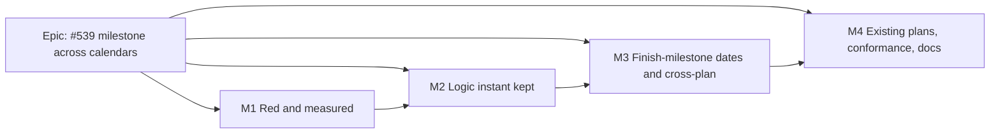

# Implementation Plan: A milestone stays where its logic puts it, across calendars (#539)

- **Feature spec:** [./feature-spec.md](./feature-spec.md)
- **Status:** Approved — by the product owner, 2026-10-26, with every default (Q1 A, Q2 A, Q3 A); the new ADR is ADR-0207
- **Owner:** api (builder agent for implementation; feature-analyst for this plan)

Written against the recommended answers (Q1 A, Q2 A, Q3 A). Q1 B removes M3 and the D3 half of M2;
Q2 B adds one step to M2-T1; Q3 B adds a schema task to M4 and is not planned here.

## Breakdown

### Epic

**A milestone stays where its logic puts it** — closes `docs/TECH_DEBT.md` #539; engine correctness.

**Release rule.** M2–M4 ship in **one** release. M2 and M3 carry no changeset; M4 carries the single
`@repo/api` minor changeset. The implementing session does not merge a Version Packages PR while M2 or
M3 is on `main` without M4, because the engine would then be fixed while stored dates stay stale with
nothing marking them stale (the #421 and ADR-0155 decision 9 finding). If an unrelated release does
cut first, the cost is stale stored dates until each plan's next recalculation, not wrong
calculation.

---

### Milestone M1: Red and measured (no behaviour change)

**Outcome:** the defect is pinned by tests that fail on today's engine, and there is a harness that
says which rows move.
**Entry point:** Ships dark: tests and a script only; nothing a user can reach.
**Journey:** none (no user-facing capability).

#### Feature: the row's fixture as tripwires

> **Description:** the row's fixture and its mirrors as engine cases that assert the correct values.
> **Complexity:** S
> **Dependencies:** none
> **Risks:** a red test on `main` → land each case as Vitest `it.fails`, which passes while the engine
> is wrong and fails the moment it is right, so M2 is forced to flip it. Not used in this repo before;
> the PR says why.
> **Testing requirements:** the cases themselves; the PR pastes the run showing each one red as a
> plain `it` before it is converted.

##### Task M1-T1 — fixture cases (one PR)

- **Description:** add to `compute.activity-calendar.spec.ts`: the #539 fixture with `M` on the plan,
  weekend and all-minutes calendars; the `START_MILESTONE` variant; the mirror (weekday task →
  milestone on the weekend calendar → weekend work); a zero-duration `TASK` in `M`'s place. Add to
  `compute.finish-milestone.spec.ts`: `M` on the plan calendar reads Sun 2027-06-27 (Q1 A); a lead
  into a finish milestone at a day's opening still reads the day before (ADR-0155 unchanged); a
  finish milestone placed on Sunday reads Sunday; `FNLT` Fri after `W` gives `W` −1,440 and `M` 0.
- **Complexity:** S
- **Dependencies:** none
- **Risks:** the predicted values in the spec are hand-derived → the red run is the check; a value
  that does not match its prediction is investigated before converting, not edited to pass.
- **Testing:** the cases; the all-minutes control passes as a plain `it` today (row bullet 3).
- **Development steps:**
  1. Build the two calendars with the existing helpers (`buildWorkingTimeCalendar`, `fullDayWeek`
     or explicit windows) and the row's dates.
  2. Assert `earlyStart`/`earlyFinish`/`lateFinish`/`totalFloat` per the spec's success criteria.
  3. Run red, paste the output, convert to `it.fails`.

#### Feature: movement harness

> **Description:** `apps/api/scripts/measure-milestone-cross-calendar.mts`, the ADR-0155
> `measure-finish-milestone.mts` shape: run `computeSchedule` over the seed catalogue's specs
> (`packages/seed`) and the torture fixture, write every activity's reported outputs to a file, and,
> given a before-file, list each row that moved with a classification: adjacent to or downstream of
> a zero-span activity with a cross-calendar neighbour, a lag on another calendar, or a finish
> milestone date on a non-working day; or **unexplained**.
> **Complexity:** S
> **Dependencies:** none
> **Risks:** the classifier is wrong and hides a real move → the "unexplained" bucket must be 0 and is
> printed in full, never summarised.
> **Testing:** the script runs locally against the repo; no host, no owner action.

##### Task M1-T2 — harness (same PR as M1-T1 or the next)

- **Description / steps:** write the script; run it on `main` to produce the before-file (kept out of
  git, path printed); record the command in the PR.

---

### Milestone M2: The logic instant is kept (D1 and D3)

**Outcome:** the row's three bullets are fixed: `K` starts Monday 06-28, `W` has float 0, `M` reads
Sunday.
**Entry point:** none new; the corrected dates appear in every existing date surface after a
recalculation (Recalculate in the plan status bar, or any edit).
**Journey:** the API e2e in M4-T1 covers this path end to end; M2 lands no web change.

#### Feature: both passes keep a zero-span activity's bound

> **Description:** D1 in `compute.ts` (Pass 1 forward `:266`, `:297`, `:303`; backward `:510`, `:521`;
> Pass 2 `:332-348`; driving flag `:411`) and `level.ts` (`:535`, `:733-735`).
> **Complexity:** M
> **Dependencies:** M1
> **Risks:** a non-zero activity's output moves → the driving-flag disjunction and the untouched
> neighbour code are argued in the spec §4.4 and checked by the harness ("unexplained" = 0) and the
> unchanged golden suite; any golden that moves is explained in the PR or the change is wrong.
> **Testing:** M1's cases flip to `it`; new unit cases below; `goldens.spec.ts`, `scenarios.spec.ts`,
> `scenarios.levelling-links.spec.ts` run unedited first, and every diff is reported.

##### Task M2-T1 — the passes

- **Complexity:** M
- **Dependencies:** M1-T1
- **Risks:** the data-date exception mis-keyed (a link bound equal to the data date) → a case with a
  predecessor finishing exactly at the data date.
- **Testing:** flip M1's `it.fails`; add driving-flag and longest-path cases for a milestone between
  calendars; a levelling-links case where the overlay must not push a weekday milestone a week.
- **Development steps:**
  1. One predicate `isZeroSpan(activity)` (`durationMinutes === 0`, not LOE, not summary) beside
     `isMilestone` in `constraints.ts`.
  2. Forward: keep `lower` unless it is the data date; backward: keep `upper`.
  3. Driving flag disjunction; levelling sites.
  4. (Q2 B only) walk an other-calendar lag from the rolled anchor.

##### Task M2-T2 — the lag-equivalence property

- **Description:** pin the spec's argument that a lag on the milestone's own calendar gives the same
  instant from the kept and the rolled anchor: positive and negative lags, on 5-day, 24-hour,
  night-shift (window crossing midnight) and holiday-exception calendars, in `edge-bounds` unit tests.
- **Complexity:** S
- **Dependencies:** none (can precede M2-T1)
- **Risks:** it fails → the parity statement in the spec is wrong for that calendar shape; stop and
  amend the spec before M2-T1 lands.

##### Task M2-T3 — the finish-milestone date (D3)

- **Description:** one helper in `instants.ts` replacing `finishMilestoneDisplayIndex` at
  `compute.ts:892-901`, `:997`, `:1000` and `level.ts:852`, reading the instant. Draft the new ADR
  (Proposed) in this PR.
- **Complexity:** S
- **Dependencies:** M2-T1
- **Risks:** the data-date floor regresses (FC-7 in `compute.finish-milestone.spec.ts:82`) → that case
  runs unedited.
- **Testing:** the D3 cases from M1-T1 flip; the ADR-0155 suite passes unedited.

---

### Milestone M3: A finish milestone's own dates, cross-plan and levelling apply (D2)

**Outcome:** a constraint, placement or external date on a weekday milestone no longer pushes a
weekend successor a week, a Friday placement after Sunday work is flagged early, and a split
programme matches one plan.
**Entry point:** none new (as M2).
**Journey:** M4-T1's API e2e.

#### Feature: the reader and its consumers

> **Description:** `finishMilestoneDateInstant` returns midnight at the end of the day, unrolled
> (`instants.ts:68-71`); the cross-plan back-roll is dropped for a zero-duration remote
> (`cross-plan-derivation.ts:238-240`); `targetDateFor`'s `rounded` is decided by working time
> (`apply-levelling.ts:155-175`); the re-expression docblock and ADR-0162 note say "position on its own
> calendar" (`zero-duration-reexpression.ts:15-21`).
> **Complexity:** M
> **Dependencies:** M2
> **Risks:** a consumer of the reader is missed → `grep` for `startDateInstant`, `finishDateInstant`,
> `finishMilestoneDateInstant`; on 2026-10-26 the non-test call sites outside `instants.ts` were
> `constraints.ts:106,107,225,261`, `compute.ts:356`, `apply-levelling.ts:160,181` and
> `cross-plan-derivation.ts:227,228,373,374,396`, and each is named in the PR; `zero-duration-reexpression.structural.spec.ts` and
> `external-instant.structural.spec.ts` run unedited.
> **Testing:** listed per task.

##### Task M3-T1 — reader and engine consumers

- **Testing:** `instants.readers.spec.ts` gains the end-of-day reading on 5-day, 24-hour (identical
  to today), night-shift and holiday calendars, and the zero-working-minutes equivalence with the old
  reading; the ADR-0155 FC-9 cases (`compute.finish-milestone.spec.ts:114-141`) pass unedited; new
  cases: `FNET` Fri on a weekday milestone with a weekend successor starts it Sat 06-26; a Friday
  placement after Sunday work reports `EARLIER_THAN_LOGIC`.
- **Complexity:** S

##### Task M3-T2 — cross-plan

- **Testing:** a twin case in `cross-plan-twin.characterisation.spec.ts` (ADR-0161) with the fixture
  split at `M → K` and at `W → M`, asserting the one-plan and two-plan runs agree; the cross-plan
  matrix (`conformance/cross-plan-matrix.ts`) re-run, with its `finishMilestoneDisplayIndex` note at
  `:93` updated.
- **Complexity:** S

##### Task M3-T3 — levelling apply and the web audit

- **Description:** `targetDateFor` by working time, with a unit case for a Friday 16:00 levelled
  instant; read the twelve web files naming `FINISH_MILESTONE` and `apps/web/src/lib/milestone-day.ts`
  for any assumption that a finish milestone's date is a working day of its calendar, and record the
  result in the PR. A finding there crosses an ADR-0105 trigger only if it needs new surface; a fix
  inside existing behaviour is a `@repo/web` patch changeset in M4.
- **Complexity:** S

---

### Milestone M4: Existing plans, conformance and documents

**Outcome:** every existing affected plan shows corrected dates at the first boot; the contract and the
matrix say what the engine does.
**Entry point:** none new; at first boot every affected plan is recalculated.
**Journey:** API e2e (below), the ADR-0081 obligation for an engine-only change.

#### Feature: re-derivation at boot

> **Description:** marker-only migration + `MilestoneRederiveService` on the
> `ProgressedVisualRederiveService` shape (spec §4.5).
> **Complexity:** M
> **Dependencies:** M2, M3
> **Risks:** boot load on a large estate → never awaited, per-plan failure isolated, one `plans` read
> at steady state (precedent `:57-60`); backend-performance-reviewer reads the pending query.
> **Testing:** API e2e (Supertest, real Postgres).

##### Task M4-T1 — migration, service, e2e

- **Complexity:** M
- **Dependencies:** M3
- **Risks:** a hand-written migration → **database-architect reviews the marker and the pending query
  before anything is written** (§19.3); re-run it if it returns nothing.
- **Testing:** `apps/api/test/milestone-cross-calendar.e2e-spec.ts`: create the #539 fixture through
  REST (two calendars, the five activities, the links), recalculate, read the persisted dates and
  float; the service's pending set includes a plan computed before the marker and excludes it after
  one run; a second run recalculates nothing. Run with `scripts/e2e-local.sh api`.
- **Development steps:**
  1. database-architect: marker name, `docs/DATABASE.md` "Re-derivation markers" entry, pending SQL.
  2. Service, module registration, log event `schedule.milestone_rederived`.
  3. e2e.

#### Feature: conformance and contract

##### Task M4-T2 — goldens, fixture, matrix

- **Description:** add a first-principles golden to `conformance/goldens.ts` (the #539 network, values
  computed by hand in the case's docblock); re-run `scenarios.spec.ts`, `external-conformance.spec.ts`,
  `cross-plan-conformance.spec.ts` and the levelling scenarios against the torture fixture, whose
  milestones sit on `CAL-01` and `CAL-03` (`packages/engine-conformance/fixtures/csv/activities.csv`);
  run the M1 harness for the after-file and attach the diff, "unexplained" = 0; update the
  per-activity-calendar row in `CAPABILITY_MATRIX.md` (ADR-0034 §8).
- **Complexity:** M
- **Dependencies:** M3
- **Risks:** a torture-fixture value moves → each is explained by the harness classification in the
  PR, or the change is wrong.

##### Task M4-T3 — ADR, amendments, register, changeset

- **Description:** new ADR → Accepted; the ADR-0035 amendment (spec §4.7) with pointers at §12 and
  §22; notes on ADR-0155 and ADR-0162; one line in CLAUDE.md §16 (`check:adr-coverage`); spec and
  plan headers → Accepted with the ADR cited (`check:spec-status`); `docs/TECH_DEBT.md` #539 closed
  with the evidence; `docs/DECISIONS.md` entry; `docs/TEST_PLAYBOOK.md` only if a seed plan is added
  (not planned); changeset `@repo/api` minor whose text lists the seven visible changes in spec §4.6
  in a planner's words.
- **Complexity:** S
- **Dependencies:** M4-T1, M4-T2

## Sequencing & slices

M1 (tests and harness, no behaviour) → M2 (the row fixed) → M3 (the same rule for a finish milestone's
own dates and across plans) → M4 (stored dates, contract, release). Each PR leaves `main` green and the
engine self-consistent; the release rule above keeps stale stored dates from shipping. No feature flag
(ADR-0088 D1). Before each push: `pnpm prepush`; M4 also `scripts/e2e-local.sh api`.

Reviewers to involve: **database-architect** (M4-T1, mandatory); **backend-performance-reviewer**
(M4-T1 pending query and boot load); **test-engineer** (M1 cases and M4-T2 golden);
**security-reviewer** briefly on M4-T1 (a system-principal write, precedent-shaped);
**api-reviewer** not needed (no contract change).

## Definition of Done (per task)

Each task's PR satisfies the Feature Completion Criteria in [`docs/PROCESS.md`](../../PROCESS.md):
code, tests, docs, security, performance, accessibility (no UI change), Docker build, CI read per
§19.9, changeset (M4 only), version impact (`@repo/api` minor; `@repo/web` none unless M3-T3 finds one).

## Risks & assumptions (rollup)

| Risk / assumption                                                   | Likelihood | Impact | Mitigation                                                                                              |
| ------------------------------------------------------------------- | ---------- | ------ | ------------------------------------------------------------------------------------------------------- |
| The lag-equivalence argument fails for some calendar shape          | low        | high   | M2-T2 runs before M2-T1 lands; failure stops M2 and amends the spec                                     |
| A single-calendar plan's dates move unexpectedly                    | low        | high   | harness "unexplained" = 0; goldens run unedited first                                                   |
| Elapsed-lag successors of milestones move earlier (Q2 A)            | med        | med    | accepted by Q2; changelog says so; harness counts them                                                  |
| Baselines show the correction as variance (Q3 A)                    | med        | low    | changelog sentence; frozen dates untouched                                                              |
| Cross-plan read of a Sunday-dated weekday milestone is day-granular | low        | low    | inside the derivation's stated limit (`cross-plan-derivation.ts:53-56`); twin case pins the common case |
| ADR-0155-migrated Sunday placements now read Sunday                 | med        | low    | position unchanged on own calendar; changelog names it                                                  |
| `it.fails` is new to the repo                                       | low        | low    | PR explains; flipped in M2, so it lives one milestone                                                   |
| An unrelated release ships M2/M3 before M4                          | low        | med    | release rule; worst case stale dates until next recalc                                                  |
