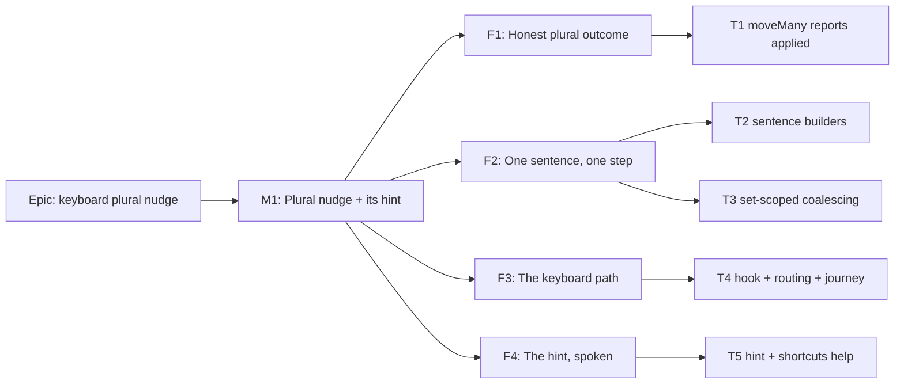

# Implementation Plan: Keyboard nudge moves the whole plural selection

- **Feature spec:** [`./spec.md`](./spec.md)
- **Status:** Approved — with the spec, 2026-10-17 (CQ-1 (b))
- **Owner:** web

## Breakdown

### Epic

**Keyboard plural nudge** closes `docs/TECH_DEBT.md` #116 items 1 and 2. It belongs to the TSLD
keyboard-parity theme: anything the canvas does to a selection by pointer, it does by keyboard.

### Milestone M1: Plural nudge and its hint (shippable slice)

**Outcome:** with two or more bars selected and the cursor on one of them, `Alt`+arrow moves every
selected bar in one write. `Ctrl+Z` reverses it in one step. A screen-reader user is told this when
the selection becomes plural, and hears what each move did.

**Entry point:** the plan workspace's canvas activity listbox. Focus the canvas, select two or more
activities, then press `Alt+→`, `Alt+←`, `Alt+↑` or `Alt+↓`. The help's "Keyboard shortcuts" list
(`PlanShortcutsHelp`) names the chord.

**Journey:** a new test in `apps/web/e2e-multi-select/multi-select.spec.ts`, under the existing
`playwright.multi-select.config.ts`. It selects three bars by keyboard and asserts the live region
says the hint. It then presses `Alt+→` twice, asserts **one** intercepted
`PATCH …/activities/placements` carrying three rows, and asserts the polite announcement. It presses
`Ctrl+Z` once and asserts all three starts return. It is required in T4, not deferred (ADR-0081 §2).

**Flag:** none (ADR-0088 D1). The plural branch is reachable only under the default-on
`CANVAS_MULTI_SELECT_ENABLED`, as the drag is. The rollback is the commit boundary.

---

#### Feature F1: An honest plural outcome

> **Description:** `moveMany` says whether it moved anything, so that no caller announces a move the
> server refused. This fixes the drag today and is the base the keyboard path is built on.
> **Complexity:** S
> **Dependencies:** none
> **Risks:** callers of `TsldBulkOperations` in tests mock `{ conflict: null }`. The compiler finds
> every one, and they are updated deliberately, not by blind replace (see #116 item 5's own lesson).
> **Testing requirements:** unit (workspace model and panel).

##### Task T1: `moveMany` returns `{ applied, conflict }` (≈ one PR)

- **Description:** Widen the contract at `TsldPanel.tsx:271-274` and the implementation at
  `use-plan-workspace-model.ts:952-1011`.
  - `applied: false` for an empty set or no-op (`:956`) and for a lock rejection (`:995`).
  - `applied: false, conflict: MOVE_CONFLICT` for a 409.
  - `applied: true` after the command is recorded.
  - The drag (`TsldPanel.tsx:2627-2636`) announces only when `applied`.
- **Complexity:** S
- **Dependencies:** none
- **Risks:** a missed `applied` on a success path would silence the drag. Mitigated by a positive
  test for each path.
- **Testing:**
  - In `use-plan-workspace-model.move-many.test.ts:226`, assert `applied: false` on 423 (currently
    it asserts only "no conflict of its own").
  - Add `applied: true` to the success cases.
  - In `TsldPanel.bulk-operations.test.tsx`, add: "a plural drag rejected for the pen announces
    nothing". It fails before the change (V5's regression test).
- **Development steps:**
  1. Write the failing panel test that reproduces V5.
  2. Widen the type and the four return sites, then gate the drag's announcement.
  3. Add a `@repo/web` patch changeset: "a plural drag that lost the pen no longer announces a move".

#### Feature F2: One sentence, one step

> **Description:** The pure pieces both modalities share.
> **Complexity:** S–M
> **Dependencies:** T1 (T3 passes through `moveMany`)
> **Risks:** reversing V6's "deliberately not coalescable" too widely. Mitigated by an opt-in key
> that is derived from the id set.
> **Testing requirements:** unit.

##### Task T2: `pluralMoveAnnouncement` and `pluralMoveHint`

- **Description:** Add both to `features/tsld/model/reposition-announcement.ts`, with these sentence
  forms:
  - "3 activities moved 2 days later; dates will update."
  - "3 activities moved up 1 lane."
  - Combined: "3 activities moved 1 day earlier and down 1 lane; dates will update."
  - Singular and plural units are handled.

  The hint returns "Dragging any of these, or pressing Alt with an arrow key, moves all N
  activities." The drag adopts `pluralMoveAnnouncement` (spec D9). Its `STARTS_NOT_CHANGED_NOTE`
  suffix is kept.
- **Complexity:** S
- **Dependencies:** T1
- **Risks:** copy drift between bar and speech. Mitigated by one function used by both, plus a test
  asserting the bar's text equals `pluralMoveHint(n)`.
- **Testing:** a table test over the sign and zero combinations of `dayDelta` and `laneDelta`. The
  zero/zero case is unreachable and asserted to throw or return an empty string, whichever the
  builder documents.
- **Development steps:**
  1. Write the pure functions and tests.
  2. Switch the drag's announcement and update its panel test expectations.

##### Task T3: Opt-in, set-scoped coalescing on `bulkPlacementCommand` (CQ-1 (b))

- **Description:** Add an optional `coalesceKey` parameter to `bulkPlacementCommand`
  (`commands.ts:1635`). When present, wrap the command with `coalescable` (`:121-136`); `rebuild`
  re-runs the builder with the merged before and after and the newest saved rows. `moveMany` accepts
  an optional `coalesceKey` and passes it through.
  - The key is `bulk-move:` followed by the sorted ids joined with commas. It is built by a helper
    exported beside the command, so no caller hand-rolls it.
  - The docblock at `:1621-1634` is rewritten to say why the set key answers its own objection.
  - Add the `docs/DECISIONS.md` entry.
  - **If CQ-1 is answered (a), this task is dropped**, and T4 passes no key.
- **Complexity:** M
- **Dependencies:** T1
- **Risks:**
  - A merged step whose `before` comes from the first command and `saved` from the last must replay
    all-or-nothing against the newest rows. Covered by `bulkPlacementCommand`'s existing replay; it
    is tested, not assumed.
  - Apply-levelling must not coalesce. It passes no key, and a test asserts that.
- **Testing** (in `bulk-commands.test.ts` and `use-plan-edit-history.test.ts`):
  - Two same-set records within 500 ms merge into one step, and undo restores the first `before`.
  - Different sets do not merge.
  - A keyless command never merges.
  - A different-key step on top (an ADR-0153 resolve) blocks the merge.
  - The `coverage.census.structural.test.ts` census still passes.
- **Development steps:**
  1. Write the tests first.
  2. Add the parameter and the key helper.
  3. Rewrite the docblock and add the DECISIONS.md entry.

#### Feature F3: The keyboard path

> **Description:** The new hook and its routing. This is the capability (item 1).
> **Complexity:** M–L
> **Dependencies:** T1, T2, T3 (or T3 dropped under CQ-1 (a))
> **Risks:** see the rollup. The serialization and version-advance wait is the delicate part.
> **Testing requirements:** unit, panel and journey. Specialist a11y review before release.

##### Task T4: `useCoalescedPluralNudge`, routing, and the journey

- **Description:**
  - Add `features/tsld/interaction/use-coalesced-plural-nudge.ts`, following spec §2 workflows 2–5.
  - Export `SERIALIZE_RETRY_MS` from the single hook. Nothing else in that file changes.
  - In `TsldPanel.tsx:2319-2339`, route by D2.
  - Widen both hooks' busy predicates so that each sees the other and the pointer.
- **Complexity:** L
- **Dependencies:** T1–T3
- **Risks:**
  - **Stale versions between bursts.** Handled by the bounded version-advance wait. A residual 409
    is safe, because the batch is all-or-nothing, and visible as the existing banner.
  - **Refactoring the single hook by accident.** `use-coalesced-nudge.test.ts` must pass with zero
    edits. A diff touching more than the one export fails review.
  - **WBS summary eligibility.** Resolved by step 1.
- **Testing:**
  - Hook unit suite, mirroring the single hook's cases:
    - burst → one call with summed delta;
    - net-zero → no call;
    - set change mid-burst → two calls;
    - started-and-sideways refusal → no call, `startFrozenPluralReason`;
    - top-lane refusal → no call;
    - a burst behind an in-flight write is not dropped (#25c analogue);
    - unmount flushes only an uncommitted delta (#448 analogue);
    - the commit waits for versions to advance, then proceeds at the bound;
    - `applied: false` → no announcement;
    - the hook bails while another write is busy.
  - Panel unit tests:
    - the plural branch is taken only when the cursor is in a set of 2 or more and `moveMany` is
      wired;
    - a single selection calls the unchanged `nudge`.
  - **Journey** as stated under M1.
- **Development steps:**
  1. **Verify first:** can a `WBS_SUMMARY` enter `selection.ids` on the canvas? Read the
     selection-building paths (`model/canvas-selection.ts`, `geometry.ts:1002` `idsIntersecting`,
     `TsldPanel.tsx:1935-1981`) and drive a seeded WBS plan. If it can, add a pre-write refusal
     sentence shared by the drag and the nudge, and record the finding.
  2. Write the hook's unit suite (red), then implement.
  3. Route the keydown and widen the busy predicates. Write the panel tests.
  4. Write the journey and run `scripts/e2e-local.sh web:multi-select` locally.
  5. Run **accessibility-reviewer**, executing in real Chromium, **before** release (spec §4.6),
     with **ux-reviewer** on the copy and **component-reviewer** on the hook/contract change.
  6. Add a `@repo/web` minor changeset: "Alt+arrow moves every selected activity". Close #116 item
     1 in `docs/TECH_DEBT.md` with the commit.

#### Feature F4: The hint, spoken

> **Description:** Item 2. It lands **in the same release as T4, never before it**
> (`TECH_DEBT.md:3088-3090`).
> **Complexity:** S
> **Dependencies:** T4 merged (or the same PR)
> **Risks:** over-announcing. Mitigated by speaking only on the transition into plural (D8).
> **Testing requirements:** unit, journey assertion (in T4's test) and a11y review.

##### Task T5: `pluralMoveHint` on the bar and in the announcement; shortcuts help

- **Description:**
  - `BulkSelectionBar` renders `pluralMoveHint(count)` when the new `canMove` prop is true. The panel
    passes `bulk.gate.writable`.
  - `announceSelectionCount` appends the hint only when the previous count was below 2, the next is
    2 or more, and the plan is writable.
  - Update the `PlanShortcutsHelp.tsx:46-47` copy.
- **Complexity:** S
- **Dependencies:** T2, T4
- **Risks:** `canMove` defaulting to `true` would show a false hint to viewers. It defaults to
  `false`, and a test asserts that a viewer sees no hint.
- **Testing:**
  - `BulkSelectionBar` tests: hint present and equal to `pluralMoveHint(n)` when `canMove`; absent
    otherwise; still not referenced by any `aria-describedby` (the `:140-144` rule).
  - Panel tests: 1 → 2 speaks count plus hint; 2 → 3 speaks only the count; no write right speaks no
    hint.
  - `PlanShortcutsHelp` snapshot or text test.
- **Development steps:**
  1. Write the tests, then implement.
  2. Close #116 item 2 in `docs/TECH_DEBT.md`. File the three findings from spec §4.9 as rows.
  3. Add a `@repo/web` patch changeset, or fold this into T4's.

## Sequencing & slices

1. **T1** is independently valuable: it fixes V5 for the drag and ships alone.
2. **T2** is pure and shippable. The drag's sentence improves.
3. **T3** is shippable but has no caller until T4 (dark by construction; nothing user-visible
   changes).
4. **T4** is the entry point and the journey. **The capability ships here.**
5. **T5** ships in the same release as T4, or the same PR. It never precedes T4.

`main` stays releasable after each slice. No flag (ADR-0088 D1).

## Definition of Done (per task)

Each task's PR satisfies the Feature Completion Criteria in [`docs/PROCESS.md`](../../PROCESS.md):

- `pnpm prepush`;
- `scripts/e2e-local.sh web:multi-select` for T4 and T5;
- docs updated in the same PR;
- a changeset;
- reviewers as named in T4 step 5;
- no `apps/api` change, so no API e2e is required. State that in the PR.

## Risks & assumptions (rollup)

| Risk / assumption                                                                                                                | Likelihood | Impact | Mitigation                                                                                                                         |
| -------------------------------------------------------------------------------------------------------------------------------- | ---------- | ------ | ---------------------------------------------------------------------------------------------------------------------------------- |
| A burst committed before props reflect the prior write sends stale versions                                                      | med        | low    | Bounded version-advance wait (spec §2 workflow 3). A residual 409 is all-or-nothing and bannered. Unit-tested.                     |
| The design must not depend on TanStack Query's `onSettled`-await internals. It does not: the wait reads versions, not timing.     | n/a        | n/a    | Stated so no dependency-internals claim is needed (`scripts/dependency-claims.json`).                                              |
| The single-bar nudge regresses                                                                                                   | low        | high   | Its file is not edited beyond one export, and its suite passes with zero edits.                                                    |
| Coalescing merges two different selections                                                                                       | low        | med    | The key is derived from the sorted id set, via a shared helper. Negative test.                                                     |
| The hint misleads a reader who cannot write                                                                                      | low        | med    | `canMove` defaults to `false` and is gated on `bulk.gate.writable`.                                                                |
| The live-region wording reads badly in a real screen reader                                                                      | med        | low    | accessibility-reviewer before release, executing it (ADR-0111's spirit; not bound by its letter, spec V15).                        |
| V9 (drag lane collapse) is real and planners see the keyboard and the drag disagree at the top lane                              | med        | low    | Filed as a finding. The keyboard behaviour is the correct one to converge on.                                                      |
| A WBS summary can be in the selection                                                                                            | unknown    | low    | T4 step 1 verifies before building.                                                                                                 |
