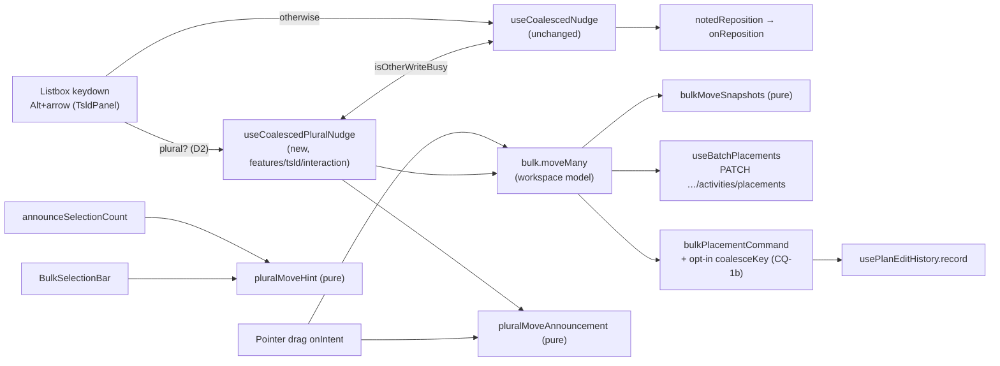
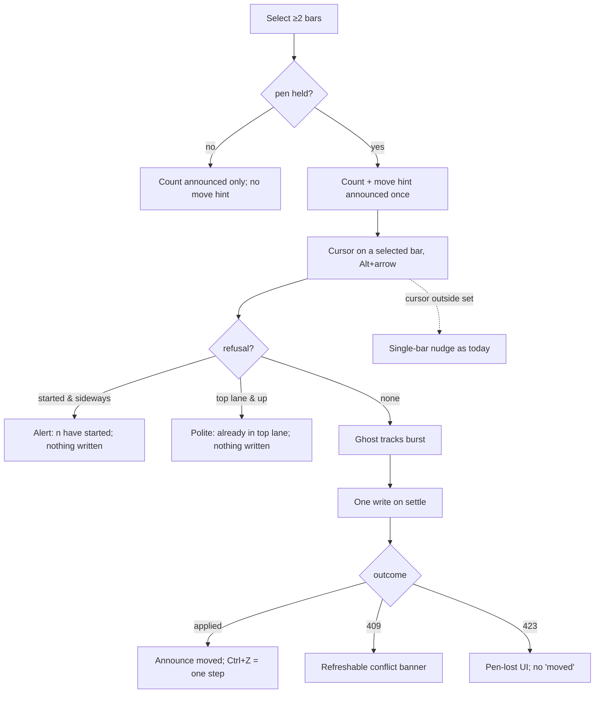

# Feature Spec: Keyboard nudge moves the whole plural selection

- **Status:** Approved — by the product owner, 2026-10-17, CQ-1 (b): quick presses on the same
  selection within 500 ms merge into one undo step; every other choice as the stated default.
- **Author(s):** feature-analyst (Product Owner / Solution Architect / Technical Lead hats)
- **Date:** 2026-10-17
- **Tracking issue / epic:** `docs/TECH_DEBT.md` #116 items 1 and 2 (`docs/TECH_DEBT.md:3078-3090`)
- **Roadmap link:** TSLD canvas capability — keyboard parity for planner throughput
- **Related ADR(s):** none new is proposed (see §4.8 for why, and the outline to use if the owner
  disagrees). Builds on ADR-0028, ADR-0048, ADR-0064, ADR-0080, ADR-0081, ADR-0088, ADR-0111,
  ADR-0153, ADR-0176

---

## 0. What was verified before writing this

The brief is not evidence (CLAUDE.md §19.11). Each claim this design rests on was read in the tree
on 2026-10-17. Line numbers are as read that day.

| #   | Claim                                                                                                                                                                                                                                                       | Established by                                                                                                                                         |
| --- | ----------------------------------------------------------------------------------------------------------------------------------------------------------------------------------------------------------------------------------------------------------- | ------------------------------------------------------------------------------------------------------------------------------------------------------ |
| V1  | The keyboard nudge targets one activity. Its burst state is a single `NudgeTarget { activityId, … }`, and the handler is `(activity, axis, delta)`.                                                                                                          | `apps/web/src/features/tsld/interaction/use-coalesced-nudge.ts:18-24`, `:91-93`, `:235`                                                                |
| V2  | The panel's `Alt`+arrow branch passes only the **cursor** row (`activeId`) to that hook and never consults the selection.                                                                                                                                   | `apps/web/src/features/tsld/components/TsldPanel.tsx:2319-2339`                                                                                       |
| V3  | The plural **pointer** drag exists. It is taken when the selection holds more than one id **and** includes the dragged bar **and** the host supplied `moveMany`. Otherwise it falls through to the single-bar path.                                          | `TsldPanel.tsx:2577-2586`                                                                                                                              |
| V4  | `moveMany` writes the whole set as one `PATCH …/activities/placements` and records **one** `bulkPlacementCommand`. It holds the coalesced recalculation across the write, and for a lane-only move it skips the recalculation and resolves overlaps immediately. | `apps/web/src/components/layout/workspace/use-plan-workspace-model.ts:952-1011` (record `:974-985`, hold `:964-965`, lane-only `:1008-1009`)            |
| V5  | **Defect, by reading:** after a pen (423) rejection, `moveMany` returns `{ conflict: null }`, the same value it returns on success. The plural drag then announces "N activities moved." for a move that did not happen. Every single-bar write returns `{ applied: false, … }` in this case. | `use-plan-workspace-model.ts:995` against `:1542`, `:1611`; announcement `TsldPanel.tsx:2629-2635`. Not reproduced in a browser.                        |
| V6  | `bulkPlacementCommand` is **deliberately not coalescable**. The stated reason is that merging two bulk moves "would produce an undo that restores a set nobody ever selected".                                                                                 | `apps/web/src/features/undo-redo/commands.ts:1621-1634`                                                                                                |
| V7  | The single-bar nudge's undo step is coalescable, keyed per activity (`visual:{id}`, `relane:{id}`). The history merges a command into the top step only when the top step has the **same key** and was recorded within `COALESCE_WINDOW_MS` = 500 ms.                | `commands.ts:1230-1233`, `:414-415`; `apps/web/src/features/undo-redo/use-plan-edit-history.ts:19`, `:167-178`                                          |
| V8  | The plural drag refuses a sideways move of the whole set if any selected bar has started, using `startFrozenPluralReason(n)`. A lane-only plural move of a started bar is allowed.                                                                          | `TsldPanel.tsx:2588-2594`; `apps/web/src/features/tsld/render/hit-test.ts:97-111`                                                                      |
| V9  | `movedPlacement` clamps **each row** to lane ≥ 0 on its own. A set moved up past the top therefore collapses: the bar already in lane 0 stays, and the bars below it close up. The dragged bar's lane is clamped at `viewport.ts:54`.                         | `apps/web/src/features/tsld/model/bulk-move.ts:63-64`; `apps/web/src/features/tsld/render/viewport.ts:54`. Inferred from reading, not seen in a browser. |
| V10 | The plural drag shows a ghost for the dragged bar only. While that ghost is set, `onIntent` refuses a new gesture.                                                                                                                                          | `TsldPanel.tsx:2552`, `:2614-2623`                                                                                                                     |
| V11 | The drag hint is static text with no live region. `announceSelectionCount` says only the count.                                                                                                                                                            | `apps/web/src/features/tsld/components/BulkSelectionBar.tsx:145`, `:171`; `TsldPanel.tsx:2000-2012`                                                   |
| V12 | The shortcuts help describes `Alt`+arrows as moving "the activity" (singular).                                                                                                                                                                              | `apps/web/src/components/layout/workspace/PlanShortcutsHelp.tsx:46-47`                                                                                |
| V13 | Plural selection is behind `CANVAS_MULTI_SELECT_ENABLED`, which is on by default and nested under direct manipulation.                                                                                                                                      | `apps/web/src/config/env.ts:1326-1327`                                                                                                                 |
| V14 | The placements route is Planner/Org Admin only, all-or-nothing, and pen-gated (423). It answers 409 for a stale version and 422 `SUMMARY_NOT_BULK_ELIGIBLE` for a WBS summary in the batch. Bodies are capped at 2,000 rows.                                  | `apps/api/src/modules/activities/plan-activities.controller.ts:44-45`, `:135-161`                                                                      |
| V15 | ADR-0111's review rule applies to **shared primitives in `components/ui/`**. The canvas listbox keymap in `TsldPanel` is not one.                                                                                                                           | `docs/adr/0111-a-primitives-keyboard-contract-is-reviewed-before-release.md:47-51`                                                                     |
| V16 | A plural selection journey exists to extend: `e2e-multi-select`, with its own Playwright config.                                                                                                                                                            | `apps/web/e2e-multi-select/multi-select.spec.ts:66`; `apps/web/playwright.multi-select.config.ts`                                                      |

**Problem re-verified, not only design** (CLAUDE.md §19, 2026-08-19). V1–V3 show the #116 gap still
exists today: no plural branch exists between the `Alt`+arrow keydown and the single-activity hook.
V11 shows item 2 is still open.

---

## 1. Business understanding

### Problem

A planner with twelve bars selected can drag all twelve with the mouse in one gesture (#108). The
same planner using the keyboard moves only the bar under the cursor. To move the set they must step
through it bar by bar, which means twelve gestures, twelve undo steps and twelve recalculations. This
is not a WCAG 2.1.1 failure, because each bar can still be moved. It is a **parity** gap: the keyboard
route is twelve times slower. It also falls on the people least able to use the pointer route.

Item 2 makes this worse. The bulk bar shows "Dragging any of these moves all N activities." to sighted
users and says nothing to a screen reader. That silence was deliberate (`TECH_DEBT.md:3088-3090`):
announcing a pointer-only capability would describe something the listener cannot do. Item 2 can
therefore only land **with** item 1.

There is also a defect on the same seam (V5). A pen rejection during a plural drag announces "N
activities moved." for a move that did not happen. A keyboard path that reuses this seam would inherit
the false sentence. So this work fixes it rather than copying it.

### Users

| Role                                 | What changes                                                                                                                                   |
| ------------------------------------ | ---------------------------------------------------------------------------------------------------------------------------------------------- |
| **Planner**, **Org Admin** (pen held) | `Alt`+arrow moves every selected bar. They hear one sentence per burst and get one undo step.                                                 |
| Planner / Org Admin without the pen  | No change. Nothing moves, as today: the listbox branch requires `editingEnabled` (`TsldPanel.tsx:2323`).                                      |
| **Contributor**, **Viewer**          | No change. They cannot write placements (V14). The new hint sentence is not shown or spoken to them (D7).                                     |
| **External Guest**                   | No change. The guest surface is read-only (ADR-0051/0163).                                                                                     |

### Primary use cases

1. Shift an entire phase one or more days later or earlier by keyboard.
2. Move a group of bars down or up one or more lanes to make room, keeping their relative layout.
3. Undo that whole keyboard move with one `Ctrl+Z`.
4. A screen-reader user learns, when they make a plural selection, that the arrow chord moves all of
   it. After the move they hear what happened.

### User journeys

**Happy path.** Select three bars with Space or a marquee. The planner hears: "3 activities selected.
Alt with an arrow key moves all 3." With the cursor on one of them, hold `Alt+→` for three repeats.
The cursor bar's ghost follows the burst. About 150 ms after release, one write goes out. The planner
hears "3 activities moved 3 days later; dates will update." `Ctrl+Z` puts all three back in one step.

**Alternates.** The cursor is outside the selection, so only that bar moves (D2). One selected bar has
started, so a sideways move is refused aloud and a lane move still works (D4). One bar is in lane 1,
so `Alt+↑` is refused aloud with nothing written (D5). The pen is lost mid-burst, so the pen UI says
so and no "moved" sentence is spoken (D6).

### Expected outcomes

- Keyboard and pointer move the same set, write through the same seam and leave the same undo step.
- The bulk bar's hint is true for both input modes and reaches assistive technology.
- A rejected plural write never announces success, whichever input mode made it.

### Success criteria

- With N ≥ 2 selected and the cursor in the set, one held `Alt+→` burst produces **exactly one**
  `PATCH …/activities/placements` carrying N rows. Asserted in the unit suite and in the journey via
  request interception.
- After the move, one `Ctrl+Z` restores all N. The journey asserts every bar's start returns.
- One polite announcement per committed burst, and none on a refusal that wrote nothing other than the
  refusal sentence itself.
- The single-bar nudge suite (`use-coalesced-nudge.test.ts`) passes **unchanged**, as evidence that the
  N = 1 path is untouched.
- `computeSchedule` is untouched (no engine input added, §3).

### Open questions

**CRITICAL**

- **CQ-1: What counts as "one undo step"?** The single-bar nudge folds several bursts into one step
  when they are recorded within 500 ms of each other (V7). `bulkPlacementCommand` refuses to fold, on
  purpose (V6).
  - **(a) One step per committed burst.** This needs no change to the command. A held key is one
    step. Taps spaced more than 150 ms apart become several steps.
  - **(b) Parity with the single bar.** Add an **opt-in** coalescing key to `bulkPlacementCommand`
    that is scoped to the exact selected **set** (`bulk-move:<sorted ids>`). Consecutive bursts on
    the same set within 500 ms become one step. A different set never merges, which meets V6's
    objection on its own terms. Apply-levelling and the drag do not opt in and are unchanged.
  - **Recommended: (b).** A planner who taps `Alt+→` three times gets one step for one bar today and
    should get one step for twelve. This reverses a documented "deliberately not". It is recorded
    under the default in §4.8 (DECISIONS.md, no ADR) unless the owner wants an ADR.

**Defaults (proceed unless overruled)**

- **D1: No feature flag.** ADR-0088 D1: every published image carries every flag at its default, so
  a flag is never a rollback. The rollback is the commit boundary. The plural branch is already
  reachable only under `CANVAS_MULTI_SELECT_ENABLED` (V13), exactly as the drag is.
- **D2: The cursor decides, as the grab does.** The plural path is taken only when the selection
  holds more than one id **and** includes the cursor row (`activeId`). This mirrors V3's rule for the
  drag. If the cursor is outside the set, `Alt`+arrow moves that one bar, as today.
- **D3: A separate hook, not a mode of the existing one.** `useCoalescedPluralNudge` sits beside
  `useCoalescedNudge`. The single hook's file is not edited. Rationale is in §4.7.
- **D4: Started bars, as the drag does.** For a sideways move, if any selected bar has started,
  refuse the whole burst with `startFrozenPluralReason(n)`, marked non-refreshable, and write nothing.
  A lane move proceeds.
- **D5: The set keeps its shape at the top.** If any selected bar is already in lane 0, `Alt+↑` is
  refused aloud and nothing is written. The sentence is "<n> of the selected activities <is/are>
  already in the top lane." The keyboard never invokes V9's per-row clamp. The drag's exposure to V9
  is **not** fixed here; it is a finding for the register (§4.9).
- **D6: `moveMany` reports `applied`.** Its return becomes `{ applied: boolean; conflict: string | null }`,
  the single-bar outcome shape. Both the drag and the keyboard announce only on `applied: true`. This
  fixes V5 for the drag as well.
- **D7: The hint is one string, gated on the write right.** `pluralMoveHint(n)` returns "Dragging any
  of these, or pressing Alt with an arrow key, moves all n activities." The bar shows it and the panel
  speaks the same string, so the visible and spoken text cannot drift. It is shown and spoken only
  while `bulk.gate.writable` is true. Otherwise the bar's existing status line already says why
  nothing can be done.
- **D8: Spoken once, on entering plural.** The hint is appended to the count announcement only on
  the transition from fewer than 2 selected to 2 or more. It is not repeated on every Space toggle,
  which would drown the count it follows.
- **D9: One sentence builder for both modalities.** `pluralMoveAnnouncement({ count, dayDelta,
  laneDelta })` goes into `model/reposition-announcement.ts`, the file whose purpose is "the sentence
  built once". The drag adopts it too. "N activities moved." becomes, for example, "N activities
  moved 2 days later; dates will update." The drag keeps its existing `STARTS_NOT_CHANGED_NOTE`
  suffix.
- **D10: Ghost the cursor bar only**, as the drag ghosts only the dragged bar (V10). The N−1 preview
  gap is #108's, not this spec's.
- **D11: The Gantt is out of scope.** Its `Alt+←/→` (`GanttPanel.tsx:964`) is a separate surface with
  no plural selection read here.

---

## 2. Functional requirements

### User stories & acceptance criteria

> **US-1**: As a **Planner** holding the pen, I want `Alt`+arrow to move every selected activity, so
> that a keyboard move of a group costs one gesture, as a drag does.
>
> **Acceptance criteria**
>
> - **Given** ≥ 2 activities selected, the cursor on one of them, and the pen held, **when** I press
>   `Alt+→`, **then** every selected activity's `visualStart` advances by one day in **one**
>   placements write, and lanes are unchanged.
> - **Given** the same, **when** I hold `Alt+→` through k key repeats, **then** exactly one write
>   carries `dayDelta = k`.
> - **Given** the same, **when** I press `Alt+↓`, **then** every selected activity's lane rises by
>   one in one write, **and** no recalculation is requested (V4 lane-only).
> - **Given** a burst of `Alt+→` then `Alt+←` that nets to zero, **when** it commits, **then**
>   nothing is written and nothing is announced.
> - **Given** the cursor is **not** in the selection, **when** I press `Alt+→`, **then** only the
>   cursor's activity moves, exactly as today (D2).
> - **Given** one activity selected, **when** I press `Alt+→`, **then** behaviour is identical to
>   today: the same hook and the same write.

> **US-2**: As a Planner, I want that keyboard move to be one undo step, so that `Ctrl+Z` reverses
> what I did rather than a fragment of it.
>
> **Acceptance criteria**
>
> - **Given** a committed plural nudge, **when** I press `Ctrl+Z`, **then** every moved activity
>   returns to its prior placement in one step labelled "Move N activities".
> - **Given** two bursts on the **same set** recorded within 500 ms (CQ-1 (b)), **then** they are
>   one step spanning the first `before` and the last `after`.
> - **Given** a burst, then a change of selection, then another burst, **then** they are **two**
>   steps.
> - **Given** an ADR-0153 overlap resolve recorded between two bursts, **then** they are not merged,
>   because the top step's key differs (V7).

> **US-3**: As a screen-reader user, I want to be told that the arrow chord moves the whole selection
> and what it did, so that I am not working blind (WCAG 4.1.3).
>
> **Acceptance criteria**
>
> - **Given** the pen held and a selection going from 1 to 2, **then** one polite utterance says the
>   count followed by `pluralMoveHint(2)`.
> - **Given** a further Space toggle from 2 to 3, **then** only "3 activities selected." is spoken.
> - **Given** a committed plural nudge, **then** one utterance from `pluralMoveAnnouncement` is
>   spoken, after the write resolves with `applied: true`.
> - **Given** no write right, **then** neither the bar nor the announcement mentions moving.

> **US-4**: As any planner, I want a rejected plural move never to claim success, whether I dragged
> or pressed keys.
>
> **Acceptance criteria**
>
> - **Given** a peer took the pen, **when** a plural drag or nudge is rejected with 423, **then** the
>   pen UI reports the loss and **no** "moved" sentence is announced (fixes V5).
> - **Given** a stale version (409), **then** the existing `MOVE_CONFLICT` banner is shown, marked
>   refreshable, and nothing is announced as moved.

### Workflows

1. **Keydown** (`Alt`+arrow on the canvas listbox, `editingEnabled`, `onReposition` wired). The
   panel resolves `current = activities[activeId]`. If `CANVAS_MULTI_SELECT_ENABLED &&
   selection.ids.length > 1 && selection.ids.includes(activeId) && bulk?.moveMany`, it calls
   `pluralNudge(selection.ids, current, axis, delta)`. Otherwise it calls `nudge(current, axis, delta)`
   unchanged.
2. **Accumulate.** The hook keeps `{ setKey, ids, anchorId, dayDelta, laneDelta, seedLanes }`.
   - A different set key flushes the pending delta for the old set first, as `use-coalesced-nudge.ts:246-252`
     does for a different activity.
   - A refusal (D4, D5) writes nothing and announces once.
   - Otherwise it sets the ghost on the anchor, marks the state dirty, and re-arms the
     `NUDGE_DEBOUNCE_MS` timer.
3. **Commit** (debounced).
   - If another write is busy, retry after `SERIALIZE_RETRY_MS`.
   - **Wait until the props show the previous write.** Every live row in the set must carry a version
     different from the one the last write sent. The retry is bounded at about 2 s; after that it
     proceeds, and any 409 surfaces as the normal banner.
   - Read the live rows from `activities`. Drop ids that no longer exist; if none remain, the burst is
     a no-op.
   - Call `bulk.moveMany(rows, { dayDelta, laneDelta })`, the **same seam as the drag**.
   - Reset the pending delta to zero, because this write now owns it.
4. **Settle.**
   - On `applied`, announce `pluralMoveAnnouncement`.
   - On `conflict`, show the refreshable banner.
   - On a throw, show the error message.
   - Always clear the ghost and the busy flag.
5. **Unmount.** Flush an **uncommitted** delta only. This repeats the single hook's #25c / #448 rules
   (`use-coalesced-nudge.ts:208-233`) one hook along.

### Edge cases

| Case                                                                                       | Behaviour                                                                                                                                                                                                                                                   |
| ------------------------------------------------------------------------------------------ | ----------------------------------------------------------------------------------------------------------------------------------------------------------------------------------------------------------------------------------------------------------- |
| Exactly one selected                                                                       | Single path; no change.                                                                                                                                                                                                                                     |
| Selection changes mid-burst                                                                | The old set's delta is flushed as its own write and step, then the new set starts at zero.                                                                                                                                                                 |
| A selected row deleted elsewhere mid-burst                                                 | Excluded at commit. The announcement counts rows actually written.                                                                                                                                                                                         |
| A selected row with no drawn start                                                         | `movedPlacement` leaves its placement as it was (`bulk-move.ts:83-88`). It is counted as written; this matches the drag.                                                                                                                                  |
| Any selected bar started, time axis                                                        | Refused whole, non-refreshable (D4).                                                                                                                                                                                                                        |
| Any selected bar in lane 0, `Alt+↑`                                                        | Refused aloud; nothing written (D5).                                                                                                                                                                                                                         |
| WBS summary in the set                                                                     | The server refuses with 422 `SUMMARY_NOT_BULK_ELIGIBLE` (V14), surfaced by the existing `catch`. **Task T4 step 1 verifies** whether a summary can enter the canvas selection at all. If it can, refuse before writing with a named sentence, and do the same for the drag. |
| More than 2,000 selected                                                                   | The route caps bodies at 2,000 rows (V14), which the drag already inherits. Out of scope; the server's message is shown. Recorded as a finding (§4.9).                                                                                                    |
| Pointer drag in flight                                                                     | The keyboard bails (`isOtherWriteBusy`). A keyboard ghost in flight blocks a new grab (V10).                                                                                                                                                              |
| Single-bar nudge in flight when the selection becomes plural, or the reverse               | Each hook's busy predicate includes the other's, so the two never write concurrently.                                                                                                                                                                       |
| Pen lost mid-burst                                                                         | 423 → `onWriteRejected` → `{ applied: false }`. No "moved" sentence (D6).                                                                                                                                                                                   |
| Recalculation lands between bursts                                                         | The version-advance wait (workflow 3) covers it. A residual 409 shows the banner and is safe: the write is all-or-nothing.                                                                                                                                 |

### Permissions

The capability inherits the existing route's authorisation with no new server path.
`PATCH /api/v1/organizations/:orgSlug/plans/:planId/activities/placements` is deny-by-default and
requires **Planner or Org Admin** in the plan's organisation (V14), plus the **pen** (ADR-0028). It
returns 423 when the lock is enforced and not held. **This is a structural write**: `visualStart`
feeds the engine. Client gating stays `editingEnabled` (keydown) plus `bulk.gate.writable` (hint),
which is the fused role-and-pen boolean (`use-plan-workspace-model.ts:888-892`).

### Validation rules

Client: `dayDelta` and `laneDelta` are integers. `laneDelta` is refused at the set level when any
seeded lane plus the delta is below 0 (D5). Server: unchanged. Complete rows, a version per row, no
duplicate ids, and no summaries (V14).

### Error scenarios

| Scenario                       | Detection                     | User-facing result                                                       | Status |
| ------------------------------ | ----------------------------- | ------------------------------------------------------------------------ | ------ |
| Pen not held / taken by a peer | `PlanLockGuard`               | Pen-lost UI via `onWriteRejected`; no "moved" announcement               | 423    |
| Stale version on any row       | optimistic lock               | `MOVE_CONFLICT` banner, refreshable; nothing moved (all-or-nothing)      | 409    |
| WBS summary in batch           | service check                 | Error message banner (or a pre-write refusal, per T4's verification)     | 422    |
| Not Planner/Org Admin          | RBAC                          | Unreachable from the UI (`editingEnabled` false); server refuses         | 403    |
| Started bar, sideways          | client, `isStartEdgeFrozen`   | `startFrozenPluralReason(n)`, non-refreshable, alert                     | none   |
| Already at top lane            | client, set-level check       | Polite "… already in the top lane."                                      | none   |
| Network / 5xx                  | `apiFetch` throws             | Banner with the thrown message (as `TsldPanel.tsx:2637-2643`)            | 5xx    |

---

## 3. Technical analysis

| Area           | Impact | Notes                                                                                                                                                                                                                                                                                                           |
| -------------- | ------ | --------------------------------------------------------------------------------------------------------------------------------------------------------------------------------------------------------------------------------------------------------------------------------------------------------------- |
| Frontend       | med    | New hook. Keydown routing in `TsldPanel`. `moveMany` return shape on the `TsldBulkOperations` contract (`TsldPanel.tsx:271-274`). `bulkPlacementCommand` opt-in key. `BulkSelectionBar` hint wording and a `canMove` prop. Two pure sentence builders. Shortcuts help copy.                               |
| Backend        | none   | No module, service or endpoint changes.                                                                                                                                                                                                                                                                        |
| Database       | none   | No schema change, so database-architect is not engaged (CLAUDE.md §19.3 applies only to schema).                                                                                                                                                                                                              |
| API            | none   | Reuses the existing `PATCH …/activities/placements`, with its API e2e already in place (ADR-0080).                                                                                                                                                                                                            |
| Security       | low    | No new authority. The write path, RBAC, org scope, pen and version checks are all existing (V14). The risk is a client-side false claim of success, which V5's fix removes.                                                                                                                                    |
| Performance    | low    | One request per burst instead of N per gesture. N ≤ 2,000. No painter change; one ghost, as the drag. One recalculation per time burst, which is the single-bar nudge's cost.                                                                                                                                    |
| Infrastructure | none   | No new Playwright config (a test goes into the existing `e2e-multi-select` suite) and no CI step.                                                                                                                                                                                                              |
| Observability  | none   | Client-only. Server logs already record the batch.                                                                                                                                                                                                                                                              |
| Testing        | med    | Unit tests for the hook state machine (mirroring the single hook's cases), the sentence builders, command coalescing and the panel routing. Journey in `e2e-multi-select`. Specialist a11y review before release (§4.6).                                                                                       |

**Recalc parity gate.** No scheduling input is added. The write sets `visualStart` and `laneIndex`
through an endpoint and engine path that already exist. `computeSchedule` is not touched, so it is
byte-identical by construction. No engine file appears in the change set, and the plan's T-list
names none.

**Pen.** The write is structural (V14) and the pen is required. No new gate is introduced.

**ADR-0105 triggers crossed** (why this is a spec, not a register fix): a component's public contract
(`TsldBulkOperations.moveMany`'s return, and `BulkSelectionBar`'s props). No schema change, no new
Playwright config, no new gate.

### Dependencies

- Already landed and reused: #108's `moveMany`, `bulkMoveSnapshots`, `bulkPlacementCommand` and
  `useBatchPlacements`; ADR-0048's coalescing machinery; ADR-0153's resolve-after-lane-move inside
  `moveMany`.
- Order inside this epic: the outcome fix (D6) before the keyboard path. The hint (item 2) **with or
  after** the keyboard path, never before (`TECH_DEBT.md:3088-3090`).

---

## 4. Solution design

### 4.1 Architecture overview



`features/tsld` still imports no other feature (ADR-0026 D8). The hook receives `moveMany` as a plain
function from the host contract, which is how the drag receives it.

### 4.2 Data flow

```mermaid
sequenceDiagram
  actor P as Planner
  participant L as Listbox (TsldPanel)
  participant H as useCoalescedPluralNudge
  participant M as moveMany (workspace model)
  participant API as PATCH /activities/placements
  participant U as Edit history
  participant SR as Live region
  P->>L: Alt+→ (×k key-repeat)
  L->>H: pluralNudge(ids, cursor, 'time', +1) ×k
  H->>L: setGhost(anchor at +k)
  Note over H: debounce 150 ms
  H->>H: wait until live versions ≠ last-sent (bounded)
  H->>M: moveMany(liveRows, {dayDelta:k, laneDelta:0})
  M->>M: autoRecalc.hold
  M->>API: one batch, N complete rows + versions
  API-->>M: 200 saved rows (or 409/423/422)
  M->>U: record bulkPlacementCommand(key: bulk-move:<set>)
  M->>M: release hold, notify recalc
  M-->>H: {applied:true, conflict:null}
  H->>L: setGhost(null)
  H->>SR: "N activities moved k days later; dates will update."
```

### 4.3 User flow



### 4.4 Database changes

None.

### 4.5 API changes

None. `docs/API.md` and OpenAPI are unchanged.

### 4.6 Component changes

| Unit                                                         | Change                                                                                                                                                                                                                                                          |
| ------------------------------------------------------------ | --------------------------------------------------------------------------------------------------------------------------------------------------------------------------------------------------------------------------------------------------------------- |
| `features/tsld/interaction/use-coalesced-plural-nudge.ts`    | **New.** It uses the single hook's constants (`NUDGE_DEBOUNCE_MS`, and `SERIALIZE_RETRY_MS`, which is exported for this). It keeps its own burst state, adds a `{ isBusy }` accessor, and repeats the single hook's mounted, dirty and in-flight rules.        |
| `features/tsld/interaction/use-coalesced-nudge.ts`           | **Not edited**, except to export `SERIALIZE_RETRY_MS`. Its `isPointerBusy` dependency receives a widened predicate from the panel.                                                                                                                             |
| `features/tsld/components/TsldPanel.tsx`                     | Keydown routing (D2). The widened busy predicates. The drag announcement goes through `pluralMoveAnnouncement` and reads `applied`. `announceSelectionCount` appends `pluralMoveHint` on the transition into plural when `bulk?.gate.writable`. The `TsldBulkOperations.moveMany` return type changes. |
| `components/layout/workspace/use-plan-workspace-model.ts`    | `moveMany` returns `applied`: `false` on lock or no-op, `true` after a recorded write. It accepts an optional `coalesceKey` and passes it to the command.                                                                                                       |
| `features/undo-redo/commands.ts`                             | `bulkPlacementCommand` gains an optional `coalesceKey`. When present it wraps the command with `coalescable`. The docblock is rewritten to say why a set-scoped key answers V6's objection.                                                                     |
| `features/tsld/model/reposition-announcement.ts`             | Adds `pluralMoveAnnouncement` and `pluralMoveHint`.                                                                                                                                                                                                             |
| `features/tsld/components/BulkSelectionBar.tsx`              | The hint text comes from `pluralMoveHint`. A new optional `canMove` prop (default `false`) hides it. Still no live region on the bar, because the panel speaks the hint (D8) and a second live region would double it.                                          |
| `components/layout/workspace/PlanShortcutsHelp.tsx:46-47`    | "Move the activity — or every selected activity — up / down one lane", and the same change for ← / →.                                                                                                                                                           |

States:

- **Loading:** the ghost on the anchor bar, plus the `writeBusy` the ghost already drives.
- **Error:** the existing conflict banner.
- **Success:** the polite announcement.
- **Empty:** not applicable, because the path is unreachable below 2 selected.

**Accessibility review.** ADR-0111 does not bind this by its letter (V15): no `components/ui/`
primitive's keyboard contract changes, and `Alt`+arrow is already claimed. The *meaning* of a claimed
chord and a live-region utterance do change. **By election, accessibility-reviewer runs before
release, executing in real Chromium.** This is the weak-instrument stance of CLAUDE.md §19.13.

### 4.7 Implementation approach & alternatives

**Chosen approach.** A sibling hook writes through the drag's `moveMany` seam, with the set-scoped
opt-in coalescing of CQ-1 (b).

| Alternative                                                                                   | Why not                                                                                                                                                                                                                                                                                                                                 |
| --------------------------------------------------------------------------------------------- | --------------------------------------------------------------------------------------------------------------------------------------------------------------------------------------------------------------------------------------------------------------------------------------------------------------------------------------- |
| Teach `useCoalescedNudge` a plural mode (the register's wording)                              | Its correctness rests on an **absolute per-activity target** diffed against one persisted row (`use-coalesced-nudge.ts:26-49`, `:113-128`). Each line was earned by a defect (#25c, #448, 2026-09-23). A plural mode means a delta model inside the same refs, plus a branch at every one of those lines. A sibling leaves that file's tested state machine byte-identical, which is the cheap regression argument. |
| Loop the single nudge over each selected id                                                   | N writes, N recalculations, N undo steps, and a partial move on the k-th failure. This is the defect #108 removed for the pointer.                                                                                                                                                                                                       |
| Absolute per-row targets in the plural hook                                                   | The server rolls `visualStart` onto working days, so rows land non-uniformly. A per-row diff then sends per-row deltas, which `moveMany`'s uniform-delta contract cannot express, so it would need a second write path. The pending-delta model with a version-advance wait reuses the one write path.                                    |
| Make every `bulkPlacementCommand` coalescable                                                 | This is exactly V6's hazard: apply-levelling and two different drags would merge. The opt-in, set-keyed form is the narrowest change that gives CQ-1 (b).                                                                                                                                                                              |
| Put the hint in a live region on `BulkSelectionBar`                                           | The bar re-renders on gate and pen changes, and its `status` line is already `role="status"`. A second region would speak the hint again on every pen poll transition. One utterance from the panel, at the transition (D8), is what the reader needs.                                                                                 |

### 4.8 ADR assessment

**No new ADR is proposed.** The work reuses ADR-0080's seam, ADR-0048's coalescing and ADR-0153's
resolve with no new mechanism. The one decision reversed (V6) is a docblock-level "deliberately not",
narrowed by a set key. It is recorded as a dated entry in `docs/DECISIONS.md` and in the rewritten
docblock. If the owner wants it as an ADR, the outline is below. Number it at filing time; it is not
reserved here.

- **Title:** A plural nudge is one step when its set is one
- **Context:** V6 and V7. Keyboard bursts on a fixed set produce several writes.
- **Decision:** `bulkPlacementCommand` may carry a coalescing key. It must be derived from the
  sorted id set. Only the keyboard plural nudge sets it.
- **Consequences:** Apply-levelling and the drag are unchanged. A different set, or an intervening
  resolve step, never merges (`use-plan-edit-history.ts:167-178`).

### 4.9 Findings surfaced, not fixed here

These should go to `docs/TECH_DEBT.md` (this spec writes only its own folder):

1. **V9.** The plural **drag** past the top lane collapses the set's relative lanes, by per-row
   clamping in `bulk-move.ts:63-64`. This is inferred by reading and should be confirmed in a browser
   first. The keyboard avoids it (D5).
2. **The lane-only routing claim is stale.** `bulk-move.ts:56-57` says a lane-only move routes "to
   the cheaper positions endpoint", and ADR-0080 §8 describes separate endpoints. `moveMany` sends
   lane-only moves through `batchPlacements` regardless (`use-plan-workspace-model.ts:968`). The cost
   is small, because the client skips the recalculation (`:1008`), but the comment is wrong
   (ADR-0076).
3. **More than 2,000 selected** produces a raw server validation message for both modalities.

## 5. Links

- Implementation plan: [`./implementation-plan.md`](./implementation-plan.md)
- Related docs updated by this change: `docs/TECH_DEBT.md` #116 (items 1–2 closed with the commit),
  `docs/DECISIONS.md` (CQ-1 (b) entry), `PlanShortcutsHelp.tsx` copy, and
  `apps/web/src/features/tsld/README` (if one documents the keymap; check at T5).
