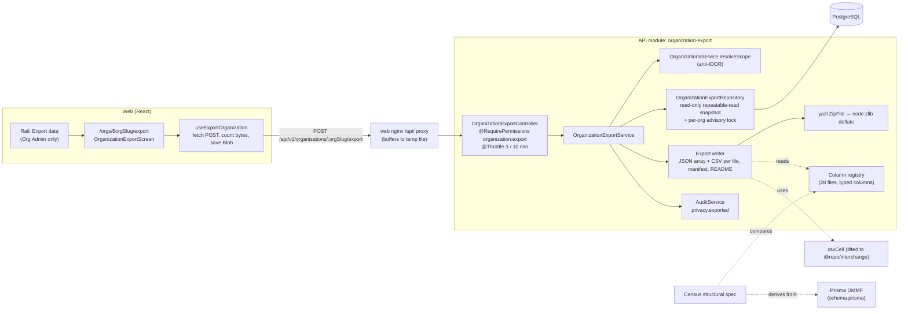
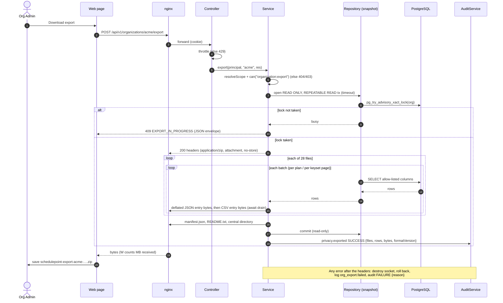
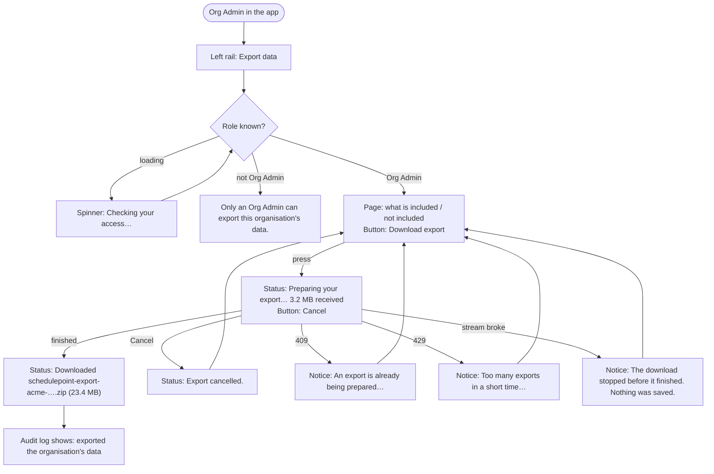

# Feature Spec: Whole-organisation export

- **Status:** Approved — by the product owner, 2026-10-14, with every default in §6 (recycle-bin items, removed members and withdrawn invitations included with their deletion dates; the audit log as the Audit log screen shows it, without IP addresses or browser details; an "Export data" rail link for Org Admins, with the Members page as the fallback). Built after the clear-out.
- **Author(s):** feature-analyst, for the product owner
- **Date:** 2026-10-14
- **Tracking issue / epic:** pre-1.0 requirement (b), `docs/RELEASE_1_0.md` row 6 (line 46). Required for 1.0 by the
  owner on 2026-10-13 (`docs/DECISIONS.md`, entry "2026-10-13 — Pre-1.0 batch 2 is approved, and 1.0 requires
  backups, the organisation export and the clear-out", lines 32-45).
- **Roadmap link:** the 1.0 entry in `docs/ROADMAP.md`.
- **Related ADR(s):** one **new** ADR proposed (§4.9; number **0194**, since 0193 went to the clear-out). It implements ADR-0085 D4 and D5 and amends `docs/PROJECT_BRIEF.md` §14 (line 212). Cited: ADR-0009,
  ADR-0011, ADR-0012, ADR-0016, ADR-0028, ADR-0050, ADR-0051, ADR-0058, ADR-0059, ADR-0066, ADR-0072, ADR-0073,
  ADR-0076, ADR-0081, ADR-0083, ADR-0085, ADR-0086, ADR-0088 D1, ADR-0096, ADR-0105, ADR-0113, ADR-0131, ADR-0132,
  ADR-0142, ADR-0156, ADR-0172, ADR-0174, ADR-0179, ADR-0190, ADR-0192.

**Decided before this spec (not re-asked):** the export is required for 1.0; the owner is non-technical and
self-hosts with Docker Compose, Dockge and Watchtower; there is one organisation today; the target scale is about
2,000 activities a plan; there is no collaborative editing in 1.0. **Already decided by an accepted ADR:** the export
is organisation-scoped and **Org Admin only**, and it is audited as `privacy.exported` (ADR-0085 D4, lines 115-127;
D5, lines 129-136). This spec builds that decision; it does not reopen it.

---

## 1. Business understanding

### Problem

An organisation cannot take its data out of SchedulePoint in one piece. Checked 2026-10-14:

- There are **plan** exports only: P6 XER and MS Project MSPDI (`GET …/plans/:planId/interchange/export/:format`,
  `apps/api/src/modules/interchange/plan-export.controller.ts:46-98`) and the diagram's CSV, PNG and PDF, made in
  the browser (ADR-0059 M4, `apps/web/src/features/tsld/export/`). Each covers one plan, and each leaves things out
  by design: the XER/MSPDI export reports what its format "cannot carry" (`plan-export.controller.ts:51-57`), and
  none of them carries clients, projects, members, baselines, notes, history or the audit log.
- `grep -ri "organi[sz]ation.?export|org.?export|privacy\.exported" apps/` finds nothing. `CLAUDE.md` §17 says the
  same in words: "Neither is an org-wide account export, which is still absent."
- The brief promised one: "an org admin can export all org data (JSON + CSV) at any time"
  (`docs/PROJECT_BRIEF.md:200`), and `docs/RELEASE_1_0.md:46` lists it as **Missing**.

Who feels it: an Org Admin who wants a copy of everything (to leave, to keep an independent record, to answer a
customer's "send us everything you hold", or simply to be sure their plans are theirs). Today the only whole copy is
the operator's database backup (ADR-0192), which is a PostgreSQL dump of **every** organisation on the server,
readable only with database tools, and reachable only by whoever has the server. That is a disaster-recovery copy,
not something an Org Admin can hand to anyone.

### Users

| Who                                                                                         | What they need                                                                                                                         |
| ------------------------------------------------------------------------------------------- | -------------------------------------------------------------------------------------------------------------------------------------- |
| **Org Admin**                                                                               | One button that downloads everything the organisation holds, in files they can open (spreadsheet) and files a program can read (JSON). |
| **Planner, Contributor, Viewer**                                                            | Nothing new. They keep the per-plan exports they have (`interchange:export` is every member, `org-permissions.ts:307-339`).            |
| **External Guest**                                                                          | Nothing. A guest holds a per-plan share grant, not a membership (ADR-0051), and can never reach this.                                  |
| **Staff** (ADR-0086)                                                                        | Nothing. A staff principal holds no membership and no permission, so it cannot export a customer's data.                               |
| **Anyone who later reads the file** (a new tool, an auditor, a future SchedulePoint import) | A documented, versioned format that says what each file is and that will not change underneath them without notice (1.0 promise).      |

### Primary use cases

1. **Take everything.** An Org Admin downloads one ZIP holding every client, project, plan, activity, link,
   calendar, resource, baseline, note, history entry, share link, member and audit event of their organisation.
2. **Read it without SchedulePoint.** They open the ZIP and a CSV in Excel, or hand the JSON to another program.
3. **Know it is complete.** A `manifest.json` lists every file with its row count and checksum, and a `README.txt`
   says in plain words what is and is not in it.
4. **See who exported.** The audit log records each export (who, when, how much), because it is a bulk egress of
   everyone's work (ADR-0085 D5).

### User journeys

**Happy path.** Org Admin → left-hand organisation list → **Export data** → reads what is included → presses
**Download export** → a status line counts megabytes received → the browser saves
`schedulepoint-export-<org>-<date>.zip` → the status says "Downloaded … (23.4 MB)". Later, **Audit log** shows
"exported the organisation's data". User flow diagram in §4.3.

**Alternates.** Another export of the same organisation is already running → "An export is already being prepared
for this organisation. Try again when it finishes." Pressed too often → "Too many exports in a short time. Try again
in a few minutes." The connection drops or the server restarts (Watchtower) mid-download → "The download stopped
before it finished. Nothing was saved. Try again." A non-admin who types the address sees why they cannot use it.

### Expected outcomes

- `docs/RELEASE_1_0.md` row 6 moves from **Missing** to built (then to Done after the owner's check, plan M4).
- The organisation export becomes a **file format the product writes**, which 1.0 promises not to break
  (`docs/RELEASE_1_0.md:97-98`). This spec therefore designs it as a format with a version, not as a database dump.

### Success criteria

- An Org Admin completes the download from the rail in **under 30 seconds** for an organisation of the brief's
  _typical_ size (20 plans of 500 activities, `docs/PROJECT_BRIEF.md:207`) — measured in plan M2-T4.
- At the brief's _upper bound_ (100 plans × 2,000 activities × 4 links, `docs/PROJECT_BRIEF.md:194`), the export
  completes in **under 5 minutes**, adds **under 256 MB** to the API's memory, and keeps an ordinary read's p95
  **under 1 s** while it runs (measured or extrapolated in M2-T4, with the method stated).
- The API end-to-end suite proves: **every** row of the organisation is in the file (counts match the database);
  **no** row of another organisation is (a seeded second organisation's ids do not occur anywhere in the bytes);
  **no** credential is (a known password hash, session token, invitation token hash and share token hash do not
  occur); only an Org Admin can do it.
- The census (§4.4) fails the build when a model or column is added to `schema.prisma` without a decision about the
  export, so the format cannot silently fall behind the schema.

### Open questions

Three for the owner, each with a default; they are in §6. Everything else is decided below with a stated default.

---

## 2. Functional requirements

### User stories & acceptance criteria

> **US-1 — Download everything.** As an **Org Admin**, I want one download of everything my organisation holds, so
> that I have my own complete copy.
>
> - **Given** I am an Org Admin of Acme **when** I press **Download export** on Acme's **Export data** page **then**
>   my browser saves one `.zip` named `schedulepoint-export-acme-YYYYMMDDTHHMMZ.zip`.
> - **Given** the ZIP **then** it contains `manifest.json`, `README.txt`, and for each of the 28 data files in §4.4
>   one `json/<name>.json` and one `csv/<name>.csv`.
> - **Given** Acme has N rows in any exported table **then** the matching JSON array and CSV both hold exactly N
>   rows, and `manifest.json` says N.
> - **Given** a client, project, plan or activity is in the recycle bin **then** it is in the export, with its
>   `deletedAt` set (default of Q1, §6).

> **US-2 — Open it without SchedulePoint.** As an **Org Admin**, I want spreadsheet files and program-readable
> files, so that I can use the data anywhere.
>
> - **Given** any `csv/*.csv` **when** I open it in Excel **then** it shows a header row, UTF-8 text (accents,
>   symbols) correctly, and one row per record.
> - **Given** a note whose text starts with `=`, `+`, `-` or `@` **then** the CSV cell is prefixed with `'` so a
>   spreadsheet does not run it as a formula, and the JSON keeps the exact text.
> - **Given** a money or quantity column (`BigInt` or `Decimal` in `schema.prisma`, e.g. lines 1237, 3260, 3353)
>   **then** the JSON holds it as a decimal **string** (no rounding), and the CSV holds the same digits.

> **US-3 — Trust what I got.** As an **Org Admin**, I want to know the file is complete and what it leaves out.
>
> - **Given** a finished download **then** `manifest.json` lists every file with its row count, byte size and
>   SHA-256, the format name and version, when it was made, by whom, and the list of exclusions with reasons.
> - **Given** the download stopped part-way **then** my browser reports the download as failed, not as a complete
>   file, and the page says it stopped.
> - **Given** `README.txt` **then** it explains, in plain English, the folders, the two file kinds, the dates and
>   money conventions, and what is deliberately not included.

> **US-4 — Only the right people.** As an **organisation**, we want only Org Admins to export everything, and every
> export recorded.
>
> - **Given** I am a Planner, Contributor or Viewer of Acme **then** I see no **Export data** link, and the API
>   answers `403` if I call it.
> - **Given** I am not a member of Acme **then** the API answers `404` (the org is not disclosed).
> - **Given** an export finished **then** the audit log has one `privacy.exported` row, outcome `SUCCESS`, naming me,
>   the organisation, and the counts.
> - **Given** an export started and did not finish **then** there is one `privacy.exported` row with outcome
>   `FAILURE` and a reason.

> **US-5 — Do not hurt everyone else.** As **any user of the server**, I want an export not to slow my work down or
> to be repeatable without limit.
>
> - **Given** an export of Acme is running **when** another export of Acme is requested **then** it is refused `409`.
> - **Given** the same person/address asked 3 times in 10 minutes **then** the 4th is refused `429`.

### Workflows

1. The page checks the role (loading is its own state; `audit-log.tsx:41-47` is the precedent).
2. **Download export** → `POST /api/v1/organizations/:orgSlug/export` with the session cookie.
3. The API resolves the organisation from the caller's own memberships (anti-IDOR), checks `organization:export`,
   applies the throttle, opens a **read-only, repeatable-read** transaction, takes a per-organisation advisory lock
   (else `409`), sends the response headers, and streams the ZIP: one file at a time, each read in bounded batches.
4. The last entry written is `manifest.json` (it carries counts and checksums only known at the end). The ZIP's
   central directory follows it.
5. When the last byte is handed to the proxy, the transaction ends and the API writes the `privacy.exported` audit
   row (`SUCCESS`). On any failure after the headers are sent, the API destroys the connection (so the browser marks
   the download failed), rolls back, logs, and writes `FAILURE`.
6. The browser collects the bytes, then saves them under the filename from `Content-Disposition`.

### Edge cases

| Case                                                                          | Behaviour                                                                                                                                            |
| ----------------------------------------------------------------------------- | ---------------------------------------------------------------------------------------------------------------------------------------------------- |
| Empty organisation (no clients)                                               | A valid ZIP: every JSON file is `[]`, every CSV is a header row only, manifest counts are 0.                                                         |
| Recycle-bin items and their subtrees                                          | Included with `deletedAt` (Q1 default). A removed member and a revoked invitation likewise.                                                          |
| Edits made while the export runs                                              | Not included. The export is one consistent snapshot taken when it starts (repeatable read). The page says "as it stood when you pressed the button". |
| Planner holds the pen while an Org Admin exports                              | No interaction. The export is a read; it takes no lease (ADR-0028) and blocks no write.                                                              |
| The admin's role is removed mid-export                                        | The export finishes; authority is checked once, at the start (the plan exports behave the same, `export.service.ts:106-112`).                        |
| A second export of the same org while one runs                                | `409 EXPORT_IN_PROGRESS`. A different organisation's export is unaffected.                                                                           |
| The browser tab is closed or the network drops                                | The API sees the socket close, stops reading, rolls back, records `FAILURE` (`client_aborted`).                                                      |
| Watchtower recreates the API mid-export                                       | The connection drops; the browser marks the download failed; the page says try again. No partial state exists to clean up (nothing is stored).       |
| A user erased under ADR-0085 D1                                               | Appears as the tombstone the `users` row now holds; their attribution ids are unchanged.                                                             |
| Unicode, quotes, commas, line breaks in names and notes                       | JSON-escaped in JSON; RFC 4180-quoted in CSV.                                                                                                        |
| JSON columns (`activity_history_entries.changes`, `audit_events.changes`)     | Nested JSON in the JSON file; compact JSON text in one CSV cell.                                                                                     |
| A plan with no currency (`plans.currency_code` nullable, `schema.prisma:896`) | `null` in JSON, empty cell in CSV; money columns are minor units of that plan's currency, stated in the README.                                      |
| The organisation itself is soft-deleted                                       | `404` (scope resolution excludes it, as for every org route).                                                                                        |
| Very large organisation                                                       | Streams; there is no size ceiling in v1. The measured bound and the trigger to revisit are in §3 and §4.9 D3.                                        |

### Permissions

- **New permission code `organization:export`, granted to `ORG_ADMIN` only**, in its own bundle beside `AUDIT_READ`
  (`apps/api/src/common/auth/org-permissions.ts:279-287` is the pattern and its reasoning applies word for word: the
  file carries everyone's work, cost, and other members' names and emails). Pinned by a structural spec asserting the
  readers are exactly `[ORG_ADMIN]` (`invitation-permissions.structural.spec.ts:37` is the precedent).
- **Why not reuse `audit:read` or `interchange:export`:** `interchange:export` is every member (`:307-339`), and the
  export includes cost, which Viewers and Contributors may not read (`cost:read`, `:121-128`). Reusing `audit:read`
  would tie two decisions together that ADR-0085 D4 and ADR-0072 took separately.
- **Org scope:** resolved from the caller's own memberships (`OrganizationsService.resolveScope`, as
  `export.service.ts:107`); a non-member gets `404`. Deny by default; the controller carries
  `@RequirePermissions('organization:export')`.
- **Not structural (ADR-0028):** no pen, no lease; it writes nothing to the plan.
- **Guests, staff, anonymous:** cannot reach it (no member principal → `401`/`404`).

### Validation rules

- Path: `:orgSlug` as every org route. Body: none accepted; any body is ignored (no options in v1 — see §4.9 D2 on
  why "include deleted" is not a request option).
- Response: `application/zip`; `Content-Disposition: attachment; filename="schedulepoint-export-<slug>-<UTC stamp>.zip"`
  (the slug is already URL-safe, `schema.prisma:125-130`); `Cache-Control: no-store`.

### Error scenarios

| Scenario                              | Detection                         | User-facing result (page)                                                                    | Status                              |
| ------------------------------------- | --------------------------------- | -------------------------------------------------------------------------------------------- | ----------------------------------- |
| Not signed in                         | session guard                     | sent to sign-in                                                                              | 401                                 |
| Not a member / org deleted            | `resolveScope`                    | "This organisation was not found."                                                           | 404                                 |
| Member without `organization:export`  | permission check                  | "Only an Org Admin can export this organisation's data."                                     | 403                                 |
| Another export of this org is running | `pg_try_advisory_xact_lock` fails | "An export is already being prepared for this organisation. Try again when it finishes."     | 409                                 |
| Throttled                             | `@Throttle` (3 / 10 min)          | "Too many exports in a short time. Try again in a few minutes."                              | 429                                 |
| Failure before the first byte         | exception in setup                | "The export could not be prepared. Try again; if it keeps failing, tell your administrator." | 500 (standard `{ error }` envelope) |
| Failure after streaming started       | exception / timeout mid-stream    | socket destroyed → "The download stopped before it finished. Nothing was saved. Try again."  | (connection reset)                  |
| Client aborts                         | `res` `close` before `finish`     | (the user did it) — on the page, **Cancel** returns to idle with "Export cancelled."         | —                                   |

---

## 3. Technical analysis

| Area           | Impact | Notes                                                                                                                                                                                                                                                                         |
| -------------- | ------ | ----------------------------------------------------------------------------------------------------------------------------------------------------------------------------------------------------------------------------------------------------------------------------- |
| Frontend       | med    | One new route `/orgs/$orgSlug/export` (lazy, ADR-0171), one rail destination (Org Admin only), one feature folder, one fetch-and-save hook. Reuses `PageContainer`/`PageHeader`/`SectionCard`/`NoticeStrip`/`Spinner`/`Button`.                                               |
| Backend        | med    | New module `modules/organization-export` (controller → service → repository), a column registry, a streaming writer. Reuses `OrganizationsService`, `AuditService`, the `ParseUuidPipe`-style conventions of `modules/clients`.                                               |
| Database       | low    | **No schema change** (§4.5). Read-only queries over existing indexes inside one read-only repeatable-read transaction. Any read that turns out to need a new index **stops and goes to database-architect** (CLAUDE.md §19.3).                                                |
| API            | med    | One new route `POST /api/v1/organizations/:orgSlug/export` returning a binary stream. Joins the 1.0 `/api/v1` promise (`RELEASE_1_0.md:93-96`), and its **file** joins promise item 2 (`:97-98`).                                                                             |
| Security       | high   | Bulk egress of an organisation, including members' names/emails, cost and the audit log. Org Admin only; anti-IDOR scope; a credential exclusion list proved by test; audited; throttled; single-flight; POST so `SameSite=Lax` cookies are not sent on a cross-site forgery. |
| Performance    | med    | The one real cost question; analysed below. Synchronous stream, bounded batches, measured before the web lands (ADR-0142).                                                                                                                                                    |
| Infrastructure | low    | One runtime dependency (`yazl`) and one dev dependency (`yauzl`). No new service, no env var, no compose change, no nginx change.                                                                                                                                             |
| Observability  | low    | Pino lines `org_export.started` / `.completed` / `.failed` with org id, user id, rows, bytes, duration; the audit row.                                                                                                                                                        |
| Testing        | high   | Unit (serialisers, census), Supertest e2e (completeness, isolation, secrets, RBAC, 409/429, abort), one Playwright journey + axe, one recorded measurement.                                                                                                                   |

### Cost at realistic scale — and the recommendation: synchronous streaming, no job queue

**What is being asked.** The brief says "export generation is async / job-queue backed" (`PROJECT_BRIEF.md:212`).
The job queue it assumes is ADR-0009's BullMQ + Redis, which is **not implemented and not installed** (`CLAUDE.md`
§17, "Four accepted ADRs have no implementation"), and the stored file a job would produce needs ADR-0011's object
storage, **also unimplemented** (same bullet). So "async" would mean building two pieces of infrastructure and a
Redis container on the owner's server for one button. The question is whether the export is too expensive to do
inside the request.

**Volume (estimate, to be replaced by M2-T4's measurement).** Two measured anchors exist:

- `activities` heap is **~470 bytes a row**: 48 MB at 102,000 activities
  (`docs/specs/staff-diagnostics-panel/m0-measurements.md:163`).
- `activity_history_entries` is **~710 bytes a row** (710 MB heap at 1,000,000 entries, ADR-0174:136).

JSON repeats every key on every row, so an exported activity is plausibly 1-2 kB of JSON and a link a few hundred
bytes; deflate compresses repeated keys very well. **These per-row JSON sizes are estimates from the row shapes, not
measurements.**

| Organisation (from the brief)                                                                                      | Activities | Links (×4, `:194`) | Raw JSON + CSV (est.) | ZIP (est., ~10× deflate) |
| ------------------------------------------------------------------------------------------------------------------ | ---------- | ------------------ | --------------------- | ------------------------ |
| **Today on the owner's server** ("hundreds of activities", `docs/specs/staff-server-readings/feature-spec.md:332`) | < 1,000    | < 4,000            | a few MB              | < 1 MB                   |
| **Typical**: 20 plans × 500 (`:207`)                                                                               | 10,000     | 40,000             | ~50-100 MB            | ~5-10 MB                 |
| **Upper bound**: 100 plans × 2,000 (`:194`), 2 baselines a plan                                                    | 200,000    | 800,000            | ~2-3 GB               | ~150-250 MB              |

Baselines dominate the upper bound because each one copies every activity and link of its plan
(`baseline_activities`, `baseline_dependencies`, ADR-0025/ADR-0126).

**Time.** Reading a few million rows through Prisma and serialising them is single-digit to tens of seconds; deflate
runs on Node's zlib (`yazl` passes compression to `node:zlib`, read from the project README 2026-10-14), i.e. on the
libuv thread pool rather than the event loop. A reasoned upper-bound total of **one to a few minutes**, and a typical
case of **seconds**. Again: reasoned, not measured — which is why M2-T4 measures it before the web milestone starts,
with the thresholds of §1 "Success criteria" as go/no-go.

**Will it get through the proxies?** The chain is Cloudflare → Nginx Proxy Manager → the web container's nginx → the
API (`apps/web/nginx.conf:14-19`). The relevant facts:

- The web nginx's `/api/` block sets **no timeout or buffering directives** (`nginx.conf:78-85`), so nginx defaults
  apply: `proxy_read_timeout 60s` is the gap **between two reads** from the API, not the whole transfer, and
  `proxy_buffering on` spools the response to the container's temp files (up to `proxy_max_temp_file_size`, 1 GB by
  default) so a slow browser does not hold the API back. A stream that emits bytes continuously never trips the 60 s.
- Cloudflare's origin timeout concerns the time to the **first response**; streaming sends headers and the first ZIP
  bytes within the first batch, so a long export is not cut off there. (Cloudflare's behaviour is stated from its
  public documentation, not exercised here; the owner's download in plan M4 is the test.)
- `gzip` in that nginx applies to `application/json` and friends only (`nginx.conf:98-99`), not `application/zip`.
- The API sets no compression middleware (`app-setup.ts` uses `helmet()` at line 90 and nothing that compresses).

A **stored file** would avoid none of this and add a disk, a clean-up and a second request; a **job** would add Redis.
Neither is justified at the measured sizes. **Recommendation: generate and stream the ZIP synchronously on the
request.** The trigger that reopens a job queue is written into the ADR (§4.9 D3), so "no queue" is a checkable
decision rather than an assumption.

### Dependencies

- Lands **after** nothing in particular; independent of the backup (ADR-0192) and the clear-out (row 7).
- Must land **before the 1.0 cut** (`RELEASE_1_0.md` "How the cut works"), so that format version 1 is what 1.0
  promises rather than something 1.0 has to break.
- Affects: the audit vocabulary (`packages/types/src/index.ts:2352-2481`, category map `:2534-2609`), the route
  census (`apps/api/src/modules/audit/audit-coverage.structural.spec.ts:51-141`), the web audit copy map, the rail
  destinations (`apps/web/src/components/layout/navigator/org-destinations.tsx:78-107`), the CLAUDE.md stage-banner
  counts (a 26th API module; `pnpm check:counts`).

---

## 4. Solution design

### 4.1 Architecture overview

A new Nest module, `organization-export`, shaped like `modules/clients` (controller → service → repository) with
`modules/share`'s care at the boundary. The repository reads inside one read-only snapshot, the precedent being
`StaffDiagnosticsRepository.reading` (`apps/api/src/modules/staff/staff-diagnostics.repository.ts:58-71`: `SET
TRANSACTION READ ONLY`, `RepeatableRead`, a transaction timeout, `SET LOCAL statement_timeout`). A **column registry**
is the single source for which models and columns are exported, and the census checks it against the Prisma schema.



### 4.2 Data flow



### 4.3 User flow



### 4.4 What the export contains — all 35 models classified

Read from `apps/api/prisma/schema.prisma` on 2026-10-14 (35 `model` blocks; `pnpm check:counts` agrees with
CLAUDE.md's "35 Prisma models"). **28 in, 7 out.** "In" means one `json/<file>.json` and one `csv/<file>.csv`.

**Rules applied to every "in" model** (the census enforces them, so each exception is written down):

- Include every column **except**: credential material (token hashes, passwords, session tokens); `version` and
  `delete_batch_id` (internal concurrency and restore bookkeeping, meaningless outside this database); and the audit
  log's `ip_address`/`user_agent` (below).
- Rows are those whose organisation is the caller's, **in any soft-delete state** (Q1 default). Each read states
  `// soft-delete: any-state — the organisation export includes the recycle bin (spec §4.4)` per ADR-0172 D3. If Q1
  is answered "exclude", the stance becomes `deletedAt: null` and nothing else changes.
- Engine-computed columns (early/late dates, float, criticality) are exported **as stored**; the export never
  recalculates.

| #   | Model → table                                            | In/out                       | File                             | Why / what is withheld                                                                                                                                                                                                                                                                                       |
| --- | -------------------------------------------------------- | ---------------------------- | -------------------------------- | ------------------------------------------------------------------------------------------------------------------------------------------------------------------------------------------------------------------------------------------------------------------------------------------------------------ |
| 1   | `User` → `users`                                         | **In, partial**              | `people`                         | Only users with an `OrgMember` row (any state) in **this** org; columns `id`, `name`, `email`, `createdAt`. No `image`, no `emailVerified` (account state, not organisation data). **Users of other organisations never appear** — the read is a join from this org's members.                               |
| 2   | `Session` → `sessions`                                   | **Out**                      | —                                | Bearer session tokens, IP, user agent (`schema.prisma:47-60`). Credentials of individuals, not organisation data.                                                                                                                                                                                            |
| 3   | `Account` → `accounts`                                   | **Out**                      | —                                | Password hashes and OAuth tokens (`:62-85`).                                                                                                                                                                                                                                                                 |
| 4   | `Verification` → `verifications`                         | **Out**                      | —                                | Single-use verify/reset secrets, no organisation column (`:87-97`).                                                                                                                                                                                                                                          |
| 5   | `Organization` → `organizations`                         | In                           | `organization` (one row)         | Minus `version`.                                                                                                                                                                                                                                                                                             |
| 6   | `OrgMember` → `org_members`                              | In                           | `members`                        | Role, joined (`createdAt`), removed (`deletedAt`), attribution.                                                                                                                                                                                                                                              |
| 7   | `Invitation` → `invitations`                             | In, minus `tokenHash`        | `invitations`                    | `tokenHash` is a credential digest (`:260-269`). Email of a possible non-user is the org's own pending invite list (ADR-0085 D2 hard-deletes an erased one, so the export reflects that).                                                                                                                    |
| 8   | `Client` → `clients`                                     | In                           | `clients`                        |                                                                                                                                                                                                                                                                                                              |
| 9   | `Project` → `projects`                                   | In                           | `projects`                       |                                                                                                                                                                                                                                                                                                              |
| 10  | `Plan` → `plans`                                         | In                           | `plans`                          | Includes `currencyCode` (`:896`) and every setting.                                                                                                                                                                                                                                                          |
| 11  | `Activity` → `activities`                                | In                           | `activities`                     | Includes `visualStart`/lane placement, the SchedulePoint layout (ADR-0156) in its native columns.                                                                                                                                                                                                            |
| 12  | `ActivityDependency` → `dependencies`                    | In                           | `dependencies`                   |                                                                                                                                                                                                                                                                                                              |
| 13  | `CrossPlanDependency` → `cross_plan_dependencies`        | In                           | `cross-plan-dependencies`        | Both endpoints are in this org by construction (`:154-158`).                                                                                                                                                                                                                                                 |
| 14  | `Calendar` → `calendars`                                 | In                           | `calendars`                      | Org and project tiers (ADR-0053).                                                                                                                                                                                                                                                                            |
| 15  | `CalendarException` → `calendar_exceptions`              | In                           | `calendar-exceptions`            |                                                                                                                                                                                                                                                                                                              |
| 16  | `CalendarShift` → `calendar_shifts`                      | In                           | `calendar-shifts`                | No organisation column; read by this org's calendar ids.                                                                                                                                                                                                                                                     |
| 17  | `CalendarExceptionWindow` → `calendar_exception_windows` | In                           | `calendar-exception-windows`     | No organisation column; read by this org's exception ids.                                                                                                                                                                                                                                                    |
| 18  | `Baseline` → `baselines`                                 | In                           | `baselines`                      |                                                                                                                                                                                                                                                                                                              |
| 19  | `BaselineActivity` → `baseline_activities`               | In                           | `baseline-activities`            |                                                                                                                                                                                                                                                                                                              |
| 20  | `BaselineAssignment` → `baseline_assignments`            | In                           | `baseline-assignments`           |                                                                                                                                                                                                                                                                                                              |
| 21  | `BaselineDependency` → `baseline_dependencies`           | In                           | `baseline-dependencies`          |                                                                                                                                                                                                                                                                                                              |
| 22  | `PlanLock` → `plan_locks`                                | **Out**                      | —                                | The pen's lease: expires in minutes and describes who is editing right now (ADR-0028, `:2747-2780`). Not data.                                                                                                                                                                                               |
| 23  | `PlanShare` → `plan_shares`                              | In, minus `tokenHash`        | `shares`                         | Who was given a link, its label, expiry, revocation, last access — governance facts. The hash is a bearer-credential digest (`:2809-2812`).                                                                                                                                                                  |
| 24  | `PlacementMigration` → `placement_migrations`            | In                           | `records-placement-migrations`   | Org-scoped record of a one-time change the product made to this org's data; "the only record there will be" (`:2876-2881`).                                                                                                                                                                                  |
| 25  | `FmDateMigration` → `finish_milestone_date_migrations`   | In                           | `records-finish-milestone-dates` | Same reason (`:3048-3058`).                                                                                                                                                                                                                                                                                  |
| 26  | `CrossPlanLagMigration` → `cross_plan_lag_migrations`    | In                           | `records-cross-plan-lags`        | Same reason (`:3107-3120`).                                                                                                                                                                                                                                                                                  |
| 27  | `Resource` → `resources`                                 | In                           | `resources`                      | Includes cost rates (the exporter is an Org Admin, who holds `cost:read`).                                                                                                                                                                                                                                   |
| 28  | `ResourceAssignment` → `resource_assignments`            | In                           | `assignments`                    |                                                                                                                                                                                                                                                                                                              |
| 29  | `ActivityStep` → `activity_steps`                        | In                           | `activity-steps`                 |                                                                                                                                                                                                                                                                                                              |
| 30  | `ActivityHistoryEntry` → `activity_history_entries`      | In                           | `activity-history`               | All rows incl. cost-only ones (Org Admin holds `cost:read`; `:3649-3651`).                                                                                                                                                                                                                                   |
| 31  | `Note` → `notes`                                         | In                           | `notes`                          | Free text; formula-guarded in CSV only.                                                                                                                                                                                                                                                                      |
| 32  | `AuditEvent` → `audit_events`                            | **In, partial** (Q2 default) | `audit-events`                   | Exactly the rows the Org Admin's **Audit log** reads (`organization_id = org`, `audit.repository.ts:87-95`) and exactly its fields: **no `ipAddress`, no `userAgent`**, which that screen deliberately never shows (`audit-event-response.dto.ts:19-22`). Org-less `auth.*` rows are not the organisation's. |
| 33  | `MailEvent` → `mail_events`                              | **Out**                      | —                                | Installation telemetry, no organisation column, staff-only (ADR-0086).                                                                                                                                                                                                                                       |
| 34  | `CspReport` → `csp_reports`                              | **Out**                      | —                                | Same.                                                                                                                                                                                                                                                                                                        |
| 35  | `PerfProbeResult` → `perf_probe_results`                 | **Out**                      | —                                | Staff's measurements of the installation.                                                                                                                                                                                                                                                                    |

**The census** (`apps/api/src/modules/organization-export/export-census.structural.spec.ts`) derives the model and
field list from the Prisma DMMF (the hierarchy-expiry census is the shipped precedent, `schema.prisma:2930-2940`
describes it) and fails when: a model is in neither the "in" registry nor the "out" list with a reason; a field of an
"in" model is neither exported nor declared withheld with a reason; or a registry column names a field that no longer
exists. It is a Vitest structural spec, the house tier for this kind of rule (ADR-0172 "B with a custom ESLint rule"
paragraph), so it needs no new root `check:*` script.

### 4.5 Database changes

**None.** Evidence:

- No table stores an export: the file is generated and streamed, never kept (§4.9 D5).
- The audit action is TEXT, and `privacy.exported` satisfies `ck_audit_events_action_format`
  (`^[a-z][a-z0-9_]*(\.[a-z][a-z0-9_]*)+$`, ≤ 64 chars,
  `apps/api/prisma/migrations/20260803170000_audit_events/migration.sql:76-78`). No migration.
- Reads use existing indexes: per-plan reads go through the `plan_id` indexes the plan screens and the XER export
  already use (`export.service.ts:165-170` reads activities, dependencies and assignments by plan); org-level tables
  by their `organization_id` indexes; the two models with no organisation index are read per plan by their
  `plan_id` index (`finish_milestone_date_migrations`, `schema.prisma:3103`; `cross_plan_lag_migrations`, `:3170`);
  the two models with no organisation column are read by parent id over the indexes the engine's own load uses
  (`calendar_shifts (calendar_id, …)`, `:2036`; `calendar_exception_windows (calendar_exception_id, …)`, `:2055`);
  the audit file pages by `idx_audit_events_org_occurred` (`schema.prisma:3843-3845`).

**database-architect is therefore not engaged — because there is no schema change to design.** M2-T4 runs `EXPLAIN`
on each read; if any one needs an index, that is a schema change and the milestone **stops** for database-architect
(CLAUDE.md §19.3).

### 4.6 API changes

`POST /api/v1/organizations/:orgSlug/export`

- **Auth:** session cookie; `@RequirePermissions('organization:export')`; scope via `resolveScope`.
- **Throttle:** `@Throttle({ default: { ttl: 600_000, limit: 3 } })` — 3 per 10 minutes per IP and handler (the
  per-handler keying is recorded at `schedule.controller.ts:49-53`; `LEVELLING_APPLICATION_THROTTLE`, `:84`, is the
  pattern). The value is a default sized for a person retrying, not a scraper; M2 may tighten it, never widen it
  without a reason in the PR.
- **Request:** no body.
- **200:** `Content-Type: application/zip`, `Content-Disposition: attachment; filename="…"`, `Cache-Control:
no-store`. Body streamed; **no `Content-Length`** (unknown until the end). `Content-Disposition` must be readable by
  the web client; M3 confirms it is exposed in the CORS config the XER export already relies on
  (`plan-export.controller.ts:89-92` comments the same for its header).
- **Errors (before the first byte, standard `{ error }` envelope, `docs/API.md`):** `401`, `403`, `404`,
  `409 EXPORT_IN_PROGRESS`, `429`, `500`.
- **After the first byte:** the connection is destroyed; no envelope is possible and none is attempted.
- **OpenAPI:** `@ApiProduces('application/zip')`, binary schema — the plan export's decorators are the template
  (`plan-export.controller.ts:36-73`).

**Why POST, not GET.** The plan export is a GET (`plan-export.controller.ts:46`), but it writes nothing. This route
writes an audit row, and `docs/SECURITY_STANDARDS.md:95-97` says safe methods are side-effect-free. More concretely:
Better Auth's session cookie is `SameSite=Lax` by default (no override: `grep -i samesite
apps/api/src/common/auth/better-auth.ts` finds none), and Lax cookies **are** sent on a cross-site top-level GET
navigation. A GET export could therefore be triggered from another site — the file would land on the admin's own disk
(the attacker gains nothing), but it would write audit rows and spend the throttle. A POST carries no Lax cookie from
another site. `POST` returning `200` with the body is used because nothing is created that has an address.

**Format (the promised part).** Fully written up in a new `docs/ORGANISATION_EXPORT_FORMAT.md` (plan M1), and a test
asserts that document names every file and column in the registry (ADR-0076: a computable claim is computed). In short:

```text
schedulepoint-export-acme-20261014T0930Z.zip
├── README.txt                     plain-English guide (same text for every export of a format version)
├── json/<file>.json               a JSON array, one object per line; camelCase keys as the API uses
├── csv/<file>.csv                 UTF-8 with BOM, CRLF, RFC 4180, header row = the same keys
└── manifest.json                  written last
```

- **Types:** instants as ISO 8601 UTC (`2026-10-14T09:30:00.000Z`); calendar days (`@db.Date`) as `YYYY-MM-DD`;
  `BigInt` and `Decimal` as decimal **strings** (`JSON.stringify` throws on a `BigInt`, and a `Decimal(18,4)` loses
  digits as a JS number); enums as their names; JSON columns nested in JSON and compact text in CSV; `null` as JSON
  `null` / empty CSV cell; durations and lags in **minutes** as the columns store them, named as stored.
- **CSV safety:** text columns only pass through `csvCell` (`apps/web/src/features/tsld/export/export-csv.ts:128-158`,
  lifted to `@repo/interchange` so the web and API share one guard). Numeric, date and boolean columns are never
  prefixed — `-5.0000` must stay a number. **JSON is authoritative; CSV is a spreadsheet view** and says so in the
  README.
- **Order:** rows by plan id, then row id (UUID v7, so creation order) — deterministic, which the tests rely on.
- **manifest.json:**
  `{ "format": "schedulepoint.organisation-export", "formatVersion": "1.0", "generatedAt", "generator": { "product":
"SchedulePoint", "apiVersion" }, "organization": { "id", "slug", "name" }, "exportedBy": { "userId", "name" },
"snapshot": "consistent", "includesDeleted": true, "files": [ { "path", "table", "kind": "json"|"csv", "rows",
"bytes", "sha256" } ], "excluded": [ { "what", "reason" } ] }`.
- **Versioning rule** (the ADR's D2): adding a file or a column is a **minor** format change (`1.1`); removing,
  renaming, or changing a column's type or meaning is a **major** (`2.0`) and, after 1.0, an API major. Readers must
  ignore files and keys they do not know. The manifest's version is the contract, not the database layout, which 1.0
  explicitly does not promise (`RELEASE_1_0.md:101-103`).

### 4.7 Component changes

| Where                                                         | What                                                                                                                                                                                                                                                                                                                                                                                                                                                        | States                                                                                |
| ------------------------------------------------------------- | ----------------------------------------------------------------------------------------------------------------------------------------------------------------------------------------------------------------------------------------------------------------------------------------------------------------------------------------------------------------------------------------------------------------------------------------------------------- | ------------------------------------------------------------------------------------- |
| `apps/web/src/lib/rbac.ts`                                    | `canExportOrganization(role)` → `role === ORG_ADMIN` (`canReadAuditLog`, `:120`, is the pattern).                                                                                                                                                                                                                                                                                                                                                           | —                                                                                     |
| `components/layout/navigator/org-destinations.tsx`            | A seventh destination **Export data** (Lucide `Download`, `aria-hidden`), last, `visible: canExportOrganization(role)`; the `to` union gains `'/orgs/$orgSlug/export'`. Expanded and collapsed rails both get it from the one array (`:16-36` explains why).                                                                                                                                                                                                | Hidden for non-admins (a courtesy; the API is the control).                           |
| `routes/organization-export.tsx` (lazy)                       | `OrganizationExportScreen`: `PageContainer` + `PageHeader` ("Export organisation data", description) + `SectionCard` "What is included" (the 28 files grouped in plain words) + "What is not included" (the 7 exclusions and the audit IP note) + the action row.                                                                                                                                                                                           | Role loading (third branch, `audit-log.tsx:41-47`); refused; idle; busy; done; error. |
| `features/organization-export/api/use-export-organization.ts` | `fetch` POST with `credentials`, reads `response.body` with a reader to count bytes, assembles a `Blob`, saves it via the existing download helper (`features/tsld/export/download.ts:15-16`, lifted to `lib/` if a second feature imports it), parses `Content-Disposition` with the plan export's parser (`features/interchange/api/use-export-plan.ts:45`), maps 403/404/409/429/5xx to copy, supports `AbortController` (Cancel, and abort on unmount). | —                                                                                     |
| `features/organization-export/components/ExportAction.tsx`    | **Download export** (`Button`, primary) → while busy becomes **Cancel**; a `role="status"` line ("Preparing your export… 3.2 MB received", updated at most every 2 s so a screen reader is not flooded); errors in a `NoticeStrip` as an **event** (ADR-0132).                                                                                                                                                                                              | Busy keeps focus on the action; nothing is `disabled` (ADR-0083).                     |
| `features/audit` copy map                                     | A label for `privacy.exported` ("exported the organisation's data") — the map is exhaustively keyed, so the build fails without it.                                                                                                                                                                                                                                                                                                                         | —                                                                                     |

Accessibility: semantic headings and lists; keyboard-only operable; the status line is the single live region; contrast
via tokens only; the page reflows at 1024 × 600 and below (ADR-0179); the rail link's accessible name equals its
visible text in both rail forms (WCAG 2.5.3). **Rail height:** seven destinations at 1024 × 600 must be measured
before the link is accepted (plan M3-T2, ADR-0113: measure the problem); if they do not fit, the fallback is a
**Export data** link inside the **Members** page header for Org Admins, which needs no rail change.

### 4.8 Implementation approach & alternatives

**Chosen:** synchronous, streamed ZIP of JSON + CSV, generated per request inside one read-only snapshot, Org Admin
only, POST, audited, throttled, single-flight, nothing stored; a versioned, documented format checked against the
schema by a census.

| Alternative                                                               | Why not                                                                                                                                                                                                                                                                                                                                                                                                                                                                                                                                                                                    |
| ------------------------------------------------------------------------- | ------------------------------------------------------------------------------------------------------------------------------------------------------------------------------------------------------------------------------------------------------------------------------------------------------------------------------------------------------------------------------------------------------------------------------------------------------------------------------------------------------------------------------------------------------------------------------------------ |
| **Job queue + stored file** (the brief's line 212; ADR-0009 + ADR-0011)   | Needs Redis, BullMQ and an object store, none installed (CLAUDE.md §17), on a non-technical owner's server, for a file that is seconds to generate at today's and the typical size. Adds a "your export is ready" notification flow and a retention rule for the stored file. Kept as the reopen path with a measured trigger (§4.9 D3).                                                                                                                                                                                                                                                   |
| **Build to a temp file, then send**                                       | Gives a `Content-Length` and clean errors, but delays the first byte until the whole file exists (the Cloudflare first-response limit then applies to generation time), needs disk clean-up after crashes, and the web nginx already spools to disk for us.                                                                                                                                                                                                                                                                                                                                |
| **Stream without a snapshot** (page through tables outside a transaction) | An edit during the export could produce a link whose activity is not in the file. A read-only repeatable-read snapshot costs one pooled connection for the duration; the staff diagnostics already do exactly this (`staff-diagnostics.repository.ts:58-71`).                                                                                                                                                                                                                                                                                                                              |
| **GET**                                                                   | Lax cookies travel on a cross-site GET; the route has a side effect (audit). See §4.6.                                                                                                                                                                                                                                                                                                                                                                                                                                                                                                     |
| **A database dump of the org** (`pg_dump` with filters)                   | Couples the file to the database layout, which 1.0 does not promise; exposes columns nobody decided to export; unreadable to a non-technical user.                                                                                                                                                                                                                                                                                                                                                                                                                                         |
| **Per-plan folders** (`plans/<id>/activities.json`)                       | Friendlier to browse, but splits a table across hundreds of files, which defeats a spreadsheet and a program alike; the per-plan XER/CSV exports already serve "give me this plan".                                                                                                                                                                                                                                                                                                                                                                                                        |
| **JSON only, or CSV only**                                                | The brief asks for both (`:200`); JSON is lossless, CSV is what the owner can open.                                                                                                                                                                                                                                                                                                                                                                                                                                                                                                        |
| **`archiver` or a hand-written ZIP writer**                               | `archiver` brings a deep dependency tree; a hand-written writer means owning a binary format the 1.0 promise rests on. **`yazl`** (MIT, ZIP64 automatic, deflate via `node:zlib`, streams of unknown size via `addReadStream`; v3.3.1, 2024-11-23 — read from its README 2026-10-14) is small and boring. Its internals that the design relies on are registered in `scripts/dependency-claims.json` in M2 (`pnpm check:claims`). If M2 finds a claim false, the fallback is a minimal store/deflate writer over `node:zlib` (Node 22 has `zlib.crc32`), behind the same writer interface. |
| **Re-import** of the export                                               | **Out of scope for 1.0.** The backup (ADR-0192) is the restore path. The format keeps every id and a version so an importer is possible later; nothing promises one.                                                                                                                                                                                                                                                                                                                                                                                                                       |
| **A "subject export"** (everything about me)                              | ADR-0085 D4 deliberately chose the organisation export first and named the subject export as later, smaller work. Not this spec.                                                                                                                                                                                                                                                                                                                                                                                                                                                           |

### 4.9 ADR required — outline (ADR-0194, number taken at landing)

**Title:** "An organisation's export is a promised format, streamed on the request."

**Why an ADR (ADR-0105 / CLAUDE.md §21):** it creates a file format 1.0 promises; it overrides the brief's "async /
job-queue backed" (`PROJECT_BRIEF.md:212`); it decides what leaves the tenant boundary in bulk; it adds a shared gate
(the census) and a runtime dependency.

- **D1 — Contents are decided per model and per column, and the census enforces it.** The §4.4 table; the
  exclusion rules (credentials, internal bookkeeping, the audit log's IP/user agent); the census fails on any
  undecided model or column. A future widening of who may export (e.g. to Planners) must revisit cost columns.
- **D2 — The format is versioned, documented, and independent of the schema.** Manifest, file naming, type
  conventions, CSV safety, JSON authoritative, the minor/major rule, readers ignore the unknown. The database layout
  stays unpromised. No request options in v1 (each option multiplies the promised shapes).
- **D3 — Generated synchronously and streamed; no job queue.** Read-only repeatable-read snapshot, per-org advisory
  lock, bounded batches with back-pressure, a transaction timeout set from the M2 measurement. **Reopen trigger:**
  a measured export at the brief's upper bound exceeds 5 minutes, or adds more than 256 MB to the API's memory, or
  pushes an ordinary read's p95 over 1 s while it runs; or an organisation outgrows the brief's §12 data-scale
  target. Then: tune (compression level, batch size), then a worker thread, then ADR-0009/0011.
- **D4 — Org Admin only, by POST, audited as `privacy.exported`, throttled, single-flight.** Implements ADR-0085
  D4/D5. `SUCCESS` when the last byte is handed to the proxy (not proof of receipt, and the row says so in its
  docblock), `FAILURE` with a reason when it started and did not finish; refusals before the first byte are not
  recorded, like every other route. Payload: flattened scalars (format version, files, rows, bytes, includes
  deleted), the ADR-0073 family-D convention.
- **D5 — Nothing is stored.** No file on the server, so no retention rule and no ADR-0011 dependency.
- **D6 — Re-import is not promised.**
- **Consequences:** `PROJECT_BRIEF.md` §14 line 212 amended to cite this ADR; `SECURITY_STANDARDS.md` "Data protection
  & privacy" says the export now exists and what it excludes; `RELEASE_1_0.md` row 6; `CLAUDE.md` §16 gains one line
  (`check:adr-coverage`) and §17's "still absent" sentence is corrected; `docs/BACKLOG.md` privacy-operations entry
  updated (export half done, erasure still owed under ADR-0085 D6).

### 4.10 Invariants and gates this design must keep

- **Recalc parity:** the engine is not imported and no scheduling input changes, so `computeSchedule` is untouched
  by construction; no `scripts/engine-parity.json` declaration.
- **No `VITE_` flag** (ADR-0088 D1): every published image carries every flag at its default and an operator cannot
  switch one off, so a flag would be a second JSX root rather than a rollback. The rollback is the commit boundary.
- **Entry point and journey** (ADR-0081): M1 and M2 ship dark and say so; M3 names **Export data** and lands its
  journey.
- **ADR-0105 triggers crossed** (hence this spec): a user-facing entry point, a public API route, a shared gate (the
  census), a component contract (the destination union), a new dependency. **Not** crossed: schema change, new
  Playwright config, new CI step (the journey joins the existing `e2e-audit` suite).
- **Audit census:** the route is added to `AUDITED_ROUTES` with `['privacy.exported']`
  (`audit-coverage.structural.spec.ts:51-141`).

## 5. Links

- Implementation plan: [`./implementation-plan.md`](./implementation-plan.md)
- Related docs updated by this change: `docs/ORGANISATION_EXPORT_FORMAT.md` (new), `docs/API.md`,
  `docs/SECURITY_STANDARDS.md`, `docs/PROJECT_BRIEF.md` §14, `docs/RELEASE_1_0.md` row 6, `docs/BACKLOG.md`,
  `docs/guides/export-your-organisation.md` (new, for the owner), `CLAUDE.md` §16, §17 and the stage-banner counts,
  ADR-0194 (new).

## 6. Critical questions for the product owner

Each has a default; if you say nothing, the default is built.

1. **Should the download include things in the recycle bin, and people who have left?** Deleted clients, projects,
   plans and activities that can still be restored, removed members and withdrawn invitations.
   **Default: yes**, each marked with the date it was deleted, because "everything the organisation holds" includes
   what you could still restore. (No: they are left out, and the download only shows what is live today.)
2. **Should the download include the organisation's audit log?** **Default: yes, exactly what the Audit log screen
   already shows** (who did what and when), and like that screen, **without** anyone's IP address or browser details.
   (No: the audit log stays only on screen.)
3. **Where should the button live?** **Default: a new "Export data" link at the bottom of the organisation list on
   the left**, shown only to Org Admins. If seven links do not fit on a small laptop screen, it goes to the top of the
   **Members** page instead (measured during the build). (Alternative: always on the Members page.)

Not asked, because already decided: only Org Admins may export (ADR-0085 D4, 2026-08-09); re-importing an export is
not part of 1.0; there is no separate on/off setting for the feature.

**Awaiting approval before implementation.**
