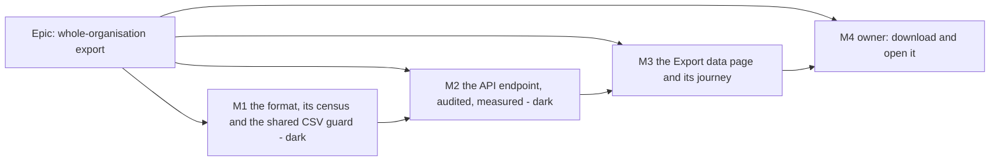

# Implementation Plan: Whole-organisation export

- **Feature spec:** [`./feature-spec.md`](./feature-spec.md)
- **Status:** Approved — with the spec, by the product owner, 2026-10-14. Starts after the clear-out.
- **Owner:** product owner; implementation by the **builder** agent (Sonnet), one PR per milestone.

## Breakdown

### Epic

**Whole-organisation export** — an Org Admin downloads one ZIP of JSON and CSV holding everything the organisation
holds, in a versioned format 1.0 will promise. Pre-1.0 requirement (b), `docs/RELEASE_1_0.md` row 6.

**Rules that apply to every milestone.**

- **No `VITE_` flag** (ADR-0088 D1). The rollback is the commit boundary.
- **No schema change.** If a read needs an index, or anything else touches `schema.prisma` or `migrations/`, the
  milestone **stops** and goes to **database-architect** (CLAUDE.md §19.3). An unavailable agent is a reason to wait.
- **No new Playwright config and no new CI step.** The journey joins `apps/web/e2e-audit/` (run by the existing
  `playwright.audit.config.ts` step); the census is a Vitest structural spec run by `pnpm test`.
- **ADR-0105:** this is a spec because it adds an entry point, a public route, a shared gate, a component contract and
  a dependency. Anything found outside a milestone's scope becomes a `docs/TECH_DEBT.md` row, not extra work.
- **Engine parity:** no engine file changes; no `scripts/engine-parity.json` declaration.
- **Soft-delete stance** (ADR-0172): every export read states `// soft-delete: any-state — the organisation export
includes the recycle bin (spec §4.4)`, or `deletedAt: null` if the owner answers Q1 "no".
- **Gate before push:** `pnpm prepush`, plus `scripts/e2e-local.sh api` for M2 and `scripts/e2e-local.sh web:audit`
  for M3 (CLAUDE.md §19.8).

---

### Milestone 1: The format, its census and the shared CSV guard (one PR)

**Outcome:** the export format exists as code and as a document; the build fails if `schema.prisma` gains a model or
column without a decision about the export.
**Entry point:** `Ships dark:` nothing reads the registry or writes a file yet; M2 adds the route, M3 the page.
**Journey:** none (dark). The census and the serialiser unit suites are the proof.

#### Feature: column registry, serialisers and census

> **Description:** the single declarative source of what is exported (28 files, typed columns, 7 exclusions with
> reasons), pure serialisers for JSON lines and CSV rows, the manifest and README builders, and the census.
> **Complexity:** M
> **Dependencies:** none
> **Risks:** the registry drifts from the schema → the census, derived from the Prisma DMMF; a CSV guard that mangles
> numbers → the guard applies only to columns typed `text`, pinned by test.
> **Testing requirements:** unit (serialisers, manifest, README), structural (census, doc-matches-registry).

##### Task 1.1 — Lift `csvCell` into `@repo/interchange` (S)

- **Description:** move `csvCell` and its constants from `apps/web/src/features/tsld/export/export-csv.ts:128-158` to
  `packages/interchange/src/csv.ts`, export it, and import it back in the web. No behaviour change.
- **Complexity:** S
- **Dependencies:** none
- **Risks:** ADR-0019 build contract for shared packages → build the package before the web typechecks (as for every
  `@repo/interchange` change).
- **Testing:** move `export-csv.test.ts`'s `csvCell` cases (lines 61-90) beside the new file; the web suite stays green
  unchanged.
- **Development steps:**
  1. Move the function and its tests; re-export from the package index.
  2. Replace the web's local definition with the import.
  3. `pnpm prepush`.

##### Task 1.2 — Column registry and serialisers (M)

- **Description:** `apps/api/src/modules/organization-export/export-columns.ts`: for each of the 28 files (spec §4.4)
  the model name, file name, read strategy (`org`, `per-plan`, `by-parent`) and an ordered column list, each column
  `{ field, kind: 'text'|'int'|'bigint'|'decimal'|'instant'|'date'|'boolean'|'enum'|'json' }`; the withheld fields per
  model with reasons; the 7 excluded models with reasons. `export-serialise.ts`: row → JSON object (bigint/decimal →
  string, instant → ISO, date → `YYYY-MM-DD`), row → CSV line (`csvCell` on `text` only; compact JSON for `json`;
  CRLF), the JSON-array framing, `manifest.json` and `README.txt` builders (`formatVersion: "1.0"`).
- **Complexity:** M
- **Dependencies:** 1.1
- **Risks:** a `Decimal` passed through `Number()` loses digits → serialiser takes Prisma's `Decimal` and calls
  `toFixed()`/`toString()`, pinned by a `Decimal(18,4)` max-value test; `@db.Date` read as an instant at UTC midnight
  → formatter reuses `formatCalendarDate` (`apps/api/src/common/validation/calendar-date`, already used by
  `export.service.ts:197`).
- **Testing:** unit — every kind, `null` in every kind, a 32 kB JSON value, Unicode, embedded quotes/CRLF, formula
  prefixes on text vs a negative decimal (unguarded), manifest shape, README stable for a version.
- **Development steps:**
  1. Write the registry from spec §4.4 (include-by-default; withhold only `version`, `deleteBatchId`, credential
     digests, `User.image`/`emailVerified`, `AuditEvent.ipAddress`/`userAgent`).
  2. Write the serialisers and builders as pure functions.
  3. Unit tests.

##### Task 1.3 — The census (S)

- **Description:** `export-census.structural.spec.ts` reads `Prisma.dmmf.datamodel.models` and asserts: every model is
  in the registry or the exclusion list (never both); every scalar field of an included model is exported or
  withheld-with-reason; every registry field exists; the counts are 28 + 7 = the model count. Also a permission
  structural spec: `organization:export` readers are exactly `[ORG_ADMIN]` (pattern:
  `apps/api/src/common/auth/invitation-permissions.structural.spec.ts:37`) — added here with the code in
  `org-permissions.ts` (own bundle, beside `AUDIT_READ`, `:279-287`).
- **Complexity:** S
- **Dependencies:** 1.2
- **Risks:** the census passes vacuously (empty DMMF in the test env) → assert the model count equals the
  `schema.prisma` `model` count and is > 30; a negative control (a fake extra field) proves it can fail (ADR-0110).
- **Testing:** the spec itself, plus the negative control.
- **Development steps:**
  1. Write the spec; run it once against a deliberately broken registry; restore.
  2. Add the permission code, bundle and its structural spec.

##### Task 1.4 — The format document and ADR (S)

- **Description:** `docs/ORGANISATION_EXPORT_FORMAT.md` (files, columns, types, versioning rule, exclusions; plain
  enough for the owner's README to quote). A structural test asserts the document names every registry file and
  column. Draft **ADR-0194** from spec §4.9 (status Proposed until M2 lands it as Accepted); add its one line to
  `CLAUDE.md` §16 (`check:adr-coverage`).
- **Complexity:** S
- **Dependencies:** 1.2
- **Risks:** the doc and the registry diverge → the structural test.
- **Testing:** doc-matches-registry spec; `pnpm check:adr-coverage`.
- **Development steps:**
  1. Write the doc from the registry.
  2. Write the test.
  3. Write the ADR and the §16 line. No changeset (nothing user-visible; internal packages are private).

---

### Milestone 2: The API endpoint, audited and measured (one PR)

**Outcome:** `POST /api/v1/organizations/:orgSlug/export` streams the ZIP for an Org Admin; every export is in the
audit log; the cost at scale is measured and recorded with a go/no-go before M3 starts.
**Entry point:** `Ships dark:` no screen links to it; M3 adds **Export data**. It is reachable through the API (and the
non-production OpenAPI page) only.
**Journey:** the Supertest e2e below drives the real route against a real database; the Playwright journey lands in M3.

#### Feature: `organization-export` module

> **Description:** controller → service → repository on the `modules/clients` shape; read-only repeatable-read
> snapshot (`staff-diagnostics.repository.ts:58-71` precedent); per-org advisory lock; streaming ZIP with `yazl`;
> `privacy.exported` audit; throttle.
> **Complexity:** L
> **Dependencies:** M1
> **Risks:** see each task and the rollup.
> **Testing requirements:** Supertest e2e (completeness, isolation, secrets, RBAC, 409, 429, abort); a recorded
> measurement.

##### Task 2.1 — Module, route and streaming writer (L)

- **Description:** `OrganizationExportModule` (registered in `AppModule`; the stage banner's API-module count becomes
  26 — `pnpm check:counts`). Controller: `@Post()` on `organizations/:orgSlug/export`,
  `@RequirePermissions('organization:export')`, `@Throttle({ default: { ttl: 600_000, limit: 3 } })`, OpenAPI
  decorators modelled on `plan-export.controller.ts:36-73`. Service: `resolveScope`, `assertCan`, then
  `repository.reading(async (tx) => …)` with `SET TRANSACTION READ ONLY`, `SET LOCAL statement_timeout`,
  `RepeatableRead`, a transaction timeout constant; `pg_try_advisory_xact_lock(hashtext('org-export'), …)` →
  `ConflictError` `EXPORT_IN_PROGRESS` **before** any header is sent. Then headers, then for each registry file:
  read in batches (per plan, or keyset pages for org-level tables and audit events), serialise, append to the ZIP
  entry with back-pressure (`await` drain); manifest last (counts, sizes, SHA-256 computed while streaming). On error
  after headers: `res.destroy(err)`, roll back, log `org_export.failed`. On `res` `close` before `finish`: abort the
  reads.
- **Complexity:** L
- **Dependencies:** M1
- **Risks:** Prisma's interactive-transaction default timeout (5 s) kills a long export → set `timeout` explicitly,
  value from Task 2.4; the transaction pins one pooled connection → single-flight per org bounds it, and the throttle
  bounds per-person; a read without an index → Task 2.4's `EXPLAIN`, stop for database-architect if needed;
  `yazl` behaviour assumed wrongly → register each relied-on claim (`addReadStream` unknown size, deflate via
  `node:zlib`, automatic ZIP64) in `scripts/dependency-claims.json` with path and line (`pnpm check:claims`).
- **Testing:** unit for the service's ordering (headers only after the lock; manifest last; failure path destroys the
  socket and does not write an envelope).
- **Development steps:**
  1. `pnpm --filter @repo/api add yazl` and `add -D yauzl` (plus types if needed); register the claims.
  2. Repository with one read method per read strategy, each with its soft-delete declaration.
  3. Writer: registry-driven, one entry at a time.
  4. Controller and service; error mapping; Pino lines `org_export.started|completed|failed`.

##### Task 2.2 — `privacy.exported` in the audit log (S)

- **Description:** add `privacy.exported` to `AUDIT_ACTIONS` (`packages/types/src/index.ts:2352-2481`) with a
  docblock citing ADR-0085 D5; category `access` in `AUDIT_ACTION_CATEGORY` (`:2534-2609`); the redactor allow-list
  for its payload (`formatVersion`, `files`, `rows`, `bytes`, `includesDeleted`, and on failure `reason`); the route in
  `AUDITED_ROUTES` (`audit-coverage.structural.spec.ts:51-141`); the web audit copy map label ("exported the
  organisation's data") — the map is exhaustive, so the web build requires it in this PR. Subject: type
  `ORGANIZATION`, id the org id, label the org name. Written **after** the stream ends, outside the read-only
  transaction (the ADR-0073 C3.4 lesson: never record inside something that can roll back).
- **Complexity:** S
- **Dependencies:** 2.1
- **Risks:** writing `SUCCESS` when the client never got the bytes → the docblock says "handed to the proxy", and a
  `close` before `finish` writes `FAILURE` `client_aborted`.
- **Testing:** audit vocabulary and coverage structural specs green; e2e asserts the row.
- **Development steps:**
  1. Vocabulary, category, redactor, census.
  2. Web copy map entry and its unit test.

##### Task 2.3 — API end-to-end suite (M)

- **Description:** `apps/api/test/organization-export.e2e-spec.ts`, reading the ZIP with `yauzl`.
- **Complexity:** M
- **Dependencies:** 2.1, 2.2
- **Risks:** a test that only checks "some files exist" → it compares every file's row count to a direct database
  count of the same organisation, and checks manifest counts and SHA-256s.
- **Testing (each a test):**
  1. **Completeness:** seed one org through the real API with at least one row in every one of the 28 tables
     (including a soft-deleted plan, a removed member, a revoked invitation, a revoked share, a baseline, a note, a
     history entry, a cross-plan link); every JSON and CSV row count equals the database count; the manifest agrees.
  2. **Isolation:** seed a second organisation; none of its ids, names or emails occurs anywhere in the decompressed
     bytes of the first organisation's export.
  3. **Secrets:** read the test user's `accounts.password`, a `sessions.token`, an `invitations.token_hash` and a
     `plan_shares.token_hash` from the database; none occurs in the bytes. No `ipAddress`/`userAgent` key occurs.
  4. **RBAC:** Org Admin `200`; Planner, Contributor, Viewer `403`; non-member `404`; no session `401`.
  5. **Single-flight:** two concurrent requests → one `200`, one `409 EXPORT_IN_PROGRESS`.
  6. **Throttle:** the 4th request in the window → `429`.
  7. **Types:** a `Decimal(18,4)` at its maximum survives exactly; a `BigInt` cost survives; a `@db.Date` is
     `YYYY-MM-DD`; a note `=HYPERLINK(...)` is guarded in CSV and exact in JSON.
  8. **Audit:** one `privacy.exported` `SUCCESS` row with the counts; an aborted request (client destroys the socket
     after the first chunk) yields one `FAILURE` row with `client_aborted`.
- **Development steps:**
  1. Fixture builder (reuse the seed-http client where it fits, ADR-0066).
  2. The eight tests.
  3. `scripts/e2e-local.sh api`.

##### Task 2.4 — Measure before the page is built (S, recorded)

- **Description:** ADR-0142. Seed with `schedulepoint-seed --tier scale --activities 2000` (`docs/TEST_PLAYBOOK.md:144`)
  into one organisation — 1 plan, then 10 plans, each with 2 baselines — and measure the export: wall time, bytes,
  peak API RSS delta, event-loop delay (`perf_hooks.monitorEventLoopDelay`) and the p95 of a concurrent ordinary read
  (`GET …/plans/:planId/activities`) while it runs. `EXPLAIN (ANALYZE)` each read. Record in
  `docs/specs/organisation-export/m2-measurements.md`: the machine, the commands, the numbers, the linearity check
  between 1 and 10 plans, and the extrapolation to the brief's upper bound (100 plans) **labelled as an
  extrapolation**. Set the transaction timeout constant from it (about 5× the measured 10-plan time, capped at 10
  minutes) and write the reason beside the constant.
- **Complexity:** S
- **Dependencies:** 2.1
- **Risks:** the numbers fail the spec's thresholds (§1 success criteria) → **stop before M3** and bring the owner
  the options in ADR-0194 D3 (tune; worker thread; ADR-0009/0011); a read needs an index → stop for
  database-architect.
- **Testing:** this is the measurement; it is not a CI test.
- **Development steps:**
  1. Seed, measure, record.
  2. Update the spec §3 table's estimates with the measured figures (the problem statement is re-verified, CLAUDE.md
     §19.11).

##### Task 2.5 — Docs, ADR accepted, changeset (S)

- **Description:** `docs/API.md` section for the route (method, auth, throttle, headers, errors, "no envelope after
  the first byte", link to the format doc); `docs/SECURITY_STANDARDS.md` "Data protection & privacy" (the export
  exists, its exclusions, POST and why); `docs/PROJECT_BRIEF.md` §14 line 212 amended to cite ADR-0194;
  `docs/BACKLOG.md` privacy-operations line (export half done; erasure still waits on ADR-0085 D6); ADR-0194 status
  **Accepted** and its §16 line updated; changeset **`api` minor** ("Org Admins can export the whole organisation").
- **Complexity:** S
- **Dependencies:** 2.1-2.4
- **Risks:** none beyond accuracy → reviewers below.
- **Testing:** `pnpm prepush` (counts, ADR coverage, claims, spec status).
- **Development steps:** write; `pnpm prepush`; `scripts/e2e-local.sh api`.

**Reviewers for M2:** security-reviewer (scope, IDOR, exclusions, CSRF reasoning, throttle), api-reviewer (route,
status codes, OpenAPI for a binary response), backend-performance-reviewer (snapshot transaction, batching,
back-pressure, measurement), devops-reviewer (new runtime dependency in the image, nginx behaviour relied on).

---

### Milestone 3: The Export data page and its journey (one PR)

**Outcome:** an Org Admin can download the export from the app.
**Entry point:** the left rail's organisation list → **Export data** (link, Org Admin only) → page
**Export organisation data** → button **Download export**. Fallback if the rail measurement fails (Task 3.2): an
**Export data** link in the **Members** page header, Org Admin only.
**Journey:** `apps/web/e2e-audit/org-export.spec.ts` — sign in as the suite's Org Admin, press the rail link **Export
data**, press **Download export**, receive the download, check it is a ZIP, then open **Audit log** and see the
export recorded. Axe check on the page.

#### Feature: Export data page

> **Description:** route, rail destination, screen, fetch-and-save hook, all states, audit copy already present from
> M2.
> **Complexity:** M
> **Dependencies:** M2 (and its measurement passing)
> **Risks:** rail height at 1024 × 600 → measured in 3.2 with a stated fallback; browser memory for a very large ZIP
> (the hook builds a `Blob`) → acceptable at the measured typical sizes; the trigger and the alternative
> (navigation-based download via a form POST) are recorded in a `TECH_DEBT.md` row if M2's upper-bound extrapolation
> exceeds ~250 MB.
> **Testing requirements:** unit (hook state machine, screen states, rbac, destinations), the journey, axe,
> accessibility-reviewer pass.

##### Task 3.1 — Route, destination, screen and hook (M)

- **Description:** `canExportOrganization` in `apps/web/src/lib/rbac.ts`; the seventh destination in
  `org-destinations.tsx` (label **Export data**, Lucide `Download`, `visible: canExportOrganization(role)`, the `to`
  union extended); the lazy route `/orgs/$orgSlug/export` (ADR-0171); `OrganizationExportScreen` (PageContainer,
  PageHeader, two SectionCards "What is included" / "What is not included", the action); `useExportOrganization`
  (POST, byte counting via `response.body.getReader()`, `Blob`, save with the existing download helper, filename from
  `Content-Disposition` via the plan export's parser, error mapping per spec §2, `AbortController` for Cancel and on
  unmount); `ExportAction` (primary **Download export** ↔ **Cancel**, one `role="status"` line updated at most every
  2 s, errors in `NoticeStrip` as events per ADR-0132, nothing `disabled` per ADR-0083). Confirm `Content-Disposition`
  is readable by the client in dev and production (the XER export already depends on reading it).
- **Complexity:** M
- **Dependencies:** M2
- **Risks:** the refusal shown while the role is still loading (the ADR-0060 defect `audit-log.tsx:41-44` describes)
  → loading is its own branch; the destination tests that list six names (`org-destinations.test.tsx:50`) → updated to
  seven for an Org Admin and unchanged for others.
- **Testing:** unit for the hook (success, 403, 404, 409, 429, 5xx, mid-stream failure, cancel, unmount abort), the
  screen's five states, rbac, destinations for each role in both rail forms.
- **Development steps:**
  1. rbac + destination + route.
  2. Hook + action + screen.
  3. Unit tests.

##### Task 3.2 — Measure the rail at 1024 × 600 (S)

- **Description:** ADR-0113 and ADR-0179. With seven destinations for an Org Admin, at 1024 × 600, fine and coarse
  pointer, expanded and collapsed rail: does the organisation nav fit without pushing the tree to zero height or
  clipping a link? Record the numbers in the PR. If it does not fit, use the fallback entry point (Members page
  header link) and keep the rail at six.
- **Complexity:** S
- **Dependencies:** 3.1
- **Risks:** deciding by eye → numbers from a Playwright measurement, as the existing `measure-*` configs do.
- **Testing:** the measurement; ux-reviewer reads it.
- **Development steps:** measure; decide per the rule above; note the decision in the PR and the spec's §4.7.

##### Task 3.3 — The journey (S)

- **Description:** `apps/web/e2e-audit/org-export.spec.ts` in the existing audit suite: rail link by role and name →
  heading → **Download export** → `page.waitForEvent('download')` → `suggestedFilename()` matches
  `^schedulepoint-export-.+\.zip$` → the saved file starts with `PK\x03\x04` and contains the end-of-central-directory
  signature `PK\x05\x06` → status says "Downloaded" → **Audit log** shows the export row → axe on the export page.
  Update `scripts/e2e-durations.json` if `check:e2e-roster` asks for it.
- **Complexity:** S
- **Dependencies:** 3.1, 3.2
- **Risks:** the download event not firing for a `blob:` anchor → it does in Chromium; verified in the first local run
  (`scripts/e2e-local.sh web:audit`), not in CI.
- **Testing:** the journey itself.
- **Development steps:** write; run locally; fix the test or the product, whichever is wrong.

##### Task 3.4 — Owner guide, register, docs, changeset (S)

- **Description:** `docs/guides/export-your-organisation.md` in plain English (where the button is, what you get, how
  to open it, what is left out and why, what to do if it stops). `docs/RELEASE_1_0.md` row 6 → "Built; waiting for
  your check" with evidence. `CLAUDE.md` §17's "Neither is an org-wide account export, which is still absent" corrected;
  stage-banner counts (`pnpm check:counts`). `docs/TEST_PLAYBOOK.md` gains a line if `pnpm check:playbook` requires
  one for a new capability. Changeset **`web` minor**.
- **Complexity:** S
- **Dependencies:** 3.1-3.3
- **Risks:** stale prose → the computed gates above.
- **Testing:** `pnpm prepush`; `scripts/e2e-local.sh web:audit`.
- **Development steps:** write; run the gates.

**Reviewers for M3:** accessibility-reviewer (live region cadence, focus on Cancel ↔ Download swap, rail link name in
both forms — ADR-0111 applies because the action swaps a control under focus), ux-reviewer (copy, states, the rail
measurement), component-reviewer (no one-off styling, destination contract), performance-reviewer (route chunk size,
memory of the `Blob` path).

---

### Milestone 4: Owner check (no code)

**Outcome:** the owner has downloaded their own organisation's export on their server, opened the ZIP, and opened one
CSV in Excel, on the Surface or the PC.
**Entry point:** **Export data** in the left rail.
**Journey:** the owner's own run, recorded in `docs/DECISIONS.md` and `docs/RELEASE_1_0.md` row 6 → **Done**.

## Sequencing & slices

1. **M1** is pure and dark: the format and its census can merge on their own and protect the schema from that day.
2. **M2** is the endpoint, dark to users; its measurement (2.4) is the go/no-go for M3. If it fails, M3 waits and the
   owner chooses among ADR-0194 D3's options.
3. **M3** is the first user-facing milestone and carries the journey (ADR-0081).
4. **M4** is the owner's step. The export must be in a release **before the 1.0 cut**, so that format `1.0` is what
   1.0 promises.

No feature flag (ADR-0088 D1). Each milestone keeps `main` releasable: M1 changes no behaviour, M2 adds a route
nothing links to, M3 adds the link.

**Version impact.** M1: none (no changeset; internal packages are private). M2: `api` **minor** (new route, new audit
action). M3: `web` **minor** (new page and destination). Pre-1.0, nothing is breaking. After 1.0, removing or renaming
any export file or column is a **major** (spec §4.6 versioning rule).

## Definition of Done (per task)

Each task's PR must satisfy the Feature Completion Criteria in [`docs/PROCESS.md`](../../PROCESS.md) (code, tests,
docs, security, performance, accessibility, Docker build, CI, changelog, version impact), with `pnpm prepush` run, the
e2e half run locally where named, and the check runs on the PR's current head read and deduped before merge
(CLAUDE.md §19.9).

## Risks & assumptions (rollup)

| Risk / assumption                                                                   | Likelihood | Impact | Mitigation                                                                                                                                                                                |
| ----------------------------------------------------------------------------------- | ---------- | ------ | ----------------------------------------------------------------------------------------------------------------------------------------------------------------------------------------- |
| The per-row size and time estimates in spec §3 are wrong                            | med        | med    | They are labelled estimates; M2-T4 measures before any UI is built and gates M3 on thresholds.                                                                                            |
| The export leaks another organisation's data or a credential                        | low        | high   | Every read is org-scoped from `resolveScope`; the census forces a decision per column; e2e tests 2 and 3 search the bytes for a second org and for real secrets. security-reviewer on M2. |
| The format falls behind the schema after 1.0 and silently omits new data            | med        | high   | The census fails the build on any undecided model or column.                                                                                                                              |
| The format is locked in by 1.0 in a shape we regret                                 | med        | med    | It is versioned; additions are minor; the doc and the registry are one source; it lands before the cut so it can still change once.                                                       |
| A long read-only transaction holds a snapshot (vacuum bloat, one pooled connection) | low        | low    | Single-flight per org; throttle; a transaction timeout set from measurement; minutes at the brief's upper bound, seconds typically.                                                       |
| A proxy cuts a long download                                                        | low        | med    | Streaming emits continuously; nginx's 60 s is between reads (`apps/web/nginx.conf:78-85` sets none); the owner's real download through Cloudflare is M4.                                  |
| Watchtower recreates the API mid-export                                             | low        | low    | The download fails visibly; nothing was stored; retry.                                                                                                                                    |
| Browser memory for a very large ZIP (`Blob`) on a tablet                            | low        | med    | Fine at measured typical sizes; trigger and alternative (form-POST navigation download) recorded if the upper bound exceeds ~250 MB.                                                      |
| `yazl` does not behave as its README says                                           | low        | med    | Claims registered and checked (`pnpm check:claims`); fallback writer over `node:zlib` behind the same interface.                                                                          |
| Seven rail links do not fit at 1024 × 600                                           | med        | low    | Measured in M3-T2; fallback entry point on the Members page.                                                                                                                              |
| The brief's "async / job-queue" line is read as a requirement later                 | low        | low    | ADR-0194 D3 records the decision, its evidence and its reopen trigger; the brief is amended to cite it.                                                                                   |
