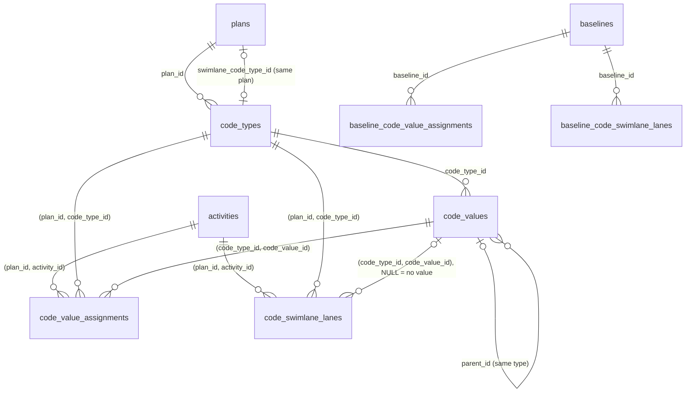

# Database design: P6 activity codes kept in the plan

- **Status:** Draft. Design only. Nothing in `apps/api/prisma/` changes with this document.
- **Author:** database-architect agent, for the P6 activity codes spec ([`./spec.md`](./spec.md)), on the
  owner's chosen design: **keep the codes in the plan** (stored code types, values and per-activity
  assignments, usable as a swimlane basis and shown in the activity UI). That is the spec's former
  "Option B"; this document answers its eight questions for the database-architect (§3).
- **Date:** 2026-10-27
- **Base:** the working tree on 2026-10-27 (`schema.prisma` has 38 models, 30 enums and 21 models with
  `deleted_at`; 78 migrations; the organisation export is at format `2.1`, first released in
  `api-v0.100.0`). Every `file:line` below was read on that tree.
- **Probes.** Claims marked **(probed)** were run on a scratch database on the local PostgreSQL 16.15
  (Ubuntu, shared container, not the deployed host), using the SQL shapes in §5, and the database was
  dropped afterwards. Synthetic data: 10 plans of 5,000 activities, 30 code types per plan, 50 values per
  type, every activity carrying every type (1,500,000 assignments). Ids were `gen_random_uuid()` (v4),
  which makes index inserts slower than the real UUID v7 keys would, so insert timings are an upper bound.
  **Prisma itself was not run** (`apps/api/node_modules` is not installed in this checkout); every claim
  about what Prisma accepts is marked **unprobed** and is owed in M1. (Probed 2026-10-27: §16.)
- **Naming.** The spec's vocabulary rule (§0 rule 2) says identifiers are `codeType*` / `codeValue*`, never
  `activityCode*`. The models and tables below follow it: `CodeType` / `code_types`, `CodeValue` /
  `code_values`, `CodeValueAssignment` / `code_value_assignments`, `CodeSwimlaneLane` /
  `code_swimlane_lanes`. If resource codes ever arrive they take a `resource_` prefix; these stay the
  activity dimension. The analyst may rename before landing; nothing below depends on the names.

---

## 0. Decisions that are the owner's

Each is in plain English, with a recommendation. Everything else in this document has a technical
reason and is decided here.

| #        | Question                                                                                                                                                                         | Recommendation                                                                                                                                                                                                                                                              | What the other answer costs                                                                                                                                                                                                                                                                                                                                                                                                                                                                   |
| -------- | -------------------------------------------------------------------------------------------------------------------------------------------------------------------------------- | --------------------------------------------------------------------------------------------------------------------------------------------------------------------------------------------------------------------------------------------------------------------------- | --------------------------------------------------------------------------------------------------------------------------------------------------------------------------------------------------------------------------------------------------------------------------------------------------------------------------------------------------------------------------------------------------------------------------------------------------------------------------------------------- |
| **DB-1** | **Do codes belong to one plan, or are they shared by the whole organisation?** P6 has three kinds: Global (every project), EPS (a branch of projects) and Project (one project). | **One plan only.** Every P6 code type, whatever its P6 kind, arrives as part of the plan the import creates. Each plan has its own list; two plans may both have an "Area" with the same values, but they are separate lists.                                               | Sharing across the organisation means a library like calendars and resources: archive, "in use" checks across plans, refusing restores onto deleted codes, and matching an imported "Area" to an existing one so that every import does not add a duplicate (the problem ADR-0208 solved for calendars). The database also can no longer guarantee that a value belongs to the same plan as the activity carrying it. About twice the work. It can be added later (§4.3) without losing data. |
| **DB-2** | **Should a baseline remember each activity's codes?**                                                                                                                            | **Yes**, as baselines already remember swimlanes (SQ-7). The size is checked before release: a baseline of a 5,000-activity plan with 30 code types copies 150,000 rows.                                                                                                    | Work that was removed since the baseline cannot be drawn inside a code swimlane; it is counted instead. And a future "Area changed since the baseline" report can never cover baselines taken before the change that adds it.                                                                                                                                                                                                                                                                 |
| **DB-3** | **A planner deletes the code type the swimlanes are currently drawn from. What happens?**                                                                                        | **Refuse, with a message**: "The swimlanes are made from Area. Choose another swimlane source first."                                                                                                                                                                       | Allowing it means switching the swimlanes off automatically in the same step, and then undo and restore have to put the swimlane source back as well. More moving parts for a rare action.                                                                                                                                                                                                                                                                                                    |
| **DB-4** | **Upper limits.**                                                                                                                                                                | **100 code types per plan and 1,000 values per code type**, counted on live rows. An import keeps only the code types this project's activities use, and only the values in use plus their parent values. Anything over a limit is left out and named in the import report. | Without limits, one P6 file with a large global code dictionary can add hundreds of thousands of rows to every load of the plan. Higher limits are possible; each one is a measurement (§9).                                                                                                                                                                                                                                                                                                  |

---

## 1. Summary

Two migrations (§10): the first adds one enum label, the second everything else. Expand-only. No
backfill. Nothing is renamed, retyped or dropped except two CHECK constraints that are replaced by wider
versions of themselves.

| Object                                               | What it holds                                                                              |
| ---------------------------------------------------- | ------------------------------------------------------------------------------------------ |
| `code_types` (new)                                   | a plan's code types ("Area", "Trade"): name, order, lifecycle                              |
| `code_values` (new)                                  | the values of a type ("L1 Level 1"): short code, description, order, optional parent value |
| `code_value_assignments` (new)                       | which value an activity carries for a type: at most one per (activity, type)               |
| `code_swimlane_lanes` (new)                          | an activity's lane inside a code swimlane, kept per (type, value or "no value")            |
| `activities`                                         | one new unique index `(plan_id, id)`, the target of two composite foreign keys             |
| `plans.swimlane_code_type_id` (new)                  | the code type the swimlanes are made from, when the source is `ACTIVITY_CODE`              |
| `SwimlaneSource`                                     | gains `ACTIVITY_CODE` (migration A)                                                        |
| `ck_plans_swimlane_source_level`                     | replaced: binds the new column to the new label                                            |
| `baselines.swimlane_code_type_id` (new)              | the frozen code type, when the frozen source is `ACTIVITY_CODE`                            |
| `ck_baselines_swimlane_snapshot_shape`               | replaced: the same binding, frozen. **Mandatory whatever DB-2 says** (§6.4)                |
| `baselines.code_snapshot_level` (new, if DB-2 yes)   | `NONE` / `FULL`: whether this baseline recorded codes                                      |
| `baseline_code_value_assignments` (new, if DB-2 yes) | every assignment of every captured activity                                                |
| `baseline_code_swimlane_lanes` (new, if DB-2 yes)    | every code lane row of every captured activity                                             |

Model count: 38 → 42, or 44 with DB-2. Soft-deletable models: 21 → 23. Enums: 30 → 31 with DB-2
(`CodeSnapshotLevel`). `pnpm check:counts`, `CLAUDE.md` §1 and §4 and `docs/DATABASE.md:5` move with
them.

---

## 2. The model in one picture



Every foreign key is `ON DELETE RESTRICT ON UPDATE RESTRICT`. Every composite key carries the scope
column (`plan_id` or `code_type_id`) so the **database** refuses a code of another plan, a value of
another type, or a parent value of another type. That is the `activities.swimlane_id` pattern
(`schema.prisma:1698-1704`), applied to every edge here.

---

## 3. Answers to the spec's eight questions (§4.5)

1. **Plan-scoped or org-scoped?** Plan-scoped (DB-1, reasons in §4). Sharing would make code types a
   library like calendars: an in-use guard across plans, archive, an ADR-0201-style restore refusal, an
   import matcher, and `ADR-0195 D4` (library rows do not expire), so plan expiry would leave them behind.
2. **One value per activity per code type as a unique constraint?** Yes:
   `uq_code_value_assignments_plan_activity_type (plan_id, activity_id, code_type_id)`. The type **is**
   denormalised onto the assignment to make that possible, and the denormalisation cannot drift, because
   the composite key `(code_type_id, code_value_id) → code_values (code_type_id, id)` refuses a value of
   another type **(probed: 23503)**. A second value of one type for one activity is refused **(probed: 23505)**.
3. **Same plan as the activity?** By composite keys: `(plan_id, activity_id) → activities (plan_id, id)`
   and `(plan_id, code_type_id) → code_types (plan_id, id)`. An activity of plan B carrying a type of
   plan A is refused **(probed: 23503 on either key)**. This needs one new unique index on `activities`,
   `(plan_id, id)` (§7.1), which is the one cost on an existing large table.
4. **New lane bases and the migration order?** No new `SwimlaneLaneBasis` labels and no change to
   `ck_activity_swimlane_lanes_basis_shape`. Code lanes get their own table (§5.4), because widening
   `activity_swimlane_lanes` would rebuild its unique index and break the **previous** image's lane
   upsert on every plan **(probed: 42P10)**, which would make the release unsafe to roll back. The one
   enum change (`SwimlaneSource` + `ACTIVITY_CODE`) is its own migration, because a CHECK that names a
   label in the transaction that added it fails with "unsafe use of new value" **(probed)**.
5. **Baselines?** The frozen source CHECK must widen in the same release regardless, or capturing a plan
   whose swimlanes come from a code fails (§6.4). Freezing the assignments themselves is DB-2; designed
   in §6. Every baseline captured before reads `code_snapshot_level = 'NONE'`, permanently: its removed
   work is counted, not drawn, under a code swimlane.
6. **Organisation export?** Additive: four new files (six with DB-2), three appended columns, one new
   enum value on two existing columns. Format `2.1` → **`2.2`**, a minor change (§11).
7. **Indexes and expiry cost?** §7 lists every index with the query it serves. Measured: a plan with
   150,000 assignments expires its code rows in about 0.37 s, against 0.16 s for its 5,000 activities
   (§9). The run budget gains a charge for assignment rows (§8.3).
8. **Import compensation order?** §8.4: code lanes and assignments before activities; then clear the
   plan's swimlane pointer, then values, then types, then the plan.

---

## 4. Scope: one tier, the plan

### 4.1 How P6's three scopes map

P6 stores the scope in `ACTVTYPE.actv_code_type_scope` (`AS_Global`, `AS_EPS`, `AS_Project`; confirmed
by public sources only, spec §3). A P6 **project** is what a SchedulePoint **plan** is (one import
creates one plan, ADR-0129 Context). So:

- **Project** codes become the plan's codes, which is what they already are.
- **Global** and **EPS** codes used by this project's activities are **copied** into the plan. The copy
  is the plan's own from then on.
- The P6 scope is **not stored**. Nothing in SchedulePoint behaves differently by it, and the import
  report can name it. If the XER writer later writes codes, it writes them as project codes, so a P6
  user importing the file does not have their global dictionary changed. (Whether P6's XER import
  behaves that way is unverified and belongs to the writer's own spec.)

### 4.2 Why not the organisation tier as well

1. **Imports would duplicate.** Every import of a programme that uses the client's global "Area" would
   add another org-level "Area" unless the import matched it to the existing one. That matcher is the
   whole of ADR-0208 for calendars, and code values (with parents and order) are harder to compare.
2. **Library lifecycle.** An org row needs archive (ADR-0053 §4), an in-use guard counting live
   assignments across every plan, a restore refusal in `restoreBatch` for a batch that binds a deleted
   org code (the ADR-0201 D1 shape), and it does not expire with a plan (ADR-0195 D4). None of that
   exists for plan-scoped rows: they live and die with their plan.
3. **The same-plan guarantee is only available plan-scoped.** The composite keys of §2 need a `plan_id`
   on the type. An org type has none, so "the activity and its code value are in the same organisation
   and the type is allowed in this plan" would be a service check, as it is for `calendar_id`
   (`schema.prisma:1108-1110`).
4. **Swimlanes are plan-scoped.** A swimlane source must resolve inside one plan anyway.

### 4.3 What adding the organisation tier later would cost

Additive, but not free: `code_types` gains a `scope` discriminator (default `PLAN`), `plan_id` becomes
nullable under a fail-closed `ck_code_types_scope_parent` (the `ck_calendars_scope_parent` shape), and
the two composite keys that carry `plan_id` into `code_types` are replaced by single-column keys plus a
service check. Existing rows stay plan-scoped and lose nothing. Nothing in this design blocks that.

---

## 5. The schema

House standard throughout (`docs/DATABASE.md`): UUID v7 primary key, `snake_case` through `@map`,
`timestamptz(3)`, `NOT NULL` unless stated, TEXT actor stamps with no foreign key, and
`organization_id` denormalised from the parent inside the create transaction and never taken from the
request.

### 5.1 `SwimlaneSource` (migration A)

```prisma
enum SwimlaneSource {
  NONE
  MANUAL
  WBS
  /// swimlanes are the live values of plans.swimlane_code_type_id (P6 activity codes)
  ACTIVITY_CODE
}
```

`ALTER TYPE "SwimlaneSource" ADD VALUE 'ACTIVITY_CODE'` alone in migration A. The label must be
committed before migration B's CHECKs name it. `@repo/types` `SwimlaneSource` gains it in lock-step.

### 5.2 `code_types`

```prisma
/// A plan's P6 activity code type ("Area", "Trade"). Plan content, like a swimlane: soft-deleted on
/// its own (sweeping its live values into the same batch), swept into its plan's batch by the plan
/// cascade, hard-deleted only with its plan (ADR-0096 expiry) or by import compensation. Never listed
/// in Recently deleted. Not a scheduling input.
///
/// Raw SQL (migration only, not declared): uq_code_types_plan_name (plan_id, lower(name)) WHERE
/// deleted_at IS NULL; idx_code_types_delete_batch_id; ck_code_types_name_shape;
/// ck_code_types_position_nonneg.
model CodeType {
  id             String    @id @default(uuid(7)) @db.Uuid
  organizationId String    @map("organization_id") @db.Uuid
  planId         String    @map("plan_id") @db.Uuid
  name           String
  // ORDER BY position, id. Not unique (the swimlanes Q1 reasoning: a permutation in one UPDATE and a
  // restore onto a reused slot must not fail).
  position       Int
  version        Int       @default(1)
  createdAt      DateTime  @default(now()) @map("created_at") @db.Timestamptz(3)
  updatedAt      DateTime  @updatedAt @map("updated_at") @db.Timestamptz(3)
  createdBy      String?   @map("created_by")
  updatedBy      String?   @map("updated_by")
  deletedAt      DateTime? @map("deleted_at") @db.Timestamptz(3)
  deleteBatchId  String?   @map("delete_batch_id") @db.Uuid

  organization  Organization          @relation(fields: [organizationId], references: [id], onDelete: Restrict)
  plan          Plan                  @relation("PlanCodeTypes", fields: [planId], references: [id], onDelete: Restrict)
  swimlanePlans Plan[]                @relation("PlanSwimlaneCodeType")
  values        CodeValue[]
  assignments   CodeValueAssignment[]
  lanes         CodeSwimlaneLane[]

  // Composite FK target for plans, assignments and lanes; its leftmost prefix also backs the plan_id
  // FK, the plan's type list, the cascade sweep and the expiry delete.
  @@unique([planId, id], map: "uq_code_types_plan_id_id")
  @@index([organizationId])
  @@map("code_types")
}
```

- **Name.** `ck_code_types_name_shape`: `char_length("name") >= 1 AND char_length("name") <= 80 AND
"name" = btrim("name") AND "name" !~ '[[:cntrl:]]'`, the text of `ck_swimlanes_name_shape` as it
  landed after PR #1119 (`20261023120000_swimlanes/migration.sql:178-181`), because a type name labels
  UI and arrives from hostile files.
- **Unique name per plan ignoring case**, live rows only: `uq_code_types_plan_name (plan_id,
lower(name)) WHERE deleted_at IS NULL`, raw SQL and undeclared (the `docs/DATABASE.md` rule for a
  case-insensitive unique). The import folds collisions before inserting (P6 type names are unique in
  P6, but folding case can still collide); a `23505` here would roll the whole import back.
- `ck_code_types_position_nonneg`: `"position" >= 0`.
- The cap of DB-4 is a service count under the plan advisory lock (a CHECK cannot count rows).
- **Not stored, deliberately:** P6's scope (§4.1), P6's `actv_short_len` (the maximum short-code length;
  nothing enforces it here), and P6's own id (an import always makes a new plan, so there is nothing to
  match on a second import).

### 5.3 `code_values`

```prisma
/// One value of a code type ("L1", "Level 1 East"). Soft-deleted on its own (with its live subtree,
/// one batch), swept with its type and with its plan. An assignment may name a SOFT-DELETED value: that
/// activity reads as having no value for the type, and comes back when the value is restored (the
/// ADR-0206 A8 rule for swimlanes). A NEW assignment to a deleted value is refused by the service.
///
/// Raw SQL (migration only, not declared): uq_code_values_type_short_code (code_type_id,
/// lower(short_code)) WHERE deleted_at IS NULL; idx_code_values_delete_batch_id;
/// idx_code_values_parent_fk; ck_code_values_short_code_shape; ck_code_values_description_shape;
/// ck_code_values_position_nonneg; ck_code_values_parent_not_self.
model CodeValue {
  id             String    @id @default(uuid(7)) @db.Uuid
  organizationId String    @map("organization_id") @db.Uuid
  codeTypeId     String    @map("code_type_id") @db.Uuid
  // A parent value OF THE SAME TYPE (composite key), NULL at the top. Adjacency list, the
  // activities.parent_id / resources.parent_id precedent.
  parentId       String?   @map("parent_id") @db.Uuid
  shortCode      String    @map("short_code")
  description    String?
  position       Int
  version        Int       @default(1)
  createdAt      DateTime  @default(now()) @map("created_at") @db.Timestamptz(3)
  updatedAt      DateTime  @updatedAt @map("updated_at") @db.Timestamptz(3)
  createdBy      String?   @map("created_by")
  updatedBy      String?   @map("updated_by")
  deletedAt      DateTime? @map("deleted_at") @db.Timestamptz(3)
  deleteBatchId  String?   @map("delete_batch_id") @db.Uuid

  organization Organization          @relation(fields: [organizationId], references: [id], onDelete: Restrict)
  codeType     CodeType              @relation(fields: [codeTypeId], references: [id], onDelete: Restrict)
  parent       CodeValue?            @relation("CodeValueTree", fields: [codeTypeId, parentId], references: [codeTypeId, id], onDelete: Restrict, onUpdate: Restrict)
  children     CodeValue[]           @relation("CodeValueTree")
  assignments  CodeValueAssignment[]
  lanes        CodeSwimlaneLane[]

  // Composite FK target (assignments, lanes, the parent key); leftmost prefix backs the code_type_id
  // FK, a type's value list and the sweeps.
  @@unique([codeTypeId, id], map: "uq_code_values_type_id_id")
  @@index([organizationId])
  @@map("code_values")
}
```

- **Short code**: `ck_code_values_short_code_shape`, the same text as the name shape with `short_code`.
  P6's real ceiling is **unverified** (spec §3). M0 reads it from a real export; if it is above 80, this
  CHECK widens before the migration lands. A migration is checksummed when it lands, so that is the
  moment to get it right.
- **Description**: `ck_code_values_description_shape`: `"description" IS NULL OR (char_length(
"description") >= 1 AND char_length("description") <= 255 AND "description" = btrim("description")
AND "description" !~ '[[:cntrl:]]')`. Empty is stored as NULL, never as `''`. 255 is a placeholder
  for the same M0 reading. A swimlane label derived from it must fit 80 characters; the derivation rule
  (spec CQ-3) shortens or falls back, the column stores the whole text.
- **Unique short code per type, ignoring case**, live rows only (raw SQL, undeclared). Two values whose
  codes differ only by case would be indistinguishable to a planner; the import folds them and reports
  it, as it does for swimlane names. If M0 shows P6 itself treats `l1` and `L1` as distinct values in
  real files, that is a reason to revisit before landing, not after.
- **Parent.** The column is kept **only if M0 confirms a parent column in `ACTVCODE`** (spec §3 lists
  `parent_actv_code_id?` as unconfirmed). If it is confirmed, it is stored now even if the first UI is
  flat, because a hierarchy dropped at import cannot be recovered from the plan later.
  - `(code_type_id, parent_id) → code_values (code_type_id, id)` refuses a parent of another type
    **(probed: 23503)**.
  - `ck_code_values_parent_not_self`: `"parent_id" IS NULL OR "parent_id" <> "id"`. Longer cycles,
    depth (proposed ≤ 10, the resource tree's) and "the parent is live" are service invariants held
    under the plan advisory lock, the resource-tree precedent.
  - `idx_code_values_parent_fk (parent_id) WHERE parent_id IS NOT NULL`: backs the self-key's RESTRICT
    check when expiry deletes values. Without it each deleted value scans its type's values (the
    `idx_activities_parent_id_fk` lesson, `docs/DATABASE.md:304`). A whole tree is deleted in one
    statement, because the RESTRICT check runs at the end of the statement (ADR-0096 D7) **(probed: a
    two-level tree deleted in one statement; the parent alone refused 23503)**.
- `ck_code_values_position_nonneg`.
- **No `plan_id` on values.** The type carries it; sweeps and deletes go through the plan's type ids.

### 5.4 `code_value_assignments`

```prisma
/// Which value an activity carries for a code type. At most one per (activity, type). "No value" is
/// the absence of a row. A join row: no deleted_at, no version, no actor columns (the
/// ActivitySwimlaneLane precedent):
/// 1. Written only inside an activity write that holds the activity row lock (id order) and bumps
///    activities.version, so the activity's version is the optimistic lock for its codes, and its
///    updated_by and the activity history (ADR-0174) record who changed them.
/// 2. Soft-deleting the activity leaves the rows, so a restore needs nothing.
/// 3. Unassigning deletes the row; changing the value updates it in place.
model CodeValueAssignment {
  id             String   @id @default(uuid(7)) @db.Uuid
  organizationId String   @map("organization_id") @db.Uuid
  planId         String   @map("plan_id") @db.Uuid
  activityId     String   @map("activity_id") @db.Uuid
  codeTypeId     String   @map("code_type_id") @db.Uuid
  codeValueId    String   @map("code_value_id") @db.Uuid
  createdAt      DateTime @default(now()) @map("created_at") @db.Timestamptz(3)
  updatedAt      DateTime @updatedAt @map("updated_at") @db.Timestamptz(3)

  organization Organization @relation(fields: [organizationId], references: [id], onDelete: Restrict)
  activity     Activity     @relation(fields: [planId, activityId], references: [planId, id], onDelete: Restrict, onUpdate: Restrict)
  codeType     CodeType     @relation(fields: [planId, codeTypeId], references: [planId, id], onDelete: Restrict, onUpdate: Restrict)
  codeValue    CodeValue    @relation(fields: [codeTypeId, codeValueId], references: [codeTypeId, id], onDelete: Restrict, onUpdate: Restrict)

  // One value per (activity, type); the upsert arbiter; the (plan_id, activity_id) FK RESTRICT check
  // (leftmost two columns); the plan load and the page load.
  @@unique([planId, activityId, codeTypeId], map: "uq_code_value_assignments_plan_activity_type")
  // "Activities by value of type T" and the per-value counts; the (plan_id, code_type_id) and
  // (code_type_id, code_value_id) FK RESTRICT checks.
  @@index([codeTypeId, codeValueId], map: "idx_code_value_assignments_type_value")
  @@index([organizationId])
  @@map("code_value_assignments")
}
```

- **Why the unique leads with `plan_id`** and not `(activity_id, code_type_id)`: measured, loading every
  assignment of one plan through `activity_id IN (plan's activities)` with an `(activity_id, …)` unique
  is a sequential scan of the whole table, 372 ms at 1.5 M rows; with `plan_id` leading it is an index
  scan, 65 ms **(probed)**. The page load (200 activities) is 5.4–5.7 ms either way. `plan_id` is
  determined by the activity, so the uniqueness means the same thing.
- **Why `(organization_id)` and not `(organization_id, id)`** for the export's keyset: the plain index is
  10 MB at 1.5 M rows (B-tree deduplication of a repeated key), the composite 92 MB, and the export page
  (`organization_id = ? AND id > ? ORDER BY id LIMIT 1000`) was served by the primary key in 6 ms
  **(probed, one organisation)**. A multi-organisation host is the case to re-measure.
- **`plan_id` exists only for the two composite keys and the plan-keyed load and delete.** It is copied
  from the activity by the service, and the keys refuse any other value.
- The house rule that "every table carries `created_at`/`updated_at`" holds. Actor columns do not: the
  activity's `updated_by` and the history entry say who.

### 5.5 `code_swimlane_lanes`

```prisma
/// An activity's lane inside a swimlane made from a code type, kept per (type, value) so switching
/// between code types, moving between values and restoring a deleted value each return the exact lane
/// last written there (the ADR-0206 A1–A2 promise, for code swimlanes). code_value_id NULL is the
/// "no value of this type" swimlane. Lifecycle as ActivitySwimlaneLane: no version, no deleted_at, no
/// actor columns; written only under the activity row lock in a write that bumps activities.version.
///
/// Raw SQL: the NULLS NOT DISTINCT clause on the unique below (declared as a plain @@unique, the
/// docs/DATABASE.md rule); ck_code_swimlane_lanes_lane_index_nonneg.
model CodeSwimlaneLane {
  id             String   @id @default(uuid(7)) @db.Uuid
  organizationId String   @map("organization_id") @db.Uuid
  planId         String   @map("plan_id") @db.Uuid
  activityId     String   @map("activity_id") @db.Uuid
  codeTypeId     String   @map("code_type_id") @db.Uuid
  codeValueId    String?  @map("code_value_id") @db.Uuid
  laneIndex      Int      @map("lane_index")
  createdAt      DateTime @default(now()) @map("created_at") @db.Timestamptz(3)
  // The projection's collision tie-break, as on activity_swimlane_lanes.
  updatedAt      DateTime @updatedAt @map("updated_at") @db.Timestamptz(3)

  organization Organization @relation(fields: [organizationId], references: [id], onDelete: Restrict)
  activity     Activity     @relation(fields: [planId, activityId], references: [planId, id], onDelete: Restrict, onUpdate: Restrict)
  codeType     CodeType     @relation(fields: [planId, codeTypeId], references: [planId, id], onDelete: Restrict, onUpdate: Restrict)
  codeValue    CodeValue?   @relation(fields: [codeTypeId, codeValueId], references: [codeTypeId, id], onDelete: Restrict, onUpdate: Restrict)

  @@unique([planId, activityId, codeTypeId, codeValueId], map: "uq_code_swimlane_lanes_basis")
  @@index([codeTypeId, codeValueId], map: "idx_code_swimlane_lanes_type_value")
  @@index([organizationId])
  @@map("code_swimlane_lanes")
}
```

- **A separate table, not two more columns on `activity_swimlane_lanes`.** Widening that table means
  dropping and rebuilding `uq_activity_swimlane_lanes_basis` with seven columns. The previous image's
  upsert names five (`activity.repository.ts:453`), and against the seven-column index PostgreSQL
  answers "there is no unique or exclusion constraint matching the ON CONFLICT specification" **(probed:
  42P10)**. Rolling back to the previous image would then break every positions batch (every bar drag)
  on every plan, including plans that never touch a code. With a separate table the previous image
  never sees a code lane. It also leaves `SwimlaneLaneBasis` and its fail-closed CHECK untouched, so
  migration A carries one label, not three. This amends ADR-0206 A2's sentence "one row per activity per
  `SwimlaneLaneBasis`": code bases live here (the new ADR records it).
- **The basis is `(code_type_id, code_value_id)`, with NULL meaning "no value of this type".** That is
  the real absence of a value, not a stand-in for one (ADR-0139). An explicit two-label discriminator
  was considered and rejected: the two states are fully determined by the nullness of one column under
  a type that is always set, so a discriminator would be a second source of the same fact. `MATCH
SIMPLE` admits the NULL value and still checks the type through its own key **(probed)**.
- `NULLS NOT DISTINCT` makes the "no value" row unique per (activity, type), and an `INSERT … ON
CONFLICT (plan_id, activity_id, code_type_id, code_value_id)` updates it rather than adding a second
  **(probed: two upserts, one row)**.
- `ck_code_swimlane_lanes_lane_index_nonneg`: `"lane_index" >= 0`; the 10,000 ceiling stays in the DTO,
  as for every lane column.
- **Bound.** One row per (type, value) the activity was actually placed against, typically one to three
  per activity; rows naming a deleted value are kept, because they are what a restore returns to.

### 5.6 `activities`: one index

`uq_activities_plan_id_id (plan_id, id)`, declared as `@@unique([planId, id], map:
"uq_activities_plan_id_id")`. It exists only as the target of the two `(plan_id, activity_id)` composite
keys. `plan_id` and `id` never change, so it costs nothing on update, only on insert. Measured: built in
44 ms on 50,000 activities **(probed)**; it is a full scan and sort under a `SHARE` lock (§10.2).
`Activity` gains `codeValueAssignments` and `codeSwimlaneLanes` back-relations.

### 5.7 `plans`: the swimlane basis

```prisma
  /// The code type whose live values are this plan's swimlanes: set iff swimlane_source =
  /// 'ACTIVITY_CODE' (ck_plans_swimlane_source_level). Same plan BY THE DATABASE: the key is
  /// (id, swimlane_code_type_id) → code_types (plan_id, id). NOT_INPUT for the engine.
  swimlaneCodeTypeId String?   @map("swimlane_code_type_id") @db.Uuid
  swimlaneCodeType   CodeType? @relation("PlanSwimlaneCodeType", fields: [id, swimlaneCodeTypeId], references: [planId, id], onDelete: Restrict, onUpdate: Restrict)
  codeTypes          CodeType[] @relation("PlanCodeTypes")
```

- The key uses the plan's own `id` as its first column, so a type of another plan is refused **(probed: 23503)**. Prisma accepting `id` inside a relation's `fields` was **unprobed** here (accepted, with two write-API hazards: §16); if `prisma validate`
  refuses it, the fallback is a single-column key `swimlane_code_type_id → code_types (id)` plus the
  service's same-plan check, and this document's same-plan claim narrows to the service for this one
  column.
- **The key closes a cycle**: `code_types.plan_id → plans` and `plans.swimlane_code_type_id →
code_types`, both RESTRICT. Neither row can be hard-deleted first **(probed: both refused 23503)**.
  Every hard-delete path therefore clears the pointer first, `UPDATE plans SET swimlane_source =
'NONE', swimlane_code_type_id = NULL` for the plans being deleted, then deletes types, then plans
  **(probed: succeeds in that order)**. §8 lists the four places that do it. Alternatives (no key, `SET
NULL`, a deferrable key, the pointer on the type row) are compared in §14.
- No index: the key's referencing side is the plan's primary key, and the check on a type delete is
  `id = ? AND swimlane_code_type_id = ?`.

`ck_plans_swimlane_source_level` is dropped and re-added as:

```sql
ALTER TABLE "plans" ADD CONSTRAINT "ck_plans_swimlane_source_level" CHECK (
  CASE "swimlane_source"
    WHEN 'NONE'          THEN "swimlane_wbs_level" IS NULL AND "swimlane_code_type_id" IS NULL
    WHEN 'MANUAL'        THEN "swimlane_wbs_level" IS NULL AND "swimlane_code_type_id" IS NULL
    WHEN 'WBS'           THEN "swimlane_code_type_id" IS NULL AND "swimlane_wbs_level" IS NOT NULL
                              AND "swimlane_wbs_level" >= 1 AND "swimlane_wbs_level" <= 3
    WHEN 'ACTIVITY_CODE' THEN "swimlane_wbs_level" IS NULL AND "swimlane_code_type_id" IS NOT NULL
    ELSE false
  END
);
```

- Fail-closed: a fifth source is rejected until it gets a branch.
- **`BETWEEN` is replaced by two comparisons.** The old branch had it as the right operand of a single
  `AND`; adding a third conjunct after it is the shape `docs/DATABASE.md:82-87` warns about. With
  explicit comparisons, `pg_get_constraintdef` re-parsed and re-added gives an identical definition
  **(probed)**. `scripts/backup-restore-check.sh` remains the proof on CI.
- **(probed)** refused `23514`: `ACTIVITY_CODE` with no type; `WBS` with no level; `WBS` level 2 with a
  type. Admitted: `ACTIVITY_CODE` with a same-plan type; `WBS` level 2.
- Re-adding validates by scanning `plans`, which is small; every existing row has a NULL type.

---

## 6. Baselines

### 6.1 Mandatory in this release, whatever DB-2 says

`baselines.swimlane_source` is the same `SwimlaneSource` enum, and the capture copies it verbatim
(swimlanes schema-design §13.4). `ck_baselines_swimlane_snapshot_shape`'s inner `CASE` has no
`ACTIVITY_CODE` branch and ends `ELSE false` (`20261023160000_baselines_freeze_swimlanes/migration.sql:93-105`),
so **the first baseline captured on a plan whose swimlanes come from a code would fail with 23514**
unless the CHECK widens in the same release. So, unconditionally:

- `baselines.swimlane_code_type_id UUID NULL`: the plan's `swimlane_code_type_id` at capture. A
  correlation id, **no foreign key** (ADR-0025), no index (read with its row).
- `ck_baselines_swimlane_snapshot_shape` is dropped and re-added:

```sql
CHECK (CASE "swimlane_snapshot_level"
  WHEN 'NONE' THEN "swimlane_source" IS NULL AND "swimlane_wbs_level" IS NULL
                   AND "swimlane_code_type_id" IS NULL
  WHEN 'FULL' THEN
    CASE "swimlane_source"
      WHEN 'NONE'          THEN "swimlane_wbs_level" IS NULL AND "swimlane_code_type_id" IS NULL
      WHEN 'MANUAL'        THEN "swimlane_wbs_level" IS NULL AND "swimlane_code_type_id" IS NULL
      WHEN 'WBS'           THEN "swimlane_code_type_id" IS NULL AND "swimlane_wbs_level" IS NOT NULL
                                AND "swimlane_wbs_level" >= 1 AND "swimlane_wbs_level" <= 3
      WHEN 'ACTIVITY_CODE' THEN "swimlane_wbs_level" IS NULL AND "swimlane_code_type_id" IS NOT NULL
      ELSE false
    END
  ELSE false END)
```

The inner `CASE` is the live CHECK verbatim, as before. The round trip is owed on CI for this one too.

### 6.2 If DB-2 is yes: freezing codes

The reasoning is swimlanes schema-design §13.2 one table along: a ghost of **removed** work has no live
row, so under a code swimlane its position is (a) which value it had for today's source type, and (b)
its lane under that value. Neither may be guessed (ADR-0126). Both are copied at capture, **for every
type and every lane row**, not for the capture-time source only, so a plan that switches from Area to
Trade after the baseline can still place that baseline's removed work (the §13.3 "copy facts, not a
rule's answer" principle).

- **`CodeSnapshotLevel { NONE, FULL }`** (new enum, no `@@map`; created and used in migration B, which
  is legal) and `baselines.code_snapshot_level CodeSnapshotLevel NOT NULL DEFAULT 'NONE'`. Written
  `FULL` unconditionally by every capture after this release, beside the four sibling levels and for
  their reason: a plan with no codes captures zero rows under `FULL`, and only the level says that is
  complete. Every existing baseline reads `NONE`, permanently, and a backfill is rejected for the §13.5
  reason (it would stamp today's codes as history).
- **`baseline_code_value_assignments`**: `id`, `organization_id`, `baseline_id` (FK RESTRICT),
  `source_activity_id`, `code_type_id`, `code_value_id` (all three correlation ids, no FK),
  `created_at`. `uq_baseline_code_value_assignments_activity_type (baseline_id, source_activity_id,
code_type_id)`: freeze-once, the `baseline_id` FK RESTRICT check, and the load. `(organization_id)`.
- **`baseline_code_swimlane_lanes`**: `id`, `organization_id`, `baseline_id` (FK RESTRICT),
  `source_activity_id`, `code_type_id`, `code_value_id` (nullable), `lane_index`, `lane_updated_at`
  (the live `updated_at`), `created_at`. `uq_baseline_code_swimlane_lanes_basis (baseline_id,
source_activity_id, code_type_id, code_value_id) NULLS NOT DISTINCT`, declared as a plain `@@unique`.
  `ck_baseline_code_swimlane_lanes_lane_index_nonneg`. `(organization_id)`.
- **Lean lifecycle** (the `baseline_activity_swimlane_lanes` precedent): no `version`, `updated_at`,
  actor columns, `deleted_at` or `delete_batch_id`. Immutable, reached only through a live baseline,
  outside the ADR-0172 gate's subject because there is no `deleted_at` to forget.
- **Names are not frozen.** Correlation ids resolve for the life of the baseline, because values and
  types are hard-deleted only with their plan, and the plan's baselines go first (§8.1). The same
  residual as swimlanes §13.9 H: a renamed value shows today's name.
- **The capture** copies both tables with `INSERT … SELECT` inside the existing capture transaction,
  after the activity row lock §13.4 already takes, so the codes and the activities are one instant.

**Size.** The probe measured about 300 bytes per live assignment with its four indexes; a frozen copy
has two indexes, so roughly 200 bytes. A typical plan (2,000 activities, 10 types, 12 baselines) holds
240,000 copies, about 48 MB. The worst case DB-4 allows at the import cap (5,000 activities, 30 types in
use, 24 baselines) is 3.6 M copies, about 0.7 GB for one plan, and each capture copies 150,000 rows
inside a transaction that holds the plan lock. The probe's unchecked insert of 150,000 rows with four
indexes and random v4 keys took 2.8 s; the real copy (two indexes, v7 keys) should be well under that,
but it is **owed as a measurement before DB-2 ships** (§12), with a stated ceiling. If it fails, the
fallback is to freeze only the assignments of the plan's swimlane source type at capture (at most one
row per activity), at the cost of the Area-to-Trade case above.

---

## 7. Indexes

### 7.1 The register (new rows for `docs/DATABASE.md` "Indexes")

| Index                                                 | On                                                               | Kind                        | Serves                                                                                                                                                                                           |
| ----------------------------------------------------- | ---------------------------------------------------------------- | --------------------------- | ------------------------------------------------------------------------------------------------------------------------------------------------------------------------------------------------ |
| `uq_activities_plan_id_id`                            | `activities (plan_id, id)`                                       | full unique                 | composite FK target for assignments and lanes. Nothing else; measured 44 ms build on 50,000 rows                                                                                                 |
| `uq_code_types_plan_id_id`                            | `(plan_id, id)`                                                  | full unique                 | composite FK target (plans, assignments, lanes); `plan_id` FK; the plan's type list (≤ 100 live, sorted in memory by `position, id`); cascade sweep; expiry delete                               |
| `code_types_organization_id_idx`                      | `(organization_id)`                                              | full                        | org FK; IDOR loads; export `org` read                                                                                                                                                            |
| `uq_code_types_plan_name`                             | `(plan_id, lower(name))`                                         | partial unique              | live name unique per plan ignoring case (`WHERE deleted_at IS NULL`); backs `CODE_TYPE_NAME_TAKEN` (409). Raw SQL                                                                                |
| `idx_code_types_delete_batch_id`                      | `(delete_batch_id)`                                              | partial                     | batch restore lookup (`WHERE delete_batch_id IS NOT NULL`)                                                                                                                                       |
| `uq_code_values_type_id_id`                           | `(code_type_id, id)`                                             | full unique                 | composite FK target; `code_type_id` FK; a type's value list (≤ 1,000 live, sorted in memory); sweeps; expiry delete                                                                              |
| `code_values_organization_id_idx`                     | `(organization_id)`                                              | full                        | org FK; export `org` read                                                                                                                                                                        |
| `uq_code_values_type_short_code`                      | `(code_type_id, lower(short_code))`                              | partial unique              | live short code unique per type ignoring case; `CODE_VALUE_TAKEN` (409). Raw SQL                                                                                                                 |
| `idx_code_values_delete_batch_id`                     | `(delete_batch_id)`                                              | partial                     | batch restore lookup                                                                                                                                                                             |
| `idx_code_values_parent_fk`                           | `(parent_id)`                                                    | partial                     | the self-key RESTRICT check at expiry (`WHERE parent_id IS NOT NULL`); also the subtree walk for a value delete. Only if the parent column is kept (§5.3)                                        |
| `uq_code_value_assignments_plan_activity_type`        | `(plan_id, activity_id, code_type_id)`                           | full unique                 | one value per (activity, type); upsert arbiter; `(plan_id, activity_id)` FK check; plan load (65 ms / 150,000 rows); page load (5.7 ms / 200 activities); expiry and compensation delete by plan |
| `idx_code_value_assignments_type_value`               | `(code_type_id, code_value_id)`                                  | full                        | "activities by value of type T" (§9.2); per-value counts; the `(plan_id, code_type_id)` and `(code_type_id, code_value_id)` FK checks. 14 MB at 1.5 M rows                                       |
| `code_value_assignments_organization_id_idx`          | `(organization_id)`                                              | full                        | org FK; export keyset (via the PK); 10 MB at 1.5 M rows                                                                                                                                          |
| `uq_code_swimlane_lanes_basis`                        | `(plan_id, activity_id, code_type_id, code_value_id)`            | unique `NULLS NOT DISTINCT` | one row per basis; upsert arbiter; activity FK check; "lanes of these activities" load. Declared plain `@@unique`                                                                                |
| `idx_code_swimlane_lanes_type_value`                  | `(code_type_id, code_value_id)`                                  | full                        | the type and value FK checks when expiry deletes values and types                                                                                                                                |
| `code_swimlane_lanes_organization_id_idx`             | `(organization_id)`                                              | full                        | org FK; export                                                                                                                                                                                   |
| `uq_baseline_code_value_assignments_activity_type`    | `(baseline_id, source_activity_id, code_type_id)`                | full unique                 | DB-2 only: freeze-once; `baseline_id` FK check (the swimlanes §13.7 lesson: without it the baselines delete scanned the table, ~45× slower); load                                                |
| `baseline_code_value_assignments_organization_id_idx` | `(organization_id)`                                              | full                        | DB-2 only: org FK; export                                                                                                                                                                        |
| `uq_baseline_code_swimlane_lanes_basis`               | `(baseline_id, source_activity_id, code_type_id, code_value_id)` | unique `NULLS NOT DISTINCT` | DB-2 only: as above                                                                                                                                                                              |
| `baseline_code_swimlane_lanes_organization_id_idx`    | `(organization_id)`                                              | full                        | DB-2 only: org FK; export                                                                                                                                                                        |

### 7.2 Deliberately not indexed

- `plans.swimlane_code_type_id`: read with its own row; the key's check uses the plans PK.
- `position` on types and values: at most 100 and 1,000 live rows, sorted in memory after a prefix scan
  (the swimlanes reasoning).
- No recycle-bin index: types and values are not listed in Recently deleted.
- No `INCLUDE (activity_id)` covering index for an index-only grouping scan. Prisma's handling of an
  undeclared `INCLUDE` index in `prisma:check-drift` is unknown, and the grouping query is 8 ms without
  it (§9.2). Measure-first upgrade if a real plan says otherwise.

---

## 8. Foreign keys and the delete paths

Every new key is `RESTRICT`. Nothing here is hard-deleted except with its plan (expiry) or by import
compensation, and both paths name every table explicitly so they can count it.

### 8.1 The expiry runner (`hierarchy-expiry.runner.ts`)

New order (the literal at `hierarchy-expiry.structural.spec.ts:97-118`; DB-2 tables marked):

```text
crossPlanDependency, activityDependency, resourceAssignment, activityStep, activityHistoryEntry,
activitySwimlaneLane, codeSwimlaneLane, codeValueAssignment, note, baselineAssignment,
baselineDependency, baselineActivity, baselineActivitySwimlaneLane,
baselineCodeValueAssignment (DB-2), baselineCodeSwimlaneLane (DB-2), baseline, planShare, activity,
swimlane, codeValue, codeType, plan, calendarException, calendar, project, client
```

- `codeSwimlaneLane` and `codeValueAssignment` are deleted **by `planId` chunk**, through the unique
  index's leading column. That is complete: the composite keys guarantee every row naming a plan's
  activity or type carries that plan's id.
- Before `codeValue`, the runner resolves the plans' type ids (`codeType.findMany({ where: { planId: { in:
chunk } } })`, as it resolves baseline ids) and runs **`tx.plan.updateMany({ where: { id: { in: chunk },
swimlaneCodeTypeId: { not: null } }, data: { swimlaneSource: 'NONE', swimlaneCodeTypeId: null } })`**
  (§5.7, the cycle). The plan is deleted a few statements later in the same transaction.
- `codeValue` by type-id chunk, one statement per chunk whatever the tree depth (ADR-0096 D7).
- `codeType` by plan chunk.
- **The census needs one stated exemption.** `Plan→CodeType` is a RESTRICT edge into a table the runner
  deletes, and `CodeType→Plan` is the reverse; no order satisfies both. Add `'Plan→CodeType'` to
  `EXEMPT_EDGES` with its reason in the docblock (the `Resource→Calendar` precedent is a stated pair,
  not a silent carve-out), **and** add an assertion that the runner's source contains
  `tx.plan.updateMany` before `tx.codeType.deleteMany`, so the exemption is paid for by a check rather
  than a comment. The pinned positive case gains `CodeValueAssignment→Activity`, `CodeType→Plan` and
  `CodeValue→CodeType`.
- **Budget.** `ExpiryCounts` gains `codeValueAssignments` and `codeSwimlaneLanes`; `budgetCharge`
  gains `ceil(n / ASSIGNMENT_ROWS_PER_ACTIVITY)` and charges code lanes at the existing
  `LANE_ROWS_PER_ACTIVITY`. Probe reading: 150,000 assignments deleted in 138 ms against 5,000
  activities in 163 ms, so an assignment cost about 1/35 of an activity there. The constant is set by
  the build's own measurement on the harness that calibrated `HISTORY_ROWS_PER_ACTIVITY` and
  `LANE_ROWS_PER_ACTIVITY` (`hierarchy-expiry.service.ts:38-49`), taking the lower, safe reading, as
  those two did. Values and types are not charged (at most 100,000 and 100 per plan).
- **Preview (ADR-0193): no change**, for the swimlanes Q6 reason: it counts roots, projects, plans and
  activities, and its scope is plan-keyed.

### 8.2 The plan cascade and restore (`hierarchy-lifecycle.service.ts`)

- **Cascade** (plan, project, client delete): after the swimlane stamp (`:461`, `:489`, `:505`) and
  before the plan stamp, stamp the plans' live types and their live values with the batch id
  (`CascadeCounts.codeTypes`, `.codeValues`). Assignments and lanes have no lifecycle columns and are
  not touched.
- **`restoreBatch`**: restore `code_types` and `code_values` by batch id beside the swimlanes (`:794`),
  **skipped for activity and dependency batches**, as swimlanes are, because no such batch stamps them
  and the activity-history statement budget (`test/activity-history-statements.e2e-spec.ts`) pins the
  statement count.
- **Restore guards, both ways.** A value restored in its own batch is refused `PARENT_DELETED` if its
  type, or its parent value, is deleted. A type restored on its own is refused under a deleted plan.
  Name collisions are the existing `P2002` → 409 mapping.
- **No calendar is involved**, so ADR-0201's calendar locks and refusals are untouched.
- **An activity restored with an assignment to a deleted value is admitted**, and reads as "no value"
  until the value is restored: the ADR-0206 A8 rule, which the new ADR states for codes so ADR-0201 D1
  is not read as covering them.

### 8.3 Deleting a type or a value (the user's actions)

- **Value:** soft-delete the value and its live subtree in one fresh batch (the WBS and resource-group
  subtree precedent). Assignments and lanes are left as they are. Activities carrying it read as "no
  value"; under a code swimlane source they draw in "No Area"; restoring the value brings them back to
  their lanes. Allowed while in use, as deleting a swimlane is.
- **Type:** refused with 409 `CODE_TYPE_IS_SWIMLANE_SOURCE` while it is the plan's swimlane source
  (DB-3), checked under the plan advisory lock, which the source switch also takes. Otherwise
  soft-delete the type and its live values in one fresh batch.
- The plan's pointer can therefore name a soft-deleted type only when the plan itself is deleted (both
  in one cascade batch). The database cannot enforce that (a key does not see `deleted_at`); the
  service does, under the lock.

### 8.4 Import compensation (`interchange.service.ts` `compensate`, `:1655-1690`)

Insert, keeping the existing comments' "children before parents" order:

```text
resourceAssignment, activityDependency, activityHistoryEntry, activitySwimlaneLane,
codeSwimlaneLane (planId), codeValueAssignment (planId), note, activity, swimlane,
plan.updateMany (clear the pointer), codeValue (codeType: { planId }), codeType (planId),
planLock, plan, …resources, calendars
```

Unlike the swimlane lines added "for the day an import writes them", these run on every failed import
of a file with codes, so the API e2e must include a failing import that carried codes **and** chose a
code swimlane source (the pointer path).

### 8.5 Test helpers and their pins

- **`clearActivityTree`** derives children from the DMMF; it gains `CodeSwimlaneLane` and
  `CodeValueAssignment`. The pin in `clear-activity-tree.e2e-spec.ts` moves from 7 children / 8 calls
  to **9 children / 10 calls**. Its sibling check stays satisfied: neither new table references the
  other.
- **`clearBaselineTree`** (DB-2 only) gains the two baseline tables: **5 → 7 calls**
  (`clear-baseline-tree.e2e-spec.ts:59`).
- **`clearDomainData`** (`test/audit-reset.ts:56-80`): after `swimlane.deleteMany()` and before
  `plan.deleteMany()`, clear the pointer, then `codeValue.deleteMany()`, then `codeType.deleteMany()`.
- **Eleven e2e specs delete plans without `clearDomainData`** (`grep -l 'plan\.deleteMany'` minus those
  using it, 2026-10-27). Each that can meet a plan with codes needs the same three lines. This is the
  TECH_DEBT #253 shape a third time; a DMMF-derived `clearPlanTree` helper (the two existing helpers'
  pattern) is the cheaper fix and is recommended to the builder, but it is a test-harness change, not
  a schema one.

---

## 9. Row counts and query shapes

### 9.1 Expected sizes

| Table                    | Typical plan        | Large plan (import cap 5,000, `import-xer.ts:54`) | Bound                                                |
| ------------------------ | ------------------- | ------------------------------------------------- | ---------------------------------------------------- |
| `code_types`             | 5–30                | 30–60                                             | 100 live (DB-4)                                      |
| `code_values`            | 200–3,000           | 10,000+                                           | 1,000 live per type                                  |
| `code_value_assignments` | 2,000 × 10 = 20,000 | 5,000 × 30 = 150,000                              | activities × live types                              |
| `code_swimlane_lanes`    | 2,000–6,000         | 15,000                                            | (types used as a source) × activities, plus revisits |
| baseline copies (DB-2)   | × baselines         | × baselines (§6.2)                                |                                                      |

So yes: **hundreds of thousands of assignments on one big plan** is possible but not typical, and an
organisation with 100 plans holds a few million rows. Measured footprint: 462 MB for 1.5 M assignments
with the probe's original four indexes (heap 202 MB; the final index set is smaller: unique 97 MB,
type-value 14 MB, org 10 MB, PK 60 MB).

### 9.2 "Activities grouped by code value"

The swimlane projection itself is client-side (ADR-0206; swimlanes spec §4.14 G), so the server's job
is to load membership. For a plan P and the source type T:

```sql
-- membership: every live activity of P with its value of T (NULL = no value)
SELECT a.id, cva.code_value_id
FROM activities a
LEFT JOIN code_value_assignments cva
  ON cva.plan_id = a.plan_id AND cva.activity_id = a.id AND cva.code_type_id = $T
WHERE a.plan_id = $P AND a.deleted_at IS NULL;

-- the swimlanes: T's live values, in order
SELECT id, short_code, description, parent_id FROM code_values
WHERE code_type_id = $T AND deleted_at IS NULL ORDER BY position, id;

-- counts per value (import report, the source picker)
SELECT cva.code_value_id, count(*)
FROM code_value_assignments cva
JOIN activities a ON a.id = cva.activity_id AND a.deleted_at IS NULL
WHERE cva.code_type_id = $T
GROUP BY cva.code_value_id;
```

**(probed)** at 5,000 activities × 30 types per plan, 1.5 M rows in the table: membership 8.0 ms (bitmap
scan of `idx_code_value_assignments_type_value` for T's 5,000 rows, hash-joined to the plan's
activities); counts 14 ms (50 groups). An activity whose value is soft-deleted is not in the live value
list, and the client treats it as "no value".

**Do not** `include: { codeValue: true }` from an assignment: a to-one include is outside the ADR-0172
gate and would return a deleted value as live. Read the type's value list separately with `deletedAt:
null` (the swimlanes rule, schema-design §9).

### 9.3 A payload warning for the API design (not a schema matter)

Every assignment of a large plan is 150,000 (activity, type, value) triples, roughly 11 MB as JSON.
The activity list should carry assignments for the page it returns (5.7 ms per 200 activities), and the
diagram should load membership for the **source type** only, not every type. The spec's API section
should say which.

---

## 10. The migrations

### 10.1 Shape

**A. `<ts>_swimlane_source_activity_code`** — one statement:
`ALTER TYPE "SwimlaneSource" ADD VALUE 'ACTIVITY_CODE';` A header comment says why it is alone
(the `20260725130000_resource_group_kind` precedent).

**B. `<ts+100>_p6_activity_codes`** — generated with `prisma migrate dev --create-only`, then
hand-edited, in this order:

1. `CREATE TYPE "CodeSnapshotLevel"` (DB-2).
2. `CREATE UNIQUE INDEX "uq_activities_plan_id_id" ON "activities" ("plan_id", "id")`.
3. `CREATE TABLE code_types`, its keys (organizations, plans), `uq_code_types_plan_id_id`, org index,
   the raw-SQL partial unique and batch index, the two CHECKs.
4. `CREATE TABLE code_values`, keys (organizations, code_types, the composite self-key), its unique,
   org index, raw-SQL partial unique, batch index, parent FK index, four CHECKs.
5. `CREATE TABLE code_value_assignments`, its three composite keys and org key, three indexes.
6. `CREATE TABLE code_swimlane_lanes`, keys, the unique **hand-edited to `NULLS NOT DISTINCT`**, two
   indexes, the CHECK.
7. `ALTER TABLE plans ADD COLUMN swimlane_code_type_id UUID`, the composite key, then `DROP CONSTRAINT`
   / `ADD CONSTRAINT ck_plans_swimlane_source_level` (§5.7).
8. `ALTER TABLE baselines ADD COLUMN swimlane_code_type_id UUID` (and `code_snapshot_level … NOT NULL
DEFAULT 'NONE'` with DB-2), then `DROP` / `ADD ck_baselines_swimlane_snapshot_shape` (§6.1).
9. DB-2: the two baseline tables, their keys, uniques (one hand-edited `NULLS NOT DISTINCT`), indexes
   and CHECK.

The header records the lock notes below, the census exemption and why, the separate-lane-table reason,
and the measurements of §12.

### 10.2 Locks and duration

The API image migrates at boot before it serves (ADR-0018), so no request is blocked; what matters is
how long the boot takes.

- `CREATE TYPE`, `CREATE TABLE`, nullable `ADD COLUMN`, constant-default `ADD COLUMN`: catalogue only.
- `uq_activities_plan_id_id`: a `SHARE` lock on `activities` and a full scan and sort, the one step that
  grows with existing data (44 ms per 50,000 rows probed; the deployed host's activity count sets the
  real figure). Not `CONCURRENTLY`: it cannot run in the migration's transaction, and there is no
  traffic to protect.
- The plans key validates by scanning `plans` (all NULL); both re-added CHECKs scan `plans` and
  `baselines`, which are small.
- `NOT VALID` plus `VALIDATE` would buy nothing in one transaction (swimlanes §8.3).

### 10.3 Expand and contract, ADR-0107, backups

- **Expand only.** No later contract step is owed.
- **ADR-0107: nothing here a pristine database cannot test.** Every statement's result is independent
  of existing rows: existing plans are `NONE`/`MANUAL`/`WBS` with a NULL type, existing baselines have a
  NULL type, so both widened CHECKs are trivially true. The seeded run is still owed, for duration
  (§12), not correctness.
- **Backups (ADR-0192):** nothing. A restore of an older copy applies these migrations as any update
  does. An update that changes the database is held if its pre-update copy cannot be made, so the
  pre-update copy is also the last-resort rollback (§13).

### 10.4 Drift

- Declared: every plain unique and index, the two `NULLS NOT DISTINCT` uniques as plain `@@unique`
  with the same `map:` name (the rule that keeps `prisma:check-drift` empty, `docs/DATABASE.md:265-273`).
- Undeclared: the partial and expression indexes (TECH_DEBT #54).
- **Unprobed, owed in M1:** `prisma validate` on the `Plan.swimlaneCodeType` relation that uses `id`
  (§5.7), the self-relation through a composite key on `CodeValue`, and two relations from one model
  sharing `codeTypeId` (assignments and lanes). The swimlanes epic proved the mixed required/optional
  composite on `Activity.swimlane`; these are close relatives, not the same shape. Then `migrate deploy`
  from empty and `prisma:check-drift` on `postgres:17-alpine`.

---

## 11. The organisation export (ADR-0194)

Format **`2.1` → `2.2`**. `2.1` shipped in `api-v0.100.0` (`git tag --contains e34dcdc7`), so this is a
new minor, and every change is one the format calls minor (`ORGANISATION_EXPORT_FORMAT.md:131`): files,
appended columns and enum values. No reader written for `2.x` breaks.

| File                                     | `read` | Exported                                                                                                                            | Withheld                                                             |
| ---------------------------------------- | ------ | ----------------------------------------------------------------------------------------------------------------------------------- | -------------------------------------------------------------------- |
| `code-types` (new)                       | `org`  | `id, organizationId, planId, name, position, createdAt, updatedAt, createdBy, updatedBy, deletedAt`                                 | `version` (VERSION), `deleteBatchId` (DELETE_BATCH)                  |
| `code-values` (new)                      | `org`  | `id, organizationId, codeTypeId, parentId, shortCode, description, position, createdAt, updatedAt, createdBy, updatedBy, deletedAt` | `version`, `deleteBatchId`                                           |
| `code-value-assignments` (new)           | `org`  | every column                                                                                                                        | nothing                                                              |
| `code-swimlane-lanes` (new)              | `org`  | every column                                                                                                                        | nothing; it is the planner's layout, as `activity-swimlane-lanes` is |
| `baseline-code-value-assignments` (DB-2) | `org`  | every column                                                                                                                        | nothing                                                              |
| `baseline-code-swimlane-lanes` (DB-2)    | `org`  | every column                                                                                                                        | nothing                                                              |

- **Appended columns:** `plans` gains `swimlaneCodeTypeId:text`; `baselines` gains
  `swimlaneCodeTypeId:text` and (DB-2) `codeSnapshotLevel:enum`, each at the end of its list.
- **Enum values:** `plans.swimlaneSource` and `baselines.swimlaneSource` gain `ACTIVITY_CODE`;
  `baselines.codeSnapshotLevel` (DB-2) is `NONE`, `FULL`.
- **Personal data:** none new. Code names and values are the customer's own data; `createdBy` is the
  same opaque id every file already carries.
- `EXPORT_STRATEGY` (`organization-export.repository.ts:90-120`) gains the models as `org`, `readPage`
  their explicit reads, `export-columns.ts` the registry entries and `EXPORT_FORMAT_VERSION = '2.2'`
  (`:977`), and `docs/ORGANISATION_EXPORT_FORMAT.md` the file sections, enum values, file count,
  version and a `2.2` changelog entry. `export-census.structural.spec.ts` and
  `export-format-doc.structural.spec.ts` fail the build until all of that agrees.
- If this lands in the same release as anything else that bumps the format, one `2.2` entry covers both.

---

## 12. Measurements owed in M1 (recorded in migration B's header)

1. Migration B's duration on the seeded catalogue and on the deployed host's activity count (the
   `uq_activities_plan_id_id` build dominates).
2. Import commit of a 5,000-activity, 30-type file through the real write path. The probe's lower bound
   for inserting 150,000 assignments in SQL was **6.4 s** (three foreign-key checks per row about 3.6 s,
   index maintenance about 2.8 s with v4 keys). That is added to the import's commit transaction and
   belongs in the spec's SC-5 cost criterion; v7 keys and `createMany` batching change it in opposite
   directions, so it must be measured, not estimated.
3. Expiry of that plan, with and without `idx_code_values_parent_fk` and `idx_code_swimlane_lanes_type_value`,
   and the cost ratio that sets `ASSIGNMENT_ROWS_PER_ACTIVITY`.
4. DB-2: one capture's copy of 150,000 assignments, with a stated ceiling agreed before the build (for
   example, no more than 1 s added to the capture), and the baselines delete of 24 such captures.
5. The two widened CHECKs and the new name and short-code CHECKs through `scripts/backup-restore-check.sh`.
6. The `É`/`é` case-folding of both case-insensitive uniques on CI's `postgres:17-alpine`, as for swimlanes.
7. The export of 1.5 M assignments across two organisations (the keyset through the PK with an org
   filter, §5.4).

---

## 13. Rollback notes (for `docs/DEPLOYMENT.md`, a new "Rolling back past the P6 activity codes release")

Forward-only (`docs/DATABASE.md` "Migrations"). What running the **previous** image after migrations A
and B have applied does:

- **Before anybody has used codes as a swimlane source, it works.** The previous image's Prisma client
  selects named columns and never sees the new tables or columns. The new index on `activities` costs it
  nothing. The enum label is harmless while no row holds it. The lane upsert is unchanged, which is why
  code lanes have their own table (§5.5).
- **Expiry and compensation in the previous image fail on plans that hold codes.** Its runner does not
  know the four new tables, so expiring such a plan raises 23503, which it logs and retries hourly;
  nothing is lost, and expiry ships disabled by default. Its import never writes codes, so its own
  compensation is unaffected. This is the ADR-0174 rollback hazard's shape.
- **Once any plan's swimlane source is `ACTIVITY_CODE`, the previous image cannot read that plan's row**
  (Prisma rejects an enum value its client does not know), which breaks that plan and any list that
  loads it. Before starting the previous image, with the API stopped:

  ```sql
  UPDATE plans SET swimlane_source = 'NONE', swimlane_code_type_id = NULL
  WHERE swimlane_source = 'ACTIVITY_CODE';
  ```

  The planners' choice of code swimlanes is lost and is re-chosen after rolling forward; their lanes are
  kept in `code_swimlane_lanes` and come back.

- **Once a baseline has been captured on such a plan, there is no clean rollback.** That baseline's
  frozen `swimlane_source` is `ACTIVITY_CODE`, and rewriting it would falsify a snapshot (ADR-0025).
  Roll forward instead, or, as a last resort, restore the pre-update copy the backup service made
  before migrating (ADR-0192), which loses everything written since.
- **Do not drop the new tables or revert the enum** as a "rollback": a later roll-forward finds the
  migrations already recorded in `_prisma_migrations` and does not re-create them. The milestone
  cross-calendar section of `docs/DEPLOYMENT.md` records the same trap for a marker row.

---

## 14. Alternatives considered

- **A. Extend `activity_swimlane_lanes`** with `code_type_id` / `code_value_id` and two new
  `SwimlaneLaneBasis` labels. One table fewer and ADR-0206 A2 unchanged in wording, but the unique index
  rebuild breaks the previous image's upsert on every plan (42P10, probed), the previous image's Prisma
  client also fails to read any lane row with a new label, and migration A grows to three labels.
  Rejected on rollback safety.
- **B. `(activity_id, code_type_id)` as the assignment unique.** Narrower, but the plan load becomes a
  sequential scan (372 ms against 65 ms at 1.5 M rows, probed). Rejected.
- **C. No `plan_id` on assignments, single-column keys, same plan held by the service.** Saves 16 bytes
  a row and the `activities` index; loses the database guarantee the swimlanes epic chose for
  `activities.swimlane_id`. Rejected: assignments arrive from hostile files in bulk.
- **D. The swimlane source pointer without a foreign key.** No cycle and no census exemption, but a plan
  could point at another plan's type. Rejected for the same reason as C.
- **E. `ON DELETE SET NULL` on the pointer.** The CHECK refuses `('ACTIVITY_CODE', NULL)`, so the
  type delete fails anyway, and the census skips non-RESTRICT edges, so it would hide the order.
  Rejected.
- **F. A `DEFERRABLE` `NO ACTION` pointer key.** Removes the pre-delete `UPDATE`, but Prisma cannot
  express deferrability, its drift handling of it is unknown, and the census does not check `NoAction`
  edges at all. Rejected as the less proven construct; worth a probe if the exemption proves awkward.
- **G. The pointer as `code_types.is_swimlane_source`** with a partial unique per plan. No cycle, but
  "source is `ACTIVITY_CODE` iff exactly one live flagged type" spans two tables, so the fail-closed
  plan CHECK could no longer say it. Rejected.
- **H. Soft-delete on assignments.** Join rows carry none by house rule, and soft-deleted assignments
  would collide with the one-value-per-type unique unless it became partial, which would then stop
  backing the activity foreign key check. Rejected.
- **I. Codes as JSONB on `activities`.** The spec's own Option C; unindexable, unvalidated, and no
  foreign keys. Rejected.
- **J. The organisation tier now.** DB-1; §4.2.

---

## 15. For the spec owner: what this implies in `spec.md` and `plan.md`

The analyst owns those files; nothing here edits them.

- **D1.** §3's Database row becomes **high**, and §4.6 "Database changes" points here. The plan needs a
  schema milestone (migrations A and B, the model, the census, the cascade, `restoreBatch`, compensation,
  the export to `2.2`, the test helpers) before any write path.
- **D2.** The Global/EPS/Project edge case (§2) now reads: all three are copied into the plan; the P6
  scope is reported, not stored (§4.1).
- **D3.** An imported code swimlane is a **live** source (`ACTIVITY_CODE`), not `MANUAL` swimlanes
  (US-3 as written is Option A's). A type is offered as a source only when its live values in use fit
  the 100-swimlane cap; that is a service rule (the database cannot count).
- **D4.** Deleting a value is allowed and its activities draw under "No <type>"; deleting the source type
  is refused (DB-3). A new assignment to a deleted value is a 422/409, an activity restore onto one is
  admitted (§8.2). The new ADR states both beside ADR-0206 A8.
- **D5.** SC-5's cost criterion should include the commit-time insert of assignments (§12 item 2), not
  only the dry-run.
- **D6.** The API should load assignments per page and membership per source type (§9.3).
- **D7.** Activity history (ADR-0174): a code change is an item `code:<codeTypeId>` `{ from, to }` of
  value ids under the existing `DEFINITION` scope, so no new `ActivityHistoryScope` label (which would
  cost a migration pair). The key vocabulary is persisted, so the name is decided once.
- **D8.** Audit (ADR-0073): `code_type.deleted` / `.restored` and `code_value.deleted` / `.restored` pass
  `ck_audit_events_action_format` unchanged (`20260803170000_audit_events/migration.sql:76-78`);
  `audit-coverage.structural.spec.ts` classifies the routes. Assignment edits are activity edits.
- **D9.** Copy and paste of activities across plans must map or drop assignments; the composite keys
  refuse a foreign type (23503), so the service must decide before the insert.
- **D10.** The new tables join the ADR-0172 gate's subject automatically where they have `deleted_at`
  (`code_types`, `code_values`); the join and lane tables do not.

### Lock order (for the builder)

Plan advisory lock → activities in id order (`FOR NO KEY UPDATE`) → code types → code values in id order
(`FOR SHARE` when an assignment names them, so a concurrent value delete waits). The plan cascade
already takes plan then activities. Type delete and the swimlane source switch both take the plan
advisory lock, which serialises DB-3's check. Restore takes ancestors `FOR SHARE` top-down, then the
plan advisory lock, then the rows. No calendar locks.

---

## 16. M2-T1 probe result (2026-10-27)

By the database-architect, on branch `feat/p6-codes-m2-schema-probe` from `origin/main` `fdabb72f`. The
owner's answers (Q1 baselines yes if ≤ 1 s, Q2 per plan, Q3 refuse deleting the source type, Q4 100 /
1,000, Q5 provisional 80 / 255 and no parent value yet) are not reopened here.

**Setup.** Prisma CLI and `@prisma/client` **6.19.3**, Node 22.22.0. A scratch copy of `schema.prisma`
(not committed) with §5.1–§5.7's declarations added verbatim: the `ACTIVITY_CODE` label, the four models,
`Activity`'s `@@unique([planId, id])` and back-relations, and `Plan.swimlaneCodeTypeId` with its composite
relation. The `parent_id` column was included for the probe only; Q5 leaves it out of migration B.
Database: the local **PostgreSQL 16.15**, not `postgres:17-alpine`; this container has no Docker daemon.
CI's run of this branch is the PostgreSQL 17 reading for migration A; migration B's own CI run is the
reading for the rest. Scratch databases `p6probe` and `p6fresh` were dropped afterwards.

### 16.1 The three shapes

| Probe                                                                                                                                                                                                                                                                   | Result                                                                                                                                                                          |
| ----------------------------------------------------------------------------------------------------------------------------------------------------------------------------------------------------------------------------------------------------------------------- | ------------------------------------------------------------------------------------------------------------------------------------------------------------------------------- |
| (a) `Plan.swimlaneCodeType`, `fields: [id, swimlaneCodeTypeId]` → `CodeType (planId, id)`                                                                                                                                                                               | `prisma validate`: **valid**. Generated FK `plans_id_swimlane_code_type_id_fkey`, `RESTRICT`/`RESTRICT`                                                                         |
| (b) `CodeValue.parent`, `fields: [codeTypeId, parentId]` → `CodeValue (codeTypeId, id)`                                                                                                                                                                                 | **valid**. FK `code_values_code_type_id_parent_id_fkey`                                                                                                                         |
| (c) assignments and lanes each with three relations, two sharing `codeTypeId`                                                                                                                                                                                           | **valid**. Six composite FKs generated as designed                                                                                                                              |
| `prisma generate` on the scratch schema                                                                                                                                                                                                                                 | **succeeds**                                                                                                                                                                    |
| API `tsc --noEmit` against that client                                                                                                                                                                                                                                  | Only the expected errors: test fixtures typed `Plan` lack `swimlaneCodeTypeId` (8 spec files), and the `SwimlaneSource` sites that migration A fixes. No production write broke |
| `migrate deploy` from empty: the 78 real migrations, then A (label), then B (generated by `prisma migrate diff`, hand-edited with `NULLS NOT DISTINCT`, the partial `uq_code_types_plan_name`, the partial `idx_code_values_parent_fk`, and the §5.7 CHECK replacement) | **All applied**                                                                                                                                                                 |
| `prisma migrate diff --from-url … --to-schema-datamodel … --exit-code` (the `prisma:check-drift` command)                                                                                                                                                               | **No difference detected**. The `NULLS NOT DISTINCT` unique declared as a plain `@@unique` and the two undeclared partial indexes cause no drift                                |

**(a) is accepted, so the fallback of §5.7 (a single-column key plus a same-plan check in the service) is
not taken.** The database keeps the same-plan guarantee for the swimlane pointer.

### 16.2 What the generated client does with these relations (probed against the scratch database)

The database answers as §5 says. Prisma's **nested-relation write API** does not, and that is the
finding to carry into M2-T3 and M2-T4:

1. **`swimlaneCodeType: { connect }` rewrites the plan's primary key.** The emitted statement is
   `UPDATE "plans" SET "id" = $1, "swimlane_code_type_id" = $2 …`. For a type of the same plan, `id` is
   set to its own value, which is harmless. For a type of another plan, Prisma sets `id` to the other
   plan's id and is refused `P2002` on `plans.id`. It cannot move the plan, but it never reaches the
   foreign key either.
2. **`swimlaneCodeType: { disconnect: true }` is silently dropped.** Prisma cannot null `id`, so it
   leaves both columns out of the UPDATE. In the probe only `ck_plans_swimlane_source_level` caught it,
   because the same write moved the source to `NONE` (`23514`). Without that CHECK the disconnect would
   have done nothing.
3. **Checked `connect` on two relations that share a column: the last one wins, without an error.** An
   assignment created with `codeType: { connect: Trade }` and `codeValue: { connect: <a value of Area> }`
   was stored with `code_type_id = Area`. A value created with `codeType: { connect: Trade }` and
   `parent: { connect: <a value of Area> }` was stored under Area. Both rows are consistent, so the
   composite keys cannot refuse them. The planner asked for Trade and got Area.
4. The **unchecked (scalar) form** behaves as designed in every case: same-plan pointer ok; another plan's
   type `P2003` (`plans_id_swimlane_code_type_id_fkey`); deleting the type the pointer names `P2003`;
   `ACTIVITY_CODE` with no type `23514`; parent of another type `P2003`; a second value for the same
   (activity, type) `P2002`; a value of another type `P2003`; an activity of another plan `P2003`.
   `include: { swimlaneCodeType, children, codeType, codeValue, activity }` all resolve.
5. **`PlanCreateInput` (the checked create) no longer has an `id` field**, because `id` is now a relation
   scalar. `PlanUncheckedCreateInput` keeps it. No plan create in `src/` passes an `id` through the
   checked form (the tsc run above found none), so nothing breaks today.
6. **A compound-unique `where` cannot name a NULL.** `codeSwimlaneLane.upsert({ where: {
planId_activityId_codeTypeId_codeValueId: { …, codeValueId: null } } })` is refused by the client
   ("Argument `codeValueId` must not be null"). `createMany({ skipDuplicates: true })` twice for the
   same "no value" row leaves **one** row, so `NULLS NOT DISTINCT` works. The code lane upsert must be raw
   `INSERT … ON CONFLICT (plan_id, activity_id, code_type_id, code_value_id)`, as the existing lane upsert
   is (`activity.repository.ts:453`).

### 16.3 Decisions this adds to migration B and the codes module

- **D-P1. Write these relations only through their scalar columns.** `plans.swimlane_code_type_id`,
  `code_values.code_type_id` / `parent_id`, and every column of `code_value_assignments` and
  `code_swimlane_lanes` are written with the unchecked input, never with `connect`, `disconnect`, `set`
  or a nested `create` on `swimlaneCodeType`, `CodeValue.parent` / `codeType`, or the assignment and lane
  relations. M2-T3 adds a structural spec (the `soft-delete-filter.structural.spec.ts` style) that fails
  on a nested write to any of those relation fields. A review rule alone is not enough, because the two
  silent failures above pass every test that checks the stored row is consistent.
- **D-P2.** The `Activity.swimlane` relation (`fields: [planId, swimlaneId]`) has the same shape. No code
  uses a nested write on it today (searched `apps/api` for `swimlane: { connect|disconnect`: no match).
  The D-P1 spec should cover it too.
- **D-P3. §2's sentence "every foreign key is `ON DELETE RESTRICT ON UPDATE RESTRICT`" is corrected.**
  It holds for the composite keys, which declare `onUpdate: Restrict`. The single-column keys of §5
  (`organization_id`, `code_types.plan_id`, `code_values.code_type_id`) generate `ON UPDATE CASCADE`, the
  Prisma default, which is what `swimlanes` and `activity_swimlane_lanes` already have. Ids never change,
  so this is kept as the house default and not hand-edited.
- **D-P4. Organisation export version.** Migration A already adds `ACTIVITY_CODE` to the enum, and
  `export-format-doc.structural.spec.ts` reads the values from the Prisma enum. So the M2-T2 PR lists the
  value for `plans.swimlaneSource` and `baselines.swimlaneSource` and starts format **`2.2`** (an enum value
  is a minor change). §11's files and columns go under that same `2.2` entry if migration B ships in the
  same release. If a release is cut between the two PRs, migration B's PR makes it **`2.3`**.
- **D-P5.** Migration B is generated with `prisma migrate diff`, then hand-edited. The generator puts
  `uq_activities_plan_id_id` after the four `CREATE TABLE`s and before every foreign key. That order is
  valid. Reorder to §10.1's order only if it makes the file easier to read; nothing depends on it.

---

## 17. Landed: migration B (M2-T3, 2026-10-27)

`20261027120100_p6_activity_codes`, by the database-architect. The figures are in the migration header
and [`./m2-record.md`](./m2-record.md). Where the landed schema differs from §5–§13, the landed schema
is the truth and this section says why.

- **No `code_values.parent_id`** (Q5; `m0-record.md` finds `parent_actv_code_id` in one public source
  only). So no `CodeValue.parent`/`children`, no `ck_code_values_parent_not_self` and no
  `idx_code_values_parent_fk`. Adding them later is expand-only: a nullable column, the composite
  self-key of §5.3, the partial index and the CHECK.
- **DB-2 took the fallback** (Q1). Copying every type of a 5,000 × 30 plan added 2.4–2.8 s to one
  capture, over the 1 s ceiling, and the row write alone was over 1 s with no keys or indexes. So
  `baseline_code_value_assignments` and `baseline_code_swimlane_lanes` do **not** exist. Instead each
  captured activity's value and lane for the frozen swimlane source type are three nullable columns on
  `baseline_activities` (`code_value_id`, `code_lane_index`, `code_lane_updated_at`, with
  `ck_baseline_activities_code_lane_pair`), and `CodeSnapshotLevel` is `NONE | SWIMLANE_TYPE` rather
  than `NONE | FULL`, pinned to `swimlane_snapshot_level = 'FULL'` by `ck_baselines_code_snapshot_shape`.
  Model count 38 → **42**, enums 30 → 31. §11's two DB-2 export files do not exist; the export gains
  three appended `baseline_activities` columns and one `baselines` enum column instead. §8.1's runner
  order loses its two DB-2 tables, and §8.5's `clearBaselineTree` pin stays at 5.
- **`ASSIGNMENT_ROWS_PER_ACTIVITY = 4`** (§8.1), from the expiry measurement.
- **Both FK-check indexes on the assignment and lane tables are required**, not merely useful: without
  `idx_code_value_assignments_type_value` one plan's values delete took 177 s.
- **The D-P1 gate** is `apps/api/src/common/query/nested-relation-writes.structural.spec.ts`. It covers
  every relation into or out of the four code models, and `Activity.swimlane` / `Swimlane.members`
  (D-P2).
- **`swimlaneCodeTypeId` is classified `NOT_INPUT`** in `PLAN_FIELD_CLASS` and joins `PlanPatch`; it is
  allowed into the classification ahead of `UpdatePlanDto` by a named allowance in
  `schedule-inputs.structural.spec.ts`, which M2-T4 removes when the DTO admits it.
