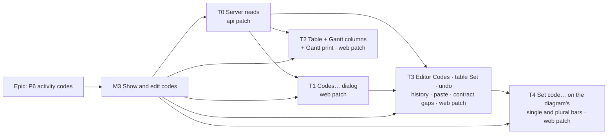

# Implementation Plan: P6 activity codes, M3 — show and edit codes

- **Feature spec:** [`./m3-spec.md`](./m3-spec.md) (Draft) — under the approved epic
  [`./spec.md`](./spec.md) and [`./plan.md`](./plan.md) M3. Design authority:
  [`./m3-ui-design.md`](./m3-ui-design.md).
- **Status:** Approved — by the product owner on 2026-10-29 (see the spec header).
- **Owner:** James Ewbank (product owner); built by the **builder** agent once approved (CLAUDE.md §19.14).
- **Owner decisions (fixed):** `spec.md` Q1–Q11; values load on demand (the T0 contract); no feature
  flag; **Gantt print carries the code columns switched on** and **Set code… is on the Activities table
  and on the diagram's selection bars in M3** (both decided by the owner, 2026-10-29). Owner question 3
  (more code columns than fit on paper) is built as recommended unless the owner says otherwise.

## Breakdown

**Order.** T0 first. T1 and T2 may run in parallel after it (T2 reads `codeKeys` and the hooks; whichever
lands first creates `features/codes/api/` and the other rebases). T3 needs T0 (the detail GET's `codes`)
and T1 (keys, `use-codes-actions`, the type and value commands). T4 needs T3 (`CodeAssignControl`,
`activityCodesCommand`, `code-assignment-plan.ts`). Each task is one PR that leaves `main` releasable.

### Epic

**P6 activity codes, kept in the plan** — M3 is the first milestone with a screen.

### Milestone M3: Show and edit codes

**Outcome:** a planner manages code types and values, sees them as table and Gantt columns, prints the
Gantt with them, and sets them on one activity or many — from the table and from the diagram — with
undo, history and paste.

**Entry points** (ADR-0081 §1):

- Plan ▸ Activities panel header ▸ **Codes…** (T1)
- Plan ▸ Activities panel header ▸ **Columns** ▸ "Area"; Gantt ▸ `View ▾ ▸ Columns ▸ Codes ▸ Area`;
  Gantt ▸ `Export ▸ Print…` (T2)
- Activity editor ▸ General ▸ **Codes** ▸ **Save codes**; Activities table ▸ ticked rows ▸ **Set Area**
  (T3)
- Diagram (and Gantt dock) ▸ selection bar ▸ **Set code…**; diagram ▸ plural selection bar ▸
  **Set code…** (T4)

T0 **ships dark**: API reads only; T1 opens the first screen.

**Journey:** a new spec file `apps/web/e2e-swimlanes/codes.spec.ts` in the existing `e2e-swimlanes`
suite (`playwright.swimlanes.config.ts`, `test:e2e:swimlanes`, local `scripts/e2e-local.sh
web:swimlanes`), on the seeded `plan:capability-codes`. It lands with T1 as a skeleton and grows a step
per task (m3-spec §1a F7). **No new Playwright config and no new CI step.** Each step is axe clean.

**No feature flag** (ADR-0088 D1). The rollback is the PR boundary.

---

#### Feature: M3 — show and edit codes

> **Description:** m3-spec §2 and §4.
> **Complexity:** L overall (T0 M, T1 M, T2 M, T3 L, T4 M).
> **Dependencies:** M2 shipped (`m2-record.md` §9–§10), the seeded `plan:capability-codes` (M2-T6).
> **Risks:** the rollup at the end.
> **Testing requirements:** per task; the journey per task; `pnpm prepush` every PR;
> `scripts/e2e-local.sh api` for T0; `scripts/e2e-local.sh web:swimlanes` for T1–T4.

##### T0 — Server reads for on-demand values (≈ one PR, `api` patch)

- **Description:** m3-spec §4.5, design §3: `GET code-types?values=none` and `valueCount`;
  `GET code-types/:codeTypeId/values` (`limit` 1–1,000 default 1,000, `cursor`, `include=deleted` behind
  `code:restore`, `ORDER BY position, id`); `GET code-values?id=` (1–100 repeated ids, not paged, deleted
  values and types named under `code:read`); `codes` on `GET /organizations/:orgSlug/activities/:id`
  (`get` calls `decorateWithCodes`); UUID `cursor` on the codes routes; `CODE_*` limits to
  `@repo/types` (API re-exports); `CodeTypeSummary.valueCount?`.
- **Schema:** **none.** No migration, no index, no Prisma model change. If the `include=deleted`
  measurement below misses its ceiling, the remedy is an index on `code_values (code_type_id,
position, id)`: **stop, do not add it**, and send it to the **database-architect** (CLAUDE.md §19.3).
- **Complexity:** M.
- **Dependencies:** none (M2 shipped).
- **Files (expected):** `apps/api/src/modules/codes/` (`code-types.controller.ts`, `code-types.service.ts`,
  `code-value.repository.ts`, `code-type.repository.ts`, new `code-values.controller.ts` or a route on
  the existing values controller, DTOs `code-type-list-query.dto.ts` (+`values`, `cursor` `@IsUUID`),
  new `code-value-list-query.dto.ts`, new `resolve-code-values-query.dto.ts`, `code-response.dto.ts`
  (+`ResolvedCodeValueDto`), `codes.constants.ts` → re-export); `apps/api/src/modules/activities/activities.service.ts`
  (`get`, `:426-438`); `packages/types/src/index.ts`; `apps/api/test/codes*.e2e-spec.ts`;
  `apps/api/test/activities*.e2e-spec.ts` (detail `codes`); `soft-delete-filter.structural.spec.ts`
  (the new any-state read's declaration); `audit-coverage.structural.spec.ts` (reads classified, not
  audited); `apps/api/test/measure/codes-reads.measure.ts`.
- **Risks:**
  - **Deleted names to `code:read`** (design §3.3) → security-reviewer decides at review; fallback:
    absent for a reader without `code:restore`, with the web reading "a deleted value".
  - **IDOR on new ids** → every query scoped by organisation **and** plan through the type; 404 never
    told apart (foreign, deleted, unknown); e2e for each.
  - **A page size above the house default of 100** (`pagination-query.dto.ts:18-24`) → its own DTO, as
    `CodeTypeListQueryDto` already overrides; api-reviewer.
  - **SC-2 parity** on the detail GET → `codes` absent on a no-type plan; byte-compare in e2e.
  - **Rate limit** (100/min per handler, design §2) → the web never fans out one values request per
    type on open; that is pinned in T1's unit tests, not here.
- **Success criterion (ADR-0142), measured with `apps/api/test/measure/codes-reads.measure.ts`** (extend
  the harness; same machine and method as `m2-record.md` §9; warm, over HTTP, v4 ids, p50 and p95):

  | Case                                                                                                            | Ceiling (p95)                                                                            |
  | --------------------------------------------------------------------------------------------------------------- | ---------------------------------------------------------------------------------------- |
  | **Codes… first paint, 100 types × 1,000 values**: `GET code-types?values=none` + `GET code-types/:first/values` | **≤ 200 ms together** (≤ 60 + ≤ 140) — today 2.6 s for the one list (`m2-record.md:255`) |
  | `GET code-types/:id/values?include=deleted`, 1,000 live + 1,000 deleted                                         | ≤ 200 ms                                                                                 |
  | `GET code-types?values=none&include=deleted`, 100 live + 100 deleted types                                      | ≤ 60 ms                                                                                  |
  | `GET code-values?id=` × 100 ids across 100 types                                                                | ≤ 60 ms                                                                                  |
  | detail GET, 30-type coded plan vs no-type plan                                                                  | ≤ 15 ms added                                                                            |

  Run as the harness's header says (`codes-reads.measure.ts:19-26`): `DATABASE_URL=… MEASURE_OUT=…
pnpm --filter @repo/api exec vitest run --config vitest.measure.config.mts codes-reads`, against a
  disposable migrated database; the harness seeds a 100 × 1,000 plan for the new cases beside its
  existing 30 × 50 one. Recorded in a new `docs/specs/p6-activity-codes/m3-record.md` §1. A miss **blocks T1 from binding**
  and goes to backend-performance-reviewer and the owner with the figure.

- **Testing:**
  - **API e2e:** `values=none` shape and `valueCount` (live only); default unchanged (byte-compare a
    playbook-row read); values route paging and order across pages; `limit` 0 and 1,001 → 422; a
    non-UUID `cursor` → 422 on both routes; `include=deleted` 403 without `code:restore`, correct with
    it, `deletedAt` set; foreign-org, other-plan, deleted and unknown type → 404; resolve with 0 and 101
    ids → 422, comma-joined → 422, foreign ids absent, a deleted value and a value of a deleted type
    named with `codeTypeDeletedAt`; detail GET `codes` absent on a no-type plan, `[]` on an uncoded
    activity of a coded plan, present otherwise; a Viewer reads all three.
  - **Structural:** the soft-delete declaration; audit coverage.
  - **Measure:** the table above.
- **Reviewers:** **api-reviewer**, **security-reviewer** (the deleted-names reading), **backend-performance-reviewer**
  (the measurement). No UI, so no ADR-0111 review.
- **Changeset:** `api` **patch** ("Code values can now be read one type at a time, and an activity's own
  read carries its codes."). The design proposed minor; the brief fixes patch (m3-spec §1a).
- **Docs:** `docs/API.md` "Codes" (`:755-`): the three reads, `valueCount`, "the default nesting is kept
  for compatibility and is not what a screen should use", and `:814-820` ("the list, the
  single-activity GET and the codes write carry `codes`"); OpenAPI decorators; `docs/TECH_DEBT.md` #562
  updated in place (bullets 1, 2, 8 closed; 3, 4, 6 with reasons; 5 and 7 open); `m3-record.md`;
  `pnpm check:counts` (no count should move; run it).
- **Development steps:**
  1. Move the `CODE_*` limits to `@repo/types`; re-export from `codes.constants.ts`.
  2. `values=none` + `valueCount` (one `groupBy`) on the list; `@IsUUID()` cursor.
  3. The per-type values route and DTO; the `include=deleted` branch with its `soft-delete: any-state`
     comment and the structural declaration.
  4. The resolve route and `ResolvedCodeValueDto`.
  5. `get` → `decorateWithCodes([activity])`.
  6. E2e, then the measurement; record; stop on a miss.
  7. Docs, changeset, `pnpm prepush`, `scripts/e2e-local.sh api`.

##### T1 — Codes… dialog (≈ one PR, `web` patch)

- **Description:** design §4 skeleton, §5.1, §6, §8.1–§8.3 for types and values, §10, §11; the
  Activities panel header's **Codes…** button; `RowActionButton` extraction; the ADR-0061 §3 amendment
  note; the journey skeleton.
- **Complexity:** M.
- **Dependencies:** T0 released (or at least merged: the web reads `values=none`).
- **Files (expected):** `apps/web/src/features/codes/` (`index.ts`, `api/use-code-types.ts`,
  `api/use-code-values.ts`, `api/use-code-mutations.ts`, `model/code-names.ts`, `model/code-text.ts`,
  `model/code-errors.ts`, `model/codes-gating.ts`, `model/use-codes-actions.ts`,
  `components/CodesDialog.tsx`, `CodeTypePane.tsx`, `CodeValueEditDialog.tsx`, `CodeTypeRenameDialog.tsx`,
  `CodeDeleteDialog.tsx`, `DeletedCodesDisclosure.tsx`); `apps/web/src/lib/query/hierarchy-keys.ts`
  (`codeKeys`); `apps/web/src/features/undo-redo/code-commands.ts`, `replay.ts` (`readCodeTypes`,
  `readCodeValues`), `use-plan-undo-redo.ts`, `coverage.ts`, `test/fake-plan-server.ts`;
  `apps/web/src/components/ui/row-action-button.tsx` (moved from `SwimlaneManageDialog.tsx:341-387`,
  tests moved); `apps/web/src/components/layout/workspace/activity-bottom-panel.tsx` (header button,
  `:310-327`); `docs/adr/0061-dialog-layout-system.md` (amendment note under §3, `:86`);
  `apps/web/e2e-swimlanes/support.ts` (`openSeededPlan(page, stamp, { family, planLink })`),
  `apps/web/e2e-swimlanes/codes.spec.ts`.
- **Risks:**
  - **A portalled popup in a native `<dialog>`, focus lost when a control unmounts** (both ADR-0111
    classes) → accessibility-reviewer and component-reviewer **before release**, executing the dialog.
  - **Automatic activation fires a request per arrow** (design §5.1) → unit test counts requests; the
    remedy (manual activation on `Tabs`) is an ADR-0111 primitive change and is **not** built unless
    that count is shown to hurt.
  - **The rate-limit claim cannot be seen in the journey** (the suite raises the limit to 300,
    `playwright.swimlanes.config.ts:61-65`) → the unit count is the proof.
  - **The shard grows** (ADR-0138) → record the `e2e-swimlanes` shard time before and after in the PR.
  - **`RowActionButton` forks** → moved, not copied; the swimlane dialog imports it.
- **Testing:**
  - **Unit/component:** every state of design §10 for the rail, the pane and the disclosures; pen and
    role shading (ADR-0083 D5 read-only summary vs shaded fields); delete sentences counted from the
    activity cache; focus rules 1–6 (design §11), rule 6 with `use-container-unmount-handoff`; a reorder
    sends every live value with its current version; opening the dialog makes **two** requests (types,
    first type's values) and arrowing across ten uncached types makes ten, then none on the way back.
  - **Undo:** each type and value command against `fake-plan-server` — applied, gone, changed,
    parent-deleted; `COVERAGE` entries `recorded(...)` for every new mutation hook.
  - **Structural:** no `setQueryData` against `activityKeys.listByPlan` outside tests (design §6.2);
    `features/codes` imports no `features/activities|gantt|tsld|plan-actions`.
  - **Journey (design §12 T1):** open Codes… on the seeded plan; three tabs in order; Area's pane lists
    GF, L1, L2, RF; add type "System" and value "HVAC"; rename L2; move RF up; delete L1, check CD_3 has
    no Area through the API, undo, check CD_3 has L1 again; shaded with the pen sentence without the
    pen; axe clean; at 1024 × 600 both panes scroll and both Add forms stay reachable.
- **Reviewers:** **accessibility-reviewer** and **component-reviewer before release (ADR-0111)**;
  **ux-reviewer** (every string against spec §0: never bare "activity code" or "Code" for a
  classification); **performance-reviewer** (the request counts, lazy loading of the dialog's chunk).
- **Changeset:** `web` **patch** ("A Codes… dialog in the Activities panel manages a plan's P6 activity
  codes.").
- **Docs:** ADR-0061 §3 amendment note (a rail fits wherever the sections are a set the reader picks
  from; the editor was the first such set); optionally a "Look at" line on the `capability-codes` rows of
  `docs/TEST_PLAYBOOK.md` (`pnpm check:playbook`); `CLAUDE.md` §1 web source-file count
  (`pnpm check:counts`).
- **Development steps:**
  1. `codeKeys`, the read hooks, `code-names.ts`, `code-text.ts`, `code-errors.ts`, `codes-gating.ts`.
  2. Extract `RowActionButton`.
  3. The dialog, its stacked dialogs, the disclosures; states; focus.
  4. Mutation hooks with design §6.2 invalidation; `use-codes-actions` records the commands.
  5. `ReplayContext` reads; the commands; `COVERAGE`.
  6. The header button (`code:read`: every member).
  7. `openSeededPlan` parameters; `codes.spec.ts` skeleton and the T1 steps.
  8. ADR-0061 note, changeset, counts; `pnpm prepush`; `scripts/e2e-local.sh web:swimlanes`; reviews.

##### T2 — Table and Gantt columns, and the Gantt's print (≈ one PR, `web` patch)

- **Description:** design §5.2 (Columns menu for the table, `View ▾ ▸ Columns ▸ Codes` for the Gantt,
  `acodes`/`gcodes` URL lists, the shared `codes` width, the 10-column cap, cell states) **and m3-spec
  §4.6, the owner's print decision**: `PrintGanttInput.codeColumns` (required), the fit to the 980 px
  page with a 240 px chart floor, the "Not printed, to leave room for the chart: …" line, names awaited
  before mounting, refusal on failure.
- **Complexity:** M.
- **Dependencies:** T0. (Independent of T1, apart from shared `features/codes/api` files.)
- **Files (expected):** `features/codes/components/CodeColumnsMenu.tsx`, `features/codes/model/code-columns.ts`
  (`CodeColumn`, URL parse/serialise, cap); `features/activities/components/ActivitiesTable.tsx`
  (`codeColumns` prop; columns memo identity unchanged with none); `features/gantt/layout/column-widths.ts`
  (`codes` default width; code columns **in `ganttFixedWidth` and `defaultGridWidth`**),
  `features/gantt/components/GanttPanel.tsx`, `features/gantt/model/gantt-view-state.ts` (`gcodes`),
  `features/gantt/components/GanttPrintSurface.tsx` (`PrintCodeColumn`, `PRINT_CODE_COLUMN_WIDTH`,
  `PRINT_CHART_MIN`, bucket `colSpan`, the not-printed line), new `features/gantt/layout/print-code-fit.ts`;
  `features/tsld/toolbar/gantt-columns-group.tsx` (the folded Codes sub-section, bounded scroll),
  `features/tsld/toolbar/use-tsld-toolbar-context.tsx` (`:871-905`: await
  `ganttColumns.resolvePrintCodeColumns()`, pass `codeColumns`, alert on rejection); the
  `GanttColumnsBundle` type; `acodes`/`gcodes` are read through `searchString` and covered by the
  search-consumer census, the undeclared-param precedent of ADR-0123 (as `gsort`/`ghide`/`gcollapsed`),
  **not** declared in the plan route's `validateSearch`; host wiring in `components/layout/workspace/`; `apps/web/e2e-support/print.ts` (**moved** from
  `e2e-export/exported-diagram.spec.ts:92-168`, which then imports it).
- **Risks:**
  - **A code column drawn but not counted paints over the chart** (the ADR-0095 Float incident,
    `column-widths.ts:11-12`) → code columns enter `ganttFixedWidth`; `grid-width.structural.test.ts`
    asserts the sum with code columns shown.
  - **Render cost** → the host memoises `CodeColumn[]` on (shown ids, name maps); the render-count test
    is **unchanged and green**.
  - **View ▾ height at the floor** (its budget, `tsld-toolbar-items.tsx:2206-2214`) → the Codes list is
    folded and scrolls inside a bounded height; the journey opens it at 1024 × 600 and asserts the
    panel's height does not grow with the type count.
  - **Print is async now** for the Gantt branch → the `printing` re-entry guard covers it; the existing
    `e2e-export` print journey must stay green.
  - **A threaded-but-dead print input** (#135, #217 in that file's own docblock) → `codeColumns` is
    required on both the input and the surface; a test prints a coded plan and reads the cells.
  - **`features/tsld` import creep (#548)** → it reads a function and plain data off `ctx.ganttColumns`;
    the structural import check stays as it is.
- **Testing:**
  - **Unit:** `code-columns` URL round trip (deleted type's id dropped; over-cap trimmed; garbage →
    default "none shown"; written in type order); `print-code-fit` (no baseline 3 fit, baseline 2,
    Predecessors + baseline 0, and the named remainder); cap shades the 11th item with its reason.
  - **Component:** cell states (value, "—", "Loading…", "Unavailable" + one status sentence); a hidden
    type fires no values request; `ActivitiesTable.render-count.test.tsx` unchanged; `GanttPrintSurface`
    headers in order, a summary's value, bucket `colSpan`, the not-printed line only when something was
    left off; the toolbar context mounts nothing and alerts when `resolvePrintCodeColumns` rejects;
    `GanttColumnsGroup` lists the types, shaded when none.
  - **Structural:** `grid-width.structural.test.ts` with code columns.
  - **Journey (design §12 T2 + print):** Activities ▸ Columns ▸ Area: "Ground floor" on CD_1, "—" on
    CD_7; reload: still shown. Gantt ▸ `View ▾ ▸ Columns ▸ Codes ▸ Trade`: a read-only column.
    `Export ▸ Print…` (print stubbed, through the moved `openPrintDocument`): `.gantt-print-root thead`
    carries "Trade" after the standard headings and CD_4's row reads "Mechanical, electrical and
    plumbing". axe clean.
- **Reviewers:** **component-reviewer**, **accessibility-reviewer** (the `menuitemcheckbox` menu and
  the folded sub-section), **performance-reviewer** (memo identity, request counts), **ux-reviewer**
  (cell, cap and print sentences). No primitive's keyboard contract changes, so no ADR-0111 pre-release
  review is owed; run it anyway if the builder touches `Menu`.
- **Changeset:** `web` **patch** ("Codes can be shown as columns in the Activities table and the Gantt,
  and the Gantt's code columns print.").
- **Docs:** `docs/TECH_DEBT.md` #548 untouched (no import added) — say so in the PR; `CLAUDE.md` §1
  count via `pnpm check:counts`.
- **Development steps:**
  1. `CodeColumn`, `codeValueName`, URL parse/serialise; router validation.
  2. Table columns and the Columns menu.
  3. Gantt columns, widths, fixed-width sum; the View ▾ sub-section.
  4. Print: `PrintCodeColumn`, the fit, the line, the bundle's resolver, the awaited mount and the alert.
  5. Move `openPrintDocument` to `e2e-support/print.ts`; journey steps.
  6. Changeset, counts; `pnpm prepush`; `scripts/e2e-local.sh web:swimlanes` and `web:export`.

##### T3 — Editor Codes section, table Set <type>, undo, history, paste, contract gaps (≈ one PR, `web` patch)

- **Description:** design §7.1–§7.3, §8.1, `activityCodesCommand` with the 422 set-aside (§8.2), paste
  (§8.4, with m3-spec §1a's loop split), history (§9); the five `surface-contract.json` entries; the
  clone-census reason. Builds `CodeAssignControl` (used by the table bar here and by the diagram bars in
  T4).
- **Complexity:** L.
- **Dependencies:** T0 (detail `codes`), T1 (`codeKeys`, `use-codes-actions`, commands file).
- **Files (expected):** `features/codes/api/use-code-value-names.ts`, `api/use-write-activity-codes.ts`
  (`onSettled` returns the awaited invalidation, design §6.2), `model/code-assignment-plan.ts`,
  `components/CodeValuePicker.tsx`, `ActivityCodesSection.tsx`, `CodeAssignControl.tsx`,
  `CodeBulkAssignBar.tsx`; `features/activities/components/ActivityEditorDialog.tsx`,
  `activity-editor-types.ts`, `ActivityEditorSession.tsx` (`codesSlot`);
  `features/activities/lib/activity-editor-gating.ts` (`'codes'` → the `definition` object, `:49-50`,
  `:110-134`) and its identity test; `components/layout/workspace/activity-crud-dialogs.tsx`
  (`:182-259`, compose the slot); the table's bulk container (companion row);
  `features/undo-redo/code-commands.ts` (`activityCodesCommand`), `replay.ts` (a `'value-deleted'`
  reason and its sentence), `coverage.ts`; `components/layout/workspace/use-plan-workspace-model.ts`
  (`duplicateActivities` `:2710-2888`: create loop, then one codes write, then carriage with the
  returned versions); `features/undo-redo/commands.ts` (`pasteActivitiesCommand` expectation adds
  `codes`, `:2105-2111`); `features/activity-copy/model/clone-projection.ts` (`:145-152` reason),
  `activity-field-census.test.ts` comment; `features/activity-history/lib/format-history-item.ts`
  (`HistoryFormatContext.codes`, the lines of design §9), `ActivityHistoryPanel`;
  `scripts/surface-contract.json` (`:92-106`, each `gap` → `{"surface": "apps/web/src/features/codes/api/use-write-activity-codes.ts"}`
  or the component that authors the field, following the file's existing convention).
- **Risks:**
  - **Two Saves on General** (ADR-0060 §3) → key-set assertions: the General save sends no `codes`, the
    codes save sends no definition fields; and the codes save waits for its refetch so the General save
    then holds the bumped `version`.
  - **Undo reads differ by row count** (≤ 5 detail, > 5 list; F3) → one test runs the same check both
    ways and expects one answer.
  - **The paste reorder** changes the shape of a working loop → rollback e2e-style unit test: a failure
    in the codes write and in carriage each deletes every clone; carriage uses the versions the codes
    response returned (a units-driven assignment create bumps the version, `use-clone-carriage.ts:98-114`).
  - **A popup in a native `<dialog>`** (the Combobox in the editor) → ADR-0111 reviews before release.
  - **The 2,000-row write takes 1.0–2.6 s** (`m2-record.md:252`, `:260-267`) → `aria-busy` "Setting…";
    the bar sends only changing rows.
- **Testing:**
  - **Editor:** a codes save sends only changed types with `version`; scope key-set assertions; `codes`
    in the gating identity test; unsaved-work registration (`ActivityEditor.registers-unsaved-work.test.tsx`)
    and the General tab's dot; read-only summary for a Viewer vs shaded pickers without the pen; WBS
    summary editable; empty-plan sentences.
  - **Picker:** values query enabled only after the first `onQueryChange`; `selectedLabel` from
    `names`; "None" clears.
  - **Bulk (table):** `code-assignment-plan` skips unchanged rows, counts "already have it", shades above
    2,000; one request; one undo step.
  - **Undo:** `activityCodesCommand` applied / changed / gone; the detail-vs-list parity; 422
    `CODE_VALUE_DELETED` and `CODE_VALUE_WRONG_TYPE` → set aside `value-deleted` with "Level 1 was
    deleted. Restore it in Codes… to set it again."; `affectsSchedule: false`; `COVERAGE`.
  - **Paste:** codes write between creates and carriage, carriage at the returned versions, rollback on
    either failure, undo expectation includes `codes`.
  - **History:** every row of design §9; no `code:` line starts with `Code `.
  - **Gates:** `pnpm check:surface-contract` green with the five entries `surface`.
  - **Journey (design §12 T3):** editor on CD_5 ▸ General ▸ Codes ▸ Trade = MEP ▸ Save codes; History
    reads "Trade set to Mechanical, electrical and plumbing"; undo. Tick CD_7 and CD_8 ▸ Set Area ▸
    Roof: one request (counted with `page.waitForRequest`), both read Roof; undo returns both.
    Duplicate CD_1: the copy carries GF and CIV. axe clean.
- **Reviewers:** **accessibility-reviewer** and **component-reviewer before release (ADR-0111)**;
  **ux-reviewer** (strings, history lines); **performance-reviewer** (the editor opening costs one
  `names` request, not one per type).
- **Changeset:** `web` **patch** ("Set an activity's codes in its editor, or one code on many ticked
  rows; codes undo, show in history and survive copy and paste.").
- **Docs:** `scripts/surface-contract.json`; `CLAUDE.md` §1 count (`pnpm check:counts`); the epic ADR's
  outline note (M7) gains F1.
- **Development steps:**
  1. `use-code-value-names`, `CodeValuePicker`.
  2. `use-write-activity-codes`, `code-assignment-plan`, `CodeAssignControl`.
  3. `activityCodesCommand` + the set-aside reason.
  4. Editor slot and gating.
  5. Table companion row.
  6. History formatting.
  7. Paste reorder and census reason.
  8. Surface-contract entries; journey steps; changeset; `pnpm prepush`;
     `scripts/e2e-local.sh web:swimlanes`; reviews.

##### T4 — Set code… on the diagram's single and plural selection bars (≈ one PR, `web` patch)

- **Description:** m3-spec §4.8, the owner's second decision. A `set-code` registry item on the
  single-activity bar (`features/plan-actions/selection-actions.tsx`, diagram and Gantt docks) and a
  `codeAction` slot on the plural bar (`features/tsld/components/BulkSelectionBar.tsx`), both rendering
  T3's `CodeAssignControl` supplied by the host. No new write and no new command: T3's write and
  `activityCodesCommand`.
- **Complexity:** M.
- **Dependencies:** T3.
- **Files (expected):** `features/plan-actions/selection-actions.tsx` (`SelectionActionContext.setCode`,
  the `set-code` item at `order: 5.75`, a `SetCodeItem` render on the `MoveToSwimlaneItem` shape,
  `:544-574`); `features/plan-actions/build-selection-context.ts` (`:85`, `:154-155` precedent);
  `features/tsld/components/BulkSelectionBar.tsx` (`codeAction?: React.ReactNode` after
  `MoveToSwimlaneButton`, `:206-213`); `features/tsld/components/TsldPanel.tsx` (pass-through prop,
  `:3412-3460`); `features/tsld/toolbar/command-manifest.json` (`selectionBar` + `set-code`) and
  `promotion-manifest.test.tsx`; `features/codes/components/CodeAssignButton.tsx`; host wiring in
  `components/layout/workspace/`.
- **Risks:**
  - **`features/tsld` or `features/plan-actions` importing `features/codes`** (#548, ADR-0026 §8) → slot
    and render-function only; a structural test asserts neither imports `@/features/codes`.
  - **The bar's width at the floor** → the reachability assertion of `command-surface.spec.ts:1089-1106`
    run on the coded plan at 1024 × 600 and 1646 in the journey (that sweep's own plans have no codes,
    so the item is omitted there).
  - **A Combobox list inside a non-modal popover panel** (the portalled-popup class; Escape must close
    the list before the panel, ADR-0079) → **accessibility-reviewer and component-reviewer before
    release (ADR-0111)**, executing it in a browser.
  - **Collision with M4's code-sourced Move to swimlane…** → none in M3 (no plan can be code-sourced:
    `m2-record.md:213-217`); same planner and command, so M4 adds lanes once (m3-spec §4.9). M4's spec
    decides whether Set code… lists the source type.
  - **Focus when the item leaves** (the last type deleted by a colleague) → `lostReason` and the
    container handoff (ADR-0135); a component test.
- **Testing:**
  - **Registry/component:** `set-code` omitted with no types; visible with types; shaded with the pen
    sentence and with the role sentence; `lostReason`; order after Move to swimlane…, before Delete;
    absent from the Gantt row menu (no `onActivate`, `GanttRowMenu.tsx:152-158`) and present on the Gantt
    dock; `BulkSelectionBar` renders `codeAction` in place; the manifest pin.
  - **Panel:** opens with focus on the type select; Escape in the open value list closes the list only;
    success closes the panel and returns focus to the trigger; one request for N ids; one undo step.
  - **Structural:** no `@/features/codes` import from `features/tsld` or `features/plan-actions`.
  - **Journey:** select CD_8 on the diagram ▸ **Set code…** ▸ Area ▸ Roof ▸ **Set Area** → CD_8 reads
    Roof (API); undo. Select CD_2, CD_3, CD_4 (plural) ▸ **Set code…** ▸ Trade ▸ ENV ▸ **Set Trade** →
    one request, all three ENV; undo. At 1024 × 600 every control on the single bar is within the
    viewport and reachable by Tab. axe clean.
- **Reviewers:** **accessibility-reviewer** and **component-reviewer before release (ADR-0111)**;
  **ux-reviewer** (the "Set code…" / "Set Area" pair, D-3); **performance-reviewer** (the bar's context
  memo: the panel render function must be stable so the bar does not re-render on every workspace
  render).
- **Changeset:** `web` **patch** ("Set a code on selected activities straight from the diagram.").
- **Docs:** `CLAUDE.md` §1 count (`pnpm check:counts`); m3-spec §4.9's note carried into M4's spec when
  it is written.
- **Development steps:**
  1. `CodeAssignButton`; host render functions.
  2. The registry item and context field; manifest.
  3. The plural slot and pass-through.
  4. Tests; journey steps; changeset; `pnpm prepush`; `scripts/e2e-local.sh web:swimlanes`; reviews.

## Sequencing and slices

T0 → (T1 ∥ T2) → T3 → T4. Each PR is releasable alone:

- after **T0** nothing is visible (dark API reads);
- after **T1** codes can be managed but not assigned in the UI (assignment still by API, as at M2);
- after **T2** they can be seen and printed;
- after **T3** they can be set from the editor and the table, with undo, history and paste;
- after **T4** also from the diagram.

No flag at any point (ADR-0088 D1). The surface-contract gaps close at T3, the first task whose UI
writes `PATCH …/activities/codes`.

## Definition of Done (per task)

[`docs/PROCESS.md`](../../PROCESS.md) Feature Completion Criteria: code, tests, docs, security review,
performance, accessibility, Docker build, CI green (read per CLAUDE.md §19.9), changeset, version impact.
"Tests" means **run**: `pnpm prepush`, plus `scripts/e2e-local.sh api` (T0) and
`scripts/e2e-local.sh web:swimlanes` (T1–T4; T2 also `web:export`). ADR-0111 reviews **before** T1, T3
and T4 are released. `pnpm check:counts` after every web task (the web source-file count in `CLAUDE.md`
§1 moves). After each squash-merge, reset the branch from `main` (CLAUDE.md §8).

## Agents

- **database-architect**: none expected; **mandatory** if T0's measurement calls for the index.
- **api-reviewer**, **security-reviewer**, **backend-performance-reviewer**: T0.
- **accessibility-reviewer**, **component-reviewer**: T1, T3, T4 before release (ADR-0111); T2 as a
  normal review.
- **ux-reviewer**: T1–T4 (spec §0 vocabulary on every string).
- **performance-reviewer**: T1–T4.
- **test-engineer**: the journey file and the moved print helper.

## Risks and assumptions (rollup)

| Risk / assumption                                                           | Likelihood | Impact | Mitigation                                                                         |
| --------------------------------------------------------------------------- | ---------- | ------ | ---------------------------------------------------------------------------------- |
| T0 reads miss a ceiling                                                     | low        | med    | Measured before T1 binds; stop and report; an index goes to the database-architect |
| Deleted names to `code:read` refused at review                              | med        | low    | Fallback in m3-spec §2 Permissions                                                 |
| A code column not counted in the Gantt's fixed width paints over the chart  | med        | high   | In `ganttFixedWidth`; structural test                                              |
| Few code columns fit on paper                                               | certain    | med    | Fit + named remainder; owner question 3                                            |
| Print shows "Unavailable" or an id                                          | low        | high   | Names awaited; refuse on failure                                                   |
| Request fan-out on rail arrowing hits the rate limit                        | low        | med    | Cache + unit count; manual activation named, not built                             |
| Journey cannot see the rate limit (suite raises it to 300)                  | certain    | low    | Unit request counts are the proof                                                  |
| Paste reorder breaks rollback or versions                                   | med        | high   | Unit tests on both failure points and on the version used by carriage              |
| Two Saves on General confuse                                                | med        | low    | ADR-0060 §3 wording; ux-reviewer; unsaved-work dot                                 |
| A popup inside a `<dialog>` or a popover panel misbehaves in a real browser | med        | med    | ADR-0111 reviews executing the component; journey steps                            |
| `features/tsld` / `plan-actions` grow a sideways import                     | low        | low    | Slots; structural test                                                             |
| M4's Move to swimlane… and Set code… diverge                                | low        | med    | One planner, one command; M4 adds lanes in one place                               |
| `e2e-swimlanes` shard grows                                                 | high       | low    | Record shard time in T1 and T4 PRs (ADR-0138)                                      |
| "Code" / "activity code" confusion in copy                                  | high       | med    | spec §0; ux-reviewer                                                               |
| Changeset level differs from the design (patch, not minor)                  | certain    | low    | The brief's decision, recorded in m3-spec §1a                                      |

## Test plan (summary)

| Level      | Where                                                                                     | Proves                                                    |
| ---------- | ----------------------------------------------------------------------------------------- | --------------------------------------------------------- |
| API e2e    | `apps/api/test/codes*.e2e-spec.ts`, activities detail                                     | T0 shapes, bounds, scope, permissions, SC-2 parity        |
| Measure    | `apps/api/test/measure/codes-reads.measure.ts` → `m3-record.md`                           | SC-M3-2                                                   |
| Unit       | `features/codes/model/*`, `print-code-fit`, `code-assignment-plan`, URL lists             | rules, caps, fit                                          |
| Component  | dialog, columns menu, table, Gantt grid, print surface, editor section, bars              | states, shading, focus, cell text, print order            |
| Undo       | `code-commands` against `fake-plan-server`                                                | applied / changed / gone / parent-deleted / value-deleted |
| Structural | no `setQueryData` on the list; import direction; `grid-width`; manifest; surface contract | the rules this milestone relies on                        |
| Journey    | `apps/web/e2e-swimlanes/codes.spec.ts` on `plan:capability-codes`                         | every entry point, print, undo, paste, 1024 × 600, axe    |

</content>
</invoke>
