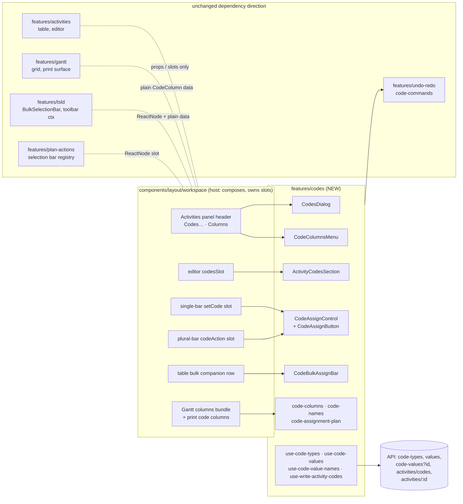
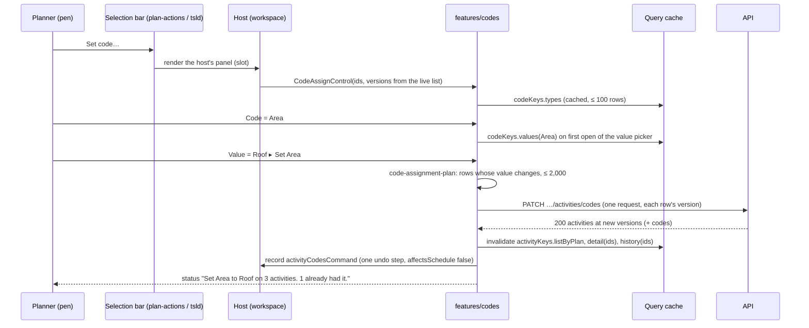

# Feature Spec: P6 activity codes, M3 — show and edit codes

- **Status:** Approved — by the product owner on 2026-10-29, with every answer below. (The
  `check:spec-status` gate reads only `spec.md` in this directory; this file is M3's own spec, under
  the approved epic spec.)
- **Author(s):** Feature Analyst (Claude Code), for James Ewbank (product owner)
- **Date:** 2026-10-29
- **Tracking issue / epic:** the P6 activity-codes epic, [`spec.md`](./spec.md) (Approved 2026-10-27);
  [`plan.md`](./plan.md) M3
- **Roadmap link:** `docs/ROADMAP.md`, schedule interchange (ADR-0050) and diagram authoring (ADR-0206)
- **Design authority:** [`m3-ui-design.md`](./m3-ui-design.md) (ui-architect, Draft, 2026-10-29). Where
  this spec and the design agree, the design's section is cited rather than restated. Where the owner's
  answers of 2026-10-29 overturn it (print, the diagram's bar), this spec says so and wins.
- **Inputs read:** [`m2-record.md`](./m2-record.md) §9–§10, [`database-design.md`](./database-design.md)
  §15–§16, `docs/TECH_DEBT.md` #562 and #548, `scripts/surface-contract.json:92-106`.
- **Companion:** [`m3-plan.md`](./m3-plan.md), the implementation plan (stage 5).
- **Related ADR(s):** no new ADR. An **ADR-0061 §3 amendment note** (a second consumer of the vertical
  rail) lands with T1. The epic ADR filed at M7 records F1 (codes are their own editor write scope) and
  §4.5's resolve-by-id read. Builds on ADR-0012, ADR-0028, ADR-0048/0176, ADR-0059 M4, ADR-0060 §3,
  ADR-0061, ADR-0073, ADR-0080, ADR-0081, ADR-0082, ADR-0083, ADR-0088 D1, ADR-0101, ADR-0111,
  ADR-0117, ADR-0118/0183, ADR-0123, ADR-0135, ADR-0142, ADR-0165, ADR-0172, ADR-0173, ADR-0174,
  ADR-0179, ADR-0185, ADR-0187, ADR-0202, ADR-0204, ADR-0206.
- **Base:** the working tree on 2026-10-29. Every `file:line` here was read on that tree.

---

## Owner questions

**Decided by the owner, 2026-10-29** (these differ from what the design recommended, and this spec is
written to them):

1. **When you print the Gantt, do the code columns you have switched on print too?**
   **Yes.** Any code column switched on in the Gantt is printed on the printed programme, in the same
   order as on screen. (§4.6 says how.)
2. **Can you set a code from the diagram's selection bar as well as from the Activities table?**
   **Yes, both, in M3.** "Set code…" appears on the diagram's selection bar (for one activity, and for
   several selected together) as well as on the Activities table's ticked-rows bar. (§4.8 says how.)

**Decided by the owner, 2026-10-29, as recommended:**

3. **A printed page only has room for a few code columns. What should happen when you have switched on
   more than fit?**
   _Decided: print as many as fit, in the order you see them, and print one line under the chart
   naming the ones left off_ — for example "Not printed, to leave room for the chart: System, Phase."
   The page is a fixed width (landscape A4 or Letter). Beside the usual columns there is room for about
   **three** code columns, **two** when a baseline is showing, and **none** if you have also switched on
   Predecessors and a baseline is showing. The other choices are to squeeze the chart until everything
   fits (the bars become very hard to read), or to refuse to print and ask you to switch some columns
   off first.

---

## 1. Business understanding

### Problem

M2 put codes in the database and behind an API with **no screen** (`m2-record.md` §9; `plan.md` M2
"Ships dark: API only"). A planner can neither see nor change an activity's Area or Trade. Five fields
of the codes write are recorded as surface-contract **gaps** for exactly this reason
(`scripts/surface-contract.json:92-106`: "Recorded as a gap so the milestone that opens the first screen
has to close it").

**Re-verified against the code, not the design or the plan (CLAUDE.md §19.11).** Each of the design's
eight findings (`m3-ui-design.md` §1) was spot-checked; the result is §1a. Two problems the design
describes as current were checked as current:

- **The type list is too expensive to bind a screen to.** `GET code-types` nests every live value of
  the page's types; 100 types × 1,000 values measured **2.3 s p50, 2.6 s p95** (`m2-record.md:255`).
  #562 bullet 1 makes binding a screen to it the trigger (`docs/TECH_DEBT.md:9501`).
- **History lies about codes today.** A code change renders "Code changed"
  (`format-history-item.ts:340`), and `FIELD_LABELS.code` is `'Code'` — the activity's ID
  (`format-history-item.ts:57`). So the placeholder tells the reader the activity's ID changed.

### 1a. The design's claims, checked

| Design claim                                                                | Checked at                                                                                                                                             | Result                                                                                                                                                                                                                                                                                                                                                                                          |
| --------------------------------------------------------------------------- | ------------------------------------------------------------------------------------------------------------------------------------------------------ | ----------------------------------------------------------------------------------------------------------------------------------------------------------------------------------------------------------------------------------------------------------------------------------------------------------------------------------------------------------------------------------------------- |
| F1: one Save per write scope; codes are a separate endpoint                 | `docs/adr/0060-…:104-125`; `plan-activities.controller.ts:192` (`@Patch('codes')`)                                                                     | **Holds.** Codes get their own Save.                                                                                                                                                                                                                                                                                                                                                            |
| F2: the Activities table has no column chooser; only the Gantt does         | `ActivitiesTable.tsx` (no `Columns`/`menuitemcheckbox`; grep), `activity-bottom-panel.tsx` (none); `gantt-columns-group.tsx:39-79`                     | **Holds.**                                                                                                                                                                                                                                                                                                                                                                                      |
| F3: the single-activity GET omits `codes`; replay reads ≤ 5 rows through it | `activities.service.ts:426-438` (`withDayFactor`) vs `:411-424` (`decorateWithCodes`); `replay.ts:65`; `use-plan-undo-redo.ts:237-252`                 | **Holds, with a correction:** the detail route is **organisation-scoped**, `GET /organizations/:orgSlug/activities/:id` (`use-plan-undo-redo.ts:248`), not under `/plans/:planId` as the design's §3 preamble implies. `decorateWithCodes` reads the plan from the row (`:418`), so the fix is unchanged.                                                                                       |
| F4: `writeOrSetAside` maps only 404 and 409, so a 422 throws                | `replay.ts:198-224`                                                                                                                                    | **Holds.**                                                                                                                                                                                                                                                                                                                                                                                      |
| F5: a cross-plan paste is refused before any write                          | `use-plan-workspace-model.ts:2949-2955` (in `components/layout/workspace/`, not `features/plan-workspace/`)                                            | **Holds.**                                                                                                                                                                                                                                                                                                                                                                                      |
| §8.4: paste needs codes between create and carriage                         | `use-plan-workspace-model.ts:2761-2785`                                                                                                                | **Holds, and is larger than "insert a call":** today each clone is created **and carried** before the next is created. Putting one codes write between "all creates" and "all carriage" splits that loop into two loops. Same `try`, same rollback.                                                                                                                                             |
| F6: "Code changed" names the activity ID                                    | `format-history-item.ts:57`, `:340`                                                                                                                    | **Holds.**                                                                                                                                                                                                                                                                                                                                                                                      |
| F7: `e2e-swimlanes` seeds, enforces the pen, turns on no flags              | `playwright.swimlanes.config.ts:12-19`, `:60`; `e2e-swimlanes/support.ts:134-173`; seed family `codes` at `apps/seed-cli/src/capabilities/index.ts:95` | **Holds, with two notes.** `openSeededPlan` hard-codes `--family swimlanes` and the plan-link name (`support.ts:159-165`), so it must take both as parameters. And the config **raises the rate limit to 300 a minute** (`:61-65`), so the journey **cannot** observe the 100-a-minute budget the design leans on (§2 of the design); that claim is proven by unit request counts instead (§5). |
| F8: two things are called a selection bar                                   | `features/plan-actions/selection-actions.tsx:671-985`; `features/tsld/components/BulkSelectionBar.tsx`; `SwimlaneBulkAssignBar.tsx`                    | **Holds — there are three:** the single-activity bar (`selection-actions.tsx`, rendered on the diagram **and** the Gantt dock, `:243-245`), the diagram's plural bar (`BulkSelectionBar.tsx`, `TsldPanel.tsx:3412`), and the table's ticked-rows bar. The owner's answer 2 puts Set code… on all three (§4.8).                                                                                  |
| Combobox loads on first open with no primitive change                       | `combobox.tsx:381-386` (`openList` calls `onQueryChange('')`)                                                                                          | **Holds.** `onQueryChange('')` also fires on commit (`:375`), which is after an open and changes nothing.                                                                                                                                                                                                                                                                                       |
| Gating: codes reuse the `definition` object                                 | `activity-editor-gating.ts:49-50`, `:110-134`                                                                                                          | **Holds.** `ActivityWritePath` gains `'codes'`.                                                                                                                                                                                                                                                                                                                                                 |
| #562 bullets 1–8 as numbered in design §3.5                                 | `docs/TECH_DEBT.md:9488-9497`                                                                                                                          | **Holds**, but the design is silent on bullets **5** (re-measure the 2,000-row history batch) and **7** (pen checked outside the transaction). Both stay open; §4.5 says so.                                                                                                                                                                                                                    |
| "The printed programme carries the standard columns" (design §5.2)          | `GanttPrintSurface.tsx:454-469`; `column-widths.ts:87-94`                                                                                              | **True of the code, overturned by the owner** (answer 1).                                                                                                                                                                                                                                                                                                                                       |
| Changesets "`api` minor (T0), `web` minor (T1–T3)" (design §15)             | brief from the coordinating agent                                                                                                                      | **Not followed:** the brief fixes **patch** changesets for every M3 task. Recorded so the difference is a decision, not a drift.                                                                                                                                                                                                                                                                |

Three facts the design does not state and this spec depends on:

- **The printed page is a fixed 980 px** (`GanttPrintSurface.tsx:54`), and the chart takes whatever the
  columns leave (`:180-183`). The default columns take 500 px (`:63-84`: 60 + 180 + 72 + 72 + 72 + 44),
  the baseline column 66 (`:82`) and Predecessors 132 (`:79`). That is owner question 3.
- **The Gantt's fixed-width sum counts only `columns`** (`column-widths.ts:172-195`). A code column that
  is drawn but not counted there paints over the chart: the ADR-0095 Float incident this file was
  written to end (`:11-12`). Code columns must enter that sum.
- **The Gantt row menu drops any selection-bar item with no `onActivate`** (`GanttRowMenu.tsx:152-158`).
  Move to swimlane… is a popover and is absent from that menu today; Set code… will be too. The Gantt's
  docked bar still carries it.

### Users

| Role                    | In M3                                                                                                                      |
| ----------------------- | -------------------------------------------------------------------------------------------------------------------------- |
| **Planner / Org Admin** | Manage code types and values; set values on one activity (editor) or many (table bar, diagram bars); undo each. Pen-gated. |
| **Contributor**         | Reads codes everywhere; turns code columns on and off and prints them (view state). No code writes (shaded, with reason).  |
| **Viewer**              | As Contributor.                                                                                                            |
| **External Guest**      | Nothing in M3. Guests never receive code fields (`spec.md` §2 Permissions); M4 decides code swimlanes for guests (Q6).     |

### Primary use cases

1. **Manage** code types and values in **Codes…**.
2. **See** codes as columns in the Activities table and the Gantt, and **print** them with the Gantt.
3. **Set** one activity's codes in the editor.
4. **Set** one value on many activities: from ticked table rows, from the diagram's selection, or from
   the single-activity bar on the diagram or the Gantt.
5. **Undo** any of those, **read** them in activity history, and **keep** them on a paste within a plan.

### User journeys

**Happy path (a plan with no codes yet).**

1. Plan ▸ Activities panel header ▸ **Codes…** ▸ **Add code type** "Trade" ▸ in Trade's pane **Add
   value** "MEP — Mechanical, electrical and plumbing", "CIV — Civil".
2. Close. Activities panel header ▸ **Columns** ▸ tick **Trade**. A Trade column appears after WBS.
3. Tick five rows ▸ the bar under the table ▸ **Code** Trade, **Value** MEP ▸ **Set Trade**. Status
   reads "Set Trade to Mechanical, electrical and plumbing on 5 activities." One undo step.
4. On the diagram, select one bar ▸ selection bar ▸ **Set code…** ▸ Trade ▸ CIV ▸ **Set Trade**.
5. Switch to the Gantt ▸ `View ▾ ▸ Columns ▸ Codes ▸ Trade` ▸ `Export ▸ Print…`: the printout carries
   a Trade column.
6. Open an activity ▸ General ▸ **Codes** ▸ Trade ▸ MEP ▸ **Save codes**. History reads "Trade:
   Civil → Mechanical, electrical and plumbing".

**Alternates.**

- **No pen:** every write control is shaded, with one pen sentence; columns, print and reading still
  work.
- **Viewer:** the editor's Codes section is a read-only list ("Trade: Civil"); Codes… opens to read.
- **Undo after a colleague deleted the value:** the step is set aside with "Mechanical, electrical and
  plumbing was deleted. Restore it in Codes… to set it again." (design §8.2).
- **Plural diagram selection:** select three bars ▸ the plural bar ▸ **Set code…**.

### Expected outcomes

- Codes are visible, editable, printable and undoable; every surface reads a value by the one naming
  rule (description, else short code).
- Opening a screen at the caps costs a bounded number of small requests, not the 2.6 s list.
- No date, link, float or critical-path change (codes are `NOT_INPUT`, `spec.md` SC-3).
- The five surface-contract gaps close.

### Success criteria

- **SC-M3-1 (reach).** Each of the four entry points in §2 is driven by a Playwright journey on the
  seeded `plan:capability-codes` (ADR-0081), axe clean.
- **SC-M3-2 (cost, ADR-0142), measured by T0 with `apps/api/test/measure/codes-reads.measure.ts` on the
  same machine as `m2-record.md` §9, before T1 binds a screen.** Proposed ceilings (p95, warm, HTTP):

  | Read                                                                                                                 | Ceiling                                                  | Comparator                                                           |
  | -------------------------------------------------------------------------------------------------------------------- | -------------------------------------------------------- | -------------------------------------------------------------------- |
  | **Codes… first paint at 100 types × 1,000 values**: `GET code-types?values=none` then `GET code-types/:first/values` | **≤ 200 ms for the two together** (≤ 60 ms and ≤ 140 ms) | today's one request: **2.6 s** (`m2-record.md:255`)                  |
  | `GET code-types/:id/values?include=deleted`, 1,000 live + 1,000 deleted                                              | ≤ 200 ms                                                 | none (unbounded today, #562 bullet 2)                                |
  | `GET code-values?id=…`, 100 ids across 100 types                                                                     | ≤ 60 ms                                                  | `GET code-types` at 30 × 50: 59 ms (`m2-record.md:254`)              |
  | `GET …/activities/:id`, 30-type coded plan, vs a no-type plan                                                        | ≤ 15 ms added                                            | the list page's codes cost ≈ 20 ms per 100 rows (`m2-record.md:257`) |

  A missed ceiling **stops** T1 from binding and goes to backend-performance-reviewer and the owner
  with the figure (§4.5 names the one remedy that would need the database-architect).

- **SC-M3-3 (render parity).** With no code column shown, `ActivitiesTable.render-count.test.tsx` is
  unchanged and green (`plan.md` M3-T2).
- **SC-M3-4 (no-codes parity).** On a plan with no code types every existing response, including the
  single-activity GET after T0, is byte-identical (`spec.md` SC-2): `codes` absent, not `[]`.
- **SC-M3-5 (contract).** `pnpm check:surface-contract` passes with the five
  `activities/update-activity-codes.*` entries classified `surface`.

### Open questions

The owner question is at the top. Defaults taken without asking (each is cheap to reverse):

- **D-1** Up to **10** code columns shown per grid (design §5.2).
- **D-2** One shared remembered width for all code columns (design §5.2, ADR-0173).
- **D-3** The selection bars' item reads **"Set code…"** (one stable label, so the bar's width does not
  change as types are added, ADR-0185/0187); the commit button inside reads **"Set Area"** once a type
  is chosen. ux-reviewer checks the wording against spec §0.
- **D-4** In print, code columns are 72 px each, the print surface's existing fallback width
  (`GanttPrintSurface.tsx:84`), and the chart is never narrower than **240 px** (the screen's
  `CHART_MIN_WIDTH`, `column-widths.ts:57`).
- **D-5** Gantt code columns sit **after** the standard columns and before `vs baseline`; table code
  columns after WBS (design §5.2).

---

## 2. Functional requirements

### User stories and acceptance criteria

> **US-M3-1. Manage codes.** As a Planner holding the pen, I want to add, rename, reorder, delete and
> restore code types and values in one dialog.
>
> - **Given** Activities panel header ▸ **Codes…**, **then** a two-pane dialog lists the plan's types
>   (rail) and the selected type's values (pane) — design §5.1.
> - **Given** I delete a value 3 activities carry, **then** the confirmation reads "Delete L1? 3
>   activities carry it. They will read as having no Area until you restore it."
> - **Given** any change, **then** it is one undo step.
> - **Given** no pen, **then** every write control is shaded with one pen sentence; I can still read.

> **US-M3-2. See codes as columns, and print them.** As anyone who can read the plan, I want to show a
> code as a column in the table and the Gantt, and have the Gantt's code columns print.
>
> - **Given** Activities ▸ **Columns** ▸ Area, **then** an Area column shows each activity's value
>   ("Ground floor") or "—".
> - **Given** `View ▾ ▸ Columns ▸ Codes ▸ Trade` in the Gantt, **then** a read-only Trade column
>   appears; **and given** `Export ▸ Print…`, **then** the printed programme carries a Trade column with
>   the same text (owner answer 1).
> - **Given** more code columns than fit on paper, **then** those that fit print in screen order and one
>   line under the chart names the rest (owner question 3, recommended).
> - **Given** I reload, **then** my column choice is still there (URL).

> **US-M3-3. Set one activity's codes.** As a Planner, I want each type's value for an activity in its
> editor.
>
> - **Given** Editor ▸ General ▸ **Codes**, **then** one picker per type shows the current value or
>   "None", and **Save codes** writes only the types I changed.
> - **Given** I change the name and a code, **then** two Saves are pending, and each saves only its own
>   fields (ADR-0060 §3).

> **US-M3-4. Set a value on many activities.** As a Planner, I want one value on many activities at
> once, from the table or the diagram.
>
> - **Given** ticked table rows ▸ **Set Area**, or a diagram selection ▸ **Set code…** ▸ Area ▸ Roof
>   ▸ **Set Area**, **then** every selected activity whose value would change is sent in **one** request
>   and recorded as **one** undo step, and the status says how many already had it.
> - **Given** a selection of more than 2,000 changing activities, **then** the button is shaded:
>   "Set a code on up to 2,000 activities at a time."

> **US-M3-5. Undo, history and paste.**
>
> - **Given** undo of a codes step whose value has since been deleted, **then** the step is set aside
>   with a sentence that names the value and the way back (design §8.2).
> - **Given** a code change, **then** history reads "Area: Level 1 → Level 2" (design §9).
> - **Given** a copy and paste within the plan, **then** the copies carry the source's codes.

### Workflows

- **Codes…** — design §5.1. Changes apply at once; each is one undo step.
- **Columns** — design §5.2; print §4.6.
- **Editor** — design §7.2: a `codesSlot` composed by the host; its own `ScopeSaveBar` ("Save codes").
- **Set code (table)** — design §7.3, the `SwimlaneBulkAssignBar` companion row.
- **Set code (diagram)** — §4.8: a slot on the single-activity bar and on the plural bar.
- **Undo** — design §8; **history** — design §9; **paste** — design §8.4 with §1a's correction.

### Edge cases

| Case                                                 | Behaviour                                                                                                                                                                                                                                                                                                               |
| ---------------------------------------------------- | ----------------------------------------------------------------------------------------------------------------------------------------------------------------------------------------------------------------------------------------------------------------------------------------------------------------------- |
| Plan has no code types                               | Columns menu shaded ("This plan has no codes yet. Add them with Codes…"); Set code… **omitted** from both diagram bars (the plan's precondition, as Move to swimlane…, `selection-actions.tsx:983`); table bar's Code select shaded; editor shows the empty sentence. Every existing response byte-identical (SC-M3-4). |
| The last type is deleted while a bar shows Set code… | The item leaves; focus is handed on with `lostReason` "Not available here: the plan has no codes." (ADR-0135, `use-focus-handoff`).                                                                                                                                                                                     |
| A shown column's type is deleted                     | The column leaves; its id is dropped from `acodes`/`gcodes` on the next parse (design §5.2).                                                                                                                                                                                                                            |
| A shown column's values fail to load                 | Cells read "Unavailable" with one status sentence (design §10). **Print refuses** rather than putting "Unavailable" or an id on paper (§4.6).                                                                                                                                                                           |
| More than 10 code columns wanted                     | The 11th item is shaded, still focusable: "Up to 10 code columns at a time." (ADR-0082).                                                                                                                                                                                                                                |
| More code columns than fit across the printed page   | Owner question 3: the recommended behaviour prints those that fit and names the rest.                                                                                                                                                                                                                                   |
| WBS summaries                                        | Show and edit codes in the editor; print and display their values. Not tickable in the table (`ActivitiesTable.tsx:729-741`), so not reached by the table's bulk set; reachable by the diagram bars if selected.                                                                                                        |
| Activity carries a deleted value                     | Reads as no value (`codes` omits it, `docs/API.md:814-820`); history still names it (design §9).                                                                                                                                                                                                                        |
| Undo races a value delete                            | 422 `CODE_VALUE_DELETED` / `CODE_VALUE_WRONG_TYPE` → set aside `value-deleted` (design §8.2).                                                                                                                                                                                                                           |
| Cross-plan paste                                     | Refused before any write today (§1a F5); nothing built for it (design F5).                                                                                                                                                                                                                                              |
| 2,001 or more changing rows                          | Shaded (design §7.3); the route's `maxItems` is 2,000 (`docs/API.md:807-809`).                                                                                                                                                                                                                                          |
| Arrowing through a 100-type rail                     | One values request per **uncached** type, 30 s cache (design §5.1); counted in a unit test (§5).                                                                                                                                                                                                                        |

### Permissions

Unchanged from M2 (`spec.md` §2 Permissions; `m2-record.md` §9): `code:read` every member;
`code:create|update|delete|restore` Planner, Org Admin; assignments need `activity:update` and the pen.
**One new reading for security-reviewer at T0:** `GET code-values?id=` names **deleted** values and types
to `code:read` holders who already hold the id (design §3.3). Fallback if refused: such ids read as "a
deleted value" and the restore picker stays behind `code:restore`. In the web, `ActivityWritePath`
gains `codes` set to **the same `definition` object** (`activity-editor-gating.ts:110`), so "M3 changes
no permission" is checked by the existing identity test, not claimed.

**The pen (ADR-0028).** Every code write is a structural plan write under the pen: type and value
writes and `PATCH …/activities/codes`. Showing columns, printing and reading are view state.

### Validation rules

The M2 limits, moved to `@repo/types` (design §3.6): type name 1–80, short code 1–80, description
0–255 (provisional, `spec.md` Q5), 100 types, 1,000 values. Client checks first (`code-text.ts`), the
server's CHECKs and DTOs last. New query bounds (T0): `values` ∈ {`none`}; values `limit` 1–1,000;
`cursor` a UUID; `id` 1–100 repeated UUIDs. All 422 outside.

### Error scenarios

| Scenario                                   | Detection                 | User-facing result                                                         | Status |
| ------------------------------------------ | ------------------------- | -------------------------------------------------------------------------- | ------ |
| Foreign, deleted or unknown type on a read | service, org + plan scope | the pane's error state                                                     | 404    |
| `include=deleted` without `code:restore`   | `assertCan`               | (the disclosure is not offered)                                            | 403    |
| Malformed cursor, limit or id list         | DTO                       | none in the UI (the client never sends one)                                | 422    |
| Duplicate name / short code                | partial unique            | "A code type called Area already exists."                                  | 409    |
| Stale version                              | optimistic lock           | "Someone changed this. Reload to see it." + Reload                         | 409    |
| No pen                                     | write gate                | the pen sentence                                                           | 409    |
| Deleted value or wrong type on a set       | service                   | "That value was deleted." / undo: set aside                                | 422    |
| Print with a code column's names unloaded  | client, before mounting   | "The printout was not made: Area's values could not be loaded. Try again." | —      |

---

## 3. Technical analysis

| Area           | Impact   | Notes                                                                                                                                                                                |
| -------------- | -------- | ------------------------------------------------------------------------------------------------------------------------------------------------------------------------------------ |
| Frontend       | **high** | New `features/codes`; host wiring in `components/layout/workspace`; table, Gantt grid, Gantt print, editor slot, two diagram bars; undo commands; history formatting; paste reorder. |
| Backend        | med      | Three additive reads and one changed read (§4.5). No write changes.                                                                                                                  |
| Database       | **none** | **No schema change.** No migration, no index. §4.5 names the one measured outcome that would need an index, and says that is the database-architect's (CLAUDE.md §19.3).             |
| API            | med      | `?values=none`, `valueCount`, `GET code-types/:id/values`, `GET code-values?id=`, `codes` on the detail GET, cursor validation. Additive. `docs/API.md` "Codes", OpenAPI.            |
| Security       | med      | IDOR on the new reads (org + plan scope, 404 never told apart); deleted names to `code:read` (§2 Permissions).                                                                       |
| Performance    | med      | SC-M3-2; the render-count parity; at most `1 + shown columns` requests on a focus refetch; ≤ 10 type loads before a print.                                                           |
| Infrastructure | none     | No new service, env var, CI step or Playwright config.                                                                                                                               |
| Observability  | low      | None new; reads are not audited (ADR-0073).                                                                                                                                          |
| Testing        | high     | API e2e (T0); unit and component per task; undo against `fake-plan-server`; one journey file in `e2e-swimlanes`; ADR-0111 reviews before T1, T3 and T4 ship.                         |

### ADR-0105 triggers this milestone crosses

User-facing entry points (four), a component's public contract (`BulkSelectionBar`, `SelectionActionContext`,
`PrintGanttInput`, `ActivityEditorDialog`'s slots, `GanttColumnsBundle`), and a shared component
extraction (`RowActionButton`). No Playwright config, no CI step, no schema. Hence this spec.

### Recalc parity

Codes are `NOT_INPUT` (`spec.md` SC-3; `schedule-input-fields.ts`). M3 adds no scheduling input and
touches no engine file. `computeSchedule` is byte-identical with or without anything M3 adds, because
nothing M3 writes is read by it; every codes undo command is `affectsSchedule: false` and requests no
recalculation (design §8.2).

### Feature flag

**None** (ADR-0088 D1: a `VITE_` flag is inlined at build time and cannot be switched off on a
published image; the rollback is the PR boundary). Each task is a releasable PR; each user-facing task
names its entry point and lands its journey step (ADR-0081).

### Dependencies

- **Exists (verified):** the M2 routes and the `codes` on the list (`m2-record.md` §9); the seeded
  `plan:capability-codes` (`apps/seed-cli/src/capabilities/codes.ts`); the swimlane precedents
  (`SwimlaneManageDialog`, `SwimlaneBulkAssignBar`, `MoveToSwimlaneButton`, `swimlane-commands.ts`);
  `ScopeSaveBar` (`components/ui/scope-save-bar.tsx:42`); the print path
  (`use-tsld-toolbar-context.tsx:865-907` → `printGanttSchedule`, `GanttPrintSurface.tsx:454`).
- **Must land first:** T0 before every web task.
- **Downstream:** M4 (swimlanes by code) reuses `code-assignment-plan.ts` and `activityCodesCommand`
  (§4.9).

---

## 4. Solution design

### 4.1 Architecture overview



**The dependency rule, stated once.** `features/codes` imports `lib/query` and `components/ui`, never
`features/activities`, `features/gantt`, `features/tsld` or `features/plan-actions`. Those four never
import `features/codes`. The host composes: code columns reach the table and the Gantt as plain
`CodeColumn[]` data; the editor, the two diagram bars and the print path receive a slot (`ReactNode` or
a render function) or plain data. **`features/tsld` gains no import** (`docs/TECH_DEBT.md` #548, ADR-0026
§8): `BulkSelectionBar` gains a `codeAction?: React.ReactNode` prop and the toolbar context reads print
code columns from `ctx.ganttColumns` (plain data). `features/plan-actions` (which already imports
`features/tsld`, `selection-actions.tsx:56-62`) also gains no import: it renders a host-supplied panel.

### 4.2 Data flow: Set code from the diagram's selection bar



### 4.3 Data flow: printing the Gantt with code columns

```mermaid
sequenceDiagram
  participant P as Planner
  participant T as Toolbar ctx (features/tsld)
  participant H as Host (ganttColumns bundle)
  participant Q as Query cache
  participant G as printGanttSchedule (features/gantt)
  P->>T: Export ▸ Print… (Gantt view)
  T->>H: ganttColumns.resolvePrintCodeColumns()
  H->>Q: ensureQueryData(codeKeys.values(t)) for each shown type (≤ 10, normally cached)
  alt every type resolved
    H-->>T: PrintCodeColumn[] {label, text(activity)}
    T->>G: printGanttSchedule({..., codeColumns})
    G->>G: fit to 980 px, chart ≥ 240 px; name what did not fit
    T-->>P: "Printing <plan>."
  else a type failed
    H-->>T: rejected with the type's name
    T-->>P: alert "The printout was not made: Area's values could not be loaded. Try again."
  end
```

### 4.4 User flow

```mermaid
flowchart TD
  O[Open plan] --> HT{Plan has code types?}
  HT -- no --> CD[Activities ▸ Codes… ▸ Add code type ▸ Add values]
  HT -- yes --> COL
  CD --> COL[Activities ▸ Columns ▸ tick Area]
  COL --> SET{Set a value where?}
  SET -- many rows --> TB[Tick rows ▸ Set Area]
  SET -- diagram --> DB[Select bar(s) ▸ Set code… ▸ Area ▸ value ▸ Set Area]
  SET -- one activity --> ED[Editor ▸ General ▸ Codes ▸ Save codes]
  TB & DB & ED --> U[One undo step · history line]
  COL --> GC[Gantt ▸ View ▾ ▸ Columns ▸ Codes ▸ Trade]
  GC --> PR[Export ▸ Print…]
  PR --> FIT{All shown code columns fit?}
  FIT -- yes --> PP[Printed with every code column]
  FIT -- no --> PN[Printed with those that fit + a line naming the rest]
```

### 4.5 API changes (T0) and database

**No schema change.** Every read below runs on existing tables and indexes:

- `GET code-types?values=none` (+ `valueCount` by one `groupBy` over the page's type ids) — design §3.1.
  Default unchanged, so the seeder, `code-types.e2e-spec` and playbook row 112 answer as before.
- `GET code-types/:codeTypeId/values` (`limit` 1–1,000, default 1,000; `cursor`; `include=deleted`
  behind `code:restore`; `ORDER BY position, id`) — design §3.2.
- `GET code-values?id=&id=` (1–100 ids; not paged; absent = unknown; deleted values and types named
  under `code:read`) — design §3.3.
- `codes` on `GET /organizations/:orgSlug/activities/:activityId` (`get` calls `decorateWithCodes`) —
  design §3.4, with §1a F3's path correction.
- `cursor` validated as a UUID on the codes routes (#562 bullet 8, codes routes only).
- `CODE_*` limits into `@repo/types`; `CodeTypeSummary.valueCount?: number` — design §3.6.

**The one index question, answered by measurement and not by guess.** The per-type read filters on
`code_type_id` (served by `uq_code_values_type_id_id (code_type_id, id)`, migration
`20261027120100_p6_activity_codes/migration.sql:224`) and sorts by `position, id` in memory. For ≤ 1,000
live rows that sort is cheap. With `include=deleted`, a type's deleted rows are not capped, so each page
scans the type's rows. T0 measures 1,000 live + 1,000 deleted (SC-M3-2). **If that misses its ceiling,
the remedy is an index `(code_type_id, position, id)`, which is a schema change: T0 stops and the
database-architect designs it** (CLAUDE.md §19.3). No index is proposed now (ADR-0142).

**#562 after T0:** bullets 1, 2 and 8 closed (8 for the codes routes; #20 keeps the general case); 3,
4 and 6 left with the design's reasons (§3.5); **5** (re-measure the 2,000-row history batch) and **7**
(pen checked outside the transaction) left open, unchanged. The row is updated in place.

### 4.6 Printing the Gantt with code columns (owner answer 1)

**Where the print columns are built.** `use-tsld-toolbar-context.tsx:871-905` calls
`printGanttSchedule` with `hiddenColumns` from `ctx.ganttColumns`; `printGanttSchedule` filters through
`shownColumns(hidden)` (`GanttPrintSurface.tsx:460`; `column-widths.ts:87-94`, which drops the swimlane
column for print); `GanttPrintSurface` sizes each column from `PRINT_COLUMN_WIDTHS`
(`GanttPrintSurface.tsx:63-84`) and gives the chart the rest of 980 px (`:180-183`).

**How code columns join.**

1. **A new required input.** `PrintGanttInput` gains `codeColumns: readonly PrintCodeColumn[]`, where
   `PrintCodeColumn = { key: string; label: string; text: (activity: ActivitySummary) => string }`.
   **Required, no default**, for the reason that file's docblock records twice (`:432-443`, #135 and
   #217): an optional field is how a threaded-but-dead input shipped. The surface gains the matching
   required prop. `GanttColumn` is **not** widened: its `key` is the closed `GanttColumnKey` union that
   `GANTT_COLUMN_LABELS` is typed over (`grid-columns.ts:223-225`), and code columns are open-ended.
2. **Order.** The standard columns first (as today), then code columns in the Gantt's on-screen order
   (type order, design §5.2), then `vs baseline`, then the chart. The same order as the screen (D-5).
3. **Width and fit.** Each code column prints at **72 px** (the surface's existing fallback, `:84`; a
   named constant `PRINT_CODE_COLUMN_WIDTH`). Code columns are added in order while the chart stays
   **≥ 240 px** (`PRINT_CHART_MIN`, the screen's `CHART_MIN_WIDTH`). Any left over are **not printed**
   and one line under the legend names them: "Not printed, to leave room for the chart: System,
   Phase." (owner question 3, recommended; ADR-0127 "counts what it does not"). The fit is a pure
   function `fitPrintCodeColumns(standardWidth, varianceWidth, codeColumns)` in
   `features/gantt/layout/`, unit-tested at the arithmetic of §1a.
4. **Names before printing.** The host builds `PrintCodeColumn.text` from the **same** `id → name` maps
   its screen columns use (`codeValueName`, design §5.2), so screen and paper cannot disagree. Because a
   shown column's type may still be loading or have failed, the bundle exposes
   `resolvePrintCodeColumns(): Promise<PrintCodeColumn[]>`, which awaits
   `queryClient.ensureQueryData(codeKeys.values(…))` for each shown type (at most 10; normally cached
   for 30 s, so no request). The Gantt branch of `printDiagram` awaits it, then mounts. On rejection it
   **does not print**: it announces and shows the existing export alert, "The printout was not made:
   Area's values could not be loaded. Try again." Paper never carries "Loading…", "Unavailable" or an id.
5. **The 10-column cap** applies before the fit: at most 10 code columns can be shown, so at most 10
   are candidates for paper. The fit then decides how many of those print.
6. **Rows.** Activity rows print each code cell as `text(activity)` ("—" for none); a WBS summary prints
   its own value. The bucket row's `colSpan` counts code columns too
   (`GanttPrintSurface.tsx:490` uses `columns.length` today).
7. **Read-only.** The print surface has no editing path (`cell-edit.ts:217`); nothing changes there.

`features/tsld` gains no import: it awaits a function from `ctx.ganttColumns` and passes plain data to
`features/gantt`, which it already imports.

### 4.7 Component changes

As the design (§4, §5, §7, §10, §11), plus:

| Component                                          | Change                                                                                                                                                                                                                                                                                       |
| -------------------------------------------------- | -------------------------------------------------------------------------------------------------------------------------------------------------------------------------------------------------------------------------------------------------------------------------------------------- |
| `components/ui/row-action-button.tsx`              | **Extracted** from `SwimlaneManageDialog.tsx:341-387` (design §4).                                                                                                                                                                                                                           |
| `features/codes/*`                                 | New feature (design §4), plus `CodeAssignControl` (the type `SelectField` + value `CodeValuePicker` + commit button + one status line) and `CodeAssignButton` (its popover trigger, the `MoveToSwimlaneButton` shape). `CodeBulkAssignBar` wraps `CodeAssignControl` for the table.          |
| `ActivitiesTable`                                  | Receives `codeColumns: readonly CodeColumn[]`; inserts them after WBS; hidden below `lg`.                                                                                                                                                                                                    |
| Gantt grid (`GanttPanel`, `column-widths.ts`)      | Code columns drawn after the standard columns; **included in `ganttFixedWidth` and `defaultGridWidth`**, one stored width key `codes` (design §5.2). `readStoredWidths` drops unknown keys today (`:130-142`), so an older bundle reading a record with `codes` ignores it: no version bump. |
| `GanttColumnsGroup` (`View ▾ ▸ Columns`)           | A folded **Codes** sub-section inside the already-folded Columns section, its list scrolling within a bounded height, so the View panel's floor budget (`tsld-toolbar-items.tsx:2206-2214`) does not grow with the type count.                                                               |
| `GanttPrintSurface` / `printGanttSchedule`         | §4.6.                                                                                                                                                                                                                                                                                        |
| `ActivityEditorDialog`                             | `codesSlot` (design §7.2).                                                                                                                                                                                                                                                                   |
| `selection-actions.tsx` (`SelectionActionContext`) | `setCode?: { panel: (initialFocus: React.RefObject<HTMLSelectElement>) => React.ReactNode } \| null` and a registry item (§4.8).                                                                                                                                                             |
| `BulkSelectionBar` (`features/tsld`)               | `codeAction?: React.ReactNode`, rendered after Move to swimlane…, before Delete (§4.8).                                                                                                                                                                                                      |
| `promotion-manifest` / `command-manifest.json`     | `selectionBar` gains `set-code` (pinned by `promotion-manifest.test.tsx`).                                                                                                                                                                                                                   |

States are the design's §10, plus the print refusal (§2 Error scenarios).

### 4.8 Set code on the diagram's selection bars (owner answer 2)

**Two bars, one control.** Both render `CodeAssignControl` from `features/codes`, supplied by the host.

**The single-activity bar** (`features/plan-actions/selection-actions.tsx`; rendered on the diagram dock
and, with `canvas: null`, on the Gantt dock, `:243-245`).

- **Registry item** `set-code`: `group: 'object'`, `order: 5.75` (after Move to swimlane… at 5.7, before
  Delete at 6, `:968-991`), `label: 'Set code…'`, a Lucide `Tag` icon, `labelVisibility: 'always'`,
  `penGated: true`.
- **Visibility and shading** follow Move to swimlane… exactly (`:960-986`): `isVisible: ctx.setCode !=
null` — **omitted** when the plan has no live code type (the plan's precondition, ADR-0082's "omit
  when it does not apply"); shaded with the pen sentence otherwise (`penRefusal(ctx)`); `lostReason:
'Not available here: the plan has no codes.'`.
- **Render** is `ToolbarPopover` + `ArrowKeysStayInPanel` around `ctx.setCode.panel(selectRef)` — the
  `MoveToSwimlaneItem` shape (`:544-574`), so the arrow keys in the panel's fields stay in the panel.
- **Context** is built in `build-selection-context.ts` beside `moveToSwimlane` (`:85`, `:154-155`): the
  host passes a render function; `plan-actions` never sees a code type.
- **Gantt row menu:** absent, because the menu keeps only items with `onActivate`
  (`GanttRowMenu.tsx:152-158`), as for Move to swimlane…. The Gantt's docked bar carries it.

**The plural bar** (`features/tsld/components/BulkSelectionBar.tsx`, mounted in `TsldPanel.tsx:3412`).

- A new optional prop **`codeAction?: React.ReactNode`**, rendered after `MoveToSwimlaneButton`
  (`:206-213`) and before Delete. `TsldPanel` passes it through from the host as a `ReactNode`.
- The host renders `CodeAssignButton` (an ordinary button with a popover, `aria-disabled` with its
  reason when shut, the `MoveToSwimlaneButton` contract, `:14-24`) for the selection's ids.
- The bar still leads with its subject ("3 activities selected — …", `:180-183`), ADR-0187.

**Width budgets.** The single bar wraps rather than overflowing (`selection-actions.tsx:641-644`;
ADR-0109); it is docked in the foot row with its own width (`e2e-workspace-fit/floor-states.spec.ts:31-34`).
One more labelled item adds one control, about the width of "Move to swimlane…". The rule held is the
reachability rule the command-surface sweep already enforces for this bar
(`e2e-workspace-fit/command-surface.spec.ts:1089-1106`): **every control on the bar is inside the
viewport and reachable at 1024 × 600 and 1646**. That sweep runs on plans without codes, where the item
is omitted, so T4's journey runs the same assertion on the coded plan. The deck (Row 1/2) and View ▾ are
not touched by T4. ADR-0185 promotion does not apply (this bar has no overflow; every item is labelled).

**The control's own rules.** A type `SelectField` (≤ 100 entries) and a value `CodeValuePicker`
(Combobox, ≤ 1,000, with "None"); the commit button reads "Set Area" once a type is chosen (D-3); one
status line ("Sets Area to Roof on 3 activities. 1 already has it."); shaded above 2,000 changing rows;
`aria-busy` "Setting…" in flight. Focus: opening the panel focuses the type select (as Move to
swimlane… focuses its select); after a successful set the panel closes and focus returns to the trigger
(the `usePopoverPanel` contract). **Escape inside an open Combobox list closes the list only**, and a
second Escape closes the panel (ADR-0079's Escape rule) — an ADR-0111 review item, because a portalled
listbox inside a non-modal panel is the "top layer swallows a popup" class.

**Gating.** The single bar's item is pen-gated as a set with Edit and Delete; the plural button's gate
is the same write right the plural bar's other actions carry. A Contributor or Viewer sees the item
shaded with the role sentence.

### 4.9 How this sits beside M4's code-sourced Move to swimlane

M4 lets a code type be the swimlane source; then "Move to swimlane…" writes that type's value (and the
lane) for the moved activities (`spec.md` §4.5; `plan.md` M4-T1/T2). M3 prepares for that and does not
collide with it:

- **No overlap in M3.** No plan can have a code source until M4: `UpdatePlanDto` does not admit
  `swimlaneCodeTypeId` (`m2-record.md:213-217`). So in M3 Set code… never moves a bar between
  swimlanes and never sends lanes.
- **One write, one command, one planner.** Both commands go through `code-assignment-plan.ts` (the
  rows that change) and `activityCodesCommand` (one undo step). M4 adds the lanes to that one planner
  (design §7.3 "M4 note"), so Set code… on the source type and Move to swimlane… produce the **same**
  write and the same undo, never two different results.
- **Distinct ids and labels.** `set-code` and `move-to-swimlane` are separate registry items; the labels
  differ; neither shadows the other in `command-manifest.json`.
- **Left to M4, recorded here so it is not forgotten:** whether Set code… should list the source type at
  all while it is the source (two routes to one write), and its lane placement. M4's spec decides.

### 4.10 Implementation approach and alternatives

**Chosen:** the design (`m3-ui-design.md` §13–§14), the owner's two answers, and five tasks: T0 server
reads; T1 Codes…; T2 columns and print; T3 editor, table bulk, undo, history, paste, contract gaps;
**T4 the diagram's two bars** (split from T3, which is already the largest task; T4 needs T3's control
and command).

| Choice                                                 | Rejected                                                          | Why                                                                                                                        |
| ------------------------------------------------------ | ----------------------------------------------------------------- | -------------------------------------------------------------------------------------------------------------------------- |
| Print fits code columns to the page and names the rest | shrink the chart to any width; refuse to print                    | The chart is the document; a sentence keeps the omission honest. Owner question 3.                                         |
| `PrintCodeColumn` as a second, required input          | widen `GanttColumn` to open keys                                  | `GanttColumnKey` is a closed union that `GANTT_COLUMN_LABELS` is typed over; opening it removes a compile-time check.      |
| Print awaits names, refuses on failure                 | print "Unavailable"                                               | Paper is the artefact held in a meeting (`grid-columns.ts:18-20`); a blank that looks like data is worse than no printout. |
| Slots for the bars                                     | `features/plan-actions` / `features/tsld` import `features/codes` | #548 and ADR-0026 §8; the editor's slot is the precedent.                                                                  |
| Static "Set code…" label on the bars                   | "Set Area…" per type, or one item per type                        | A type-count-dependent bar breaks the wrap budget and reorders under the cursor (ADR-0094's refusal of per-context order). |
| T4 as its own PR                                       | inside T3                                                         | Smaller review surface; an ADR-0111 review per new composition.                                                            |

## 5. Testing summary

Per task in the plan. Specifically for the owner's answers:

- **Print:** `fitPrintCodeColumns` unit cases (no baseline: 3 fit; baseline: 2; Predecessors + baseline:
  0 and the sentence names all); `GanttPrintSurface` component cases (headers in order, cell text, a
  summary's value, bucket `colSpan`, the "Not printed" line only when something was left off);
  `use-tsld-toolbar-context` case that a rejected `resolvePrintCodeColumns` mounts nothing and alerts;
  journey step (T2) driving `Export ▸ Print…` in the Gantt on the coded plan.
- **Diagram bars:** registry cases (visible only with types; shaded with pen and role reasons;
  `lostReason`); `command-manifest.json` pinned; `BulkSelectionBar` renders `codeAction` in order;
  journey step (T4) on a single and a plural selection, plus the reachability sweep at 1024 × 600.
- **Rate-limit claim (design §2):** a unit test counts requests on opening Codes… (two) and arrowing
  across ten uncached types (ten, then zero on the way back), since the journey runs with a raised limit
  (§1a F7).

## 6. Links

- Plan: [`./m3-plan.md`](./m3-plan.md) · Design: [`./m3-ui-design.md`](./m3-ui-design.md) · Epic spec:
  [`./spec.md`](./spec.md)
- Docs updated during build: `docs/API.md` "Codes" (T0) and `:814-820`; OpenAPI; `docs/TECH_DEBT.md`
#562 (T0, in place); ADR-0061 amendment note (T1); `docs/TEST_PLAYBOOK.md` `capability-codes` rows,
a "Look at" line for the UI (optional, T1); `CLAUDE.md` §1 web source-file count via
`pnpm check:counts` (every web task); a new `m3-record.md` for T0's measurements.
</content>

</invoke>
