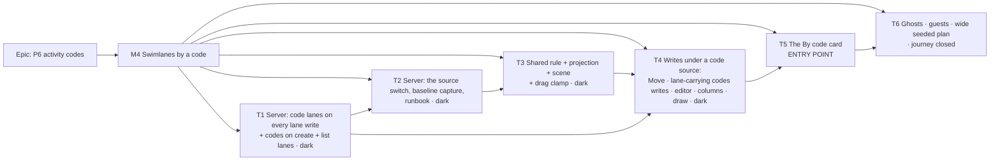

# Implementation Plan: P6 activity codes, M4 — swimlanes by a code

- **Feature spec:** [`./m4-spec.md`](./m4-spec.md) — under the approved epic [`./spec.md`](./spec.md) §4.5
  and [`./plan.md`](./plan.md) M4. Design authorities: [`./m4-database-review.md`](./m4-database-review.md)
  and [`./m4-ui-design.md`](./m4-ui-design.md).
- **Status:** Approved — by the product owner on 2026-10-30, owner questions 1–3 as recommended (see the spec header; `check:spec-status` reads only
  `spec.md`).
- **Owner:** James Ewbank (product owner); built by the **builder** agent once approved (CLAUDE.md §19.14).
- **Owner decisions (fixed):** `spec.md` Q1–Q11 (Q1 as the shipped fallback, `m2-record.md:90-97`); M3's
  answers; no feature flag (ADR-0088 D1). **Owner questions 1–3** (m4-spec, top) are built **as
  recommended** unless the owner says otherwise; each task names what an alternative answer changes.
- **The owner's hard rule:** no task asks the owner to test, measure or check anything on their server or
  devices. Every measurement runs on the build machine against a disposable database; the runbook is a
  contingency document, not a release step.

## Breakdown

**Order and why.** The four failures in m4-spec §1 Problem (lane writes 500, capture 23514, the
unlocked switch, leaving the source 23514) must be gone before any plan can hold the source, so the server
lands first. T1 makes every lane write work under a code source while nothing can yet be one; T2 opens the
source to the API. T3 and T4 build the web against a plan sourced **through the API** (the journey sets it
with `page.request`), so they are dark. T5 opens the entry point when every write already works. T6
completes ghosts and guests, which until then behave honestly (removed work counted, guests shown no
swimlanes). Each task is one PR that leaves `main` releasable.

**One release.** Each PR adds its own changeset (`patch`, as M3; m4-spec D-7). The Version Packages PR is
merged **once, after T6**, so the first released image already has everything. Until then the open Version
Packages PR is updated by each merge and not merged.

### Epic

**P6 activity codes, kept in the plan** — M4 adds the third swimlane source.

### Milestone M4: Swimlanes by a code

**Outcome:** a planner groups the diagram by a code, switches between codes and back losslessly, moves
work between bands by writing the code, and can baseline, compare and share the result.

**Entry point** (ADR-0081 §1): diagram ▸ `View ▾ ▸ Structure` ▸ **Set up swimlanes…** / **Swimlanes…** ▸
**One per code value** ▸ **Code** ▸ **Set up swimlanes** / **Use Area** (T5). (Plan.md's "▸ Apply" is the
dialogs' real submit labels, ui-design F9.) T1–T4 **ship dark**: reached only on a plan whose source was set
through the API.

**Journey:** a new spec file **`apps/web/e2e-swimlanes/swimlanes-by-code.spec.ts`** in the existing suite
(`playwright.swimlanes.config.ts`, `test:e2e:swimlanes`, `scripts/e2e-local.sh web:swimlanes`), on
`plan:capability-codes` and (T6) `plan:capability-codes-wide`. Lands with T3 as a skeleton (source set by
API) and grows a step per task. **No new Playwright config and no new CI step.** Every step axe clean.

**No feature flag** (ADR-0088 D1). The rollback is the PR boundary, and for data the T2 runbook.

---

#### Feature: M4 — swimlanes by a code

> **Description:** m4-spec §2 and §4.
> **Complexity:** L overall (T1 L, T2 M, T3 M, T4 L, T5 M, T6 M).
> **Dependencies:** M2 (schema), M3 (codes on screen), both shipped; the two design documents.
> **Risks:** the rollup at the end.
> **Testing requirements:** per task; `pnpm prepush` every PR; `scripts/e2e-local.sh api` for T1, T2, T6;
> the web suites each task names.

##### T1 — Server: code lanes on every lane write, codes on create, code lanes on the list (≈ one PR, `api` patch, dark)

- **Description:** m4-spec §4.5 "Positions batch", "Codes write", "Activity create", "Activity list".
  - `deriveLaneBasis`'s thrown `ACTIVITY_CODE` branch (`swimlane-lanes.ts:118-124`) replaced by a code
    basis `(T, live value of T, else NULL)` written to `code_swimlane_lanes` by raw `INSERT … ON CONFLICT`
    (DB §2.4); `lockPlanSwimlaneSource` returns the type (`activities.service.ts:338-355`).
  - `assertSwimlaneIdWritable` refuses under `ACTIVITY_CODE` (reason `IS_ACTIVITY_CODE`, `:318-327`).
  - Codes write: `lanes` + `lanesCodeTypeId`; union lock in id order; 409 `SWIMLANE_SOURCE_CHANGED`;
    lane-only rows bumped, no history item; order DB §3.2.
  - Create: `codes` (0–100); types/values `FOR SHARE` after the plan lock and the insert.
  - List (and the single read, the codes write and create responses): `codeSwimlaneLanes`. **Amended 2026-10-30 by the owner's decision (current code only).** Only under an
    `ACTIVITY_CODE` source, only the source type, only the current basis (at most one entry, absent
    otherwise), run in the list's `Promise.all`; the codes write reads it inside its transaction after the
    upsert. Plus a plan-wide read `GET …/plans/:planId/code-swimlane-lanes?codeTypeId=` for any live type
    (member read, not a guest route). Success criteria: the list ≤ 6 ms per 200 rows added; that read
    ≤ 10 ms DB time at 5,000 activities (median paired difference).
  - `@repo/types`: `ActivitySummary.codeSwimlaneLanes?`, `CreateActivityInput.codes?`, the codes-write
    body, `SWIMLANE_LIMIT` (moved from `swimlanes/dto/reorder-swimlanes.dto.ts:15`, API re-exports).
- **Schema:** **none** (DB §1 item 1). If a measurement below calls for an index, **stop**: that is the
  database-architect's (CLAUDE.md §19.3). **And** send the create-with-codes lock order (m4-spec §4.5) to
  the database-architect for a one-paragraph confirmation before merge, because the database review did
  not cover it.
- **Complexity:** L.
- **Dependencies:** none.
- **Files (expected):** `apps/api/src/modules/activities/` (`swimlane-lanes.ts`, `activities.service.ts`,
  `activity-codes.service.ts`, `dto/update-activity-codes.dto.ts`, `dto/create-activity.dto.ts`, the
  response DTO, a `code-swimlane-lane.repository.ts` or a method on the codes repositories);
  `apps/api/src/modules/codes/code-assignment.repository.ts`; `packages/types/src/index.ts`;
  `apps/api/test/activities*.e2e-spec.ts`, `codes*.e2e-spec.ts`, `swimlane*.e2e-spec.ts`;
  `apps/api/test/measure/codes-reads.measure.ts`; `soft-delete-filter.structural.spec.ts` (raw SQL
  declarations, the tally at `:1843`); `nested-relation-writes.structural.spec.ts` (scalars only).
- **Risks:**
  - **A code-lane write leaks into `activity_swimlane_lanes` or `activities.lane_index`** (ADR-0206 A1–A2)
    → e2e asserts both untouched under a code source.
  - **Statement-count pins move** (`activity-history-statements.e2e-spec.ts:47-94`) → every new statement
    gated on `ACTIVITY_CODE` or on `codes` being non-empty; a moved `OWN_ACTIVITY_PATCH` means a gate is
    missing (DB §5).
  - **IDOR** on `lanes` ids and on `codes` in create → the same org + plan scoping as the rows; a foreign
    id reads as missing (404), never told apart.
  - **Lane-only rows bypass the version check** → each locked and version-compared like a code row; e2e.
  - **The list grows** → measured (below); SC-2 absent-not-empty asserted byte-for-byte.
  - **Nothing can reach this yet** (the switch is T2) → e2e write the pointer directly with Prisma, as
    `codes.e2e-spec.ts:866` does, and T2 adds the real-PATCH cases.
- **Success criteria (ADR-0142), measured on the build machine** with `codes-reads.measure.ts` (extend it;
  same method as `m2-record.md` §9), recorded in a new `m4-record.md` §1: the 2,000-row codes write with
  lanes vs without (≤ 150 ms added); a 200-row list page with `codeSwimlaneLanes` vs without (≤ 6 ms
  added); the list payload at 5,000 activities × three placed types (recorded). A miss **stops** the task
  and goes to backend-performance-reviewer with the figure.
- **Testing:**
  - **API e2e:** positions batch in-swimlane rows under a code source write the `(T, value)` / `(T, NULL)`
    row, upsert twice → one row (DB probe P9); a soft-deleted value derives `(T, NULL)`; `swimlaneId`
    refused 422 on create, PATCH and both batches; codes write with lanes: movers and lane-only neighbours
    locked, bumped, lanes at the post-write basis; 409 when the source is not code or not
    `lanesCodeTypeId`; version mismatch on a lane-only row → 409 and nothing written; union of 2,001 → 422;
    an id twice in `lanes` → 422; history records code changes only; create with codes (live, wrong type
    422, deleted 422, foreign 404, two of one type 422); list `codeSwimlaneLanes` absent on a no-type plan,
    present per live type, deleted type's rows omitted; MANUAL and WBS behaviour unchanged.
  - **Unit:** the code-basis derivation.
  - **Structural:** soft-delete declarations; nested-relation writes.
  - **Measure:** above.
- **Playwright suites:** none changes; run `scripts/e2e-local.sh web:swimlanes` as a guard (the positions
  batch and codes write it drives are edited).
- **Reviewers:** **api-reviewer** (the `lanes` shape and precondition; confirm "no membership route",
  m4-spec §1b row 3), **security-reviewer** (IDOR, lane-only rows), **backend-performance-reviewer**
  (the measurements; the gating of statements).
- **Changeset:** `api` patch — "Activities can be created with codes, and code writes and lane writes are
  ready for swimlanes drawn from a code."
- **Docs:** `docs/API.md` (codes write, create, list fields); OpenAPI; `m4-record.md`; the stale comment at
  `swimlane-lanes.ts:118-124`.
- **Development steps:**
  1. Types and `SWIMLANE_LIMIT` into `@repo/types`.
  2. Code basis in the positions batch; `swimlaneId` refusal.
  3. `lanes` on the codes write.
  4. `codes` on create; database-architect confirmation requested.
  5. `codeSwimlaneLanes` on the list and the write responses.
  6. E2e; measurements; record; stop on a miss.
  7. Docs, changeset; `pnpm prepush`; `scripts/e2e-local.sh api`; `scripts/e2e-local.sh web:swimlanes`.

##### T2 — Server: the source switch, baseline capture, the rollback runbook (≈ one PR, `api` patch, dark)

- **Description:** m4-spec §4.5 "Plan update", "Baseline capture", §4.7.
  - DTO admits `ACTIVITY_CODE` + `swimlaneCodeTypeId`; the triple (DB §2.1); the lock order DB §3.1
    (plan advisory lock first whenever a swimlane field is carried, calendar guard after it, re-read, the
    type `FOR SHARE`, the count, the version-gated UPDATE).
  - The count: DB §2.2's shape plus `a.type <> 'WBS_SUMMARY'`; 422 `SWIMLANE_CODE_TYPE_INELIGIBLE` /
    `SWIMLANE_CODE_TYPE_MISMATCH`, never 23514/23503.
  - `PlanResponseDto`/`PlanSummary.swimlaneCodeTypeId`; `swimlaneSource` description fixed
    (`plan-response.dto.ts:111`).
  - Capture: DB §2.10 (pointer, `SWIMLANE_TYPE` always, the three activity columns verbatim under
    `ACTIVITY_CODE`, two statements).
  - `classifiedAheadOfDto` removed (`schedule-inputs.structural.spec.ts:76-81`; drop the array and its
    comment if empty).
  - `docs/DEPLOYMENT.md:836-851` replaced by DB §4.3's text.
  - Stale claims corrected: `plan.repository.ts:51-55`, `schema.prisma:731-733` (a comment, no migration),
    `update-plan.dto.ts:28-34`, `codes.e2e-spec.ts:866`.
  - **If owner answer 1 is "refuse":** the codes write and create count the source type under the plan
    lock they already hold and refuse a 101st value in use (422 `SWIMLANE_SOURCE_OVER_LIMIT`), about 8 ms
    paid only when the write touches the source type (DB §6.1 (a)); restores stay a stated gap.
- **Schema:** **none.** `schema.prisma`'s comment edit is not a schema change but is still shown to the
  database-architect in the PR, since it is the schema file (CLAUDE.md §19.3 is about changes; this is the
  cheap side of the line).
- **Complexity:** M.
- **Dependencies:** T1 (so the moment a plan can hold the source, lane writes work).
- **Files (expected):** `apps/api/src/modules/plans/` (`plans.service.ts`, `plan.repository.ts`,
  `dto/update-plan.dto.ts`, `dto/plan-response.dto.ts`); `apps/api/src/modules/codes/code-type.repository.ts`
  (`lockActiveForShare`, the count); `apps/api/src/modules/baselines/` (`baselines.service.ts`,
  `baseline.repository.ts` and specs); `common/schedule-inputs/schedule-inputs.structural.spec.ts`;
  `packages/types/src/index.ts`; `apps/api/test/plans*.e2e-spec.ts`, `baselines*.e2e-spec.ts`,
  `code-cascade.e2e-spec.ts`, `hierarchy-expiry.e2e-spec.ts`, `interchange.e2e-spec.ts`;
  `codes-reads.measure.ts`; `docs/DEPLOYMENT.md`; `docs/API.md`.
- **Risks:**
  - **The switch now waits on the plan lock** (behind a recalculation or codes write) → deliberate (DB §5
    last bullet); a test pins it.
  - **Moving the calendar guard** after the plan lock changes an existing path → e2e of a PATCH carrying
    both a calendar and a source, and of a calendar alone (unchanged order when no swimlane field).
  - **Summary exclusion drifts from the web rule** → the shared `@repo/layout` fixture (T3 adds the
    function; T2 adds the fixture file in `packages/layout` with the e2e reading it, so the SQL is pinned
    first).
  - **Runbook wrong for the real previous image** → DB §4.1 is the analysis; devops-reviewer.
  - **Baseline statement count** → reads gated on `ACTIVITY_CODE`.
- **Success criteria (ADR-0142), build machine:** the count with the exclusion at 5,000 × 30 types
  ≤ 10 ms; a code-sourced capture at 5,000 activities ≤ 50 ms added over the same plan by hand. Recorded in
  `m4-record.md` §2. A miss stops the task.
- **Testing:**
  - **API e2e:** every row of DB §2.1 through the real PATCH (to code, foreign type 404, T1 → T2, code →
    MANUAL clears the type, soft-deleted type 422); 0, 1, 100, 101 values in use; a value carried only by a
    summary does not count; a held plan lock against a type delete (the `code-cascade.e2e-spec.ts`
    harness) — the switch waits, then sees the type deleted → 422; a held type delete against a switch;
    `swimlaneCodeTypeId` on read, `null` on a no-code plan; no `plan.settings_changed` row and no
    `schedule_inputs_changed_at` stamp; Viewer/Contributor 403; no pen refused. Capture of a
    code-sourced plan succeeds with verbatim values (a soft-deleted one too) and lanes; capture of MANUAL
    and WBS plans writes `SWIMLANE_TYPE` with NULLs. Expiry, compensation and cascade/restore with the
    source set through the PATCH (DB §2.11).
  - **Structural:** `schedule-inputs.structural.spec.ts` green without the allowance; ADR-0172 gate; D-P1.
  - **Measure:** above.
- **Playwright suites:** `scripts/e2e-local.sh web:swimlanes` (the plan response every swimlane case reads
  gains a field).
- **Reviewers:** **api-reviewer**, **security-reviewer** (scoping of the type id), **backend-performance-reviewer**
  (count, capture, lock wait), **devops-reviewer** (the runbook text).
- **Changeset:** `api` patch — "A plan's swimlanes can come from a code, and such a plan can be baselined."
- **Docs:** `docs/API.md` (plans); OpenAPI; `docs/DEPLOYMENT.md`; `m4-record.md` §2.
- **Development steps:**
  1. DTO, triple, lock order, count, errors.
  2. Response field and types.
  3. Capture.
  4. Remove the allowance; correct the stale comments.
  5. E2e; measure; record.
  6. Runbook; docs; changeset; `pnpm prepush`; `scripts/e2e-local.sh api`; `web:swimlanes`.

##### T3 — Shared rule, code membership, projection, scene and the drag clamp (≈ one PR, `web` patch, dark)

- **Description:** ui-design §3.1–§3.4, §5.1, §10; m4-spec §4.6 bullets 1–3 and "Over 100".
  `packages/layout/src/code-swimlanes.ts` (`codeBasisOf`, `codeSwimlaneValues`, `codeSwimlaneName`; specs
  reading T2's fixture); `features/codes/model/code-names.ts` re-exports `codeSwimlaneName`;
  `features/swimlanes/model/code-membership.ts` (`codeSwimlaneInput`, the one-slot cache of
  `manual-membership.ts:6-16`); `SwimlaneInput` gains `'ACTIVITY_CODE'`, `codeTypeId`, `codeTypeName`,
  `noneName`; the nine "No swimlane" read sites per ui-design §3.4 (three edited, minimap by id);
  `swimlanePictureOn` / `swimlanePictureInput` / `useSwimlaneScene` for a code source (values query enabled
  whenever the source is a code); `laneRangeOf` and `dropInSwimlane` cross only under `MANUAL`;
  `edgeNoteFor(input)`; `swimlanesShown` and the lens's "set up" test name `ACTIVITY_CODE`; the over-100
  standing line in the lens (owner answer 1 recommended).
  - **Amended 2026-10-30 by the owner's decision (current code only):** switching the source to another code
    fetches that code's lanes with `GET …/code-swimlane-lanes?codeTypeId=` (T1) and shows the settled shape
    while it loads (ADR-0202); the list only carries the lanes of the code the plan already uses. Consistency
    rule: a lane is applied only when its `codeValueId` equals the activity's current `codes` value of the
    type (or both are null), else it counts as unplaced and is derived on the client.
- **Complexity:** M.
- **Dependencies:** T2 (the plan's `swimlaneCodeTypeId`; the journey sets the source through the API).
- **Files (expected):** `packages/layout/src/code-swimlanes.ts` (+ spec, `index.ts`);
  `apps/web/src/features/tsld/render/project-swimlanes.ts`, `swimlane-gutter.ts`, `minimap.ts`,
  `group-listbox.ts`; `features/tsld/model/swimlane-lanes.ts`; `features/swimlanes/model/`
  (`code-membership.ts`, `use-swimlane-scene.ts`, `use-swimlane-management.ts`, `code-swimlane-copy.ts`);
  `features/tsld/toolbar/use-tsld-toolbar-context.tsx` (`:733-735`), `use-tsld-canvas-ui-state.ts`
  (`:211-213`); `TsldPanel.tsx` (`:2827`, `:3025`, the edge note); host wiring in
  `components/layout/workspace/` (scene and auto-resolve input); `e2e-swimlanes/swimlanes-by-code.spec.ts`
  (skeleton).
- **Risks:**
  - **MANUAL/WBS pictures move** → ADR-0206 parity suites and `project-swimlanes` tests unchanged; MANUAL
    and WBS pass no `noneName`.
  - **The minimap's "none" test by name** → moved to `id === null`; a unit case for each source.
  - **A swimlane-free first frame** (ADR-0202) → `pending` while the values load; a component test.
  - **Projection cost with many bands** (owner answer 1 recommended draws over 100) → a Vitest timing of
    `projectSwimlanes` at 5,000 activities × 1,000 values in use, recorded in `m4-record.md` §3, compared
    with the same input at 100; reported to performance-reviewer. Not a canvas fps claim.
  - **`features/tsld` gains an import** (#548) → the input is plain data; the existing import check.
- **Testing:**
  - **Unit:** `code-swimlanes` (summaries excluded, deleted value → null, order, name); `codeSwimlaneInput`
    (cache identity, summary → null, stored lane for `(T, value)` and `(T, NULL)`); clamp and backstop by
    source; `edgeNoteFor`; `swimlanePictureOn` matrix; "No Area" in the gutter, listbox, lane sentences,
    minimap.
  - **Component:** scene pending once, failed degrades swimlane-free; the lens line over 100.
  - **Journey (skeleton):** on `plan:capability-codes`, set the source to Area through `page.request`
    (PATCH with the pen); the gutter reads Ground floor, Level 1, Roof, No Area; drag CD_3 past Level 1's
    edge → held, note announced; drop within Level 1 → one positions request; axe clean.
- **Playwright suites:** `web:swimlanes`, `web:workspace-fit` (ui-design §11.4), `web:minimap`
  (`minimap.ts` is edited).
- **Reviewers:** **component-reviewer**, **performance-reviewer** (memo identity, the projection timing),
  **test-engineer** (the journey file).
- **Changeset:** `web` patch — "The diagram can draw swimlanes from a code (not yet offered in Swimlanes…)."
- **Docs:** `CLAUDE.md` §1 counts (`pnpm check:counts`); `m4-record.md` §3; corrected comment at
  `SwimlaneSourceFields.tsx:14` deferred to T5 (still true until then).
- **Development steps:**
  1. `code-swimlanes.ts` and specs; re-export.
  2. `codeSwimlaneInput`; `SwimlaneInput` widening; `noneName` sites.
  3. Scene, picture gate, lens.
  4. Clamp and edge note.
  5. Timing; journey skeleton; changeset; `pnpm prepush`; the three suites.

##### T4 — Writes under a code source (≈ one PR, `web` patch, dark)

- **Description:** ui-design §5.2–§5.4, §6; m4-spec US-M4-4 to US-M4-7.
  - `useCodeSwimlaneAssignment` (a code `SwimlaneAssignment`, choices per owner answer 2: the drawn bands
    then "No Area"); `MoveToSwimlaneControl` unchanged; the selection bars, the table's bulk bar and the
    Swimlane column receive it through the existing slots.
  - `features/codes/model/code-swimlane-lanes.ts`: the `CodeSwimlaneLanePlanner` interface and context;
    `useSetActivityCodes` reads it and adds `lanes` + `lanesCodeTypeId` when the planner returns some; the
    host provides it from `features/swimlanes`. The 2,000 cap counts lane-only rows.
  - Undo: `activityCodesCommand` captures the planner; replay re-plans lanes when the type is still the
    source, else codes only; 409 `SWIMLANE_SOURCE_CHANGED` → refetch the plan and set the step aside with
    its sentence.
  - Editor: `CodeSwimlaneField` read-only line (composed at `activity-crud-dialogs.tsx:183-197`).
  - Grids: `SwimlaneColumnSource` code branch; `swimlaneCellGate`/`swimlaneCellLabel` read-only code branch
    (`gantt/model/swimlane-cell.ts:23-40`); the table's WBS note untouched.
  - Create: a bar drawn in a code band sends `codes` (`use-plan-workspace-model.ts:900-907`); the
    follow-up lane write unchanged (it reaches T1's code basis).
  - **If owner answer 1 is "refuse":** the value pickers shade a value that would be the source type's
    101st in use, with the refusal sentence, and map the 422.
  - **If owner answer 2 is "every value":** choices are the type's live values (up to 1,000), which takes
    `MoveToSwimlaneControl` past its "up to 100" `SelectField` basis (`MoveToSwimlaneControl.tsx:28-30`):
    it becomes a `Combobox` in code mode, which is an ADR-0111 review item.
- **Complexity:** L.
- **Dependencies:** T1 (lanes, create codes), T3 (projection).
- **Files (expected):** `features/swimlanes/model/use-code-swimlane-assignment.ts`, `code-source.ts`;
  `features/swimlanes/components/CodeSwimlaneField.tsx`; `features/codes/model/code-swimlane-lanes.ts`,
  `use-set-activity-codes.ts`, `code-assignment-plan.ts`; `features/undo-redo/code-commands.ts`,
  `replay.ts`, `coverage.ts`, `test/fake-plan-server.ts`; `features/tsld/model/swimlane-assignment.ts`;
  `features/gantt/model/swimlane-cell.ts`; `features/activities/components/ActivitiesTable.tsx` (the
  column's source, no new code in the table); `components/layout/workspace/` (provider, assignment wiring,
  `use-plan-workspace-model.ts` create, `activity-crud-dialogs.tsx`); journey steps.
- **Risks:**
  - **The provider is absent in a host and lanes are silently omitted** → a structural test: every
    workspace caller of `useSetActivityCodes` sits under the provider (ui-design §13).
  - **Bars jump on a Set Area** (ADR-0153) → the planner pins neighbours; a unit case asserts only the
    subjects move.
  - **Two writers of one fact on the editor's General tab** → the Swimlane line is read-only (ui-design
    §5.3).
  - **Undo against a moved source** → both replay branches unit-tested against `fake-plan-server`.
  - **`features/codes` importing `features/swimlanes` or `features/tsld`** → the context lives in
    `features/codes`; the import-direction structural test.
  - **Undo of a create that carried codes** → deletes the row; restore brings assignments back (join rows
    kept); a unit case.
- **Testing:**
  - **Unit:** assignment `choices`, `currentOf`, `assign` produces one codes request with codes for movers
    and lanes for movers and neighbours; the planner returns null for a non-source type; cap counts lane
    rows; undo both branches; the 409 set-aside; create payload for a code band and for No Area;
    `swimlaneCellGate` code branch.
  - **Component:** the editor line; the Swimlane column cell; the Gantt cell read-only with its reason.
  - **Journey:** (source set through the API) Move to swimlane… on CD_8 ▸ Roof → one
    `PATCH …/activities/codes`, CD_8 carries Roof (API), undo returns it; editor on CD_4 ▸ Area = Ground
    floor ▸ Save codes → CD_4 in Ground floor, CD_1's and CD_2's lanes unchanged; draw a bar in Level 1 →
    the create request carries Area = Level 1; axe clean.
- **Playwright suites:** `web:swimlanes`, `web:activity-editor` (editor composition), `web:gantt-editing`
  (`swimlane-cell.ts`), `web:undo` (code commands).
- **Reviewers:** **accessibility-reviewer** and **component-reviewer** (the editor line, the Gantt cell's
  shaded reason; **before release, ADR-0111**, if answer 2 turns the Move control into a `Combobox`);
  **ux-reviewer** (sentences, spec §0); **performance-reviewer** (the provider's identity; no workspace
  re-render per frame).
- **Changeset:** `web` patch — "Under swimlanes drawn from a code, moving work between them sets its code."
- **Docs:** `CLAUDE.md` §1 counts.
- **Development steps:**
  1. The planner interface, context and `useSetActivityCodes`.
  2. `useCodeSwimlaneAssignment` and wiring.
  3. Undo replay.
  4. Editor line, grid branches.
  5. Create with codes.
  6. Tests; journey steps; changeset; `pnpm prepush`; the four suites.

##### T5 — The By code card: the entry point (≈ one PR, `web` patch)

- **Description:** ui-design §4, §9 (Delete… shaded), §11; m4-spec US-M4-1, US-M4-2.
  `SwimlaneSourceFields`' third card with its three shaded reasons; the **Code** `Combobox` (live types,
  `badge` "N values in use", shaded options with reasons, preselect the first eligible, prefetch the values
  on choose, the hint); setup and manage dialogs' third branch ("Set up swimlanes", "Use Area",
  `unchanged` compares the type); `useSetPlanSwimlaneSource` sends `swimlaneCodeTypeId`, no lane write, no
  list refetch; `SwimlaneBasisChoice.codeTypeId` and `choiceWords`; the manage dialog hides the hand-made
  list and the gutter shades rename/move/delete with `CODE_GUTTER_REASON` (`notHandMade`); `CodeTypePane`'s
  Delete… shaded for the source type with spec Q3's sentence; `ChosenSource` no longer excludes
  `ACTIVITY_CODE` and its comment is corrected.
  - **Amended 2026-10-30 by the owner's decision (current code only):** switching the source to another code
    fetches that code's lanes with `GET …/code-swimlane-lanes?codeTypeId=` (T1) and shows the settled shape
    while it loads (ADR-0202); the list only carries the lanes of the code the plan already uses. Consistency
    rule: a lane is applied only when its `codeValueId` equals the activity's current `codes` value of the
    type (or both are null), else it counts as unplaced and is derived on the client.
- **Complexity:** M.
- **Dependencies:** T3, T4.
- **Files (expected):** `features/swimlanes/components/SwimlaneSourceFields.tsx`,
  `SwimlaneSetupDialog.tsx`, `SwimlaneManageDialog.tsx`; `features/swimlanes/api/use-swimlane-mutations.ts`
  (`:131-151`); `features/swimlanes/model/use-swimlane-management.ts` (`:155`, `:171-183`),
  `code-swimlane-copy.ts`; `features/undo-redo/swimlane-commands.ts` (`:223-266`);
  `features/codes/components/CodeTypePane.tsx` (`:314-316`) and its host; `swimlane-copy.structural.test.ts`;
  journey steps.
- **Risks:**
  - **A `Combobox` inside a native `<dialog>`** (Escape must close the list first, then the dialog) →
    **accessibility-reviewer and component-reviewer before release (ADR-0111; plan.md M4-T3)**, executing
    it in a browser.
  - **A reason claimed before it is true** (a false "no values in use" while loading) → the card is shaded
    only once the answer is known; the `Combobox` `loading` row meanwhile.
  - **The dialog at 1024 × 600** (ADR-0179) → the body scrolls; journey asserts every card, the picker,
    an open list's last option and the submit are reachable and the dialog does not grow past the viewport.
  - **Existing card locators** → `swimlanes-by-wbs.spec.ts:108`, `:233`, `:247`, `:275` match
    `/One per WBS group/` and `/By hand/`; the new title matches neither (ui-design §11.4).
- **Testing:**
  - **Component:** each shaded reason (no codes, none eligible, loading); each option's reason (0 in use,
    over 100); preselection; `unchanged` with the type; the manage paragraph; gutter shading; Delete…
    shaded for the source type only; no native `disabled` anywhere (ADR-0204).
  - **Undo:** the switch with a type; undo to a since-deleted type → set aside.
  - **Journey:** Set up swimlanes… ▸ One per code value ▸ Phase shaded with its reason (focusable) ▸ Area
    ▸ Set up swimlanes → gutter names; Escape once with the list open leaves the dialog open; Swimlanes… ▸
    Trade ▸ Use Trade ▸ Swimlanes… ▸ Area ▸ Use Area → CD_3 on the lane T3's step left it, **no**
    positions or codes request on either switch (SC-M4-4); Codes… ▸ Area ▸ Delete… shaded with the
    sentence; Baselines ▸ Take baseline succeeds; 1024 × 600 checks; axe clean. The T3/T4 steps switch
    from `page.request` to the card where it reads better.
- **Playwright suites:** `web:swimlanes`, `web:workspace-fit` (the dialog at the floor), `web:toolbar`
  (the lens's "set up" test).
- **Reviewers:** **accessibility-reviewer** and **component-reviewer before release (ADR-0111)**;
  **ux-reviewer** (every sentence against spec §0); **performance-reviewer** (the per-type count from the
  cache, no request).
- **Changeset:** `web` patch — "Swimlanes… can draw one swimlane per value of a code, and switch between
  codes without losing any layout."
- **Docs:** `CLAUDE.md` §1 counts; optionally a "Look at" line on `docs/TEST_PLAYBOOK.md`'s
  `capability-codes` row (`pnpm check:playbook`).
- **Development steps:**
  1. `code-source.ts` reasons (T4) wired into the card and the `Combobox`.
  2. Dialog branches and the mutation.
  3. Undo choice.
  4. Manage dialog and gutter; Delete… shading.
  5. Tests; journey; changeset; `pnpm prepush`; the three suites; ADR-0111 reviews.

##### T6 — Ghosts, guests, the wide seeded plan, and the journey closed (≈ one PR, `api` + `web` patch)

- **Description:** ui-design §7, §8, §11.5 "The 101-values case"; m4-spec US-M4-8, US-M4-9, §1b row 4.
  - **Ghosts:** server `frozenCodeTypeId`/`frozenCodeValueId`/`frozenCodeLane` on removed ghosts from a
    `SWIMLANE_TYPE` baseline (`schedule.service.ts:2336-2349`, `@repo/types` ghost type); web
    `GhostLaneScene.source` gains `ACTIVITY_CODE` and the type id; `removedLane` draws only when today's
    source is the frozen type, the frozen value (or No Area) is a drawn band by id, a lane was frozen and
    it is within the band's rows; otherwise counted. Never derived.
  - **Guests:** `liveSwimlanes`, `guestSwimlaneList`, `guestSwimlanePlacement` code branch on the shared
    rule; the page-sized assignment and lane reads; `noSwimlaneName` per owner answer 3 (if "No swimlane",
    the field is not added); `guest-dto.spec.ts` absence assertions; the guest web passes `noneName`
    (`features/share/guest-api.ts:219-235`).
  - **Seeded plan** `plan:capability-codes-wide` in its **own family** `codes-wide`
    (`apps/seed-cli/src/capabilities/index.ts`), so `--family codes` is unchanged: 101 activities; a type
    **Room** with 101 values in use (one per activity) and a type **Zone** with exactly 100 in use (two
    activities share one), so both sides of the limit exist; its `docs/TEST_PLAYBOOK.md` row and "what
    wrong looks like" (`pnpm check:playbook`). Within the suite's raised limit of 300 per handler
    (`playwright.swimlanes.config.ts:61-65`).
  - `SeededPlan` gains `CODES_WIDE_PLAN` in `e2e-swimlanes/support.ts`.
- **Complexity:** M.
- **Dependencies:** T2 (capture), T5.
- **Files (expected):** `apps/api/src/modules/schedule/schedule.service.ts`, `baselines/revision-ghosts.ts`,
  `baselines/baseline.repository.ts` (`loadFrozenLanesForGhosts`); `apps/api/src/modules/share/`
  (`share-guest.service.ts:179-189`, `guest-swimlanes.ts`, `dto/guest-plan.dto.ts`, `guest-dto.spec.ts`);
  `apps/api/test/share-guest-swimlanes.e2e-spec.ts`, `revision*.e2e-spec.ts`; `packages/types/src/index.ts`;
  `apps/web/src/features/tsld/render/swimlane-ghosts.ts`; `features/share/guest-api.ts`;
  `apps/seed-cli/src/capabilities/codes-wide.ts`, `index.ts`; `docs/TEST_PLAYBOOK.md`;
  `apps/web/e2e-swimlanes/support.ts`, `swimlanes-by-code.spec.ts`.
- **Risks:**
  - **A guest receives a code field** → allow-listed DTOs; absence asserted in `guest-dto.spec.ts` and in
    the API e2e; **security-reviewer**.
  - **A ghost drawn somewhere plausible but false** → the five conditions above, each a unit case; the
    rule at `swimlane-ghosts.ts:45-50` kept.
  - **The shard grows** (ADR-0138) → record the `e2e-swimlanes` shard time before and after in the PR; the
    over-100 shading is also pinned at the component tier (T5), so the journey step can move there without
    losing the check.
  - **Seeding 101 values and activities is slow** → one codes write for all assignments (the M2 seeder
    path); time recorded.
- **Testing:**
  - **API e2e:** ghost fields only from a `SWIMLANE_TYPE` baseline under a code source and only with
    geometry; guest list and placement under a code source (order, names, null for No Area, lane), absent
    fields, `noSwimlaneName` per answer 3; MANUAL guest behaviour unchanged.
  - **Unit:** `removedLane` code branch: drawn; counted for a pre-M4 baseline, another type, a dead frozen
    value, no frozen lane, a lane past the band's rows.
  - **Seed:** the wide plan builds, `pnpm check:playbook` green.
  - **Journey:** on `plan:capability-codes-wide`, Room is listed shaded with "Room has 101 values in use.
    Swimlanes can show up to 100." and Zone is choosable; on `plan:capability-codes`, take a baseline,
    delete CD_6, compare → its ghost drawn in Roof; open the plan's share link as a guest → the gutter reads
    Ground floor, Level 1, Roof and the last band per answer 3; axe clean.
- **Playwright suites:** `web:swimlanes`, `web:share` (the guest view), `web:revision-compare` (ghosts).
  `scripts/e2e-local.sh api`.
- **Reviewers:** **security-reviewer** (guests), **api-reviewer** (ghost and guest fields),
  **ux-reviewer** (counted-ghost sentence, the wide plan's reasons), **test-engineer** (seed plan,
  playbook row).
- **Changeset:** `api` patch and `web` patch — "Comparisons draw removed work in its code swimlane, and
  guests see swimlanes drawn from a code by name."
- **Docs:** `docs/API.md` (ghost and guest fields); `docs/TEST_PLAYBOOK.md`; `CLAUDE.md` §1 counts; the
  epic ADR outline note (M7) gains m4-spec §1b's decisions.
- **Development steps:**
  1. Server ghost fields; web `removedLane`.
  2. Guest branch; `noSwimlaneName` (per answer 3).
  3. Seeded plan, family, playbook row.
  4. Journey steps; shard time; changeset; `pnpm prepush`; `scripts/e2e-local.sh api`; the three suites.
  5. After merge: the Version Packages PR is merged once (the M4 release); read its checks per CLAUDE.md
     §11 and §19.9.

## Sequencing and slices

T1 → T2 → T3 → T4 → T5 → T6. Each PR is releasable alone:

- after **T1** nothing is visible; lane and code writes are ready for a code source nobody can set;
- after **T2** the API can set it; the web still draws nothing for it (as today, `use-swimlane-scene.ts:33-35`);
- after **T3** a plan sourced through the API draws code swimlanes;
- after **T4** every write on such a plan works;
- after **T5** a planner can choose it in Swimlanes…;
- after **T6** comparisons and guests see it, and the M4 release is cut.

## Definition of Done (per task)

[`docs/PROCESS.md`](../../PROCESS.md) Feature Completion Criteria: code, tests, docs, security review,
performance, accessibility, Docker build, CI green (read per CLAUDE.md §19.9), changeset, version impact.
"Tests" means **run**: `pnpm prepush`, plus `scripts/e2e-local.sh api` (T1, T2, T6) and each task's named
`scripts/e2e-local.sh web:<suite>` runs. ADR-0111 reviews **before** T5 is released (and T4 if owner answer
2 changes the Move control). `pnpm check:counts` after every web task. After each squash-merge, reset the
branch from `main` (CLAUDE.md §8). No step asks the owner to test, measure or check anything on their server
or devices.

## Agents

- **database-architect:** no schema change expected; **mandatory** if any measurement calls for an index;
  a short confirmation of the create-with-codes lock order (T1); sees the `schema.prisma` comment edit (T2).
- **api-reviewer:** T1, T2, T6.
- **security-reviewer:** T1, T2 (scoping), T6 (guests).
- **backend-performance-reviewer:** T1, T2 (the measurements, the lock wait).
- **devops-reviewer:** T2 (the runbook).
- **accessibility-reviewer**, **component-reviewer:** T5 before release (ADR-0111); T3 (component) and T4
  as normal reviews.
- **ux-reviewer:** T4, T5, T6.
- **performance-reviewer:** T3, T4, T5.
- **test-engineer:** the journey file (T3 onward), the seeded plan (T6).

## Risks and assumptions (rollup)

| Risk / assumption                                                          | Likelihood | Impact | Mitigation                                                                            |
| -------------------------------------------------------------------------- | ---------- | ------ | ------------------------------------------------------------------------------------- |
| A plan holds the source before lane writes and capture work                | low        | high   | T1 (lane writes) lands before T2 (the switch), both before the entry point (T5)       |
| Switch races a type delete                                                 | low        | high   | Plan advisory lock on the switch (DB §2.9); e2e with a held lock                      |
| Membership query shape regresses to the slow form                          | low        | med    | No whole-plan membership read is built; if one is, DB §2.3 Q1b                        |
| Lane upsert or the list's lanes miss a ceiling                             | low        | med    | Measured in T1; stop and report; an index goes to the database-architect              |
| Statement-count pins move                                                  | med        | low    | New statements gated on the source or on `codes`                                      |
| The "in use" rule drifts between API and web                               | med        | med    | One `@repo/layout` fixture read by both                                               |
| Values in use pass 100 after the switch                                    | med        | med    | Owner question 1; drawn with a standing line, or refused                              |
| Bars jump on a Set Area under the source                                   | med        | med    | Lane planner context; ADR-0153 unit case; structural provider test                    |
| A removed ghost drawn in a false place                                     | low        | high   | Count, never derive (§1b row 4)                                                       |
| A guest receives a code field                                              | low        | med    | Allow-listed DTO; absence assertions; security-reviewer                               |
| Rollback to 0.103.x leaves plans stuck                                     | med        | med    | DB §4.3 runbook in T2; devops-reviewer                                                |
| `Combobox` in a native `<dialog>` misbehaves in a real browser             | med        | med    | ADR-0111 reviews executing it; journey Escape step                                    |
| Organisation export of a no-code plan's new baseline reads `SWIMLANE_TYPE` | certain    | low    | Stated exception to SC-2 (m4-spec §2 Edge cases)                                      |
| `e2e-swimlanes` shard grows                                                | high       | low    | Shard time recorded in T3 and T6 PRs (ADR-0138); wide case movable to component tier  |
| The Version Packages PR is merged before T6                                | low        | med    | Plan states one release after T6; intermediate states are honest anyway (§Sequencing) |

## Test plan (summary)

| Level      | Where                                                                                                | Proves                                                          |
| ---------- | ---------------------------------------------------------------------------------------------------- | --------------------------------------------------------------- |
| API e2e    | activities, codes, plans, baselines, cascade, expiry, interchange, revision, `share-guest-swimlanes` | writes, scope, locks, capture, lifecycle, guests, SC-2 parity   |
| Measure    | `apps/api/test/measure/codes-reads.measure.ts` → `m4-record.md`                                      | SC-M4-2                                                         |
| Unit, pure | `packages/layout` `code-swimlanes`; code membership; clamp; assignment; planner; `removedLane`       | the rules                                                       |
| Component  | card, picker, dialogs, gutter, editor line, grid cells, lens line                                    | states, reasons, shading, focus                                 |
| Undo       | code commands and the switch against `fake-plan-server`                                              | one step each; replay under a moved source; set-asides          |
| Structural | provider coverage; import direction; soft-delete gate; nested writes; `schedule-inputs`              | the rules M4 relies on                                          |
| Journey    | `apps/web/e2e-swimlanes/swimlanes-by-code.spec.ts` on `capability-codes` and `capability-codes-wide` | every entry point, SC-M4-4, baseline, ghosts, guest, 1024 × 600 |
