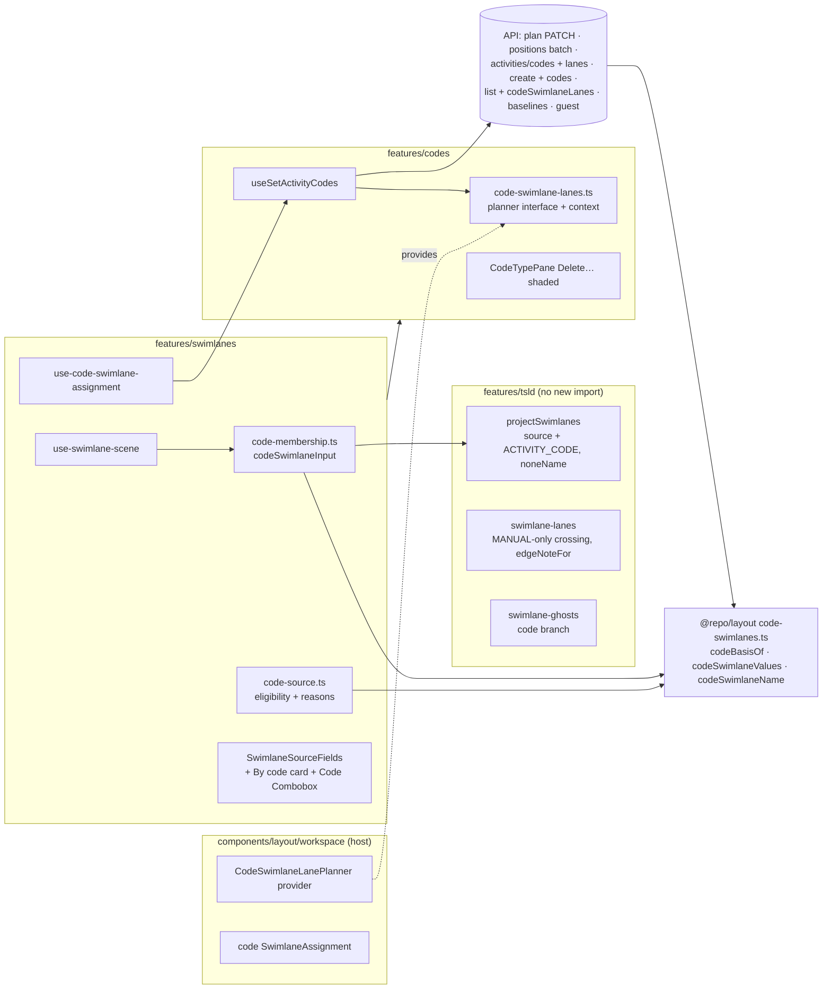
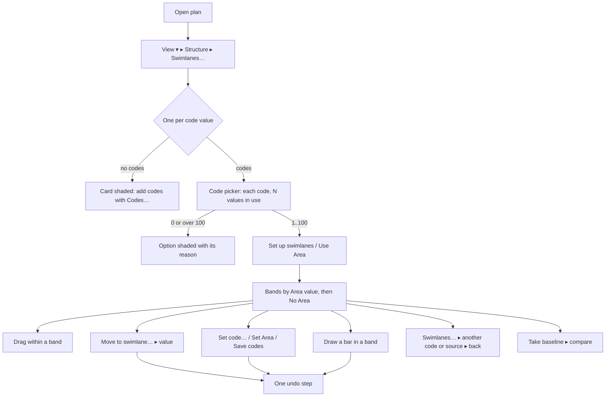

# Feature Spec: P6 activity codes, M4 — swimlanes by a code

- **Status:** Approved — by the product owner on 2026-10-30, with every recommended answer below. (The `check:spec-status` gate reads only `spec.md` in this
  directory; this file is M4's own spec, under the approved epic spec.)
- **Author(s):** Feature Analyst (Claude Code), for James Ewbank (product owner)
- **Date:** 2026-10-30
- **Tracking issue / epic:** the P6 activity-codes epic, [`spec.md`](./spec.md) §4.5 (Approved
  2026-10-27); [`plan.md`](./plan.md) M4
- **Roadmap link:** `docs/ROADMAP.md`, diagram authoring (ADR-0206)
- **Design authorities** (both written 2026-10-30; cited, not restated):
  - [`m4-database-review.md`](./m4-database-review.md) (database-architect): no schema change, the lock
    order, the query shapes, baseline capture, the rollback runbook text.
  - [`m4-ui-design.md`](./m4-ui-design.md) (ui-architect): findings F1–F10, the By code card, writes
    under a code source, ghosts, guests, the journey.
  - Where they disagree, §1b says so and decides, or the question is the owner's (top of this file).
- **Inputs read:** `m2-record.md` §4, §9–§10; `m3-spec.md` §4.9 (what M3 left to M4); `m3-record.md`;
  `docs/DEPLOYMENT.md:812-860`.
- **Companion:** [`m4-plan.md`](./m4-plan.md), the implementation plan (stage 5).
- **Related ADR(s):** no new ADR in M4. The epic ADR filed at M7 records the decisions §1b and §4 list
  (F2, the list carrying code lanes, F8, "No <type>", Move to swimlane…'s choice list, create with codes,
  the lane precondition, owner answers 1–3). Builds on ADR-0012, ADR-0025, ADR-0028, ADR-0048/0176,
  ADR-0051/0205, ADR-0073, ADR-0076, ADR-0081, ADR-0082, ADR-0088 D1, ADR-0111, ADR-0126/0127, ADR-0132,
  ADR-0142, ADR-0153, ADR-0172, ADR-0174, ADR-0179, ADR-0192, ADR-0202, ADR-0204, ADR-0206.
- **Base:** branch `docs/p6-m4-spec` on 2026-10-30 (api 0.103.1, web 0.200.3). Every `file:line` here was
  read on that tree.

---

## Owner questions

**Decided by the owner, 2026-10-30, all as recommended:** (1) keep drawing every band past 100,
with the standing line; (2) Move to swimlane… offers the bands on screen plus "No <type>"; (3) a guest
sees "No <type>" as the last band's name. The spec and plan are approved.

Three questions. Each has a recommended answer; the plan is built to the recommendation unless you say
otherwise. A **swimlane** is one of the horizontal bands the diagram is divided into. A **code** is a label
such as Area or Trade; each code has **values** such as Ground floor, Level 1, Roof. "Grouped by Area" means
one band per Area value that some activity carries, plus a last band for activities with no Area.

1. **Once the diagram is grouped by a code, what should happen if more than 100 of that code's values come
   into use?**
   You already decided that a code with more than 100 values in use cannot be _chosen_ for grouping. The
   question is what happens _after_ it has been chosen, when someone gives activities new values (or brings
   back deleted ones) and the count goes past 100.
   - **Recommended — keep drawing every band, and say so.** The diagram keeps one band per value in use,
     however many, and the Swimlanes menu carries one line: "Area has 140 values in use. Swimlanes are made
     for up to 100." Nobody is stopped from labelling their work. The cost: on a very large plan the
     diagram may become long and slower to scroll, and if you switch to another grouping you cannot switch
     back to Area until fewer than 100 of its values are in use.
   - **Alternative — refuse the change that would go over.** Setting an activity to a 101st value of the
     code the diagram is grouped by is refused with "Area already has 100 values in use, the most
     swimlanes can show. Clear one first, or group the swimlanes another way." The diagram never draws more
     than 100 bands from ordinary editing. The cost: a planner can be stopped while doing classification
     work that has nothing to do with the diagram, and the guard is not complete — bringing a deleted value
     or a deleted activity back from the bin can still take the count past 100, so the diagram must handle
     it anyway.
   - **Alternative — switch the grouping off automatically.** Surprising, and it changes the picture for
     everyone looking at the plan. Not recommended.

2. **When the diagram is grouped by a code, what should "Move to swimlane…" offer?**
   "Move to swimlane…" is the command that moves selected activities into another band.
   - **Recommended — only the bands on screen, plus the "No Area" band.** Moving into a value nobody uses
     yet (so has no band yet) is done with **Set code…**, which can search all of a code's values.
   - **Alternative — every value of the code**, up to 1,000, in one long list with no search box.

3. **When a guest (someone viewing through a share link) sees a plan grouped by Area, what should the last
   band be called?**
   You decided guests see the band names but never the codes themselves.
   - **Recommended — "No Area"**, exactly as you and your printed programme see it. It tells the guest the
     bands are by Area, which the band names (Ground floor, Level 1, Roof) already make plain.
   - **Alternative — "No swimlane"**, the wording guests see today, which reveals nothing about which code
     the bands come from, at the cost of the guest's picture reading differently from yours.

   The security reviewer still checks the safety of whichever you choose.

---

## 1. Business understanding

### Problem

A plan's diagram can be drawn in swimlanes made by hand or from the WBS (ADR-0206). M3 made codes visible
and editable (`m3-spec.md`). There is still no way to say "draw this by Area, now by Trade". M2 landed the
storage for it — the `ACTIVITY_CODE` source label, the plan's pointer `swimlane_code_type_id`, and
`code_swimlane_lanes` (`m4-database-review.md` §1 item 1) — and nothing can reach it.

**Re-verified against the code (CLAUDE.md §19.11), not taken from the two design documents.** §1a lists
each problem statement and what was read. Four are worse than "not built yet": they are **failures that
would fire the moment a plan holds the source**, so M4 cannot open the entry point until they are fixed.

1. **Every lane write would answer 500.** `deriveLaneBasis`'s `ACTIVITY_CODE` branch throws a plain
   `Error` (`apps/api/src/modules/activities/swimlane-lanes.ts:118-124`), called by the positions batch at
   `activities.service.ts:1151`. An in-swimlane drag, a nudge, auto-resolve, Tidy, Re-layout and a canvas
   create's follow-up lane write (`use-plan-workspace-model.ts:923-929`) all go through it (ui-design F2).
2. **Baseline capture would fail 23514.** It writes `swimlaneSnapshotLevel: 'FULL'` with the plan's source
   but no type (`baselines/baseline.repository.ts:257-258`; the mirrors read at
   `baselines.service.ts:205`), which `ck_baselines_swimlane_snapshot_shape` refuses for `ACTIVITY_CODE`
   (database review §2.10, probe P6).
3. **The source switch takes no plan lock**, so it races a code-type delete and can leave a live plan
   pointing at a deleted type (`plans.service.ts:238-261`, `:272-300`; database review §2.9, two-session
   probe).
4. **Leaving the code source would fail 23514**, because the update writes source and level only and leaves
   the type set (`plans.service.ts:259-260`; database review §2.1 probe P4).

### 1a. The problem statements, checked

| Claim                                                                              | Read at                                                                                                                                 | Result                                                                                                                                        |
| ---------------------------------------------------------------------------------- | --------------------------------------------------------------------------------------------------------------------------------------- | --------------------------------------------------------------------------------------------------------------------------------------------- |
| UI F2 / DB §2.4: `deriveLaneBasis` throws for `ACTIVITY_CODE`                      | `swimlane-lanes.ts:118-124`; caller `activities.service.ts:1151`                                                                        | **Holds.**                                                                                                                                    |
| DB §1.3: the plan update takes no plan lock; calendar guard is its first statement | `plans.service.ts:238-261`, `:272-290` (`assertCalendarUsableBy` at `:281`)                                                             | **Holds.**                                                                                                                                    |
| DB §2.10: capture writes FULL + source, no type                                    | `baseline.repository.ts:257-258`; `baselines.service.ts:205`                                                                            | **Holds.**                                                                                                                                    |
| DB §2.10: `code_snapshot_level` written `SWIMLANE_TYPE` on every capture           | `apps/api/prisma/schema.prisma:2384-2389` ("written SWIMLANE_TYPE unconditionally by every capture once … taught the codes")            | **Holds**; §2 Edge cases states its one visible consequence (organisation export).                                                            |
| DB §5: `classifiedAheadOfDto` must go                                              | `common/schedule-inputs/schedule-inputs.structural.spec.ts:76-81`                                                                       | **Holds.**                                                                                                                                    |
| DTO admits only NONE/MANUAL/WBS; its docblock says the CHECK has no code branch    | `plans/dto/update-plan.dto.ts:28-35`                                                                                                    | **Holds**, and the docblock is already false (migration B replaced the CHECK, DB §2.1 P1): a stale claim M4 corrects.                         |
| `swimlaneId` refused only under WBS                                                | `activities.service.ts:318-327`; called at `:471`, `:889`, `:1083`, `:1103`                                                             | **Holds.**                                                                                                                                    |
| `lockPlanSwimlaneSource` returns source and level only                             | `activities.service.ts:338-355`                                                                                                         | **Holds**; it gains the type (one column, no statement).                                                                                      |
| The codes write's lock order                                                       | `activities/activity-codes.service.ts:111-203` (plan lock `:112`, re-read `:114`, rows `:118`, types `:129`, values `:134`)             | **Holds**, matches DB §3.2.                                                                                                                   |
| UI §5.2: a codes row must carry at least one code                                  | `activities/dto/update-activity-codes.dto.ts:61-66`; batch max 2,000 `:76-79`                                                           | **Holds**, so lane-only rows need their own list (§4.5).                                                                                      |
| UI §5.4: activity create carries no `codes`                                        | `activities/dto/create-activity.dto.ts` (no `codes`, grep)                                                                              | **Holds.** Create takes the plan lock first (`activities.service.ts:481`).                                                                    |
| UI F3: the list carries `codes` and `swimlaneLanes`, no code lanes                 | `packages/types/src/index.ts:704`, `:710`                                                                                               | **Holds.**                                                                                                                                    |
| UI F4: no `swimlaneCodeTypeId` on `PlanSummary`                                    | `packages/types/src/index.ts:463-465` (grep: absent)                                                                                    | **Holds.**                                                                                                                                    |
| UI F1: the projection is in the web, not `@repo/layout`                            | `apps/web/src/features/tsld/render/project-swimlanes.ts`; `packages/layout/src/` (no projection)                                        | **Holds.** Plan M4-T2's "`@repo/layout` and projection" is corrected: the package gains only the shared rule.                                 |
| UI F5/F10, §5.1: only WBS is special-cased                                         | `swimlane-lanes.ts:249`, `:306`; `gantt/model/swimlane-cell.ts:28`, `:36`; `ActivitiesTable.tsx:957`                                    | **Holds.** Each becomes "not hand-made".                                                                                                      |
| The web draws nothing for `ACTIVITY_CODE`                                          | `features/swimlanes/model/use-swimlane-scene.ts:26-36`; `SwimlaneSourceFields.tsx:14-16`                                                | **Holds.**                                                                                                                                    |
| UI F6: removed ghosts placed only under MANUAL; never derived                      | `features/tsld/render/swimlane-ghosts.ts:45-50`, `:74-87`; server `schedule.service.ts:2341-2349`                                       | **Holds.**                                                                                                                                    |
| UI F7: guests see swimlanes only under MANUAL                                      | `share/share-guest.service.ts:179-189`; `share/guest-swimlanes.ts:33-37`                                                                | **Holds.**                                                                                                                                    |
| UI §5.4: a drawn bar carries `swimlaneId` / `parentId`                             | `use-plan-workspace-model.ts:900-907`                                                                                                   | **Holds.**                                                                                                                                    |
| A lane-only write records no history item                                          | `activity-history/activity-history.recorder.ts:518-520`                                                                                 | **Holds**, so lane-only rows on the codes write record none either.                                                                           |
| The rollback runbook says the previous image "cannot read that plan's row"         | `docs/DEPLOYMENT.md:836-851`                                                                                                            | **Holds as text; wrong for api 0.103.x** (DB §4.1). M4 replaces it with DB §4.3.                                                              |
| No import can set the source                                                       | `packages/interchange/src/import-graph.ts:311`                                                                                          | **Holds** (M5's job).                                                                                                                         |
| The seeder can set MANUAL or WBS only; a family seeds every plan in it             | `packages/seed-http/src/runner.ts:250-251`; `apps/seed-cli/src/capabilities/index.ts:95`, `:99-103`; `e2e-swimlanes/support.ts:174-196` | **Holds.** The wide plan gets its **own family** so M3's `--family codes` cases do not seed 101 extra activities (§4.9).                      |
| Only `e2e-swimlanes` asserts swimlanes                                             | grep `[Ss]wimlane` over `apps/web/e2e*/**`: 4 files, all in `e2e-swimlanes`                                                             | **Holds.** Guest swimlanes are pinned at the API tier (`apps/api/test/share-guest-swimlanes.e2e-spec.ts`); `e2e-share` drives the guest view. |

### 1b. Where the two design documents disagree, and what this spec decides

| #   | Topic                                          | Database review                                                                                     | UI design                                                               | Decision                                                                                                                                                                                                                                                                                                                                                                                                                                                                                    |
| --- | ---------------------------------------------- | --------------------------------------------------------------------------------------------------- | ----------------------------------------------------------------------- | ------------------------------------------------------------------------------------------------------------------------------------------------------------------------------------------------------------------------------------------------------------------------------------------------------------------------------------------------------------------------------------------------------------------------------------------------------------------------------------------- |
| 1   | Values in use pass 100 after the switch        | §6.1: (a) the codes write refuses a value taking the source type over 100; restores a stated gap    | §9: keep drawing all                                                    | **Owner question 1.** Recommended: keep drawing, with a standing line (ADR-0132). Reason: the diagram must cope with over 100 anyway (restores), so the refusal buys a partial guarantee at the cost of refusing classification work.                                                                                                                                                                                                                                                       |
| 2   | Does a WBS summary count as "in use"?          | §2.2: count over live activities, no summary exclusion                                              | §3.1: summaries excluded (never members, epic spec `:287`)              | **Excluded.** A summary-only value would offer an empty band and could shade a type that draws 100. The service count adds `a.type <> 'WBS_SUMMARY'`; T2 re-measures it against DB §2.2's 7.5–7.8 ms. An API e2e pins it.                                                                                                                                                                                                                                                                   |
| 3   | A public membership route                      | §2.3 measures it and §6.3 asks for its p95; also says the page-sized alternative is "an API choice" | F3, §3.3: no route; membership from `codes`, lanes on the list          | **No membership route** (api-reviewer confirms at T1). _Amended 2026-10-30 by the owner's decision (current code only): the plan-wide **lane** read for another code is built, `GET …/code-types/:codeTypeId/swimlane-lanes`; membership still comes from `codes`._ No M4 reader needs whole-plan membership: the web derives it from `codes`, guests read per page. If one is ever needed, it is DB §2.3's **Q1b** shape. The owed measurement becomes the list's added cost (§1 SC-M4-2). |
| 4   | A removed ghost whose frozen value is not live | §2.10 last bullet: treat the frozen lane as absent and **derive** one                               | §7: **count** it                                                        | **Count.** ADR-0127 and the existing rule "a lane is never derived among today's members" (`swimlane-ghosts.ts:45-50`). A derived lane would put removed work somewhere plausible, which is a false statement about where it was.                                                                                                                                                                                                                                                           |
| 5   | Band name length clause                        | —                                                                                                   | F8: no clause; M3's `codeValueName`                                     | **No clause** (description, else short code). The owner's answer had none; the epic spec's "≤ 80" belonged to a rejected option. Amends epic spec §2 Validation and US-3's wording; recorded for the M7 ADR.                                                                                                                                                                                                                                                                                |
| 6   | How a lane-only row reaches the codes write    | §2.5: "the request must admit lane-only rows" (shape left to the spec)                              | §5.2: a top-level `{ id, version, laneIndex }` list                     | **The UI shape, plus a precondition**: the request names the source type it planned against, refused 409 if the plan's source has moved (§4.5). The basis stays server-derived (ADR-0206 A3).                                                                                                                                                                                                                                                                                               |
| 7   | Hand-made `swimlaneId` under a code source     | §2.6: refuse, as WBS does                                                                           | silent (§5.4 sends `codes` instead of `swimlaneId`)                     | **Refuse** (422, the WBS precedent), kept and ignored for switching back.                                                                                                                                                                                                                                                                                                                                                                                                                   |
| 8   | What is measured in M4                         | §2.4, §6.3: the 2,000-row lane upsert; the membership endpoint                                      | §3.3: the list payload at 5,000 activities × three placed types         | **Both lane-cost figures, the list's added read and payload, the re-shaped count, and the code-sourced capture** (SC-M4-2). The membership endpoint is not built (row 3).                                                                                                                                                                                                                                                                                                                   |
| 9   | Guests' "No <type>"                            | —                                                                                                   | §8: `noSwimlaneName`, security-reviewer decides, fallback "No swimlane" | **Owner question 3** (what a guest is shown is a product decision); security-reviewer reviews the chosen answer.                                                                                                                                                                                                                                                                                                                                                                            |

### Users

| Role                    | In M4                                                                                                                                                                            |
| ----------------------- | -------------------------------------------------------------------------------------------------------------------------------------------------------------------------------- |
| **Planner / Org Admin** | Choose **By code** in Swimlanes…, switch between codes and back; move work between code swimlanes; set codes that move bars; draw bars in a swimlane. Every write needs the pen. |
| **Contributor**         | Sees code swimlanes, toggles them for their own view; no structural writes (shaded, with the role sentence).                                                                     |
| **Viewer**              | As Contributor.                                                                                                                                                                  |
| **External Guest**      | Sees code swimlanes by name, in order, with members (spec Q6); never a code type id, a value's short code or description as fields, `codes`, or lanes' timestamps.               |

### Primary use cases

1. **Group** the diagram by a code (Swimlanes… ▸ By code ▸ a code ▸ Set up swimlanes / Use Area).
2. **Switch** to another code, or to by hand or WBS, and back, with each picture as it was left (SC-4).
3. **Move** work between bands with Move to swimlane…, and by setting the code anywhere (editor, table,
   either selection bar); move a bar within its band by dragging.
4. **Draw** a new bar in a band and have it carry that band's value.
5. **Baseline** a code-grouped plan, and see removed work in its band when comparing.
6. **Share** it: guests see the bands by name.

### User journeys

**Happy path** (on `plan:capability-codes`: Area GF/L1/RF in use, L2 unused; Trade four in use; Phase
unused; `apps/seed-cli/src/capabilities/codes.ts:16-65`).

1. Diagram ▸ `View ▾ ▸ Structure` ▸ **Set up swimlanes…** ▸ **One per code value** ▸ Code: **Area** (Phase
   is shaded, "No activity carries a Phase value yet. Set Phase on some activities first.") ▸ **Set up
   swimlanes**. The gutter reads Ground floor, Level 1, Roof, then **No Area** (CD_7, CD_8).
2. Drag CD_3 down past Level 1's edge: it stops at the edge and the note is announced. Drop it on a free
   lane inside Level 1.
3. Select CD_8 ▸ **Move to swimlane…** ▸ Roof: one request; CD_8 now carries Area = Roof; one undo returns
   it.
4. Open CD_4 ▸ General ▸ Codes ▸ Area = Ground floor ▸ **Save codes**: CD_4 moves to Ground floor, nothing
   else on screen moves (ADR-0153). Its Swimlane line reads "In Ground floor. Swimlanes follow Area in this
   plan: change it under Codes above."
5. Draw a bar in Level 1: it is created carrying Area = Level 1.
6. **Swimlanes…** ▸ Trade ▸ **Use Trade**; then ▸ Area ▸ **Use Area**: CD_3 is back on the lane it was
   dropped on, and neither switch wrote a lane.
7. **Baselines ▸ Take baseline**: it succeeds.

**Alternates.** No pen: the card and every write control are shaded with the pen sentence. No code types:
the card is shaded, "This plan has no codes yet. Add them with Codes… in the Activities panel." Delete the
source type in Codes…: **Delete…** is shaded, "The swimlanes are made from Area. Choose another swimlane
source first." (spec Q3). A colleague deletes the Roof value: CD_6 moves to No Area; restoring Roof brings
it back to its old lane.

### Expected outcomes

- A planner groups by any code with 1–100 values in use and switches losslessly.
- Every existing lane-writing gesture works inside a code band; none crosses a band edge (Q7).
- No date, link, float or critical-path change: codes and the pointer are `NOT_INPUT`.
- A code-grouped plan can be baselined, compared, shared and rolled back by the runbook.

### Success criteria

- **SC-M4-1 (reach, ADR-0081).** Each entry point in §2 is driven by `e2e-swimlanes/swimlanes-by-code.spec.ts`,
  axe clean, including at 1024 × 600.
- **SC-M4-2 (cost, ADR-0142), measured on the build machine with the existing harness
  `apps/api/test/measure/codes-reads.measure.ts` (same method as `m2-record.md` §9), recorded in a new
  `m4-record.md`.** No measurement is asked of the owner. Proposed ceilings (p95, warm):

  | Measure                                                                          | Ceiling             | Comparator                                                                     |
  | -------------------------------------------------------------------------------- | ------------------- | ------------------------------------------------------------------------------ |
  | Codes write, 2,000 rows, lanes on every row, vs the same write without lanes     | ≤ 150 ms added      | the 2,000-row assignment upsert's 80 ms (`m2-record.md` §9; DB §2.4 "owed")    |
  | Activity list page of 200 with `codeSwimlaneLanes`, vs without                   | ≤ 6 ms added        | DB §2.3: 0.6 ms per 200 server-side; the epic spec's ≤ 6 ms per page for codes |
  | List payload, 5,000 activities × three placed types                              | recorded, not gated | UI §3.3 asks for it; the figure goes to backend-performance-reviewer           |
  | Values-in-use count, summaries excluded, 5,000 × 30 types                        | ≤ 10 ms             | DB §2.2: 7.5–7.8 ms without the exclusion                                      |
  | Baseline capture of a 5,000-activity code-sourced plan, vs the same plan by hand | ≤ 50 ms added       | DB §2.10: two reads of ≈ 4 ms and ≈ 3 ms                                       |

  A missed ceiling **stops** the task and goes to backend-performance-reviewer with the figure; any remedy
  that is an index goes to the database-architect (CLAUDE.md §19.3). None is expected (DB §2.13).

- **SC-M4-3 (parity).** MANUAL and WBS pictures are byte-identical: the ADR-0206 parity suites and the
  `project-swimlanes` tests unchanged and green. A plan with no code types: every response byte-identical
  (`codeSwimlaneLanes` absent, not `[]`; the plan's `swimlaneCodeTypeId` is `null`, a new field).
- **SC-M4-4 (lossless switch, epic SC-4).** Area → Trade → Area returns every lane, and the journey asserts
  **no** lane write is sent on either switch.
- **SC-M4-5 (rollback).** `docs/DEPLOYMENT.md` carries DB §4.3's text, reviewed by devops-reviewer, before
  the release that lets a plan hold the source.

### Defaults taken without asking (each cheap to reverse)

- **D-1** Cards in order By hand, WBS, code; the default stays By hand (`SwimlaneSetupDialog.tsx:68`).
- **D-2** The type picker preselects the first eligible type (UI §4.2).
- **D-3** **Set code… keeps listing the source type** and, for it, sends lanes, so it and Move to
  swimlane… are the same write (closes `m3-spec.md` §4.9's open item).
- **D-4** `codeSwimlaneLanes` on the list carries rows for every **live** type, not only the source type
  (UI §3.3), so a switch needs no fetch.
- **D-5** The Gantt's Swimlane cell is read-only under a code source (UI §6.2); the editor's Swimlane
  section is a read-only line (UI §5.3).
- **D-6** "No <type>" uses the type's own name, not lower-cased (UI §3.4).
- **D-7** Changesets are `patch`, as M3 (`m3-spec.md` §1a last row); one release after the last task.

---

## 2. Functional requirements

### User stories and acceptance criteria

> **US-M4-1. Group by a code.** As a Planner holding the pen, I want to draw the swimlanes from a code.
>
> - **Given** Swimlanes… (setup or manage), **then** a third card, "One per code value" (then "One per
>   value of Area" once a code is picked), offers a **Code** picker listing each live code with "N values in
>   use".
> - **Given** a code with no value in use, or over 100, **then** it is listed shaded with one reason and
>   cannot be chosen (spec Q4; ADR-0082, ADR-0204).
> - **Given** I choose Area and press **Set up swimlanes** (or **Use Area**), **then** the diagram shows one
>   band per Area value in use, in the order set in Codes…, named by description else short code, then "No
>   Area" when anything is in it. One undo step returns the previous source.
> - **Given** the server refuses (ineligible, deleted, stale), **then** the dialog's alert says why.

> **US-M4-2. Switch losslessly.** **Given** Area → Trade → by hand → Area, **then** every picture returns as
> left and no lane write is sent (SC-M4-4).

> **US-M4-3. The drag stops at the edge (Q7).** **Given** a code source, **when** I drag a bar past its
> band's edge, **then** it is held at the edge and the note is announced once: "This swimlane is made from
> Area, so the bar stays in it. Use Move to swimlane… or Set code… to change its Area. Press Alt+Down to
> add a lane in the swimlane." Inside a band, drag, nudge, auto-resolve, Tidy and Re-layout work as today.

> **US-M4-4. Move to swimlane… writes the code.** **Given** a selection and Move to swimlane… ▸ Roof,
> **then** one request sets Area = Roof on the movers and places them (and any neighbour the move must
> pin) so nothing else moves; one undo step. "No Area" clears Area. The choices are owner question 2.

> **US-M4-5. Setting the code moves the bar, and only it.** **Given** Set code… (either bar), the table's
> Set Area or the editor's Save codes on the source type, **then** the changed activities move to their new
> bands, nothing else on screen moves (ADR-0153), and it is one undo step. On any other type nothing moves.

> **US-M4-6. Drawing in a band carries its value.** **Given** I draw a bar in Level 1, **then** it is
> created carrying Area = Level 1, in one request; in "No Area" it carries no Area. Undo deletes it.

> **US-M4-7. Read where an activity sits.** The Activities table's and the Gantt's Swimlane column show the
> value's name ("—" for No Area); the Gantt cell is read-only with "Swimlanes follow Area in this plan.
> Change it with Set code… or the editor's Codes."; the editor's Swimlane section is a read-only line.

> **US-M4-8. Baselines and comparison.** **Given** a code-grouped plan, **then** a baseline succeeds and
> freezes each activity's value of the source type and its code lane. **Given** a comparison under the same
> code, **then** removed work draws in its frozen band at its frozen lane when both still exist today;
> otherwise it is counted (ADR-0127).

> **US-M4-9. Guests.** **Given** a share link to a code-grouped plan, **then** the guest sees the bands by
> name, in order, with their members, and the last band named per owner question 3.

### Edge cases

| Case                                                    | Behaviour                                                                                                                                                                                                                                                                                                                                         |
| ------------------------------------------------------- | ------------------------------------------------------------------------------------------------------------------------------------------------------------------------------------------------------------------------------------------------------------------------------------------------------------------------------------------------- |
| Values in use pass 100 after the switch                 | Owner question 1. Recommended: drawn, with the standing line in the swimlanes lens. Switching back to that code is refused until ≤ 100.                                                                                                                                                                                                           |
| Values in use fall to none                              | One band, "No Area". The source is not switched for the planner.                                                                                                                                                                                                                                                                                  |
| A value of the source type is renamed, reordered, added | Rename relabels; reorder restacks (lanes are per value); an added value has no band until carried (UI §9). No lane write.                                                                                                                                                                                                                         |
| A value in use is deleted                               | Its carriers draw in No Area on their stored no-value lane, else a derived one materialised on the next write; restore returns them to their lanes (DB §2.7, probe P13).                                                                                                                                                                          |
| The source type is deleted                              | Refused 409 `CODE_TYPE_IS_SWIMLANE_SOURCE` (spec Q3; `code-types.service.ts:246-256`); Codes… shades Delete… up front.                                                                                                                                                                                                                            |
| A switch races a type delete                            | Serialised by the plan advisory lock (DB §2.9, §3.1); the loser is a 422 or the type delete's 409, never a dangling pointer.                                                                                                                                                                                                                      |
| WBS summaries                                           | Never members; drawn in No Area, or lifted to the WBS band (`project-swimlanes.ts:88-99`); not counted "in use" (§1b row 2). The picker's hint says so.                                                                                                                                                                                           |
| A hand-made `swimlaneId` sent under a code source       | 422 (reason `IS_ACTIVITY_CODE`), as under WBS; the stored id is kept for switching back.                                                                                                                                                                                                                                                          |
| Lanes sent on the codes write but the source has moved  | 409 `SWIMLANE_SOURCE_CHANGED`, nothing written; the client refetches the plan.                                                                                                                                                                                                                                                                    |
| More than 2,000 changing rows including lane-only rows  | The button is shaded with M3's sentence (`CodeAssignControl.tsx:28`); the server refuses the union over 2,000 with 422.                                                                                                                                                                                                                           |
| Undo of a code step after the source moved              | Replays codes only; the stored lane for the old value puts the bar back (UI §5.3). A unit test pins both branches.                                                                                                                                                                                                                                |
| Undo of a switch to a code since deleted                | 422 → set aside with its sentence (ADR-0176).                                                                                                                                                                                                                                                                                                     |
| A baseline on a plan that is not code-sourced           | Writes `code_snapshot_level = 'SWIMLANE_TYPE'` with the three columns NULL (schema docblock `:2384-2389`). **Visible consequence:** the organisation export's `codeSnapshotLevel` for new baselines reads `SWIMLANE_TYPE` on a plan with no codes. A deliberate, stated exception to SC-2: the field records what the capture knew how to freeze. |
| Baselines taken before M4                               | `code_snapshot_level = 'NONE'`; removed work counted (UI §7).                                                                                                                                                                                                                                                                                     |
| Rollback to api 0.103.x                                 | The plan opens without swimlanes; switching its source or baselining it fails until reset by the runbook (DB §4.1–§4.3).                                                                                                                                                                                                                          |
| Import                                                  | Cannot set the source in M4 (`import-graph.ts:311`); M5.                                                                                                                                                                                                                                                                                          |

### Permissions

Unchanged (`spec.md` §2 Permissions). The switch is `plan:update` plus the pen (`plans.service.ts:195`,
`:242`); the codes write `activity:update` plus the pen; create as today. Every lookup of the type is scoped
by organisation and plan; a foreign or deleted type is a 404/422 from the service, never 23503/23514 (DB §5
"Guards"). Guests: the allow-listed DTOs gain no field except, under owner answer 3, one optional
`noSwimlaneName` string; `guest-dto.spec.ts` gains the absence assertions (UI §8).

**The pen (ADR-0028).** The switch, Move to swimlane…, every code write and the positions batch are
structural writes under the pen. Showing and hiding swimlanes is view state.

### Validation rules

- **Switch:** `swimlaneSource ∈ {NONE, MANUAL, WBS, ACTIVITY_CODE}`; `swimlaneCodeTypeId` a UUID or null,
  required iff the resulting source is `ACTIVITY_CODE`, cleared otherwise; the type live, of this plan and
  organisation, with **1–100** values in use by §1b row 2's rule. A request changing neither keeps the
  stored type only while the source stays `ACTIVITY_CODE` (DB §2.1). Mismatch → 422
  `SWIMLANE_CODE_TYPE_MISMATCH`; ineligible → 422 `SWIMLANE_CODE_TYPE_INELIGIBLE` with the count.
- **Codes write lanes:** `lanes` 0–2,000 of `{ id, version, laneIndex 0–10,000 }`; `lanesCodeTypeId`
  required when `lanes` is non-empty; an id at most once in `lanes`; an id in both lists states one
  version; the union of ids ≤ 2,000.
- **Create:** `codes` 0–100 of `{ codeTypeId, codeValueId }` (the M2 row shape), a type at most once, the
  value live and of the type.

### Error scenarios

| Scenario                                      | Detection                     | User-facing result                                                                       | Status           |
| --------------------------------------------- | ----------------------------- | ---------------------------------------------------------------------------------------- | ---------------- |
| Ineligible code (0 or > 100 in use)           | service count under plan lock | shaded with reason; if sent: "Area has 140 values in use. Swimlanes can show up to 100." | 422              |
| Foreign / deleted / unknown code type         | service, org + plan scope     | "That code no longer exists. Choose another."                                            | 404              |
| Stale plan version on the switch              | optimistic lock               | "Someone changed this plan. Reload to see it."                                           | 409              |
| No pen                                        | write gate                    | the pen sentence                                                                         | 423/409 as today |
| Hand-made `swimlaneId` under a code           | `assertSwimlaneIdWritable`    | (never sent by the web)                                                                  | 422              |
| Lanes under a moved source                    | codes write, under plan lock  | "The swimlanes changed while you were working. The plan has been refreshed."             | 409              |
| Owner answer 1 = refuse: a 101st value in use | codes write / create count    | "Area already has 100 values in use, the most swimlanes can show. …"                     | 422              |

---

## 3. Technical analysis

| Area           | Impact   | Notes                                                                                                                                                                                                                    |
| -------------- | -------- | ------------------------------------------------------------------------------------------------------------------------------------------------------------------------------------------------------------------------ |
| Frontend       | **high** | Code membership input, projection widening, scene, drag clamp, source card + Combobox, manage dialog and gutter shading, Move to swimlane…, the lane-planner context, editor line, grid cells, ghosts, guest name.       |
| Backend        | **high** | Source switch (lock, triple, count), code-lane basis on the positions batch, lanes on the codes write, codes on create, code lanes on the list, plan response, baseline capture, ghost frozen-code fields, guest branch. |
| Database       | **none** | **No schema change** (DB §1 item 1, §2.13). No migration, no index. Census pins unmoved (DB §5).                                                                                                                         |
| API            | med      | Additive fields; `ACTIVITY_CODE` admitted; two new 422 reasons and one 409; `docs/API.md`, OpenAPI.                                                                                                                      |
| Security       | med      | IDOR on the type id; guest allow-list; lane-only rows lock and bump like any activity write.                                                                                                                             |
| Performance    | med      | SC-M4-2; projection memo identity; the switch now waits on the plan lock (DB §5 last bullet, deliberate).                                                                                                                |
| Infrastructure | low      | The `docs/DEPLOYMENT.md` runbook replacement. No new service, env var, CI step or Playwright config.                                                                                                                     |
| Observability  | low      | None new; the switch writes no audit row (not a governance field, `plan-governance-fields.ts:24-39`).                                                                                                                    |
| Testing        | high     | API e2e per write; lifecycle cases through the real PATCH (DB §2.11 last paragraph); unit/component per task; one new journey file; a new seeded plan.                                                                   |

### ADR-0105 triggers crossed

A user-facing entry point (By code), components' public contracts (`SwimlaneInput`, `GhostLaneScene`,
`SwimlaneColumnSource`, `SwimlaneSourceFields`, `useSetActivityCodes`), a shared package export
(`@repo/layout`), and a new seeded plan. No schema, no Playwright config, no CI step. Hence this spec.

### Recalc parity

`swimlaneCodeTypeId` is already `NOT_INPUT` (`schedule-input-fields.ts:75`), so a switch never stamps
`schedule_inputs_changed_at` (`plans.service.ts:303`); code lanes and assignments are not read by
`computeSchedule`. M4 touches no engine file. `computeSchedule` is byte-identical for any plan with or
without anything M4 writes; every new undo command is `affectsSchedule: false`.

### Feature flag

**None** (ADR-0088 D1). Tasks T1–T4 ship **dark** (no plan can be code-sourced from the UI: the card is
T5); T5 opens the entry point; T6 completes ghosts and guests, which until then behave honestly (removed
work counted, `swimlane-ghosts.ts:74-75`; guests shown no swimlanes, `share-guest.service.ts:184`). The
release is cut once, after T6.

### Dependencies

- **Exists (verified):** the M2 schema; M3's `useSetActivityCodes`, `planCodeAssignment`,
  `CodeAssignControl`, `codeValueName` (`features/codes/model/…`, glob); `deriveSwimlaneLanes` and
  `wbsBasisOf` in `@repo/layout`; the measure harness (`apps/api/test/measure/codes-reads.measure.ts`);
  `share-guest-swimlanes.e2e-spec.ts`.
- **Out of scope:** import choice (M5), XER (M6), the ADR (M7).

---

## 4. Solution design

### 4.1 Architecture overview



**Dependency rule** (UI §12): `features/swimlanes` → `features/codes` (public index) and the existing
`features/tsld`, `features/wbs`; `features/codes` imports no feature; `features/tsld` gains **no** import
(`docs/TECH_DEBT.md` #548 does not grow). The API and the web share one "in use" rule through
`@repo/layout` (UI §3.1); the API's switch count is SQL and is held equal to it by a shared fixture.

### 4.2 Data flow: Move to swimlane… under a code source

```mermaid
sequenceDiagram
  participant P as Planner (pen)
  participant M as MoveToSwimlaneControl (unchanged)
  participant A as useCodeSwimlaneAssignment
  participant C as useSetActivityCodes
  participant S as API activities/codes
  participant DB as Postgres
  P->>M: Move to swimlane… ▸ Roof
  M->>A: assign(ids, Roof)
  A->>A: assignToSwimlane(projection): movers' lanes + pinned neighbours (ADR-0206 A4)
  A->>A: planCodeAssignment: rows whose Area changes
  A->>C: codes rows + lanes + lanesCodeTypeId = Area
  C->>S: PATCH …/activities/codes (one request)
  S->>DB: plan advisory lock; re-read plan (source = Area?)
  S->>DB: activity rows FOR NO KEY UPDATE (codes ∪ lanes ids, id order)
  S->>DB: types, values FOR SHARE; assignment upsert/delete
  S->>DB: code_swimlane_lanes upsert, basis (Area, value after write)
  S->>DB: version bump; history (codes only) last
  S-->>C: 200 activities at new versions (+ codes, codeSwimlaneLanes)
  C->>C: record activityCodesCommand (one undo step, lanes captured)
  C-->>P: "Moved Snagging to Roof."
```

### 4.3 Data flow: the source switch

```mermaid
sequenceDiagram
  participant P as Planner (pen)
  participant D as Swimlanes… dialog
  participant S as API plan PATCH
  participant DB as Postgres
  P->>D: One per value of Area ▸ Set up swimlanes
  D->>S: { swimlaneSource: ACTIVITY_CODE, swimlaneCodeTypeId: Area, version }
  S->>S: pen check (before the transaction)
  S->>DB: plan advisory lock (NEW on this route)
  S->>DB: calendar lock only if a calendar is assigned (moved after the plan lock)
  S->>DB: re-read plan; Area FOR SHARE (live, this plan)
  S->>DB: values-in-use count (summaries excluded) → 1..100?
  S->>DB: version-gated UPDATE of source, level = NULL, type = Area
  S-->>D: 200 plan (+ swimlaneCodeTypeId)
  D->>D: plan cache updated; NO lane write, NO list refetch (SC-M4-4)
  D->>D: record swimlane-source command (one undo step)
```

The order is DB §3.1. No activity row is locked, so it cannot deadlock with the positions batch
(activities → plan `FOR SHARE`), and it never holds the plan row while waiting for the advisory lock, so it
cannot deadlock with the codes write.

### 4.4 User flow



### 4.5 API changes (all additive; no schema)

**Plan update (`PATCH …/plans/:id`).** `WRITABLE_SWIMLANE_SOURCES` gains `ACTIVITY_CODE`; `UpdatePlanDto`
gains `swimlaneCodeTypeId?: string | null` (`UUID_REGEX`); the source/level pair becomes a triple written
together as scalars through `PlanPatch` (never `connect`, DB §2.1, the D-P1 gate). The lock order is DB
§3.1, including moving the calendar guard after the plan lock. The count is DB §2.2's shape plus
`a.type <> 'WBS_SUMMARY'` (§1b row 2), `$queryRaw` with `a.deleted_at IS NULL` in its text (the ADR-0172
gate, `soft-delete-filter.structural.spec.ts:576-610`). `PlanResponseDto` and `PlanSummary` gain
`swimlaneCodeTypeId: string | null`. `classifiedAheadOfDto` is deleted (DB §5).

**Positions batch (`PATCH …/activities/positions`).** `lockPlanSwimlaneSource` also returns
`swimlane_code_type_id`. Under `ACTIVITY_CODE`, in-swimlane rows derive basis `(T, the activity's live
value of T, else NULL)` and upsert `code_swimlane_lanes` (raw `INSERT … ON CONFLICT`, DB §2.4), never
`activity_swimlane_lanes` and never `activities.lane_index`. The thrown branch of `deriveLaneBasis` is
replaced by a code-basis derivation (F2). `assertSwimlaneIdWritable` refuses under `ACTIVITY_CODE` too
(§1b row 7). Order DB §3.3; no plan advisory lock (the capture's comment relies on it).

**Codes write (`PATCH …/activities/codes`).** Body gains, beside `activities`:

```ts
lanes?: { id: string; version: number; laneIndex: number }[]; // 0–2,000
lanesCodeTypeId?: string; // required when lanes is non-empty
```

Under the plan lock the service checks the re-read plan's source is `ACTIVITY_CODE` with type
`lanesCodeTypeId`, else 409 `SWIMLANE_SOURCE_CHANGED`. It locks the **union** of ids in id order, checks
every version, writes assignments, then upserts each lane at the basis derived **after** the write, bumps
every version once, and records history for code changes only (a lane-only row records nothing,
`activity-history.recorder.ts:518-520`). Order DB §3.2. **Why a precondition and not a client basis:**
lane indexes are planned against one picture; writing them under another type would be wrong, and the
basis itself stays server-derived (ADR-0206 A3). api-reviewer confirms the shape.

**Activity create (`POST …/activities`).** Gains `codes?: ActivityCodeValueDto[]` (0–100). Inside the
existing transaction, after the plan lock (`activities.service.ts:481`) and the insert: types and values
`FOR SHARE`, the live/same-type checks, the assignment insert. The new row is this transaction's own, so
no activity lock is involved. Statements are added **only when `codes` is non-empty**, so
`activity-history-statements.e2e-spec.ts`'s pins hold (DB §5). **Not covered by the database review**; it
follows `database-design.md` §15's order, and T1 asks the database-architect for a one-paragraph
confirmation before merge.

**Activity list.** **Amended 2026-10-30 by the owner's decision (current code only).** Each activity gains `codeSwimlaneLanes?: { codeTypeId, codeValueId: string | null,
laneIndex, updatedAt }[]` **only while the plan's swimlane source is `ACTIVITY_CODE`, only for that source
type, and only the row at the activity's current basis** `(T, the activity's live value of T, else NULL)`:
at most one entry, `[]` when never placed there, **absent under any other source** (the original wording
sent every live type and every stored basis; measured +5.2 to +6.0 ms and +24.1 % payload per page against a
6 ms ceiling, and unbounded with stale rows, `m4-record.md` §1). It is read per page in the list's own
`Promise.all` (the database-architect's Statement A, `loadCurrentCodeLanes`). The single read's, the codes
write's (read in its transaction after the upsert) and create's responses carry it under the same rule.
Rows for other bases and other types stay stored untouched (ADR-0206). **Another code's lanes:**
`GET …/code-types/:codeTypeId/swimlane-lanes` returns the same current-basis lane for every live
activity under any live type of the plan, one request (Statement B, `loadPlanCodeLanes`); a member read,
never a guest route. A client applies a lane only when its `codeValueId` equals the activity's current
`codes` value of the type (or both are null), else it counts as unplaced and is derived.

**No membership route** (§1b row 3).

**Baseline capture.** DB §2.10 exactly: the pointer read with the mirrors (`baselines.service.ts:201-208`);
`code_snapshot_level = 'SWIMLANE_TYPE'` on every capture; under `ACTIVITY_CODE`, per row the stored
assignment of T **verbatim** (even if soft-deleted) and its `code_swimlane_lanes` row or NULLs; two
statements (Q3b, Q5) joined in memory. Lock order DB §3.4.

**Comparison ghosts (T6).** A removed ghost from a `SWIMLANE_TYPE` baseline gains `frozenCodeTypeId`,
`frozenCodeValueId` (null = no value) and `frozenCodeLane` (`{ laneIndex }` or null), loaded only when
geometry is asked for (`schedule.service.ts:2336-2349`), beside `frozenSwimlaneId`/`frozenLanes`.

**Guests (T6).** `liveSwimlanes` and `guestSwimlaneList`/`guestSwimlanePlacement` gain an `ACTIVITY_CODE`
branch built on the shared rule: the list is the values in use as `{ id, name }` in value order; each
activity's `memberOfSwimlaneId` is its value id if drawn, else null; `swimlaneLaneIndex` its code lane for
that basis. Never sent: the type id, short codes or descriptions as fields, `codes`, lane rows,
timestamps, `swimlaneCodeTypeId`. Plus `noSwimlaneName` per owner answer 3.

### 4.6 Web design

UI design §3–§11 as written, with these decisions recorded:

- **Shared rule** `packages/layout/src/code-swimlanes.ts` (UI §3.1); `codeValueName` re-exports
  `codeSwimlaneName`.
- **Membership** from `codes` the web already holds (UI §3.2); `SwimlaneInput.source` widens; `noneName`
  carries "No Area" (UI §3.4); the "none" extent is told apart by `id === null` only (the minimap,
  `minimap.ts:262`).
- **Scene:** `swimlanePictureOn` admits `ACTIVITY_CODE` with a type; the values query is enabled whenever
  the source is a code, shown or not (`use-swimlane-scene.ts:83-86` precedent); `pending` holds the first
  paint once (ADR-0202).
- **Card and picker** (UI §4): `Combobox` with shaded options and `badge` "N values in use"; Escape closes
  an open list before the dialog (asserted in the journey).
- **Writes** (UI §5): drag clamp `MANUAL`-only crossing; `edgeNoteFor(input)`; Move to swimlane… via
  `useCodeSwimlaneAssignment` with `MoveToSwimlaneControl` unchanged; the `CodeSwimlaneLanePlanner`
  context in `features/codes` provided by the host, so the editor, the table bar and both diagram bars send
  lanes for the source type; undo re-plans lanes at replay when the type is still the source.
- **Over 100 (owner question 1, recommended):** `codeSwimlaneValues` returns every value in use; the lens
  shows the standing line when over 100. Under the alternative, `code-source.ts` also shades the 101st value
  in the value pickers with the refusal sentence.
- **Grids and editor** (UI §5.3, §6): `SwimlaneColumnSource` gains the code branch; the Gantt cell is
  read-only; `CodeSwimlaneField` in the editor.
- **Create** (UI §5.4): `codes: [{ codeTypeId, codeValueId }]` for the band drawn in, nothing for No Area.
- **Ghosts** (UI §7) with §1b row 4; **guests** (UI §8) with owner answer 3.

### 4.7 Rollback

`docs/DEPLOYMENT.md`'s two bullets (`:836-851`) are **replaced** with DB §4.3's text in T2, the task that
lets a plan hold the source (plan.md "Rollback window"). It is a contingency procedure for an operator who
chooses to roll back; it is **not** a release step and asks nothing of the owner. devops-reviewer reviews
it. The stale claims DB §5 lists (`plan.repository.ts:51-55`, `schema.prisma:731-733`,
`swimlane-lanes.ts:118-124`, `update-plan.dto.ts:28-34`, `SwimlaneSourceFields.tsx:14`,
`codes.e2e-spec.ts:866`) are corrected in the task that makes each false (ADR-0076).

### 4.8 Approach and alternatives

| Choice                                                           | Rejected                                      | Why                                                                                          |
| ---------------------------------------------------------------- | --------------------------------------------- | -------------------------------------------------------------------------------------------- |
| Code lanes on the list, every live type                          | a membership route + per-type lanes           | Zero requests and no intermediate frame on a switch; one cache (UI §13). Measured (SC-M4-2). |
| Lanes on the codes write with a type precondition                | client-sent basis; a second request for lanes | ADR-0206 A3; one request and one undo step; a moved source cannot misfile lanes.             |
| Codes on create                                                  | create, then a codes write                    | Two requests and a frame with the new bar in No Area (UI §5.4).                              |
| Lanes for every code write of the source type, via context       | lanes only on Move to swimlane…               | Otherwise a Set Area re-derives neighbours and bars jump (ADR-0153).                         |
| Count removed ghosts with a dead frozen value                    | derive a lane (DB §2.10)                      | ADR-0127; `swimlane-ghosts.ts:45-50`.                                                        |
| Server first (T1, T2), then the web dark (T3, T4), then the card | the card first                                | The four failures in §1 Problem must be gone before any plan can hold the source.            |

## 5. Testing summary

Per task in the plan. Specifically:

- **API e2e:** the switch's every row of DB §2.1 through the real PATCH, including a held plan lock
  against a type delete (`code-cascade.e2e-spec.ts` harness); the summary exclusion; positions batch under
  a code source writes `code_swimlane_lanes` and never `activity_swimlane_lanes`; `swimlaneId` refused;
  codes write lanes (lane-only rows bumped, union cap, version agreement, 409 on a moved source); create
  with codes; list `codeSwimlaneLanes` absent/present; baseline capture of a code-sourced plan (no 23514)
  and of a hand-made one (`SWIMLANE_TYPE`, NULLs); expiry, compensation and cascade with the source set
  through the PATCH (DB §2.11); guest absence assertions.
- **Shared rule:** one `@repo/layout` fixture, read by a Vitest spec and by the API e2e for the SQL count.
- **Web:** the ADR-0206 parity suites unchanged; projection, clamp, edge note, assignment, planner context
  (a structural test: every workspace caller of `useSetActivityCodes` sits under the provider), undo both
  branches, card states and reasons, ghosts, guest input.
- **Journey:** `e2e-swimlanes/swimlanes-by-code.spec.ts` (plan), plus `plan:capability-codes-wide` for the
  over-100 shading.

## 6. Links

- Plan: [`./m4-plan.md`](./m4-plan.md) · Design: [`./m4-ui-design.md`](./m4-ui-design.md) · Database
  review: [`./m4-database-review.md`](./m4-database-review.md) · Epic: [`./spec.md`](./spec.md),
  [`./plan.md`](./plan.md)
- Docs updated during build: `docs/API.md` (plans, activities, codes); OpenAPI; `docs/DEPLOYMENT.md`
  (T2); `docs/TEST_PLAYBOOK.md` (the wide plan, T6); `m4-record.md` (measurements); `CLAUDE.md` §1 counts
  via `pnpm check:counts` (web source files move; models and migrations do not).
