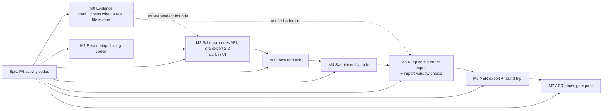

# Implementation Plan: P6 activity codes, kept in the plan

- **Feature spec:** [`./spec.md`](./spec.md)
- **Status:** Approved (product owner, 2026-10-27; see the spec header)
- **Owner:** James Ewbank (product owner); built by the **builder** agent once approved (CLAUDE.md §19.14)
- **Schema:** [`./database-design.md`](./database-design.md) (database-architect, Draft, 2026-10-27). It is
  the authority; every schema task below implements it exactly and any change goes back through the
  database-architect (CLAUDE.md §19.3).

This plan assumes the **recommended answers** to the open owner questions at the top of `spec.md`
(Q1–Q11). Where an answer changes a task, the task says so.

**Milestone names differ from the design's.** The design says "owed in M1" for its schema checks
(`prisma validate`, measurements, design §10.4, §12). In this plan the schema lands in **M2**; M1 is the
import-report fix. Wherever the design says M1, read **M2** here.

## Breakdown

**Order.** Storage, screens and swimlanes (M2–M4) need no P6 column. Importing values (M5) and writing
them (M6) need the unconfirmed `ACTVCODE` columns and **wait for M0** (owner's answer 3). If a real file
arrives early, M5 can follow M2 directly. **Q5** decides whether M2 waits for M0's two CHECK bounds and
the parent column: the recommendation is no (see M2-T2).

**Size overall: L.** Every milestone is a releasable slice.

### Epic

**P6 activity codes, kept in the plan**: code types, values and per-activity assignments as plan data;
visible and editable; a live third swimlane source; kept on P6 import; carried by SchedulePoint's XER and
the organisation export (format 2.2).

---

### M0: Evidence (ships dark; closes when a real P6 file has been read)

**Outcome:** the P6 columns, lengths and nesting this feature relies on are recorded from a real export,
and a synthetic fixture matches them.
**Entry point:** `Ships dark: a record and a fixture. M1 uses publicly confirmed columns; M5 and M6 start
only when this milestone closes.`
**Journey:** none.

##### M0-T1: Record what public sources confirm (now) — S

- `docs/specs/p6-activity-codes/m0-record.md`: spec §3's confirmed / unconfirmed table, each confirmed
  column with its sources ([30832](https://planningplanet.com/comment/30832),
  [back-end thread](https://www.planningplanet.com/forums/oracle-primavera-pm6/603778/questions-about-back-end),
  [96953](https://planningplanet.com/comment/96953), [88966](https://planningplanet.com/index.php/comment/88966)).
- **Risk:** a forum post is wrong → only columns two sources agree on are marked confirmed.

##### M0-T2: Record a real export (when the owner has one) — S

- Verbatim `%T`/`%F` lines of `ACTVTYPE`, `ACTVCODE`, `TASKACTV`; P6 version; counts; **the longest short
  code and description seen and P6's documented maxima** (they set two CHECK bounds, design §5.3);
  **whether `ACTVCODE` has a parent column** (sets whether `code_values.parent_id` exists); whether real
  files carry case-distinct short codes (`l1`/`L1`, design §5.3); whether any activity carries two values
  of one type.
- Synthetic fixture `packages/interchange/src/xer-activity-codes.fixtures.ts` to that shape: global,
  EPS and project types; an unused type; unused values; a nested value if seen; a type with 101 values in
  use; an over-long description; case-folded duplicates; an orphan assignment; a double value.
- **If M2 has already landed** (Q5 = don't wait) and the file needs wider bounds or a parent column,
  open a database-architect task for an expand-only follow-up migration before M5.
- **Testing:** `xer-parser.spec.ts` parses the fixture and asserts the three field lists.

---

### M1: The import report stops hiding activity codes

**Outcome:** importing a P6 file with codes says so: one report line names the code types and counts
their assignments as not imported yet. Fixes the ADR-0050 silent drop.
**Entry point:** Project ▸ **Import schedule…** ▸ choose a `.xer` ▸ **"2 · Review what will be imported"**.
**Journey:** `apps/web/e2e-interchange/interchange.spec.ts` (`test:e2e:interchange`): upload a fixture with
`ACTVTYPE` and `TASKACTV` (confirmed columns only, no `ACTVCODE` names) and assert the report row.

##### M1-T1: Read types and assignments; report them — S

- **Description:** `xer-adapter.ts` reads `ACTVTYPE` (`actv_code_type_id`, `actv_code_type`, `proj_id`,
  `actv_code_type_scope`) and `TASKACTV` (`task_id`, `actv_code_type_id`, `actv_code_id`, `proj_id`) for the
  imported project; one `drop` finding. ADR-0050's mapping row amended in place.
- **Risks:** report change for files without codes → a deep-equal parity case against `main`'s output and
  the golden file.
- **Testing:** adapter cases (none; one type; other project's rows ignored; `__proto__` names inert);
  `import-xer.spec.ts` parity; API e2e asserts the finding; journey step. Changeset `api` patch.

---

### M2: Schema, codes API and organisation export 2.2 (dark in the UI)

**Outcome:** a plan can hold code types, values and assignments; the API reads and writes them; the org
export carries them; delete, restore, expiry and import rollback handle them.
**Entry point:** `Ships dark: API only (reachable by an API client and the seed catalogue). M3 opens the
first screen.`
**Journey:** none in a browser; the API e2e suite is the gate.

**Before M2 starts:** Q1 (baselines), Q3, Q4 and Q5 answered, because they change migration B's
contents; the database-architect confirms the design is final for those answers.

##### M2-T1: `prisma validate` probe — S (database-architect + builder)

- **Description:** the design's unprobed Prisma claims (design §10.4), on a scratch branch before any
  migration is written: (1) `Plan.swimlaneCodeType` relation whose `fields` include the plan's own `id`;
  (2) the `CodeValue` self-relation through `(codeTypeId, parentId)`; (3) two relations from one model
  sharing `codeTypeId` (assignments and lanes). Then `migrate deploy` from empty and `prisma:check-drift`
  on `postgres:17-alpine`.
- **Risk:** (1) refused → the design's fallback, a single-column key plus a service same-plan check
  (design §5.7), recorded in the design and the ADR; the database-architect signs the change.
- **Output:** a note in `database-design.md` (by the database-architect) stating what passed.

##### M2-T2: Migration A — the enum label alone — S

- **Description:** `<ts>_swimlane_source_activity_code`: `ALTER TYPE "SwimlaneSource" ADD VALUE
'ACTIVITY_CODE';` and nothing else, with the header comment saying why (design §5.1, §10.1; the
  `20260725130000_resource_group_kind` precedent). `@repo/types` `SwimlaneSource` gains it in lock-step;
  `schedule-input-fields.ts` unchanged (the column is already classified).
- **Risk:** naming the label in the same transaction → "unsafe use of new value" (probed); hence alone.
  **Rollback hazard:** harmless while no row holds the value (design §13).
- **Testing:** migration applies; existing swimlane e2e unchanged.

##### M2-T3: Migration B and everything the censuses force into the same PR — L

- **Description:** `<ts+100>_p6_activity_codes`, in the design's order (§10.1): (`CodeSnapshotLevel` if Q1
  yes) → **`uq_activities_plan_id_id (plan_id, id)`** → `code_types` → `code_values` (with `parent_id` only
  if M0 has confirmed it; short code ≤ 80 and description ≤ 255 **unless M0 has shown otherwise**) →
  `code_value_assignments` → `code_swimlane_lanes` (unique hand-edited to `NULLS NOT DISTINCT`) →
  `plans.swimlane_code_type_id` + replaced `ck_plans_swimlane_source_level` → `baselines.swimlane_code_type_id`
  - replaced `ck_baselines_swimlane_snapshot_shape` (**mandatory whatever Q1 says**, design §6.1) → (Q1 yes)
    the two baseline tables. Header records lock notes, the census exemption, the separate-lane-table reason
    and the measurements below.
    **In the same PR, because builds fail otherwise:**
  * **Org export 2.2** (design §11): `EXPORT_STRATEGY`, `readPage`, `export-columns.ts` registry,
    `EXPORT_FORMAT_VERSION = '2.2'`, `docs/ORGANISATION_EXPORT_FORMAT.md` (files, enum values, count,
    version, changelog). `export-census.structural.spec.ts` and `export-format-doc.structural.spec.ts`.
  * **Expiry** (design §8.1): new runner order; resolve type ids; **clear the plan pointer before deleting
    types**; add `'Plan→CodeType'` to `EXEMPT_EDGES` with its reason **and** an assertion that
    `tx.plan.updateMany` precedes `tx.codeType.deleteMany`; pinned positive cases gain
    `CodeValueAssignment→Activity`, `CodeType→Plan`, `CodeValue→CodeType`; `ExpiryCounts` and
    `budgetCharge` gain assignments (`ASSIGNMENT_ROWS_PER_ACTIVITY`) and code lanes.
  * **Import compensation** (design §8.4): the deletes and the pointer clear, in order.
  * **Test helpers and pins** (design §8.5): `clearActivityTree` pin **7 → 9 children, 8 → 10 calls**;
    `clearBaselineTree` **5 → 7** (Q1 yes); `clearDomainData` (`test/audit-reset.ts:56-80`) clears the
    pointer, values, types; the **eleven e2e specs** that delete plans directly — recommended fix a
    DMMF-derived `clearPlanTree` helper (test-harness only).
  * `schedule-input-fields.ts` classifies `swimlaneCodeTypeId` `NOT_INPUT` (SC-3); `pnpm check:counts`
    and `CLAUDE.md` §1/§4, `docs/DATABASE.md` (count line; index register rows, design §7.1).
- **Measurements (design §12, recorded in migration B's header and `m2-record.md`):** (1) migration B's
  duration on the seeded catalogue and at the deployed host's activity count (the `activities` index
  under a `SHARE` lock at boot, probed 44 ms per 50,000 rows); (3) expiry of a 5,000 × 30 plan, with and
  without the two FK-check indexes, setting `ASSIGNMENT_ROWS_PER_ACTIVITY`; (5) the widened and new
  CHECKs through `scripts/backup-restore-check.sh`; (6) `É`/`é` folding of both case-insensitive uniques on
  `postgres:17-alpine`; (7) export of 1.5 M assignments across two organisations; (4, Q1 yes) one capture
  of 150,000 rows **≤ 1 s added**, or fall back to freezing only the source type (design §6.2).
- **Risks:** a checksummed migration cannot be edited → database-architect reviews the generated SQL
  before merge; if unavailable, wait and re-run (CLAUDE.md §19.3). Census red mid-stack → everything above
  is one PR. `BETWEEN` rewritten as two comparisons (design §5.7) so the CHECK round-trips.
- **Testing:** constraint probes in API e2e (cross-plan type 23503; value of another type 23503; second
  value per type 23505; `ACTIVITY_CODE` without a type 23514; parent of another type 23503); expiry e2e
  of a coded, code-sourced plan; compensation e2e; ADR-0107 seeded run for duration.

##### M2-T4: `codes` module and assignments on activity writes — L

- **Description:** routes in spec §4.7 on the `modules/swimlanes` shape; `code:*` permissions; pen-gated;
  type/value `version`; soft delete (value with live subtree, one batch); **delete of the swimlane-source
  type refused 409** (Q3, under the plan advisory lock); restore guards (`PARENT_DELETED`); caps (Q4) under
  the plan advisory lock; activity list gains per-page `codes` (absent when the plan has none, SC-2);
  `PATCH …/activities/codes` as an activity write (row lock, `version` bump); history item
  `code:<codeTypeId>` under `DEFINITION` (design §15 D7); audit `code_type.*`/`code_value.*` deleted/restored;
  lock order per design §15.
- **Risks:** IDOR → every query scoped by organisation and plan; security-reviewer, api-reviewer. A to-one
  `include: { codeValue: true }` → forbidden (ADR-0172, design §9.2).
- **Testing:** API e2e: CRUD, roles, pen, duplicates, stale versions, limits, restore guards, source-type
  delete refused; audit-coverage and history-coverage censuses; `org-permissions.spec.ts`; read timings
  (SC-5 reads) in `m2-record.md`.

##### M2-T5: Cascade and restore — M

- **Description:** stamp types and values into the plan/project/client batch beside swimlanes; restore
  them by batch, **skipped for activity and dependency batches** so the activity-history statement budget
  holds (design §8.2; `test/activity-history-statements.e2e-spec.ts`).
- **Testing:** cascade/restore e2e; statement-budget test unchanged.

##### M2-T6: Seed catalogue — S

- A coded seeded plan via REST (ADR-0066), three types; `docs/TEST_PLAYBOOK.md`; `pnpm check:playbook`.

---

### M3: Show and edit codes

**Outcome:** codes appear as table and Gantt columns and in the editor; planners manage types and values
and assign them singly or in bulk.
**Entry point:** Plan ▸ Activities ▸ **Codes…**; **Columns** ▸ "Area"; selection bar ▸ **Set Area…**;
editor ▸ General ▸ **Codes**.
**Journey:** the existing `activity-editor` suite (`test:e2e:activity-editor`, `apps/web/package.json:60`)
on the seeded coded plan; lands with M3-T1 as a skeleton (open **Codes…**), extended by each task.

##### M3-T1: Codes… dialog — M

- Two-pane (ADR-0061, ADR-0101), flat even if parents are stored (Q11); add, rename, reorder with keyboard
  twin, delete with count, restore; pen-shaded. **accessibility-reviewer + component-reviewer before
  release** (ADR-0111).

##### M3-T2: Table and Gantt columns — M

- One column per type, off by default; Gantt read-only (`grid-columns.ts:154-163` precedent); widths per
  ADR-0173. Render-count test unchanged with no code columns.

##### M3-T3: Editor group, bulk Set, undo, paste — M

- Editor **Codes** group (definition scope); **Set <type>…**; undo commands with set-aside (a since-deleted
  value); history formatting; paste within a plan keeps codes, across plans drops and counts (design §15 D9).
  ux-reviewer on copy (spec §0).

---

### M4: Swimlanes by code

**Outcome:** a planner groups the diagram by a code and switches between codes losslessly.
**Entry point:** diagram ▸ `View ▾ ▸ Structure` ▸ **Swimlanes…** ▸ **By code** ▸ type ▸ Apply.
**Journey:** `e2e-swimlanes` (`test:e2e:swimlanes`): choose By code: Area, assert names; move a bar within
a swimlane; switch to Trade and back; assert the moved bar's lane (SC-4); assert the shaded reason for the
101-value type; take a baseline of the code-sourced plan (the §6.1 CHECK).

No schema task: the source label, pointer and `code_swimlane_lanes` landed in M2.

##### M4-T1: Server — M

- Plan update accepts `ACTIVITY_CODE` + type (live, same plan, 1–100 values in use, under the plan advisory
  lock); membership endpoint (design §9.2 query; ≤ 10 ms target); `PATCH …/activities/codes` upserts
  `code_swimlane_lanes` when the source is shown; basis never client-sent (ADR-0206 A3); baseline capture
  copies the pointer (and, Q1 yes, the two frozen tables).
- **Testing:** API e2e for each; baseline of a code-sourced plan succeeds (no 23514).

##### M4-T2: `@repo/layout` and projection — M

- Code-membership key; `projectSwimlanes`, `deriveDiagramSource`; names (description, else short code);
  drag stops at the edge (Q7); Move to swimlane writes the assignment. ADR-0206 parity suites unchanged.

##### M4-T3: Source card, Swimlane column, ghosts, guests — M

- **By code** card with shaded reasons; Swimlane column shows the value name; ghosts of removed work from
  frozen rows (Q1 yes) or counted; guest view per Q6 (names and derived membership only; no code fields),
  security-reviewer; accessibility-reviewer on the card.

---

### M5: Keep codes on P6 import, and choose a code in the import window (waits for M0)

**Outcome:** importing a P6 file keeps its codes; the planner can open it already grouped by one.
**Entry point:** Project ▸ **Import schedule…** ▸ step 1 **Swimlanes by code** (Q8) ▸ **Import**.
**Journey:** `e2e-interchange`: import the M0-T2 fixture choosing Area; assert the plan opens grouped,
**Codes…** lists the types, and "Restore the SchedulePoint layout" never appeared (spec §4.4 item 6).

##### M5-T1: Pure pipeline — M

- Read `ACTVCODE` with **M0-recorded** columns; keep used types and in-use values plus parents (Q4); repairs,
  folding, limits; P6 scope reported; `swimlaneCodeType` option and its 422s; report replaces M1's drop;
  `mapper.ts:197-198` comment fixed. Helpers held at least as strict as the CHECKs by a database sweep.
- **Testing:** unit for every spec §2 edge case; parity; golden.

##### M5-T2: Commit, cost and compensation — M

- Types, values (parents first), activities, assignments (`createMany`), then the plan pointer, in the
  existing transaction; compensation per design §8.4; `interchange.service.ts:1669` comment fixed.
- **Measurement (SC-5, design §12 item 2):** commit of a 5,000-activity, 30-type file through the real path,
  against the **6.4 s lower bound** the probe found for 150,000 assignments alone; recorded in
  `m5-record.md` and the ADR; if it breaks the import's 15 s transaction timeout
  (`TRANSACTION_TIMEOUT_MS`, `interchange.service.ts:525`) or leaves too little headroom, stop and bring options to the
  owner (for example a lower per-import cap) before shipping.
- **Testing:** API e2e: commit stores everything; **a failed import that carried codes and chose a code
  source leaves nothing** (the pointer path).

##### M5-T3: Import window — M

- `SelectField` in step 1, re-runs the dry-run, resets on a new file; `carriesLayout` reads carried
  swimlanes only. Component tests; accessibility-reviewer.

---

### M6: XER export and round trip (waits for M0); MSPDI stated honestly

**Outcome:** SchedulePoint's XER carries codes and a code-sourced grouping back to SchedulePoint, and to
P6 as project codes; MSPDI says plainly it does not.
**Entry point:** plan ▸ **Export ▸ P6 XER** (existing).
**Journey:** `e2e-interchange`: export the coded, code-sourced plan, import into a second project, assert
types, a value and the grouping by activity code (SC-7).

##### M6-T1: Reader for a code source in the swimlanes field — S (ships one release before M6-T2)

- `xer-layout-fields.ts` accepts `ACTIVITY_CODE` (naming the type by name). Read before write (ADR-0156 D9):
  an older reader discards an unknown source (`:150-175`).

##### M6-T2: Writer — M

- `export-xer.ts` writes `ACTVTYPE` (project scope), `ACTVCODE`, `TASKACTV` with M0 columns and the code
  source; export report states "P6 receives these as project codes". MSPDI: one aggregate drop on export
  when a plan has codes; outline codes reported as not read on import (Q10).
- **Testing:** round-trip unit (FC-7 shape); API e2e; journey.

---

### M7: ADR, documents, gate pass

**Entry point:** `Ships dark: documents only.` **Journey:** all of the above, re-run on the merged tree.

##### M7-T1 — S

- File the ADR (spec §4.12); `CLAUDE.md` §16 line; amendment notes (ADR-0206 A2/A7, ADR-0156, ADR-0194,
  ADR-0051, ADR-0025 if Q1 yes); **`docs/DEPLOYMENT.md` "Rolling back past the P6 activity codes release"**
  (design §13); spec header `Accepted — shipped (ADR-NNNN)`; `docs/BACKLOG.md` closed; reconciliation pass.
- `pnpm prepush` (`check:adr-coverage`, `check:spec-status`, `check:counts`, `check:playbook`).

## Sequencing and release order

M0-T1 → M1 → M2 (T1 → T2 → T3 → T4 → T5 → T6) → M3 → M4 → (M0-T2 closed) → M5 → M6-T1 → **next release** →
M6-T2 → M7.

- **Migrations A then B.** Two files, A strictly before B (each runs in its own transaction). They may ship
  in one release.
- **Organisation export 2.2** ships with migration B (census-forced). It is a minor format change, so
  existing 2.x readers keep working.
- **XER read before write:** M6-T1 is released before M6-T2.
- **Rollback window:** once any plan uses the `ACTIVITY_CODE` source (M4 onward, or M5's import choice),
  rolling back to an earlier image needs the design §13 runbook; once a baseline froze that source, roll
  forward only. M7 publishes it, but **M4's PR adds the runbook** so it exists before the first such plan.
- **No feature flag** (ADR-0088 D1).

**Agents:** **database-architect** for M2-T1, M2-T2, M2-T3 and any M0-driven follow-up (mandatory);
**security-reviewer** M2-T4, M4-T3, M5; **api-reviewer** M2-T4, M4-T1; **backend-performance-reviewer**
M2-T3/T4 measurements, M5-T2 commit cost; **accessibility-reviewer** + **component-reviewer** M3-T1, M3-T3,
M4-T3, M5-T3 (before release, ADR-0111); **ux-reviewer** M3; **test-engineer** fixtures, helper pins,
journeys; **devops-reviewer** for the rollback runbook.

## Definition of Done (per task)

[`docs/PROCESS.md`](../../PROCESS.md) Feature Completion Criteria, with `pnpm prepush`,
`scripts/e2e-local.sh api` for API work, and `scripts/e2e-local.sh web:<suite>` (`interchange`,
`swimlanes`, `activity-editor`) for each journey touched.

## Risks and assumptions (rollup)

| Risk / assumption                                                                  | Likelihood         | Impact  | Mitigation                                                                  |
| ---------------------------------------------------------------------------------- | ------------------ | ------- | --------------------------------------------------------------------------- |
| No real P6 file arrives                                                            | med                | high    | M1–M4 need none; M5–M6 wait                                                 |
| Real file needs longer short codes/descriptions or a parent column after M2 landed | med                | low–med | Q5; an expand-only follow-up migration via the database-architect before M5 |
| `prisma validate` refuses the plan-pointer relation using `id`                     | med                | med     | M2-T1 first; design §5.7 fallback                                           |
| Enum label used in its own transaction                                             | low (designed out) | high    | Migration A alone                                                           |
| Previous image breaks lane writes on rollback                                      | designed out       | high    | Separate `code_swimlane_lanes` table (design §5.5, probed 42P10)            |
| Rollback after a plan uses the code source                                         | med                | high    | Design §13 runbook in `docs/DEPLOYMENT.md`, landed with M4                  |
| First baseline of a code-sourced plan fails 23514                                  | designed out       | high    | Baseline CHECK widened in migration B regardless of Q1                      |
| Expiry delete cycle (plan ↔ code type)                                             | certain            | med     | Pointer cleared first; `EXEMPT_EDGES` entry plus an asserting test          |
| Census red mid-stack                                                               | high if split      | med     | Export 2.2, expiry, compensation and test pins in the migration B PR        |
| Test helpers miss the new tables (eleven specs)                                    | high               | low     | Pins moved; `clearPlanTree` recommended                                     |
| Import commit too slow at the cap (6.4 s lower bound)                              | med                | med     | Measured in M5-T2; owner decides before release                             |
| Baseline capture too slow (Q1 yes)                                                 | med                | med     | ≤ 1 s gate; fallback to the source type only                                |
| `activities` index build lengthens boot                                            | low                | low     | Measured on the host's row count (M2-T3)                                    |
| "Activity code" confusion                                                          | high               | med     | Spec §0; Q9; ux-reviewer                                                    |
| Guest leaks code fields                                                            | low                | med     | Allow-listed DTO; e2e asserts absence                                       |
| Older SchedulePoint drops a code-sourced swimlanes field                           | med                | med     | M6-T1 a release before M6-T2                                                |
| Scope creep (filters, colour by code, Gantt grouping)                              | med                | med     | Out of v1; backlog                                                          |

## Test plan (summary)

| Level             | Where                                                                                      | Proves                                                             |
| ----------------- | ------------------------------------------------------------------------------------------ | ------------------------------------------------------------------ |
| Unit, pure        | `packages/interchange`, `packages/layout`                                                  | read, repair, report, round trip; membership; parity without codes |
| Golden            | `packages/interchange/src/golden/`                                                         | existing imports byte-identical                                    |
| Constraint probes | API e2e                                                                                    | every composite key, unique and CHECK in design §3                 |
| API e2e           | codes, activities, swimlanes, interchange, share, baselines, expiry, cascade               | behaviour, permissions, pen, lifecycle, rollback paths             |
| Censuses          | org export, expiry (with the exemption assertion), audit, history, `schedule-input-fields` | nothing new unclassified                                           |
| Helper pins       | `clear-activity-tree`, `clear-baseline-tree` e2e                                           | 9/10 and 7 calls                                                   |
| Component         | codes dialog, table, Gantt, editor, swimlane card, import window                           | states, reasons, undo set-aside, the dialog trap                   |
| Journeys          | `e2e-interchange`, `e2e-swimlanes`, `activity-editor`                                      | each milestone's entry point, axe clean                            |
| Measurements      | `m2-record.md`, `m5-record.md`, migration B header                                         | SC-5 and design §12 items 1–7                                      |
