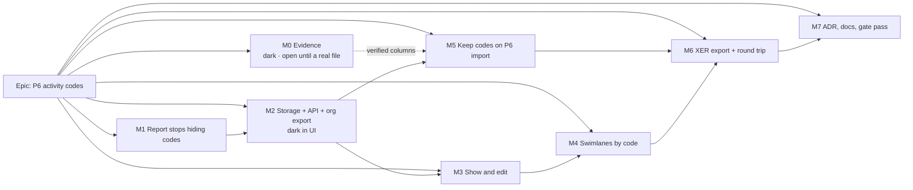

# Implementation Plan: P6 activity codes, kept in the plan

- **Feature spec:** [`./spec.md`](./spec.md)
- **Status:** Draft
- **Owner:** James Ewbank (product owner); built by the **builder** agent once approved (CLAUDE.md §19.14)
- **Schema:** [`./database-design.md`](./database-design.md), by the database-architect agent (pending
  at this revision). No milestone that touches the schema starts before it lands and is approved.

Direction set by the owner on 2026-10-27 (relayed): keep the codes in the plan; swimlane name =
description, else short code; no real P6 file yet, so **anything needing an unverified P6 column waits
for M0** (spec §3 table). Remaining questions OQ-1 to OQ-7 are in spec §6; this plan assumes their
defaults and names where an answer would change a milestone.

## Breakdown

**Why the order differs from "storage + import" in one milestone.** The value's short code and
description live in `ACTVCODE` columns that public sources do **not** confirm (spec §3). Under the
owner's answer (3) those wait for M0. So storage, the screens and swimlanes (M2–M4), which need no P6
column at all, go first; importing values (M5) and writing them (M6) follow M0. If a real file arrives
early, M5 moves up to straight after M2; nothing else changes.

**Size overall: L.** Every milestone is a releasable slice; most are 2–4 PRs.

### Epic

**P6 activity codes, kept in the plan**: code types, values and per-activity assignments as plan
data; visible and editable; a third swimlane source; kept on P6 import; carried by SchedulePoint's XER
and the organisation export. Roadmap: schedule interchange (ADR-0050) and diagram authoring (ADR-0206).

---

### M0: Evidence (ships dark; stays open until a real file is read)

**Outcome:** the P6 columns this feature relies on are recorded from a real export, and a synthetic
fixture matches them.
**Entry point:** `Ships dark: a record and a fixture. M1 uses only publicly confirmed columns; M5 and
M6 start only when this milestone closes.`
**Journey:** none.

##### M0-T1: Record what public sources confirm (now)

- **Description:** `docs/specs/p6-activity-codes/m0-record.md`: the confirmed / unconfirmed column
  table from spec §3, each confirmed column with its source
  ([Planning Planet 30832](https://planningplanet.com/comment/30832),
  [back-end thread](https://www.planningplanet.com/forums/oracle-primavera-pm6/603778/questions-about-back-end),
  [96953](https://planningplanet.com/comment/96953), [88966](https://planningplanet.com/index.php/comment/88966)).
- **Complexity:** S · **Dependencies:** none
- **Risks:** a forum post is wrong → only columns two sources agree on are marked confirmed.
- **Testing:** none (document).

##### M0-T2: Record a real export (when the owner has one)

- **Description:** add the verbatim `%T`/`%F` lines of `ACTVTYPE`, `ACTVCODE`, `TASKACTV`, the P6
  version, counts, whether any activity carries two values of one type, whether values nest, value
  colour columns. Build `packages/interchange/src/xer-activity-codes.fixtures.ts` (synthetic, to the
  recorded shape): three types (one global scope), one with 101 values in use, an 81-character
  description, case-folded duplicates, a nested value if seen, an orphan assignment, a double value.
- **Complexity:** S · **Dependencies:** a real file (owner)
- **Risks:** client data → only headers and counts are copied; the fixture is invented.
- **Testing:** `xer-parser.spec.ts` parses the fixture and asserts the three field lists.

---

### M1: The import report stops hiding activity codes

**Outcome:** importing a P6 file with activity codes says so: the report names the code types and
counts their assignments, as "not imported yet". Fixes the ADR-0050 silent drop.
**Entry point:** Project ▸ **Import schedule…** ▸ choose a `.xer` ▸ **"2 · Review what will be
imported"**: the drops list names the activity codes.
**Journey:** `apps/web/e2e-interchange/interchange.spec.ts`: upload a fixture with `ACTVTYPE` and
`TASKACTV` and assert the report row (ADR-0081 §2). The fixture uses **confirmed columns only** and no
`ACTVCODE` names.

##### M1-T1: Read types and assignments; report them (≈ one PR)

- **Description:** in `xer-adapter.ts`, read `ACTVTYPE` (`actv_code_type_id`, `actv_code_type`, `proj_id`,
  `actv_code_type_scope`) and `TASKACTV` (`task_id`, `actv_code_type_id`, `actv_code_id`, `proj_id`),
  filtered to the imported project; emit **one** `drop` finding: "N activity code types (Area, Trade,
  …) and M assignments were not imported". Amend ADR-0050's mapping row in place ("reported").
- **Complexity:** S · **Dependencies:** M0-T1
- **Risks:** report change for files without codes → parity case: no `ACTV*` tables gives a report
  deep-equal to `main`'s, plus the existing golden file.
- **Testing:** adapter unit cases (none; one type; another project's rows ignored; `__proto__` names
  inert); `import-xer.spec.ts` parity; API e2e (`apps/api/test/interchange.e2e-spec.ts`) asserts the
  finding; the journey step.
- **Steps:** adapter + finding → tests → ADR-0050 row → changeset (`api` patch).

---

### M2: Storage, API and organisation export (dark in the UI)

**Outcome:** a plan can hold code types, values and assignments; the API reads and writes them; the
organisation export includes them; deletes, restores, expiry and import rollback handle them.
**Entry point:** `Ships dark: API only (reachable by an API client, and by the seed catalogue). M3
opens the first screen.`
**Journey:** none in the browser; the API e2e suite is the gate. The seed catalogue gains a coded plan
so M3's journey has data.

#### Feature: Schema (database-architect, mandatory)

> **Description:** implement `database-design.md` exactly: models, CHECKs, composite FKs, indexes,
> partial indexes, migration order (spec §4.6 N1–N3, N5; N4 waits for M4).
> **Complexity:** M
> **Dependencies:** database-design.md landed **and approved**; DBQ-1 to DBQ-4, DBQ-7, DBQ-8, DBQ-11,
> DBQ-12 answered there.
> **Risks:** a migration is checksummed once applied → no hand edits; if the agent is unavailable, wait
> and re-run it (CLAUDE.md §19.3).
> **Testing:** migration applies on a fresh and on a populated database (ADR-0107); constraint
> sweeps in API e2e (duplicate name, value of another type, value of another plan, two values per
> type).

##### M2-T1: Migration and Prisma models (≈ one PR)

- **Complexity:** M · **Dependencies:** database-design.md
- **Steps:** migration per the design → Prisma schema → `schedule-input-fields.ts` classifies every new
  field `NOT_INPUT` (SC-3) → `pnpm check:counts` banner update.
- **Testing:** the org export census (`export-census.structural.spec.ts:178`, `:277`) and the expiry
  runner census fail until M2-T3; this PR therefore lands **with** M2-T3 or behind it in one stack.

##### M2-T2: `codes` module: types, values, assignments (≈ one PR)

- **Description:** routes in spec §4.7, on the `modules/swimlanes` shape: thin controller, service,
  repository; `code:*` permissions (spec §2); pen-gated writes; optimistic locking; soft delete and
  restore; limits; `GET …/code-assignments` separate from the activity list.
- **Complexity:** L · **Dependencies:** M2-T1
- **Risks:** IDOR on type/value/assignment ids → every read and write scoped by `organizationId` and
  `planId`; security-reviewer. Payload growth → SC-7 measured here.
- **Testing:** API e2e: CRUD, 403 per role, 409 without pen, 409 duplicates/stale, 422 cross-type and
  cross-plan, restore, limits; audit-coverage and history-coverage censuses classify the routes;
  `org-permissions.spec.ts` grants. Measure SC-7 (2,000 × 20) and record in `m2-record.md`.
- **Steps:** DTOs in `@repo/types` → module → OpenAPI → `docs/API.md` → changeset (`api` minor).

##### M2-T3: Lifecycle and organisation export (≈ one PR)

- **Description:** cascade stamping and `restoreBatch`; expiry order (DBQ-8); interchange compensation
  deletes; organisation export 2.1 → 2.2 with the new files and `docs/ORGANISATION_EXPORT_FORMAT.md`;
  audit rows for `code_type.deleted/restored`.
- **Complexity:** M · **Dependencies:** M2-T2
- **Testing:** expiry e2e removes coded plans; compensation leaves nothing; export census and
  `export-format-doc.structural.spec.ts`; an export of a coded plan carries the rows.

##### M2-T4: Seed catalogue (≈ one PR)

- **Description:** a coded seeded plan through the public REST API (ADR-0066) with three code types;
  `docs/TEST_PLAYBOOK.md` entry with what wrong looks like.
- **Complexity:** S · **Dependencies:** M2-T2 · **Testing:** `pnpm check:playbook`.

---

### M3: Show and edit codes

**Outcome:** planners see codes as table and Gantt columns and in the editor, manage code types and
values, and assign values one at a time or in bulk.
**Entry point:** Plan ▸ Activities ▸ **Codes…** (manage); Activities ▸ **Columns** ▸ "Area"; selection
bar ▸ **Set Area…**; activity editor ▸ General ▸ **Codes**.
**Journey:** new steps in the existing `activity-editor` Playwright suite (`test:e2e:activity-editor`,
`apps/web/package.json:60`) on the M2-T4 seeded plan: open
**Codes…**, add a type and a value; tick its column; select two rows, **Set <type>…**, assert the
cells; open the editor and assert the Codes group. Lands with M3-T1 as a skeleton (open **Codes…**),
extended by each task (ADR-0081 §2).

##### M3-T1: Codes… dialog (≈ one PR)

- **Description:** `features/codes/`: two-pane dialog (ADR-0061, ADR-0101): types list, values list;
  add, rename, reorder with a keyboard twin, delete with a count, restore. Pen-shaded with reason.
- **Complexity:** M · **Dependencies:** M2
- **Testing:** component tests; journey skeleton; **accessibility-reviewer and component-reviewer
  before release** (ADR-0111: `Dialog`, `Toolbar`, `SelectField`).

##### M3-T2: Columns in the table and the Gantt (≈ one PR)

- **Description:** one column per type under its name, off by default, in the existing chooser;
  Gantt read-only columns (`grid-columns.ts`, the Swimlane column precedent `:154-163`); widths per
  ADR-0173.
- **Complexity:** M · **Dependencies:** M3-T1
- **Testing:** table and Gantt column tests; render-count test unchanged when no code columns;
  journey step.

##### M3-T3: Assign: editor group, bulk control, undo, history (≈ one PR)

- **Description:** General tab **Codes** group (per-scope save, ADR-0060); **Set <type>…** on the
  table's selection bar; undo commands (ADR-0176 check-before-write); activity history entries;
  copy/paste keeps values within a plan and drops them across plans (counted).
- **Complexity:** M · **Dependencies:** M3-T2
- **Testing:** editor and bulk tests; undo set-aside when the value was deleted; history formatting;
  journey steps; ux-reviewer on copy (spec §0 vocabulary rules).

---

### M4: Swimlanes by a code

**Outcome:** a planner shows swimlanes by a code type and switches to another later without losing
either picture.
**Entry point:** diagram ▸ `View ▾ ▸ Structure` ▸ **Swimlanes…** ▸ "Where swimlanes come from" ▸ **By
code** ▸ choose a type ▸ Apply.
**Journey:** `e2e-swimlanes` (the swimlanes suite): on the seeded coded plan choose **By code: Area**,
assert the gutter names; switch to Trade; switch back and assert a lane the test had moved under Area
is where it was (SC-4); assert the shaded reason for the 101-value type.

#### Feature: The third source (database-architect, mandatory for T1)

> **Description:** spec §4.5. **Complexity:** L.
> **Dependencies:** M3; database-design.md answers DBQ-5, DBQ-6, DBQ-13 (and DBQ-10 if OQ-3 is "yes").
> **Risks:** widening fail-closed CHECKs and an enum in one release → the design's migration order;
> parity with the four existing bases → the ADR-0206 parity suites stay byte-identical.

##### M4-T1: Migration: source value, plan reference, two lane bases (≈ one PR)

- **Complexity:** M · **Testing:** constraint sweeps; existing swimlane e2e unchanged.

##### M4-T2: Server: source switch, basis derivation, assignment-with-lane writes (≈ one PR)

- **Description:** the plan source write accepts the code source; refuse a deleted type or one over 100
  values; derive the basis server-side under `FOR SHARE` (ADR-0206 A3); `PATCH …/code-assignments`
  carries lane rows when a code source is shown; deleting the source type is refused.
- **Complexity:** M · **Testing:** API e2e for each; a client-sent basis is 422.

##### M4-T3: `@repo/layout` and projection (≈ one PR)

- **Description:** membership key by code value beside the WBS walk; `projectSwimlanes` and
  `deriveDiagramSource`; order by value order; names by description then short code; Move to
  swimlane writes the assignment; drag stops at the edge (OQ-5).
- **Complexity:** M · **Testing:** pure unit; parity suites (ADR-0206 M0-T2/M2-T6) unchanged; the
  canvas a11y description says the swimlane by its name.

##### M4-T4: Setup card, Swimlane column, guests (≈ one PR)

- **Description:** the **By code** card (`SwimlaneSourceFields.tsx`) with shaded reasons; the
  Swimlane column shows the value's name; guest plan view carries code-sourced swimlane names and
  derived membership (OQ-4; ADR-0051 §4 amendment note), never code fields.
- **Complexity:** M · **Testing:** component tests; guest e2e asserts no code fields leak;
  security-reviewer on the guest DTO; accessibility-reviewer on the card.

---

### M5: Keep codes on P6 import (waits for M0)

**Outcome:** importing a P6 file keeps its code types, values and assignments.
**Entry point:** Project ▸ **Import schedule…**: the report now says "3 code types kept"; the plan
opens with them in **Codes…** and the column chooser.
**Journey:** `e2e-interchange`: import the M0-T2 fixture, open **Codes…**, assert the types and a
value; tick a column and assert a cell.

##### M5-T1: Pure pipeline (≈ one PR)

- **Description:** adapter reads `ACTVCODE` with the **M0-recorded** columns into canonical
  `codeTypes`; mapper and validator (spec §2 repairs, limits, folding); report counts kept and not kept;
  the M1 drop finding is replaced; `mapper.ts:197-198` comment corrected.
- **Complexity:** M · **Dependencies:** M0-T2 closed, M2
- **Risks:** a name the database refuses rolls back the import → helpers at least as strict as the
  CHECKs, held by a database sweep (the `layout-interchange.e2e-spec.ts` precedent).
- **Testing:** unit for every edge case in spec §2; parity for files without codes; golden.

##### M5-T2: Commit and compensation (≈ one PR)

- **Description:** insert types and values before activities, assignments after, in the existing
  transaction; compensation order per DBQ-8; the stale comment at `interchange.service.ts:1669`
  corrected.
- **Complexity:** M · **Dependencies:** M5-T1
- **Testing:** API e2e: commit stores everything; recalculation failure leaves nothing;
  `scripts/e2e-local.sh api`.

---

### M6: XER export and round trip (waits for M0); MSPDI stated honestly

**Outcome:** a SchedulePoint XER carries codes back into SchedulePoint and into P6 as project codes;
MSPDI says it does not carry them.
**Entry point:** plan ▸ **Export ▸ P6 XER** (existing); the export report names what P6 will see.
**Journey:** `e2e-interchange`: export the coded plan as XER, import it into a second project, assert
the types, a value and the code-sourced swimlanes by activity code (SC-5).

##### M6-T1: Reader for the code-sourced swimlanes field (≈ one PR, one release before T2)

- **Description:** `xer-layout-fields.ts` accepts a code source in `SchedulePoint layout v1:
  swimlanes` (naming the code type by name), restoring it on import. Ships **one release before** the
  writer (ADR-0156 D9), because an older reader discards an unknown source (`:150-175`).
- **Complexity:** S · **Dependencies:** M4, M5

##### M6-T2: Writer (≈ one PR)

- **Description:** `export-xer.ts` writes `ACTVTYPE` (project scope), `ACTVCODE`, `TASKACTV` with the
  M0-recorded columns, and the code source; the export report states "P6 receives these as project
  codes". MSPDI export adds one aggregate `drop` when a plan has codes; MSPDI import reports outline
  codes as not read (OQ-6).
- **Complexity:** M · **Dependencies:** M6-T1 released
- **Testing:** round-trip unit (`export-xer.spec.ts`, the FC-7 shape); API e2e round trip; the journey.

---

### M7: ADR, documents, gate pass

**Outcome:** the decision is recorded and every document agrees with the code.
**Entry point:** `Ships dark: documents only.` **Journey:** every journey above, re-run on the merged tree.

##### M7-T1 (≈ one PR)

- **Description:** file the ADR (spec §4.12 outline); one line in `CLAUDE.md` §16; amendment notes on
  ADR-0206, ADR-0156, ADR-0194, ADR-0051; spec header `Accepted — shipped (ADR-NNNN)`; `docs/BACKLOG.md`
  row closed; `docs/RECONCILE.md` epic-boundary pass.
- **Complexity:** S · **Testing:** `pnpm prepush` (`check:adr-coverage`, `check:spec-status`,
  `check:counts`, `check:playbook`).

## Sequencing and slices

M0-T1 → M1 → M2 → M3 → M4, then M5 → M6 once M0-T2 closes; M7 last. Each task leaves `main`
releasable: M2 adds tables and routes nobody's screen calls; M3 opens the first screen with its
journey; M4 adds a source option; M5 and M6 change import and export behind the existing controls.
**No feature flag** (ADR-0088 D1): rollback is the commit.

**If an open question is answered differently:** OQ-1 "shared across the organisation" rewrites M2 and
adds an import collision step to M5. OQ-3 "yes" adds a baseline task to M4 (DBQ-10). OQ-4 "no" removes
the guest half of M4-T4. OQ-6 "build it" adds an M8 for MSPDI outline codes. OQ-7 "keep nesting" adds a
parent to M2 and a level choice to M4.

**Agents:** **database-architect** for M2-T1 and M4-T1 (mandatory, and for any later schema change);
**security-reviewer** M2-T2, M4-T4, M5; **api-reviewer** M2-T2, M4-T2; **backend-performance-reviewer**
M2-T2 (SC-7), M5; **accessibility-reviewer** and **component-reviewer** M3-T1, M3-T3, M4-T4 (before
release, ADR-0111); **ux-reviewer** M3 (copy); **test-engineer** for fixtures and journeys.

## Definition of Done (per task)

Each PR satisfies [`docs/PROCESS.md`](../../PROCESS.md)'s Feature Completion Criteria with
`pnpm prepush` run, `scripts/e2e-local.sh api` for API work, and `scripts/e2e-local.sh web:<suite>`
(`interchange`, `swimlanes`, `activity-editor`) for each journey touched.

## Risks and assumptions (rollup)

| Risk / assumption | Likelihood | Impact | Mitigation |
| ----------------- | ---------- | ------ | ---------- |
| No real P6 file arrives | med | high | M1–M4 need none; M5–M6 wait (owner answer 3); the ADR states it |
| Unverified `ACTVCODE` columns differ from belief | med | high | Not coded before M0-T2 |
| database-design.md disagrees with this spec | med | med | The design wins; §4.6 reconciled by reference before M2 starts |
| "Activity code" confusion | high | med | Spec §0; OQ-2; ux-reviewer |
| Widening swimlane source and basis breaks shipped swimlanes | low | high | Migration order from the design; ADR-0206 parity suites unchanged |
| Older SchedulePoint drops a code-sourced swimlanes field | med | med | Reader one release before writer (M6-T1) |
| Guest leaks code fields | low | med | Guest DTO allow-list; e2e asserts absence; security-reviewer |
| Activity payload or assignment read too slow | low | med | Separate read; SC-7 measured in M2 |
| Lane rows grow with each code basis | med | low | DBQ-13; re-measure the budget in M4 |
| Org export census or expiry census red mid-stack | high if split | med | M2-T1 and M2-T3 land together |
| Scope creep (filters, colour by code, Gantt grouping) | med | med | Out of scope in v1; backlog entries |

## Test plan (summary)

| Level | Where | Proves |
| ----- | ----- | ------ |
| Unit, pure | `packages/interchange`, `packages/layout` | read, repair, report, round trip; basis derivation; parity without codes |
| Golden | `packages/interchange/src/golden/` | existing imports byte-identical |
| API e2e | `apps/api/test/` (codes, swimlanes, interchange, share, expiry) | CRUD, permissions, pen, constraints, lifecycle, guests, round trip |
| Censuses | org export, expiry, audit coverage, history coverage, `schedule-input-fields` | nothing new is unclassified |
| Component | `features/codes`, Activities table, Gantt, editor, swimlane setup | states, shading reasons, undo set-aside |
| Journeys | `e2e-interchange`, `e2e-swimlanes`, `activity-editor` suite | each milestone's entry point, driven in a browser, axe clean |
| Measurement | `m2-record.md` | SC-7 |
