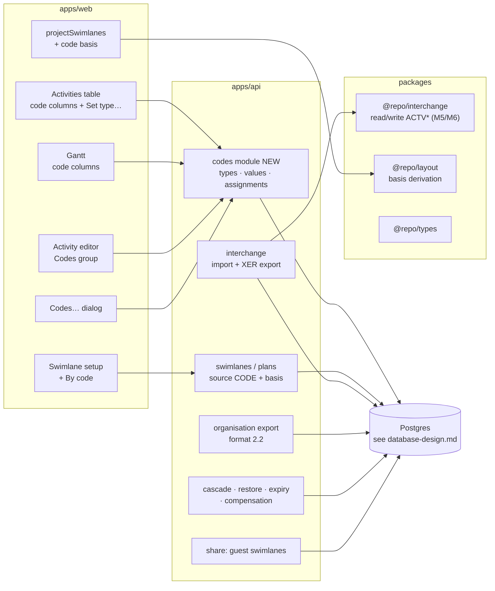
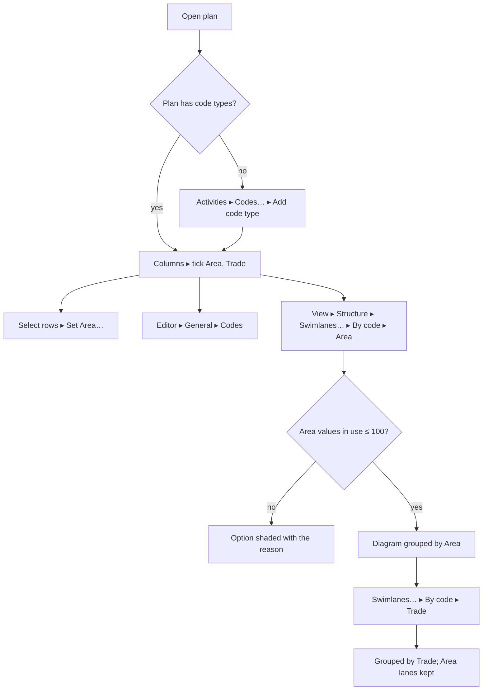

# Feature Spec: P6 activity codes, kept in the plan

- **Status:** Draft — awaiting approval before implementation
- **Author(s):** Feature Analyst (Claude Code), for James Ewbank (product owner)
- **Date:** 2026-10-27 (revised the same day: the owner chose to keep the codes in the plan, §6)
- **Tracking issue / epic:** none yet; `docs/BACKLOG.md:245-252` ("Swimlanes from P6 activity codes")
- **Roadmap link:** `docs/ROADMAP.md`, schedule interchange (ADR-0050) and diagram authoring (ADR-0206)
- **Companion documents:**
  - [`plan.md`](./plan.md): the implementation plan.
  - [`database-design.md`](./database-design.md): the schema, **written by the database-architect
    agent in parallel and not yet landed when this revision was written**. It is the authority for
    every table, column, constraint, index and migration step. This spec states needs and questions
    only (§4.6), and writes no schema.
- **Related ADR(s):** **one new ADR is required** (outline in §4.12). It amends ADR-0206 (a third
  swimlane source), ADR-0050 (the mapping row for activity codes), ADR-0194 (organisation export
  format 2.1 → 2.2), ADR-0156 (the swimlanes layout field gains a source value), and ADR-0051 §4 if
  OQ-4 stays "yes". Builds on ADR-0012, ADR-0028, ADR-0048/0176, ADR-0071 §5, ADR-0073, ADR-0076,
  ADR-0081, ADR-0088 D1, ADR-0096, ADR-0116, ADR-0172, ADR-0174.
- **Base:** the working tree on 2026-10-27. Every `file:line` below was read on that tree.

> **The owner's three answers, relayed by the coordinating agent on 2026-10-27.** (1) **Keep the codes in
> the plan**, not once at import. (2) Swimlane name = the value's description, falling back to its
> short code. (3) No real P6 file yet: proceed on public documentation, but **anything that depends on
> an unverified column name waits for M0**. These set the direction of this draft. They are not approval
> of the spec, which is still outstanding (§6 lists what remains open).

---

## 0. Vocabulary: read this first

**"Activity code" already means something else in SchedulePoint.** It is the activity's own
identifier: P6's _Activity ID_, imported from `TASK.task_code` (`packages/interchange/src/xer-adapter.ts:547-557`),
stored as `activities.code`, shown or hidden by `View ▾ ▸ Markers ▸ Activity codes`
(`docs/adr/0157-a-marks-class-is-its-hue-and-its-shape.md:66`), and the key ADR-0129 D1 matches two
imports on.

In Primavera P6, **"Activity Codes"** are **labels a planner attaches to activities to sort and group
them**: _Area_ (Level 1, Level 2, Roof), _Trade_ (Civil, Mechanical, Electrical), _System_ (HVAC, Fire).

| P6 table   | What it holds                                       | Called here (code and docs) |
| ---------- | --------------------------------------------------- | --------------------------- |
| `ACTVTYPE` | one row per kind of label: "Area", "Trade"          | a **code type**             |
| `ACTVCODE` | one row per value of a kind: "Level 1", "Mechanical" | a **code value**            |
| `TASKACTV` | which value each activity carries, per code type    | a **code assignment**       |

Rules:

1. **Copy never says bare "activity code" for the classification.** The product word is OQ-2
   (default **"Codes"**, with "P6 activity codes" in hints where a P6 user needs the bridge). A code
   type appears under its own name wherever possible: the table column is headed "Area", not "Code 1".
2. **Identifiers are `codeType*`, `codeValue*`, `codeAssignment*`**, never `activityCode*`, so a search
   for the existing `activityCodes` view toggle never returns this feature and the reverse also holds.
3. **"Activity code" without "P6" keeps its present meaning**: the activity's identifier.

---

## 1. Business understanding

### Problem

A P6 programme is often organised by activity codes (area, trade, system) rather than by its WBS.
Planners use the codes to group, sort, filter and colour the programme, and since 2026-10-25
SchedulePoint can draw labelled swimlanes (ADR-0206), by hand or one per WBS group. But SchedulePoint
has nowhere to keep a code: an imported P6 file loses them, and a planner building a plan in
SchedulePoint cannot classify activities except by WBS or by hand-made swimlane. So the grouping the
client's programme is built around disappears, and there is no way to say "show me this by Area,
now by Trade".

**Re-verified against the code, not the backlog's wording (CLAUDE.md §19.11):**

- **There is no model for codes.** `apps/api/prisma/schema.prisma` has no code type, value or
  assignment; `gantt-editing` already recorded "No data model for activity codes exists"
  (`docs/specs/gantt-editing/feature-spec.md:184`). The ways to group today are the WBS
  (`features/wbs/model/wbs-groups.ts`) and hand-made swimlanes (`activities.swimlane_id`,
  `schema.prisma:1348-1356`).
- **The XER reader keeps every table, so the codes reach memory.** `parseXer` stores every `%T`
  block "so unknown tables survive as rows" (`packages/interchange/src/xer-parser.ts:102-109`,
  `:272-277`).
- **The adapter then ignores them.** Its table list is `PROJECT`, `TASK`, `TASKPRED`, `CALENDAR`,
  `PROJWBS`, `RSRC`, `TASKRSRC`, `TASKMEMO`, `MEMOTYPE` (`xer-adapter.ts:43-55`), plus `UDFTYPE` /
  `UDFVALUE` (`xer-layout-fields.ts:219`). A search for `ACTVTYPE|ACTVCODE|TASKACTV|actv_code` across
  the repository (excluding `node_modules`) matches only `docs/BACKLOG.md` and
  `docs/specs/swimlanes/feature-spec.md:813`.
- **And the drop is silent, contrary to ADR-0050.** ADR-0050's mapping table says "activity-code
  matrices … **dropped + reported**" (`docs/adr/0050-schedule-interchange-canonical-model.md:138`), and
  its rule is that every source entity is mapped or named in the report (`:31-37`). Foreign UDFs are
  reported (`xer-layout-fields.ts:252-256`); activity codes are not. `importXer` builds its report
  only from adapter, layout, mapper and validator findings (`import-xer.ts:217-222`). **The backlog row
  did not mention this defect.**
- **Neither export writes codes**, and the MSPDI side reads none either: no match for
  `ExtendedAttribute|OutlineCode` in `packages/interchange/src`.
- **This repository holds no real P6 file with activity codes.** The two `.xer` files are
  `packages/engine-conformance/fixtures/p6_torture_test_v1.xer` (tables `PROJECT, CALENDAR, PROJWBS,
  TASK, TASKPRED, RSRC, TASKRSRC`, its `%T` lines 2, 5, 15, 35, 163, 353, 377) and a SchedulePoint-written
  golden file. ADR-0071 §5 refused to code an XER column from memory (`canonical.ts:337-353`), and the
  owner's answer (3) applies the same rule here: §3 lists exactly which columns wait for M0.

**Why now:** the owner chose to build it, with codes kept as plan data (§6, answer 1).

### Users

| Role | What they do with codes |
| ---- | ----------------------- |
| **Planner / Org Admin** | Import a P6 file and keep its codes; create and edit code types and values; assign values to activities (one at a time or in bulk); make swimlanes from a code type and switch to another later. Writes need the pen (ADR-0028). |
| **Contributor** | Sees codes in the table and editor; turns code columns and swimlanes on or off in their own view. No code writes (a Contributor's write is progress, `PROGRESS_WRITE`, `org-permissions.ts:254`). |
| **Viewer** | Read only, as Contributor. |
| **External Guest** | Sees code swimlanes by name on a share link if OQ-4 stays "yes"; never the code fields themselves. |

### Primary use cases

1. **Import keeps the codes.** A contractor's planner imports the client's P6 programme; its Area,
   Trade and System codes arrive with every activity's values.
2. **See them.** The Activities table and the Gantt can show one column per code type, headed with
   its name; the activity editor shows each code type's value.
3. **Edit them.** A planner adds a code type "Zone" with values, or corrects an activity's Trade, one
   at a time or across a selection.
4. **Swimlanes by a code.** The planner shows the diagram "by Area", and later switches to "by Trade";
   each switch keeps every lane the planner arranged under the other (the ADR-0206 lane-per-basis model).
5. **Take them out again.** A SchedulePoint XER carries the codes back to SchedulePoint, and to P6 as
   project codes; the organisation export includes them.

### User journeys

**Happy path (import, then swimlanes).**

1. Project ▸ **Import schedule…** ▸ choose `Tower-B-rev7.xer`. The report says "3 code types kept
   (Area, Trade, System); 1,208 code assignments".
2. **Import**; the plan opens.
3. Activities tab ▸ **Columns** ▸ tick **Area** and **Trade**: two columns appear, headed with those
   names.
4. Diagram ▸ `View ▾ ▸ Structure` ▸ **Swimlanes…** ▸ "Where swimlanes come from" ▸ **By code: Area**
   ▸ Apply. One swimlane per Area value in use, named after its description, "No swimlane" last.
5. Later: **Swimlanes…** ▸ **By code: Trade**. The diagram regroups. Switching back to Area returns
   the Area picture as it was left.

**Alternates.**

- **Built in SchedulePoint:** Activities tab ▸ **Codes…** (OQ-2 word) ▸ **Add code type** "Trade" ▸ add
  values ▸ select twelve rows ▸ **Set Trade…** ▸ Mechanical.
- **Editor:** open an activity ▸ General tab ▸ **Codes** group ▸ choose its Area.
- **A file with no codes:** nothing changes, byte for byte (SC-2).
- **A code type with more than 100 values in use** cannot be a swimlane source (the plan holds at most
  100 swimlanes, `SWIMLANE_LIMIT`, `apps/api/src/modules/swimlanes/dto/reorder-swimlanes.dto.ts:15`):
  the option is shaded with that reason; the codes themselves are still kept and shown.

### Expected outcomes

- A P6 programme's codes survive import and are usable for grouping in SchedulePoint.
- Planners can classify activities in SchedulePoint the way P6 users do.
- The import report stops hiding codes, closing the ADR-0050 gap.
- No change to dates, logic, float or the critical path: codes are not a scheduling input.

### Success criteria

- **SC-1 (keep).** Importing the M0 fixture stores every code type, value and assignment the file
  carries for the imported project, or reports each one it could not store, with a reason.
- **SC-2 (parity: no codes).** For a file without code tables, and for every plan with no codes, the
  import graph, the persisted plan, every existing API response and the report are byte-identical to
  today. Held by `packages/interchange/src/golden/fc7-rich-export.pre-epic.xer` and new parity cases.
- **SC-3 (parity: engine).** `computeSchedule` is untouched. Codes and the new source are classified
  `NOT_INPUT` in `apps/api/src/common/schedule-inputs/schedule-input-fields.ts` (where `laneIndex`,
  `swimlaneId`, `swimlaneSource` and `swimlaneWbsLevel` already sit, `:35-36`, `:72-73`), which makes an
  unclassified new field a compile error. Dates and the critical set of a plan with codes equal those
  of the same plan without.
- **SC-4 (switch is lossless).** Switching swimlanes from code type A to B and back returns every A
  lane with **no write** (the ADR-0206 A2 property, extended to the new bases).
- **SC-5 (round trip).** SchedulePoint XER → SchedulePoint: the same code types, values and per-activity
  assignments, matched by activity code (ADR-0129 identity). SchedulePoint XER → P6 is stated
  honestly in §4.9; MSPDI is a reported drop until a real MS Project file is read (OQ-6).
- **SC-6 (export).** The organisation export carries code types, values and assignments; the census
  (`apps/api/src/modules/organization-export/export-census.structural.spec.ts:178`, `:277`) passes.
- **SC-7 (cost).** The plan's code read for 2,000 activities × 20 code types is p95 < 200 ms (CLAUDE.md
  §15), and the activity list payload is unchanged (codes come on a separate read, §4.7). Measured in
  M2, not claimed (ADR-0142).

### Open questions

The owner answered three (header). Six remain, each with a default (§6). Questions for the
database-architect are §4.6.

---

## 2. Functional requirements

### User stories and acceptance criteria

> **US-1. Import keeps the codes.** As a Planner importing a P6 programme, I want its activity codes
> kept, so that I can group and sort by them as the client does.
>
> - **Given** a file whose activities carry Area values, **when** I dry-run, **then** the report names
>   the code types and counts the values and assignments that will be kept, and lists anything it
>   cannot keep with a reason.
> - **Given** I confirm, **then** the new plan holds those code types, values and assignments.
> - **Given** a file with no code tables, **then** nothing in the import changes (SC-2).

> **US-2. See codes.** As anyone who can read the plan, I want to see each activity's codes, so that I
> can find work by area or trade.
>
> - **Given** a plan with code types, **when** I open the Activities table's column chooser, **then**
>   each code type is offered as a column under its own name, off by default.
> - **Given** I open an activity, **then** the General tab's **Codes** group lists each code type with
>   the activity's value, or "None".
> - **Given** the Gantt, **then** the same columns are offered (read-only in the Gantt in v1).

> **US-3. Edit codes.** As a Planner holding the pen, I want to create code types and values and assign
> them, so that a plan built in SchedulePoint can be coded too.
>
> - **Given** the pen, **when** I open **Codes…**, **then** I can add, rename, reorder, delete and
>   restore code types and their values.
> - **Given** a selection, **when** I choose **Set Area…**, **then** every selected activity gets that
>   value (or "None") in one write and one undo step.
> - **Given** no pen, **then** every write control is shaded with the pen reason (ADR-0112, ADR-0204).

> **US-4. Swimlanes by a code.** As a Planner, I want to show swimlanes by a code type and switch to
> another later, so that I can look at the programme by area, then by trade.
>
> - **Given** a code type with 1 to 100 values in use, **when** I choose "By code: Area" in the swimlane
>   setup, **then** there is one swimlane per value in use, in the type's value order, named by
>   description (short code when the description is missing or over 80 characters), and "No swimlane"
>   last for activities with no Area.
> - **Given** I switch to "By code: Trade" and back, **then** the Area picture returns with no write
>   (SC-4).
> - **Given** a code source, **when** I change an activity's Area value, **then** it moves to that
>   value's swimlane, at its remembered lane there if free, else the nearest free lane (ADR-0206 A4).
> - **Given** a code source, **when** I drag a bar, **then** it stops at its swimlane's edge, as under a
>   WBS source (ADR-0206 A7); changing swimlane goes through the value (OQ-5).

> **US-5. Take codes out.** As a Planner, I want codes to leave in my exports, so that nothing I
> entered is stuck in SchedulePoint.
>
> - **Given** a plan with codes, **when** I export XER, **then** the file carries them as P6 project
>   codes, and re-importing it into SchedulePoint gives the same codes (SC-5).
> - **Given** I export MSPDI, **then** the report names the codes as not written (OQ-6 default).
> - **Given** an organisation export, **then** it includes code types, values and assignments.

### Workflows

- **Import:** dry-run reads, reports, and maps codes into the import graph; commit writes them in the
  same transaction as the activities; rollback removes them (§4.4).
- **Manage:** **Codes…** dialog (Activities tab command, and a link from the swimlane setup when a
  plan has none). Add type → name it → add values (short code, description) → order them.
- **Assign:** editor Codes group (per-scope save, ADR-0060); table bulk bar **Set <type>…** (the
  `SwimlaneBulkAssignBar` pattern, `features/swimlanes/components/SwimlaneBulkAssignBar.tsx`); paste in
  the table carries values within a plan.
- **Swimlane source:** the existing setup's "Where swimlanes come from" (`SwimlaneSourceFields.tsx:52-75`)
  gains a third card, **By code**, with a code type picker.

### Edge cases

| Case | Behaviour |
| ---- | --------- |
| Global, EPS and project code types in a P6 file | All kept as **plan** code types (OQ-1 default); the scope is not kept and the report says so once. |
| An assignment for another project's task, an unknown task, type or value | Ignored and counted (the `NoteCollector.orphan` pattern, `xer-adapter.ts:641-643`). |
| Two values of one type on one activity (P6 allows one) | First by file order kept; the rest counted as one `repair`. The database refuses two (DBQ-2). |
| Nested values (a value with a parent) | Kept flat in v1 (OQ-7): each value stands alone; the report says nesting was not kept. Whether a parent can be stored at all is DBQ-9 and waits for M0. |
| A type or value name the database would refuse (empty, too long, control characters) | Repaired where a safe repair exists (trim; short code for a missing description), otherwise dropped and counted. Never a constraint violation that rolls the import back (the `isSwimlaneName` discipline, `xer-layout-fields.ts:106-128`). |
| Duplicate type names or value short codes, differing only by case | Folded and suffixed, counted (`foldSwimlaneName`, `xer-layout-fields.ts:141-148`). |
| More code types or values than the limits (§2 Validation) | The overflow is dropped and counted with the true total (ADR-0116). |
| A code type whose values in use exceed 100 | Kept and shown; not available as a swimlane source (shaded with the reason). |
| Deleting a code type that is the swimlane source | Refused with a reason ("Swimlanes are drawn from this code. Choose another source first."). DBQ-6 decides whether the database also enforces it. |
| Deleting a code value activities carry | Allowed after a confirmation that names the count; assignments go with it (soft) and come back on restore. |
| Restoring an activity whose value was deleted meanwhile | Admitted: the activity shows "None" for that type until the value is restored (the ADR-0206 A8 reasoning: codes are presentation, not a scheduling input). |
| Copy and paste within a plan | Values kept. Across plans: dropped, and the paste report counts them (code types are per plan, OQ-1). |
| WBS summaries | Can carry codes in P6; kept if present. Never members of a code swimlane in v1: a summary has no bar in the lane model (ADR-0206 B12 band rule). |
| Concurrent edits | Optimistic locking on type and value rows (`version`); assignment writes are pen-gated, so one writer. |
| A SchedulePoint XER written by this version opened by an **older** SchedulePoint | The older reader ignores the code tables (today's behaviour) and, for a code-sourced plan, discards the swimlanes field it does not recognise (`xer-layout-fields.ts:150-175`). Hence reader before writer (§4.9). |
| A plan with codes, imported into a version without this feature | Not applicable: import always makes a new plan. |

### Permissions

Proposed, to be finalised with security-reviewer at M2 (ADR-0012, deny by default, org-scoped on the
plan):

| Permission | Granted to | Covers |
| ---------- | ---------- | ------ |
| `code:read` | every member (Viewer up) | read code types, values, assignments |
| `code:create`, `code:update`, `code:delete`, `code:restore` | Planner, Org Admin | manage code types and values |
| `activity:update` (existing) | Planner, Org Admin | assign values to activities |
| `interchange:import` (existing) | Planner, Org Admin | import keeps codes |

This mirrors `swimlane:*` (`apps/api/src/common/auth/org-permissions.ts:149-153`, `:200`, `:242-245`).
**The pen (ADR-0028):** every code write is a plan-content write and is pen-gated, as every swimlane
write is (ADR-0206; swimlanes spec §4.8 "every write is structural and gated"). Showing columns or
switching the swimlane toggle is view state and needs no pen. **Switching the swimlane source** is a
plan write under the pen, as today.

**Guests:** never receive code types, values or assignments as fields. If OQ-4 stays "yes", the guest
plan view's swimlane list carries the code-sourced swimlanes' names and each guest activity's
**derived** membership and lane, exactly as for hand-made swimlanes (ADR-0205;
`apps/api/src/modules/share/dto/guest-plan.dto.ts:119`, `:178-184`).

### Validation rules

Proposed limits; the database-architect sets the CHECKs (DBQ-3), the DTOs mirror them, and the
importer's pure helpers are held at least as strict as the database (the swimlane name precedent):

| Field | Rule (proposed) |
| ----- | --------------- |
| Code type name | 1–60 characters, trimmed, no control characters; unique per plan ignoring case among live rows |
| Value short code | 1–60 characters, trimmed, no control characters; unique per code type ignoring case among live rows |
| Value description | 0–120 characters, trimmed, no control characters |
| Code types per plan | ≤ 50 |
| Values per code type | ≤ 1,000 |
| Assignments | ≤ one per activity per code type; the value must belong to that type and to the activity's plan |
| Swimlane source by code | code type must be live, in the same plan, with 1–100 values in use |
| Swimlane name from a value | description if it passes the swimlane name shape (`isSwimlaneName`, ≤ 80), else the short code, else the value is unnamed and its activities go to "No swimlane" (counted) |

Shared client ↔ server through `@repo/types` (Zod on the client, `class-validator` on the DTOs).

### Error scenarios

| Scenario | Detection | User-facing result | Status |
| -------- | --------- | ------------------ | ------ |
| Not a member / lacks permission | guards | existing forbidden message | 403 / 404 |
| No pen | write gate | "Take the pen to edit codes." | 409 (existing lock code) |
| Duplicate type name or short code | unique index | inline: "A code type called Area already exists." | 409 |
| Stale version | optimistic lock | "Someone changed this code. Reload to see it." | 409 |
| Value of another type, or another plan | service check + composite FK (DBQ-4) | "That value does not belong to Area." | 422 |
| Delete the type swimlanes are drawn from | service check | reason stated | 409 |
| Code source over 100 values in use | service check | shaded option with reason; 422 if sent | 422 |
| Assign to a deleted value | service check | "That value was deleted." | 404 |
| Over a limit | DTO / service | names the limit | 422 |

---

## 3. Technical analysis

| Area | Impact | Notes |
| ---- | ------ | ----- |
| Frontend | high | Code columns in the Activities table and Gantt; a Codes group in the editor; a **Codes…** management dialog; a bulk **Set <type>…** control; a third swimlane source card; projection by code value. |
| Backend | high | A new `codes` module (types, values, assignments) on the `modules/swimlanes` shape; swimlane source and basis derivation extended; interchange import and XER export; expiry, cascade, restore and compensation; audit, history and undo classifications. |
| Database | **high** | New models and a widened swimlane source and lane basis. **database-architect, mandatory** (§4.6). |
| API | med–high | New plan-nested routes; the plan's swimlane-source write gains a value and a code-type reference; import report and options; OpenAPI and `docs/API.md`. Additive. |
| Security | med | New org-scoped resources (IDOR on type/value/assignment ids), hostile-file input on three new tables, guest projection. security-reviewer at M2, M4, M5. |
| Performance | med | Assignment reads scale with activities × types; separate read, measured (SC-7). Lane rows grow by bases used (ADR-0206 Consequences budget). |
| Infrastructure | none | No service, env var or Playwright config. Existing suites gain steps. |
| Observability | low | The commit and switch log lines gain counts. |
| Testing | high | Pure unit, API e2e on a real database, censuses, Playwright journeys per milestone, a11y review of the new dialog and controls (ADR-0111). |

### Which P6 columns are known, and which wait for M0

Searched 2026-10-27 (Planning Planet forum threads; the URLs are in `plan.md` M0). Under the owner's
answer (3), only the left column may be coded before M0.

| Confirmed by public sources (may be coded now) | Not confirmed (waits for M0) |
| --- | --- |
| Tables `ACTVTYPE`, `ACTVCODE`, `TASKACTV` | `ACTVCODE` short code column (believed `short_name`) |
| `TASKACTV`: `task_id`, `actv_code_type_id`, `actv_code_id`, `proj_id` | `ACTVCODE` description column (believed `actv_code_name`) |
| `ACTVTYPE`: `actv_code_type_id`, `actv_code_type` (name), `actv_short_len`, `seq_num`, `proj_id`, `wbs_id`, `actv_code_type_scope` (`AS_Global`, `AS_Project`, …) | `ACTVCODE` parent column (believed `parent_actv_code_id`) and order (believed `seq_num`) |
| `ACTVCODE` links to its type by `actv_code_type_id`; its own id is what `TASKACTV.actv_code_id` names | Whether P6 guarantees one value per type per activity; whether a value's colour column exists and matters |

Consequences for sequencing (plan.md): **M1** (report the codes, counting types by name and
assignments) uses only confirmed columns. **M5** (import values with their names) and **M6** (write
`ACTVCODE`) need unverified columns and **wait for M0**. M2–M4 do not touch P6 at all.

### Dependencies

- **Exists (verified):** swimlanes with sources, lane-per-basis, projection, guests, XER layout fields
  (ADR-0206; `schema.prisma:716-739`, `:3899-3996`); the import's swimlane persistence
  (`interchange.service.ts:686-735`); the org export census.
- **Needs:** database-design.md from the database-architect (M2 cannot start without it); a real P6
  export for M0 (owner, when available).
- **Affected:** Activities table, Gantt grid columns (`features/gantt/layout/grid-columns.ts:154-163`
  is the Swimlane column precedent), activity editor (`features/activities/lib/activity-editor-intent.ts:18-28`
  tabs), swimlane setup (`features/swimlanes/components/SwimlaneSourceFields.tsx`), undo
  (`features/undo-redo/commands.ts`), activity history, audit, guest DTOs, interchange, org export,
  hierarchy expiry (`apps/api/src/common/hierarchy/hierarchy-expiry.runner.ts`).
- **Not affected:** the engine, calendars, resources, levelling, Earned Value.

---

## 4. Solution design

### 4.1 Architecture overview



The `codes` module follows `modules/swimlanes` (plan-nested, pen-gated writes, soft delete, restore,
optimistic locking) and `modules/clients` for the canonical layering (ADR-0057).

### 4.2 Data flow: assign a value under a code source

```mermaid
sequenceDiagram
  participant P as Planner (pen)
  participant H as Workspace host
  participant L as @repo/layout
  participant A as API
  participant DB as Postgres
  P->>H: Set Area… → Level 2 (8 selected)
  H->>L: remembered lane under basis (Area, Level 2) if free, else nearestFreeRow
  L-->>H: lanes
  H->>A: PATCH …/code-assignments [{activityId, codeTypeId, codeValueId, version}] + lanes
  A->>A: RBAC + scope + pen; value ∈ type ∈ plan; derive basis server-side
  A->>DB: lock activities (id order) → write assignments → upsert lane rows
  DB-->>A: rows
  A-->>H: 200
  H->>H: one undo step; projection by code value
```

### 4.3 User flow



### 4.4 Import (M5) and the report (M1)

1. **M1, report only:** the adapter reads `ACTVTYPE` and `TASKACTV` (confirmed columns) and the report
   names the code types and counts assignments in one `drop`, replacing today's silence. No storage.
2. **M5, keep:** the adapter reads all three tables into an optional canonical `codeTypes` (types,
   values with short code and description, assignments by task id), filtered to the imported project's
   tasks (`xer-adapter.ts:467-470`, `:636-637` pattern), absent when the file has none (the `notes?`
   precedent, `:831`). The mapper adds them to the import graph under keys; the validator applies the
   §2 repairs; the report counts what was kept and what was not.
3. **Commit:** code types and values are inserted after the plan and before the activities, and the
   assignments after the activities, in the existing single transaction (`interchange.service.ts`
   phase 3a, `:686-735`). **Compensation** (`:1660-1681`) gains the deletes in the order DBQ-8 sets.
4. **Swimlanes on import:** a SchedulePoint XER whose swimlanes are code-sourced restores the source
   and code type (§4.9). A foreign P6 file imports with swimlane source `NONE`, as today: choosing a code
   source is one action afterwards. (The rejected "choose at import" variant is §4.12, Option A.)

### 4.5 Swimlanes by a code (M4)

- **A third source.** `swimlaneSource` gains a code value (name per DBQ-5), with the chosen code type on
  the plan, pinned the way `ck_plans_swimlane_source_level` pins the WBS level (`schema.prisma:1066-1075`).
- **Two new lane bases**, alongside the four in `enum SwimlaneLaneBasis` (`schema.prisma:726-739`):
  "a code value" and "no value under code type T". With them, each code type keeps its own picture,
  so switching Area → Trade → Area writes nothing (SC-4), exactly as WBS levels do today.
- **Membership** is the activity's assignment for the source type; the basis is **derived by the
  server**, never sent (ADR-0206 A3), read under `FOR SHARE` in the write's transaction.
- **Placement** is unchanged: `deriveSwimlaneLanes`, materialise-on-write, the stale-row rule
  (ADR-0206 A4), the partition (A5) and auto-resolve (A6). `@repo/layout` gains the code-value key
  beside the WBS ancestor walk.
- **Order and names:** swimlanes follow the code type's value order; the name is the description,
  else the short code (owner answer 2); a rename follows live, with no write (as a WBS rename does).
- **Writes under a code source:** drag stops at the swimlane edge; **Move to swimlane…** and **Set
  <type>…** write the assignment and the lane together, one undo step (OQ-5 default).
- **Ghosts, baselines, guests:** a removed activity's ghost in a code swimlane is **counted, not
  drawn** unless baselines freeze codes (OQ-3; ADR-0127's rule, as for a `NONE` baseline today). Guests
  per OQ-4.
- **The `Swimlane` column** (`grid-columns.ts:154-163`) shows the value's name under a code source.

### 4.6 Database changes: questions for the database-architect

**Nothing here is schema.** The design belongs to the database-architect agent (CLAUDE.md §19.3) and
lands as [`database-design.md`](./database-design.md); when it lands, this section is reconciled with it
by reference and any conflict is resolved in its favour. The needs:

- **N1.** Plan-scoped code types (name, order), soft-deletable, restorable, versioned.
- **N2.** Values per code type (short code, description, order), soft-deletable, restorable, versioned.
- **N3.** At most one value per activity per code type, same plan as the activity.
- **N4.** A third swimlane source referencing one code type, and two new lane bases.
- **N5.** Everything above in the cascade, restore, expiry, import compensation and organisation export.

**Questions (DBQ):**

| # | Question |
| - | -------- |
| **DBQ-1** | Plan-scoped tables (OQ-1 default), or org-scoped types and values shared across plans (P6's global codes)? What does each do to the cascade, restore, ADR-0096 expiry order and the ADR-0193 preview? |
| **DBQ-2** | Can "one value per activity per code type" be a unique constraint on the assignment table? Does the code type need denormalising onto the assignment to make it one, and how is the value's type then kept consistent (composite FK)? |
| **DBQ-3** | Name-shape CHECKs, lengths and case-insensitive uniqueness for type names and value short codes, among live rows only (the `uq_swimlanes_plan_name` / `ck_swimlanes_name_shape` pattern, `schema.prisma:3899-3946`). Where do the per-plan counts (≤ 50 types, ≤ 1,000 values) get enforced, and under which lock? |
| **DBQ-4** | How are value → type → plan and assignment → activity → plan pinned to one plan by the database (the composite-FK pattern of `activities.swimlane_id`, `schema.prisma:1698-1704`)? |
| **DBQ-5** | The new `SwimlaneSource` value, the plan's code-type reference, and the widened `ck_plans_swimlane_source_level`: what is the migration order for adding an enum value and widening a fail-closed CHECK in one release, and what happens to the plan's source when its code type is soft-deleted (refuse, or fall back)? |
| **DBQ-6** | The two new `SwimlaneLaneBasis` values and the widened `ck_activity_swimlane_lanes_basis_shape` and `uq_activity_swimlane_lanes_basis` (`schema.prisma:3949-3996`): which columns carry a code value and a code type, with what FKs (RESTRICT, like `summary_activity_id`)? |
| **DBQ-7** | Soft delete: are assignments soft-deleted with their value, or kept and filtered by the value's `deleted_at`? (ADR-0172's stated-at-the-query filter applies either way.) Batch stamping for the plan/project/client cascade and `restoreBatch`. |
| **DBQ-8** | Expiry and compensation order: where do assignments, values and types sit in the RESTRICT order of `hierarchy-expiry.runner.ts` and `interchange.service.ts:1660-1681`, and what does the run budget count? |
| **DBQ-9** | Nested values: store a parent reference now (and constrain it to the same type, acyclic), or leave it out of v1 and add it when M0 shows real files use it? (OQ-7 default: leave out.) |
| **DBQ-10** | Baselines: if OQ-3 becomes "yes", a seventh ADR-0025 amendment with a snapshot-level discriminator (the `SwimlaneSnapshotLevel` precedent, `schema.prisma:741-766`). If "no", confirm nothing in the baseline capture must change. |
| **DBQ-11** | Indexes for the reads in §4.7 (a plan's assignments; activities of a value), and the FK-check partial indexes. |
| **DBQ-12** | Organisation export format 2.2: which files and columns, and what the census registry records as withheld (`version`, `deleteBatchId`, per `docs/ORGANISATION_EXPORT_FORMAT.md:184`). |
| **DBQ-13** | Lane-row growth: each code type used as a source adds up to one row per activity. Does `LANE_ROWS_PER_ACTIVITY` (ADR-0206 Consequences) need re-measuring, and is pruning rows of a deleted code type in scope? |

### 4.7 API changes

All `/api/v1/organizations/:orgSlug/plans/:planId/…`, the `modules/swimlanes` path shape
(`swimlanes.controller.ts:56`), standard `{ data, meta }` / `{ error }` envelopes, paginated lists
(the cap is the whole list, as `SWIMLANE_LIMIT` is for swimlanes):

| Method and path | Purpose |
| --------------- | ------- |
| `GET …/code-types` | types with their values (live; `?include=deleted` for restore UI) |
| `POST …/code-types`, `PATCH …/code-types/:id`, `PATCH …/code-types/order` | create, rename, reorder |
| `DELETE …/code-types/:id`, `POST …/code-types/:id/restore` | soft delete, restore |
| `POST …/code-types/:id/values`, `PATCH …/code-values/:id`, `PATCH …/code-types/:id/values/order` | values |
| `DELETE …/code-values/:id`, `POST …/code-values/:id/restore` | soft delete, restore |
| `GET …/code-assignments` | the plan's assignments as compact `(activityId, codeTypeId, codeValueId)` triples, separate from the activity list so its payload is unchanged (SC-7) |
| `PATCH …/code-assignments` | bulk set or clear (value `null`), with lane rows when a code source is shown; one transaction |
| existing plan update that sets `swimlaneSource` | accepts the code source and a code type id |
| existing interchange dry-run / commit | report block (M1), kept counts (M5) |
| existing XER export | writes the code tables (M6) |

Errors per §2. OpenAPI via `@nestjs/swagger`; `docs/API.md` updated per milestone. All additive; `api`
minor bumps.

### 4.8 Component changes

- **Activities table** (`features/activities/components/ActivitiesTable.tsx`): one optional column per
  code type, under the type's name, off by default, in the existing column chooser; a bulk **Set
  <type>…** control on the selection bar (one `SelectField` popover per ADR-0206 B10, no submenu).
- **Gantt** (`features/gantt/layout/grid-columns.ts`): the same columns, read-only in v1 (Gantt cell
  editing, ADR-0095, is a follow-on).
- **Activity editor:** a **Codes** field group on the General tab, one `SelectField` per code type,
  saved with that tab's scope (ADR-0060, ADR-0089 field vocabulary). Not a new tab: a tab for a handful
  of selects would cost a tab stop and a heading for little.
- **Codes… dialog** (`features/codes/components/`): a two-pane editor (ADR-0061) listing code types
  and the selected type's values; add, rename, reorder (with a keyboard twin), delete with a count,
  restore. Dialog, not drawer (ADR-0101).
- **Swimlane setup** (`SwimlaneSourceFields.tsx:52-75`): a third card **By code** with a type picker;
  shaded with the reason when the plan has no code type, or when the chosen type has over 100 values in
  use.
- **Projection** (`features/tsld/render/project-swimlanes.ts`, ADR-0206 B1): membership by code value.
- **States:** loading uses the settled shape (ADR-0202); empty states point to **Codes…**; errors use
  the existing alert.
- **No flag** (ADR-0088 D1). Each milestone names its entry point or declares itself dark (ADR-0081).
- **Reviews before release:** accessibility-reviewer and component-reviewer on the dialog, the
  bulk control and the editor group (ADR-0111, these use `Dialog`, `SelectField`, `Toolbar`).

### 4.9 Interchange round trip: what each format can and cannot carry

| Path | Carries | Cannot carry (reported) |
| ---- | ------- | ----------------------- |
| **P6 XER → SchedulePoint** (M5) | types, values (short code, description, order), one value per activity per type | P6 scope (global/EPS/project, all become plan types; one report line); nesting (OQ-7); value colours; codes on activities of other projects |
| **SchedulePoint → XER** (M6) | the plan's types as `ACTVTYPE` rows with project scope; values as `ACTVCODE`; assignments as `TASKACTV`; a code-sourced swimlane via the existing `SchedulePoint layout v1: swimlanes` PROJECT field gaining a code source | nothing about codes is lost to a SchedulePoint reader; **P6 itself** imports them as **project** codes, so a client who had them as global codes gets project copies (stated in the export report) |
| **XER → SchedulePoint → XER** | equal types, values and assignments, by activity code (SC-5) | value order ties broken by short code |
| **MSPDI** (both ways) | nothing in v1 | MS Project's equivalent is outline codes; nothing in this repo reads or writes them and no real MS Project file has been read (`docs/adr/0050-…:135` defers MSPDI layout for the same reason, #386). **Export reports one aggregate drop when a plan has codes; import reports outline codes as not read.** OQ-6. |
| **Organisation export** (M2) | new files for types, values, assignments; plan's code-type reference; format 2.1 → 2.2 (a minor: added files, ADR-0194 versioning, `ORGANISATION_EXPORT_FORMAT.md:127-137`) | `version`, `deleteBatchId` (as every file) |

**Reader before writer (ADR-0156 D9).** An older SchedulePoint discards the whole swimlanes field when
its source is unknown (`xer-layout-fields.ts:150-175`). So the reader that understands a code source
ships one release before the writer emits it, as ADR-0206 A9 did for swimlanes.

### 4.10 Lifecycle, undo, audit, history

- **Soft delete and restore:** types and values on their own; the plan/project/client cascade stamps
  them into its batch (DBQ-7). Not listed in Recently deleted (it holds clients, projects, plans,
  resources and calendars, as swimlanes are not).
- **Expiry:** the DMMF census in the expiry runner fails the build until the new tables are ordered
  (DBQ-8).
- **Undo** (ADR-0048, ADR-0176): commands for create, rename, reorder, delete, restore of types and
  values, assignment, and source switch; each checks before it writes and sets aside what it cannot
  apply (for example an assignment to a since-deleted value).
- **Audit** (ADR-0073): `code_type.deleted/restored` earn rows (the swimlane precedent); create,
  rename, reorder and assignment do not (plan content). The audit-coverage census classifies every
  new route (`apps/api/src/modules/audit/audit-coverage.structural.spec.ts`).
- **Activity history** (ADR-0174): an assignment change is recorded on the activity ("Area: Level 1 →
  Level 2"); the history-coverage census classifies it.

### 4.11 Performance

- Assignments: one indexed read per plan (DBQ-11), ≤ 2,000 × 50 rows worst case; measured in M2 for
  SC-7. The activity list payload does not grow.
- Projection by code is O(activities) on the client, as WBS projection is.
- Import: linear in `TASKACTV` rows, bounded by the parser's 1,000,000-row cap
  (`xer-parser.ts:40-44`) and the 5,000-activity graph cap (`import-xer.ts:54`); inserts batched in the
  existing transaction.

### 4.12 Approach and alternatives

**Chosen (owner, answer 1): keep the codes as plan data**, with a code type usable as a third swimlane
source.

| Option | What it is | Status |
| ------ | ---------- | ------ |
| **B. Keep codes in the plan** | Stored types, values, assignments; table, editor, swimlane source, round trip | **Chosen.** |
| A. Swimlanes once, at import | Pure derivation into hand-made swimlanes; no storage (the first draft of this spec) | **Rejected as the design** by the owner: switching Area → Trade later would mean importing again, and codes would not be visible or editable. **Kept as a partial fallback**: if storage were ever withdrawn, its M1 report change stands alone. |
| C. Codes as one JSON column on `activities` | Cheap storage | Rejected: unindexable, unvalidated, against `docs/DATABASE.md`; unique-per-type cannot be a constraint. |
| D. Codes into the WBS | Rebuild the WBS from a code | Rejected: destroys the client's WBS, which the Gantt and band depend on (the owner's manual stopgap of 2026-10-22, `docs/specs/swimlanes/feature-spec.md:84-87`). |
| E. Org-shared code library | Like the resource library | Deferred (OQ-1): P6's global codes argue for it, but it brings cross-plan deletion, permissions and import-collision questions (the resource-collision resolver, `ImportScheduleDialog.tsx:330-353`) for a demand not yet seen. |

**ADR required.** Outline:

- **Title:** "An activity code is plan data, and a code type is a swimlane source"
- **Context:** P6 programmes are organised by codes; the import dropped them silently against ADR-0050;
  swimlanes had two sources; no real P6 file in the repo (ADR-0071 §5).
- **Decisions:** D1 vocabulary (§0); D2 plan-scoped types, values, one value per activity per type
  (per database-design.md); D3 not a scheduling input (`NOT_INPUT`); D4 a third swimlane source with two
  lane bases, server-derived, lossless switching; D5 under a code source a drag stops at the edge and the
  value is the membership; D6 naming (description, then short code); D7 interchange table (§4.9),
  reader before writer; D8 organisation export 2.2; D9 guests see names and derived membership only;
  D10 baselines per OQ-3; D11 no flag (ADR-0088 D1).
- **Alternatives:** A, C, D, E above.
- **Consequences:** MSPDI is a reported drop; P6 scope is flattened; nesting deferred; Gantt cells
  read-only for codes; lane rows grow per code basis used.

---

## 5. Links

- Implementation plan: [`./plan.md`](./plan.md)
- Schema: [`./database-design.md`](./database-design.md) (database-architect; pending at this revision)
- Docs updated at build: the new ADR and its `CLAUDE.md` §16 line; ADR-0050 mapping row (in place);
  ADR-0206, ADR-0156, ADR-0194 and ADR-0051 amendment notes; `docs/API.md`;
  `docs/ORGANISATION_EXPORT_FORMAT.md`; `docs/BACKLOG.md` (row closed); `docs/TEST_PLAYBOOK.md` (a
  coded seeded plan); changesets.
- Incidental, fixed when the path is touched (M5): the comment at
  `apps/api/src/modules/interchange/interchange.service.ts:1669` says "no import writes either yet" of
  swimlanes and lanes; swimlanes M4-T4 made that false. `packages/interchange/src/mapper.ts:197-198`
  ("Only a SchedulePoint file produces any") becomes false at M5.

---

## 6. Questions for the product owner

### Answered (2026-10-27, relayed by the coordinating agent)

| # | Question | Answer |
| - | -------- | ------ |
| CQ-1 | Once at import, or keep codes in the plan? | **Keep them in the plan.** |
| CQ-2 | Swimlane name? | **Description, falling back to short code.** |
| CQ-3 | Real P6 file? | **None yet. Proceed on public docs; anything needing unverified columns waits for M0.** |

### Still open (each has a default; the first two shape the schema)

| # | Question (plain English) | Recommended default | If you choose otherwise |
| - | ------------------------ | ------------------- | ----------------------- |
| **OQ-1** | Should codes **belong to each plan**, or be **shared across the organisation** like the resource library (so "Trade" is defined once and every plan uses it)? | **Each plan.** Simpler, matches swimlanes, and an import always makes a new plan. | Shared codes need an org library, permission to edit it, and an import step for "this file's Trade looks like ours" (like resource name clashes). Bigger, and changes the schema. |
| **OQ-2** | What should the product **call** them? "Activity code" already means the activity's ID here. | **"Codes"** (menu "Codes…", editor group "Codes"), with "P6 activity codes" in hints; each type shows under its own name ("Area"). | "Classification", "Tags" or "Activity codes" (the last clashes with the existing ID switch and would mean renaming it). |
| **OQ-3** | Should a **baseline** remember each activity's codes, so deleted work can still be drawn in its code swimlane when compared? | **No, not in v1.** Deleted work in a code swimlane is counted rather than drawn, as with older baselines today. | Yes means another baseline schema amendment and more capture work. |
| **OQ-4** | Should **share-link guests** see swimlanes made from codes (names only, never the codes as fields)? | **Yes**, the same as hand-made swimlanes. | No: guests see no swimlanes when the plan is grouped by a code. |
| **OQ-5** | When swimlanes are grouped by a code, should **dragging a bar into another swimlane** change its code? | **No.** The drag stops at the swimlane edge (as when grouped by WBS); change the code with "Move to swimlane…", "Set Area…" or the editor. | Yes: a drag silently changes data. Easy to do by accident. |
| **OQ-6** | **MS Project** files: carry codes, or say plainly they are not carried? | **Say they are not carried** (one line in the export and import reports), until someone gives us a real MS Project file that uses outline codes. | Build it from Microsoft's published format, unchecked against a real file. Not recommended. |
| OQ-7 | P6 values can be **nested** (Building A ▸ Level 1). Keep the nesting? | **No, keep them flat in v1**; the report says nesting was not kept. Revisit once a real file shows how it is used. | Nesting adds a parent link, a tree editor and a "which level" choice for swimlanes. |

### Defaults (decided unless you say otherwise)

- One code type at a time drives swimlanes (no "Area within Trade").
- Code columns are off by default in the table and Gantt; Gantt code cells are read-only in v1.
- A code type with more than 100 values in use cannot drive swimlanes (shaded, with the reason).
- Copying activities to another plan does not carry their codes (counted in the paste report).
- No feature flag (ADR-0088 D1).
