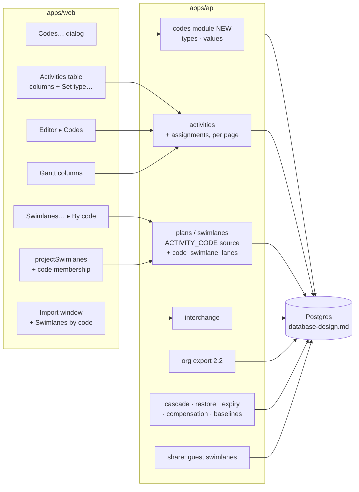
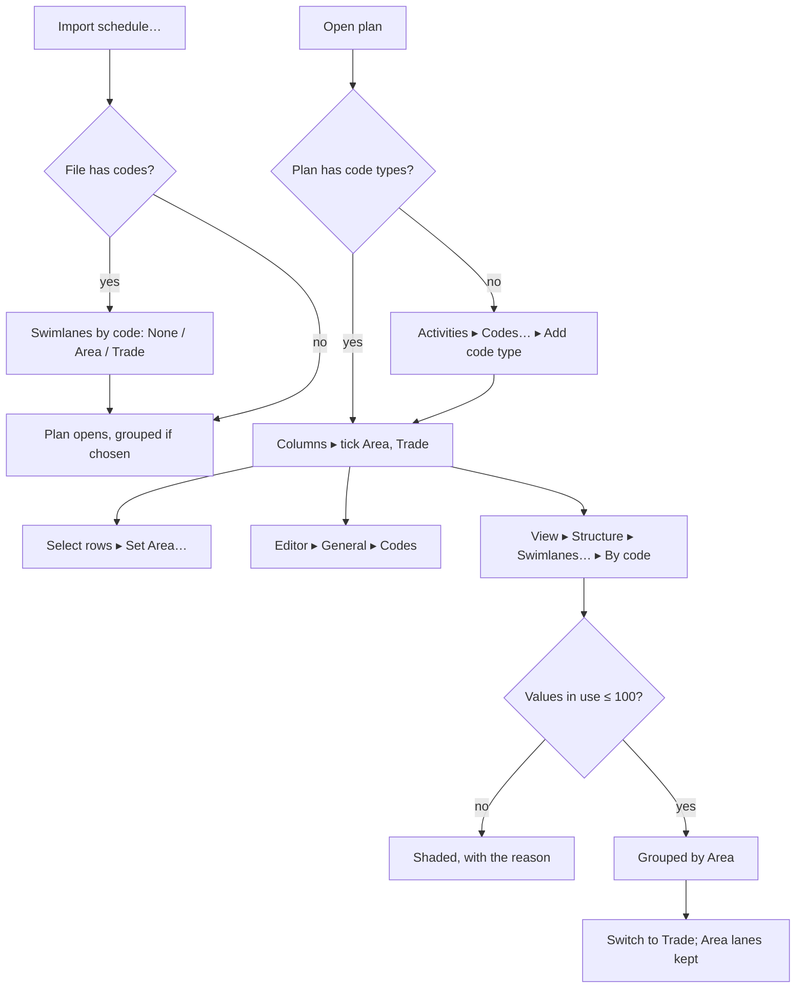

# Feature Spec: P6 activity codes, kept in the plan

- **Status:** Draft — awaiting approval before implementation
- **Author(s):** Feature Analyst (Claude Code), for James Ewbank (product owner)
- **Date:** 2026-10-27 (revised twice the same day: the owner chose to keep the codes in the plan; then
  the database design landed and is folded in, §7)
- **Tracking issue / epic:** none yet; `docs/BACKLOG.md:245-252` ("Swimlanes from P6 activity codes")
- **Roadmap link:** `docs/ROADMAP.md`, schedule interchange (ADR-0050) and diagram authoring (ADR-0206)
- **Companion documents:**
  - [`plan.md`](./plan.md): the implementation plan.
  - [`database-design.md`](./database-design.md): the schema, by the database-architect agent
    (Draft, 2026-10-27). **It is the authority for every table, column, key, CHECK, index, lock order and
    migration step.** Where this spec and it disagreed, the design won; §7 lists each conflict.
- **Related ADR(s):** **one new ADR is required** (outline in §4.12). It amends ADR-0206 (a third
  swimlane source, and code lanes in their own table), ADR-0050 (the activity-code mapping row),
  ADR-0194 (organisation export 2.1 → 2.2), ADR-0156 (the swimlanes layout field gains a source value),
  ADR-0025 if Q1 is "yes", and ADR-0051 §4 if Q6 is "yes". Builds on ADR-0012, ADR-0018, ADR-0028,
  ADR-0048/0176, ADR-0071 §5, ADR-0073, ADR-0076, ADR-0081, ADR-0088 D1, ADR-0096, ADR-0107, ADR-0116,
  ADR-0172, ADR-0174, ADR-0192, ADR-0193, ADR-0201.
- **Base:** the working tree on 2026-10-27. Every `file:line` below was read on that tree.

---

## Questions for the owner: answer these in one go

**Already answered (2026-10-27, relayed by the coordinating agent):** keep the codes in the plan;
swimlane name = the value's description, else its short code; no real P6 file yet, so anything that
depends on an unconfirmed P6 column waits for M0. These set this draft's direction; they are not
approval of the spec.

Still open. Each has a recommended answer; "yes to all recommendations" is a complete reply.

| #       | Question (plain English)                                                                                                                                                                                                                                                                                                                                                                                                                                                                                                                                                                                                                                                                 | Recommended answer                                                                                                                                                                                                           |
| ------- | ---------------------------------------------------------------------------------------------------------------------------------------------------------------------------------------------------------------------------------------------------------------------------------------------------------------------------------------------------------------------------------------------------------------------------------------------------------------------------------------------------------------------------------------------------------------------------------------------------------------------------------------------------------------------------------------- | ---------------------------------------------------------------------------------------------------------------------------------------------------------------------------------------------------------------------------- |
| **Q1**  | **Should a baseline remember each activity's codes?** The database design recommends **yes** (DB-2); my first draft said **no**. _For yes:_ when you compare against a baseline, deleted work can still be drawn in the right code swimlane, and a later "Area changed since the baseline" report would work for baselines taken from now on. _For no:_ less storage and faster baselines; deleted work in a code swimlane is counted instead of drawn. _Size:_ a baseline of a 5,000-activity plan with 30 codes copies **150,000 rows**; a typical plan (2,000 activities, 10 codes, 12 baselines) holds about 48 MB of copies; the largest allowed case is about 0.7 GB for one plan. | **Yes**, on one condition: before release, one baseline of the largest plan must take no more than **1 extra second**. If it does not, baselines remember only the code the swimlanes are drawn from (one row per activity). |
| **Q2**  | **Codes per plan, or shared across the organisation** (like the resource library)?                                                                                                                                                                                                                                                                                                                                                                                                                                                                                                                                                                                                       | **Per plan.** Shared can be added later without losing data, at about twice the work (DB-1).                                                                                                                                 |
| **Q3**  | **Someone deletes the code the swimlanes are currently drawn from. What happens?**                                                                                                                                                                                                                                                                                                                                                                                                                                                                                                                                                                                                       | **Refuse, with a message**: "The swimlanes are made from Area. Choose another swimlane source first." (DB-3)                                                                                                                 |
| **Q4**  | **Limits:** at most **100 codes per plan** and **1,000 values per code**. An import keeps only the codes this project's activities use, and only the values in use (plus their parent values); anything over a limit is left out and named in the import report.                                                                                                                                                                                                                                                                                                                                                                                                                         | **Yes.** (DB-4)                                                                                                                                                                                                              |
| **Q5**  | **Store codes before we have a real P6 file?** The database needs a maximum length for a value's short code and description. Without a real file the design uses 80 and 255 characters and leaves out "parent value". If a real file later needs more, that costs one small extra database change. Waiting instead holds up the whole feature until a file arrives.                                                                                                                                                                                                                                                                                                                      | **Don't wait.** Build storage, screens and swimlanes now with those limits; only importing and exporting P6 files wait for the real file.                                                                                    |
| **Q6**  | **Share-link guests:** see swimlanes made from codes (names only, never the codes themselves)?                                                                                                                                                                                                                                                                                                                                                                                                                                                                                                                                                                                           | **Yes**, as for hand-made swimlanes.                                                                                                                                                                                         |
| **Q7**  | **When grouped by a code, does dragging a bar into another swimlane change its code?**                                                                                                                                                                                                                                                                                                                                                                                                                                                                                                                                                                                                   | **No.** The drag stops at the swimlane edge (as when grouped by WBS). You change a code on purpose with "Move to swimlane…", "Set Area…" or the editor.                                                                      |
| **Q8**  | **Offer "Swimlanes by code" in the import window**, so the plan opens already grouped?                                                                                                                                                                                                                                                                                                                                                                                                                                                                                                                                                                                                   | **Yes**, defaulting to "None". It is the same live grouping you could choose afterwards.                                                                                                                                     |
| **Q9**  | **What do we call them on screen?** "Activity code" already means an activity's ID here.                                                                                                                                                                                                                                                                                                                                                                                                                                                                                                                                                                                                 | **"Codes"** ("Codes…", the editor's "Codes" section), with "P6 activity codes" in hints; each code shows under its own name ("Area").                                                                                        |
| **Q10** | **MS Project files:** carry codes, or say plainly they are not carried?                                                                                                                                                                                                                                                                                                                                                                                                                                                                                                                                                                                                                  | **Say they are not carried** (one line in the report) until someone gives us a real MS Project file that uses its equivalent.                                                                                                |
| **Q11** | **Nested P6 values** (Building A ▸ Level 1): keep the nesting?                                                                                                                                                                                                                                                                                                                                                                                                                                                                                                                                                                                                                           | **Store the parent if the real P6 file has one, but show the values flat at first.** A nesting dropped at import cannot be recovered later.                                                                                  |

---

## 0. Vocabulary: read this first

**"Activity code" already means something else in SchedulePoint.** It is the activity's own
identifier: P6's _Activity ID_, imported from `TASK.task_code` (`packages/interchange/src/xer-adapter.ts:547-557`),
stored as `activities.code`, shown or hidden by `View ▾ ▸ Markers ▸ Activity codes`
(`docs/adr/0157-a-marks-class-is-its-hue-and-its-shape.md:66`), and the key ADR-0129 D1 matches two
imports on.

In Primavera P6, **"Activity Codes"** are **labels a planner attaches to activities to sort and group
them**: _Area_ (Level 1, Level 2, Roof), _Trade_ (Civil, Mechanical, Electrical), _System_ (HVAC, Fire).

| P6 table   | What it holds                                        | Called here       | Table (database-design.md)      |
| ---------- | ---------------------------------------------------- | ----------------- | ------------------------------- |
| `ACTVTYPE` | one row per kind of label: "Area", "Trade"           | a **code type**   | `code_types` (§5.2)             |
| `ACTVCODE` | one row per value of a kind: "Level 1", "Mechanical" | a **code value**  | `code_values` (§5.3)            |
| `TASKACTV` | which value each activity carries, per code type     | an **assignment** | `code_value_assignments` (§5.4) |

Rules:

1. **Copy never says bare "activity code" for the classification.** The product word is Q9 (default
   **"Codes"**). A code type appears under its own name wherever possible: the column is headed "Area".
2. **Identifiers are `codeType*`, `codeValue*`, `codeValueAssignment*`, `codeSwimlaneLane*`**, never
   `activityCode*` (the design follows this, `database-design.md:19-23`). The one exception is the enum
   label `ACTIVITY_CODE` on `SwimlaneSource` (design §5.1), which names the P6 concept as a source.
3. **"Activity code" without "P6" keeps its present meaning**: the activity's identifier.

---

## 1. Business understanding

### Problem

A P6 programme is often organised by activity codes (area, trade, system) rather than by its WBS.
Planners use codes to group, sort and filter. Since 2026-10-25 SchedulePoint draws labelled swimlanes
(ADR-0206), by hand or one per WBS group. But SchedulePoint has nowhere to keep a code: an imported P6
file loses them, and a plan built in SchedulePoint cannot be classified except by WBS or hand-made
swimlane. There is no way to say "show me this by Area, now by Trade".

**Re-verified against the code, not the backlog's wording (CLAUDE.md §19.11):**

- **There is no model for codes.** `schema.prisma` has none; `gantt-editing` recorded "No data model for
  activity codes exists" (`docs/specs/gantt-editing/feature-spec.md:184`). Grouping today is the WBS
  (`features/wbs/model/wbs-groups.ts`) or hand-made swimlanes (`activities.swimlane_id`,
  `schema.prisma:1348-1356`).
- **The XER reader keeps every table**, "so unknown tables survive as rows"
  (`packages/interchange/src/xer-parser.ts:102-109`, `:272-277`).
- **The adapter ignores the code tables.** Its list is `PROJECT`, `TASK`, `TASKPRED`, `CALENDAR`,
  `PROJWBS`, `RSRC`, `TASKRSRC`, `TASKMEMO`, `MEMOTYPE` (`xer-adapter.ts:43-55`) plus `UDFTYPE`/`UDFVALUE`
  (`xer-layout-fields.ts:219`). `ACTVTYPE|ACTVCODE|TASKACTV|actv_code` matches nothing in the code
  (only `docs/BACKLOG.md` and `docs/specs/swimlanes/feature-spec.md:813`).
- **And the drop is silent, contrary to ADR-0050**, whose table says activity codes are "dropped +
  reported" (`docs/adr/0050-schedule-interchange-canonical-model.md:138`) under a no-silent-loss rule
  (`:31-37`). Foreign UDFs are reported (`xer-layout-fields.ts:252-256`); codes are not;
  `importXer`'s report has no other source (`import-xer.ts:217-222`). **The backlog row missed this.**
- **Neither export writes codes**; nothing reads MSPDI outline codes (`ExtendedAttribute|OutlineCode`
  matches nothing in `packages/interchange/src`).
- **No real P6 file with activity codes is in the repository.** The P6 fixture's tables are `PROJECT,
CALENDAR, PROJWBS, TASK, TASKPRED, RSRC, TASKRSRC` (`p6_torture_test_v1.xer` `%T` lines 2, 5, 15, 35, 163,
  353, 377). §3 lists which columns are confirmed publicly and which wait for M0 (ADR-0071 §5 precedent;
  the owner's answer).

### Users

| Role                    | What they do with codes                                                                                                                                                                          |
| ----------------------- | ------------------------------------------------------------------------------------------------------------------------------------------------------------------------------------------------ |
| **Planner / Org Admin** | Import a P6 file and keep its codes; create and edit code types and values; assign values (one at a time or in bulk); show swimlanes by a code and switch later. Writes need the pen (ADR-0028). |
| **Contributor**         | Sees codes; turns code columns and the swimlane toggle on or off for their own view. No code writes (a Contributor's write is progress, `PROGRESS_WRITE`, `org-permissions.ts:254`).             |
| **Viewer**              | Read only.                                                                                                                                                                                       |
| **External Guest**      | Sees code swimlanes by name if Q6 is "yes"; never the code fields.                                                                                                                               |

### Primary use cases

1. **Import keeps the codes**, with every activity's values.
2. **Open already grouped** by one code chosen in the import window (Q8), as a live grouping.
3. **See codes** as table and Gantt columns and in the activity editor.
4. **Edit codes**: add a code type and values; correct an activity's Trade; set a value on many rows.
5. **Switch grouping**: by Area, then by Trade, then back, each picture kept.
6. **Take codes out** again: SchedulePoint's XER and the organisation export carry them.

### User journeys

**Happy path.**

1. Project ▸ **Import schedule…** ▸ choose `Tower-B-rev7.xer`. The report says "3 code types kept (Area,
   Trade, System); 1,208 assignments". Step 1 offers **Swimlanes by code: None ▾** (Q8); the planner
   chooses **Area**.
2. **Import**: the plan opens with swimlanes by Area, one per value in use, named by description, "No
   Area" last. The plan's swimlane source is the live `ACTIVITY_CODE` source, pointing at Area.
3. Activities ▸ **Columns** ▸ tick **Trade**: a column headed Trade appears.
4. Diagram ▸ `View ▾ ▸ Structure` ▸ **Swimlanes…** ▸ **By code: Trade** ▸ Apply. The diagram regroups.
   Switching back to Area returns the Area picture as it was left (design §5.5).

**Alternates.**

- **Built in SchedulePoint:** Activities ▸ **Codes…** ▸ **Add code type** "Trade" ▸ add values ▸ select
  rows ▸ **Set Trade…** ▸ Mechanical.
- **Editor:** open an activity ▸ General ▸ **Codes** ▸ choose its Area.
- **A file with no codes:** nothing changes, byte for byte (SC-2).
- **A code type with more than 100 values in use** cannot be a swimlane source (`SWIMLANE_LIMIT`,
  `apps/api/src/modules/swimlanes/dto/reorder-swimlanes.dto.ts:15`): offered shaded with that reason; its
  codes are still kept and shown (design §15 D3: a service rule).

### Expected outcomes

- A P6 programme's codes survive import and drive grouping in SchedulePoint.
- Planners classify activities in SchedulePoint as P6 users do.
- The import report stops hiding codes (ADR-0050).
- No change to dates, logic, float or the critical path.

### Success criteria

- **SC-1 (keep).** Importing the M0 fixture stores every code type this project's activities use, every
  value in use and its parents, and every assignment, within the Q4 limits; everything else is named in
  the report with a reason.
- **SC-2 (parity, no codes).** For a file without code tables and a plan with no code types: the import
  graph, the persisted plan, every existing API response (new fields absent, not empty) and the report
  are byte-identical to today. Held by `packages/interchange/src/golden/fc7-rich-export.pre-epic.xer` and
  new parity cases.
- **SC-3 (parity, engine).** `computeSchedule` is untouched. The new columns are classified `NOT_INPUT` in
  `apps/api/src/common/schedule-inputs/schedule-input-fields.ts` (beside `swimlaneSource`, `:72-73`),
  which makes an unclassified field a compile error. Dates and the critical set of a plan with codes
  equal those without.
- **SC-4 (switch is lossless).** Area → Trade → Area returns every Area lane with **no write**: lanes are
  kept per (type, value) in `code_swimlane_lanes` (design §5.5).
- **SC-5 (cost).** Measured, not estimated (ADR-0142; design §12):
  - **Import commit:** a 5,000-activity, 30-code-type file through the real write path. The database
    probe's **lower bound for inserting 150,000 assignments was 6.4 s** inside the commit transaction
    (≈ 3.6 s for three foreign-key checks per row, ≈ 2.8 s index maintenance with random v4 keys;
    design §12 item 2). Real v7 keys and `createMany` batching move it in opposite directions, so the
    milestone records the figure and the owner sees it before release. **Ceiling (proposed): the whole
    commit for that file stays under the import's interactive-transaction timeout,
    `TRANSACTION_TIMEOUT_MS` = 15 s (`interchange.service.ts:525`), with headroom for the rest of the
    commit** — 6.4 s for assignments alone already spends over 40 % of it. The measured figure goes into
    the ADR; if it does not fit, the owner chooses (for example a lower per-import cap) before release.
  - **Reads:** the plan's assignment load ≤ 65 ms at 150,000 rows and a page's ≤ 6 ms per 200
    activities (probed, design §5.4); swimlane membership for one source type ≤ 10 ms at 5,000
    activities (probed 8.0 ms, design §9.2); p95 < 200 ms end to end (CLAUDE.md §15).
  - **Dry-run:** no more than 10 % slower for a 2,000-activity, 20-type file than without code tables.
  - **Baseline capture (if Q1 is yes):** ≤ 1 s added for 150,000 rows (design §12 item 4).
  - **Migration B's duration** on the seeded catalogue and the deployed host's activity count, dominated
    by the `activities (plan_id, id)` index build (probed 44 ms per 50,000 rows, design §10.2).
- **SC-6 (export).** The organisation export (format 2.2) carries every new table; the census passes
  (`export-census.structural.spec.ts:178`, `:277`; design §11).
- **SC-7 (round trip).** SchedulePoint XER → SchedulePoint: the same types, values and assignments,
  matched by activity code (ADR-0129). P6 and MSPDI as stated in §4.9.

---

## 2. Functional requirements

### User stories and acceptance criteria

> **US-1. Import keeps the codes.** As a Planner importing a P6 programme, I want its codes kept.
>
> - **Given** a file whose activities carry Area values, **when** I dry-run, **then** the report names the
>   code types kept and counts values and assignments, and names what it leaves out (types no activity
>   uses, values not in use, anything over the Q4 limits, the P6 scope) with reasons.
> - **Given** I confirm, **then** the new plan holds them.
> - **Given** a file with no code tables, **then** nothing changes (SC-2).

> **US-2. See codes.** As anyone who can read the plan, I want to see each activity's codes.
>
> - **Given** a plan with code types, **then** the Activities table's and the Gantt's column choosers
>   offer each type under its own name, off by default.
> - **Given** I open an activity, **then** General ▸ **Codes** lists each type with its value or "None".

> **US-3. An imported code drives live swimlanes.** As a Planner importing a P6 programme, I want to
> choose one of its codes in the import window and have the plan open grouped by it, and stay grouped
> by it as codes change. _(Rewritten: an imported code swimlane is the live `ACTIVITY_CODE` source,
> design §15 D3, not hand-made swimlanes as in this spec's first draft.)_
>
> - **Given** the dry-run lists Area with 1–100 values in use, **when** I choose "Swimlanes by code: Area"
>   and import, **then** the plan's swimlane source is `ACTIVITY_CODE` pointing at Area, and the diagram
>   shows one swimlane per value in use, in value order, named by description (short code when the
>   description is missing or too long for a swimlane name), and "No Area" last.
> - **Given** that plan, **when** I later change an activity's Area value, **then** it moves to that
>   value's swimlane: its remembered lane there if free, else the nearest free lane (ADR-0206 A4).
> - **Given** I rename a value, **then** its swimlane's name follows with no write.
> - **Given** I add a value and assign it, **then** a swimlane for it appears.
> - **Given** I left the choice on "None", **then** the plan's source is `NONE`, as today.

> **US-4. Edit codes.** As a Planner holding the pen, I want to create code types and values and assign
> them.
>
> - **Given** the pen, **when** I open **Codes…**, **then** I can add, rename, reorder, delete and
>   restore types and values.
> - **Given** a selection, **when** I choose **Set Area…**, **then** each selected activity gets that value
>   (or "None") in one write and one undo step, and each activity's version moves (design §5.4).
> - **Given** no pen, **then** every write control is shaded with the pen reason (ADR-0112, ADR-0204).

> **US-5. Switch grouping.** As a Planner, I want to show swimlanes by one code and switch later.
>
> - **Given** a type with 1–100 values in use, **when** I choose **By code** in Swimlanes…, **then** the
>   diagram groups by it.
> - **Given** I switch to Trade and back, **then** the Area picture returns with no write (SC-4).
> - **Given** a code source, **when** I drag a bar, **then** it stops at its swimlane's edge (Q7).

> **US-6. Take codes out.** As a Planner, I want codes to leave in my exports.
>
> - **Given** an XER export, **then** the file carries them as P6 project codes, and re-importing it gives
>   the same codes and, for a code-sourced plan, the same grouping (SC-7).
> - **Given** an MSPDI export, **then** the report says codes were not written (Q10).
> - **Given** an organisation export, **then** it includes every new table (SC-6).

### Workflows

- **Import:** dry-run reads and reports; the optional "Swimlanes by code" choice re-runs the dry-run (the
  existing rule, `ImportScheduleDialog.tsx:116-118`, `:189-194`); commit writes types, values,
  assignments and, if chosen, the plan's source in the existing transaction; compensation removes them
  (design §8.4).
- **Manage:** **Codes…** dialog; add type → values (short code, description) → order.
- **Assign:** editor Codes group (per-scope save, ADR-0060); table bulk **Set <type>…** (the
  `SwimlaneBulkAssignBar` pattern). Every assignment write is an **activity write**: it holds the
  activity row lock, bumps `activities.version`, and is recorded in activity history (design §5.4, D7).
- **Swimlane source:** "Where swimlanes come from" (`SwimlaneSourceFields.tsx:52-75`) gains **By code**.

### Edge cases

| Case                                                                               | Behaviour                                                                                                                                                                                                                                                           |
| ---------------------------------------------------------------------------------- | ------------------------------------------------------------------------------------------------------------------------------------------------------------------------------------------------------------------------------------------------------------------- |
| P6 Global, EPS and Project code types                                              | All three **copied into the plan**; the P6 scope is **reported, not stored** (design §4.1, §15 D2).                                                                                                                                                                 |
| Types no activity of this project uses; values not in use                          | Left out, counted (Q4 / DB-4). A used value's parents are kept, if parents are stored (Q11).                                                                                                                                                                        |
| Over 100 types or 1,000 values per type                                            | The overflow is left out and named, with the true total (ADR-0116). The caps are a service count under the plan advisory lock (design §5.2).                                                                                                                        |
| An assignment for another project's task, or naming an unknown task, type or value | Ignored, counted (the `NoteCollector.orphan` pattern, `xer-adapter.ts:641-643`).                                                                                                                                                                                    |
| Two values of one type on one activity                                             | First by file order kept; the rest counted as a `repair`. The database refuses a second (`23505`, probed, design §3 item 2).                                                                                                                                        |
| Names the database would refuse                                                    | Repaired where safe (trim; empty description → NULL, design §5.3), else left out and counted. Never a constraint error that rolls the import back. Pure helpers are held at least as strict as the CHECKs, as `isSwimlaneName` is (`xer-layout-fields.ts:106-128`). |
| Type names or short codes differing only by case                                   | Folded and suffixed, counted; the unique indexes are case-insensitive (design §5.2, §5.3). If M0 shows P6 treats `l1` and `L1` as distinct in real files, revisit before migration B lands (design §5.3).                                                           |
| Deleting a value activities carry                                                  | Allowed. Its activities read as "no value" and, under a code source, draw in "No <type>"; restoring the value brings them back to their lanes (design §8.3).                                                                                                        |
| Deleting the type swimlanes are drawn from                                         | Refused, 409 `CODE_TYPE_IS_SWIMLANE_SOURCE` (Q3 / DB-3).                                                                                                                                                                                                            |
| A **new** assignment to a deleted value                                            | Refused (design §5.3, §15 D4).                                                                                                                                                                                                                                      |
| Restoring an activity whose value was deleted meanwhile                            | Admitted; reads "no value" until the value is restored (ADR-0206 A8 reasoning, stated for codes in the new ADR so ADR-0201 D1 is not read as covering them, design §8.2).                                                                                           |
| Restoring a value whose type or parent is deleted; a type under a deleted plan     | Refused `PARENT_DELETED` (design §8.2).                                                                                                                                                                                                                             |
| Copy and paste across plans                                                        | Assignments are dropped and counted; the composite keys would refuse them (`23503`), so the service decides first (design §15 D9). Within a plan they are kept.                                                                                                     |
| WBS summaries                                                                      | May carry codes from P6; kept. Never members of a code swimlane (no bar in the lane model, ADR-0206 B12).                                                                                                                                                           |
| A code-sourced plan opened by the **previous** release after a rollback            | It cannot read that plan (unknown enum value). Rollback runbook in §4.10 (design §13).                                                                                                                                                                              |
| A newer SchedulePoint XER opened by an older SchedulePoint                         | The older reader discards an unknown swimlane source (`xer-layout-fields.ts:150-175`); hence reader before writer (§4.9).                                                                                                                                           |

### Permissions

Proposed, finalised with security-reviewer at M2 (ADR-0012, deny by default, org-scoped on the plan):

| Permission                                                  | Granted to         | Covers                                           |
| ----------------------------------------------------------- | ------------------ | ------------------------------------------------ |
| `code:read`                                                 | every member       | code types and values                            |
| `code:create`, `code:update`, `code:delete`, `code:restore` | Planner, Org Admin | manage types and values                          |
| `activity:update` (existing)                                | Planner, Org Admin | assignments (an assignment is an activity write) |
| `interchange:import` (existing)                             | Planner, Org Admin | import keeps codes                               |

Mirrors `swimlane:*` (`org-permissions.ts:149-153`, `:200`, `:242-245`). **The pen:** every code write is
pen-gated; showing columns and the swimlane toggle are view state; a source switch is a plan write under
the pen, as today. **Guests** never receive code fields; if Q6 is yes, the guest view's swimlane list
carries code-sourced swimlane names and derived membership only (ADR-0205; `share/dto/guest-plan.dto.ts:119`,
`:178-184`).

### Validation rules

From the design (it wins over this spec's first draft, §7):

| Field                            | Rule                                                                                                     | Where                                                                                                                                      |
| -------------------------------- | -------------------------------------------------------------------------------------------------------- | ------------------------------------------------------------------------------------------------------------------------------------------ |
| Type name                        | 1–80 chars, trimmed, no control characters; unique per plan ignoring case, live rows                     | `ck_code_types_name_shape`, `uq_code_types_plan_name` (design §5.2)                                                                        |
| Value short code                 | 1–80 chars, same shape; unique per type ignoring case, live rows                                         | `ck_code_values_short_code_shape`, `uq_code_values_type_short_code` (§5.3). **80 is provisional until M0** (Q5)                            |
| Value description                | NULL or 1–255 chars, same shape; empty stored as NULL                                                    | `ck_code_values_description_shape` (§5.3). **255 is provisional until M0** (Q5)                                                            |
| Parent value                     | same type; not itself; acyclic; depth ≤ 10; parent live                                                  | composite key + `ck_code_values_parent_not_self`; the rest service-held (§5.3). **Column exists only if M0 confirms P6 has one** (Q5, Q11) |
| Types per plan / values per type | ≤ 100 / ≤ 1,000 live                                                                                     | service count under the plan advisory lock (Q4)                                                                                            |
| Assignment                       | one per (activity, type); value of that type; same plan                                                  | `uq_code_value_assignments_plan_activity_type` + composite keys (§5.4)                                                                     |
| Code swimlane lane               | `lane_index ≥ 0` (≤ 10,000 in the DTO)                                                                   | `ck_code_swimlane_lanes_lane_index_nonneg` (§5.5)                                                                                          |
| Swimlane source by code          | live type, same plan, 1–100 values in use                                                                | CHECK binds source and pointer (§5.7); the count is a service rule                                                                         |
| Swimlane name from a value       | description if `isSwimlaneName` accepts it (≤ 80), else the short code; the column stores the whole text | derivation, pure (`@repo/layout`)                                                                                                          |

Shared client ↔ server via `@repo/types` (Zod / `class-validator`).

### Error scenarios

| Scenario                           | Detection                                                                  | User-facing result                        | Status                                            |
| ---------------------------------- | -------------------------------------------------------------------------- | ----------------------------------------- | ------------------------------------------------- |
| Not a member / lacks permission    | guards                                                                     | existing message                          | 403 / 404                                         |
| No pen                             | write gate                                                                 | "Take the pen to edit codes."             | 409                                               |
| Duplicate type name / short code   | partial unique                                                             | "A code type called Area already exists." | 409 `CODE_TYPE_NAME_TAKEN` / `CODE_VALUE_TAKEN`   |
| Stale version                      | optimistic lock (type/value `version`; activity `version` for assignments) | "Someone changed this. Reload to see it." | 409                                               |
| Value of another type or plan      | composite keys + service                                                   | "That value does not belong to Area."     | 422                                               |
| Delete the source type             | service, plan advisory lock                                                | Q3 message                                | 409 `CODE_TYPE_IS_SWIMLANE_SOURCE`                |
| Assign a deleted value             | service                                                                    | "That value was deleted."                 | 409 / 422 (design §15 D4; api-reviewer picks one) |
| Restore under a deleted parent     | service                                                                    | "Restore Area first."                     | 409 `PARENT_DELETED`                              |
| Code source over 100 values in use | service                                                                    | shaded with reason; refused if sent       | 422                                               |
| Over a limit                       | service                                                                    | names the limit                           | 422                                               |

---

## 3. Technical analysis

| Area           | Impact   | Notes                                                                                                                                                                                    |
| -------------- | -------- | ---------------------------------------------------------------------------------------------------------------------------------------------------------------------------------------- |
| Frontend       | high     | Code columns (table, Gantt); editor Codes group; **Codes…** dialog; bulk **Set <type>…**; **By code** source card; import-window choice; projection by code value.                       |
| Backend        | high     | New `codes` module; activity writes carry assignments; swimlane source switch; interchange read/write; cascade, restore, expiry, compensation; audit, history, undo.                     |
| Database       | **high** | Four new tables (six if Q1 yes), one `activities` index, two plan/baseline columns, one enum label, two widened CHECKs, **two migrations** (design §1, §10).                             |
| API            | med–high | New plan-nested routes; activity list gains per-page assignments; membership per source type (design §9.3); import option; OpenAPI, `docs/API.md`. Additive.                             |
| Security       | med      | IDOR on new ids; hostile-file input; guest projection.                                                                                                                                   |
| Performance    | med      | Import commit cost (SC-5: 6.4 s lower bound); payload (150,000 triples ≈ 11 MB if loaded whole, design §9.3); baseline copy (Q1).                                                        |
| Infrastructure | low      | No new service. A new rollback note in `docs/DEPLOYMENT.md` (design §13).                                                                                                                |
| Observability  | low      | Commit, switch and expiry log lines gain counts.                                                                                                                                         |
| Testing        | high     | Pure unit; API e2e with constraint probes; censuses (export, expiry, audit, history, `schedule-input-fields`); test-helper pins (design §8.5); journeys per milestone; ADR-0111 reviews. |

### Which P6 columns are known, and which wait for M0

Searched 2026-10-27 (Planning Planet threads; URLs in `plan.md` M0-T1). Only the left column may be
coded before M0.

| Confirmed by public sources                                                                                                                                       | Not confirmed (waits for M0)                                                               |
| ----------------------------------------------------------------------------------------------------------------------------------------------------------------- | ------------------------------------------------------------------------------------------ |
| Tables `ACTVTYPE`, `ACTVCODE`, `TASKACTV`                                                                                                                         | `ACTVCODE` short code column (believed `short_name`) and its real maximum length           |
| `TASKACTV`: `task_id`, `actv_code_type_id`, `actv_code_id`, `proj_id`                                                                                             | `ACTVCODE` description column (believed `actv_code_name`) and its length                   |
| `ACTVTYPE`: `actv_code_type_id`, `actv_code_type`, `actv_short_len`, `seq_num`, `proj_id`, `wbs_id`, `actv_code_type_scope` (`AS_Global`, `AS_EPS`, `AS_Project`) | `ACTVCODE` parent (believed `parent_actv_code_id`) and order (believed `seq_num`)          |
| `ACTVCODE.actv_code_type_id` links to its type                                                                                                                    | One value per type per activity guaranteed by P6? Case-distinct short codes in real files? |

**What depends on M0** (owner's answer 3; design §5.3):

- **Two CHECK bounds** in migration B: short code ≤ 80 and description ≤ 255 are **placeholders**; if a
  real file shows larger, the CHECKs widen before migration B lands, or (Q5's recommended path, if B has
  already landed) in a small expand-only follow-up migration.
- **The `code_values.parent_id` column** is created only if M0 confirms a parent column.
- **The case-folding unique** on short codes is revisited if real files carry case-distinct codes.
- **Import of values (M5) and the XER writer (M6).** M1 (report) uses confirmed columns only.

### Dependencies

- **Exists (verified):** swimlanes with sources, projection, guests, XER layout fields (ADR-0206;
  `schema.prisma:716-739`, `:3899-3996`); import swimlane persistence (`interchange.service.ts:686-735`);
  the org-export, expiry, audit and history censuses.
- **Needs:** owner answers Q1, Q3–Q5 before migration B (they change its contents); a real P6 export for
  M0 (owner, when available).
- **Affected:** Activities table, Gantt grid columns (`features/gantt/layout/grid-columns.ts:154-163`),
  activity editor (`features/activities/lib/activity-editor-intent.ts:18-28`), swimlane setup
  (`features/swimlanes/components/SwimlaneSourceFields.tsx`), import dialog, undo (`features/undo-redo/commands.ts`),
  activity history, audit, guest DTOs, interchange, org export, expiry runner, hierarchy lifecycle,
  baseline capture, test helpers.
- **Not affected:** engine, calendars, resources, levelling, Earned Value.

---

## 4. Solution design

### 4.1 Architecture overview



The `codes` module follows `modules/swimlanes` (plan-nested, pen-gated, soft delete, restore, versions)
and `modules/clients` for layering (ADR-0057). **Assignments are not a module of their own**: they are
written through activity writes (design §5.4), so the activity's version is their lock and its history
records them.

### 4.2 Data flow: set a value under a code source

```mermaid
sequenceDiagram
  participant P as Planner (pen)
  participant H as Workspace host
  participant L as @repo/layout
  participant A as API
  participant DB as Postgres
  P->>H: Set Area… → Level 2 (8 selected)
  H->>L: remembered lane for (Area, Level 2) if free, else nearestFreeRow
  H->>A: PATCH …/activities/codes [{activityId, version, codeTypeId, codeValueId}] + lanes
  A->>A: RBAC + scope + pen
  A->>DB: plan advisory lock → activities FOR NO KEY UPDATE (id order) → code type → values FOR SHARE (id order)
  A->>DB: upsert assignments; upsert code_swimlane_lanes; bump activities.version; history items
  A-->>H: 200 (new versions)
  H->>H: one undo step; projection by code value
```

Lock order is the design's (§15 "Lock order").

### 4.3 User flow



### 4.4 Import and the report

1. **M1, report only:** read `ACTVTYPE` and `TASKACTV` (confirmed columns); one `drop` names the code
   types and counts assignments, replacing today's silence. No storage.
2. **M5, keep:** read all three tables (M0 columns) into an optional canonical `codeTypes`, filtered to
   the imported project (`xer-adapter.ts:467-470`, `:636-637` pattern), absent when the file has none
   (`:831` precedent). Keep only used types and in-use values plus parents (Q4); apply the §2 repairs.
3. **Choice (Q8):** an optional `swimlaneCodeType` field (a source key from that file's dry-run) on dry-run
   and commit, sets the new plan's source to `ACTIVITY_CODE` with that type.
4. **Commit** inside the existing transaction (`interchange.service.ts` phase 3a, `:686-735`): types,
   values (parents first), activities, assignments (`createMany`), then the plan's source pointer. The
   cost is SC-5's 6.4 s lower bound at the cap, measured in M5.
5. **Compensation** (`:1655-1690`) gains, in the design's order (§8.4): code lanes and assignments by
   plan → … activities → swimlanes → **clear the plan's pointer** → values → types → plan. The API e2e
   includes a failed import that carried codes **and** chose a code source (the pointer path).
6. **The dialog trap.** `carriesLayout` (`ImportScheduleDialog.tsx:86-94`, `:146`) treats any swimlane
   count as "came from SchedulePoint". A code-sourced import must not show "Restore the SchedulePoint
   layout" for a P6 file; the report says where swimlanes came from, and `carriesLayout` reads only the
   carried ones. A component case and the journey pin it.

### 4.5 Swimlanes by a code

- **A third source**, `ACTIVITY_CODE`, with `plans.swimlane_code_type_id` bound to it by the replaced
  `ck_plans_swimlane_source_level` (design §5.1, §5.7). Same plan by a composite key using the plan's
  own `id` (Prisma acceptance unprobed; fallback in §4.11).
- **Code lanes have their own table**, `code_swimlane_lanes`, keyed `(plan, activity, type, value-or-NULL)`
  with `NULLS NOT DISTINCT` (design §5.5). **No new `SwimlaneLaneBasis` labels and no change to
  `activity_swimlane_lanes`** — this replaces the first draft's "two new lane bases" (§7). Reason: widening
  that table rebuilds its unique index and breaks the **previous** image's lane upsert on every plan
  (`42P10`, probed), making the release unsafe to roll back. The new ADR amends ADR-0206 A2's wording.
- **Membership** is the activity's assignment for the source type; a deleted value reads as none.
- **Placement** reuses `deriveSwimlaneLanes`, materialise-on-write, the stale-row rule (ADR-0206 A4), the
  partition (A5) and auto-resolve (A6); `@repo/layout` gains the code-membership key beside the WBS walk.
- **Order and names:** value order; description, else short code (owner's answer).
- **Writes under a code source:** drag stops at the edge (Q7); **Move to swimlane…** / **Set <type>…** write
  the assignment and the lane together, one undo step.
- **Ghosts:** if Q1 is yes, removed work is placed from the frozen assignments and code lanes (design
  §6.2); baselines taken before read `code_snapshot_level = 'NONE'` and their removed work is counted
  (ADR-0127). If Q1 is no, always counted.
- **Swimlane column** (`grid-columns.ts:154-163`) shows the value's name under a code source.
- **Baselines, unconditionally:** `ck_baselines_swimlane_snapshot_shape` is widened and
  `baselines.swimlane_code_type_id` added in the same release, **whatever Q1 says**, or the first baseline
  of a code-sourced plan fails with `23514` (design §6.1).

### 4.6 Database changes: the design's answers to this spec's questions

**No schema in this spec.** `database-design.md` is the authority. This spec's thirteen questions,
answered by reference:

| #      | Question                                                       | Answer in database-design.md                                                                                                                                                               |
| ------ | -------------------------------------------------------------- | ------------------------------------------------------------------------------------------------------------------------------------------------------------------------------------------ |
| DBQ-1  | Plan- or org-scoped                                            | **Plan** (DB-1 → owner Q2); §4.1–§4.3, including what adding the org tier later costs                                                                                                      |
| DBQ-2  | One value per activity per type as a constraint                | **Yes**: `uq_code_value_assignments_plan_activity_type`, type denormalised and held by a composite key (§3 item 2, §5.4; probed 23505/23503)                                               |
| DBQ-3  | Name shapes, lengths, uniqueness, where caps are enforced      | §5.2, §5.3: name/short code ≤ 80, description ≤ 255 (**provisional until M0**), case-insensitive partial uniques; caps a service count under the plan advisory lock (DB-4 → Q4)            |
| DBQ-4  | Same-plan guarantees                                           | Composite keys on every edge, via the new `uq_activities_plan_id_id` (§3 item 3, §5.6)                                                                                                     |
| DBQ-5  | New source, pointer, CHECK, migration order; type soft-deleted | §5.1, §5.7, §10.1: **migration A** adds the enum label alone ("unsafe use of new value", probed); **migration B** the rest. Deleting the source type is refused (DB-3 → Q3, §8.3)          |
| DBQ-6  | Lane bases                                                     | **No new bases**: a separate `code_swimlane_lanes` table (§5.5, §14 A; probed 42P10)                                                                                                       |
| DBQ-7  | Soft delete                                                    | Types and values soft-delete (a value with its live subtree, one batch); assignments and lanes are join rows with no lifecycle, kept (§8.2, §8.3, §14 H)                                   |
| DBQ-8  | Expiry and compensation order                                  | §8.1 (new runner order, `EXEMPT_EDGES` entry `'Plan→CodeType'` plus an assertion that the pointer is cleared before types are deleted; `ASSIGNMENT_ROWS_PER_ACTIVITY` budget charge), §8.4 |
| DBQ-9  | Nested values                                                  | `parent_id` kept **only if M0 confirms it**; stored even if the UI is flat (§5.3 → Q11)                                                                                                    |
| DBQ-10 | Baselines                                                      | §6: the CHECK widening is mandatory regardless (§6.1); freezing is DB-2 → **Q1**, with sizes and a fallback (§6.2)                                                                         |
| DBQ-11 | Indexes                                                        | §7.1 register; §7.2 deliberately not indexed                                                                                                                                               |
| DBQ-12 | Organisation export                                            | §11: format **2.2**, four new files (six with Q1), appended columns, `ACTIVITY_CODE` enum value                                                                                            |
| DBQ-13 | Lane-row growth                                                | §5.5 "Bound" (one to three rows per activity typically); lanes charged at `LANE_ROWS_PER_ACTIVITY` (§8.1)                                                                                  |

### 4.7 API changes

All `/api/v1/organizations/:orgSlug/plans/:planId/…` (the `swimlanes.controller.ts:56` shape), standard
envelopes. Following design §9.3 / §15 D6: **assignments travel with the activity page, and the diagram
loads membership for the source type only**, never every type of a large plan (≈ 11 MB at the cap).

| Method and path                                                                                  | Purpose                                                                                                                  |
| ------------------------------------------------------------------------------------------------ | ------------------------------------------------------------------------------------------------------------------------ |
| `GET …/code-types`                                                                               | types with their live values (`?include=deleted` for restore)                                                            |
| `POST …/code-types`, `PATCH …/code-types/:id`, `PATCH …/code-types/order`                        | create, rename, reorder                                                                                                  |
| `DELETE …/code-types/:id`, `POST …/code-types/:id/restore`                                       | soft delete (409 if swimlane source), restore                                                                            |
| `POST …/code-types/:id/values`, `PATCH …/code-values/:id`, `PATCH …/code-types/:id/values/order` | values                                                                                                                   |
| `DELETE …/code-values/:id`, `POST …/code-values/:id/restore`                                     | soft delete (with subtree), restore                                                                                      |
| existing activity list                                                                           | each activity gains `codes: [{codeTypeId, codeValueId}]` for the page, **absent when the plan has no code types** (SC-2) |
| `PATCH …/activities/codes`                                                                       | bulk set/clear for many activities, each with its `version`; lanes when a code source is shown; one transaction          |
| `GET …/code-types/:id/membership`                                                                | `(activityId, codeValueId)` for every live activity, for the diagram (design §9.2 query)                                 |
| existing plan update                                                                             | `swimlaneSource: 'ACTIVITY_CODE'` + `swimlaneCodeTypeId`                                                                 |
| existing interchange dry-run / commit                                                            | report block; `swimlaneCodeType` option (Q8)                                                                             |
| existing XER export                                                                              | writes the code tables (M6)                                                                                              |

Additive; `api` minor bumps; OpenAPI and `docs/API.md` per milestone.

### 4.8 Component changes

- **Activities table:** a column per type, off by default; bulk **Set <type>…** (`SelectField` popover,
  ADR-0206 B10).
- **Gantt:** the same columns, read-only in v1.
- **Editor:** a **Codes** group on General, one `SelectField` per type, saved with the definition scope
  (ADR-0060, ADR-0089).
- **Codes… dialog** (`features/codes/`): two-pane (ADR-0061), dialog not drawer (ADR-0101); add, rename,
  reorder with a keyboard twin, delete with a count, restore. Flat list in v1 even if parents are stored (Q11).
- **Swimlane setup:** a **By code** card with a type picker, shaded with reasons (no types; over 100 values
  in use).
- **Import window:** "Swimlanes by code" `SelectField` in step 1, shown only when the file has codes (Q8).
- **Projection:** `features/tsld/render/project-swimlanes.ts` by code membership.
- **States:** settled-shape loading (ADR-0202); empty states point to **Codes…**.
- **No flag** (ADR-0088 D1). **ADR-0111 reviews before release** for the dialog, the bulk control, the
  editor group and the source card.

### 4.9 Interchange round trip

| Path                            | Carries                                                                                                                                                                                                                                                 | Cannot carry (reported)                                                                                                                                                                                      |
| ------------------------------- | ------------------------------------------------------------------------------------------------------------------------------------------------------------------------------------------------------------------------------------------------------- | ------------------------------------------------------------------------------------------------------------------------------------------------------------------------------------------------------------ |
| **P6 XER → SchedulePoint** (M5) | used types; in-use values with parents (if stored) and order; assignments                                                                                                                                                                               | P6 scope (all become plan types, one line); value colours; unused types and values; overflow beyond Q4                                                                                                       |
| **SchedulePoint → XER** (M6)    | `ACTVTYPE` (project scope), `ACTVCODE`, `TASKACTV`; a code source in `SchedulePoint layout v1: swimlanes`                                                                                                                                               | **P6** receives them as project codes, so codes that were global in the client's P6 come back as project copies (stated in the export report; whether P6's XER import behaves so is unverified, design §4.1) |
| **XER → SchedulePoint → XER**   | equal types, values, assignments by activity code (SC-7)                                                                                                                                                                                                | as above                                                                                                                                                                                                     |
| **MSPDI** (both ways)           | nothing in v1 (Q10)                                                                                                                                                                                                                                     | outline codes are unread; export reports one aggregate drop when a plan has codes; import reports outline codes as not read                                                                                  |
| **Organisation export** (M2)    | format 2.2: `code-types`, `code-values`, `code-value-assignments`, `code-swimlane-lanes` (+ two baseline files if Q1); appended `plans.swimlaneCodeTypeId`, `baselines.swimlaneCodeTypeId` (+ `codeSnapshotLevel`); `ACTIVITY_CODE` values (design §11) | `version`, `deleteBatchId` withheld, as everywhere                                                                                                                                                           |

**Release order ("read before write").** Two places:

- **XER (ADR-0156 D9):** an older SchedulePoint discards a swimlanes field with an unknown source
  (`xer-layout-fields.ts:150-175`), so the reader that understands `ACTIVITY_CODE` ships one release
  before the writer emits it.
- **Organisation export 2.2:** a minor format change (ADR-0194; `ORGANISATION_EXPORT_FORMAT.md:127-137`),
  so 2.x readers keep working; the census and the format document must agree in the same PR as the
  migration (design §11). If another format bump lands in the same release, one 2.2 entry covers both.

### 4.10 Lifecycle, undo, audit, history, rollback

- **Cascade and restore** (`hierarchy-lifecycle.service.ts`): types and values stamped into the plan's
  batch beside swimlanes and restored with them, **skipped for activity and dependency batches** so the
  activity-history statement budget holds (design §8.2).
- **Expiry** (`hierarchy-expiry.runner.ts`): the design's order (§8.1), the **delete-cycle exemption**
  (`'Plan→CodeType'` in `EXEMPT_EDGES`, paid for by an assertion that `tx.plan.updateMany` precedes
  `tx.codeType.deleteMany`), new `ExpiryCounts`, `ASSIGNMENT_ROWS_PER_ACTIVITY` set from the build's own
  measurement. The ADR-0193 preview needs no change.
- **Undo** (ADR-0048, ADR-0176): commands for type/value create, rename, reorder, delete, restore;
  assignment; source switch. Each checks first and sets aside what it cannot apply.
- **Audit** (ADR-0073): `code_type.deleted/.restored`, `code_value.deleted/.restored` (they pass
  `ck_audit_events_action_format`, design §15 D8); assignments are activity edits.
- **History** (ADR-0174): item `code:<codeTypeId>` `{ from, to }` (value ids) under the existing
  `DEFINITION` scope, no new scope label (design §15 D7). The key vocabulary is persisted, so it is
  decided once, here.
- **ADR-0172:** `code_types` and `code_values` join the soft-delete gate automatically; no to-one
  `include: { codeValue: true }` (design §9.2).
- **Rollback** (design §13, a new `docs/DEPLOYMENT.md` section): the previous image works until a plan
  uses the `ACTIVITY_CODE` source; then that plan must be reset with the stated SQL before starting it;
  once a baseline froze that source there is no clean rollback (roll forward, or restore the ADR-0192
  pre-update copy). Never drop the new tables as a "rollback".

### 4.11 Risks specific to the schema (from the design)

- **`prisma validate` is owed** (design §10.4) — Prisma was not run by the design. Three shapes:
  `Plan.swimlaneCodeType` relation using the plan's own `id`; the `CodeValue` self-relation through a
  composite key; two relations from one model sharing `codeTypeId`. Then `migrate deploy` from empty
  and `prisma:check-drift` on `postgres:17-alpine`. **Fallback if the first is refused:** a single-column
  key plus a service same-plan check (design §5.7). The design calls this its "M1"; in this plan it is
  the first task of **M2** (§7).
- **Test-helper pins move** (design §8.5): `clearActivityTree` 7 → 9 children / 8 → 10 calls;
  `clearBaselineTree` 5 → 7 (Q1 yes); `clearDomainData` gains pointer-clear, values, types; **eleven e2e
  specs** delete plans without `clearDomainData` — recommend a DMMF-derived `clearPlanTree`.
- **Migration B's duration** is dominated by `uq_activities_plan_id_id` under a `SHARE` lock at boot
  (design §10.2).

### 4.12 Approach and alternatives

**Chosen (owner): keep the codes in the plan**, a code type as a live third swimlane source.

| Option                         | What it is                                                                                      | Status                                                                                                                                     |
| ------------------------------ | ----------------------------------------------------------------------------------------------- | ------------------------------------------------------------------------------------------------------------------------------------------ |
| **B. Keep codes in the plan**  | the design's schema                                                                             | **Chosen.**                                                                                                                                |
| A. Swimlanes once, at import   | pure derivation into hand-made swimlanes, no storage (this spec's first draft)                  | **Rejected by the owner**: switching later meant importing again; codes not visible or editable. Its M1 report change survives as M1 here. |
| C. JSON column on `activities` |                                                                                                 | Rejected (unindexable, unvalidated; design §14 I).                                                                                         |
| D. Codes into the WBS          |                                                                                                 | Rejected: destroys the client's WBS (`docs/specs/swimlanes/feature-spec.md:84-87`).                                                        |
| E. Org-shared library          |                                                                                                 | Deferred (Q2; design §4.2–§4.3).                                                                                                           |
| Design-level alternatives      | extend `activity_swimlane_lanes`; narrower uniques; no FK on the pointer; deferrable keys; etc. | Rejected in design §14 A–J.                                                                                                                |

**ADR required.** Outline:

- **Title:** "An activity code is plan data, and a code type is a swimlane source"
- **Context:** codes dropped silently against ADR-0050; two swimlane sources; no real P6 file (ADR-0071 §5).
- **Decisions:** D1 vocabulary (§0); D2 plan-scoped types, values, one value per activity per type,
  composite keys (design §2–§5); D3 `NOT_INPUT`; D4 `ACTIVITY_CODE` source, code lanes in their own
  table (amends ADR-0206 A2), server-derived membership, lossless switching; D5 drag stops at the edge;
  D6 naming; D7 deleted values and restores (beside ADR-0206 A8, not ADR-0201 D1); D8 deleting the source
  type refused; D9 interchange table and read-before-write; D10 export 2.2; D11 guests per Q6; D12
  baselines per Q1; D13 no flag.
- **Consequences:** MSPDI a reported drop; P6 scope flattened; Gantt code cells read-only; rollback hazard
  once the source is used (design §13); the expiry exemption.

---

## 5. Links

- Plan: [`./plan.md`](./plan.md) · Schema: [`./database-design.md`](./database-design.md)
- Docs updated at build: the new ADR and its `CLAUDE.md` §16 line; `CLAUDE.md` §1/§4 counts and
  `docs/DATABASE.md` (models 38 → 42, or 44; index register rows, design §7.1); ADR-0050 row (in place);
  amendment notes on ADR-0206, ADR-0156, ADR-0194, ADR-0051, ADR-0025; `docs/API.md`;
  `docs/ORGANISATION_EXPORT_FORMAT.md`; `docs/DEPLOYMENT.md` rollback section; `docs/BACKLOG.md`;
  `docs/TEST_PLAYBOOK.md`; changesets.
- Incidental (fixed at M5): `interchange.service.ts:1669` says "no import writes either yet" of swimlanes
  and lanes, false since swimlanes M4-T4; `mapper.ts:197-198` becomes false at M5.

---

## 6. Owner questions: where each came from

The consolidated list is at the top. Provenance: Q1 = design DB-2 against this spec's earlier OQ-3; Q2 =
design DB-1 = earlier OQ-1; Q3 = DB-3; Q4 = DB-4; Q5 = new (design §5.3 with the owner's answer 3); Q6 =
earlier OQ-4; Q7 = earlier OQ-5; Q8 = new (follows from US-3 and design §8.4's pointer path); Q9 = earlier
OQ-2; Q10 = earlier OQ-6; Q11 = earlier OQ-7, changed by design §5.3.

**Defaults (decided unless you say otherwise):** one code drives swimlanes at a time; code columns off by
default; Gantt code cells read-only in v1; copying to another plan drops codes (counted); no feature flag.

---

## 7. Conflicts with the database design, resolved in its favour

| This spec said (earlier draft)                                          | The design says                                                                                            | Now                                                                          |
| ----------------------------------------------------------------------- | ---------------------------------------------------------------------------------------------------------- | ---------------------------------------------------------------------------- |
| Baselines do not freeze codes (OQ-3)                                    | Yes (DB-2)                                                                                                 | Owner question Q1, both views, recommending yes with a 1 s gate and fallback |
| Two new `SwimlaneLaneBasis` values, widen `activity_swimlane_lanes`     | Separate `code_swimlane_lanes`, no new bases (§5.5)                                                        | Design                                                                       |
| ≤ 50 types; names ≤ 60; description ≤ 120                               | ≤ 100 types, ≤ 1,000 values; names and short codes ≤ 80; description ≤ 255 (provisional)                   | Design (Q4, Q5)                                                              |
| Nesting not stored                                                      | Parent stored if M0 confirms it                                                                            | Design (Q11)                                                                 |
| Assignments by their own versioned route; soft-deleted with their value | Assignments are activity writes (activity `version`), no lifecycle; a deleted value's assignments are kept | Design                                                                       |
| Assignments only via a separate whole-plan read                         | Per page with activities; membership per source type                                                       | Design (§9.3)                                                                |
| Imported code swimlanes as hand-made (`MANUAL`), first draft            | Live `ACTIVITY_CODE` source                                                                                | Design (US-3 rewritten)                                                      |
| Org export: "new files"                                                 | Four (six) named files, appended columns, enum value, 2.2                                                  | Design                                                                       |
| Cost criterion: dry-run only                                            | Include the commit insert (6.4 s lower bound)                                                              | Design (SC-5)                                                                |
