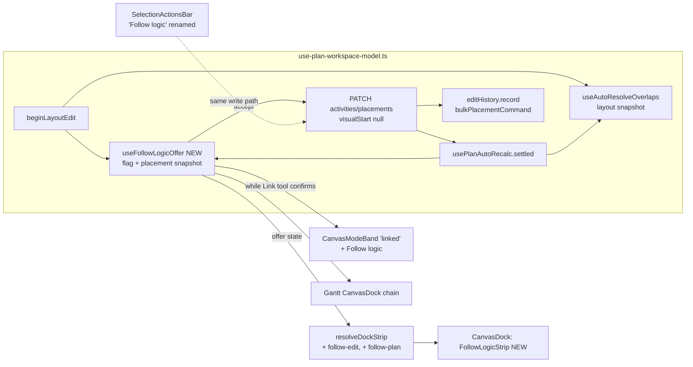
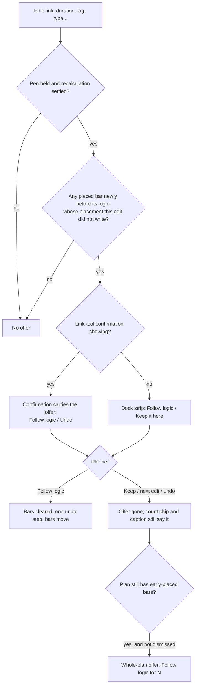

# Feature Spec: A bar you placed is offered its logic when an edit leaves it behind

- **Status:** Approved — by the product owner, 2026-11-11, with all defaults (Q1 remove the placement, Q2 any
  edit, Q3 dock message only, Q4 rename to "Follow logic", Q5 no one-time explanation).
- **Author(s):** feature-analyst (for the product owner, james)
- **Date:** 2026-11-11
- **Tracking issue / epic:** the owner's GUI review, runbook steps 3.5–3.8 (`docs/HANDOFF.md`, "The owner's biggest
  finding", 2026-11-11). ADR-0105: this adds user-facing entry points, so it is a spec, not a register row.
- **Roadmap link:** follow-on to the one-planning-surface epic (ADR-0148) and the conflict-review work (ADR-0094,
  ADR-0186)
- **Related ADR(s):** a short new ADR is required: **ADR-0216** (proposed; the next free number after 0215, verified
  by listing `docs/adr/021*.md` on 2026-11-11), filed at M2. Draft text in §4.9. It **extends** ADR-0148 and
  ADR-0153. It does **not** amend ADR-0148's decision: a placed bar still never moves unless the planner acts (see §1,
  "What the brief got wrong"). If Q4 is answered yes, the rename lands first (M1) as a dated amendment note on
  ADR-0094 (D5/D6 name the item) and ADR-0186 (D2's one wording), which ADR-0216 then cites.

> **About the evidence.** This spec was written from the source tree, without a browser. Every claim that decides
> something carries the file and line it was read from. Where a premise could only be settled in a browser, it is
> marked **M0 check** and M0 settles it before anything is built (ADR-0113, ADR-0142). If M0 contradicts a premise,
> the work stops and comes back.

## 0. Plain-English summary

When you draw a bar on the diagram, SchedulePoint remembers where you put it and keeps it there. Linking it to
another activity, or making the activity before it longer, does not move it. If that leaves it starting before its
links allow, the toolbar counts a "conflict". Today nothing tells you this as it happens, and the only fix is a
button called "Clear visual start", one bar at a time.

After this change:

- **When an edit leaves a bar you placed starting too early**, a message appears at the foot of the diagram, for
  example: _"Pour slab" stays where you placed it, before its logic allows._ It has two buttons: **Follow logic** (the
  bar moves to where its links put it, and follows them from then on) and **Keep it here**. Nothing pops up over your
  work, and the message waits for you until your next edit.
- This happens whether the edit was **adding a link** or **lengthening the activity before** (your step 3.8).
- **If a plan already has bars in that state**, a quieter message offers **Follow logic** for all of them at once.
- "Clear visual start" is **renamed "Follow logic"** everywhere, so the same words mean the same thing.
- Each "Follow logic" is one Undo step. Bars you drag yourself are never asked about.

## 1. Business understanding

### Problem

Re-verified against the tree on 2026-11-11 (CLAUDE.md §19.11, "re-verify the problem statement"):

1. **A drawn bar is saved with a placement.** Create-by-drop writes `visualStart: dropDate`
   (`apps/web/src/components/layout/workspace/use-plan-workspace-model.ts:805-814`). A day-drag does the same
   (`:1826-1880`).
2. **The engine never moves a placed bar.** Pass 2 draws a placed activity at its placement "honoured exactly, even if
   infeasible (stay-and-flag)" (`apps/api/src/modules/schedule/engine/compute.ts:306-312`, `:356-360`). This is the
   decision of ADR-0148 ("Where a bar is drawn is where it is placed", `docs/adr/0148-visual-is-the-plan.md:48-50`).
3. **A placement earlier than logic allows is flagged, not moved.** `visualConflictMap.set(id, placed !== null &&
placed < logicEarliest)` (`compute.ts:376`) becomes `visualConflictReason: 'EARLIER_THAN_LOGIC'` (`:876-880`), which
   the web reads as the conflict flag "Placed before its logic allows"
   (`apps/web/src/features/tsld/render/conflicts.ts:116-118`) and counts in the toolbar chip (ADR-0094, ADR-0186).
4. **The remedy exists, one bar at a time, under a name a planner does not recognise.** The flag's remedy is the
   selection bar's existing **Clear visual start** (`apps/web/src/features/plan-actions/conflict-remedy.ts:58-62`),
   which deliberately renders **no** separate "Fix" button (ADR-0094 D5, `docs/adr/0094-…md:105-111`). It is the
   bar's last item (`order: 6.5`) and the first to move into the `⋯` under width pressure
   (`apps/web/src/features/plan-actions/selection-actions.tsx:1048-1051`). It wears a warning-triangle icon when it is
   the remedy (`:1108-1125`).
5. **Nothing tells the planner at the moment it happens.** A link create records an undo step and requests a
   recalculation, and says nothing about the successor (`use-plan-workspace-model.ts:2124-2159`). The Link tool's
   confirmation says only `Linked "A" → "B" (FS).` with an Undo
   (`apps/web/src/features/tsld/components/CanvasModeBand.tsx:77-78`, `:115-119`).
6. **There is no whole-plan way to make placed bars follow their logic.** The only callers of the clear are the
   selection bar and its command-surface twin, both single-activity (`use-plan-workspace-model.ts:2254-2296`).

The owner, using the product as a first-time planner, drew three activities, linked them, lengthened the first, saw
no bar move and the conflict count rise, and concluded the plan was in a "freestyle mode". There is no mode
(ADR-0148 D1). The model is right; nothing on screen teaches it, and the fix is hard to find and works on one bar.

### What the brief got wrong, or left open

The brief is not evidence (CLAUDE.md §19.11). Checked against the code:

1. **"No Fix button on a conflicted bar" is by design, not a defect.** ADR-0094 D5 decided that the placement
   conflict's remedy _is_ Clear visual start and that rendering a conflict-flavoured twin would be ADR-0093's
   duplicate inside one surface (`conflict-remedy.ts:28-40`). What it lacks is a recognisable name (Q4).
2. **Naming both activities in the message would sometimes be false.** `logicEarliest` is the latest bound over
   **every** incoming link, the forward constraints, any external early start and the data date
   (`compute.ts:322-351`). The link just drawn may not be the one that binds, so "B starts before A finishes" can be
   untrue. The message names the stranded bar(s) and uses the existing reason wording (ADR-0186 D2), not the cause.
3. **"Creates or worsens" cannot be measured on the client, so the trigger is "newly"**. The engine's
   `logicEarliest` is not persisted (only `visualConflictReason`, `visualDriftDays` and `remainingFloat` reach the
   client, `packages/types/src/index.ts:926-966`). Drift is measured from Pass 1's early start (`compute.ts:377-381`)
   and `remainingFloat` is `totalFloat − visualDriftDays` (ADR-0148 D3), which algebraically is late start minus
   placement and does not grow when a predecessor does. So "worsened" has no honest client signal. The offer fires
   when a placed bar becomes **newly** flagged, which is also the right behaviour: a bar the planner already chose to
   keep is not asked about again.
4. **A message raised only "when a link is created" would be hidden in the commonest case.** The Link tool stays
   armed after a link (the confirmation "renders only while that [arming] is still current", ADR-0064 §3,
   `docs/adr/0064-canvas-authoring-flow.md:73-77`; **M0 check**), and an armed tool's band outranks every lower
   strip in the dock (`apps/web/src/features/tsld/model/dock-strip.ts:94`). The offer must therefore be carried by
   the Link tool's own confirmation when that is showing (§4.6).
5. **The "undo notification" is the wrong template.** `HistoryResultStrip` times a success out after 15 s
   (`apps/web/src/features/tsld/components/HistoryResultStrip.tsx:15`, `:77-83`). The right precedent is
   `LayoutResolvedStrip`: an edit's consequence, announced once, **no timer**, withdrawn when its undo step is no
   longer on top (`LayoutResolvedStrip.tsx:19-30`; `use-auto-resolve-overlaps.ts:344-349`).
6. **"Amendment to ADR-0148" is not quite right.** ADR-0148's decision stands: a placed bar does not move by itself.
   This adds an offer the planner accepts or declines, so the new ADR _extends_ ADR-0148 rather than amending a
   decision of it (§4.9).
7. **"Asking at link time does not cover lengthening" is true of a link-shaped trigger, not of the problem.** Both
   are the same event: an edit whose recalculation leaves a placed bar newly before its logic. One trigger covers
   both (§4.5), so the whole-plan action is for _pre-existing_ conflicts, not for step 3.8.
8. **Something does explain the conflict, just not the model.** Since ADR-0186, a selected flagged bar shows the
   caption "Placed before its logic allows". What nothing explains is that a placed bar _stays_.

### Users

| Role (ADR-0016)             | Needs                                                                                        | Gets                                                |
| --------------------------- | -------------------------------------------------------------------------------------------- | --------------------------------------------------- |
| Planner, Org Admin (pen)    | To know at once when an edit strands a bar they placed, and a one-press way to let it follow | The edit offer, the whole-plan offer, Follow logic  |
| Planner, Org Admin (no pen) | Nothing they can act on                                                                      | No offer (omitted, ADR-0082's omit clause)          |
| Contributor, Viewer         | To see that a bar conflicts                                                                  | Unchanged: count chip, caption, shaded Follow logic |
| External Guest              | Read-only view (ADR-0051/0163)                                                               | Unchanged                                           |

### Primary use cases

1. A planner links two placed bars and the successor now starts too early; they let it follow.
2. A planner lengthens a placed activity and the placed bars after it now start too early; they let them follow.
3. A planner opens a plan that already has several early-placed bars and makes all of them follow in one press.
4. A planner deliberately keeps a bar early (for example, a negotiated early start) and dismisses the offer.

### User journeys

Happy path (the owner's runbook, 3.5–3.8): draw A, B, C → arm Link → A→B (no conflict: B is drawn after A) → B→C →
lengthen A so it overlaps B → the recalculation settles → the dock says _"Pour slab" and 1 other stay where you
placed them, before their logic allows._ → **Follow logic** → both bars move to where their links put them → the
conflict count drops by two → Ctrl+Z puts them back, a second Ctrl+Z undoes the lengthening.

Alternates: **Keep it here** dismisses and nothing changes; the next edit replaces the message; without the pen
there is no message; a plan opened with existing early-placed bars shows the whole-plan offer instead.

### Expected outcomes

A first-time planner learns from the product, at the moment it matters, that a drawn bar stays where it was drawn
and how to let it follow. The owner's step 3.8 resolves in one press instead of a hunt through the selection bar.

### Success criteria

- **SC-1** Re-running runbook 3.5–3.8 in a browser, the offer appears after the lengthening, and one press of
  **Follow logic** leaves zero `EARLIER_THAN_LOGIC` flags in the plan (journey, read back at the API).
- **SC-2** An edit that does not newly strand a placed bar raises no offer; a bar whose own placement the edit wrote
  (drag, nudge, typed date, create-by-drop, apply levelling) is never offered (unit).
- **SC-3** Accepting changes **only** the offered bars' `visualStart` (to null) and nothing else on them: constraint,
  lane and every other bar's placement are unchanged (journey, read back at the API).
- **SC-4** `computeSchedule` is untouched: `git diff` of the epic touches nothing under `apps/api/src`.
- **SC-5** The offer has no time limit, is reachable by keyboard, and leaves focus on a defined target when it goes
  (accessibility review, M2 and M3).
- **SC-6** At 1024 × 600 the offer's strip fits the dock without clipping a control (M0 reading, re-taken at M2).

### Open questions

**Critical (answers change design or scope).** Each has a recommended default.

- **Q1. What does "Follow logic" do?** (a) Remove the hand placement: the bar moves to where its links put it and
  follows them from then on. (b) Re-place it at that date: it moves now but stays hand-placed, so the next change
  before it leaves it behind again. **Default (a).** (b) brings back the owner's step 3.8 problem and needs a server
  computation the client does not have (§4.10).
- **Q2. What raises the message?** (a) Any edit of yours that leaves a bar you placed newly starting too early
  (links, longer durations, lags, type changes). (b) Only adding a link, as you first asked. **Default (a).** (b)
  does not cover your step 3.8.
- **Q3. Where does the whole-plan action live?** (a) A message at the foot of the diagram that appears only while
  the plan has early-placed bars and can be dismissed, like the Arrange offer. (b) That, plus a toolbar button.
  **Default (a).** A toolbar button costs width on a row that is already full at 1024 px and needs measuring first.
- **Q4. Rename "Clear visual start" to "Follow logic"?** **Default yes.** One name for one action, and it says what
  happens rather than what is removed.
- **Q5. Add a one-time explanation the first time a conflict appears in a plan?** **Default no.** The message in Q2
  appears at exactly that moment and says the same thing; a one-time tip would be gone the next time it is needed.

**Non-critical, defaults stated:**

- The offer is **not** shown inside the activity editor; an edit made from the editor's Logic or General tab raises
  it in the dock, visible when the editor closes (the editor is a modal `<dialog>`, ADR-0108 D7). Announced at once.
- No confirmation dialog before either Follow logic: each is one Undo step and changes only placements.
- A summary (`WBS_SUMMARY`) is never in a batch (the route refuses one, see Edge cases).
- "Keep it here" is not remembered beyond the offer. A kept bar is asked again only if it stops being early and then
  becomes early again.
- Copy is drafted here and settled in the UX review.

## 2. Functional requirements

### User stories & acceptance criteria

> **US-1 — the edit offer.** As a Planner holding the pen, when an edit of mine leaves a bar I placed starting before
> its logic allows, I want to be told and offered to let it follow, so that I do not have to discover the conflict
> count and hunt for the fix.
>
> - **Given** placed bars B (and C after it), **when** I make an edit whose recalculation settles with B (and C)
>   newly flagged `EARLIER_THAN_LOGIC`, **then** the dock shows one offer naming them, with **Follow logic** and
>   **Keep it here**, and the sentence is announced once through the polite region.
> - **Given** the offer, **when** I press **Follow logic**, **then** each named bar's `visualStart` is cleared in one
>   all-or-nothing write, recorded as one undo step, the recalculation runs, and the bars draw at their logic dates.
> - **Given** the offer, **when** I press **Keep it here**, **then** it goes and nothing is written.
> - **Given** the offer, **when** I make another edit, undo, or redo, **then** the offer is withdrawn (it is bound to
>   the undo step on top when it was raised).
> - **Given** an edit that itself wrote B's placement (drag, nudge, typed start, create-by-drop, apply levelling),
>   **then** B is not in the offer even if B is now flagged.
> - **Given** the Link tool is still armed and showing its confirmation, **then** the confirmation itself carries the
>   offer (§4.6) rather than a second strip being hidden behind it.

> **US-2 — the whole-plan offer.** As a Planner holding the pen, when a plan has bars placed before their logic
> allows, I want to let all of them follow in one press.
>
> - **Given** a plan with N ≥ 1 early-placed activities (not summaries) and no edit offer showing, **then** the dock
>   shows _"N bars stay where they were placed, before their logic allows."_ with **Follow logic** and **Dismiss**.
> - **When** I press **Follow logic**, **then** all N are cleared in one write and one undo step.
> - **When** I press **Dismiss**, **then** it stays dismissed for this plan in this session (Arrange-offer rule,
>   `TsldPanel.tsx:1828-1833`).

> **US-3 — one name.** As any user, I want the per-bar action and both offers to use the same words, so that I can
> tell they do the same thing. (If Q4 = yes.)
>
> - The selection bar's item reads **Follow logic**; its icon, `srDescription`, gate and placement rule are unchanged
>   (`selection-actions.tsx:1052-1144`); `CONFLICT_REMEDIES.visualEarlierThanLogic.label` changes to match.

### Workflows

**Edit offer.** (1) A pen-gated edit calls `beginLayoutEdit` before its write, as every structural edit already must
(`use-auto-resolve.census.structural.test.ts` enforces it). (2) The new hook snapshots, per activity, whether it is
flagged `EARLIER_THAN_LOGIC` and its `visualStart`. (3) On the recalculation's settle (`usePlanAutoRecalc.settled`),
after the overlap resolution has run, it computes _newly stranded_ = flagged now, not flagged before, placed, not a
summary, and `visualStart` unchanged since the snapshot. (4) If non-empty it announces the sentence and raises the
offer bound to the undo step now on top. (5) **Follow logic** → `beginLayoutEdit(ids)` → `PATCH
…/activities/placements` with `visualStart: null`, constraint round-tripped, `laneIndex: null` → record
`bulkPlacementCommand` → announce → `autoRecalc.notify()` → offer consumed.

**Whole-plan offer.** Visible when the editing gate is open, the plan has ≥ 1 flagged non-summary placed activity,
it has not been dismissed, and no higher strip is showing. **Follow logic** runs step (5) over all of them.

### Edge cases

| Case                                                                            | Behaviour                                                                                                                                                                                                                                                                                                    |
| ------------------------------------------------------------------------------- | ------------------------------------------------------------------------------------------------------------------------------------------------------------------------------------------------------------------------------------------------------------------------------------------------------------ |
| A chain: B and C both stranded by one edit                                      | One offer naming both. Clearing is order-independent and creates no new conflict (§4.10, `compute.ts:361`, `:367-374`).                                                                                                                                                                                      |
| A placed bar after B that is **not** stranded                                   | Untouched: its placement and its gap stay. Clearing B does not change what B passes on, because a stranded bar already passes on its feasible start (`compute.ts:361`).                                                                                                                                      |
| Unplaced bars after B                                                           | Do not move when B follows, for the same reason; they were already drawn from B's feasible start.                                                                                                                                                                                                            |
| A burst of edits before one settle                                              | The first snapshot is kept and subjects unioned (the auto-resolve rule, `use-auto-resolve-overlaps.ts:38-40`); one offer for the burst, bound to the top step.                                                                                                                                               |
| The same settle also moves a bar clear of an overlap                            | Auto-resolve records its lane step first; the offer then binds to that top step and ranks above the layout notice in the dock (§4.6). Its Undo stays one Ctrl+Z away.                                                                                                                                        |
| Following makes a bar overlap another                                           | The write calls `beginLayoutEdit(ids)` first, as `clearVisualPlacement` does today (`use-plan-workspace-model.ts:2258`), so the ADR-0153 resolution runs on the settle.                                                                                                                                      |
| Undo after Follow logic                                                         | Bars return to their placements (flagged again). The consumed offer does **not** reappear even though the edit's step is on top again: accepting or dismissing clears the offer's state, it is not only derived from the top.                                                                                |
| A stranded bar is also `constraintViolated`                                     | It is still in the offer. The selection bar leads with the constraint remedy (`conflicts.ts:108-118` order), which is unchanged.                                                                                                                                                                             |
| Stranded by a forward constraint, external date or data date rather than a link | Included: clearing lands it at `logicEarliest`, which includes those bounds (`compute.ts:333-351`). The copy says "logic", the existing word (ADR-0186 D2), not "link", so it stays true.                                                                                                                    |
| `LATER_THAN_BOUND` (placed past a ceiling)                                      | Never in either offer. Its remedy stays the "Review the constraint…" route (`conflict-remedy.ts:83-87`).                                                                                                                                                                                                     |
| A started or complete activity that is placed and flagged                       | Included; clearing changes no date because actuals freeze its bar and what it passes on (`compute.ts:367-369`). The flag clears. **M0 check** that such a row can exist through the product.                                                                                                                 |
| A `WBS_SUMMARY` that is placed and flagged                                      | Excluded from both batches: the route refuses one (`SUMMARY_NOT_BULK_ELIGIBLE`, `plan-activities.controller.ts:182-186`). Its per-object Follow logic still works. A summary carries no logic (ADR-0038), so a link or duration edit cannot newly strand it. **M0 check** whether one can be placed at all.  |
| Level of effort                                                                 | An LOE predecessor never pushes in Pass 2 (`compute.ts:325-326`); a placed LOE that is flagged is eligible like a task.                                                                                                                                                                                      |
| More than 2,000 flagged activities                                              | The batch route caps at 2,000 rows (`update-placements.dto.ts:120-123`). The whole-plan Follow logic is shaded with a reason (copy at UX review) rather than chunked into a non-atomic series; the per-bar action still works. No current plan is near this (the scale fixture has 2,160 activities in all). |
| The pen is lost between edit and settle                                         | No offer (the snapshot is dropped, as auto-resolve does, `use-auto-resolve-overlaps.ts:199-204`).                                                                                                                                                                                                            |
| The pen is lost while the offer is showing                                      | The offer is withdrawn (its whole content is a pen-gated offer: ADR-0082 omit, the Arrange-offer rule `TsldPanel.tsx:1834-1848`). Focus hand-off per ADR-0135.                                                                                                                                               |
| Late-start overlay on                                                           | Follow logic is shaded with the shared gate's reason (`conflict-remedy.ts:170-172`), on the bar and in both offers.                                                                                                                                                                                          |
| A peer edits the plan                                                           | Peers cannot write without the pen (ADR-0028), so only the pen holder's own edits snapshot. A stale version on accept → 409, nothing written, announced, offer withdrawn.                                                                                                                                    |
| Cross-plan links                                                                | Out of scope for the edit offer: a link whose successor is in another plan strands it in that plan, whose own whole-plan offer shows it when opened. ADR-0148 D10's forward bound means the effect is real; it is not this workspace's to offer.                                                             |
| Undo / redo replays                                                             | Never raise an offer (`noteReplay` drops the snapshot, `use-auto-resolve-overlaps.ts:49-53`).                                                                                                                                                                                                                |
| Gantt view                                                                      | The Gantt creates no links (no `createDependency` / `onLink` under `apps/web/src/features/gantt`, grep 2026-11-11), but its in-cell duration and bar edits can strand placed bars. The offer appears in the Gantt's dock too (`plan-workspace-toolbar.tsx:1970-1978`).                                       |

### Permissions

Deny-by-default, no new permission. Following writes through the existing batch placement route: "Planner or Org
Admin" (`plan-activities.controller.ts:161-171`), org-scoped by `orgSlug`, pen-enforced with 423
(`:187`), optimistically locked per row with 409 (`:179-181`). The web gates on `canEditSchedule` and the shared
`clearVisualPlacementGate` (`conflict-remedy.ts:163-175`). **Structural write**: yes, it changes a scheduling input
(ADR-0028; the route's own description, `:166-168`). Audit: none, as for every placement batch (`PLAN_CONTENT`,
ADR-0167 D6); each cleared row records a `visualStart` item in its activity history (ADR-0174).

### Validation rules

None new. Each batch row states the activity's whole placement: `visualStart: null`, `constraintType` and
`constraintDate` **as stored**, `laneIndex: null` ("unchanged"), and the row's `version`
(`update-placements.dto.ts:21-36`, `:87-100`). Round-tripping the constraint is load-bearing: omitting it is a 400 and
nulling it would silently delete a commitment (the ADR-0148 context defect; ADR-0167 D1 does the same round-trip).

### Error scenarios

| Scenario                         | Detection                     | User-facing result                                                                    | Status |
| -------------------------------- | ----------------------------- | ------------------------------------------------------------------------------------- | ------ |
| Pen not held / taken mid-write   | pen guard                     | The shared pen banner (`pen.onWriteRejected`); offer withdrawn                        | 423    |
| A row changed since it was read  | version mismatch, whole batch | "This plan changed since … nothing was moved. Refresh to see the latest." (announced) | 409    |
| A summary slipped into the batch | `SUMMARY_NOT_BULK_ELIGIBLE`   | Not reachable: excluded client-side; a unit test pins the exclusion                   | 422    |
| Role lost                        | RBAC                          | Standard forbidden handling                                                           | 403    |
| Recalculation fails after write  | auto-recalc                   | Non-fatal; dates land on the next recalculation (existing behaviour)                  | —      |

## 3. Technical analysis

| Area           | Impact | Notes                                                                                                                                                                                                                                                                                                             |
| -------------- | ------ | ----------------------------------------------------------------------------------------------------------------------------------------------------------------------------------------------------------------------------------------------------------------------------------------------------------------- |
| Frontend       | med    | One new hook beside `useAutoResolveOverlaps`; one new strip component on `NoticeStrip`; `resolveDockStrip` gains two rungs; `CanvasModeBand`'s `linked` statement can carry the offer; the Gantt dock chain gains one entry; one label rename.                                                                    |
| Backend        | none   | No change under `apps/api/src`.                                                                                                                                                                                                                                                                                   |
| Database       | none   | **No schema change.** `visual_start` exists and is nullable. Nothing here goes to database-architect.                                                                                                                                                                                                             |
| API            | none   | Existing `PATCH /api/v1/organizations/:orgSlug/plans/:planId/activities/placements`.                                                                                                                                                                                                                              |
| Security       | low    | No new route, permission or input. The client builds rows only from activities it already read.                                                                                                                                                                                                                   |
| Performance    | low    | The snapshot diff is O(activities) over cached rows, run in the same idle callback as auto-resolve. **M0 measures** it at `scale-2000` against auto-resolve's measured 8.8 ms p95 (`use-auto-resolve-overlaps.ts:69-73`). One batch write and one recalculation per accept.                                       |
| Infrastructure | none   |                                                                                                                                                                                                                                                                                                                   |
| Observability  | none   | No new log line; the existing request log records the batch.                                                                                                                                                                                                                                                      |
| Testing        | med    | Unit (hook, dock precedence, strip, command, mode band), the existing `e2e-workspace-chrome/conflict-review.spec.ts` journey extended, `e2e-gantt-editing/object-actions-reach.spec.ts` for the rename and the Gantt dock. No new Playwright config (ADR-0105 trigger avoided). No API e2e unless M0 finds a gap. |

**Recalculation parity gate.** Holds by construction: the engine is not imported and nothing under `apps/api/src`
changes, so `computeSchedule` is byte-identical for every input (SC-4). A plan where nobody accepts an offer gets
exactly today's writes.

**Feature flag.** None, citing ADR-0088 D1: a `VITE_` constant is inlined at build and is never an operator rollback;
the rollback is each milestone's commit.

### Dependencies

- `useAutoResolveOverlaps` and its `begin`/settle lifecycle, and the census that every structural write calls
  `beginLayoutEdit` (ADR-0153). The new hook rides on both rather than adding call sites.
- `bulkPlacementCommand` (`apps/web/src/features/undo-redo/commands.ts:1896-1981`), already the undo shape for
  bulk drags and apply levelling.
- The ADR-0064 Link-tool confirmation and the ADR-0092 dock precedence (`dock-strip.ts`).
- No ordering constraint against other open epics was found; if one lands in `TsldPanel`'s dock first, re-read
  `resolveDockStrip` before M2.

## 4. Solution design

### 4.1 Architecture overview



### 4.2 Data flow

```mermaid
sequenceDiagram
  participant P as Planner
  participant W as Workspace model
  participant F as useFollowLogicOffer
  participant API as API
  participant E as Engine (unchanged)
  P->>W: lengthen A (or add a link)
  W->>F: begin(): snapshot {id: early?, visualStart}
  W->>API: PATCH activity / POST dependency
  W->>API: recalculate (coalesced)
  API->>E: computeSchedule
  E-->>API: visualConflictReason per activity
  API-->>W: activities refetched; settled++
  W->>F: settle (after auto-resolve)
  F->>F: newly = early now ∧ ¬early before ∧ placed ∧ visualStart unchanged ∧ ¬summary
  F-->>P: announce + dock offer (bound to top undo step)
  P->>F: Follow logic
  F->>W: beginLayoutEdit(ids)
  F->>API: PATCH placements [{id, version, visualStart:null, constraint as stored, laneIndex:null}]
  API-->>F: saved rows
  F->>W: record bulkPlacementCommand; notify recalc; announce
```

### 4.3 User flow



### 4.4 Database changes

None. Verified: `visualStart` is already nullable on the batch DTO (`update-placements.dto.ts:74-85`) and on the
single PATCH used today (`use-plan-workspace-model.ts:2260`). database-architect is not engaged; if any later
milestone finds it needs a column (for example to remember "keep"), the work stops and goes there first.

### 4.5 API changes

None. **Why the existing batch route and not a new bulk endpoint**: it is already all-or-nothing, per-row versioned,
pen-gated, org-scoped, capped at 2,000, refuses summaries, and is the write apply levelling uses for exactly this
kind of bulk placement change (ADR-0167 D1, D4). A dedicated "release placements" endpoint would be a second write
path for `visual_start`, a new audit classification and an undo rebuilt from its response, the same alternative
ADR-0167 rejected. One call per activity (the single PATCH) is rejected too: N requests, N undo steps or a
hand-rolled composite, and partial failure. **The batch is used even for one bar** so there is one code path and one
undo shape.

`docs/API.md` needs no change. If M0 finds no existing API e2e case for "a `visualStart: null` row with the
constraint round-tripped keeps the constraint" in `apps/api/test/activity-batch-ops.e2e-spec.ts`, M2 adds one (a
test-only change).

### 4.6 Component changes

- **`useFollowLogicOffer`** (new, `apps/web/src/components/layout/workspace/use-follow-logic-offer.ts`). Same shape as
  `useAutoResolveOverlaps`: `begin()`, `noteReplay()`, settle-driven evaluation in `whenIdle`, `offer | null` derived
  against `history.isTop(offer.command)`, `accept()`, `dismiss()`. Reads the flag through
  `CONFLICT_FLAGS`' `visualEarlierThanLogic.matches` (one derivation, ADR-0094 D2). Pure diff function exported and
  unit-tested on its own. `beginLayoutEdit` (`use-plan-workspace-model.ts:674`) becomes a two-call fan-out so the
  census test keeps covering every write without new call sites.
- **`FollowLogicStrip`** (new, `apps/web/src/features/tsld/components/`). `NoticeStrip`, no `role` (announced once
  by the workspace; ADR-0132 event; the `LayoutResolvedStrip` rule). Two variants by prop: **edit** (event; buttons
  Follow logic + Keep it here) and **plan** (standing condition; not announced on mount; buttons Follow logic +
  Dismiss; dashed emphasis like the Arrange offer). Every button moves focus to a stable target before acting
  (ADR-0135/ADR-0149 D8; the canvas listbox in the diagram, the grid in the Gantt). No timer.
- **`resolveDockStrip`** gains `followEdit` and `followPlan`. Order: conflict › history failure › **mode, except a
  `linked` confirmation when a follow-edit offer exists** › history success › **follow-edit** › layout-resolved ›
  empty › **follow-plan** › arrange-offer › touch-hint. Each rung's reason is written in the function, as its
  docblock requires (`dock-strip.ts:57-83`).
- **`CanvasModeBand`**: when the statement is `linked` and a follow-edit offer exists, the dock shows the
  `FollowLogicStrip` with the confirmation's sentence leading and the link's **Undo** kept beside **Follow logic**.
  One strip, never two; the armed-tool statements (`linking`, `linkPicking`) still outrank everything as today.
- **Gantt**: `{historyResultNotice?.node ?? followEditNotice ?? layoutResolvedNotice ?? followPlanNotice ??
touchGestureHint}` at `plan-workspace-toolbar.tsx:1977`, keeping the same order.
- **Selection bar** (Q4): label `Follow logic`; the `CONFLICT_REMEDIES` label; `lostReason` copy unchanged in
  meaning. Width is **expected** to shrink (12 characters for 18) and M0 measures it; `dock.spec.ts`'s equality is
  the gate that will say if it moved.
- **Copy (draft, settled at UX review):**
  - edit, one bar: `“Pour slab” stays where you placed it, before its logic allows.`
  - edit, several: `“Pour slab” and 2 others stay where you placed them, before their logic allows.`
  - plan: `3 bars stay where they were placed, before their logic allows.`
  - after accept: `“Pour slab” and 2 others now follow their logic; dates will update.` (the
    `clearVisualPlacement` wording, `use-plan-workspace-model.ts:2292`)
- States: no loading state (the write is one request; the button is not shaded mid-flight beyond the existing
  write-in-flight rule); error states as §2's table; empty is "no strip".

### 4.7 Accessibility

- **Timing (WCAG 2.2.1):** no timeout. The edit offer lasts until the next edit, undo or redo, or a press; the plan
  offer until dismissed. This is why `HistoryResultStrip`'s 15 s timer is not reused.
- **Status message (4.1.3):** the edit offer's sentence goes through the app's single polite region once; the
  strip has no live role (ADR-0132 event; double-speak avoided). The plan offer is a standing condition: no role and
  no announcement on mount (ADR-0132 D1's discriminator: it reads the same to somebody arriving five minutes later).
- **Keyboard:** both strips sit in the dock in DOM order after the canvas and the selection bar; every control is a
  native button. No focus is moved when an offer appears (non-blocking). When an offer leaves while focus is in it,
  focus goes to the listbox (diagram) or grid (Gantt) (`useContainerUnmountHandoff`, ADR-0135).
- **Shaded Follow logic** states its reason to every input (ADR-0204).
- **Not engaged:** ADR-0111 (no shared primitive's keyboard contract changes; `NoticeStrip` and `Button` are used as
  they are). The accessibility review is still required at M2 and M3 for focus hand-off and reading order.

### 4.8 Implementation approach & alternatives

**Chosen:** a consequence-triggered, non-blocking, undo-bound offer in the dock; a standing whole-plan offer; one
name; the existing batch write.

| Alternative                                                | Why not                                                                                                                                                                                                                                                                     |
| ---------------------------------------------------------- | --------------------------------------------------------------------------------------------------------------------------------------------------------------------------------------------------------------------------------------------------------------------------- |
| A modal asking on every link (the owner's literal ask)     | Interrupts every link, most of which strand nothing; blocks chaining with the Link tool; ADR-0108 limits modals to guarding the canvas.                                                                                                                                     |
| Trigger on the link gesture only (the brief's item 1)      | Misses step 3.8, the case the owner actually hit; needs the whole-plan action to cover it after the fact.                                                                                                                                                                   |
| Name the predecessor in the message                        | Can be false: the binding bound may be another link, a constraint or the data date (`compute.ts:322-351`).                                                                                                                                                                  |
| Re-place at the earliest date (keep it placed) — Q1 (b)    | Reproduces step 3.8 on the next change; the client does not have `logicEarliest` (only Pass 1's `earlyStart`, which differs when predecessors are placed), so it needs an engine preview like ADR-0167's. Clear gives the identical position today (§4.10).                 |
| Compose the link and the follow into one undo step         | The link is already recorded when the offer appears and the planner may accept later; rewriting a recorded step is outside ADR-0048. The layout-resolved notice made the same call (CQ-2, `use-auto-resolve-overlaps.ts:130-134`).                                          |
| A toolbar button beside the conflict chip — Q3 (b)         | The chip's `find` group is for looking; a pen-gated write belongs in `tools` (ADR-0090/0031 taxonomy), so "beside the count" is not where the registry would put it. It costs row width that needs measuring (ADR-0142). Can be added later without changing anything here. |
| Make the count chip a popover with the action              | The chip is a presentational, `aria-hidden` read-out that "cannot be read as a control" (ADR-0186 D6, `tsld-toolbar-items.tsx:3077-3098`).                                                                                                                                  |
| One-time explanation the first time a conflict appears (a) | The edit offer appears at that moment with the same sentence; a one-time tip needs a persisted dismissal and is gone the next time it is needed. Recommended against (Q5).                                                                                                  |
| Reword the chip to name the remedy (b)                     | The owner decided the chip stays count-only (ADR-0186 D4). The remedy's name is fixed instead, on the object (Q4).                                                                                                                                                          |
| "Release every placement in the plan"                      | Also removes deliberate later placements (drift a planner wants). Out of scope; the plan offer touches only early-placed bars.                                                                                                                                              |
| A `VITE_` flag                                             | ADR-0088 D1.                                                                                                                                                                                                                                                                |

### 4.9 Draft ADR-0216 (to be filed at M2; not created yet)

> # ADR-0216: A bar you placed stays put, and an edit that leaves it behind offers to let it follow
>
> - **Status:** Proposed
> - **Extends:** ADR-0148 (visual is the plan), ADR-0153 (an edit's consequence is resolved on the settle and is its
>   own undo step), ADR-0094 (a conflict has a remedy). Cites the M1 amendment notes on ADR-0094 D5/D6 and ADR-0186
>   D2 (if Q4 = yes): the placement remedy's label is "Follow logic".
> - **Spec:** `docs/specs/placed-bar-follows-link/`
>
> **Context.** ADR-0148 made a drawn bar a placement that logic never moves. The owner's first-time run (runbook
> 3.5–3.8) showed the consequence is invisible when it happens: an edit strands a placed bar, the count rises, and
> the only remedy is a single-bar command named for what it removes.
>
> **D1 — A placed bar still never moves by itself.** ADR-0148's decision is unchanged. Everything here is an offer
> the planner accepts.
> **D2 — The trigger is the consequence, not the gesture.** An offer is raised when a pen-holder's edit settles with
> a placed, non-summary activity **newly** `EARLIER_THAN_LOGIC`, excluding any activity whose placement that edit
> wrote. "Worsened" is not a trigger: the client has no measure of the logic bound.
> **D3 — Following is removing the placement.** `visualStart := null`, constraint round-tripped, lane unchanged,
> through the existing batch placement route. For a stranded bar this is the same position as re-placing it at its
> logic date (Pass 2 already propagates the feasible start, `compute.ts:361`), so nothing downstream moves and no new
> conflict can arise; the difference is only that it now follows its logic.
> **D4 — The offer is an event bound to the top undo step, with no time limit.** Announced once; no live role;
> withdrawn by the next edit, undo or redo; consumed by a press. Accepting is its own undo step.
> **D5 — The Link tool's confirmation carries the offer** rather than hiding it, because the armed tool outranks
> every lower dock strip.
> **D6 — A plan with early-placed bars offers to let all of them follow**, as a dismissible standing condition in the
> dock (the Arrange-offer pattern), never as a toolbar write in the `find` group.
> **D7 — No engine change, no schema change, no new endpoint, no flag** (ADR-0088 D1). The recalculation parity gate
> holds by construction.
>
> **Alternatives** as spec §4.8. **Consequences:** two new dock rungs; the remedy's label changes in every journey
> that names it; a cross-plan successor is not offered in the plan that drew the link.

### 4.10 Why "Follow logic" clears the placement (the decision behind Q1), with the evidence

Pass 2, per activity in topological order (`compute.ts:318-382`):

- `display = placed ?? logicEarliest` (`:360`): a placed bar draws at its placement; an unplaced one at its logic date.
- `prop = placed !== null ? max(placed, logicEarliest) : logicEarliest` (`:361`): what it passes to successors.
- conflict = `placed < logicEarliest` (`:376`).

For a stranded bar, `placed < logicEarliest`, so `prop = logicEarliest` **before** clearing, and after clearing
`placed = null`, so `prop = logicEarliest` and `display = logicEarliest`. Therefore clearing:

1. puts the bar exactly where re-placing it at its earliest date would (same `display`);
2. changes nothing it passes on, so no other activity's Pass 2 date changes and no new conflict appears;
3. is order-independent across any set of stranded bars, so one batch is exact.

Progressed activities pass on Pass 1's instants regardless (`:367-369`), so the same holds. What does change: the
bar's drift becomes null and `remainingFloat` becomes `totalFloat` (ADR-0148 D3); resource load and levelling read
the drawn span (ADR-0166), so a levelling-window flag can change; an overlap can appear and is resolved by ADR-0153.

## 5. Links

- Implementation plan: [`implementation-plan.md`](./implementation-plan.md)
- Related docs updated by this change: `CLAUDE.md` §16 (ADR-0216 line, at M2), `docs/adr/0216-…md` (M2),
  `docs/adr/0094-…md` and `docs/adr/0186-…md` amendment notes and their §16 status lines (M1, if Q4 = yes),
  `docs/COMPONENT_LIBRARY.md` (the label, M1), `docs/TEST_PLAYBOOK.md` if a catalogue plan is added (M0 decides),
  `docs/HANDOFF.md` runbook note (M3).
