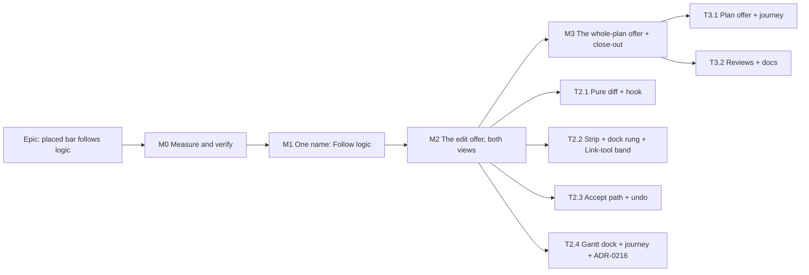

# Implementation Plan: A bar you placed is offered its logic when an edit leaves it behind

- **Feature spec:** [`feature-spec.md`](./feature-spec.md)
- **Status:** Approved — by the product owner, 2026-11-11, with all defaults (Q1 remove the placement, Q2 any
  edit, Q3 dock message only, Q4 rename to "Follow logic", Q5 no one-time explanation).
- **Owner:** web

## Breakdown

### Epic

**Placed bar follows logic.** Closes the owner's GUI-review finding at runbook 3.5–3.8 (`docs/HANDOFF.md`). Web
only: **no change under `apps/api/src`, no schema change, no new endpoint, no `VITE_` flag** (ADR-0088 D1; the
rollback is each milestone's commit). ADR-0216 is filed at M2. Every milestone is one PR.

**ADR-0105 triggers, per milestone:** M0 none (measurement only). **M1 crosses** (a control's accessible name, which
journeys and the remedy map rely on). **M2 crosses** (a new user-facing entry point; a change to the dock's
precedence contract). **M3 crosses** (a new user-facing entry point). The spec exists, so crossing means "built to
this spec", not "stop".

**Agents to involve:** builder (Sonnet) for M1–M3; component-reviewer, accessibility-reviewer and ux-reviewer at M2
and M3; performance-reviewer at M0/M2 for the settle-time diff; test-engineer for the journey cases. **Not needed:**
database-architect (no schema change; if one appears, stop and go there first), api-reviewer, security-reviewer
and backend-performance-reviewer (no backend change; security-reviewer is re-engaged if M0 finds any API change is
needed).

---

### Milestone M0: Measure and verify (no product change)

**Outcome:** committed readings in `docs/specs/placed-bar-follows-link/m0-measurement.md` that confirm or overturn
the spec's premises, and replace its marked checks with findings.
**Entry point:** `Ships dark: measurement only; nothing user-facing changes.`
**Journey:** none (a `measure-toolbar/` probe, not a gate).

#### Feature: premises and readings

> **Description:** settle every **M0 check** in the spec before anything is built (ADR-0113, ADR-0142).
> **Complexity:** S
> **Dependencies:** none
> **Risks:** a premise is false → the work stops and the spec is revised, as the spec says.
> **Testing requirements:** readings committed with the command that took them.

##### Task 0.1 — Re-run the owner's runbook 3.5–3.8 with a probe

- **Description:** a throwaway Playwright probe under `apps/web/measure-toolbar/` drawing three bars, linking them
  with the Link tool, lengthening the first, and reading back `visualConflictReason` per activity after each settle.
- **Complexity:** S
- **Dependencies:** —
- **Risks:** the probe's `placeOnDay` returns before the engine has seen a placement (recorded in ADR-0094's
  consequences) → poll the API, not the DOM.
- **Testing:** n/a (records readings).
- **Development steps:**
  1. Record which activities become newly `EARLIER_THAN_LOGIC` at each step (confirms the chain case, spec Edge cases).
  2. Confirm the Link tool stays armed after a link and the `linked` confirmation is what the dock shows (spec §1 item 4).
  3. Record whether **Clear visual start** is inline or in the `⋯` on the selection bar at 1024 × 600 and 1440 × 900.

##### Task 0.2 — Width and fit readings

- **Description:** measure the draft copy (one bar, several bars, plan offer, the Link confirmation carrying the
  offer) in the dock at 1024 × 600 (fine and coarse pointer) and 1912 × 1080; measure the selection bar with the
  label `Follow logic` against `Clear visual start`.
- **Complexity:** S
- **Dependencies:** —
- **Risks:** the Link-confirmation-plus-offer sentence with three buttons does not fit at 1024 → shorten copy first,
  then drop the band's own Undo (Ctrl+Z stays) — owner's call if neither suffices.
- **Testing:** n/a.
- **Development steps:**
  1. Reuse the `conflict-reason-m1.spec.ts` probe pattern.
  2. Record the 120 px stage floor margin on touch 1024 × 600 (`docs/TECH_DEBT.md` #488 has 2 px) — the dock is one
     row, so a strip that wraps would cost it.

##### Task 0.3 — Edge-case and cost checks

- **Description:** settle the data questions by API and unit reads.
- **Complexity:** S
- **Dependencies:** —
- **Risks:** none.
- **Testing:** n/a.
- **Development steps:**
  1. Can a placed `WBS_SUMMARY` exist through the product? Can a started activity be placed and flagged?
  2. Does `apps/api/test/activity-batch-ops.e2e-spec.ts` (or a sibling) already assert that a `visualStart: null`
     row with the constraint round-tripped keeps the constraint? If not, M2 adds that case.
  3. Time the pure diff at `scale-2000` (n = 50 after warm-up) against auto-resolve's 8.8 ms p95.
  4. Confirm every edit path a planner uses (Link tool, Logic tab add/edit, chain link, duration drag, Gantt cell)
     calls `beginLayoutEdit` (`use-auto-resolve.census.structural.test.ts` is the list).
  5. Decide whether a catalogue plan (a placed chain) earns a `docs/TEST_PLAYBOOK.md` row; `pnpm check:playbook`.

---

### Milestone M1: One name — "Clear visual start" becomes "Follow logic" (if Q4 = yes)

**Outcome:** the per-bar remedy says what it does, in the Diagram and the Gantt, before any offer uses the words.
**Entry point:** the selection bar's **Follow logic** (Diagram and Gantt dock), accessible name `Follow logic`.
**Journey:** `e2e-workspace-chrome/conflict-review.spec.ts` (the existing remedy step, renamed) and
`e2e-gantt-editing/object-actions-reach.spec.ts`.

#### Feature: the rename

> **Description:** label, remedy-map label, announcements that name the action, tests, docs.
> **Complexity:** S
> **Dependencies:** M0 (T0.2's width reading)
> **Risks:** the foot-row equality in `e2e-workspace-chrome/dock.spec.ts` moves → that is the gate working; record
> the new figure with M0's reading. A journey locating the button by its old name → updated in the same PR.
> **Testing requirements:** unit (selection-actions suites that name it), both journeys, `pnpm prepush`,
> `scripts/e2e-local.sh web:workspace-chrome` and `web:gantt-editing`.

##### Task 1.1 — Rename and sweep (≈ one PR)

- **Description:** `selection-actions.tsx:1057` label; `conflict-remedy.ts:61` label; the success announcement
  (`use-plan-workspace-model.ts:2292`) to "Now follows its logic"; ~10 test files and two e2e specs that name it
  (grep `Clear visual start` under `apps/web`, 2026-11-11).
- **Complexity:** S
- **Dependencies:** T0.2
- **Risks:** historical docs (CHANGELOG, older specs, measurement records) also name it → leave them; they record
  what was true.
- **Testing:** existing tests updated; no new behaviour.
- **Development steps:**
  1. Rename in code and tests.
  2. Dated amendment notes on ADR-0094 (D5/D6) and ADR-0186 (D2); update their `CLAUDE.md` §16 status parentheticals.
  3. `docs/COMPONENT_LIBRARY.md` entry; changeset (web, patch).

---

### Milestone M2: The edit offer, in both views

**Outcome:** an edit that leaves a placed bar newly before its logic offers **Follow logic** / **Keep it here** in
the dock (or inside the Link tool's confirmation), and accepting moves the bars in one undo step.
**Entry point:** the dock strip's **Follow logic** button (`data-testid="canvas-follow-logic"`), Diagram and Gantt.
**Journey:** `e2e-workspace-chrome/conflict-review.spec.ts`, new case "an edit that strands a placed bar offers to
let it follow" (runbook 3.5–3.8 as a journey; asserts SC-1 and SC-3 at the API). Gantt half in
`e2e-gantt-editing/object-actions-reach.spec.ts` (a cell duration edit raises the offer in the Gantt dock).

#### Feature: detect, offer, accept

> **Description:** spec §4.6.
> **Complexity:** M
> **Dependencies:** M1 (the button's words)
> **Risks:** see rollup.
> **Testing requirements:** unit for the pure diff, the hook, the dock precedence, the strip, the band; journey
> above; a11y review of focus hand-off and reading order.

##### Task 2.1 — The pure diff and `useFollowLogicOffer`

- **Description:** `strandedBy(before, after)` pure function; the hook with `begin`, `noteReplay`, settle evaluation
  after auto-resolve, `offer` bound to `history.isTop`, `accept`, `dismiss`; `beginLayoutEdit` fans out to both hooks.
- **Complexity:** M
- **Dependencies:** M1
- **Risks:** settle ordering with auto-resolve (which records its own lane step) → evaluate after it in the same
  idle callback and bind to the top step then; a unit test pins the order.
- **Testing:** pure-function table (newly flagged; already flagged; placement written by the edit; summary;
  unplaced; `LATER_THAN_BOUND`; chain of two); hook tests for burst, replay, pen loss, consumed-offer-does-not-return-on-undo.
- **Development steps:**
  1. Write the pure function and its table first (red), then the hook.
  2. Read the flag through `CONFLICT_FLAGS` (`conflicts.ts:116-118`), not a literal.
  3. Keep the census test green with no new call sites.

##### Task 2.2 — `FollowLogicStrip`, the dock rung and the Link-tool band

- **Description:** the strip (edit variant), the `followEdit` rung in `resolveDockStrip` with its reason written in
  the function, and the `linked` confirmation carrying the offer.
- **Complexity:** M
- **Dependencies:** T2.1
- **Risks:** two strips in one row → the precedence function is the only place the order lives, asserted as a
  decision (`dock-strip.ts`'s own rule); the band never renders beside the strip.
- **Testing:** `resolveDockStrip` cases for every new pair; strip unit tests (no `role`, buttons, focus target called
  before the action); band test (`linked` + offer → one strip with Undo and Follow logic).
- **Development steps:**
  1. Strip on `NoticeStrip`, no timer, ADR-0135 hand-off via `useContainerUnmountHandoff`.
  2. Announce through the workspace's polite region once, from the same sentence function the strip renders.

##### Task 2.3 — The accept path

- **Description:** build complete placement rows (constraint as stored, `laneIndex: null`, `visualStart: null`,
  current `version`), exclude summaries, `beginLayoutEdit(ids)`, one `PATCH …/placements`, record
  `bulkPlacementCommand` (label "Follow logic for N activities"), announce, `autoRecalc.notify()`; 423 and 409 per
  the spec's error table.
- **Complexity:** S
- **Dependencies:** T2.1
- **Risks:** nulling a constraint by building a row from the wrong fields → a unit test asserts the row's constraint
  equals the cached row's; the journey reads the constraint back from the API.
- **Testing:** unit (row shape, 409, 423, undo/redo through `bulkPlacementCommand`'s check); API e2e case only if
  T0.3 step 2 found none.
- **Development steps:**
  1. Reuse the `clearVisualPlacement` structure (`use-plan-workspace-model.ts:2254-2296`) generalised to a set.
  2. Route the selection bar's single-bar Follow logic through the same function so there is one write path (it
     becomes a one-row batch; its undo shape changes from `visualStartCommand` to `bulkPlacementCommand`, recorded).

##### Task 2.4 — Gantt dock, journey, ADR-0216

- **Description:** add the offer to the Gantt dock chain (`plan-workspace-toolbar.tsx:1977`); the two journey cases;
  file ADR-0216 from spec §4.9 with one line in `CLAUDE.md` §16 (`check:adr-coverage`).
- **Complexity:** S
- **Dependencies:** T2.2, T2.3
- **Risks:** the journey asserts on DOM before the engine has flagged → poll the API for the flag, as
  `conflict-review.spec.ts` already does.
- **Testing:** `scripts/e2e-local.sh web:workspace-chrome`, `web:gantt-editing`; `pnpm prepush`.
- **Development steps:**
  1. Journey: draw A, B, C; link A→B, B→C; lengthen A; expect the offer naming B and C; press Follow logic; API shows
     both `visualStart: null`, constraints unchanged, zero `EARLIER_THAN_LOGIC`; Ctrl+Z restores both placements.
  2. Journey: a drag that places B early raises **no** offer (SC-2).
  3. File ADR-0216; changeset (web, minor).

---

### Milestone M3: The whole-plan offer, and close-out

**Outcome:** a plan that already has early-placed bars offers **Follow logic** for all of them in one press.
**Entry point:** the dock strip's **Follow logic** in its plan variant (`data-testid="canvas-follow-logic-plan"`),
Diagram and Gantt.
**Journey:** `e2e-workspace-chrome/conflict-review.spec.ts`, new case: seed two placed, flagged activities through the
API, open the plan, press Follow logic in the dock, read back zero flags; Dismiss keeps it gone for the session.

#### Feature: plan offer

> **Description:** the plan variant of `FollowLogicStrip`, the `followPlan` rung (below `empty`, above
> `arrange-offer`), session dismissal per plan, the 2,000-row shade.
> **Complexity:** M
> **Dependencies:** M2
> **Risks:** the strip appearing on every open of a plan whose planner keeps conflicts deliberately → dismissible,
> and it never outranks anything about the planner's last act; if the owner finds it noisy, a persisted dismissal
> is a later, separate decision.
> **Testing requirements:** precedence unit cases; strip unit (no role, not announced on mount); journey above;
> accessibility and UX reviews.

##### Task 3.1 — Plan offer and journey

- **Description:** as above; reuses T2.3's accept path over every flagged non-summary activity.
- **Complexity:** S
- **Dependencies:** M2
- **Risks:** Q3 answered (b) → a toolbar item is added in `tools`, measured first (ADR-0142, ADR-0185); that would
  be its own task with a fit reading.
- **Testing:** as the feature.
- **Development steps:**
  1. Strip variant and rung; the omit rule when the editing gate is shut (`TsldPanel.tsx:1834-1848` pattern).
  2. Journey case; changeset (web, minor).

##### Task 3.2 — Reviews and docs

- **Description:** component, accessibility and UX reviews over M2 and M3 together; fold findings; update
  `docs/HANDOFF.md`'s runbook note (steps 3.5–3.8 now show the offer); spec and plan headers to
  `Accepted — shipped (ADR-0216)` (ADR-0131).
- **Complexity:** S
- **Dependencies:** T3.1
- **Risks:** a review finds a focus defect in a browser that jsdom cannot see (CLAUDE.md §19.13) → fix before
  release, not after.
- **Testing:** `pnpm prepush`; both e2e suites.
- **Development steps:**
  1. Run the reviewers; fold blocking findings; file suggestions as register rows.
  2. Headers, HANDOFF, changeset.

## Sequencing & slices

M0 → M1 → M2 → M3, each one PR that leaves `main` releasable. M1 is independently valuable (the remedy becomes
findable by name) and is the cheapest; if Q4 is declined it is dropped and the offers say "Clear visual start" so
there is still one name. M2 delivers the owner's request and step 3.8. M3 covers plans that were already in that
state. No flags. If Q2 is answered (b), T2.1's trigger narrows to link creates only and M3 becomes the only remedy
for step 3.8.

**Rough size:** M0 S (half a day), M1 S, M2 M (the bulk of the work), M3 S–M.

## Definition of Done (per task)

Each task's PR must satisfy the Feature Completion Criteria in [`docs/PROCESS.md`](../../PROCESS.md) (code, tests,
docs, security, performance, accessibility, Docker build, CI, changelog, version impact), with `pnpm prepush` and the
named `scripts/e2e-local.sh web:<suite>` runs reported before push.

## Risks & assumptions (rollup)

| Risk / assumption                                                              | Likelihood | Impact | Mitigation                                                                                             |
| ------------------------------------------------------------------------------ | ---------- | ------ | ------------------------------------------------------------------------------------------------------ |
| The Link confirmation plus the offer does not fit the dock row at 1024         | med        | med    | M0 T0.2 measures first; shorten copy, then drop the band's Undo; owner decides if neither fits         |
| A batch row nulls a constraint                                                 | low        | high   | Rows built from the cached row's stored constraint; unit and journey both read it back                 |
| Settle ordering with auto-resolve binds the offer to the wrong step            | med        | low    | Evaluate after auto-resolve in the same callback; unit test on order; the consumed flag stops a replay |
| The offer is noisy for planners who keep bars early on purpose                 | low        | low    | Only _newly_ stranded bars; never the bar the edit placed; Keep it here; the plan offer is dismissible |
| The Logic tab's offer is hidden behind the modal editor until it closes        | high       | low    | Announced at once; visible on close; recorded as accepted rather than designed around (spec defaults)  |
| Clearing a placement changes levelling results (ADR-0166 reads the drawn span) | med        | low    | Expected behaviour; the levelling flags recompute on the recalculation; stated in spec §4.10           |
| The rename breaks an unlisted journey locator                                  | med        | low    | Grep of the tree in M1; both suites run locally before push                                            |
| A cross-plan successor is stranded silently in another plan                    | low        | low    | Its plan's whole-plan offer shows it when opened; recorded as out of scope                             |
