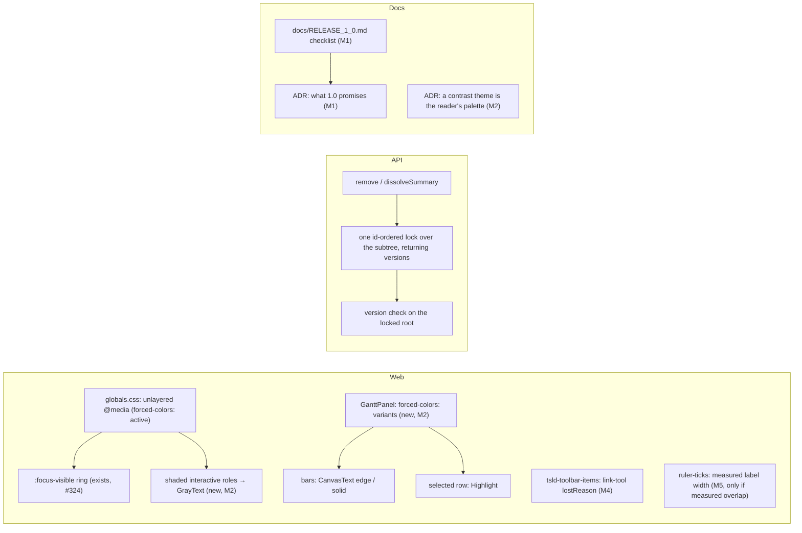
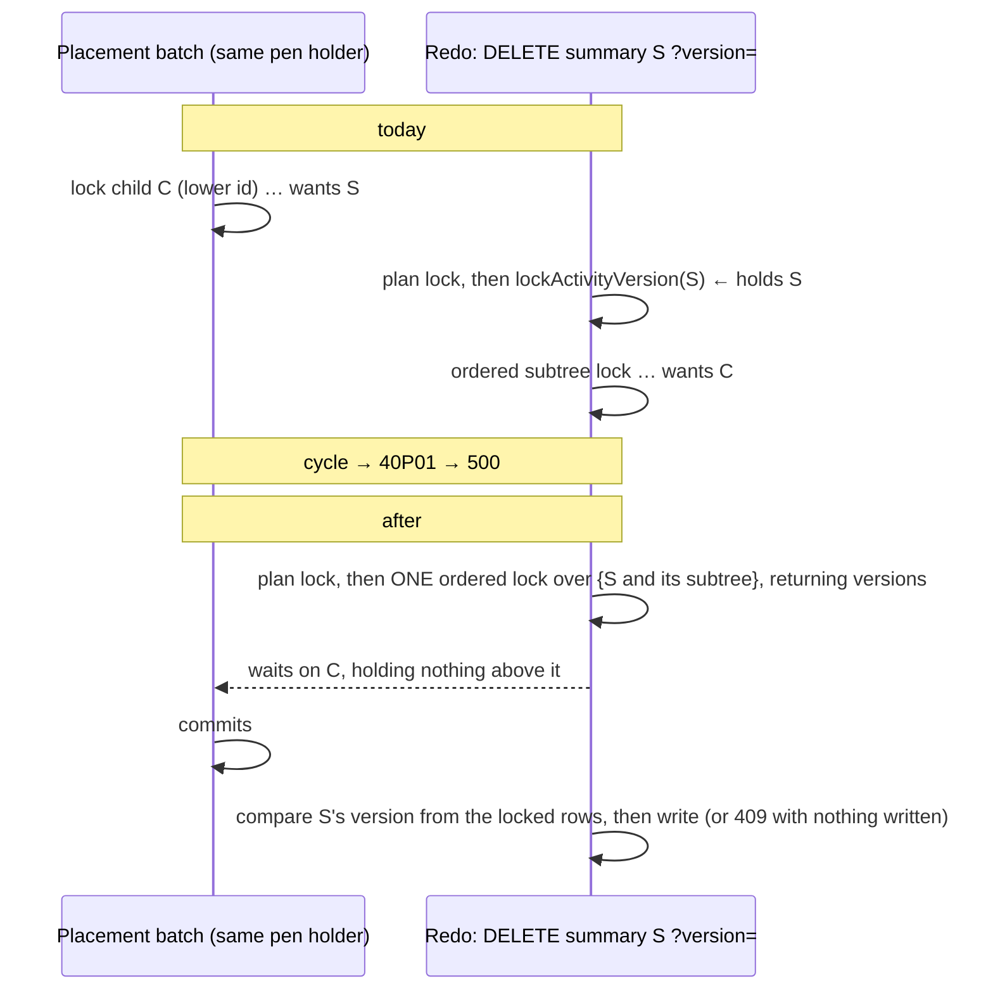

# Feature Spec: Pre-1.0 batch 2 — contrast themes, what 1.0 means, two lock and focus fixes, two measurements

- **Status:** Approved — by the product owner on 2026-10-13 ("Approve; write 1.0 down only"), all six milestones; answers recorded in §6.
- **Author(s):** feature-analyst, for the product owner
- **Date:** 2026-10-13
- **Tracking issue / epic:** `docs/TECH_DEBT.md` #505, #500, #504, #501, #506, and a new item with no row (defining 1.0).
  Scope chosen by the product owner on 2026-10-13 (decided, not re-asked here).
- **Roadmap link:** none yet. `docs/ROADMAP.md` has **no 1.0 milestone** (grep for `1.0` in it, 2026-10-13: one hit,
  a contrast ratio), although the previous batch's header cites "the pre-1.0 milestone (`docs/ROADMAP.md`)". Milestone 1
  adds one.
- **Related ADR(s):** two **new** ADRs proposed (§4.1 and §4.2; numbers are taken at landing, 0190 and 0191 today).
  Cited: ADR-0026, ADR-0027, ADR-0028, ADR-0059, ADR-0082, ADR-0088 D1, ADR-0097, ADR-0105, ADR-0111, ADR-0113,
  ADR-0128, ADR-0131, ADR-0135, ADR-0176, ADR-0185.

---

## 1. Business understanding

### Problem

Four pieces of work the owner picked to do before calling the product "1.0". In plain words:

1. **Windows contrast themes hide things (#505).** Windows has a setting, "Contrast themes", that people with low
   vision use. It throws away the colours a website chooses and paints everything in a small set of high-contrast
   colours the person picked (often yellow or white on black). Browsers call this **forced colours**. Two things
   probably break under it here:
   - A **shaded** menu item (one you cannot use right now, such as "Delete" when you do not hold the pen) differs from
     a usable one only by being greyer. A contrast theme replaces that grey, so the two probably look the same, and the
     shading is the only sign an action is refused.
   - The **Gantt's bars** are drawn as coloured boxes. A contrast theme removes box fill colours, so the bars probably
     disappear, and with them which bar is critical, which row is selected, and how far work has progressed.

   The diagram itself is **not** affected the way the register row says (see §3, finding 1).

2. **Nobody has written down what "1.0" means.** Version numbers here start with 0 (`web` 0.190.1, `api` 0.89.3).
   CLAUDE.md §10 says moving to 1.0 "is a deliberate, documented milestone", but no document says what has to be true
   first, or what 1.0 promises afterwards. Without that, "are we ready for 1.0?" has no answer.

3. **Two small faults (#500, #504).**
   - **#500:** "Redo" of deleting or dissolving a WBS summary (a heading row that groups other activities) grabs the
     summary first and its children second. Bar drags grab rows in a fixed order (lowest id first). If both happen at
     once, each can end up waiting for the other forever; the database then cancels one of them and the user sees an
     error. It needs an unlucky moment, but the fix is small.
   - **#504:** when the **Link activities** button disappears while the keyboard is on it, a screen reader hears that it
     went, but not why. Every such control is meant to carry a short reason sentence; this one has none.

4. **Two things to measure, then tidy (#501, #506).**
   - **#501:** at 200 % text size, the Gantt's month labels ("Sept 2027") may overlap, because their spacing was
     worked out by reasoning, never measured. The same fault was real on the diagram's day numbers last week (#478).
     **Measure first; fix only if they overlap.**
   - **#506:** one automated test (converting a zero-length task into a milestone) takes about 3.9 of its 4 allowed
     minutes, so a slow machine can fail it for no real reason. Find where the minutes go and make it faster, rather
     than giving it more time.

### Users

- **People using a Windows contrast theme** (1): any role that opens a menu, a shaded button or the Gantt — Org Admin,
  Planner, Contributor, Viewer. The shaded-control rule is global, so it also reaches the External Guest's share view
  wherever that view uses the same controls (not separately verified; no guest-specific work is planned).
- **The product owner** (2): decides what 1.0 means and when to cut it.
- **Planners and Org Admins** (3): the people who undo and redo summary deletes, and keyboard/screen-reader users of
  the toolbar.
- **Readers at 200 % text** (4, #501) and **contributors to the repository** (4, #506: every pull request).

### Primary use cases

1. A Viewer with a dark contrast theme opens a row's `⋯` menu and can see that "Delete" is unavailable.
2. The same person opens the Gantt and sees every bar, which ones are critical, which row is selected, and progress.
3. The owner reads a one-page 1.0 checklist in plain English, ticks or strikes each line, and later cuts 1.0 knowing
   exactly what it promises.
4. A planner redoes a summary delete while their own drag is still saving; neither fails.
5. A screen-reader user on the Link button hears why it left when it leaves.
6. A reader at 200 % text reads the Gantt's months without overlap (if the measurement finds any).
7. Every pull request's CI no longer risks a false red from the slow milestone test.

### Expected outcomes and success criteria

| #   | Success looks like                                                                                                                                                                                                                                                                                                         |
| --- | -------------------------------------------------------------------------------------------------------------------------------------------------------------------------------------------------------------------------------------------------------------------------------------------------------------------------- |
| 1   | Under emulated forced colours: a shaded menu item and a shaded button compute to `GrayText`, an available one does not; every Gantt bar, milestone, critical bar, progress and the selected row differ from the background, by computed colour and by screenshot; the same checks in ordinary colours show nothing changed |
| 2   | `docs/RELEASE_1_0.md` exists, every line is either evidence-backed "met", "owner decides", or "not for 1.0", and the owner has answered §6's questions; the 1.0 ADR is Accepted; the cut itself is a separate, named step                                                                                                  |
| 3   | #500: the new API e2e cases are red on today's `main` and green after; #504: the `link-tool` announcement carries a reason, and the development warning no longer fires in `web:workspace-fit`                                                                                                                             |
| 4   | #501: a measurement file records label overlap at 100 % and 200 % text; built only if it overlaps, then 0 overlapping pairs; #506: the journey's measured time before and after, with at least a third of its limit spare after                                                                                            |

### Open questions

Four critical questions, at the end (§6). Defaults are stated inline for everything else.

## 2. Functional requirements

### User stories & acceptance criteria

> **US-1 (#505, shaded controls)** — As a reader with a contrast theme, I want an unavailable menu item or button to
> look unavailable, so that I know an action is refused before I press it.
>
> - **Given** `forced-colors: active` **when** a menu shows a shaded item (`aria-disabled="true"`) beside an available
>   one **then** the shaded item's computed `color` is the browser's `GrayText` and the available one's is not.
> - The same for a shaded `Button` (any variant) and a shaded dialog action.
> - A toolbar member that is **pressed and shaded** keeps today's `GrayText` fill with `Canvas` ink
>   (`toolbar-styles.ts:272-276`); the new rule must not paint its label `GrayText` on a `GrayText` fill.
> - **Given** `forced-colors: none` **then** nothing renders differently from today (the control case).

> **US-2 (#505, the Gantt)** — As a reader with a contrast theme, I want the Gantt's bars and marks drawn in my
> theme's colours, so that the chart is still a chart.
>
> - Under forced colours every task bar has a visible edge (`CanvasText`); a critical bar's edge is **thicker** than an
>   ordinary one (the shape cue it has today: `ring-2` against `ring-1`, `GanttPanel.tsx:2273-2277`); a summary bar and
>   a milestone are solid `CanvasText`; progress is visible inside its bar; the selected row is marked in `Highlight`.
> - Marks that already survive (the float tail, the baseline "ghost" and the armed outline: dashed borders and an
>   outline, `GanttPanel.tsx:2245-2265`, `:2283`) are unchanged.
> - Dependency arrows (`GanttLinkOverlay.tsx:56`, an SVG stroke) are measured and fixed only if they vanish.
> - Ordinary colours are unchanged.

> **US-3 (1.0 definition)** — As the product owner, I want one short page that says what must be true before 1.0
> and what 1.0 promises afterwards, so that cutting it is a decision rather than a guess.
>
> - Each line says, in plain English, what it is, its status today with the evidence (file, command or decision), and
>   whether 1.0 waits on it.
> - It names the parked tasks (#100 alerts, the device check sheet) as **parked** and asks whether 1.0 waits on them.
> - It states collaborative editing is **not** in 1.0 (owner, 2026-10-12, `docs/DECISIONS.md`).
> - It describes the cut: one changeset, what version numbers, tags, images and changelog result, and what changes
>   for the running host (nothing, by default).

> **US-4 (#500)** — As a planner, I want redoing a summary delete or dissolve never to fail because my own drag is
> saving at the same moment.
>
> - **Given** a child row with a lower id than its summary is locked by another transaction **when** the summary is
>   deleted with `?version=` (or dissolved with `version` in the body) **then** the request holds **no** row of that
>   subtree while it waits, and completes (204 / 200) once the other transaction ends.
> - A stale `version` still answers 409 `STALE_VERSION` and a vanished summary still answers 404, with nothing written.

> **US-5 (#504)** — As a screen-reader user, when the Link activities control leaves the toolbar while I am on it, I
> want to hear why.
>
> - The announcement composed by `composeHandoffMessage` (`use-focus-handoff.ts:176-193`) includes a static reason that
>   is true both before and after the change.
> - If the control left because it moved somewhere else on the toolbar, focus lands on that place (`successorId`), not
>   on the toolbar container.

> **US-6 (#501, conditional)** — As a reader at 200 % text, I want the Gantt's month labels never to overprint.
>
> - **Given** text-only 200 % (CDP `Page.setFontSizes`, root 32 px) **when** the Gantt shows any zoom **then** no two
>   month labels' glyph boxes intersect. At 100 % text the labels are unchanged.

> **US-7 (#506)** — As a contributor, I want the Make-milestone journey to run well inside its limit, so that load on a
> runner cannot fail it.

### Edge cases

- **#505, a container marked `aria-disabled`:** colour is inherited, so a rule on any element would grey a whole group.
  The rule is limited to interactive roles (§4.1).
- **#505, a control with its own forced-colours rule** (five places today: `globals.css:1834-1839`,
  `toolbar-styles.ts:259-276`, `:462`, `:577`, `ToolbarSplitButton.tsx:270`, `viewport-notice.tsx:218`,
  `conflict-readout.ts:13`): an unlayered rule beats every layered utility regardless of specificity (the reason
  `globals.css:1794-1801` gives), so each is checked against the new rule in M2-T1.
- **#505, opacity:** a shaded `Button` also dims to 60 % (`button.tsx:21`). Opacity is not among the properties
  forced colours replaces (expected; measured in M2-T1), so `GrayText` at 60 % may be fainter than wanted. Default: the
  rule sets `opacity: 1` so `GrayText` alone carries the state, as Windows' own controls do.
- **#505, print:** the printed programme (`GanttPrintSurface.tsx`) is forced light by ADR-0103 and is not in scope.
- **#500, the default path** (no `version`) already locks the subtree in one sorted pass and is unchanged.
- **#500, a root deleted by someone else between the preamble read and the lock:** the ordered lock finds no root row
  and the answer stays 404.
- **#501, the printed programme** shares `buildRulerTicks` (`GanttPrintSurface.tsx:186`); a new width argument must
  default so paper is unchanged.
- **#506:** the test resizes from 1646 to 1920 on purpose (shrinking broke hit-testing, `zero-duration.spec.ts:277-280`);
  any split keeps that order or gives each width its own fresh page.

### Permissions

No change anywhere. #505 is presentation only, for every role. #500 keeps `activity:delete` and the pen
(`activities.service.ts:1487`, `:1491`, `:1864`, `:1870`). #504 is toolbar data. The 1.0 work is documents.

### Validation rules

None new. No DTO changes.

### Error scenarios

| Scenario                                                  | Today                  | After                                      | Status    |
| --------------------------------------------------------- | ---------------------- | ------------------------------------------ | --------- |
| Redo of summary delete/dissolve while a drag saves (#500) | possible `40P01` → 500 | waits its turn                             | 204 / 200 |
| Same, with a stale version                                | 409 `STALE_VERSION`    | unchanged (checked after the ordered lock) | 409       |
| Same, summary already gone                                | 404                    | unchanged                                  | 404       |

## 3. Technical analysis

| Area           | Impact | Notes                                                                                                                                                       |
| -------------- | ------ | ----------------------------------------------------------------------------------------------------------------------------------------------------------- |
| Frontend       | med    | `globals.css` forced-colours block; `GanttPanel.tsx` bar/row classes; `tsld-toolbar-items.tsx` (`link-tool`); maybe `ruler-ticks.ts`                        |
| Backend        | low    | `activities.service.ts` `remove`/`dissolveSummary`; `activity-row-lock.ts`; `hierarchy-lifecycle.service.ts` activity branch                                |
| Database       | none   | **No schema change, no migration.** Row locks only. If any milestone finds one is needed it stops for database-architect                                    |
| API            | none   | No contract change (same 204/200/404/409). The 1.0 ADR **defines** what the contract is; it does not change it                                              |
| Security       | none   | Scope predicates kept; no new input                                                                                                                         |
| Performance    | low    | #500 locks the subtree before the version check (it was locked a statement later anyway). #501's width read is once per font                                |
| Infrastructure | none   | No workflow change. The 1.0 cut (not in this batch by default) uses the existing Release workflow unchanged                                                 |
| Observability  | none   |                                                                                                                                                             |
| Testing        | med    | Two new Playwright spec files in **existing** configs; new API e2e cases in an existing file; two measurement specs in the existing `measure-gantt` harness |

**Recalc parity gate:** no scheduling input is added or changed and `computeSchedule` is not touched, so it is
byte-identical by construction. **The pen:** #500's writes are structural and stay pen-gated exactly as today; nothing
becomes or stops being structural. **Flags:** none, per ADR-0088 D1 — every milestone is its own commit boundary, which is
the rollback. **Entry points (ADR-0081):** no new entry point; #505 changes how existing surfaces look in a mode, and
its journeys drive the real Gantt and a real menu.

### ADR-0105 triggers, item by item

| Item | Trigger tripped                                                                                                                                                               | Why it is spec-level                           |
| ---- | ----------------------------------------------------------------------------------------------------------------------------------------------------------------------------- | ---------------------------------------------- |
| #505 | **A component's public contract** (the shaded state of every `aria-disabled` control, product-wide) and a **shared gate** (the forced-colours block's structural test widens) | Yes, plus an ADR                               |
| 1.0  | None of the code triggers; it is a **version-policy** change with no register row, so it needs stages 1–4 and an ADR                                                          | Yes                                            |
| #500 | None: inside the row's behaviour; new cases go in an existing API e2e file                                                                                                    | Covered by the row; in this spec for the batch |
| #504 | None (registry data). If `successorId` is set, focus lands somewhere new: **§19.13 applies** (accessibility-reviewer before release), not ADR-0105                            | Covered by the row                             |
| #501 | None: measurement under the existing `measure-gantt` config; a fix changes an internal function's signature                                                                   | Covered by the row                             |
| #506 | None: test-only, no new config or CI step                                                                                                                                     | Covered by the row                             |

**No new Playwright config and no CI step** anywhere in this batch: every new spec file sits in an existing
config's `testDir` (`e2e-gantt`, `e2e-workspace-fit` if needed, `measure-gantt`), and `ci.yml` runs suites by config.

### What the rows got wrong (re-verified 2026-10-13, read not run unless stated)

1. **#505: "the diagram canvas may vanish" is wrong.** The painter reads its colours as CSS custom properties with
   `getPropertyValue` (`features/tsld/render/palette.ts:93-95`, `:103-107`), and forced colours does not alter custom
   property values, only the used values of a fixed list of colour properties. A Canvas 2D bitmap is not recoloured.
   So the diagram **neither vanishes nor follows the theme**: it keeps its own light palette inside a dark screen, like a
   photograph. The DOM around it (ruler labels, toolbar, minimap rectangle) is recoloured. Whether the diagram should
   follow the theme is question Q4.
2. **#505: the Gantt is worse than "bars may vanish".** Expected, to be measured in M2-T1 (per the CSS Color
   Adjustment spec: background colours become `Canvas` with their alpha kept, and `box-shadow` becomes `none`):
   - **invisible:** task bars (fill `bg-canvas-bar/60` plus an inset `ring`, i.e. a box-shadow, `GanttPanel.tsx:2267-2277`),
     critical bars (same mechanism, `:2274`), summary bars (`bg-foreground/70`, `:2276`), milestone diamonds
     (`bg-foreground`, `:2255`), progress (`bg-foreground/45`, `:2305`), and the **selected row** (`bg-accent` only,
     `:2044`, `:2056`);
   - **survive:** the float tail (dashed border, `:2260-2265`), the baseline ghost (dashed border, `:2245-2250`), the
     armed outline (`:2283`), text labels and the badge glyphs;
   - **unknown:** the arrows (`GanttLinkOverlay.tsx:56`, SVG `stroke` from a custom property).
   - There is **no today line** on the Gantt (grep for `today` in `features/gantt/components/*.tsx`: none in markup).
3. **#505: "drops opacity cues the same way for every control" is probably wrong.** Opacity is not a forced property,
   so a shaded `Button` (`aria-disabled:opacity-60`, `button.tsx:21`) probably still dims; a shaded **menu item** has no
   opacity, only `text-muted-foreground` (`menu.tsx:458-460`), so it is the one that most likely looks identical. To be
   measured, not assumed. Menus and dialogs keep their edges: both have a `border` (`menu.tsx:255`, `dialog.tsx:84`).
4. **#505: the row says per-component rules; the repository's own precedent is one global rule.** The forced-colours
   focus ring is a single unlayered rule that overrides 61 call sites without touching them (`globals.css:1783-1839`,
   #324). #251 counts 13 hand-rolled `aria-disabled` recipes; a per-component fix touches each, a global rule covers
   all and every future one. §4.1 chooses the global rule for shaded controls and per-component rules for the Gantt's
   meaning-bearing marks.
5. **#505: "the e2e-forced-colors suite" cannot host this.** `playwright.forced-colors.config.ts:31-32` serves a
   production preview with no API and matches only `focus-ring.spec.ts`; the in-app forced-colours journeys already live
   in the suites of the surfaces they test (`e2e-workspace-fit/deck-tracks-forced-colors.spec.ts:27-30`). The same
   placement is used here.
6. **#500: the trigger is narrower than "another planner drags bars".** Both the placement writers and
   `remove`/`dissolveSummary` require the pen (`activities.service.ts:904`, `:985`; `:1491`, `:1870`), which one person
   holds (ADR-0028). So the other party is the **same** pen holder (a drag's save still in flight when a redo fires, or a
   second tab) or a peer in the moment between a pen hand-off and the transaction. Rarer; still a real cycle, since the
   placement writers take rows in id order without the plan lock (`activity-row-lock.ts:9-11`).
7. **#500: the fix shape differs per path.** In `dissolveSummary` the ordered lock is in the service (`:1917-1920`); in
   `remove` it is inside the cascade (`hierarchy-lifecycle.service.ts:452-453`). So for `remove` the version check has to
   move into the cascade's activity branch, or the cascade's ordered lock has to happen first.
8. **#500: "the harness cannot reproduce it" (#70) is true of the race and not of the order.**
   `hierarchy-cascade-lock-order.e2e-spec.ts` case B (`:197-237`) proves lock **order** deterministically: park a
   low-id row, send the request, wait in `pg_stat_activity` until it blocks, then probe a higher-id row with `NOWAIT`.
   That proves what the request holds while it waits. It does not reproduce a `40P01`, and the spec says so.
9. **#504: the cause was "not recorded", and it matters.** `link-tool`'s visibility is a build constant
   (`isVisible: () => CANVAS_AUTHORING_ENABLED`, `tsld-toolbar-items.tsx:3298`), so it did not leave because its own
   condition changed. Something re-composed the toolbar around it (a view switch, a re-render of the row, or promotion,
   ADR-0185, whose handoffs already say "Moved into the … menu", `toolbar-promotion.tsx:238-239`). A `lostReason` must be
   true before and after (`use-focus-handoff.ts:100-105`), so the reason cannot be worded until the cause is found
   (M4-T1).
10. **#501: confirmed plausible, with one more exposure.** The label size is rem-based (`text-micro` →
    `--type-micro: 0.625rem`, `globals.css:1238`), so text-only zoom doubles it. The ruler is a fixed 34 px tall
    (`GanttRuler.tsx:6`) with the label at `top-1` (rem), so **vertical** clipping at 200 % is also possible and is
    measured.
11. **#506: the leading suspect is the bar finder.** The test calls `findBarWide` five times (`zero-duration.spec.ts:283`,
    `:289` at two widths, `:319`); each call is a click sweep every 40 px across the canvas and every 6 px down to 200 px,
    row by row (`e2e-workspace-chrome/support.ts:495-508`): up to ~1,200 clicks per call at 1646 px. To be timed, not
    assumed.
12. **The brief is stale in two places relevant to 1.0:** `PROJECT_BRIEF.md` §16 still says hosting is "to be decided"
    (settled 2026-08-01, `docs/TECH_DEBT.md` #5), and §16 names a staging environment and daily backups that do not
    exist in any document (grep for `backup` in `docs/DEPLOYMENT.md`, 2026-10-13: no match).

### Dependencies

- Precedents reused: the unlayered forced-colours block and its structural test (`globals.css:1834`,
  `styles/focus-ring.structural.test.ts`); the computed-system-colour plus screenshot-difference method with a
  `forcedColors: 'none'` control (`deck-tracks-forced-colors.spec.ts:16-25`); the 200 % text cell
  (`Page.setFontSizes`, `measure-toolbar/ruler-days-200pc.spec.ts`, `docs/specs/pre-1-0-hardening/m7-measurement.md`);
  the lock-order probe (`hierarchy-cascade-lock-order.e2e-spec.ts`).
- The parked device check sheet's steps 22–23 (`device-check-sheet.md:222-227`) would confirm #505 on real Windows;
  #505 does **not** wait on them (owner, `docs/DECISIONS.md` 2026-10-13: "#505 can still be fixed from the code").

## 4. Solution design

### Architecture overview



### 4.1 #505: forced colours

**Measure first (ADR-0113).** M2-T1 photographs and reads computed colours, in the existing `measure-gantt` harness
(no new config), for: a menu with one shaded and one available item; a shaded and an available `Button` of each
variant; a dialog's shaded action; every Gantt mark in finding 2; and each existing forced-colours rule in the edge case
list, before and after a draft of the rule. The verdict decides the build; anything that already survives is left
alone.

**Shaded controls: one rule, in the existing unlayered block.** Default design (the exact selector is settled by T1):

```css
@media (forced-colors: active) {
  :is(
      button,
      a,
      input,
      select,
      textarea,
      [role='menuitem'],
      [role='menuitemradio'],
      [role='menuitemcheckbox'],
      [role='option'],
      [role='tab'],
      [role='radio'],
      [role='checkbox'],
      [role='switch']
    )[aria-disabled='true']:not([aria-pressed='true']) {
    color: GrayText;
    border-color: GrayText;
    opacity: 1;
  }
}
```

- **Why global.** Same reasoning as #324's ring: one rule covers the 13 hand-rolled recipes #251 counts and every future
  one, without touching them. `GrayText` is the system colour for disabled text, so the reader's theme decides it.
- **Why unlayered.** A layered rule loses to any utility that sets a colour, and a non-system author colour is then
  reverted to the browser default rather than to the next author rule, so a layered rule would never paint.
- **Why role-limited.** Colour inherits; a `div[aria-disabled]` group would grey everything in it.
- **Why `:not([aria-pressed='true'])`.** The toolbar's pressed-and-shaded member paints a `GrayText` fill with `Canvas`
  ink under `forced-color-adjust: none` (`toolbar-styles.ts:272-276`); without the exclusion its label would turn
  `GrayText` on `GrayText`.
- Natively `disabled` controls already get `GrayText` from the browser and are untouched.
- `focus-ring.structural.test.ts` widens: the block stays unlayered, the new rule is present, has the exclusion, and sets
  no `box-shadow` (the existing assertion at `:78-81`).
- **Rejected: per-component rules** in `menu.tsx`/`button.tsx`. Smaller blast radius, but it leaves every hand-rolled
  recipe outside the two primitives uncovered, which is the population #251 says keeps growing.

**The Gantt: per-element rules, because the meaning is the Gantt's.** `forced-colors:` variants on the elements in
finding 2, default mapping:

| Mark                | Ordinary (today)            | Forced colours (default)                                                              |
| ------------------- | --------------------------- | ------------------------------------------------------------------------------------- |
| Task bar            | fill + 1 px inset ring      | 1 px `CanvasText` border on `Canvas`                                                  |
| Critical bar        | red fill + 2 px ring        | 2 px `CanvasText` border (the width is the cue, as today)                             |
| Summary bar         | solid foreground            | solid `CanvasText` (`forced-color-adjust: none`)                                      |
| Milestone           | solid foreground diamond    | solid `CanvasText` diamond                                                            |
| Progress            | darker band inside the bar  | `CanvasText` band inside the bar (on a summary, a `Canvas` band; settled by T1)       |
| Selected row        | `bg-accent`                 | `Highlight` fill with `HighlightText` text, the Windows convention for a selected row |
| Arrows              | `--muted-foreground` stroke | `CanvasText` stroke, only if T1 shows them gone                                       |
| Float, ghost, armed | dashed borders / outline    | unchanged (they survive)                                                              |

Risk named for the selected row: `forced-color-adjust: none` inherits, so descendant text with its own colour class
would keep its author colour on `Highlight`. T1 photographs the row with a critical name and a variance value in it;
if legibility fails, the fallback is a `Highlight` left-edge mark that is not the focus ring's shape.

**The diagram:** unchanged by default (Q4). The ADR records why: it is a bitmap with its own palette, it stays visible
and its colours are the design system's checked contrast, and repainting it from system colours is a separate,
larger piece of work.

**Where the checks live.** One new spec, `apps/web/e2e-gantt/forced-colors.spec.ts`, under the existing
`playwright.gantt.config.ts`: one onboarding covers the Gantt's bars, a shaded item in a Gantt row's `⋯` menu, and a
shaded `Button` (M2-T1 names which item and button are shaded in which state, e.g. with the pen released; not assumed
here). Primary assertion: computed system colours; supplementary: the
screenshot of a mark differs from the same box with the mark absent; control: a `forcedColors: 'none'` describe proves
ordinary colours are untouched. A second file in `e2e-workspace-fit` only if T1 finds a toolbar-hosted case the Gantt
suite cannot reach. Emulation is Chromium's; #154's real-hardware debt is untouched and the parked sheet still confirms.

**ADR (new, "A contrast theme is the reader's palette").** Outline:

- **Context:** #505; #324's ring; the measurements of M2-T1.
- **D1:** shaded interactive controls are `GrayText` under forced colours, from one unlayered rule; components do not
  restate it. A component that paints its own shaded state under `forced-color-adjust: none` excludes itself by state
  (the pressed exclusion) and says so.
- **D2:** a mark that carries meaning by fill (a bar, a selection) gets a forced-colours form that carries it by
  system colour **and** shape; a mark that is already a border or outline needs nothing.
- **D3:** canvas bitmaps keep their palette; the reasons and the trigger to revisit (a contrast-theme user report, or
  the owner's answer to Q4).
- **D4:** a forced-colours check lives in the suite of the surface it tests, asserts computed system colours first,
  and has an ordinary-colours control.
- **Consequences:** `DESIGN_SYSTEM.md` gains one "Forced colours" section gathering today's scattered notes (`:244`,
  `:254`, `:273-276`, `:303`, `:679-719`); `COMPONENT_LIBRARY.md` notes that a new shaded primitive needs nothing.

### 4.2 What 1.0 means

**Deliverable 1: `docs/RELEASE_1_0.md`**, plain English, one page plus evidence. Candidate lines, each to be confirmed
in M1-T1 (statuses below are as read on 2026-10-13):

| Area                 | Candidate line                                                                                | Status today, with evidence                                                                                                                  | Whose call                     |
| -------------------- | --------------------------------------------------------------------------------------------- | -------------------------------------------------------------------------------------------------------------------------------------------- | ------------------------------ |
| Features             | Every brief §8 Must-have works                                                                | Met. CLAUDE.md §1 banner; hammock is met by Level of Effort by decision (`DECISIONS.md:3571-3589`, Q1); Gantt editing ADR-0095/0170          | evidence                       |
| Features             | Collaborative editing                                                                         | **Not in 1.0** (`DECISIONS.md`, 2026-10-12)                                                                                                  | decided                        |
| Engine               | CPM parity on the canonical suite                                                             | Met: conformance matrix closed (ADR-0034)                                                                                                    | evidence                       |
| Accessibility        | No known WCAG 2.2 AA defect open                                                              | #505 open (this batch); M1-T1 triages the 125 open rows (`grep -c '^\*\*Status:\*\* open'`) for user-facing defects                          | evidence after triage          |
| Safety of data       | A written, tested way to back up and restore the database                                     | **Missing**: no procedure in any doc (finding 12)                                                                                            | owner (Q3)                     |
| Safety of data       | Whole-organisation export (brief §13)                                                         | **Missing** (CLAUDE.md §17)                                                                                                                  | owner (Q3)                     |
| Safety of data       | Recycle-bin clear-out after 90 days (brief §13)                                               | Built, **off** by default (`RETENTION_HIERARCHY_ENABLED=false`, CLAUDE.md §17)                                                               | owner (Q3)                     |
| Operations           | Mail-failure alerts reach someone (#100)                                                      | **Parked by the owner** (`DECISIONS.md` 2026-10-13)                                                                                          | owner (Q2)                     |
| Operations           | Real-device accessibility check (device sheet)                                                | **Parked by the owner**                                                                                                                      | owner (Q2)                     |
| Performance          | 30 fps at Fit with 2,000 activities (brief §12)                                               | Met on the Dell (45.9 fps, CLAUDE.md §17 item 10); last Surface reading 26.0 fps on an older painter, not re-read since                      | owner reading (ADR-0128 panel) |
| Contract             | The public contract is named (below) and the deprecated fields are removed or kept on purpose | Deprecated `fromEarlyStart…` fields "removed at the next breaking change" (`API.md:37-39`); a 1.0 cut is the last free moment to remove them | default: remove at the cut     |
| Docs                 | Brief, roadmap and CLAUDE.md §10 say the same thing about 1.0                                 | Brief §16 stale (finding 12); ROADMAP has no 1.0 entry                                                                                       | evidence                       |
| Not release criteria | Brief §7 success measures (NPS, view telemetry, 20-minute build)                              | These measure adoption after release; listed so nobody waits on them                                                                         | stated                         |

**Deliverable 2: the mechanics of the cut** (described in the document, **not performed** unless Q1 says so):

- One changeset: `'@repo/api': major` and `'@repo/web': major`. Changesets is expected to take `0.89.x` to `1.0.0`,
  since it does not apply the "0.x major counts as minor" convention; that is **to be verified by a dry run** in M1-T3
  (`pnpm changeset status --verbose` on a throwaway branch), and registered in `scripts/dependency-claims.json` if the
  ADR states it as a fact about Changesets.
- Internal packages (`@repo/types`, `@repo/interchange`, …) are private and unpublished; default: they stay 0.x.
- Tags: `api-v1.0.0`, `web-v1.0.0`, per ADR-0027, unchanged.
- Images: `:1.0.0`, `:latest`, `:sha-…` and `:main`. The `type=semver` patterns (`docker-publish.yml:129-130`) only
  fire on the legacy `v*` tag push, so no `:1` or `:1.0` tags appear on the Release path. Default: unchanged.
- The host: Watchtower pulls `IMAGE_TAG` (default `main`), so 1.0 changes nothing on the host.
- `CHANGELOG.md`: the changeset's text is the 1.0 release note, written plain: what 1.0 promises, and the known limits
  (whatever Q2–Q4 leave out).

**ADR (new, "What 1.0 promises").** Outline:

- **Context:** CLAUDE.md §10 ("breaking changes bump the minor" while pre-1.0); API.md:24-29; ADR-0027; this spec.
- **D1, the public contract:** the REST API under `/api/v1` as described by its OpenAPI document, including the guest
  share endpoints (`/api/v1/share/*`); the export file formats and the inert SchedulePoint layout field (ADR-0156); the
  operator's configuration surface (environment variables in `.env.example` and the compose files). **Not** the
  contract: `/api/v1/staff/*` (already declared outside it, `API.md:1465`), the database schema, internal packages.
- **D2, after 1.0:** a breaking change to D1 bumps the package's **major**. The URL version (`/api/v1`) moves only for a
  breaking REST change, and per `API.md:26-29` that needs its own ADR and a migration note. Package major and URL
  version are separate numbers that move for different reasons; the ADR says which one a given change moves.
- **D3, `web`'s major:** the web app has no programmatic contract; its major moves when a capability users rely on is
  removed, or when saved links (plan URLs, share links) stop resolving.
- **D4, the cut:** what §4.2 Deliverable 2 says; who decides (the owner); that the checklist is the gate.
- **Consequences:** CLAUDE.md §10 rewritten to the post-1.0 rule (one line pointing at the ADR); `.changeset/README.md`
  table unchanged.

### 4.3 #500: the version check moves after the ordered lock



- `lockActivityRowsInIdOrder` and `lockActivityIdsInIdOrder` return the locked rows' `(id, version)` (callers that do not
  need them ignore the value; one statement, same `ORDER BY id FOR NO KEY UPDATE`).
- **`dissolveSummary`:** drop the early `lockActivityVersion`; after the ordered lock at `:1917-1920`, take the summary's
  version from the returned rows and `assertVersionMatches` before the `updateMany`.
- **`remove`:** pass an optional `expectedRootVersion` to `cascadeSoftDelete`; its activity branch checks it against the
  root row its ordered lock returned (`hierarchy-lifecycle.service.ts:452-453`), before the first write. The branch's
  other callers pass nothing and are unchanged.
- `lockActivityVersion` then has no callers and is deleted (CLAUDE.md §5, no dead code); the dependency and assignment
  variants stay.
- `activity-row-lock.structural.spec.ts` gains a case: in `remove` and `dissolveSummary`, no single-row activity lock
  precedes the id-order seam.

### 4.4 #504: a reason for the Link control

M4-T1 finds why it left (re-run `web:workspace-fit` with the console captured and the triggering test named). Default
wording by cause, all true before and after:

- moved into a menu by promotion → `lostReason: 'Moved into the toolbar menu.'` plus `successorId` naming that menu's
  trigger (this moves focus: §19.13, accessibility-reviewer before release);
- the toolbar re-composed for another view → `'Linking is available only on the diagram.'`, no successor;
- anything else → the sentence describing that condition, worded with accessibility-reviewer.

If T1 shows the control did not really leave (a remount of the same item), that is a different defect (a false
announcement, the class `command-surface.spec.ts:2126-2148` guards) and gets its own row instead of a sentence.

### 4.5 #501: measure, then maybe pass a width

M5-T1 adds `apps/web/measure-gantt/month-labels-200pc.spec.ts`: 1280 × 800, text-only 100 % and 200 %, each Gantt zoom
preset and the arrival framing; reads each month label's glyph box (a `Range`, as `ruler-days-200pc.spec.ts` does),
counts intersecting neighbours, and records the label's bottom against the ruler's 34 px height. Writes
`docs/specs/pre-1-0-batch-2/m5-measurement.md`.

**Only if anything overlaps:** `buildRulerTicks` gains an optional `minLabelPitchPx` (default
`MONTH_LABEL_MIN_PITCH_PX`, so the print surface is unchanged); `GanttRuler` measures the widest label once per root
font size and passes width plus gap. A vertical clip, if found, is fixed by sizing the ruler in rem or letting the
label sit inside its height; T1's numbers choose. **If nothing overlaps,** #501 closes on the measurement and nothing is
built.

### 4.6 #506: time it, then shorten the set-up

M6-T1 wraps the test's phases in `test.step` and runs it twice on `main` with the JSON reporter; the per-step times go
in the PR. Default remedy if the bar finder dominates: select bars by lane (`findBarInRow` with `y` from the lane index
the test itself set) or through the diagram's accessible list, since selecting a bar is set-up here and the pointer
claims are about the dock's controls, not the bar. If one width's checks dominate instead, split the two widths into
two tests, each starting at its own width. **The limit is not raised.** Target: under 160 s locally (a third spare).

### Database changes

None. Any milestone that finds one is needed stops and goes to database-architect (CLAUDE.md §19.3).

### API changes

None to the contract. The 1.0 ADR defines the contract; it does not alter it.

### Implementation approach & alternatives

- **#505, per-component shaded rules only:** rejected (§4.1).
- **#505, wait for the device sheet:** rejected; the owner allowed fixing from the code (`DECISIONS.md` 2026-10-13).
- **#505, repaint the diagram from system colours:** deferred to Q4; a larger change to the painter.
- **1.0, cut it in this batch:** only if Q1 says so; the checklist has open owner answers.
- **#500, take the root's version in a second statement after the ordered lock:** works too, but a separate re-read is
  one more statement for nothing; the ordered lock already has the row.
- **#506, raise the timeout:** rejected by the row and by this spec.

## 5. Links

- Implementation plan: [`./implementation-plan.md`](./implementation-plan.md)
- Docs updated by this work: `docs/RELEASE_1_0.md` (new), two new ADRs and their CLAUDE.md §16 lines, CLAUDE.md §10,
  `docs/ROADMAP.md`, `docs/PROJECT_BRIEF.md` §16, `docs/API.md` (versioning), `docs/DESIGN_SYSTEM.md`,
  `docs/FRONTEND_QUALITY.md`, `docs/COMPONENT_LIBRARY.md`, `docs/specs/pre-1-0-hardening/device-check-sheet.md`
  (steps 22–23 and its maintainers' log), `docs/TECH_DEBT.md` (#505, #500, #504, #501, #506 closed to the ledger; a
  note on #251).

## 6. Questions for the owner

Plain English; each has a recommended default. Only these four change what gets built.

**Q1. Should this batch actually release 1.0, or only write down what 1.0 means?**
"Releasing 1.0" means changing the version numbers from 0.something to 1.0.0 and publishing that. It changes nothing
on your server by itself. **Recommended:** only write it down now. You read the checklist, answer the lines marked
"owner", and the release is a separate, short step afterwards.

**Q2. You parked two jobs on 2026-10-13. Does 1.0 wait for either?**
(a) Setting up the mail-failure and uptime alerts on your server (about 15 minutes, `docs/guides/set-up-alerts.md`).
(b) The device check sheet: screen reader, contrast theme and large text on your two machines (about 1½–2 hours).
**Recommended (your decision):** (a) yes, because without it a broken mail relay silently stops password resets;
(b) no, because this batch adds automated checks for the contrast-theme faults, and the sheet can confirm after 1.0.

**Q3. The original brief promised three things for "version 1" that are missing or switched off. Which must be done
before 1.0?**
(a) A written, tested way to **back up and restore** the database (nothing in the documents describes one).
(b) A **whole-organisation export** (everything an organisation has, in one download).
(c) **Permanent clear-out** of the recycle bin after 90 days (built, but off on your server).
**Recommended:** (a) yes, as its own short spec after this batch: a product people use needs a restore that has been
tried once. (b) and (c) not for 1.0: listed as known limits in the release notes, and the brief updated to match.

**Q4. Should the diagram follow a Windows contrast theme?**
The diagram is a picture the app paints itself, so a contrast theme does not recolour it: it stays in its normal
colours inside an otherwise dark or coloured screen. It stays visible and readable; it just does not match.
**Recommended:** no, not in this batch. The Gantt, menus and buttons are fixed to follow the theme; the diagram is
recorded as a deliberate choice, with a register row to revisit if a contrast-theme user asks.

### The owner's answers (2026-10-13)

- **Q1 — write it down only.** This batch does not cut 1.0; the cut is a separate step after the owner has read the
  checklist.
- **Q2 — not asked.** The owner asked on 2026-10-13 that the two parked jobs not be raised until they bring them up.
  The checklist lists both as "parked by the owner — the owner's call" and takes no position on them.
- **Q3 — all three are required for 1.0.** (a) Backup and restore: required, as its own short spec after this batch.
  (b) Whole-organisation export and (c) the recycle bin's permanent clear-out: the owner answered "have both working".
  Both are **required** lines on the checklist, each to be specified on its own after this batch (the export is
  unbuilt; the clear-out is built and off, so its spec is mostly turning it on and confirming it works). Neither is
  scope in this batch, and the brief is **not** changed to drop them.
- **Q4 — no.** The diagram keeps its own colours under a contrast theme; the ADR records it as a choice and a register
  row tracks it.

**Defaults (proceed unless told otherwise):** one global `GrayText` rule for shaded controls and per-element Gantt rules
(§4.1); Gantt selection in `Highlight`; checks in a new `e2e-gantt/forced-colors.spec.ts`; the checklist at
`docs/RELEASE_1_0.md`; internal packages stay 0.x; no `:1` image tag; deprecated API fields removed at the 1.0 cut;
#500's check moved after the ordered lock; #504 worded by the cause T1 finds; #501 built only on a measured overlap;
#506 shortened, never given more time.
