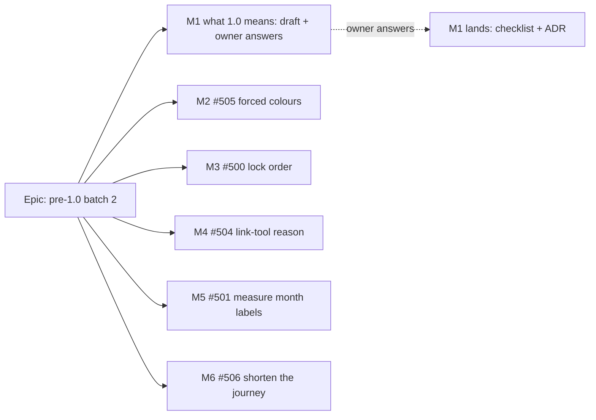

# Implementation Plan: Pre-1.0 batch 2

- **Feature spec:** [`./feature-spec.md`](./feature-spec.md)
- **Status:** Approved — by the product owner on 2026-10-13 ("Approve; write 1.0 down only"), all six milestones; answers recorded in §6.
- **Owner:** product owner; implementation by the **builder** agent (Sonnet), one PR per milestone.

## Breakdown

### Epic

**Pre-1.0 batch 2** — fix the contrast-theme faults, write down what 1.0 means, close two small faults, and settle two
suspicions by measurement.

**Rules that apply to every milestone.**

- **No `VITE_` flag** (ADR-0088 D1); each milestone is its own commit boundary, which is the rollback.
- **Schema:** none expected. Any schema need stops the milestone and goes to the database-architect (§19.3).
- **ADR-0105:** M2 (a component contract and a shared gate) and M1 (version policy) are why this is a spec; M3–M6 sit
  inside their rows. Anything found beyond a milestone's scope becomes a `TECH_DEBT` row, not extra work in the PR.
- **Pre-push:** `pnpm prepush` always; `scripts/e2e-local.sh api` when `apps/api` changes; `scripts/e2e-local.sh
web:<suite>` for **every suite listed under the milestone**, not only the one a test was added to (the HANDOFF lesson:
  two CI reds last batch came from suites nobody ran).
- **Evidence:** each PR states what was run (command and result), per §19.11. Measurement milestones record their
  numbers in a file beside this plan.
- **Closing rows:** each milestone closes or updates its row in the same PR (closed rows move to the ledger with one line
  and the PR number).
- **Header first:** on approval, the first PR sets both headers to `Approved — <date, the owner's words>`. M1 and M2 add
  ADRs that cite this directory, and `check:spec-status` S3 refuses a cited spec still headed `Draft`.
- **Counts:** a new ADR moves the ADR count and a new spec or source file may move the web file count; run
  `pnpm check:counts` after every rebase (`docs/HANDOFF.md`: parallel PRs collide on these numbers). A new ADR adds **one
  line** to CLAUDE.md §16 (`check:adr-coverage`).

### Running in parallel, and the one database

Non-DB work (code, unit tests, lint, docs, reviews) runs in parallel worktrees. **Every Playwright journey, measurement
spec and API e2e run needs the single local Postgres: one DB-backed run at a time**, handed over by an explicit "DB free"
from the orchestrator.

| M   | Needs the DB for                              | Can start in parallel with            |
| --- | --------------------------------------------- | ------------------------------------- |
| 1   | nothing (docs only; T3's dry run needs no DB) | everything                            |
| 2   | T1 measurement, T3 journey, the suite runs    | M1, and the code halves of M3–M6      |
| 3   | API e2e                                       | M1, M2 code                           |
| 4   | T1 reproduction, suite runs                   | M1; touches toolbar files M2 does not |
| 5   | T1 measurement (and T2's journey, if built)   | M1; edits Gantt files other than M2's |
| 6   | T1 timing, suite runs                         | M1                                    |

Suggested DB order: M2-T1, M3, M2-T3, M4-T1, M5-T1, M6-T1, then each milestone's full suite run before its PR.

---

### Milestone 1: Write down what 1.0 means (draft first, lands after the owner answers)

**Outcome:** the owner can answer "are we ready for 1.0?" from one page.
**Ships dark:** documents only; no product change.
**Journey:** n/a.

> **Description:** `docs/RELEASE_1_0.md` (checklist and cut mechanics, plain English), the "What 1.0 promises" ADR,
> and the supporting doc corrections.
> **Complexity:** S (writing) plus the owner's time · **Dependencies:** the owner's answers to Q1–Q3 before it lands ·
> **Changeset:** no (unless Q1 says "cut it", see T4)
> **Risks:** a checklist that grows into a backlog → every line is either evidence-backed, owner-decided or "not for
> 1.0", and items found missing become rows or specs of their own, never scope here. Stating a Changesets behaviour
> wrongly → T3's dry run before the ADR states it. Triage of 125 open rows taking a day → T1 is capped at the
> user-facing question only (is it a defect a user can meet?), recorded as a list, no row rewritten.
> **Testing:** `pnpm prepush` (format, `check:adr-coverage`, `check:spec-status`, `check:counts`).
> **Reviewers:** api-reviewer (D1's contract boundary), devops-reviewer (the cut's tags, images, host).

##### Task 1.1 — Gather the evidence

1. Re-verify each candidate line in spec §4.2 against the source it cites; record command or file:line beside it.
2. Triage open `TECH_DEBT` rows (`grep -n '^\*\*Status:\*\* open'`) into "a user can meet this defect" or not; list the
   first group by number and one line each.
3. Confirm the brief's §8 Must-haves against the banner and ADRs; note the hammock decision.

##### Task 1.2 — Draft for the owner

1. Write `docs/RELEASE_1_0.md`: what 1.0 is, the checklist table, what 1.0 promises afterwards, how the cut works, and
   the known limits section left blank for the owner's answers.
2. Draft the ADR from spec §4.2 (status Proposed), and its CLAUDE.md §16 line.
3. Put Q1–Q3 to the owner (Q4 belongs to M2) in the words of spec §6.

##### Task 1.3 — Verify the cut's mechanics without cutting

1. On a throwaway local branch, add a `major` changeset for `@repo/api` and `@repo/web`, run
   `pnpm changeset status --verbose`, record the versions it would produce, and **delete the branch**. Nothing pushed.
2. Read `docker-publish.yml:122-139` and `release.yml` for the tags produced on the Release path; record them.
3. If the ADR states a Changesets internal as fact, register it in `scripts/dependency-claims.json` (`pnpm check:claims`).

##### Task 1.4 — Land

1. Fill the checklist with the owner's answers; set the ADR to Accepted; rewrite CLAUDE.md §10's pre-1.0 bullet to
   point at the ADR; update `docs/API.md` "Versioning" (package major versus URL version) and `docs/ROADMAP.md` (a 1.0
   entry linking the checklist); correct `PROJECT_BRIEF.md` §16 hosting (settled, `TECH_DEBT` #5) and the lines Q3
   moves out of v1.
2. Record the owner's answers in `docs/DECISIONS.md`.
3. **Only if Q1 is "cut it":** a separate follow-up PR with the `major` changeset and the release note; the cut is then
   the Version Packages PR, read per §11. Default: not in this batch.

---

### Milestone 2: Contrast themes show shaded controls and the Gantt (#505)

**Outcome:** under a Windows contrast theme, shaded menu items and buttons look shaded, and every Gantt bar and mark is
visible.
**Entry point:** existing: any menu, any shaded button or dialog action, and the Gantt view, under `forced-colors:
active`.
**Journey:** `apps/web/e2e-gantt/forced-colors.spec.ts` (new file, existing `playwright.gantt.config.ts`), with a
`forcedColors: 'none'` control.

> **Description:** measure; one unlayered `GrayText` rule for shaded interactive roles; `forced-colors:` variants on the
> Gantt's marks; the "contrast theme is the reader's palette" ADR; design-system docs.
> **Complexity:** M · **Dependencies:** none (Q4's answer only widens it) · **Changeset:** yes, `@repo/web` patch
> **Risks:**
>
> - The unlayered rule overrides a component's own forced-colours rule → T1 lists every existing rule (spec edge
>   cases) and checks each against the draft; the pressed exclusion is the known case.
> - Selected-row text keeps author colours on `Highlight` (`forced-color-adjust` inherits) → T1 photographs it with
>   coloured text in the row; the fallback mark is named in spec §4.1.
> - The structural test reads the block's text (`focus-ring.structural.test.ts:78`) → widened in the same PR, red first.
> - The new spec adds an onboarding to the Gantt shard → one test file, one onboarding for all three surfaces; the
>   CI shard times are read after merge against ADR-0138's trigger (slowest shard over 1,250 s).
> - Emulation is not real Windows → stated in the spec file's docblock; #154 untouched; the parked sheet still confirms.
>   **Testing:** widened `focus-ring.structural.test.ts`; GanttPanel unit tests that the forced variants exist on the
>   right elements and not on others; the journey (computed `GrayText`/`CanvasText`/`Highlight` first, screenshot
>   difference second, ordinary-colours control).
>   **Reviewers:** accessibility-reviewer and component-reviewer **before release** (a product-wide change to every
>   shaded control's presentation, §19.13's spirit), ux-reviewer (the Gantt mapping).
>   **Pre-push:** `pnpm prepush`; `scripts/e2e-local.sh` for **web:gantt** (the new spec, and `gantt.spec.ts`,
>   `column-widths.spec.ts`, `disclosure.spec.ts`, `gantt-scale.spec.ts` because `GanttPanel.tsx` changes),
>   **web:gantt-editing** (`bar-drag.spec.ts`, `touch.spec.ts` read the bar element and `data-bar-armed`),
>   **web:workspace-fit** (`deck-tracks-forced-colors.spec.ts` holds the pressed-and-shaded member the exclusion
>   protects; `deck-focus-ring.spec.ts` runs forced colours), **web:forced-colors** (`focus-ring.spec.ts`, the block
>   the rule joins), **web:narrow-shell** (forced-colours card and ring at `narrow-shell.spec.ts:286-300`). Ordinary
>   colours are unchanged by construction, so suites that never emulate forced colours are not re-run for this; the
>   builder greps `apps/web/e2e*/` for any class-string assertion on the changed Gantt elements before relying on that.

##### Task 2.1 — Measure (ADR-0113)

1. Add `apps/web/measure-gantt/forced-colors-m2.spec.ts` (existing `playwright.measure-gantt.config.ts`): a plan with a
   task, a critical task, a summary with a child, a milestone, progress on one bar, a baseline, a link with the
   arrows on, and a selected row; a row `⋯` menu with a shaded and an available item; a shaded and an available
   `Button` of each variant; a dialog with a shaded action.
2. For each, under `forcedColors: 'active'` then `'none'`: computed `color`, `background-color`, `border`,
   `box-shadow`, `opacity`, `forced-color-adjust`, and a clipped screenshot; and whether the mark differs from the same
   box without it.
3. Repeat (2) for each existing forced-colours rule in spec §2 "Edge cases" with the draft global rule applied.
4. Record in `docs/specs/pre-1-0-batch-2/m2-measurement.md`: which marks vanish, which survive, and the verdict on
   opacity. Anything that survives is dropped from T2.

##### Task 2.2 — Build

1. Add the shaded-controls rule to the unlayered block in `apps/web/src/styles/globals.css` (selector settled by T1),
   with a docblock in the style of #324's.
2. Widen `focus-ring.structural.test.ts`: the rule is present, outside every `@layer`, carries the pressed exclusion,
   and sets no `box-shadow`. Red first (delete the rule; the case fails).
3. Add `forced-colors:` variants in `GanttPanel.tsx` per the spec §4.1 table, on the spacing and token rules
   (`token-architecture.test.ts`); arrows in `GanttLinkOverlay.tsx` only if T1 found them gone.
4. Unit tests: each variant on its element; the critical bar's edge wider than the task bar's.

##### Task 2.3 — Journey

1. `e2e-gantt/forced-colors.spec.ts`: one onboarding; bars, milestone, summary, critical edge width, progress and the
   selected row by computed system colour; the row menu's shaded item `GrayText` and its available item not; a shaded
   `Button` `GrayText`. Screenshot differences as supplementary. A `forcedColors: 'none'` describe proves none of the
   forced values leak. Verified red by removing the rule and the variants (record in the PR).

##### Task 2.4 — ADR and docs

1. The ADR from spec §4.1 (D1–D4), its CLAUDE.md §16 line, and Q4's answer in D3.
2. `docs/DESIGN_SYSTEM.md`: one "Forced colours" section gathering the existing notes and the new rule;
   `docs/FRONTEND_QUALITY.md`: where forced-colours checks live and their control; `docs/COMPONENT_LIBRARY.md`: a new
   shaded primitive needs nothing.
3. `device-check-sheet.md` steps 22–23: reword "Correct" to what the fix shows, and add a line to its maintainers'
   section (the sheet stays parked).
4. `TECH_DEBT`: close #505 (correcting the canvas claim in the ledger line); add a note to #251 that the forced-colours
   half of the recipe is now global; open a row for Q4's deferral if the answer is "not now".

---

### Milestone 3: Summary redo locks in one order (#500)

**Outcome:** redoing a summary delete or dissolve while a drag saves never returns a 500.
**Ships dark:** no surface; an existing action stops failing. The API e2e cases are the proof.
**Journey:** n/a (no UI change).

> **Description:** the version check reads the root from the ordered lock's rows, in both paths.
> **Complexity:** S · **Dependencies:** none · **Changeset:** yes, `@repo/api` patch
> **Risks:** the cascade's signature grows an optional argument → only `remove` passes it; the other activity-branch
> callers are untouched and their tests pin that. Error order changes (409/404 now after the subtree lock) → API e2e
> asserts both still answer with nothing written. The test cannot reproduce a `40P01` (#70) → it proves lock order, and
> the PR says that is what it proves.
> **Testing:** two new cases in `apps/api/test/hierarchy-cascade-lock-order.e2e-spec.ts`; unit cases in
> `activities.service.spec.ts`; the structural case.
> **Reviewers:** test-engineer (cases first), backend-performance-reviewer (locks and transactions). security-reviewer
> only if a scope predicate changes (none planned).
> **Pre-push:** `pnpm prepush`, `scripts/e2e-local.sh api`.

##### Task 3.1 — Red first

1. **Case E, `DELETE …/activities/:summary?version=`:** insert a summary S and a child C with explicit ids so C's id is
   lower than S's (the case-B technique, `:197-237`). Park a test transaction on C (`FOR NO KEY UPDATE`). Send the
   delete with S's current version; wait until it blocks on an activities row. Probe S with `FOR NO KEY UPDATE NOWAIT`:
   today it fails `55P03` (the delete already holds S), after the fix it succeeds. Release; assert 204.
2. **Case F, `POST …/activities/:summary/dissolve` with `{ version }`:** the same shape; assert 200.
3. **Case G:** stale version → 409 `STALE_VERSION`, nothing stamped; root already deleted → 404.
4. Record the red run in the PR.

##### Task 3.2 — Fix

1. `activity-row-lock.ts`: `lockActivityRowsInIdOrder` and `lockActivityIdsInIdOrder` return `{ id, version }[]` from
   the same statement.
2. `dissolveSummary`: remove the early `lockActivityVersion`; check the version from the ordered lock's rows before the
   `updateMany`.
3. `cascadeSoftDelete`: optional `expectedRootVersion`, checked in the activity branch after its ordered lock and before
   the first write; `remove` passes it.
4. Delete `lockActivityVersion` (no callers left); keep the dependency and assignment variants.
5. `activity-row-lock.structural.spec.ts`: no single-row activity lock before the id-order seam in `remove` and
   `dissolveSummary`.
6. Close #500 to the ledger, recording findings 6–8 of the spec.

---

### Milestone 4: The Link control says why it left (#504)

**Outcome:** a screen-reader user hears the reason, and the development warning stops.
**Entry point:** existing: the TSLD toolbar's **Link activities** control.
**Journey:** a step in the suite where T1 reproduces the handoff, asserting the announcer's sentence.

> **Description:** find the cause; add a static `lostReason`, and `successorId` if the control moved elsewhere.
> **Complexity:** S · **Dependencies:** none · **Changeset:** yes, `@repo/web` patch
> **Risks:** wording a reason for the wrong cause → T1 first. Setting `successorId` changes where focus lands → §19.13:
> accessibility-reviewer runs **before release**. The handoff being a false one (the control never left) → its own row,
> not a sentence (spec §4.4).
> **Testing:** a unit case in the registry tests that `link-tool` declares the reason; the journey step.
> **Reviewers:** accessibility-reviewer (wording, and focus destination if set).
> **Pre-push:** `pnpm prepush`; `scripts/e2e-local.sh` for **web:workspace-fit** (`command-surface.spec.ts:569`,
> `floor-states.spec.ts:192` arm the Link tool; `command-surface.spec.ts:2126-2148` asserts no false "no longer
> available"), **web:promotion** (`promotion.spec.ts:577-589`, `:783`, the Link type set and handoff sentences),
> **web:workspace-chrome** (`peer-unmount-focus.spec.ts:272`, handoff sentences).

##### Task 4.1 — Find the cause

1. Run `web:workspace-fit` (and `web:promotion`) with `page.on('console')` logging the test title beside any
   `lostReason` warning; record which test and which step removed `link-tool`, and what the toolbar did.
2. Write the cause into #504.

##### Task 4.2 — Fix

1. Add the `lostReason` worded for that cause (spec §4.4) to `tsld-toolbar-items.tsx:3290-3304`, and `successorId` if
   the control moved to another place on the bar.
2. Unit case; journey step asserting the full sentence from `composeHandoffMessage`.
3. Close #504.

---

### Milestone 5: Measure the Gantt's month labels at 200 % text (#501), fix only if they overlap

**Outcome:** a measured answer; a fix only if the answer is "they overlap".
**Entry point:** existing: the Gantt's time ruler.
**Journey (only if built):** a test in `e2e-gantt` at 1280 × 800 with `Page.setFontSizes` at 200 %, through the zoom
presets, asserting no two month labels' glyph boxes overlap.

> **Description:** a measurement spec in `measure-gantt`; conditionally, a measured pitch passed to `buildRulerTicks`.
> **Complexity:** S (measure); S (fix, if needed) · **Dependencies:** none · **Changeset:** `@repo/web` patch only if
> built; none if the measurement closes the row
> **Risks:** the print surface shares the function → the new argument defaults to today's constant, and a unit test pins
> the print ticks unchanged. A failed `Page.setFontSizes` is silent → the spec asserts the root reads 32 px first (the
> `command-surface.spec.ts:1882-1911` guard). Width read every render → measured once per root font size.
> **Testing:** the measurement; if built, unit tests (100 % unchanged, 200 % thinned, print unchanged) and the journey.
> **Reviewers (if built):** ux-reviewer, accessibility-reviewer (1.4.4), performance-reviewer.
> **Pre-push:** `pnpm prepush`; if built, `scripts/e2e-local.sh` for **web:gantt** (`e2e-gantt/support.ts` reads the
> ruler), **web:gantt-editing** (zoom and scroll), **web:export** and **web:csp** (both drive the printed programme,
> which shares `buildRulerTicks`).

##### Task 5.1 — Measure

1. `apps/web/measure-gantt/month-labels-200pc.spec.ts` per spec §4.5; run with
   `pnpm exec playwright test --config playwright.measure-gantt.config.ts month-labels-200pc` (not the whole harness).
2. Record `docs/specs/pre-1-0-batch-2/m5-measurement.md` in the m7 table format (text size, framing, labels, minimum
   pitch, widest glyph, overlapping pairs, label bottom against ruler height). **If nothing overlaps or clips: close
   #501 on it and stop.**

##### Task 5.2 — Build (only on a measured overlap)

1. `buildRulerTicks(anchorIso, widthPx, pxPerDay, minLabelPitchPx = MONTH_LABEL_MIN_PITCH_PX)`; `labelStep` uses it.
2. `GanttRuler`: measure the widest month label once per root font size; pass width plus the existing gap.
3. Fix a vertical clip by the means T1's numbers choose; journey; close #501, and correct the constant's docblock
   ("reasoned, not measured") to cite the measurement.

---

### Milestone 6: The Make-milestone journey runs well inside its limit (#506)

**Outcome:** the journey has at least a third of its four minutes spare.
**Ships dark:** test-only.
**Journey:** the changed test is the journey.

> **Description:** time each phase on `main`; shorten the dominant set-up; never raise the limit.
> **Complexity:** S · **Dependencies:** none · **Changeset:** no
> **Risks:** a faster bar selection drops a pointer claim the test makes → the pointer claims are about the dock's
> controls and the dialog (`zero-duration.spec.ts:293`, `:304-311`) and stay pointer-driven; only finding the bar
> changes. A split re-introduces the shrink-width hit-test fault → each width starts fresh or the order stays
> 1646 → 1920 (`:277-280`).
> **Testing:** two timed runs before and two after, per-step times in the PR.
> **Reviewers:** test-engineer.
> **Pre-push:** `pnpm prepush`; `scripts/e2e-local.sh web:workspace-chrome` (the whole suite: `findBarWide` and the
> support file are shared by its other specs, so a helper change is run against all of them).

##### Task 6.1 — Time it

1. Wrap the phases (onboard, hierarchy, plan and seed, each `findBarWide`, each width's checks, convert, undo) in
   `test.step`; run twice on `main` with `--reporter=json`; record the step times in #506.

##### Task 6.2 — Shorten

1. If `findBarWide` dominates: select by lane (`findBarInRow` with the `y` of the lane the test set), or through the
   diagram list where the test is not about the pointer. Change the shared helper only if the other specs that use it
   also pass faster or unchanged.
2. If one width dominates: split into two tests, each starting at its own width.
3. Two timed runs after; close #506 with both sets of numbers.

## Sequencing & slices

Value order: **M1's draft goes first** because its questions wait on the owner, and it needs no database; **M2** is the
likely real accessibility defect; **M3** removes a server-error path; **M4–M6** are small. M1 lands whenever the owner has
answered; M2–M6 do not wait for it. Every milestone is one small PR that leaves `main` releasable. No flags.

| M   | Changes                                       | Changeset               | Extra pre-push suites                                            |
| --- | --------------------------------------------- | ----------------------- | ---------------------------------------------------------------- |
| 1   | docs, ADR, CLAUDE.md §10/§16                  | no                      | none                                                             |
| 2   | `globals.css`, Gantt, ADR, design-system docs | web patch               | gantt, gantt-editing, workspace-fit, forced-colors, narrow-shell |
| 3   | `apps/api`                                    | api patch               | `e2e-local.sh api`                                               |
| 4   | toolbar registry                              | web patch               | workspace-fit, promotion, workspace-chrome                       |
| 5   | measurement; maybe ruler                      | web patch only if built | if built: gantt, gantt-editing, export, csp                      |
| 6   | web e2e test                                  | no                      | workspace-chrome                                                 |

## Definition of Done (per milestone)

Each PR meets the Feature Completion Criteria in [`docs/PROCESS.md`](../../PROCESS.md): code, tests, docs, security,
performance, accessibility, Docker build, CI read per §19.9 (deduped by name, every survivor `success`, merge pinned to
an obtained SHA), changeset where marked, version impact assessed, and the `TECH_DEBT` row closed or updated with the PR
cited.

## Risks & assumptions (rollup)

| Risk / assumption                                                | Likelihood | Impact | Mitigation                                                         |
| ---------------------------------------------------------------- | ---------- | ------ | ------------------------------------------------------------------ |
| The global rule overrides a component's own forced-colours paint | med        | med    | T1 checks every existing rule; pressed exclusion; journey control  |
| Chromium's emulation differs from real Windows                   | med        | low    | stated; the parked sheet confirms; #154 unchanged                  |
| The 1.0 checklist turns into a backlog                           | med        | med    | three statuses only; missing items become rows or their own specs  |
| A Changesets 0.x → 1.0 claim is wrong                            | low        | med    | dry run before the ADR states it; registered claim                 |
| #504's cause is a false handoff, not a real one                  | low        | low    | its own row; no sentence written for a move that did not happen    |
| #501 finds nothing                                               | med        | none   | the row closes on the measurement; nothing built                   |
| Added e2e time pushes a shard past ADR-0138's trigger            | low        | low    | one onboarding for M2's spec; M6 gives time back; read after merge |
| A schema change turns out to be needed                           | low        | high   | stop; database-architect (§19.3)                                   |
