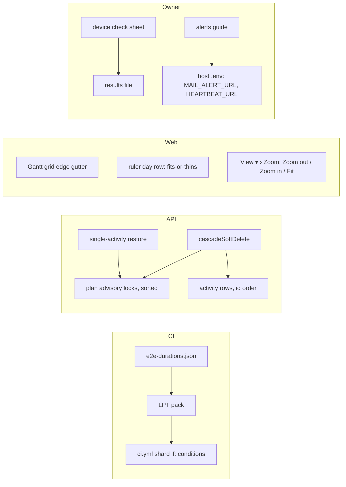
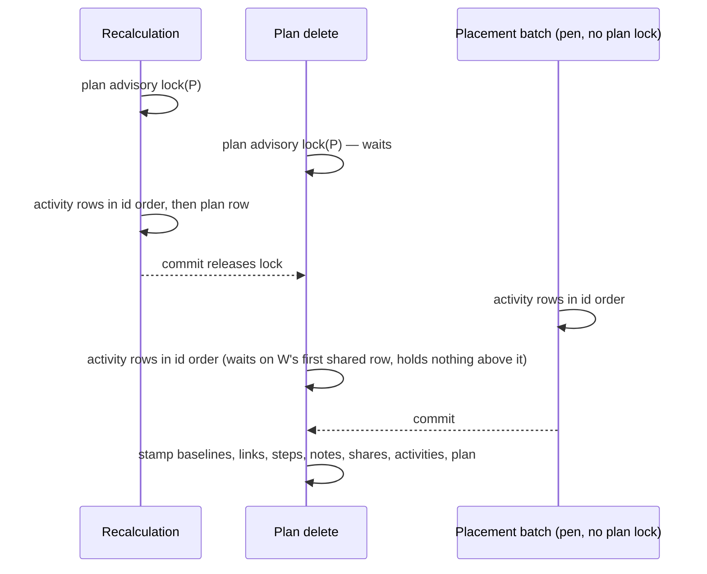

# Feature Spec: Pre-1.0 hardening pass

- **Status:** Accepted — shipped (ADR-0138 and ADR-0056 amendments) 2026-10-13 (api 0.89.3, web 0.190.0 and 0.190.1). Approved by the product owner on 2026-10-13, all nine milestones, with the fifth-shard trigger set as
  the default below (OQ-1).
- **Author(s):** feature-analyst, for the product owner
- **Date:** 2026-10-13
- **Tracking issue / epic:** `docs/TECH_DEBT.md` #492, #497, #496, #494, #478, #480, #100, and ADR-0138's shard
  assignment. Scope chosen by the product owner on 2026-10-13 (decided, not re-asked here).
- **Roadmap link:** the pre-1.0 milestone (`docs/ROADMAP.md`); this is clean-up before 1.0, not a new capability.
- **Related ADR(s):** ADR-0138 (dated amendment proposed, §4.1), ADR-0056 (dated amendment likely, §4.6), ADR-0028,
  ADR-0081, ADR-0088 D1, ADR-0105, ADR-0111, ADR-0179, ADR-0183/0188, ADR-0074, ADR-0075, ADR-0086. **No new ADR.**

---

## 1. Business understanding

### Problem

Seven small problems, each already recorded. Together they are the rough edges worth closing before calling the
product 1.0:

1. **CI is slower than it needs to be.** Web end-to-end shard 4 is the slowest job on every run since #955
   (1,178 / 1,064 / 1,136 / 1,157 s on runs 38302288727, 38314679272, 38315222823, 38317448630), so every pull
   request waits for it.
2. **Deleting a plan, project or client can fail with a server error** if it happens while that plan is being
   recalculated or while someone drags bars in it (#492). Postgres detects a deadlock and cancels one side (`40P01`),
   and the user sees a 500.
3. **Two automated tests fail at random** on pull requests that do not touch them (#497, #496). Each false red costs a
   re-run and teaches people to ignore red.
4. **Three screen defects:** in the Gantt, the table/chart divider steals mouse presses meant for each row's `⋯` and the
   "Float left" sort button (#494). At 200 % text, the diagram's day numbers overlap (#478). When a side panel has
   squeezed the diagram away, Zoom in/out cannot be reached (#480).
5. **No one has checked the app with a screen reader or Windows High Contrast on real hardware.** Automated tests run
   in a headless browser; they cannot hear Narrator or see a real contrast theme.
6. **Mail-failure alerts reach nobody** (#100, CLAUDE.md §17). The code exists; the two settings on the host are empty.

### Users

- **Planners and Org Admins** (2, 4): the people deleting and restoring plans, using the Gantt and the diagram.
- **Anyone using assistive technology** (4, 5): keyboard, screen reader, 200 % text, forced colours.
- **The product owner as operator** (5, 6): runs the host and the device checks.
- **Contributors to the repository** (1, 3): every pull request.

### Primary use cases

1. A planner deletes a plan while a colleague recalculates it; the delete waits its turn and succeeds.
2. A mouse user opens a Gantt row's `⋯` menu by clicking anywhere on the button.
3. A user with 200 % text reads the diagram's day row without overlapping numbers.
4. A user whose dock has squeezed the diagram zooms in or out from `View ▾`.
5. The owner runs a one-hour sheet with Narrator, High Contrast and a rotation, and records what happened.
6. The owner sets up phone alerts for mail failures and proves they work by breaking mail on purpose for two minutes.

### Expected outcomes and success criteria

| #   | Success looks like                                                                                                                                                        |
| --- | ------------------------------------------------------------------------------------------------------------------------------------------------------------------------- |
| 1   | Slowest web shard below **1,147 s** (the median of today's four slowest readings) on at least two of the three runs read after the change, and the four within ~120 s     |
| 2   | The new regression test is red on today's `main` and green after; no `40P01` path left in the cascade or restore writers the inventory finds                              |
| 3   | #497 and #496 green on repeated local runs (10 and 5 respectively) and their rows closed                                                                                  |
| 4   | #494's measured overlap reads **0 px** for the `⋯` and the sort button; #478 measured with no day-label overlap at its cell; #480's Zoom steps reachable with a dock open |
| 5   | A filled-in results file beside the sheet; every "wrong" answer becomes a `TECH_DEBT` row or a fix                                                                        |
| 6   | An alert observed on the owner's phone from an induced failure, and a green heartbeat check; #100 closed on that observation                                              |

### Open questions

See the end of the document. Defaults are stated inline for everything else.

## 2. Functional requirements

### User stories & acceptance criteria

> **US-1 (#492)** — As a Planner or Org Admin, I want delete and restore to wait for a running recalculation rather
> than fail, so that I never see a 500 for an ordinary action.
>
> - **Given** a recalculation of plan P is in progress **when** P (or its project or client) is deleted **then** the
>   delete waits for the plan lock and returns 204.
> - **Given** a placement batch is writing P's activities **when** P is deleted **then** neither request fails with
>   `40P01`: both lock activity rows in id order.
> - **Given** a project with plans A and B **when** it is deleted **then** the plan locks are taken in sorted plan-id
>   order.

> **US-2 (#494)** — As a mouse user of the Gantt, I want every pixel of a row's `⋯` and of the "Float left" header to
> be that control's, so that I never start a divider drag by accident.
>
> - **Given** the Gantt at the measured cell **when** the a11y-touch-sweep harness reads `overlapCurrentPx` **then**
>   it is 0 for every `Actions for …` button and the Float left sort button.
> - The divider still has a ≥ 24 px mouse strip over open space, its arrow keys, and `View ▾ › Columns › Table width`.

> **US-3 (#478)** — As a reader at 200 % text, I want the day row's numbers never to overprint, so that I can read
> the dates.
>
> - **Given** 1280 × 800 with the browser's default font size at 200 % **when** the diagram is at any zoom that shows
>   the day row **then** no two day labels' boxes overlap.
> - At 100 % text the day row is unchanged (same labels at the same zooms).

> **US-4 (#480)** — As anyone viewing the diagram, I want Zoom out and Zoom in in `View ▾ › Zoom` beside Fit to plan,
> so that I can zoom when a dock has squeezed the corner cluster away.
>
> - **Given** a dock has taken the stage **when** I press `View ▾ › Zoom › Zoom in` **then** the dock closes and the
>   diagram zooms a frame later (the same wrapped viewport command the cluster uses,
>   `canvas-directed-commands.ts:57`).
> - With no diagram (the Gantt view) the two buttons are shaded with the reason Fit already gives (ADR-0082/0083).

> **US-5 (check sheet)** — As the product owner, I want a plain-English sheet that tells me what to press and what
> right and wrong look like, so that one hour on my two machines tells the team what no automated test can.

> **US-6 (#100)** — As the operator, I want copy-and-paste steps to switch on mail-failure alerts and a heartbeat,
> and a safe way to prove they work.

### Edge cases

- **#492, multi-plan cascades:** a client delete may lock many plans. Locks are taken sorted and de-duplicated. No
  other path holds two plan locks (every `acquirePlanWriteLock` / `lockPlanForWrite` caller takes one plan: grep of
  `apps/api/src`, lines listed in §3), so a sorted order cannot form a cycle with them.
- **#492, restore:** restore writes only soft-deleted rows (`hierarchy-lifecycle.service.ts:601`, `:613` select by
  `deleteBatchId`), while every other activity writer locks only active rows (`activity-row-lock.ts:47`,
  `deleted_at IS NULL`). See §3 for what that means for the remedy.
- **#478:** the day row must stay viewport-bounded and cheap; label width is measured once per font change, not per
  frame (ADR-0026 D3, `TsldCanvas.tsx:1804-1821` runs on every pan).
- **#480 at the design floor:** at 1024 × 600 with a dock open the cluster is still in the stage
  (`e2e-minimap/viewport-cluster.spec.ts:387-401`); it goes when a dock is dragged to take the row, or below the
  floor. The fix covers both.

### Permissions

No change. Delete and restore keep `plan:delete`, `plan:restore` and their project/client/activity siblings
(`plans.service.ts:274`, `:313`; `activities.service.ts:2001`). Plan delete is not pen-gated today
(`plans.service.ts:267-304` has no `assertHoldsPen`) and stays so; single-activity restore stays pen-gated
(`activities.service.ts:2006`). Zoom steps are viewport-only and open to every role that can see the diagram,
including a guest.

### Validation rules

None new. No DTO changes.

### Error scenarios

| Scenario                                | Today                  | After                                       | Status    |
| --------------------------------------- | ---------------------- | ------------------------------------------- | --------- |
| Plan delete during recalculation        | possible `40P01` → 500 | waits for the plan lock                     | 204       |
| Plan delete during a placement batch    | possible `40P01` → 500 | both lock in id order; one waits            | 204 / 200 |
| Zoom step from `View ▾` with no diagram | n/a                    | shaded with Fit's reason                    | n/a       |
| Induced mail failure on the host        | logged only            | one ntfy alert + row in `/staff` Mail panel | n/a       |

## 3. Technical analysis

| Area           | Impact | Notes                                                                                                |
| -------------- | ------ | ---------------------------------------------------------------------------------------------------- |
| Frontend       | low    | `GanttPanel.tsx` grid edge; `time-scale.ts` day row; `tsld-toolbar-items.tsx` Zoom panel             |
| Backend        | med    | `hierarchy-lifecycle.service.ts`, `activity-row-lock.ts`, `plan-advisory-lock.ts`, activity restore  |
| Database       | none   | **No schema change, no migration.** Row locks and advisory locks only                                |
| API            | none   | No contract change; one fewer 500                                                                    |
| Security       | none   | Locks only; scope predicates kept                                                                    |
| Performance    | low    | Delete may now wait for a recalculation (seconds at 2,000 activities). Ruler: one cached measurement |
| Infrastructure | low    | `ci.yml` shard `if:` conditions; `scripts/e2e-durations.json`                                        |
| Observability  | none   |                                                                                                      |
| Testing        | med    | One new API e2e spec; two flaky specs repaired; three journey additions; one widened structural test |

**Recalc parity gate:** no scheduling input is added or changed; `computeSchedule` is not touched, so it stays
byte-identical by construction. **The pen:** no write becomes structural or stops being so. **Flags:** none
(ADR-0088 D1); each milestone is its own commit boundary.

### What the rows got wrong (re-verified 2026-10-13, read not run unless stated)

1. **#492's remedy cannot serve restore as written.** `lockActivityRowsInIdOrder` filters `deleted_at IS NULL`
   (`activity-row-lock.ts:47`), so on a restore's soft-deleted rows it locks nothing.
2. **#492 overstates restore.** Restore writes only rows that are soft-deleted (selected by `deleteBatchId`,
   `hierarchy-lifecycle.service.ts:601`, `:613`); the recalculation locks only active rows (`activity-row-lock.ts:47`)
   and writes activities then the plan row (`schedule.repository.ts:827`, `:1030`). The two row sets are disjoint, so
   restore cannot deadlock a recalculation. Single-activity restore does lack the plan lock that batch restore takes
   (`activities.service.ts:2011` vs `:1763`), which is worth fixing for parity, not for this deadlock.
3. **#492 understates the activity cascades.** It says `remove`, `bulkDelete` and `dissolveSummary` are safe because
   they hold the plan lock and the lock-free writers "now lock in id order". A deadlock needs only one party out of
   order: the placement writers take the pen, not the plan lock (`activity-row-lock.ts:9-11`), and the cascades'
   `activity.updateMany` by id list (`hierarchy-lifecycle.service.ts:543`) locks in scan order. And plan delete is not
   pen-gated, so an admin can delete while a planner drags.
4. **#492's structural gate cannot see the defect.** `activity-row-lock.structural.spec.ts` scans `modules/` only
   (`:24`) and only raw `UPDATE activities` templates (`:34-35`); the cascade is a Prisma `updateMany` in `common/`.
5. **#496's leading hypothesis is unlikely.** The fixture's data date is fixed at 2026-03-02
   (`packages/seed/src/fixture/index.spec.ts:54`); nothing in `packages/seed` or `packages/seed-http` reads the clock
   except for timings. And `calendarId: null` in the 422 does not mean "no calendar": it means more than one calendar
   is in play (`plan-calendar.ts:138-150`). **Better hypothesis:** the perturbed activities come from an unordered
   `findMany` (`revision-delta-m0.e2e-spec.ts:253-263`, sliced at `:296-298`), so heap order sometimes picks one on the
   fixture's window-only calendar (CAL-05, "the turnaround that is the ONLY working time",
   `packages/seed/src/fixture/index.ts:290`); +20 days walks past its window → 422. #926's deterministic `orderBy`
   would then have picked such an activity every time, which matches it failing deterministically. The links are also
   read from the first page only (`:362-364`, `limit=100`, no paging). The 401 is unexplained by either.
6. **#497's line numbers moved:** the two tests are now `command-surface.spec.ts:3117` and `:3230` (the canvas checks
   at `:3137`, `:3252`). The `expanded` reading can also be stale: it is taken straight after a possible Show click
   (`:143-145`).
7. **ADR-0138's 2026-10-12 trigger fired on all four runs** ("a web shard slower than `quality`", ADR-0138:229), and
   can no longer be met by any four-way pack: `quality` fell to 676 to 698 s on the last two runs while the four shards
   sum to ~4,100 s (~1,030 s each). The trigger needs restating (§4.1).
8. **DEPLOYMENT.md "Retiring the cron" step 3** says to reset "a throwaway address". An address with no account sends
   nothing (ADR-0074:123; `better-auth.ts:186` is handed a `user`), which would look exactly like a broken alert. It
   must be an address that has an account.

### Dependencies

- `acquirePlanWriteLock` callers today, one plan each: `activities.service.ts:362, 646, 1136, 1503, 1606, 1763, 1878`;
  `plan-lock.service.ts:84, 205, 243`; `baselines.service.ts:135, 285, 351`; `schedule.service.ts:562`;
  `dependencies.service.ts:246`.
- The a11y-touch-sweep harness (`apps/web/measure-toolbar/a11y-touch-sweep-m0.spec.ts`) and the toolbar-redesign M3
  harness's 200 % text cell (`toolbar-redesign-m3.spec.ts:55`, `Page.setFontSizes`) are reused under the existing
  `playwright.measure-toolbar.config.ts`. **No new Playwright config.**
- The device sheet depends on M5 to M7 shipping first, so it tests what is released.

## 4. Solution design

### Architecture overview

### 4.1 Shard re-pack (CI)

Re-harvest per-suite step times the way #955 did (`scripts/e2e-durations.json` "_": one step per `test:e2e*`
script, mapped by the script the step runs), but from **three** runs, taking each suite's median: 38314679272,
38315222823, 38317448630. `run`/`job` keep naming one run (38317448630, the `main` run) because
`e2e-durations.test.mjs:57-63` requires single ids; the prose lists all three. Also record each shard's fixed cost
(job wall minus suite sum) per run, because shard 4 has run ~130 s over its 892 s projection on every run, and the
pack should know whether that is a suite or overhead. LPT-pack the 50 suites keeping `csp`, `forced-colors` and
`splitting` together (ADR-0138 amendment). **Target:** projected wall (suite sum + that shard's measured fixed cost)
within 30 s across shards. **Acceptance reading** (printed, never asserted, D4): §1 row 1.

ADR-0138 gets a dated amendment: the evidence, the re-pack, and a restated trigger. **Default restated trigger:** the
slowest web shard's median over three consecutive runs exceeds 1,250 s, or any shard is cancelled by its 30-minute
timeout. The `ci.yml` comment block at `:400-413` and §16's ADR-0138 line are updated in the same PR.

### 4.2 #492: cascade and restore lock order

- In `cascadeSoftDelete`'s client, project and plan branches, after the plan ids are resolved and **before the first
  write**: take `acquirePlanWriteLock` for each plan id, sorted and de-duplicated (a small `acquirePlanWriteLocks`
  beside it in `plan-advisory-lock.ts`), then lock the plans' active activity rows in id order (a plan-wide variant in
  `activity-row-lock.ts`, keeping `deleted_at IS NULL`).
- In the activity branch and `cascadeSoftDeleteActivityLeaves` (the `remove`, `bulkDelete`, `dissolveSummary` paths),
  lock the resolved id list in id order before the `updateMany` (`:543` and the subtree write).
- Single-activity restore takes `acquirePlanWriteLock` like batch restore (`activities.service.ts:1763`).
  `restoreBatch` gets a docblock declaration saying why soft-deleted-only writes need no id order (finding 2).
- **Why both locks, not one.** The id order alone would stop the deadlock with the recalculation (it writes activities
  then the plan row, so the same table order), but not serialise a baseline capture (`baselines.service.ts:135` holds
  the plan lock) against a plan delete, which could leave a fresh baseline active under a deleted plan (read, not run;
  M2-T1 tries it). The advisory lock is also what every other cascade takes. The cost: a delete waits for a running
  recalculation.
- **Widen the structural test** to `common/` and to Prisma `activity.updateMany` / `updateManyAndReturn`. A writer
  passes if it calls an id-order seam first, or declares a reason that names **both** the engine and the placement
  writers (the current `lock-order: plan-lock` declaration only covers the engine, finding 3).

### 4.3 #497 and #496: tests only

- **#497:** in `foldToSpine`, read `expanded` only once the canvas width has settled, and replace the two canvas-gain
  `toBe` checks with `expect.poll(() => readColumn(page).then(r => r.canvas - expanded.canvas)).toBe(gain)`. The
  product is not touched.
- **#496:** investigate first (plan M4-T1), then make target selection deterministic **and** restrict it to TASKs on
  the plan's default calendar, page the links fully, and add an explicit sort to `critical`. The investigation must
  explain the 401 or record it as a separate row.

### 4.4 #494: the Gantt divider

**Default:** give the grid's trailing edge a gutter as wide as the strip's grid-side reach (12 px, `-left-3`,
`panel-resizer.tsx:262`), on the spacing scale, so no grid control sits under the strip. Both targets keep their
whole box and the divider keeps 25 px. Alternatives measured in M5-T1 before choosing: (b) the controls stack above
the strip (divider loses up to 9.5 px at each row); (c) the Gantt's strip extends only into the chart (needs a
`PanelResizer` prop: a component public-contract change). The fix lives in `GanttPanel.tsx`/the grid, not in
`PanelResizer`, so ADR-0188 D3 and the structural exception list are unchanged. `device-checklist.md` items 6 and 25b
are updated in the same PR (what a finger meets near the line changes).

### 4.5 #480: Zoom steps in View ▾

Add **Zoom out** and **Zoom in** buttons to the `View ▾ › Zoom` panel beside Fit to plan
(`tsld-toolbar-items.tsx:2192-2221`), calling `ctx.stepZoom(0.5)` / `ctx.stepZoom(2)` as the cluster does
(`:2870`, `:2882`). `stepZoom` is already a wrapped viewport command (`canvas-directed-commands.ts:57`), so a dock
squeezing the stage closes first. Shading reuses `canvasViewportReason`. This is a **new entry point** (ADR-0105), which
is why it is in this spec; it needs no ADR.

### 4.6 #478: the ruler day row

The day row shows whenever `pxPerDay >= 18` (`time-scale.ts:28`, `:189`); its labels are DOM text sized in rem
(`text-xs`), so at 200 % text a two-digit label is ~28 px against an 18 px pitch (expected, **to be measured**).
**Default after measurement:** pass the measured widest day label (cached per font size, as `minLabelGapPx` already
is, `time-scale.ts:185`) and, when it does not fit the pitch, label every 2nd, then every 7th (Mondays) day, as
ADR-0141 thins thumbnail labels by pitch. Dated amendment to ADR-0056 recording the rule. If the measurement shows no
overlap at the cell, the row closes on the measurement and nothing is built.

### 4.7 Device check sheet

`docs/specs/pre-1-0-hardening/device-check-sheet.md`, in the format of `gantt-coarse-pointer/device-checklist.md`
(tick boxes, "what correct looks like", one line for notes), with answers recorded in a sibling
`device-check-results.md`. Two machines: the Surface (1912 × 1114 cover on, 1912 × 1104 tablet, DPR 1.5, per
`device-results.md:15-16`) with finger and stylus, and the PC (1912 × 948, mouse). Sections, about an hour:

1. **Narrator (Surface, Edge) and NVDA if installed (PC):** sign in; open a plan; find the "Plan command band" region
   (`plan-workspace-toolbar.tsx:2121`) by landmark/region navigation; select an activity on the diagram; open the
   activity editor and move between its tabs; open a row's `⋯` menu and leave it with Escape; switch to the Gantt and
   read a row; open `View ▾ › Zoom` and use the new Zoom steps.
2. **Windows contrast theme** (Settings › Accessibility › Contrast themes): the toolbar's on/off switches show the on
   state in the theme's highlight colour; every focused control shows a ring.
3. **Rotation:** focus the deck's Settings gear, rotate the Surface (portrait is narrower than 80 rem, so the gear
   moves, `Deck.tsx:325-337`); focus stays on the gear.
4. **Re-run, do not copy:** Gantt sheet items 6, 25b (as M5 rewrites them) and 29, by reference.
5. **200 % text on the PC:** the ruler at the #478 cell.

Reviewed by accessibility-reviewer for what "correct" says before the owner runs it.

### 4.8 Operator alerts guide

A new owner-facing `docs/guides/set-up-alerts.md` (beside `measure-draw-performance.md`), linked from the top of
DEPLOYMENT.md "Alerting on mail failures", which stays the reference. Steps: make an ntfy topic (phone app) and a
healthchecks.io check; paste both URLs into the stack's `.env` (the compose files already pass them through,
`docker-compose.release.yml:114`, `:119`); `docker compose up -d`; confirm `/staff` reports both as set
(`staff-health.dto.ts:155-158`); then the induced-failure test from "Retiring the cron", with step 3 corrected to "an
address that has an account" (finding 8). **The cron:** not installed for a first-time setup, as DEPLOYMENT.md:974-976
says; the guide says to keep it only if it is already running and remove it after the induced test passes.

### Database changes

None. If M2 finds one is needed, it stops and goes to the database-architect (CLAUDE.md §19.3).

### API changes

None to the contract.

### Implementation approach & alternatives

- **#492, id-order rows only:** smaller, avoids the recalculation deadlock, but leaves the baseline-capture race and
  diverges from every other cascade. Rejected.
- **#492, plan lock only:** stops the recalculation deadlock but not the placement-writer one. Rejected.
- **Shards, five instead of four:** declined by the owner on 2026-10-12; `docs/specs/e2e-fifth-shard/` stays parked.
- **#480, host the cluster outside the stage:** refused in #480 itself (it would draw over the dock).
- **#478, hide the day row at 200 %:** loses information a planner reads; thinning keeps it.

## 5. Links

- Implementation plan: [`./implementation-plan.md`](./implementation-plan.md)
- Docs updated by this work: ADR-0138, ADR-0056 (if the rule changes), `docs/TECH_DEBT.md` rows,
  `docs/DEPLOYMENT.md`, `docs/guides/set-up-alerts.md`, `docs/specs/gantt-coarse-pointer/device-checklist.md`,
  `scripts/e2e-durations.json`, CLAUDE.md §16 (ADR-0138's line).

## Questions for the owner (answered)

**Answered 2026-10-13 (OQ-1).** ADR-0138's trigger becomes: the slowest web shard's median over three consecutive
runs exceeds 1,250 s, or any shard is cancelled by its 30-minute timeout. The trigger the owner set on 2026-10-12 ("a
web shard slower than `quality`") had fired on all four runs since, and no four-way pack can satisfy it now that
`quality` takes ~690 s.

**Defaults (proceed unless told otherwise):** advisory lock plus id-order rows for #492; Gantt gutter for #494; thin
labels for #478; a new guide under `docs/guides/`; Narrator on the Surface, NVDA on the PC only if already installed;
no cron for a first-time alert setup.
