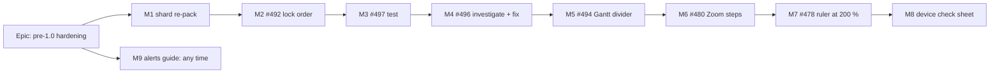

# Implementation Plan: Pre-1.0 hardening pass

- **Feature spec:** [`./feature-spec.md`](./feature-spec.md)
- **Status:** Draft — written 2026-10-13; nothing is built.
- **Owner:** product owner; implementation by the **builder** agent (Sonnet), one PR per milestone.

## Breakdown

### Epic

**Pre-1.0 hardening** — close seven recorded rough edges before 1.0: CI speed, one server-error path, two flaky
tests, three screen defects, a real-device accessibility check, and operator alerts.

**Rules that apply to every milestone.**

- **No `VITE_` flag** (ADR-0088 D1): every milestone is its own commit boundary, which is the rollback.
- **Schema:** none expected. Any schema need stops the milestone and goes to the database-architect (§19.3).
- **ADR-0105:** M6 adds an entry point and M1 changes a CI step; both are covered by this spec. Anything a milestone
  finds beyond its scope becomes a `TECH_DEBT` row, not extra work in the same PR.
- **Pre-push:** `pnpm prepush` always; plus `scripts/e2e-local.sh api` when `apps/api` changes; plus
  `scripts/e2e-local.sh web:<suite>` for each Playwright suite changed.
- **Evidence:** each PR states what was run (command and result), per §19.11.
- **Closing rows:** each milestone closes or updates its `TECH_DEBT` row in the same PR, citing the PR.
- **Header first:** on approval, the first PR sets both headers to `Approved — <date, the owner's words>`. M1 and M7
  amend ADRs that will cite this directory, and `check:spec-status` S3 refuses a cited spec still headed `Draft`.

---

### Milestone 1: Re-pack the four web shards (CI)

**Outcome:** every PR's slowest web shard finishes sooner.
**Ships dark:** not user-facing (CI only).
**Journey:** none (no product change).

> **Description:** re-harvest per-suite durations from three runs, LPT-pack four shards, amend ADR-0138.
> **Complexity:** S · **Dependencies:** none · **Changeset:** no
> **Risks:** one more sample still varies ±27 % (ADR-0138) → median of three runs, and the acceptance is a reading
> over three runs, never a gate. Shard 4's extra time is overhead not a suite → the fixed cost is measured per shard
> and used in the pack.
> **Testing:** `node scripts/e2e-durations.test.mjs`; `pnpm check:e2e-roster` (prints the new sums).
> **Reviewers:** devops-reviewer.
> **Pre-push:** `pnpm prepush`.

##### Task 1.1 — Harvest

1. With the GitHub tool, read the job list of runs 38314679272, 38315222823 and 38317448630, and for each web shard
   job the steps' `started_at`/`completed_at`; map each step to the `test:e2e*` script it runs, as the
   `scripts/e2e-durations.json` "_" text describes for #955.
2. Take each suite's median. Compute each shard's fixed cost per run (job wall minus its suite steps).
3. Rewrite `scripts/e2e-durations.json`: `run` 38317448630 and its slowest web `job`, `measured` 2026-10-13, the
   three run ids and the fixed costs in the prose, and the new `residualCheck` sum (the test at
   `e2e-durations.test.mjs:110-116` checks it).

##### Task 1.2 — Pack and amend

1. LPT-pack the 50 web suites over four shards, `csp` + `forced-colors` + `splitting` as one unit, adding each shard's
   measured fixed cost. Target: projected wall within 30 s across shards.
2. Rewrite the `if: ${{ matrix.shard == N }}` conditions in `.github/workflows/ci.yml` and the comment at `:400-413`
   (it still quotes `quality` at 1,103 s).
3. Add "Amendment 2026-10-13" to ADR-0138: evidence (the four runs in the spec), the new sums, why the 2026-10-12
   trigger can no longer be met, and the restated trigger (spec §4.1, pending the owner's answer). Update ADR-0138's
   line in CLAUDE.md §16.
4. **After merge:** read the three runs that follow and record them in ADR-0138's amendment. Accepted when the slowest
   shard is below 1,147 s on at least two of three and the four are within ~120 s. If not, open a row; do not
   re-pack again on one reading.

---

### Milestone 2: Delete and restore wait their turn (#492)

**Outcome:** deleting a plan, project or client while it recalculates or while bars move never returns a 500.
**Ships dark:** no new surface; the change is that an existing action stops failing. The API e2e test is the proof.
**Journey:** n/a (no UI change).

> **Description:** plan advisory locks (sorted) and id-ordered activity row locks before every cascade write; plan lock
> on single-activity restore; widened structural test.
> **Complexity:** M · **Dependencies:** none (M1 only speeds its CI) · **Changeset:** yes, `@repo/api` patch
> **Risks:**
>
> - A client delete holds one advisory lock per plan → fine for realistic counts (Postgres's shared lock table is
>   `max_locks_per_transaction` × connections); stated in the docblock.
> - The widened structural test may find more writers than the row lists → each gets the one-line seam if that is all
>   it needs; anything bigger becomes a new row.
> - Delete now waits for a recalculation → seconds at 2,000 activities; accepted (the same as `remove` today,
>   `activities.service.ts:1503`).
> - The test is timing-sensitive → deterministic by construction (below), never a sleep-and-hope race.
>   **Testing:** new `apps/api/test/hierarchy-cascade-lock-order.e2e-spec.ts`; unit tests for the sort; the widened
>   `activity-row-lock.structural.spec.ts`.
>   **Reviewers:** test-engineer (the test first), backend-performance-reviewer (transactions and locks),
>   security-reviewer only if a scope predicate changes.
>   **Pre-push:** `pnpm prepush`, `scripts/e2e-local.sh api`.

##### Task 2.1 — The regression test, red first

1. **Case A, plan lock.** A test transaction takes `acquirePlanWriteLock(P)` and holds it. Send `DELETE` for P. Poll
   `pg_stat_activity` until the delete's backend waits with `wait_event = 'advisory'`; assert it does; release; assert 204. On today's `main` the delete never waits on the advisory lock, so this is red.
2. **Case B, id order.** Insert P's activities with explicit ids in **descending** order, so heap (and `plan_id`
   index) order is the reverse of id order. A test transaction locks the **lowest**-id row `FOR NO KEY UPDATE`. Send
   `DELETE` for P and wait until it is blocked on a row lock. Then, in the test transaction, lock the **highest**-id
   row with `NOWAIT`. With id order the delete holds nothing yet, so it succeeds; in scan order the delete already
   holds it, so it fails `55P03`. Release; assert 204.
3. **Case C, two plans.** A project with plans A and B: assert the locks are taken in sorted order (unit test on the
   helper, plus Case A against the higher id).
4. **Case D, baseline race (finding to confirm).** Hold P's plan lock, start a baseline capture and a plan delete;
   assert no active baseline survives under a deleted plan. Record the result either way in the PR.
5. Record the red run (command and output) in the PR description.

##### Task 2.2 — The fix

1. `plan-advisory-lock.ts`: `acquirePlanWriteLocks(db, planIds)` — de-duplicate, sort, take each.
2. `activity-row-lock.ts`: a variant that locks the active activity rows of a list of plans, and one for a resolved id
   list without plan scope (the cascade does not receive the organisation), both `ORDER BY id FOR NO KEY UPDATE` and
   both keeping `deleted_at IS NULL`. Reuse the `IN (SELECT … unnest(…))` form (the file's own measurement, `:24-29`).
3. `hierarchy-lifecycle.service.ts`: client/project/plan branches take both locks after resolving plan ids and
   before the first write (`:383`, `:408`, `:422`); the activity branch and `cascadeSoftDeleteActivityLeaves` lock their
   id lists before writing (`:438`, `:543`).
4. `activities.service.ts` `restore`: `acquirePlanWriteLock(tx, existing.planId)` first in the transaction
   (`:2011`), as batch restore does (`:1763`).
5. `restoreBatch` docblock: the declaration that soft-deleted-only writes cannot meet an active-row writer.
6. Update the `service.spec.ts` mocks if a call order is pinned.

##### Task 2.3 — Widen the structural test

1. Scan `common/` as well as `modules/` (`activity-row-lock.structural.spec.ts:24`); match Prisma
   `activity.updateMany(` / `updateManyAndReturn(` as well as raw templates.
2. Pass on a seam call before the statement, or a declaration naming both the engine and the placement writers. Add
   a red case for the old `lock-order: plan-lock` reason that names only the engine.
3. Re-pin the writer list (`:79-82`).
4. Close #492 citing the PR; record finding 3 of the spec in the row.

---

### Milestone 3: The collapsed-spine journeys wait for the canvas (#497)

**Outcome:** no false red from these two tests.
**Ships dark:** test-only.
**Journey:** the changed tests are the journey.

> **Complexity:** S · **Dependencies:** none · **Changeset:** no
> **Risks:** a poll hides a real regression → the poll asserts the exact gain, with Playwright's default timeout.
> **Testing:** run `scripts/e2e-local.sh web:workspace-fit` ten times; all green.
> **Reviewers:** test-engineer.
> **Pre-push:** `pnpm prepush`, `scripts/e2e-local.sh web:workspace-fit`.

##### Task 3.1

1. In `foldToSpine` (`command-surface.spec.ts:136-166`), take `expanded` only once two readings a frame apart agree.
2. Replace the canvas-gain `toBe` at `:3137` and `:3252` with `expect.poll` on `canvas − expanded.canvas`.
3. Leave the stage checks as they are (they were right in both failures).
4. Close #497.

---

### Milestone 4: The revision-delta spec stops failing at random (#496)

**Outcome:** `revision-delta-m0.e2e-spec.ts` is deterministic.
**Ships dark:** test-only.
**Journey:** n/a.

> **Complexity:** M (investigation is open-ended; capped below) · **Dependencies:** M2 (both edit `apps/api/test`;
> avoids two rebases) · **Changeset:** no
> **Risks:** #926's attempt made it fail every time and was reverted → T1 explains before T2 changes anything; T2
> must pass five local runs **and** CI before merge. The 401 may be a separate defect → recorded as its own row.
> **Testing:** five consecutive local runs of the API e2e suite, plus CI.
> **Reviewers:** test-engineer; backend-performance-reviewer only if the cause is in the API.
> **Pre-push:** `pnpm prepush`, `scripts/e2e-local.sh api`.

##### Task 4.1 — Investigate (timebox: one session)

1. Log which activities `critical.slice(0, 4)` and `slice(4, 16)` pick and each one's calendar; run until each of the
   three failures reproduces, or ten runs.
2. Test the hypothesis in the spec (§3, finding 5): a target on CAL-05 produces the 422. Re-apply #926's `orderBy`
   locally and confirm it picks a CAL-05 activity.
3. For the 401: log the session cookie's expiry and the request count before the failure; check the auth rate limit.
4. Write the finding into #496 (what was run, what it showed). If the 422 hypothesis is false, stop and report before
   T2.

##### Task 4.2 — Fix

1. Order `oldSide` explicitly; choose targets only among TASKs on the plan's default calendar; keep extend and shrink
   disjoint.
2. Page the dependency list fully (`getPage` loop, as the activity read at `:318-330` does) and sort before slicing.
3. Fix the 401 if T1 found its cause; otherwise leave a row.
4. Close #496 (or narrow it to the 401).

---

### Milestone 5: The Gantt divider stops covering the row menus (#494)

**Outcome:** a mouse press anywhere on a row's `⋯` or the Float left header reaches that control.
**Entry point:** existing: the Gantt view, each row's `Actions for …` button and the "Float left" column header.
**Journey:** a step in the Gantt suite that clicks the `⋯` 2 px from its left edge and expects the menu, and the
divider still drags.

> **Complexity:** S · **Dependencies:** none · **Changeset:** yes, `@repo/web` patch
> **Risks:** the gutter narrows the last column by 12 px → measured at 1024 × 600 and 1912 × 948 that no header
> truncates; the divider's mouse strip stays 25 px. A change to `PanelResizer` would be a component-contract change →
> the default avoids it; if the measurement picks (c), the PR runs component-reviewer and accessibility-reviewer before
> merge (ADR-0111).
> **Testing:** re-read `overlapCurrentPx` with `a11y-touch-sweep-m0.spec.ts` (expect 0); the journey step above; the
> existing Gantt coarse sweep still counts the exempt divider.
> **Reviewers:** component-reviewer, accessibility-reviewer, ux-reviewer.
> **Pre-push:** `pnpm prepush`, `scripts/e2e-local.sh web:<the Gantt suite the step lands in>`.

##### Task 5.1 — Measure the options

1. With the existing harness (`playwright.measure-toolbar.config.ts`), read the overlap for (a) a 12 px trailing
   gutter, (b) controls stacked above the strip, (c) a chart-only strip, at 1024 × 600, 1646 × 1097 and 1912 × 948.
2. Record in `docs/specs/pre-1-0-hardening/m5-measurement.md`; choose (a) unless it truncates a header.

##### Task 5.2 — Build and record

1. Apply the chosen option in `GanttPanel.tsx` / the grid, on the spacing scale (`token-architecture.test.ts`).
2. Add the journey step.
3. Update `docs/specs/gantt-coarse-pointer/device-checklist.md` items 6 and 25b and its "Keep this sheet current" log
   (the rule at `:15-18`).
4. Close #494.

---

### Milestone 6: Zoom steps in View ▾ (#480)

**Outcome:** with a dock squeezing the diagram, a user can still zoom in and out.
**Entry point:** `View ▾ › Zoom` panel: **Zoom out**, **Zoom in** (beside **Fit to plan**).
**Journey:** extend `e2e-minimap/viewport-cluster.spec.ts:531` ("… View ▾ still fits the plan"): with the cluster
withdrawn, press `View ▾ › Zoom › Zoom in`; the dock closes and the zoom level changes.

> **Complexity:** S · **Dependencies:** none · **Changeset:** yes, `@repo/web` minor (a new control)
> **Risks:** two "Zoom in" buttons exist while the panel is open (cluster and panel) → journeys scope locators to the
> panel; the names stay identical on purpose (same command, ADR-0117). Not a change to a shared primitive's keyboard
> contract, so ADR-0111 does not apply; the panel's own Tab order gains two stops.
> **Testing:** unit test that both buttons call `stepZoom` with 0.5 and 2 and shade with Fit's reason; the journey.
> **Reviewers:** accessibility-reviewer, ux-reviewer.
> **Pre-push:** `pnpm prepush`, `scripts/e2e-local.sh web:minimap`.

##### Task 6.1

1. In `tsld-toolbar-items.tsx:2192-2221`, render Zoom out and Zoom in beside Fit to plan, same `Button` variant, same
   `canvasViewportReason` shading (the cluster's `ZOOM_DISABLED_REASON`).
2. Unit test and journey as above.
3. Update #480 (close it: the Zoom steps were the part "left open").

---

### Milestone 7: The ruler's day row at 200 % text (#478)

**Outcome:** day numbers never overprint at large text sizes.
**Entry point:** existing: the diagram's date ruler.
**Journey:** a test in the axis-markers suite at 1280 × 800 with `Page.setFontSizes` at 200 %, zooming through the
presets and asserting no two day labels' boxes overlap.

> **Complexity:** M (measure, decide, build) · **Dependencies:** none · **Changeset:** yes, `@repo/web` patch
> **Risks:** the ruler syncs on every pan frame (`TsldCanvas.tsx:1804-1821`) → the label width is measured once per
> font-size change and cached, never per frame; performance-reviewer checks. At 100 % text the row must be unchanged →
> a unit test pins today's ticks at 100 %.
> **Testing:** unit tests on `rulerTicks` with a label width (100 % unchanged; 200 % thinned); the journey.
> **Reviewers:** ux-reviewer, accessibility-reviewer (1.4.4), performance-reviewer.
> **Pre-push:** `pnpm prepush`, `scripts/e2e-local.sh web:axis-markers`.

##### Task 7.1 — Measure (ADR-0113)

1. Add a spec under `apps/web/measure-toolbar/` reusing the M3 200 % cell (`toolbar-redesign-m3.spec.ts:55`): at each
   preset, the day pitch, the widest day label, and the count of overlapping label pairs.
2. Record in `docs/specs/pre-1-0-hardening/m7-measurement.md`. If nothing overlaps, close #478 on the measurement and
   stop.

##### Task 7.2 — Build

1. `rulerTicks` takes the measured widest day label (as it takes `minLabelGapPx`, `time-scale.ts:185`); when label +
   gap exceeds the pitch, emit every 2nd day, then every 7th (Mondays).
2. Measure in `TsldCanvas` once per root font size; pass it in.
3. Dated amendment to ADR-0056; journey; close #478.

---

### Milestone 8: The device check sheet

**Outcome:** the owner runs one hour of checks no automated test can do, and the team gets the answers.
**Ships dark:** a document, not a product change.
**Journey:** n/a; the owner runs it after M5 to M7 are released.

> **Complexity:** S · **Dependencies:** M5, M6, M7 released (so the sheet tests what is live) · **Changeset:** no
> **Risks:** a sheet that duplicates the Gantt sheet drifts from it → it references Gantt items by number rather than
> copying them. Steps an owner cannot judge → each step states what correct and wrong look like in plain words.
> **Testing:** accessibility-reviewer reads every "correct looks like" against what the product does today.
> **Reviewers:** accessibility-reviewer, ux-reviewer.
> **Pre-push:** `pnpm prepush` (Markdown formatting).

##### Task 8.1

1. Write `docs/specs/pre-1-0-hardening/device-check-sheet.md` with the five sections in spec §4.7, in the Gantt
   sheet's format: setup (how to start Narrator: Ctrl + Win + Enter; how to pick a contrast theme), numbered steps,
   tick boxes, "Correct:" and "Wrong:" lines, a notes line per section.
2. Add a "keep current" note like `device-checklist.md:15-18`.
3. When the owner answers, a follow-up docs PR records `device-check-results.md` and turns each "wrong" into a row.

---

### Milestone 9: The alerts guide (any time; docs only)

**Outcome:** the owner switches on mail-failure alerts and a heartbeat, and proves both work.
**Ships dark:** host configuration, not a product change.
**Journey:** n/a; the proof is the owner's induced-failure test.

> **Complexity:** S · **Dependencies:** none · **Changeset:** no
> **Risks:** an unregistered address in the reset step sends nothing and looks like a broken alert → the guide and
> DEPLOYMENT.md both say "an address that has an account". Leaving mail pointed at a dead port → the guide's restore
> step comes before anything else and is marked "do not skip".
> **Testing:** devops-reviewer checks every command against the compose files and `env.validation.ts:106-141`.
> **Reviewers:** devops-reviewer.
> **Pre-push:** `pnpm prepush`.

##### Task 9.1

1. Write `docs/guides/set-up-alerts.md` (spec §4.8): ntfy topic and phone app; healthchecks.io check with a period a
   little over 5 minutes; the two `.env` lines; `docker compose up -d`; check `/staff` shows both set; heartbeat green
   within one interval; the induced test (dead `MAIL_SMTP_URL`, one reset to a real account, alert on the phone, row
   in `/staff` Mail panel, restore mail, one more reset).
2. Link it from the top of DEPLOYMENT.md "Alerting on mail failures"; correct step 3 of "Retiring the cron"; fix
   "kept in-tree for one release" (`:973`, the script is still there two months later).
3. When the owner reports the alert arrived, a follow-up PR closes #100 on that observation (its condition 1) and on
   the heartbeat (condition 2), and updates CLAUDE.md §17's first bullet.

## Sequencing & slices

M1 first (it speeds every later PR's CI), then M2 (the one real defect), then the two test fixes (M3, M4), then the
three screen fixes (M5, M6, M7), then the sheet (M8), which tests what they shipped. M9 can land at any point.
Every milestone is one small PR that leaves `main` releasable. No flags.

| M   | Changes                 | Changeset | Extra pre-push gate     |
| --- | ----------------------- | --------- | ----------------------- |
| 1   | CI, durations, ADR-0138 | no        | none                    |
| 2   | `apps/api`              | api patch | `e2e-local.sh api`      |
| 3   | web e2e test            | no        | `web:workspace-fit`     |
| 4   | api e2e test            | no        | `e2e-local.sh api`      |
| 5   | web Gantt               | web patch | the Gantt suite changed |
| 6   | web View ▾              | web minor | `web:minimap`           |
| 7   | web ruler, ADR-0056     | web patch | `web:axis-markers`      |
| 8   | docs                    | no        | none                    |
| 9   | docs                    | no        | none                    |

## Definition of Done (per task)

Each PR meets the Feature Completion Criteria in [`docs/PROCESS.md`](../../PROCESS.md): code, tests, docs, security,
performance, accessibility, Docker build, CI read per §19.9, changeset where marked, version impact assessed, and the
`TECH_DEBT` row closed or updated with the PR cited.

## Risks & assumptions (rollup)

| Risk / assumption                            | Likelihood | Impact | Mitigation                                            |
| -------------------------------------------- | ---------- | ------ | ----------------------------------------------------- |
| One CI sample misleads the pack              | med        | low    | median of three runs; acceptance read over three more |
| Widened lock gate finds many writers         | med        | med    | one-line seam each; anything bigger is a new row      |
| #496 cause is not the calendar               | med        | low    | T1 stops and reports before T2 changes anything       |
| Gutter truncates a Gantt header at 1024      | low        | low    | measured first; option (b) or (c) instead             |
| Ruler thinning costs frame time              | low        | med    | measured once per font size; performance-reviewer     |
| A schema change turns out to be needed in M2 | low        | high   | stop; database-architect (§19.3)                      |
| The owner's device answers find more defects | high       | low    | that is the point; each becomes a row, not scope here |
