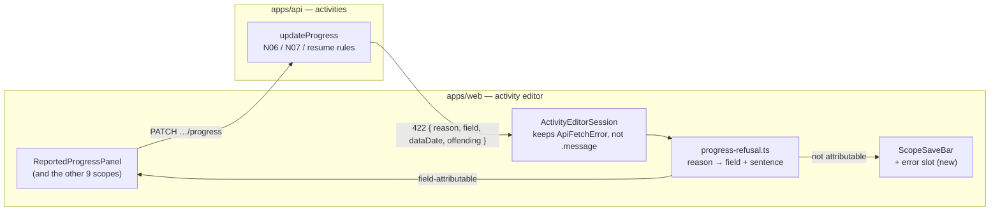
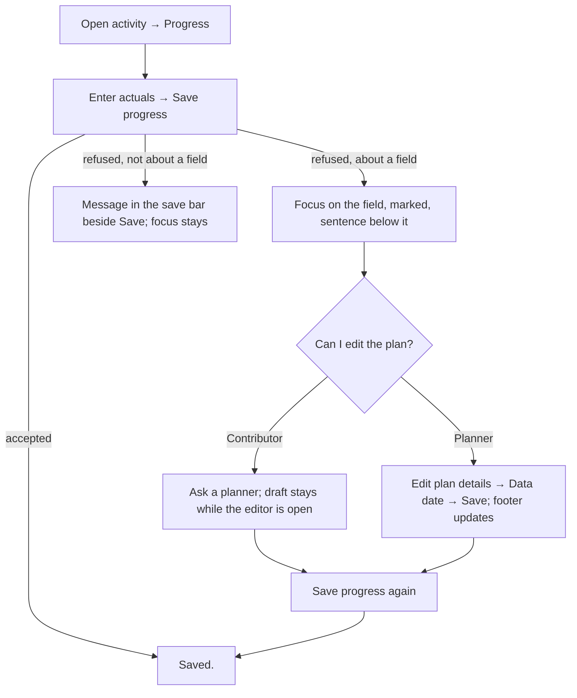

# Feature Spec: Reporting progress past the data date, and a refusal you can see

- **Status:** Accepted — shipped (ADR-0217). Approved by the product owner, 2026-11-12, with all three defaults (Q1 keep the rule, Q2 reword journey 2, Q3 separate dates not now); M1 to M4 built.
- **Author(s):** feature-analyst (for the product owner)
- **Date:** 2026-11-12
- **Tracking issue / epic:** the owner's GUI review, the two open first-severity problems on the ranked list
  (`docs/HANDOFF.md:139-149`, `:168-173`): "a Contributor cannot report progress until a Planner has moved the data
  date" and "at 1024 × 600 that refusal is off the screen, so Save appears to do nothing". Neither is registered in
  `docs/TECH_DEBT.md` (`docs/HANDOFF.md:148`). ADR-0105: this changes a shared component's public contract
  (`ScopeSaveBar`), so it is a spec, not a register row.
- **Roadmap link:** GUI review fixes, highest severity first (`docs/HANDOFF.md`, "What is next").
- **Related ADR(s):** ADR-0035 §6 (N07, N08), ADR-0033 (the mandatory data date), ADR-0028 / ADR-0060 (progress is
  not pen-gated), ADR-0169 (an editor's working state lives for one opening), ADR-0190 (what 1.0 promises),
  ADR-0077 `ServerError` rule, ADR-0111 (a shared primitive's keyboard contract is reviewed before release).
  **A short new ADR is recommended: ADR-0217** (the next free number; `docs/adr/021*.md` lists 0210–0216 on
  2026-11-12) for the shared refusal rule in §4.8. **No ADR touches ADR-0035** on the recommended path.

> **About the evidence.** Written from the source tree on 2026-11-12 (web 1.3.0, current `main`), without a browser.
> Every claim that decides something carries the file and line it was read from. The one premise only a browser can
> settle — that the refusal is off-screen at 1024 × 600 — is settled by M2's journey, which is written first and must
> **fail on `main`** before the fix is built (ADR-0113, ADR-0142). If it passes on `main`, the work stops and comes back.

## 0. Plain-English summary

**What goes wrong today.** A site contributor opens an activity, types "finished on Thursday", and presses **Save
progress**. SchedulePoint refuses, because Thursday is after the plan's _data date_ (the "as of" date the schedule is
calculated from). On a laptop-sized screen the refusal appears at the top of the form, out of sight, so it looks as if
Save did nothing. Even when you can see it, it does not say which date was wrong, what the data date is, or who can
move it. Only a planner can move it, and the control is labelled "Planned start", not "Data date".

**What this work does, if approved with the defaults:**

1. When a save is refused, **the message appears where you are looking**: on the date box that caused it (marked
   and with the cursor put there), or next to the Save button. This applies to every Save in the activity editor.
2. The message **says it plainly**: "Actual finish, 14 Nov 2026, is after the plan's data date, 10 Nov 2026. A
   planner needs to move the data date to 14 Nov 2026 or later first. What you typed stays here until you close the
   editor." A planner is told where to move it.
3. The plan's date box is **called "Data date"** where you change it, and the footer shows the new date straight away.
4. The progress form **says what an actual finish means**: the activity becomes complete; the percentage is not
   changed for you.
5. **The rule itself stays** (progress cannot be reported after the data date). The weekly order becomes: the planner
   moves the data date, the contributors report, the planner recalculates. The brief's journey 2 is re-worded to match.

Nothing here needs you to run or check anything on your server or devices. No database change.

## Critical questions (each with the recommended default)

| #      | Question                                                                                                                                                      | Recommended default                                                                                                                                                                                                                                                    | What changes if you choose otherwise                                                                                                                                                                                |
| ------ | ------------------------------------------------------------------------------------------------------------------------------------------------------------- | ---------------------------------------------------------------------------------------------------------------------------------------------------------------------------------------------------------------------------------------------------------------------- | ------------------------------------------------------------------------------------------------------------------------------------------------------------------------------------------------------------------- |
| **Q1** | **Keep the rule** (a planner moves the data date before contributors report) **or relax it** (accept a date after the data date and flag it for the planner)? | **Keep the rule** — option (a), §4.9. It is the only option that needs no change to how dates are calculated, no new ADR on the engine and no change to who may do what. The weekly order becomes "planner opens the week, contributors report, planner recalculates". | Relaxing it is option (c): an engine change (a started activity can today get a finish before its start, §3.2), a new ADR amending ADR-0035 §6, and its own spec. It would be a separate piece of work after M1–M4. |
| **Q2** | Re-word journey 2 in `docs/PROJECT_BRIEF.md` §10 so the planner moves the data date **first**?                                                                | **Yes**, in M4, if Q1 is "keep the rule".                                                                                                                                                                                                                              | Leave the brief as is and it keeps describing an order the product refuses.                                                                                                                                         |
| **Q3** | **Separate "plan start" from "data date"** (your runbook step 4.6)? Today they are one stored value.                                                          | **Not in this work.** Record it as a costed backlog item (§4.10) and decide it on its own. It is a database change, a new ADR, a new field on the public API and the export, and it does not fix either of the two problems here.                                      | If yes now: a fifth milestone with database-architect first, an ADR, and roughly the cost in §4.10. It would land after M4.                                                                                         |

Everything else has a stated default (§1, "Defaults taken").

## 1. Business understanding

### Problem

**Re-verified against the code on 2026-11-12; the brief's statement holds, with two corrections.**

1. **The refusal.** `ActivitiesService.updateProgress` reads `const dataDate = plan.plannedStart;`
   (`apps/api/src/modules/activities/activities.service.ts:1706`) and rule N07 throws
   `ValidationError('An actual date cannot be after the plan’s data date.', { reason: 'ACTUAL_AFTER_DATA_DATE' })`
   when either actual is later (`:1765-1773`). It does not say which date, nor the data date, nor who can move it.
2. **Who can move it.** Only a role with `plan:update` (`apps/api/src/modules/plans/plans.service.ts:198`). The
   Contributor role holds `activity:update_progress` and not `plan:update`
   (`apps/api/src/common/auth/org-permissions.ts:268`, `:355-361`). The control is the field labelled
   **"Planned start"** (`apps/web/src/features/plans/components/PlanFormDialog.tsx:146-151`) in the dialog titled
   "Edit plan details" (`:44`), reached from the toolbar item whose description says "planned start"
   (`apps/web/src/features/tsld/toolbar/tsld-toolbar-items.tsx:3421-3422`).
3. **The brief's order is the other way round.** `docs/PROJECT_BRIEF.md:157`: "Contributor … marks activities %
   complete and actual finish … Planner re-opens for full edit, sets the data date, runs CPM".
4. **The refusal is rendered at the top of the panel.** `ActivityProgressPanels.tsx:113-117` renders the server's
   message as `<p role="alert">` above the six fields; Save is the `ScopeSaveBar` at the bottom (`:175-181`). Nothing
   scrolls to it or moves focus. The host stores only `error.message` (`ActivityEditorSession.tsx:578-582`), so the
   reason code the API returns (`ApiFetchError.error.details`, `apps/web/src/lib/api/client.ts:10-18`;
   `packages/types/src/index.ts:29-35`) is thrown away.
5. **The same shape is in every scope of the editor.** The definition tabs render `scopeError(...)` at the top of
   the tab (`ActivityEditorSession.tsx:517-529`, used at `:781`, `:875`, `:1067`); the measure and steps panels do the
   same (`ActivityProgressPanels.tsx:243-247`, `:513-517`). Two callers already worked round it: the WBS members panel
   scrolls its error into view (`apps/web/src/features/wbs/components/ActivityMembersPanel.tsx:159-163`) and the codes
   section links it to Save with `alsoDescribedBy` (`apps/web/src/features/codes/components/ActivityCodesSection.tsx:221-248`).
   Ten `ScopeSaveBar` callers exist, all inside the activity editor (grep `<ScopeSaveBar` in `apps/web/src`).

**Correction 1 — "on closing the form the typed entry is lost".** True only after a confirmation. A refused save does
not reset the form (`ActivityEditorSession.tsx:611`, `:578-582`), so the scope stays dirty and Close asks first
(`:491-497`). After you confirm, the draft is discarded, which is ADR-0169's rule (working state lives for one
opening). This spec keeps that rule; it makes closing unnecessary rather than making drafts outlive the editor.

**Correction 2 — the stale foot row is a missing cache refresh, not a server problem.** The foot row reads the
schedule summary's `dataDate` (`plan-workspace-toolbar.tsx:3056`), which the server reads live from the plan
(`apps/api/src/modules/schedule/schedule.service.ts:800`). `useUpdatePlan` refreshes the plan list and detail but not
the summary (`apps/web/src/features/plans/api/use-plans.ts:64-77`), while `useSetPlanCalendar` does refresh it
(`:99-100`). So the fix is one invalidation.

### Users

| Role                    | Need                                                                                                           |
| ----------------------- | -------------------------------------------------------------------------------------------------------------- |
| **Contributor**         | Report the week's progress and, when it is refused, know why, by whom it can be unblocked, and keep the entry. |
| **Planner / Org Admin** | Same, plus: find the data date by its name, move it, and see the new date at once.                             |
| Viewer, External Guest  | Unaffected (they cannot report progress or edit the plan).                                                     |

### Primary use cases

1. A contributor reports an actual finish later than the data date and is told, on the field, what to do.
2. A planner opens the week by moving the **Data date**, and the footer shows it immediately.
3. Any save in the activity editor that the server refuses is visible next to the control that caused it.

### User journeys

- **Weekly update (new order, Q1/Q2 default).** Planner: Edit plan details → **Data date** → Friday → Save; the footer
  reads Friday. Contributor: opens activity → Progress → Actual finish Thursday → Save progress → "Saved." Planner:
  Recalculate.
- **Alternate — contributor first.** Contributor enters Friday's finish while the data date is last Monday → Save
  progress → focus lands on **Actual finish**, marked invalid, with the sentence beneath it naming both dates and
  "a planner needs to move the data date". The draft stays while the editor is open. Once the planner has moved
  the date, the contributor presses Save progress again and it succeeds.

### Expected outcomes

No save in the activity editor can fail silently at 1024 × 600, and the data date refusal tells the reader what to do.

### Success criteria

- At 1024 × 600, after a refused **Save progress**, the message is in the viewport, the offending field is marked
  `aria-invalid` and has focus, and nothing is clipped. Asserted by a journey, not by pixel figures.
- The same holds for an unattributable refusal (a version conflict) in a definition scope.
- After **Data date** is moved and saved, the foot row shows the new date with no reload and no recalculation.

### Defaults taken (not critical questions)

- **D-a. The planner's message has no button** that opens Edit plan details from inside the activity editor (a dialog
  over a dialog; ADR-0108). It names the place instead.
- **D-b. The label is "Data date"** in Edit plan details and on the plan page's details, with a hint ("Activities are
  scheduled from this date. Progress can be reported up to it."). The **New plan** dialog says **"Start date"** with
  the hint "This is also the plan's data date." The plans table column becomes "Data date".
- **D-c. Actual finish and percent complete.** Copy only: a line under the fields says "An actual finish makes the
  activity complete. Percent complete is not changed for you." When an actual finish is set and percent is below 100,
  a quiet note says so. The server behaviour (N08 / N18, below) does not change.
- **D-d. Telling the planner that progress has arrived** is out of scope (notifications are ADR-0137's subject).
- **D-e. No `VITE_*` flag** (ADR-0088 D1): the rollback is the commit boundary.

### Scope against the related rows on the ranked list

| Row                                                                      | Decision                           | Why                                                                                                                                                                                                                                                                                                          |
| ------------------------------------------------------------------------ | ---------------------------------- | ------------------------------------------------------------------------------------------------------------------------------------------------------------------------------------------------------------------------------------------------------------------------------------------------------------ |
| Refusal not tied to the field; does not say start or finish (WCAG 3.3.1) | **IN** (M1, M2)                    | It is the same fix as problem 2: the refusal lands on the field.                                                                                                                                                                                                                                             |
| Nothing is called "Data date" where you change it                        | **IN** (M4)                        | Copy only; it is half of why the message is hard to act on.                                                                                                                                                                                                                                                  |
| Data date and plan start are one column (step 4.6)                       | **OUT — costed** (§4.10, Q3)       | Schema + ADR + API + export change; fixes neither problem.                                                                                                                                                                                                                                                   |
| Foot row keeps the old data date until recalc/reload                     | **IN** (M4)                        | One missing cache invalidation (`use-plans.ts:72-76`); directly in the planner's half of the new weekly order.                                                                                                                                                                                               |
| Does an actual finish imply 100 %?                                       | **IN as copy** (M4); behaviour OUT | The server keeps the typed percent (`activities.service.ts:1711`, `:1810-1811`) and marks the activity complete (`:1779`); the form already previews "Complete" (`activity-schemas.ts:349`). Changing the percent automatically is a behaviour change to a documented endpoint and to EV — its own decision. |
| Nothing tells the planner progress arrived                               | **OUT**                            | Not adjacent; ADR-0137 territory.                                                                                                                                                                                                                                                                            |

## 2. Functional requirements

### User stories & acceptance criteria

> **US-1** — As a **Contributor**, I want a refused progress save to tell me, on the field, which date is wrong and
> who can unblock it, so that I am not left pressing Save.
>
> - **Given** the data date is 10 Nov 2026 **when** I enter Actual finish 14 Nov 2026 and press Save progress
>   **then** focus moves to **Actual finish**, it is marked invalid, and beneath it reads: "Actual finish, 14 Nov
>   2026, is after the plan's data date, 10 Nov 2026. A planner needs to move the data date to 14 Nov 2026 or later
>   first. What you typed stays here until you close the editor."
> - **Given** both actuals are after the data date **then** both fields are marked; focus goes to the first
>   (Actual start); the "or later" date is the later of the two.
> - **Given** a refusal **then** my entries are unchanged and the scope is still marked unsaved.
> - **Given** the planner has since moved the data date **when** I press Save progress again **then** it saves.

> **US-2** — As a **Planner**, I want the same refusal to tell me where to move the data date.
>
> - **Given** I can edit the plan **then** the sentence's second half reads "Move the data date (the Planned start box in
>   Edit plan details) to 14 Nov 2026 or later, then save again." (until M4 renames the box; the parenthetical then goes)

> **US-3** — As **anyone saving in the activity editor**, I want any refusal I cannot pin to a field to appear by
> the Save I pressed.
>
> - **Given** a save in any scope is refused for a reason not tied to a field (a version conflict, a lost pen, a
>   network failure) **then** the message is shown inside that scope's save bar, beside the button, it is in the
>   viewport, Save is described by it, and **focus does not move** (ADR-0077 `ServerError` rule,
>   `apps/web/src/components/ui/server-error.tsx:12-29`).
> - The definition tabs' **Refresh this section** action moves with the message (`ActivityEditorSession.tsx:524-526`).

> **US-4** — As a **Planner**, I want the plan's date called "Data date" and shown at once after I change it.
>
> - **Given** I open Edit plan details **then** the field is labelled "Data date" with the hint in D-b.
> - **Given** I save a new data date **then** the foot row shows it without reload or recalculation.

> **US-5** — As a **Contributor**, I want the form to say what an actual finish does (D-c).

### Workflows

See §4 user flow. The client never refuses on its own: the server stays the one judge, and the client places and
words the server's refusal. (A client-side mirror of N07 was considered and rejected — §4.9, "Alternatives".)

### Edge cases

- **Data date moved by a planner while the contributor's editor is open.** The server answers with its current data
  date in `details` (M1), so the message names the right date even if the client's cached plan is stale.
- **Actual on the data date** is accepted (`d > dataDate`, `activities.service.ts:1767`); copy says "after", never
  "on or after".
- **A refusal while the reader is on another tab** keeps today's announcement (`ActivityEditorSession.tsx:581`) and the
  field is marked when they come back (the form owns the error, ADR-0169).
- **Editing the field clears its server error** (react-hook-form clears a field's error on change).
- **N06 refusals** (`FINISH_WITHOUT_START`, `FINISH_BEFORE_START`, `:1754-1763`) and `RESUME_BEFORE_SUSPEND`
  (`:1804-1808`) are mapped to their fields by the same table. The client already mirrors them
  (`activity-schemas.ts:319-334`), so the server copy is only met if the two disagree.
- **An API older than M1** (no `details.field`): the web falls back to the save-bar message (US-3). Not reachable on the
  owner's host, where both images update together, but harmless.

### Permissions

Unchanged. Progress: `activity:update_progress` (Contributor, Planner, Org Admin), never the pen
(`ActivityProgressPanels.tsx:45`; `activity-editor-gating.ts:21`). Data date: `plan:update` (Planner, Org Admin);
**not** pen-gated unless swimlane fields ride along (`plans.service.ts:243-254`). The message's planner variant is
chosen by the editor's existing role flag `canWrite` (`activity-editor-gating.ts:36`), which is held by exactly the
roles that hold `plan:update` today (both come from `HIERARCHY_WRITE`, `org-permissions.ts:362-366`). A unit test pins
that equivalence so a future role split cannot silently mislead.

### Validation rules

Unchanged: N06, N07, N08, N18 as in `activities.service.ts:1753-1797`.

### Error scenarios

| Scenario                          | Detection                   | User-facing result                                             | Status  |
| --------------------------------- | --------------------------- | -------------------------------------------------------------- | ------- |
| Actual after the data date (N07)  | service rule                | on the field, named date, who can move it                      | 422     |
| Finish without/before start (N06) | client schema, then service | on Actual finish                                               | 422     |
| Resume before suspend             | client schema, then service | on Resume date                                                 | 422     |
| Version conflict                  | version gate                | in the save bar, with **Refresh this section** where it exists | 409     |
| Pen lost (definition scopes)      | `assertHoldsPen`            | in the save bar                                                | 409/403 |
| Network / 5xx                     | fetch                       | in the save bar                                                | —       |

## 3. Technical analysis

| Area           | Impact | Notes                                                                                                                         |
| -------------- | ------ | ----------------------------------------------------------------------------------------------------------------------------- |
| Frontend       | med    | Progress panel field mapping; `ScopeSaveBar` error slot and its ten callers; plan form label; one cache invalidation; copy.   |
| Backend        | low    | `updateProgress`: richer `details` on N07 (and `field` on N06 / resume). No rule change.                                      |
| Database       | none   | Recommended path. Q3 or option (c)/(d) would change this.                                                                     |
| API            | low    | Additive `details` keys on an existing 422. `code`, `reason`, status unchanged. Not a break under ADR-0190 D1/D2.             |
| Security       | none   | `details.dataDate` is the plan's own data date, already readable by every role that can call the endpoint (`HIERARCHY_READ`). |
| Performance    | none   | No new query: `plan` is already loaded (`activities.service.ts:1705`).                                                        |
| Infrastructure | none   | No new Playwright config, no CI step (journeys are one new file in the existing `e2e-workspace-chrome` suite).                |
| Observability  | low    | Keep the existing warn logs; add none.                                                                                        |
| Testing        | med    | API e2e for `details`; unit for mapping and `ScopeSaveBar`; journeys at 1024 × 600.                                           |

### 3.1 Why N07 exists — what an actual after the data date would break

ADR-0035 §6: "Recorded actual start/finish are immutable … Invalid actuals are **rejected at the boundary**: …
actual-in-the-future beyond the data date (N07) [is an error]" (`docs/adr/0035-schedulepoint-cpm-semantics.md:89-93`).
The data date is "a hard floor for remaining work" (§2, `:66-68`). The engine itself is N07-agnostic (stated in
`compute.progress.spec.ts:152-153`), so the rule protects the following, each read from the code:

1. **A started activity could finish before it starts.** For an in-progress activity the engine freezes the early
   start at the actual start (`compute.ts:294`) but schedules the remaining work from `lower`, which starts at the data
   date (`:200`) and is raised to the actual start **only** in Actual Dates mode (`:233-235`). The plan default is
   Retained Logic (`schema.prisma:862`). So with actual start Wed and data date Mon, two days remaining, the early
   finish is Tue — before the start. `compute.progress.spec.ts:151-163` shows exactly this (`override.earlyFinish`
   2026-01-06 against an actual start of 2026-01-07).
2. **The N08 repair would write a finish before the start.** "Complete without a finish" sets the finish to the data
   date (`activities.service.ts:1781-1782`); with an actual start after the data date that breaks N06, the rule
   checked just above it (`:1759`).
3. **Earned value would compare unlike things.** Planned value is measured up to the data date
   (`engine/earned-value.ts:402-418`), while earned value comes from the reported percent, which would include work
   done after it — so SPI would read better than the truth.
4. **The schedule health check already fails a plan for it.** DCMA metric 9 "Invalid dates" counts every actual after
   the data date (`schedule/health/compute-health.ts:533-545`) with a threshold of 0 (`health/thresholds.ts:64`).

So N07 is a correctness guard, not an arbitrary restriction. **Note:** the state is already reachable another way —
moving the data date **backwards** is not checked against existing actuals (`plans.service.ts:255-259`), which is why
the health check needs metric 9. That is not changed here.

The conformance fixture allows either behaviour: N07's expectation is `REJECT_OR_WARN`
(`packages/engine-conformance/fixtures/negative_cases.json:155-157`; `packages/seed/src/negative/cases.ts:236-238`;
`docs/TEST_PLAYBOOK.md:202`). Relaxing it would therefore stay conformant, but would need items 1–3 handled.

### 3.2 Recalc parity gate

The recommended path changes **no engine input and no engine code**: `computeSchedule` is untouched, so it is
byte-identical by construction. (Option (c) would not be: see §4.9.)

### Dependencies

None outstanding. M1 (API) and M3 (shared save bar) are independent; M2 uses M1's `details` but degrades without it.

## 4. Solution design

### 4.1 Architecture overview



### 4.2 Data flow

```mermaid
sequenceDiagram
  participant C as Contributor
  participant P as Progress panel
  participant S as Editor session
  participant A as API updateProgress
  C->>P: Actual finish 14 Nov, Save progress
  P->>S: onSave(values)
  S->>A: PATCH /activities/:id/progress
  A-->>S: 422 VALIDATION_FAILED details{reason: ACTUAL_AFTER_DATA_DATE, fields:[actualFinish], dataDate: 2026-11-10, latestActual: 2026-11-14}
  S->>P: refusal {fields, sentence}
  P->>P: setError(actualFinish), setFocus(actualFinish)
  Note over P: field scrolls into view with focus; draft kept
```

### 4.3 User flow



### 4.4 Database changes

**None** on the recommended path.

### 4.5 API changes

`PATCH /api/v1/organizations/:slug/activities/:id/progress` — the 422 for N07 gains **additive** `details` keys; the
`code` (`VALIDATION_FAILED`), `reason` and status are unchanged:

```json
{
  "error": {
    "code": "VALIDATION_FAILED",
    "message": "An actual date cannot be after the plan’s data date.",
    "details": {
      "reason": "ACTUAL_AFTER_DATA_DATE",
      "fields": ["actualFinish"],
      "dataDate": "2026-11-10",
      "latestActual": "2026-11-14"
    }
  }
}
```

N06 and resume refusals gain `fields` only. Dates are ISO calendar days; the web formats them (CLAUDE.md §17: no
locale baked into the server). The English `message` stays as it is: a client must not parse it. Under ADR-0190 D1/D2
adding keys to `details` is not a breaking change (no field removed or retyped). `docs/API.md` and the controller's
`@ApiOperation` description (`activities.controller.ts:127-130`) are updated; an `ApiProperty`-documented error-details
shape is added if the module documents its 422s that way.

### 4.6 Component changes

- **`ScopeSaveBar`** (`components/ui/scope-save-bar.tsx`) gains `error?: { message: string; action?: ReactNode } | null`.
  When set, the bar shows it in place of the dirty/saved sentence, as an `Alert purpose="event" tone="error"` (the
  `ServerError` treatment), links it to Save through the existing `aria-describedby` assembly (`:112-114`), and calls
  `scrollIntoView({ block: 'nearest' })` on it once per new error (guarded for jsdom, the `ActivityMembersPanel`
  precedent). **It never moves focus.** `alsoDescribedBy` stays for callers that render elsewhere, then is retired
  once its two users move (Codes, Members).
- **All ten callers** pass their error to the bar and delete their top-of-scope `<p role="alert">`: General,
  Scheduling, Cost (`scopeError`), Reported progress, Measure, Steps, Codes, WBS members, Add a link, Resources (the
  last two render errors at `AddLinkSection.tsx:185`, `ActivityResourcesPanel.tsx:327`, `:371`, `:402` — each checked
  in M3; a per-row error that sits beside its own row stays where it is).
- **`ReportedProgressPanel`** maps field-attributable refusals onto the form (`setError` + `setFocus`, the
  `ChangePasswordForm` precedent named in `server-error.tsx:25-27`). Focus moves to the field: it is the control the
  reader must change, and the browser scrolls it into view.
- **`ActivityEditorSession`** keeps the `ApiFetchError` (status + details) per panel instead of `error.message`
  (`:175-181`, `:578-582`).
- **New** `features/activities/model/progress-refusal.ts`: pure; `reason → fields`, and the sentence for the reader's
  role. Unit-tested on its own.
- **`PlanFormDialog`** label/hint (D-b); `plan-chrome-dialogs.tsx:85`, `PlansTable.tsx:70`, toolbar description
  (`tsld-toolbar-items.tsx:3422`).
- **`useUpdatePlan`** also invalidates `scheduleKeys.summary` (`use-plans.ts:72-76`).
- **Progress panel copy** for D-c.

States: loading/empty unchanged; error is the subject; success unchanged ("Saved.").

### 4.7 Implementation approach

Server stays the judge; the server says which field and which date; the client words it and puts it where the reader
is. One shared rule for every Save in the editor.

### 4.8 Draft ADR outline — ADR-0217 "A refusal is shown where it was asked for, and on the field it is about"

- **Context:** ten scope saves render refusals at the top of their scope; at 1024 × 600 (ADR-0179 design floor) they
  are off-screen; two callers each invented a different workaround.
- **Decision:** D1 a refusal tied to a field goes on that field and focus moves there; D2 any other refusal is shown in
  the save bar beside the Save that was pressed, describes it, is scrolled into view, and never takes focus; D3 the
  server names the field(s) in `details.fields` where a rule is about fields; D4 the client never parses `message`.
- **Consequences:** `alsoDescribedBy` retired; `ServerError`'s no-focus rule restated for the save bar; ADR-0083/0204
  untouched.
- **Amends:** nothing; extends ADR-0060 §6 (the per-scope save bar).

### 4.9 Options for problem 1, with trade-offs

| Option                                                                                                        | Needs an ADR?                               | Schema? | API contract change?                              | Permission change?                               | Verdict                                                                                                                                                                                                                                                                                                                                                            |
| ------------------------------------------------------------------------------------------------------------- | ------------------------------------------- | ------- | ------------------------------------------------- | ------------------------------------------------ | ------------------------------------------------------------------------------------------------------------------------------------------------------------------------------------------------------------------------------------------------------------------------------------------------------------------------------------------------------------------ |
| **(a) Keep the rule; fix the experience** (message names the date and who, kept entry, on the field, visible) | ADR-0217 for the shared UI rule only        | No      | Additive `details` (non-breaking)                 | No                                               | **Recommended.** Fixes both problems; no engine risk; the planner-first weekly order is a normal one. Cost: the brief's journey 2 order changes (Q2).                                                                                                                                                                                                              |
| **(b1) Accept, and move the data date automatically** to the latest reported actual                           | Yes (amends ADR-0035 §6 and ADR-0033)       | No      | Behaviour change: a progress write edits the plan | Effectively yes: a Contributor re-dates the plan | **Reject.** One typo (2027) re-dates every unstarted activity for everyone on the next recalc; the brief says a Contributor "cannot alter logic or dates" (`PROJECT_BRIEF.md:46`); moving the data date is a governance change that earns an audit row (`plans.service.ts:312-315`).                                                                               |
| **(b2) Let a Contributor move the data date** (a new `plan:update_data_date` permission)                      | Yes (amends ADR-0012/0016, brief §5)        | No      | 403 → 200 for one field (widening, not breaking)  | **Yes**                                          | **Reject** for the same governance reason, with less risk of typos than (b1) but the same "a contributor moves everyone's dates".                                                                                                                                                                                                                                  |
| **(c) Accept actuals after the data date and flag them** until the planner moves it                           | Yes (amends ADR-0035 §6: N07 reject → warn) | No      | 422 → 200 + `meta.warnings` (widening)            | No                                               | **Viable, larger.** Engine must floor remaining work at the actual start in every mode (§3.1 item 1) — not byte-identical for any plan that already holds such actuals (reachable by moving the data date back, §3.1); N08 must repair to `max(dataDate, actualStart)`; EV's SPI reads optimistic until the date moves; health metric 9 fails meanwhile. Own spec. |
| **(d) A separate "report up to" date**                                                                        | Yes                                         | **Yes** | Additive field                                    | Possibly                                         | **Reject.** A second date beside the data date that means "the data date, but for progress" is the confusion problem 1 complains about, doubled. If the plan needs two dates, they are start and data date (§4.10).                                                                                                                                                |

**Alternatives considered for problem 2.** (i) Scroll the existing top-of-panel alert into view — rejected: the
reader's eye and focus are at Save; scrolling away from them hides the field they must change. (ii) Focus the alert —
rejected by the house rule (`server-error.tsx:12-29`). (iii) A client-side N07 check before sending — rejected as the
primary path: the client's cached data date can be stale (a planner moved it in another tab), and a client that
refuses what the server would accept is a dead end with no server to correct it. The server's `details.dataDate`
makes the message correct without that risk.

### 4.10 Costed, not proposed — separating plan start from data date (Q3)

- **Schema:** add `plans.data_date DATE NOT NULL`, backfilled from `planned_start`; `planned_start` becomes the
  project's start. database-architect first (CLAUDE.md §19.3). Baselines already capture `data_date`
  (`schema.prisma:2307-2316`).
- **Engine/services:** every `formatCalendarDate(plan.plannedStart)` that means "data date" moves
  (`schedule.service.ts:444`, `:800`, `:879`, `:1036`, `:1129`, `:1213`, `:1400`; `activities.service.ts:1706`; health,
  EV, canvas origin `plan-workspace-toolbar.tsx:717-753`, `:1639`, `:1765`). Parity holds if the backfill copies.
- **API:** add `dataDate` to the plan DTOs (additive). Keeping `plannedStart` meaning "data date" is the only
  non-breaking reading; repurposing it to "project start" is a behaviour change of a 1.0 field → **major** under
  ADR-0190 D2, an ADR and a migration note.
- **Interchange:** import today collapses P6's `plan_start_date` into the data date
  (`packages/interchange/src/xer-adapter.ts:454-455`; MSPDI `mspdi-adapter.ts:301`), so this would also restore
  fidelity. The organisation export format (ADR-0194) gains a field (a format version step).
- **Size:** roughly an epic of its own (4–6 PRs). Recorded as a `docs/BACKLOG.md` item in M4 if Q3 is "not now".

## 5. Links

- Implementation plan: [`./implementation-plan.md`](./implementation-plan.md)
- Docs updated by this change: `docs/API.md`, `docs/TEST_PLAYBOOK.md` (N07 row), `docs/TECH_DEBT.md` (new rows),
  `docs/UX_STANDARDS.md` (refusal placement), `docs/COMPONENT_LIBRARY.md` (`ScopeSaveBar`), `docs/PROJECT_BRIEF.md`
  §10 (Q2), `docs/BACKLOG.md` (Q3), `CLAUDE.md` §16 (ADR-0217 line).
