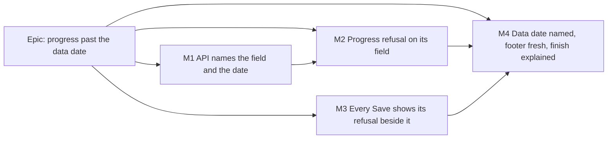

# Implementation Plan: Reporting progress past the data date, and a refusal you can see

- **Feature spec:** [`./feature-spec.md`](./feature-spec.md) — approved, 2026-11-12.
- **Status:** Approved by the product owner, 2026-11-12, with all three defaults (Q1 keep the rule, Q2 reword journey 2, Q3 separate dates not now). M1–M2 built, M3 in progress.
- **Owner:** product owner; built by the **builder** agent milestone by milestone after approval.

Written for the defaults in the spec (Q1 keep the rule, Q2 re-word the brief, Q3 not now). A different answer to Q1
or Q3 adds a milestone (end of this file); it does not change M1–M4.

## Breakdown

### Epic

**Progress past the data date** — the two open first-severity problems on the GUI review's ranked list.

## Sequencing & slices

M1 → M2 → M3 → M4, one pull request each, each releasable alone. M1 and M3 do not depend on each other and may be
built in either order; M2 needs M1's `details` (without it M2 falls back to today's message). **No `VITE_*` flag**
(ADR-0088 D1): every image carries every flag at its default, so a flag is never a rollback here; the rollback is the
commit boundary.

**ADR-0105 triggers, all named:** M3 changes a shared component's public contract (`ScopeSaveBar`), which is why this
is a spec. **None** of the milestones adds a Playwright config, a CI step, a schema change, a shared gate or a new entry
point: the journeys are new spec files in existing suites, and every control they press exists today.

---

### Milestone M1: The API says which field and which date

**Outcome:** a refused progress save carries the offending field(s) and the plan's data date. No visible change yet.
**Entry point:** `Ships dark: an API-only change; M2 surfaces it on the Progress tab.`
**Journey:** none of its own (dark); M2's journey drives it.

#### Feature: richer N07 / N06 refusal details

> **Description:** add `fields`, `dataDate`, `latestActual` to N07's `details`; add `fields` to N06 and resume refusals.
> **Complexity:** S
> **Dependencies:** none
> **Risks:** a client parsing `message` → none exists (the web reads `.message` only, `ActivityEditorSession.tsx:580`);
> the message text is kept verbatim anyway. Leaking data → `dataDate` is readable by every caller already.
> **Testing requirements:** service unit + Supertest e2e.

##### Task 1 — `updateProgress` details (≈ one PR)

- **Description:** in `apps/api/src/modules/activities/activities.service.ts:1753-1773`, `:1804-1808`, build `fields`
  from which actual(s) exceed the data date (start first, then finish), `dataDate` and `latestActual` as ISO calendar
  days via the existing `formatCalendarDate`. `reason`, `code`, status, message unchanged.
- **Complexity:** S
- **Dependencies:** —
- **Risks:** date formatting off by a day across time zones → use the same calendar-day formatter the summary uses
  (`schedule.service.ts:800`); test a date on the boundary (equal to the data date is accepted).
- **Testing:**
  - `activities.service.spec.ts`: start only, finish only, both, equal-to-data-date accepted; N06 and resume carry
    `fields`.
  - `apps/api/test/activities.e2e-spec.ts`: a Contributor's `PATCH …/progress` with a finish after the data date →
    422 with the four keys; the existing contributor case near `:738-741` stays green.
  - Run `scripts/e2e-local.sh api`.
- **Development steps:**
  1. Write the failing e2e case first.
  2. Add the keys; keep the message.
  3. Update the `@ApiOperation` description (`activities.controller.ts:127-130`) and `docs/API.md` (the progress
     endpoint's 422, "details are additive; do not parse `message`").
  4. Register the two problems as `docs/TECH_DEBT.md` rows (next free number at time of writing is **#583**; verify)
     with "Closed by" pointing at M2/M3, so the list and the register agree.
  5. Changeset: `'@repo/api': minor` ("A refused progress save now says which date and the plan's data date").

---

### Milestone M2: A refused progress save lands on its field, in plain words

**Outcome:** a Contributor or Planner whose progress save is refused sees, at any window size, the date box marked,
the cursor in it, and a sentence naming both dates and who can move the data date.
**Entry point:** existing — plan workspace → select a bar → **Report progress** (ADR-0093) → **Save progress**.
**Journey:** `apps/web/e2e-workspace-chrome/progress-refusal.spec.ts` (new file in the existing
`playwright.workspace-chrome.config.ts` suite, beside `progress-entry.spec.ts`, whose `support.ts` helpers it reuses;
run with `scripts/e2e-local.sh web:workspace-chrome`). Chosen over `e2e-activity-editor` because that suite runs on
the legacy stacked page (`playwright.activity-editor.config.ts:13-17`), and the walkthrough found this on the canvas
workspace — ADR-0081 wants the real product's entry point.

#### Feature: field-attributed progress refusal

> **Description:** keep the API error (not just its message); map `details.fields` onto the form; word the sentence.
> **Complexity:** M
> **Dependencies:** M1
> **Risks:** see tasks.
> **Testing requirements:** unit (mapping, wording by role, panel focus), journey at 1024 × 600, accessibility review.

##### Task 1 — the journey first, red on `main`

- **Description:** prove the problem before fixing it (ADR-0113, ADR-0142).
- **Complexity:** S
- **Dependencies:** M1 merged (or run against M1's branch)
- **Risks:** the journey passes on `main` (the refusal is in view after all) → **stop and come back**; the spec's
  premise was wrong.
- **Testing:** `test.use({ viewport: { width: 1024, height: 600 } })`. Create a plan through the UI as in the suite's
  other tests; open an activity's Progress tab; type an Actual start before and an Actual finish after the data date;
  press **Save progress**. (Plan, activities and pen through the suite's `createHierarchy` / `newPlan` /
  `seedActivities` / `ensurePen` helpers.) Assert **invariants only, never pixel figures** (`docs/HANDOFF.md:123-126`):
  1. `getByLabel('Actual finish')` has `aria-invalid="true"` and is focused;
  2. the refusal text (matched on "data date") is `toBeInViewport()`;
  3. the refusal's bounding box lies inside the editor's scroll container's box (nothing clipped);
  4. `document.scrollingElement.scrollWidth <= clientWidth` (no sideways scroll);
  5. the typed value is still in the field and the Progress tab still shows its unsaved marker.
     Assertions 1, 2 and 3 must fail on `main`; record which did in the PR.
- **Development steps:** write; run locally on `main`; keep it red in the PR until Task 2.

##### Task 2 — keep the error, map it, word it

- **Description:**
  - `ActivityEditorSession.tsx:175-181`, `:578-582`: hold `ApiFetchError | Error` per panel slot, not a string.
  - New pure module `apps/web/src/features/activities/model/progress-refusal.ts`:
    `progressRefusal(error, { canMovePlanDates }) → { fields: ('actualStart'|'actualFinish'|'resumeDate')[]; sentence }`.
    Sentence (Contributor): "Actual finish, 14 Nov 2026, is after the plan's data date, 10 Nov 2026. A planner needs
    to move the data date to 14 Nov 2026 or later first. What you typed stays here until you close the editor."
    Planner: second sentence "Move the data date (the Planned start box in Edit plan details) to 14 Nov 2026 or
    later, then save again." — the parenthetical stays until M4 renames the box. A second field carries "Also after
    the data date. See Actual start."
    Dates through the existing `formatCalendarDate`. Unknown reason or no `fields` → `fields: []` and the server
    message (falls to the save bar in M3; until M3 lands it stays where it is today).
  - `ReportedProgressPanel`: on a refusal with fields, `form.setError(field, { type: 'server', message })` for each
    and `form.setFocus(first)`; show the sentence once, under the first field (the others say "See above" — avoid
    the same paragraph twice). Remove the top `
` only for the field case.
  - `canMovePlanDates` comes from the gating input's `canWrite` (`activity-editor-gating.ts:36`).
- **Complexity:** M
- **Dependencies:** Task 1
- **Risks:**
  - Focus moves on a server reply — a focus change on a shared form flow → **accessibility-reviewer before release**
    (CLAUDE.md §19.13; the `*Field` primitives themselves are not changed). Mitigation: it moves only to the field the
    reader must edit, the `ChangePasswordForm` precedent (`server-error.tsx:25-27`).
  - `canWrite` stops meaning `plan:update` one day → a unit test in `org-permissions.spec.ts` asserting the set of
    roles holding `activity:update` equals the set holding `plan:update`, failing with a message pointing here.
  - The reader is on another tab when it fails → today's announcement stays (`ActivityEditorSession.tsx:581`); the
    field is marked when they return, because the form holds the error.
- **Testing:** Vitest for `progress-refusal.ts` (each reason; one/two fields; both role variants; missing details);
  panel test: refusal → field `aria-invalid`, `toHaveFocus()`, `toHaveAccessibleDescription` includes the sentence,
  draft unchanged, editing the field clears the error. Task 1's journey goes green. `pnpm prepush`.
- **Development steps:**
  1. Module + tests. 2. Session state shape. 3. Panel. 4. Journey green.
  2. `docs/TEST_PLAYBOOK.md:202` N07 row: "Refused, with the field marked and the data date named".
  3. Changeset `'@repo/web': minor`.
  4. accessibility-reviewer, component-reviewer, ux-reviewer before merge.

---

### Milestone M3: Every Save in the activity editor shows its refusal beside it

**Outcome:** any refused save in any scope of the activity editor (a version conflict, a lost pen, a network failure)
is shown next to the Save that was pressed, at any window size; focus never jumps.
**Entry point:** existing — every Save in the activity editor (General, Scheduling, Cost, Reported progress, How value
is measured, Weighted steps, Codes, WBS members, Add a link, Resources).
**Journey:** a second test in `apps/web/e2e-workspace-chrome/progress-refusal.spec.ts` (same file, same config): a
definition-scope conflict.

#### Feature: `ScopeSaveBar` error slot (ADR-0217)

> **Description:** one place for a scope's refusal; ten callers moved to it.
> **Complexity:** M
> **Dependencies:** none (M2 not required)
> **Risks:** shared component used by ten callers → component-reviewer + accessibility-reviewer **before release**
> (ADR-0111 applies in spirit: what describes Save and where its refusal lives is its contract).
> **Testing requirements:** unit for the bar and each caller; journey for two scopes.
>
> **Carried from M2's review (not done in M2):** M2 decodes a field-attributed refusal for the nine-field-less panels
> by hand in `ActivityEditorSession`/`ActivityProgressPanels`. M3 splits (a) a generic `fieldRefusal` decoder out of
> `progress-refusal.ts` and (b) a `useClearServerErrorsOnEdit` hook (the clear-on-edit rule: only the edited field's
> server error clears, except a relation between two fields clears from either end), for the other nine panels.

##### Task 1 — the bar (≈ one PR with Task 2)

- **Description:** `components/ui/scope-save-bar.tsx` gains `error?: { message: string; action?: ReactNode } | null`.
  Renders `Alert purpose="event" tone="error"` in the bar's sentence slot (replacing dirty/saved text while present),
  adds its id to `aria-describedby` (`:112-114`), and scrolls it into view `{ block: 'nearest' }` once per new error,
  guarded for jsdom (`ActivityMembersPanel.tsx:159-163`). No focus call. Layout: the alert wraps above the button on a
  narrow bar rather than squeezing it (ADR-0114: a row that cannot shrink is never asked to wrap — the bar becomes a
  column only while an error shows).
- **Complexity:** S
- **Dependencies:** —
- **Risks:** two live regions announcing the same sentence (old top alert + new bar) during the move → each caller's
  top alert is removed in the same PR; a unit test asserts one `role="alert"` per scope.
- **Testing:** bar unit tests (error shown, describes Save, no focus change, scroll called once per new error, error
  replaces the dirty sentence, `action` rendered).

##### Task 2 — move the ten callers

- **Description:** `ActivityEditorSession.tsx` `scopeError` (`:517-529`, used at `:781`, `:875`, `:1067`) becomes the
  bar's `error` with **Refresh this section** as `action`; `ActivityProgressPanels.tsx:113-117` (non-field case),
  `:243-247`, `:513-517`; `ActivityCodesSection.tsx:221-248` and `ActivityMembersPanel.tsx:159-163`, `:280-291`
  (retire `alsoDescribedBy` and the hand-rolled scroll); `AddLinkSection.tsx:185`; `ActivityResourcesPanel.tsx:327`,
  `:371`, `:402` — **keep** any error that already sits beside its own row (e.g. a per-assignment Save) and say so in
  the PR. Then delete `alsoDescribedBy` if it has no caller left.
- **Complexity:** M
- **Dependencies:** Task 1
- **Risks:** an existing unit test locates the alert by position → update locators to role-in-scope; the steps panel's
  focus choreography (`ActivityProgressPanels.tsx:387-393`) must be untouched → its tests stay green unchanged.
- **Testing:** every caller's existing error test updated to find the alert inside the bar; journey: at 1024 × 600,
  make a definition-scope save conflict for real (save the same activity through the API between opening and saving,
  so the version is stale) → the message is `toBeInViewport()`, inside the bar, Save `toHaveAccessibleDescription`
  containing it, focus still on Save; **Refresh this section** recovers. `pnpm prepush`;
  `scripts/e2e-local.sh web:workspace-chrome`, and `web:activity-editor` because its existing journeys drive the same
  scopes.
- **Development steps:**
  1. File **ADR-0217** (draft in spec §4.8) and its one line in `CLAUDE.md` §16 (`check:adr-coverage`).
  2. Bar + callers. 3. `docs/UX_STANDARDS.md` (where a refusal goes) and `docs/COMPONENT_LIBRARY.md` (`ScopeSaveBar`).
  3. Changeset `'@repo/web': minor`. 5. accessibility-reviewer + component-reviewer + ux-reviewer before merge.

---

### Milestone M4: The data date is called that, the footer is fresh, and an actual finish is explained

**Outcome:** a planner finds **Data date** in Edit plan details, saves it, and the footer shows it at once; the progress
form says what an actual finish does; the brief describes the order the product supports.
**Entry point:** existing — plan toolbar **Edit plan details** → **Data date**; plan footer "Data date".
**Journey:** a third test in `apps/web/e2e-workspace-chrome/progress-refusal.spec.ts` (no new config): open Edit plan details, change **Data date**, save, assert the footer's "Data date" fact shows
the new date **without** pressing Recalculate or reloading; then the M2 flow saves successfully.

#### Feature: naming, freshness, copy

> **Description:** labels, one cache invalidation, two lines of copy, docs.
> **Complexity:** S
> **Dependencies:** M2 (the message's "Edit plan details" must match the label)
> **Risks:** journeys and tests that find the field by "Planned start" → grep `Planned start` in `apps/web` (unit:
> `PlanFormDialog.test.tsx:59`, `:76`, `:88`, `:129`, `:138`; any e2e) and update in the same PR.
> **Testing requirements:** unit + journey.

##### Task 1 — labels and footer (≈ one PR)

- **Description:** **drop the parenthetical** `DATA_DATE_BOX` ("(the Planned start box in Edit plan details)") from
  `apps/web/src/features/activities/model/progress-refusal.ts` — M2 added it because the box is still labelled
  "Planned start" until this task; one constant, one edit, and update the sentence asserted in
  `progress-refusal.test.ts`, `ActivityEditorDialog.progress-saves.test.tsx` and the journey.
  `PlanFormDialog.tsx:146-151` → edit: "Data date" with hint "Activities are scheduled from this date.
  Progress can be reported up to it."; create: "Start date" with hint "This is also the plan's data date."
  `plan-chrome-dialogs.tsx:85`, `PlansTable.tsx:70` → "Data date". Toolbar description
  (`tsld-toolbar-items.tsx:3422`) → "…status, data date and description". `use-plans.ts:72-76` also invalidates
  `scheduleKeys.summary(orgSlug, input.planId)`.
- **Complexity:** S
- **Testing:** `PlanFormDialog.test.tsx` updated; a `use-plans` test that the summary is invalidated on update;
  journey as above.

##### Task 2 — actual-finish copy (D-c)

- **Description:** in `ReportedProgressPanel` (`ActivityProgressPanels.tsx:141-147`), Actual finish hint "Makes the
  activity complete. Percent complete is not changed for you."; when an actual finish is set and percent < 100, a quiet
  note beside "Resulting status" (`:171-174`): "Percent complete is still N %." No behaviour change.
- **Complexity:** S
- **Testing:** panel unit tests for both.

##### Task 3 — documents

- **Description:** `docs/PROJECT_BRIEF.md:157` journey 2 re-worded (Q2): "Planner moves the data date to the end of the
  reporting week; contributors mark % complete and actual dates; planner runs CPM and reviews impact." Q3 →
  `docs/BACKLOG.md` item "Separate plan start from data date" with spec §4.10's costing. `docs/TECH_DEBT.md` rows
  closed with citations; one new **deferred** row: "moving the data date backwards is not checked against existing
  actuals" (`plans.service.ts:255-259`; caught only by health metric 9). Changeset `'@repo/web': minor`.
- **Complexity:** S

---

### Conditional milestone (only if Q1 = "relax the rule")

Not planned in detail: it needs its own spec addendum and approval. Outline — ADR amending ADR-0035 §6 (N07 reject →
warn); engine floors remaining work at `max(dataDate, actualStart)` in every recalc mode (`compute.ts:200`, `:233-235`),
with the conformance harness and the golden suite re-run and the non-parity for plans already holding such actuals
stated; N08 repair to `max(dataDate, actualStart)` (`activities.service.ts:1781-1782`); a `meta.warnings` code; a
planner-facing count; EV note. database-architect not needed (no schema). Size: L.

### Conditional milestone (only if Q3 = "separate them now")

database-architect first (CLAUDE.md §19.3), ADR, then the work costed in spec §4.10. Size: XL. After M4.

## Definition of Done (per task)

Each PR meets the Feature Completion Criteria in [`docs/PROCESS.md`](../../PROCESS.md): code, tests, docs, security,
performance, accessibility, Docker build, CI green (read per CLAUDE.md §19.9), changeset, version impact. "Tests" means
`pnpm prepush` was run, plus `scripts/e2e-local.sh api` for M1 and `scripts/e2e-local.sh web:workspace-chrome` and
`web:activity-editor` for the web milestones.

**Version impact:** `api` minor (M1, additive error details); `web` minor (M2, M3, M4). No major: no field removed or
retyped, no saved link changes (ADR-0190 D2/D3).

## Risks & assumptions (rollup)

| Risk / assumption                                                       | Likelihood | Impact | Mitigation                                                                           |
| ----------------------------------------------------------------------- | ---------- | ------ | ------------------------------------------------------------------------------------ |
| The refusal is actually visible at 1024 × 600 on `main` (premise wrong) | low        | med    | M2 Task 1 must be red on `main`; if not, stop and come back.                         |
| A focus move on a server reply surprises a screen-reader user           | low        | med    | Only to the field to change; accessibility-reviewer before release.                  |
| Ten-caller change regresses a scope's error path                        | med        | med    | Every caller's error test updated; one alert per scope asserted; component-reviewer. |
| `canWrite` stops implying `plan:update`                                 | low        | low    | Permission-equivalence unit test pointing here.                                      |
| Owner chooses (c) after M1–M4                                           | med        | low    | M1–M4 remain correct under (c): the refusal path simply stops firing for N07.        |
| Journeys flaky on CI's runner because of text width                     | med        | low    | Invariants only (`docs/HANDOFF.md:123-126`); figures kept out of assertions.         |
| The owner must check something on their host                            | none       | —      | Nothing here needs it: no environment variable, migration or operator step.          |

**Agents during build:** builder (each milestone); test-engineer (journeys); accessibility-reviewer, component-reviewer,
ux-reviewer (M2, M3, M4); api-reviewer and security-reviewer (M1); database-architect only if Q3 is "now".
