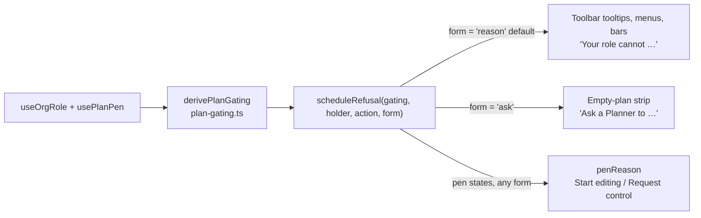
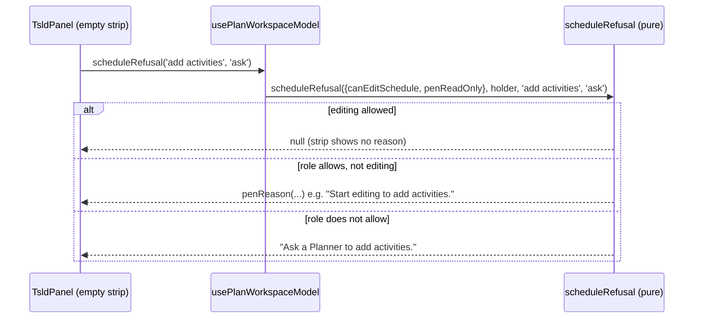
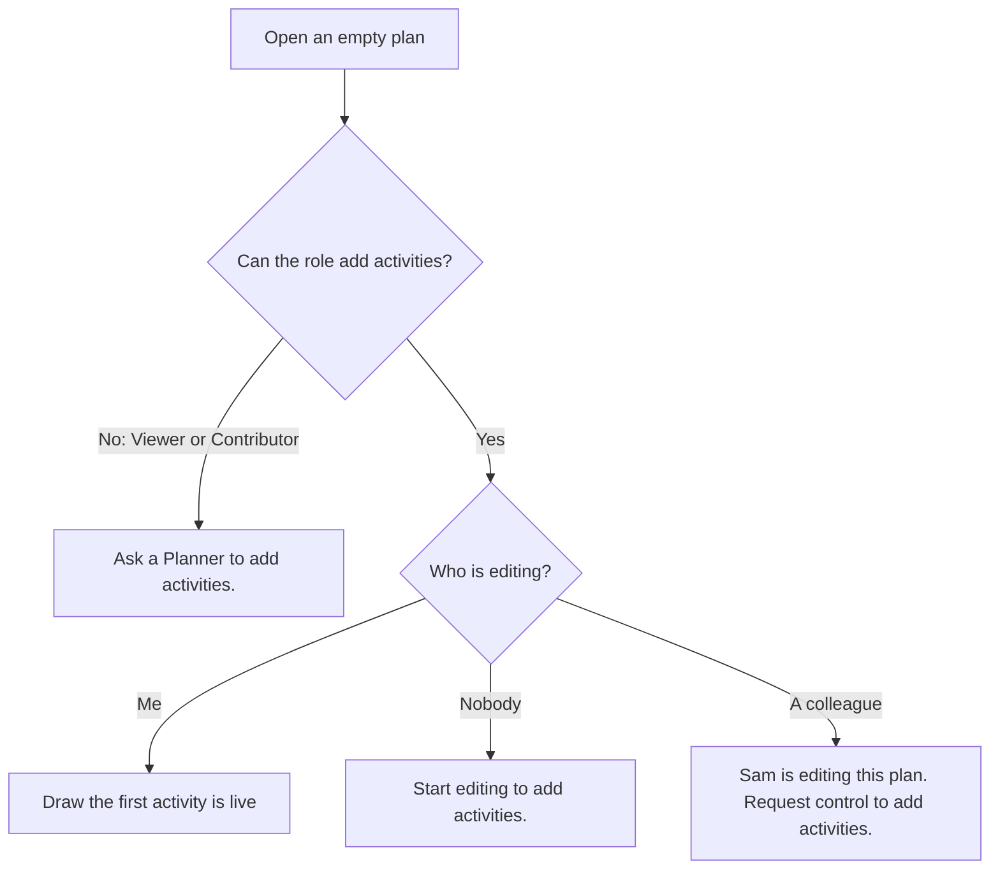

# Feature Spec: Wording for people who cannot edit

- **Status:** Approved — by the product owner, 2026-11-13, with "Ask a Planner" (capital P, question 1's default) and the "Locked" badge left alone (question 2's default). Not yet built.
- **Author(s):** feature-analyst (for the product owner)
- **Date:** 2026-11-13
- **Tracking issue / epic:** none yet (`docs/HANDOFF.md` "What is next", item 3, and the "edit lock" bullet)
- **Roadmap link:** none (copy polish)
- **Related ADR(s):** none new. Governed by ADR-0082, ADR-0083, ADR-0204 (a shaded control says why), ADR-0028
  and ADR-0220 (the pen and its vocabulary), ADR-0105 (why this needs a spec).

This is copy plus one small seam. Every sentence that would change is in the table in section 2, one row per
sentence, so it can be approved or struck line by line.

## 1. Business understanding

### Problem

1. **The empty plan tells a Viewer or Contributor what they cannot do, and nothing else.** On a plan with no
   activities, the diagram shows "This plan has no activities yet." and a shaded **Draw the first activity**
   button. For someone whose role cannot add work, the reason under it reads "Your role cannot draw
   activities." It is true, but it is the only thing on the screen, so it reads as a dead end. The owner wants
   it to say who can help: "Ask a planner to add activities."
   Verified: the sentence is built at `apps/web/src/features/plan-lock/lib/plan-gating.ts:74`
   (`` `Your role cannot ${action}.` ``) and the diagram asks for it at
   `apps/web/src/features/tsld/components/TsldPanel.tsx:3590` (`scheduleRefusal('draw activities')`).
2. **Some screens still say "edit lock" or "the pen".** The product's own words are "editing", "Start editing",
   "Stop editing", "Request control", "You're editing this plan" (`apps/web/src/features/plan-lock/lib/lock-copy.ts:42-101`).
   Seven places still use the old words (section 2, rows 4 to 11). One of them is also **wrong**, not only
   old-fashioned: the selection bar says "Take the edit lock to change this plan." even when a colleague is
   editing, where the only thing that helps is **Request control**
   (`apps/web/src/components/layout/workspace/use-plan-workspace-model.ts:1095-1099` picks between two fixed
   strings and never looks at who holds the plan).

Both were re-verified in the code on 2026-11-13 (web 1.8.0, `apps/web/package.json:3`).

### Users

| Role                | What this changes for them                                                                                                                       |
| ------------------- | ------------------------------------------------------------------------------------------------------------------------------------------------ |
| Viewer, Contributor | The empty plan names who can add work (row 1). Selection bar refusal reads like every other refusal (row 5).                                     |
| Planner, Org Admin  | Old "edit lock" wording replaced with "editing" wording (rows 2-4, 6-11).                                                                        |
| External Guest      | Nothing. The guest view never shows this strip; it has its own empty state (`apps/web/src/features/share/components/GuestPlanView.tsx:273-277`). |

### Primary use cases

1. A Viewer or Contributor opens an empty plan and learns whom to ask.
2. A Planner who is not editing reads refusals in the same words as the editing control they can see.

### Expected outcomes and success criteria

- No user-visible string under `apps/web/src` says "edit lock", "edit-lock", "editing lock" or "the pen"
  (checked by a grep in M2, section 3 "Testing").
- The empty plan never names a remedy the reader's colleague cannot provide (section 2, "Permissions").
- What a screen reader hears is unchanged in **mechanism** (same element, same `aria-describedby`, same live
  region or none); only the words differ.

### Open questions

None critical. Defaults are stated; two small choices are offered to the owner in section 5.

## 2. Functional requirements

### The before/after table (every sentence proposed to change)

"Who sees it" is the role that can reach that state, checked against the permission map
(`apps/api/src/common/auth/org-permissions.ts:350-389`).

| #   | Where it appears                                                                            | Who sees it              | Before                                                                                                                                                                                  | After                                                                                                                                                                      |
| --- | ------------------------------------------------------------------------------------------- | ------------------------ | --------------------------------------------------------------------------------------------------------------------------------------------------------------------------------------- | -------------------------------------------------------------------------------------------------------------------------------------------------------------------------- |
| 1   | Empty plan, under the shaded **Draw the first activity** button                             | Viewer, Contributor      | This plan has no activities yet. Your role cannot draw activities.                                                                                                                      | This plan has no activities yet. Ask a Planner to add activities.                                                                                                          |
| 2   | Same place, plan free, after the reader pressed **Stop editing**                            | Planner, Org Admin       | This plan has no activities yet. Start editing to draw activities.                                                                                                                      | This plan has no activities yet. Start editing to add activities.                                                                                                          |
| 3   | Same place, a colleague is editing                                                          | Planner, Org Admin       | This plan has no activities yet. Sam is editing this plan. Request control to draw activities.                                                                                          | This plan has no activities yet. Sam is editing this plan. Request control to add activities.                                                                              |
| 4   | Selection bar (several activities selected), reader not editing, plan free                  | Planner, Org Admin       | Take the edit lock to change this plan.                                                                                                                                                 | Start editing to change this plan.                                                                                                                                         |
| 4b  | Selection bar, a colleague is editing (new: today this case wrongly shows row 4's "Before") | Planner, Org Admin       | Take the edit lock to change this plan.                                                                                                                                                 | Sam is editing this plan. Request control to change this plan.                                                                                                             |
| 5   | Selection bar, role cannot edit                                                             | Viewer, Contributor      | You don't have permission to change this plan.                                                                                                                                          | Your role cannot change this plan.                                                                                                                                         |
| 6   | **Make milestone** dialog, when editing ended before Confirm landed                         | Planner, Org Admin       | The edit lock was taken, so nothing was changed.                                                                                                                                        | You're no longer editing this plan, so nothing was changed.                                                                                                                |
| 7   | Closing the activity editor or leaving the page with unsaved changes, all of them unsavable | Planner, Org Admin       | General and Scheduling have unsaved changes. They can no longer be saved, because you no longer hold the edit lock.                                                                     | General and Scheduling have unsaved changes. They can no longer be saved, because you're no longer editing this plan.                                                      |
| 8   | Same, some of them unsavable                                                                | Planner, Org Admin       | General and Progress have unsaved changes. General can no longer be saved, because you no longer hold the edit lock.                                                                    | General and Progress have unsaved changes. General can no longer be saved, because you're no longer editing this plan.                                                     |
| 9   | Members, "What each role can do", the Planner line                                          | Anyone who opens Members | Full access to clients, projects, plans and activities, and can hold a plan's edit lock.                                                                                                | Full access to clients, projects, plans and activities, and can change a plan's logic and dates.                                                                           |
| 10  | Organisation overview, "Needs your attention", a plan you are editing                       | Planner, Org Admin       | You are holding the editing lock.                                                                                                                                                       | You're editing this plan.                                                                                                                                                  |
| 11  | Programme recalculation refused because plans in it are being edited                        | Planner, Org Admin       | Nothing was recalculated. Another editor holds the edit-lock on a plan in this programme. Ask the current editor to hand over the pen, or an Org Admin can override it, then try again. | Nothing was recalculated. A plan in this programme is being edited by someone else. Ask whoever is editing to hand over, or ask an Org Admin to take over, then try again. |

Notes on the table:

- "Sam" stands for the colleague's first name, which the product already fills in (`lock-copy.ts:49`).
- Row 11 has a plural twin: when more than one plan is blocked it reads "Some plans in this programme are being
  edited by someone else." in place of "A plan in this programme is being edited by someone else."
  (`apps/web/src/features/schedule/components/ProgrammeScheduleSection.tsx:186-190`). Its heading "Some plans are
  being edited" already uses the right words and stays. _Changed in review, 2026-11-13: the plural no longer
  implies one person edits every plan._
- Rows 2 and 3 change only because the action phrase moves from "draw activities" to "add activities", so
  that row 1 can read "Ask a Planner to add activities." and so that the empty plan says the same as the
  shaded **Add activity** command beside it, whose phrase is already "add activities"
  (`apps/web/src/features/tsld/toolbar/promotion-entries.tsx:47`). If the owner prefers "draw" kept in rows 2
  and 3, strike them; the seam then takes a separate phrase for the ask form (a small extra, not a redesign).
- Rows 6, 7, 8 and 10 reuse sentences the product already says elsewhere: "You're no longer editing this plan"
  (`lock-copy.ts:82`) and "You're editing this plan." (`lock-copy.ts:46`).
- Row 9 mirrors the Contributor line directly above it, "Cannot change logic or dates."
  (`apps/web/src/features/members/components/RolesPanel.tsx:26`), so the two lines answer the same question.
- Row 11 uses the product's own button names: **Hand over** and **Take over** (`lock-copy.ts:88-89`).

### Sentences deliberately left alone

| Sentence (where)                                                                                                                                                                                                                                                                                                                                                                    | Why it stays                                                                                                                                                                                                                                                                                                                                                                                           |
| ----------------------------------------------------------------------------------------------------------------------------------------------------------------------------------------------------------------------------------------------------------------------------------------------------------------------------------------------------------------------------------- | ------------------------------------------------------------------------------------------------------------------------------------------------------------------------------------------------------------------------------------------------------------------------------------------------------------------------------------------------------------------------------------------------------ |
| "Your role cannot {action}." on every shaded diagram, toolbar, selection and undo command (for example `tsld-toolbar-items.tsx:1036, 1198, 2169, 3196, 3233, 3277, 3319`; `promotion-entries.tsx:281, 321`; `plan-workspace-toolbar.tsx:299, 324, 1435, 1950`; `activity-crud-dialogs.tsx:229`; `selection-actions.tsx:287`; `conflict-remedy.ts:168`; `history-result-host.ts:49`) | Each sits beside a control and answers "why is this shaded?" (ADR-0204). Eleven tooltips each saying "Ask a Planner to…" would be noise. The empty plan is different because the sentence is the only thing on the screen.                                                                                                                                                                             |
| "Your role cannot edit this plan." on the shaded **Start editing** control (`tsld-toolbar-items.tsx:2804`)                                                                                                                                                                                                                                                                          | It explains why the editing control itself is shut. A Planner cannot hand over a role, so "ask" would point at the wrong person.                                                                                                                                                                                                                                                                       |
| "Your role cannot edit this plan's details." (plan actions menu, `plan-actions-menu.tsx:71`)                                                                                                                                                                                                                                                                                        | A menu item's reason (ADR-0204 D2). Correct as it is.                                                                                                                                                                                                                                                                                                                                                  |
| "Your role cannot edit activity details.", "…report progress.", "…add notes." (activity editor, `activity-editor-gating.ts:54, 73, 74`)                                                                                                                                                                                                                                             | Field-level reasons. The progress and notes ones reach only a Viewer, whose remedy is a role change by an Org Admin; suggesting that on every field is not our call. **Your runbook's step 4.3 quote of "Your role cannot edit activity details." is therefore still correct.** (That runbook is not in this repository; a search for the sentence outside `apps/` finds only specs and the register.) |
| Badge "Locked" with a name, as in "Locked · Sam" (`lock-copy.ts:94`, used at `lock-view.ts:226-273`)                                                                                                                                                                                                                                                                                | A compact one-word state badge. "Editing · Sam" would read like the reader's own "Editing" badge (`lock-copy.ts:93`). Offered to the owner in section 5, not changed by default.                                                                                                                                                                                                                       |
| The "Someone else is now editing this plan…" sentence, announced, then announced again with the name (`lock-copy.ts:79-82`)                                                                                                                                                                                                                                                         | The double announcement is real but **not free**: the second one comes from the banner re-rendering when the holder's name arrives, and fixing it means changing when the pen's live region speaks, which is its own accessibility review. Left out; it stays in `docs/HANDOFF.md`.                                                                                                                    |
| API refusal messages ("Your editing control has ended.", "You are not the editor of this plan. Start editing to make changes.", "Someone else is currently editing this plan.", `apps/api/src/modules/plan-lock/plan-lock.service.ts:169, 296, 339`)                                                                                                                                | They already use "editing", and the web replaces a 423 with its own sentence on every path checked (`lock-error.ts:16`, `cell-commit.ts:262-263`, `code-errors.ts:21-22`, `swimlane-errors.ts:18-19`, `lock-copy.ts:79-82`). No API change.                                                                                                                                                            |
| "Could not {action}: you are no longer editing this plan. Press Start editing, then try again." (`code-errors.ts:22`, `swimlane-errors.ts:19`)                                                                                                                                                                                                                                      | Already in the product's words.                                                                                                                                                                                                                                                                                                                                                                        |
| Code comments, identifiers and test fixtures mentioning the pen or the edit lock (for example `ToolbarButton.tsx:136`, `menu.test.tsx:204`)                                                                                                                                                                                                                                         | Not shown to anyone.                                                                                                                                                                                                                                                                                                                                                                                   |

### User stories and acceptance criteria

> **US-1**: As a **Viewer or Contributor** opening an empty plan, I want to be told who can add work, so that I
> know my next step.
>
> - **Given** a Viewer or Contributor on a plan with no activities **when** the diagram shows its empty state
>   **then** the visible sentence under the shaded button is "Ask a Planner to add activities." and the button's
>   accessible description is that same sentence.
> - **Given** a Planner who has pressed Stop editing **when** the plan is empty **then** the sentence is
>   "Start editing to add activities." (never the ask form).
> - **Given** a colleague is editing **when** a Planner sees the empty plan **then** the sentence names the
>   colleague and offers Request control (row 3).

> **US-2**: As a **Planner**, I want every refusal and notice to use the words on the editing control I can see.
>
> - **Given** any of rows 4 to 11's states **when** the sentence appears **then** it reads as the "After"
>   column, and row 4b names the colleague.

### Permissions (why "a Planner" is never a wrong remedy here)

The ask form is used only by the diagram's schedule refusals, and every one of those is a write granted to
**Planner and Org Admin** and nobody else: activities, dependencies, recalculation, swimlanes and codes are all
in `HIERARCHY_WRITE` (`org-permissions.ts:214-260`), which only those two roles hold (`:362-388`). Contributor
holds progress and notes only (`:355-361`); Viewer holds reads only (`:354`). An Org Admin can also add
activities, and the Roles panel says so ("Everything a Planner can do", `RolesPanel.tsx:29`), so "Ask a Planner"
is incomplete in that one sense but never wrong. The ask form is **not** used for anything needing an Org Admin
alone, and not for progress or notes.

### Edge cases

- **A host that does not pass the new choice** (tests, any future host): it gets today's sentence frame
  unchanged. The default callback already ignores extra arguments (`TsldPanel.tsx:685`).
- **The guest share view**: unaffected, it never mounts this strip.
- **Role changes while the plan is open**: the sentence follows the role on the next render, exactly as today,
  because it is computed from the same gating each render (`use-plan-workspace-model.ts:270-280`).

### Error scenarios

No new errors. Rows 6, 7, 8 and 11 are existing error sentences with new words; status codes are unchanged
(423 for editing ended or held elsewhere).

## 3. Technical analysis

| Area           | Impact | Notes                                                                                           |
| -------------- | ------ | ----------------------------------------------------------------------------------------------- |
| Frontend       | low    | String changes in 7 files; one optional argument added to one pure function and one panel prop. |
| Backend        | none   |                                                                                                 |
| Database       | none   | No schema change.                                                                               |
| API            | none   | No endpoint or message change.                                                                  |
| Security       | none   | No permission changes; the ask form is chosen by the same gate that already refuses.            |
| Performance    | none   |                                                                                                 |
| Infrastructure | none   |                                                                                                 |
| Observability  | none   |                                                                                                 |
| Testing        | low    | Unit pins, three journey edits, one browser accessibility review (below).                       |

### ADR-0105 triggers

- **A component's public contract changes: yes.** `TsldPanel`'s `scheduleRefusal` prop
  (`TsldPanel.tsx:310`) gains an optional second argument. That is the trigger that requires this spec.
- No new entry point, no Playwright config or CI step, no shared gate, no schema change.

### Is an ADR needed? No.

This is copy and an optional argument. The governing decisions still hold:

- **ADR-0082 / ADR-0204** (a shaded control says why, to every input): the empty-state reason stays visible
  text inside the strip and stays the button's `aria-describedby` target (`TsldPanel.tsx:3590, 3600`). "Ask a
  Planner to add activities." still tells the reader why the button is shut (only a Planner can) and what to
  do.
- **ADR-0083** (a gated form field is read-only): no form field is touched.
- **ADR-0220**: rows 2, 4 and 6 tell a Planner to "Start editing" only in states where the Start editing control
  is on screen (the plan is free and the reader let go); a peer-held plan gets Request control (rows 3, 4b),
  via the existing `penReason` (`apps/web/src/features/plan-lock/lib/pen-reason.ts:30-36`).
- **ADR-0088 D1**: no feature flag. The rollback is the commit.

### Testing

- **Unit (Vitest):**
  - `plan-gating.test.ts`: the ask form returns "Ask a Planner to add activities." for a role refusal, and
    returns exactly the pen sentences (`penReason`) for both pen states, so the ask form can never replace a
    Request control or Start editing sentence.
  - `TsldPanel.mode-band.test.tsx:211-237`: update to "add activities"; add a case that the host's ask-form
    sentence is what the button's description points at.
  - Update the pinned strings in `report.test.ts:98, 109`, `use-plan-workspace-model.make-milestone.test.ts:262`,
    `overview-screen.test.tsx:327`, and the `ProgrammeScheduleSection.test.tsx` 423 case if it pins the text.
    Add a test for the selection bar's gate (rows 4, 4b, 5) through the model, since today only fixture strings
    are tested (`BulkSelectionBar.test.tsx:127-228` passes the sentence in).
- **Journeys (Playwright)**, found by grepping `apps/web/e2e*` for every "Before" sentence:
  - `apps/web/e2e-toolbar/toolbar.spec.ts:45-47` asserts row 2's old sentence: update.
  - `apps/web/e2e-overview/overview.spec.ts:84` asserts row 10's old sentence: update.
  - `apps/web/e2e-edit/pen-auto.spec.ts:341-363` ("a Viewer who opens a free plan…") opens an **empty** plan as
    a Viewer (`apps/web/e2e-edit/support.ts:227-234` creates it with no activities): add one assertion that the
    empty state reads "Ask a Planner to add activities." and that **Draw the first activity** is described by
    it. This is the journey ADR-0081 asks for: it drives the real product to row 1.
  - No journey asserts rows 4 to 9 or 11.
- **Accessibility:** the mechanism is unchanged, but the words change in three places that speak: the selection
  bar's status line (`role="status"`, `BulkSelectionBar.test.tsx:131`), the Make milestone dialog's error, and
  the unsaved-work confirmation. By the owner's standing rule, **accessibility-reviewer runs in a browser before
  release**, covering the empty state with keyboard and screen-reader name/description, and the selection bar.
- **Leftover check:** in M2, a grep for `edit lock|edit-lock|editing lock|the pen` in string literals under
  `apps/web/src` (excluding comments and tests) returns nothing. Not a new gate; a step in the task.

### Dependencies

None. Builds on ADR-0220 (web 1.8.0), already shipped.

## 4. Solution design

### Architecture overview

The diagram panel does not know the reader's role, and should not. The plan model already knows, and already
builds the sentence through one pure function. The seam lets the panel ask for the **other shape** of the same
sentence, and leaves the decision of which sentence applies where it is today.

### Data flow

### User flow

### Database changes

None.

### API changes

None.

### Component changes

- `plan-gating.ts`: `scheduleRefusal` gains an optional fourth parameter `form: 'reason' | 'ask'`, default
  `'reason'`. Only the role branch (`:74`) reads it. The two pen branches (`:68-71`) ignore it, so "ask" can
  never hide Start editing or Request control.
- `use-plan-workspace-model.ts:277-280`: `refuseSchedule` passes the optional form through.
- `TsldPanel.tsx:310`: the prop type becomes `(action: string, form?: 'reason' | 'ask') => string | null`. The
  default at `:685` is unchanged. The empty strip at `:3590` calls `scheduleRefusal('add activities', 'ask')`.
  Every other caller's type is `(action: string) => …`, which the wider function still satisfies, so no other
  file changes for the seam.
- `use-plan-workspace-model.ts:1095-1099`: the selection bar gate uses `refuseSchedule('change this plan')`
  instead of two fixed strings (rows 4, 4b, 5). This fixes the wrong sentence when a colleague is editing.
- String edits: `use-plan-workspace-model.ts:2617`, `lib/unsaved-work/report.ts:149, 152`,
  `RolesPanel.tsx:28`, `NeedsAttentionSection.tsx:71` (use `lockCopy.holding`),
  `ProgrammeScheduleSection.tsx:186-189`.

No styling, layout, focus or live-region change anywhere.

### Implementation approach and alternatives

**Chosen: an optional "form" argument on the existing refusal builder.** The policy ("who can do this") lives
in `plan-gating.ts`, next to the role check that already decides a refusal is a role refusal, and the panel only
says which shape of sentence suits its place.

Alternatives considered:

1. **Pass the role (or a "role denied" flag) to the panel and build the sentence there.** Rejected: the panel
   would restate the role rule and the "Planners can add activities" policy, which is exactly the
   hand-assembled gate ADR-0062 and `docs/TECH_DEBT.md` #114.1 removed.
2. **A second prop carrying the whole empty-state sentence, computed by the host.** Rejected: two props for one
   gate can disagree (a sentence with a live button, or none with a shaded one), and the host would have to
   know the panel's wording.
3. **Change every "Your role cannot …" to an ask form.** Rejected: next to a control the job is to say why it is
   shaded (ADR-0204), and a row of "Ask a Planner to…" tooltips is noise. See "left alone".

## 5. Questions for the owner

Neither blocks the work; the defaults are what will be built.

1. **"Ask a Planner" or "Ask a planner"?** Default: capital P, because the product names roles with capitals
   everywhere a reader meets them (Members: "Viewer, Contributor, Planner, Org Admin"; row 11 "an Org Admin";
   `docs/UX_STANDARDS.md:81` "ask a Planner").
2. **The "Locked · Sam" badge.** Default: leave it (see "left alone"). If you want it gone, say so and it joins
   M2 as one more row.

## 6. Links

- Implementation plan: [./implementation-plan.md](./implementation-plan.md)
- Docs updated by this change: `docs/HANDOFF.md` (close item 3 and the "edit lock" bullet; keep the
  double-announcement bullet), `apps/web` changeset. `docs/UX_STANDARDS.md` needs no change: it already says a
  Viewer "should ask a Planner" (`docs/UX_STANDARDS.md:80-81`) and has no rule quoting these strings.
