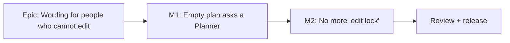

# Implementation Plan: Wording for people who cannot edit

- **Feature spec:** [./feature-spec.md](./feature-spec.md) (Approved)
- **Status:** Draft, awaiting approval before implementation.
- **Owner:** product owner; built by the **builder** agent

## Breakdown

### Epic

**Wording for people who cannot edit**: the empty plan names who can help, and every remaining sentence uses the
product's "editing" words. Copy polish, web only.

Both milestones are small and can ship as **one pull request with two commits**, or two pull requests. Default:
one pull request, one changeset.

### Milestone 1: The empty plan asks a Planner (rows 1 to 3)

**Outcome:** a Viewer or Contributor on an empty plan reads "Ask a Planner to add activities."
**Entry point:** open any plan with no activities as a Viewer or Contributor; the diagram's empty strip, under
the shaded **Draw the first activity** button.
**Journey:** `apps/web/e2e-edit/pen-auto.spec.ts`, test "a Viewer who opens a free plan does not take the pen"
(`:341`), gains the assertion.

#### Feature: the "ask" form of a schedule refusal

> **Description:** an optional `form: 'reason' | 'ask'` on `scheduleRefusal`, threaded through the model and
> the panel prop; the empty strip asks with `'add activities'`.
> **Complexity:** S
> **Dependencies:** none
> **Risks:** the ask form leaking into a pen state, telling a Planner to ask a Planner → the form is read only
> in the role branch, and a unit test pins both pen branches under `'ask'`.
> **Testing requirements:** unit (gating + panel), one journey assertion, toolbar journey string update.

##### Task 1.1: builder and seam (one commit)

- **Description:** add the form parameter (`plan-gating.ts:63-75`), pass it through `refuseSchedule`
  (`use-plan-workspace-model.ts:277-280`), widen the `TsldPanel` prop type (`TsldPanel.tsx:310`), and call
  `scheduleRefusal('add activities', 'ask')` at `TsldPanel.tsx:3590`. Update the panel prop's docblock to say
  the second argument is a sentence **shape**, never a policy.
- **Complexity:** S
- **Dependencies:** none
- **Risks:** see Feature.
- **Testing:**
  - `plan-gating.test.ts`: role refusal with `'ask'` → "Ask a Planner to add activities."; pen free and
    peer-held with `'ask'` → the same strings `penReason` gives; default form unchanged ("Your role cannot
    recalculate." at `:118` still passes).
  - `TsldPanel.mode-band.test.tsx:211-237`: "draw activities" → "add activities"; add a case where the host
    returns the ask sentence and the button's `aria-describedby` target holds it, visible (not `sr-only`).
  - `apps/web/e2e-toolbar/toolbar.spec.ts:45-47`: expect "This plan has no activities yet. Start editing to add
    activities."
  - `apps/web/e2e-edit/pen-auto.spec.ts:341-363`: assert the Viewer's empty strip contains "Ask a Planner to add
    activities." and **Draw the first activity** has that accessible description.
- **Development steps:**
  1. Change `plan-gating.ts`, the model callback, the panel prop and the call site.
  2. Update and add the unit tests; run `pnpm --filter @repo/web test`.
  3. Update the two journeys; run `scripts/e2e-local.sh web:toolbar` and `scripts/e2e-local.sh web:edit`
     (suite names to be confirmed against `apps/web/playwright*.config.ts`).

### Milestone 2: No more "edit lock" (rows 4 to 11)

**Outcome:** no user-visible sentence says "edit lock", "edit-lock", "editing lock" or "the pen"; the selection
bar names the colleague when one is editing.
**Entry point:** existing screens (selection bar, Make milestone, activity editor close, Members, overview,
programme recalculation). No new surface.
**Journey:** `apps/web/e2e-overview/overview.spec.ts:84` (row 10), updated.

#### Feature: replace the leftover wording

> **Description:** seven string sites, one of which becomes a call to the existing refusal builder.
> **Complexity:** S
> **Dependencies:** Task 1.1 only if both ship in one pull request (no code dependency).
> **Risks:** a string asserted somewhere not found by grep → `pnpm prepush` runs every unit suite; the journeys
> were grepped (spec section 3).
> **Testing requirements:** unit pins updated or added; one journey string; leftover grep.

##### Task 2.1: strings and the selection-bar gate (one commit)

- **Description:**
  - `use-plan-workspace-model.ts:1095-1099` → `reason: refuseSchedule('change this plan')` (rows 4, 4b, 5).
  - `use-plan-workspace-model.ts:2617` → row 6.
  - `lib/unsaved-work/report.ts:149, 152` → rows 7, 8.
  - `RolesPanel.tsx:28` → row 9.
  - `NeedsAttentionSection.tsx:71` → `lockCopy.holding` (row 10).
  - `ProgrammeScheduleSection.tsx:186-189` → row 11, keeping the singular/plural switch.
- **Complexity:** S
- **Dependencies:** none
- **Risks:** row 4b now depends on `penHolder`, so the selection bar's memo must list it → covered by the model
  test below.
- **Testing:**
  - Update `report.test.ts:98, 109`, `use-plan-workspace-model.make-milestone.test.ts:262`,
    `overview-screen.test.tsx:327`, and `ProgrammeScheduleSection.test.tsx` if it pins the 423 text.
  - New: a model-level test that the selection bar's gate reason is row 4, 4b or 5 for the three states.
  - Optional hygiene: `BulkSelectionBar.test.tsx` fixtures still say "Take the edit lock…"; they are passed-in
    strings, so they pass either way. Update them so nobody copies the old sentence from a test.
  - `apps/web/e2e-overview/overview.spec.ts:84` → "You're editing this plan." (mind the curly apostrophe the
    source uses).
  - Leftover grep (spec section 3) returns nothing.
- **Development steps:**
  1. Edit the strings; reuse `lockCopy` where the sentence already exists there.
  2. Update tests; `pnpm prepush`.
  3. `scripts/e2e-local.sh web:overview`.
  4. Changeset: **`@repo/web` patch** ("Clearer wording for people who cannot edit, and 'editing' everywhere
     instead of 'edit lock'"). Patch, not minor: no new capability, no new control.
  5. `docs/HANDOFF.md`: close item 3 and the "edit lock" bullet; keep the double-announcement bullet.

### Review and release

- **accessibility-reviewer, run in a browser, before release** (owner's standing rule for any change to what is
  announced): empty strip name and description by keyboard and screen reader; selection bar status line
  (`role="status"`) in its three states; Make milestone error; unsaved-work confirmation.
- **ux-reviewer**: the copy against `docs/UX_STANDARDS.md` "Content & tone" (`:266-278`).
- **component-reviewer**: the widened `scheduleRefusal` prop on `TsldPanel`.
- Not needed: database-architect (no schema), api-reviewer, security-reviewer, backend-performance-reviewer
  (no API or permission change).

## Sequencing and slices

M1 then M2, each leaving `main` releasable. No feature flag (ADR-0088 D1); rollback is the commit.

| Milestone                    | Size                               | Files touched (approx.)               |
| ---------------------------- | ---------------------------------- | ------------------------------------- |
| M1 Empty plan asks a Planner | S (about half a day with journeys) | 3 source, 2 unit test, 2 journey      |
| M2 No more "edit lock"       | S (about half a day)               | 6 source, 4 to 5 unit test, 1 journey |
| Review and release           | S                                  | browser a11y review, changeset        |

## Definition of Done (per task)

Each task satisfies the Feature Completion Criteria in [`docs/PROCESS.md`](../../PROCESS.md): code, tests (the
pre-push gate **run**, including the named e2e suites), docs, review, accessibility, CI green, changeset,
version impact (web patch).

## Risks and assumptions (rollup)

| Risk / assumption                                                                  | Likelihood | Impact | Mitigation                                                                                        |
| ---------------------------------------------------------------------------------- | ---------- | ------ | ------------------------------------------------------------------------------------------------- |
| "Ask a Planner" read as wrong in an organisation whose only editors are Org Admins | low        | low    | Roles panel says Org Admin does everything a Planner does (`RolesPanel.tsx:29`); owner question 1 |
| Ask form shown in a pen state                                                      | low        | med    | Form read only in the role branch; unit test pins both pen branches                               |
| An old sentence asserted somewhere grep missed                                     | low        | low    | Full unit run in `pnpm prepush`; the three journeys named                                         |
| A screen reader hears a changed sentence differently than expected                 | low        | med    | Browser accessibility review before release                                                       |
| API 423 text reaches the screen on a path not checked                              | low        | low    | API strings already say "editing"; no change needed either way                                    |
