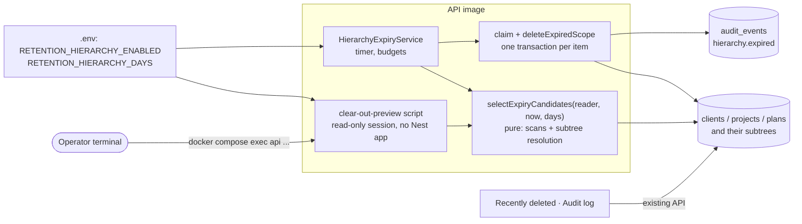
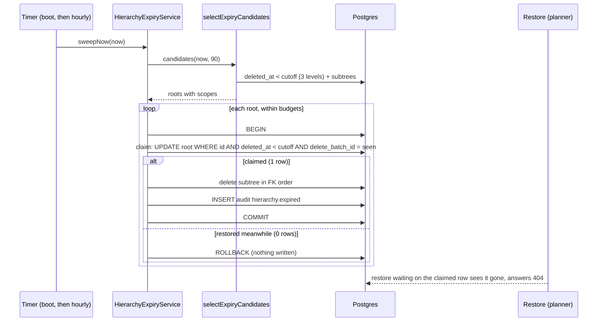
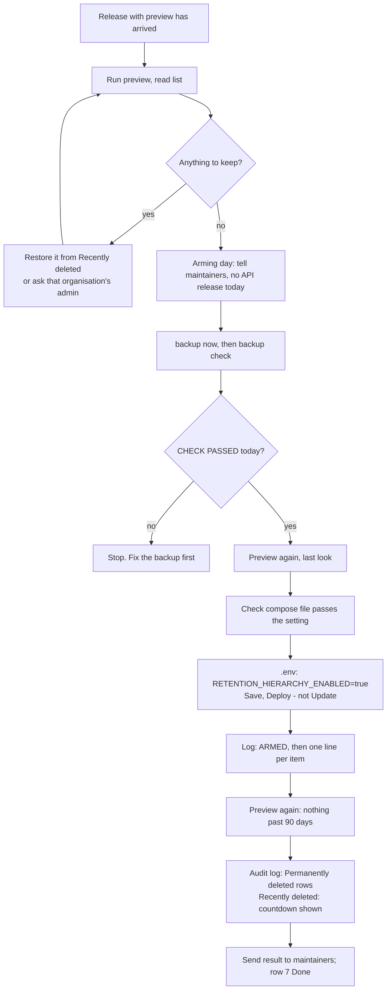

# Feature Spec: The recycle bin's 90-day clear-out, switched on and proven

- **Status:** Draft
- **Author(s):** feature-analyst, for the product owner
- **Date:** 2026-10-14
- **Tracking issue / epic:** pre-1.0 requirement (c), `docs/RELEASE_1_0.md` row 7. Required for 1.0 by the owner on
  2026-10-13 (`docs/DECISIONS.md`, entry "2026-10-13 — Pre-1.0 batch 2 is approved, and 1.0 requires backups, the
  organisation export and the clear-out").
- **Roadmap link:** the 1.0 entry in `docs/ROADMAP.md`.
- **Related ADR(s):** one **new** ADR proposed (§4.10; number taken at landing). It amends ADR-0096 D4 and D9. Cited:
  ADR-0072, ADR-0073, ADR-0076, ADR-0081, ADR-0085, ADR-0086, ADR-0087, ADR-0088 D1, ADR-0096, ADR-0105, ADR-0121,
  ADR-0131, ADR-0174 D8, ADR-0190, ADR-0192.

**Decided by the owner before this spec (not re-asked):** the clear-out is required for 1.0; switching on
`RETENTION_HIERARCHY_ENABLED` is an irreversible hard delete and **ships as its own release**, not alongside other
changes; the owner is non-technical and runs Docker Compose with Dockge and Watchtower auto-update, so every host step is
in plain English with a time; a same-day backup that passed `check` on the host is a precondition
(`docs/DEPLOYMENT.md:1279-1282`, ADR-0192 D8).

> **Evidence.** Every decision-bearing claim below names the file and line it was read from on 2026-10-14 in this
> working tree (branch `claude/1-0-handoff-verification-p0twtd`). Nothing was run: no test, no command, no query.
> Claims that need running are marked **[not measured]** and the plan owns them.

---

## 1. Business understanding

### Problem

`docs/RELEASE_1_0.md` row 7 says the clear-out is "built, switched off" and that the remaining work "is mostly turning
it on and proving it works" (`docs/RELEASE_1_0.md:47`). **The first half is true. The second half understates the
work**, for one reason the owner will feel directly: **there is no way today to see, before switching it on, what the
first run will permanently delete.**

#### What already exists (verified)

| Piece                                             | Where                                                                                                |
| ------------------------------------------------- | ---------------------------------------------------------------------------------------------------- |
| The sweep: an hourly timer plus a run at boot     | `apps/api/src/common/hierarchy/hierarchy-expiry.service.ts:123-146`                                  |
| No timer at all when switched off                 | `hierarchy-expiry.service.ts:124-129`                                                                |
| Candidate selection at all three levels           | `hierarchy-expiry.service.ts:184-290`                                                                |
| FK-safe permanent delete of a whole subtree       | `apps/api/src/common/hierarchy/hierarchy-expiry.runner.ts:79-225`                                    |
| One `hierarchy.expired` audit row per subtree     | `hierarchy-expiry.service.ts:314-341`, inside the deleting transaction                               |
| Two run budgets and a scan limit                  | `hierarchy-expiry.service.ts:26`, `:64`, `:74`                                                       |
| Overlap guard; permanent-failure escalation       | `hierarchy-expiry.service.ts:114`, `:162-176`, `:361-383`                                            |
| The switch: only `true`/`false`, default `false`  | `apps/api/src/config/env.validation.ts:221-223`; `.env.example:90`; `docker-compose.release.yml:153` |
| The period: 1 to 3650 days, default 90            | `env.validation.ts:205`; `docker-compose.release.yml:154`                                            |
| Unit tests of selection, budgets, failure, arming | `hierarchy-expiry.service.spec.ts:115-301`                                                           |
| Real-database tests of the delete order           | `apps/api/test/hierarchy-expiry.e2e-spec.ts:136-348`                                                 |
| Structural gates (no audit delete, no raw SQL…)   | `hierarchy-expiry.structural.spec.ts:58-228`                                                         |
| Countdown and rule on Recently deleted            | `apps/web/src/features/recently-deleted/components/RecentlyDeletedTable.tsx:226-243`, `:319-327`     |
| "Permanently deleted" rows in the audit log       | `apps/web/src/features/audit/model/audit-copy.ts:54`, `:169-182`                                     |
| Playwright journey with the switch on, 3650 days  | `apps/web/playwright.recently-deleted.config.ts:68-71`                                               |

#### What is genuinely missing

1. **A preview.** ADR-0096 D4 promised that "the countdown ships one release before the sweep arms" so the operator
   can see the blast radius (`docs/adr/0096-deleted-work-expires-and-purge-is-refused.md:75-84`). **That countdown is
   never shown while the switch is off.** `expirySentence` returns `null` when `active` is false
   (`apps/web/src/features/recently-deleted/model/expiry-copy.ts:36`), the rule sentence and the summary are withheld
   on the same condition (`RecentlyDeletedTable.tsx:319`, `expiry-copy.ts:59`), and the landing's "expiring" count is
   not even queried (`apps/api/src/modules/overview/overview.service.ts:136`). This was a deliberate honesty fix
   (ADR-0096 D11, `0096-…md:209-216`), and it is right for planners, but it removed the only preview D4 described.
   The screen also only shows one organisation at a time, and only to its members. So on the owner's server, **before
   switching on, nothing shows what the first run would delete**. `docs/DEPLOYMENT.md:1288-1293` says "there is no
   dry run" and then tells the operator to read a countdown that is not displayed.
2. **A race between restore and the clear-out.** The sweep picks its candidates first (`hierarchy-expiry.service.ts:196-235`)
   and deletes each one later, in its own transaction, **by id only** (`hierarchy-expiry.runner.ts:184-216`). Nothing
   re-checks inside that transaction that the item is still deleted and still past its period. A planner who restores
   a plan in the gap (seconds to tens of seconds on a large run: `hierarchy-expiry.service.ts:55-62` puts 2,000 scopes
   at about 20 s) has the **restored, live** plan permanently deleted, with a `hierarchy.expired` row saying it was
   expired. The restore side does not prevent it: `restoreBatch` reads the root, then updates by batch id
   (`hierarchy-lifecycle.service.ts:608`, `:631-639`), with no lock the sweep respects. What a restore that loses the
   race then answers (the controller re-reads the plan, `apps/api/src/modules/plans/plans.controller.ts:97-103`) was
   **not traced**; M1 pins it to a 404. **[not measured; read from code.]** Narrow, but it is the one failure this
   feature must not have.
3. **No real-database proof of the sweep itself.** The e2e suite drives `deleteExpiredScope` directly and says so
   (`hierarchy-expiry.e2e-spec.ts:24-26`). The selection (cutoff, three levels, skipping descendants), the persisted
   audit row and its redaction, and the boundary instant are proven only against a mocked Prisma
   (`hierarchy-expiry.service.spec.ts:43-65`). Nothing has ever run the **shipped image** with the switch on.
4. **The audit row loses one of its counts.** The sweep records `activityHistoryCount`
   (`hierarchy-expiry.service.ts:337`), and ADR-0096's amendment says it is reported (`0096-…md:295-300`), but the
   redactor's allowlist for `hierarchy.expired` does not contain it (`apps/api/src/modules/audit/audit-redactor.ts:92-101`),
   and `redactChanges` keeps only allowlisted fields (`audit-redactor.ts:272-277`). **[not measured; read from code.]**
5. **Recovering from a backup re-deletes what you recovered.** A copy taken before an item expired holds it as
   soft-deleted with its original deletion date. Restoring that copy (`docs/guides/back-up-and-restore.md:328-372`)
   and starting the API with the switch still on runs the sweep at boot (`hierarchy-expiry.service.ts:145`), which
   deletes it again within seconds. The restore guide does not say so.
6. **Planners are not warned at the moment they delete.** The delete confirmation cannot say the bin is time-limited
   (`docs/TECH_DEBT.md` #140). Harmless while the switch is off; a real gap the day it is on.
7. **Wrong statements in operator documents**, each of which tells the owner to rely on a preview that does not exist:
   `docs/DEPLOYMENT.md:1290-1293`; the comments at `docker-compose.release.yml:148-150` and the same block in
   `docker-compose.yml:97-107`; `.env.example:87-89`. And two stale citations in the 1.0 page: row 7 cites
   `docker-compose.release.yml:141` (that line is `RETENTION_MAIL_EVENTS_DAYS`; the switch is at `:153`) and
   `CLAUDE.md:613`/`:654` (the bullets now start at `:619` and `:658`).

Two things that are **not** missing, checked because a reader might expect them: the retention period is served to the
screen from the server rather than hard-coded (`apps/api/src/modules/recycle-bin/recycle-bin.service.ts:66-69`), and the
switch already refuses anything but `true`/`false` (`env.validation.spec.ts:201-221`).

### Users

| Who                                            | Need                                                                                                                                 |
| ---------------------------------------------- | ------------------------------------------------------------------------------------------------------------------------------------ |
| **Operator** (today: the owner; non-technical) | See exactly what would go **before** switching on; switch on safely; check it worked; know how to undo a mistake.                    |
| **Org Admin**                                  | Read "Permanently deleted" rows in the organisation's audit log (`audit:read` is Org Admin only, `org-permissions.spec.ts:159-171`). |
| **Planner** (and Org Admin)                    | Be told when deleting that the bin keeps things for 90 days; see the countdown; restore in time.                                     |
| **Contributor, Viewer**                        | See the rule and countdown on Recently deleted (any member may read it, `recycle-bin.service.ts:34-36`). Cannot restore.             |
| **External Guest**                             | Nothing. A guest link to a plan that expires stops working, as it does today when the plan is deleted.                               |

### Primary use cases

1. **Preview:** the operator runs one command and reads, in plain words, every deleted client, project and plan on the
   server that would be permanently removed if the switch were on now, with what goes with each, and what falls due in
   the next 7 days.
2. **Keep something:** the operator (or that organisation's admin) restores it from Recently deleted before switching on.
3. **Switch on:** on a day with a fresh checked backup, the operator sets one line in the stack's `.env` and redeploys.
4. **Confirm:** the operator sees the "ARMED" log line, the removals, an empty preview and "Permanently deleted" rows.
5. **Keep checking:** the same preview, run any time later, shows anything overdue (a removal that keeps failing).
6. **Undo a mistake:** switch off, restore the last good copy, restore the item from the bin, switch on again.

### User journeys

- **Happy path (owner):** M1–M4 arrive by Watchtower → preview → restore anything to keep → arming day: copy now,
  `check`, preview again, set the switch, Deploy, watch the log, preview again, look at the audit log. See §4.3.
- **Planner after switch-on:** deletes a plan → the confirmation says it is kept 90 days → Recently deleted shows
  "Expires in 90 days" → restores it on day 30, or it is removed on day 90 and the audit log says so.
- **Mistake:** the owner finds something was removed that should not have been → follows the guide: switch off,
  restore the copy from before it went (losing later work), restore the item from the bin, switch on.

### Expected outcomes

- `docs/RELEASE_1_0.md` row 7 can move to **Done**, with the date it was switched on and what the first run removed.
- The bin stops growing forever on the owner's server; what is in it is honestly counted down.
- No item is permanently deleted that its owner restored, even at the same instant.

### Success criteria

1. **Preview equals sweep.** For the same instant, the set of items the preview lists is the set the sweep deletes.
   Proven by a test that runs both on one real database (plan M1).
2. **The preview cannot delete.** It runs on a read-only database session, never starts the API application, and a
   structural gate pins both (M1).
3. **A restored item is never deleted.** Proven on a real database for both orders of the race (M1).
4. **The shipped image, switched on, removes an overdue subtree on its first run** and writes the audit row; proven
   in CI on the real image and compose file, including on a database restored from a copy (M2).
5. **The owner switched it on**, on their server, after a same-day `CHECK PASSED`, and recorded the preview before and
   after (M5). Row 7 cites that record.

### Open questions

**Critical** (answers change scope or the arming mechanism) — each has a recommended default; see §6:

- **Q1** How it is switched on: a setting on the server (recommended) or a new default in a release.
- **Q2** How the preview is delivered: a command the owner runs in a terminal (recommended).
- **Q3** Whether the delete confirmation must warn planners before switch-on (`#140`; recommended: yes, M3).
- **Q4** Whether other organisations on the server need notice before switch-on.

**Defaults for the rest** (not asked):

- The period stays **90 days**. The owner's requirement says 90 (`docs/RELEASE_1_0.md:47`).
- **No `VITE_*` flag** (ADR-0088 D1). The only switch is the existing server setting.
- The shipped default for **new** installations stays `false` (follows from Q1's default).
- The preview command is **not** part of the 1.0 promise (ADR-0190 lists API routes, file formats and settings; an
  operator command's wording may change). The setting `RETENTION_HIERARCHY_ENABLED` already is.
- No alert webhook for a removal that keeps failing. The preview shows it as **overdue**, and the owner's alerts are
  parked (`docs/DECISIONS.md:49-65`).
- `docs/TECH_DEBT.md` #141 (per-organisation fairness of the run budget) stays open: one organisation in practice.

---

## 2. Functional requirements

### User stories & acceptance criteria

> **US-1 — See what would go, before switching on.** As the operator, I want one command that lists everything the
> clear-out would remove now, so that I can keep anything that matters before the first run deletes it.
>
> - **Given** the switch is off **when** I run the preview **then** it prints, grouped by organisation, each deleted
>   client, project or plan that is past the period: its kind, name, the date it was deleted, how many days past, and
>   what goes with it (projects, plans, activities); then a second list of what falls due in the next 7 days; then
>   totals.
> - **Given** nothing is past the period **then** it says so in one sentence and exits 0.
> - It states, first, whether the clear-out is **on or off on this server** and the period it used, read from the same
>   setting the API reads, so the owner also learns whether their compose file passes the setting through.
> - **Given** the switch is on **when** I run it **then** the same list is "still waiting to be removed", and any item
>   past its period by more than one day plus one interval is marked **OVERDUE**, with one sentence telling me to send
>   the output to the maintainers.
> - **Given** more than 200 items are due **then** it prints the first 200 by deletion date and the totals for all of
>   them, and says how many runs the first removal will take (the 2,000-deletions-per-run budget).
> - It is read-only: it never starts the API application, its database session refuses writes, and running it with
>   the switch on removes nothing.
> - It prints customer names to the terminal only, never to the log.

> **US-2 — A restored item is never removed.** As a planner, I want a restore to win against the clear-out, so that
> work I brought back is not destroyed in the same minute.
>
> - **Given** an item was picked as a candidate **when** it is restored before its deletion transaction starts **then**
>   that transaction removes nothing and writes no `hierarchy.expired` row, and the next item proceeds.
> - **Given** the deletion transaction has claimed the item **when** a restore of it arrives **then** the restore waits
>   and then answers **404 "no longer in Recently deleted"**, never 200 with nothing restored.
> - **Given** an item was restored and deleted again within the gap **then** its new deletion date makes it ineligible
>   and it is not removed.

> **US-3 — Proof on a real database and the real image.** As a maintainer, I want the sweep proven end to end, so that
> "switched on" rests on evidence rather than on reading.
>
> - The selection, the boundary instant, the persisted and redacted audit row, its readability by an Org Admin (and not
>   a Planner), and the restore race are proven against Postgres (M1).
> - The built API image, armed through the release compose file, removes a back-dated subtree on boot, logs
>   `hierarchy_expiry.armed` and `hierarchy_expiry.batch`, writes the row, and leaves the preview empty (M2).
> - The same holds on a database produced by `backup restore` (M2).

> **US-4 — Switch on safely.** As the operator, I want a short guide that switches it on with no surprises.
>
> - The guide refuses to proceed (in words) without a same-day `CHECK PASSED`, a preview read that day, and the
>   compose file passing the setting through.
> - Switching on is one `.env` line and a **Deploy** (not **Update**), so no new version arrives in the same step.
> - The guide says plainly that switching off again brings nothing back.

> **US-5 — Know it worked.** As the operator, I want to see, without a database tool, that it ran.
>
> - The API log shows `hierarchy expiry ARMED` once per start, and one `expired a deleted subtree` line per item.
> - The preview, run again, shows nothing past the period (or the backlog still being worked through).
> - The organisation's audit log shows one "Permanently deleted" row per item, actor System, with its counts.
> - Recently deleted now shows "Deleted items are kept for 90 days, then permanently removed" and a countdown per row.

> **US-6 — Undo a mistake.** As the operator, I want to recover a removed item from a backup without it being removed
> again.
>
> - The restore guide tells me to switch the clear-out **off before** starting SchedulePoint after a restore, to restore
>   the item from Recently deleted, and only then to switch it back on.
> - It says what a full restore costs: all work since the copy.

> **US-7 — Warned at deletion (if Q3 = yes).** As a planner, I want the delete confirmation to tell me the item is kept
> for 90 days, so that I decide knowing it is not forever.
>
> - **Given** the switch is on **then** every delete confirmation states the period from the server.
> - **Given** it is off **then** the sentence is exactly today's (no limit is claimed that is not true).

### Workflows

1. **Preview (operator):** in the stack folder, `docker compose exec api node dist/cli/clear-out-preview.js` (final
   name fixed in M1). The script reads `DATABASE_URL`, `RETENTION_HIERARCHY_DAYS` and `RETENTION_HIERARCHY_ENABLED` from
   the container's environment, opens one read-only session, calls the **same** candidate selector the sweep uses with
   `now`, and prints. If the API is down, `docker compose run --rm --no-deps api node dist/cli/clear-out-preview.js`
   runs it without starting the server.
2. **Sweep (unchanged schedule):** boot and every `RETENTION_SWEEP_INTERVAL_MINUTES`. For each candidate, one
   transaction: **claim** the root (re-assert deleted, past the cutoff, same deletion batch, under a row lock), then
   delete the subtree, then write the audit row. A failed claim skips the item silently except for a debug log.
3. **Switch on (operator):** §4.3 and plan M5.

### Edge cases

- **Exactly at the period.** The cutoff is `now − days × 86,400,000 ms` and the test is strictly older
  (`hierarchy-expiry.service.ts:185`, `:198`). Deleted at exactly the cutoff instant: kept; one millisecond older:
  removed. The screen's countdown uses the same millisecond arithmetic (`expiry-copy.ts:14-24`).
- **Time zones and clock changes.** Both sides work in UTC milliseconds; no calendar day is involved, so a clock change
  (for example 2026-10-25 in the UK) moves the local wall-clock time of a removal by one hour and changes nothing else.
  "90 days" means 90 × 24 hours from the moment of deletion. Pinned by a test run under `TZ=Europe/London` (M1).
- **The first run is at boot**, not an hour later (`hierarchy-expiry.service.ts:145`), and is bounded by 2,000
  deletions and 20,000 activity-equivalents (`:26`, `:64`); a larger backlog takes several hourly runs. The preview
  says how many.
- **Large single item.** One subtree cannot be split; a 200,000-activity client is about 12 s in one transaction
  (`hierarchy-expiry.service.ts:21-24`). Unchanged.
- **Item in an organisation the operator cannot open.** The preview still lists it (the operator already has database
  access, `docs/DEPLOYMENT.md:1406-1408`); keeping it needs that organisation's admin to restore it (Q4).
- **Switch on, then off, then on.** Off creates no timer (`hierarchy-expiry.service.ts:124-129`); on again resumes from
  whatever is past the period. Nothing that went comes back.
- **Period changed later.** Raising it reprieves everything not yet removed; lowering it brings removals forward
  (`.env.example:82-85`). The guide tells the owner not to change it.
- **Two API containers.** Not a supported shape; the overlap guard is per process (`hierarchy-expiry.service.ts:114`).
  The claim step (US-2) also makes a second process's attempt on the same item a no-op.
- **A cross-plan link into a removed plan.** The surviving plan still recalculates (proven,
  `hierarchy-expiry.e2e-spec.ts:298-348`).
- **Restored database.** Items past the period in the copy are removed at the next armed boot (US-6).
- **The preview run while a sweep is mid-run.** It may list an item the sweep removes a second later. Stated in its
  output ("as of HH:MM UTC").

### Permissions

- **Preview:** no application permission at all; it is not reachable over HTTP. Whoever can run `docker compose exec`
  on the server can run it — the same bar as `psql`, which already reads everything (`docs/DEPLOYMENT.md:1406-1408`).
  The staff console is **not** used (ADR-0096 D9, ADR-0086 unchanged).
- **The sweep:** acts as `SYSTEM`; it is a provider no other module can inject (`hierarchy.module.ts:13-21`,
  `hierarchy-expiry.structural.spec.ts:207-228`). Unchanged.
- **Reading the audit row:** `audit:read`, Org Admin only (`org-permissions.spec.ts:159-171`), organisation-scoped.
- **Restoring from the bin:** unchanged — the existing per-entity restore endpoints, writer roles only.
- **Delete confirmation (US-7):** the retention fields ride on an authenticated, organisation-scoped response every
  member already reads; no new route and nothing on the public `/version` (`docs/TECH_DEBT.md` #140).
- **The pen (ADR-0028):** not involved. The sweep does not edit a plan anyone can hold; plan locks are removed by
  cascade (`hierarchy-expiry.runner.ts:182-183`).

### Validation rules

- `RETENTION_HIERARCHY_ENABLED`: exactly `true` or `false`, else the API refuses to start (`env.validation.ts:221-223`).
  Unchanged. The preview validates with the **same schema** so it can never disagree with the API about the setting.
- `RETENTION_HIERARCHY_DAYS`: whole number 1 to 3650 (`env.validation.ts:205`). Unchanged.
- The preview takes **no arguments** that change what is selected. (A `--days` option would let it preview a period
  the API is not using, which is a second answer to "what will go".)

### Error scenarios

| Scenario                                     | Detection                           | What the operator sees                                     | Result |
| -------------------------------------------- | ----------------------------------- | ---------------------------------------------------------- | ------ |
| Preview cannot reach the database            | connection error                    | one plain sentence, "could not reach the database", exit 1 | exit 1 |
| Setting invalid in `.env`                    | shared env schema                   | same message the API would print, exit 2                   | exit 2 |
| Preview attempts a write (a bug)             | read-only session                   | Postgres refuses; script exits non-zero; nothing changed   | exit 1 |
| Item restored between selection and deletion | claim count is 0                    | nothing; debug log `hierarchy_expiry.skipped_restored`     | —      |
| Restore loses the race to a claimed deletion | restore finds nothing to restore    | planner sees "no longer in Recently deleted"               | 404    |
| A subtree can never be removed (FK, size)    | existing escalation (`:361-377`)    | ERROR log; preview marks it **OVERDUE**                    | —      |
| Switch set but compose file does not pass it | `hierarchy_expiry.disabled` at boot | preview's first line says "OFF on this server"; guide step | —      |

---

## 3. Technical analysis

| Area           | Impact | Notes                                                                                                                                                                                                                   |
| -------------- | ------ | ----------------------------------------------------------------------------------------------------------------------------------------------------------------------------------------------------------------------- |
| Frontend       | low    | Only if Q3 = yes: one shared delete-confirmation sentence (`features/recently-deleted/model/delete-copy.ts`, per #140) gated on a served flag. No new screen, route or component.                                       |
| Backend        | med    | Extract the candidate selector from `HierarchyExpiryService.sweep` into one pure function both the sweep and the preview call. Add the claim step. Add the preview script. Enrich the disabled boot log with counts.    |
| Database       | none   | No schema change, no migration, no index. The claim is an ordinary `updateMany` on the root row. The scans use ADR-0096 D6's existing indexes (`0096-…md:100-113`).                                                     |
| API            | low    | No new route. Restore answers 404 when it restored nothing (US-2). If Q3 = yes: two fields added to an existing authenticated response; `docs/API.md` updated.                                                          |
| Security       | med    | A host command that prints customer names: same bar as `psql`; terminal only; read-only session; cannot boot the app; structural gates. No staff-console widening.                                                      |
| Performance    | low    | Preview: one scan per level plus one count per root, an operator command run a few times. Boot log: three indexed counts at start (~1 ms each with nothing due, `0096-…md:104-106`). Claim adds one statement per item. |
| Infrastructure | low    | Script ships in the existing image (`apps/api/Dockerfile:59` copies `dist`). CI `image` job gains an armed-expiry step. No compose service, no new setting.                                                             |
| Observability  | low    | New debug event for a skipped item; `hierarchy_expiry.disabled` gains counts. No metric.                                                                                                                                |
| Testing        | high   | The point of the epic: real-database selection, boundary, race, audit row; preview-equals-sweep; armed image; restored database.                                                                                        |

**Recalculation parity.** No new scheduling input; the engine is not imported. `computeSchedule` is untouched and so
byte-identical by construction. The one schedule-adjacent effect (a surviving downstream plan losing a cross-plan
predecessor) is already proven (`hierarchy-expiry.e2e-spec.ts:298-348`).

**Flags.** None, per ADR-0088 D1. The control is the existing server setting, which is a real runtime switch
(`docs/DEPLOYMENT.md:748-753`).

**ADR-0105 triggers crossed** (so this spec is mandatory, not a register row): a **CI step** (M2), a new **operator
entry point** (the preview command), and, if Q3 = yes, a change to an **API response contract**. No schema change, so
the database-architect is **not** required; if any milestone finds it needs one (for example an index for the preview
on a large backlog), it stops and goes to the database-architect first (CLAUDE.md §19.3).

### Dependencies

- **Database backup (ADR-0192) live on the owner's server**, and the owner's practice `CHECK PASSED` recorded
  (`docs/RELEASE_1_0.md:45`). The owner has **not** done these host steps yet. M1–M4 can land before; M5 cannot.
- PR #989 (the `docs/DEPLOYMENT.md` "Backups" and precondition text) merged before M4 edits the same section.
- No dependency on the organisation-export spec.

---

## 4. Solution design

### 4.1 Architecture overview

One selector, two callers. The sweep keeps its budgets and its transaction; the preview reads only.

### 4.2 Data flow

### 4.3 User flow (the owner's arming day)

### 4.4 Database changes

**None.** No model, column, index, constraint or data migration. The claim step is an `updateMany` on the root row
with an equality on `delete_batch_id` and the existing `deleted_at` predicate; it writes the same value back, so its
only effects are the row lock and the count. Because the row is deleted in the same transaction, the `updated_at` that
Prisma sets is never visible. If it is rolled back, nothing changed.

### 4.5 API changes

- **Restore endpoints** (`POST …/clients|projects|plans/:id/restore`): when the batch update restores zero root rows,
  answer `404` with the existing not-found envelope ("no longer in Recently deleted") instead of 200. Today this can
  only happen in the race (US-2). `docs/API.md` notes it.
- **If Q3 = yes:** carry `retentionActive` and `retentionDays` on an existing authenticated, organisation-scoped
  response the shell already reads (the remedy `docs/TECH_DEBT.md` #140 names; the exact response is chosen in M3 with
  the api-reviewer). Additive, so not breaking. Never on `/version` (`@Public()`).
- No new route. The sweep stays unreachable over HTTP.

### 4.6 Component changes

- None for M1–M2. The preview is a terminal command; its output format is specified in plan M1.
- **If Q3 = yes:** the one shared delete sentence (`features/recently-deleted/model/delete-copy.ts`, per #140) gains a
  clause for an armed host, e.g. "You can restore it from Recently deleted for 90 days." All five confirmations already
  read it, so no dialog changes shape.

### 4.7 Implementation approach and alternatives

#### The preview (question 2 in the brief)

| Option                                                  | Shows names? | All organisations? | Owner effort                 | Verdict                                                                                                                                                                                         |
| ------------------------------------------------------- | ------------ | ------------------ | ---------------------------- | ----------------------------------------------------------------------------------------------------------------------------------------------------------------------------------------------- |
| **A. Read-only command in the API image** (recommended) | yes          | yes                | one command, as for `backup` | Same bar as `psql`. Same selector as the sweep, so it cannot disagree. Works with the API down.                                                                                                 |
| B. Log line at boot listing what is due                 | counts only  | yes                | read logs in Dockge          | Names in logs would persist in the 30 MB rotated log (`docker-compose.release.yml:92-96`). **Kept as a supplement**: counts only, on the `disabled` line, so the owner sees a number in Dockge. |
| C. Staff console panel                                  | no           | yes                | a page                       | Refused by ADR-0096 D9 and ADR-0086: staff cannot reach customer data, by construction (`0096-…md:137-143`). A counts-only diagnostic (ADR-0140) is possible but cannot name anything.          |
| D. Show the countdown on Recently deleted while off     | yes          | **no**             | open each organisation       | Shows every member a removal date that is not going to happen, which D11 removed for good reason (`expiry-copy.ts:26-29`). Per organisation only.                                               |
| E. A `--dry-run` mode of the API itself                 | yes          | yes                | restart with a flag          | Boots the whole application next to a timer that deletes. One mistyped value away from the real thing.                                                                                          |

**Recommendation: A, with B's count.** A gives the owner exactly what will go, in every organisation, from the code that
will do it. The safety argument rests on three properties, each pinned by a gate rather than a habit:

1. **One derivation** (ADR-0121's rule): the selector is extracted from `sweep()` (`hierarchy-expiry.service.ts:184-290`)
   and both callers use it; a test asserts preview set == sweep set on one database.
2. **It cannot start the application.** Booting `AppModule` would construct `HierarchyExpiryService`, and with the
   switch on its `onApplicationBootstrap` would start a **second** sweep in the preview's process
   (`hierarchy-expiry.service.ts:123-146`), outside the per-process overlap guard. So the script uses a bare
   `PrismaClient`, and a structural test forbids it importing `AppModule`, `@nestjs/core`, `HierarchyExpiryService`,
   `deleteExpiredScope`, or any `delete`/`update`/`create`/`$transaction` call.
3. **Its session refuses writes**, set as its first statement (a constant), with a test that a write through it fails.

#### What "switched on" means (question 3 in the brief)

| Option                                                                                  | Verdict                                                                                                                                                                                                                                                                                                                                                                   |
| --------------------------------------------------------------------------------------- | ------------------------------------------------------------------------------------------------------------------------------------------------------------------------------------------------------------------------------------------------------------------------------------------------------------------------------------------------------------------------- |
| **Host setting**: owner sets `RETENTION_HIERARCHY_ENABLED=true` in `.env` (recommended) | Arms one server, on a day the owner chooses, after the owner's own preview and same-day `check`. Reversible to "off" in three minutes (it never brings anything back). The image stays the same, so an image rollback stays meaningful.                                                                                                                                   |
| Release flips the default to `true`                                                     | Watchtower pulls it within minutes (`docs/DEPLOYMENT.md:827-836`) and **arms every server that has not set the line**, at an hour nobody chose, with no preview and no same-day check — the ADR-0192 D8 precondition becomes unenforceable. Changes a 1.0-promised setting's meaning (ADR-0190, `RELEASE_1_0.md:99`). Rolling the image back afterwards restores nothing. |

**Recommendation: the host setting, with the shipped default left `false`.** This meets the owner's "its own release"
decision in its strongest form: **on arming day nothing else changes** — no image, no migration, no code. The plan
makes that literal: the maintainers do not release the API that day (M5 step 1), and the owner uses **Deploy**, which
recreates from the image already on the server, not **Update**, which pulls (`docs/DEPLOYMENT.md:807-817`). Q1 asks the
owner to confirm this reading.

#### The race fix

Re-assert eligibility **inside** the deleting transaction, under the root's row lock, before anything is deleted:
`updateMany({ where: { id, deletedAt: { lt: cutoff }, deleteBatchId: seen }, data: { deleteBatchId: seen } })`, abort
when the count is 0. Both the restore and the expiry take the root row first, so they cannot deadlock; whichever is
second waits and then sees the other's result (Postgres READ COMMITTED re-evaluates an `UPDATE`'s predicate after the
wait). Rejected: `SELECT … FOR UPDATE` (raw SQL is forbidden in this directory, `hierarchy-expiry.structural.spec.ts:72-81`);
a serializable transaction (retries on unrelated conflicts in a 12 s transaction).

### 4.8 What "proven" means

| #   | Proof                                                                                                                       | Exists?       | Where                                        |
| --- | --------------------------------------------------------------------------------------------------------------------------- | ------------- | -------------------------------------------- |
| P1  | FK order with unstamped tables, WBS depth, org calendar kept, cross-plan survivor recalculates                              | yes           | `hierarchy-expiry.e2e-spec.ts:136-348`       |
| P2  | Arming, selection, budgets, overlap, escalation (mocked database)                                                           | yes           | `hierarchy-expiry.service.spec.ts:115-301`   |
| P3  | Gates: no audit delete, no raw SQL, ownership scope, order, census, not exported                                            | yes           | `hierarchy-expiry.structural.spec.ts:58-228` |
| P4  | Switch accepts only `true`/`false`                                                                                          | yes           | `env.validation.spec.ts:201-221`             |
| P5  | `sweepNow` on a real database: three levels, descendants skipped, live siblings untouched, audit row persisted and redacted | **add, M1**   | e2e                                          |
| P6  | Boundary: at the cutoff kept, 1 ms older removed, identical under `TZ=Europe/London` across 2026-10-25                      | **add, M1**   | e2e + web unit for the countdown             |
| P7  | Race, both orders; restore answers 404 when it restored nothing                                                             | **add, M1**   | e2e                                          |
| P8  | Preview set == sweep set; preview read-only; preview cannot boot the app                                                    | **add, M1**   | e2e + structural                             |
| P9  | `hierarchy.expired` row carries `activityHistoryCount`; Org Admin reads it via the audit API, Planner cannot                | **add, M1**   | e2e                                          |
| P10 | Shipped image, armed via the release compose file, removes a back-dated subtree at boot, logs, audit row, preview empty     | **add, M2**   | CI `image` job                               |
| P11 | Restored-from-copy database: armed boot re-removes the item; disarmed boot leaves it restorable                             | **add, M2**   | CI `image` job                               |
| P12 | Owner: preview before and after, `ARMED` line, audit rows, countdown visible                                                | **owner, M5** | recorded in `docs/DECISIONS.md` and row 7    |

**How the owner checks it, in plain English** (the guide's wording, plan M4): "Open Dockge, open the SchedulePoint
stack, click the `api` box and read its log. You should see a yellow line saying `hierarchy expiry ARMED` and then one
line saying `expired a deleted subtree` for each item the list showed. Then run the preview again: it should say
nothing is waiting. Then sign in, open your organisation's **Audit log**: each removed item has a row 'Permanently
deleted' by **System**. Last, open **Recently deleted**: the page now says items are kept for 90 days, and each row
shows how many days it has left."

### 4.9 Backups and privacy — said plainly

**"Permanently removed" means removed from the live database. It does not mean removed from the backups.**

- Nightly copies are kept 30 days (`BACKUP_KEEP_DAYS`, `docs/DEPLOYMENT.md:1127-1130`), so a removed item stays in
  copies for **at least 30 days after it is removed**.
- **And sometimes far longer.** Pruning never deletes the newest copy of each kind
  (`apps/api/backup/schedulepoint-backup.sh:402-410`; ADR-0192 Consequences, `0192-…md:117-121`). The newest
  "before an update" copy can be months old if no release has changed the database since, and still holds everything
  as it was then. A restore also keeps the old database as `<db>_before_restore_…` until someone drops it by hand
  (`docs/DEPLOYMENT.md:1189-1190`).
- The `hierarchy.expired` row keeps the item's **name** forever: the audit table refuses deletion (ADR-0085 D1;
  `docs/DEPLOYMENT.md:1299-1302`).
- So a request to erase a client's data completely needs the live removal **and** deleting or waiting out the copies.
  That is ADR-0085's territory and is not built here; the guide and `docs/DEPLOYMENT.md` state it.

The converse is the safety net: for at least 30 days after an item is removed, a copy can bring it back — at the cost
of all work done since that copy (US-6).

### 4.10 ADR (required — outline)

The preview replaces a mechanism an accepted ADR describes (ADR-0096 D4), and the arming is decided as a host act for
1.0. Both are hard to reverse once the owner has armed. Proposed title: **"A permanent delete is previewed by the
code that performs it, and arming is a host act."**

- **Context:** D4's countdown is withheld while off (`expiry-copy.ts:36`), so no preview existed; the restore race;
  1.0 requires the clear-out.
- **D1** The preview is a read-only command in the API image that calls the sweep's own selector; it cannot boot the
  application. Amends ADR-0096 D4 ("the countdown is the preview").
- **D2** Arming is the operator's `.env` setting; the shipped default stays `false` at 1.0. Rejected: flipping the
  default (arms every Watchtower host unseen).
- **D3** Eligibility is re-asserted inside the deleting transaction under the root's row lock; a restore that finds
  nothing answers 404.
- **D4** ADR-0096 D9 is unchanged: no staff-console view; the operator's bar is the host shell.
- **D5** Expired data persists in backups for at least `BACKUP_KEEP_DAYS`, longer in the never-pruned newest copies.
- **Consequences:** the 1.0 row is met on the owner's host; a fresh installation is not armed by default.

---

## 5. Links

- Implementation plan: [`./implementation-plan.md`](./implementation-plan.md)
- Prior art: [`docs/specs/recently-deleted/`](../recently-deleted/feature-spec.md) (ADR-0096),
  [`docs/specs/retention-sweep/`](../retention-sweep/feature-spec.md) (ADR-0087),
  [`docs/specs/database-backup/`](../database-backup/feature-spec.md) (ADR-0192).
- Docs this changes (plan M4): `docs/guides/switch-on-the-clear-out.md` (new), `docs/guides/back-up-and-restore.md`
  Part 3, `docs/DEPLOYMENT.md` "Deleted work", `docker-compose.release.yml` and `docker-compose.yml` comments,
  `.env.example`, `docs/RELEASE_1_0.md` row 7, `CLAUDE.md` §16 (one ADR line) and §17, `docs/API.md`,
  `docs/TECH_DEBT.md` #140.

## 6. Critical questions for the owner

1. **Q1 — How is it switched on?** Recommended: **you set one line in your server's settings on a day you choose**;
   the version we ship keeps it off by default, so nothing switches on by itself. On that day no new version of
   SchedulePoint is released, so the switch is the only change — that is how we read "its own release". The
   alternative (a release that switches it on everywhere) would arrive by Watchtower at a time nobody picked, before
   you had looked at the list. **Default if you do not answer: the setting.**
2. **Q2 — How do you see the list beforehand?** Recommended: **one command you type in the server's terminal**, the
   same way as the backup check (about 5 minutes), which prints every item that would go, by organisation, with what
   goes with it. **Default: the command.**
3. **Q3 — Should the delete confirmation tell planners about the 90 days before you switch on?** Recommended: **yes**,
   one small release before switch-on (plan M3), so nobody deletes something on switch-on day without being told.
   **Default: yes.**
4. **Q4 — Are there organisations on your server whose people you cannot easily contact?** If there are, they get two
   weeks' notice before switch-on and their admin decides what to restore. **Default: there are none; you can see or
   ask about everything the list shows.**
