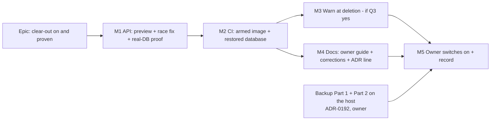

# Implementation Plan: The recycle bin's 90-day clear-out, switched on and proven

- **Feature spec:** [`./feature-spec.md`](./feature-spec.md)
- **Status:** Draft
- **Owner:** product owner (approval, host steps M5); maintainers (M1–M4)

## Breakdown



### Epic

**The recycle bin's 90-day clear-out, switched on and proven** — pre-1.0 requirement (c), `docs/RELEASE_1_0.md` row 7.

Each milestone M1–M4 is one pull request that keeps `main` releasable. None changes the shipped default, so none can
delete anything on any server. **Only M5 deletes, and M5 is a setting the owner changes, not a release.**

---

### Milestone M1: A preview that cannot delete, a sweep that cannot take a restored item, and real-database proof

**Outcome:** the operator can list exactly what the clear-out would remove; the sweep re-checks each item inside its
transaction; the sweep is proven end to end on Postgres.
**Entry point:** operator command `docker compose exec api node dist/cli/clear-out-preview.js` (name fixed here), run
in the stack folder. Not reachable from the web app by design.
**Journey:** the operator-surface analogue of ADR-0081's journey is M2's CI step, which runs this command against the
**built image**; M1 proves it against a real database in the API e2e suite.

#### Feature: one selector, two callers

> **Description:** extract candidate selection from `HierarchyExpiryService.sweep`
> (`hierarchy-expiry.service.ts:184-290`) into a pure function both the sweep and the preview call.
> **Complexity:** M
> **Dependencies:** none
> **Risks:** a behaviour change hidden in a refactor → the existing service unit suite must pass unchanged before
> anything else in M1 lands (it is the characterisation test).
> **Testing requirements:** existing `hierarchy-expiry.service.spec.ts` green and unmodified in its assertions; new
> unit tests of the selector's ordering and skip rules.

##### Task M1-T1 — Extract `selectExpiryCandidates`

- **Description:** new `apps/api/src/common/hierarchy/hierarchy-expiry.candidates.ts`, taking a read-only Prisma
  surface, `now`, `retentionDays` and a per-level scan limit, returning ordered roots with resolved scopes (client →
  projects → plans) and the descendant-skip rule. The service keeps its budgets and loop; it calls the selector.
- **Complexity:** M
- **Dependencies:** —
- **Risks:** the descendant subtree lookups currently run lazily inside the budgeted loop
  (`hierarchy-expiry.service.ts:243-254`, `:267-270`); resolving them all up front would do work the budget would
  never spend → return roots eagerly and resolve scopes lazily (an iterator or a `resolveScope(root)` function).
- **Testing:** service spec unchanged; new selector unit tests.
- **Development steps:**
  1. Move the three scans and the two skip sets into the new file; keep `CANDIDATE_SCAN_LIMIT` at the call site.
  2. Add `resolveScope(root)` for the subtree lookups.
  3. Keep the file free of `deleteMany`, `$transaction`, `update*` and `create*`; extend
     `hierarchy-expiry.structural.spec.ts` to pin that.

#### Feature: the claim step (race fix)

> **Description:** inside each deleting transaction, before any delete, claim the root by
> `updateMany({ where: { id, deletedAt: { lt: cutoff }, deleteBatchId: seen }, data: { deleteBatchId: seen } })`; on a
> count of 0, roll back with no audit row and log `hierarchy_expiry.skipped_restored` at debug. The restore path
> answers 404 when its root update restores nothing.
> **Complexity:** M
> **Dependencies:** M1-T1
> **Risks:** a deadlock between restore and expiry → both take the root row first; the e2e test drives both orders
> with two real transactions. A restore counting zeros that some caller treats as success → assert the 404 at the HTTP
> level for client, project and plan.
> **Testing requirements:** e2e on Postgres (P7 in spec §4.8).

##### Task M1-T2 — Claim in the runner; 404 on an empty restore

- **Description:** add `claimExpiredRoot(tx, kind, id, cutoff, deleteBatchId)` to `hierarchy-expiry.runner.ts` and call
  it first in `expireScope` (`hierarchy-expiry.service.ts:305-307`). In `HierarchyLifecycleService.restoreBatch`, throw
  the existing `NotFoundError` when the root's own update counted 0 (`hierarchy-lifecycle.service.ts:631-639`).
- **Complexity:** M
- **Dependencies:** M1-T1
- **Risks:** the structural order assertion (`hierarchy-expiry.structural.spec.ts:90-116`) matches `deleteMany` only,
  so an `updateMany` does not disturb it; confirm and say so in the test's comment.
- **Testing:**
  1. Restore committed between selection and the transaction → nothing deleted, no `hierarchy.expired` row.
  2. Expiry transaction holds the claim while a restore runs → restore answers 404; subtree gone; one audit row.
  3. Restore then re-delete in the gap → new `deleted_at` makes it ineligible; not removed.
- **Development steps:**
  1. Write the three e2e cases first and watch case 1 fail against today's code (ADR-0110: a test is verified against
     the defect it names).
  2. Add the claim and the 404.
  3. `docs/API.md`: the restore routes may answer 404 when the item was removed in the same instant.

#### Feature: the preview command

> **Description:** a standalone script compiled into the image's `dist/cli/`, using a bare `PrismaClient` and the M1-T1
> selector.
> **Complexity:** M
> **Dependencies:** M1-T1
> **Risks:** booting the Nest application would start a second sweep in the preview process when the switch is on →
> structural ban (below). Names leaking to logs → the script writes only to stdout and never uses the Pino logger.
> A large backlog floods the terminal → cap at 200 rows with full totals.
> **Testing requirements:** e2e: preview set equals sweep set (P8); write refused; structural gate; output snapshot.

##### Task M1-T3 — `clear-out-preview`

- **Description:** `apps/api/src/cli/clear-out-preview.ts`. Validates env with the **same** `validateEnv` the API
  uses (`apps/api/src/config/env.validation.ts`), opens one session, makes it read-only as its first statement, runs
  the selector with no scan limit (paged), counts each root's projects, plans and activities, and prints.
- **Complexity:** M
- **Dependencies:** M1-T1
- **Risks:** `nest build` may not emit a file nothing imports → confirm `dist/cli/clear-out-preview.js` exists in the
  built image (M2 asserts it); add an explicit entry if not.
- **Testing:**
  1. e2e: seed a mix (expired client with subtree, expired plan under a live project, a plan due in 3 days, a live
     plan); run the preview function and `sweepNow` at the same `now`; the listed ids equal the deleted ids.
  2. e2e: an `INSERT` through the preview's session is refused.
  3. Structural: the file imports none of `AppModule`, `@nestjs/core`, `HierarchyExpiryService`,
     `deleteExpiredScope`, and contains no `deleteMany`/`updateMany`/`create`/`$transaction`.
  4. Unit: output wording for none due, some due, over 200, switch on with an overdue item, switch off.
- **Development steps:** output, fixed in this task and reviewed by the ux-reviewer for plain English:

  ```text
  SchedulePoint clear-out preview — 2026-10-20 14:03 UTC
  The clear-out is OFF on this server. Period: 90 days.
  If it were switched on now, these would be permanently removed:

  Organisation "Acme Builders"
    Client  "Northgate"  deleted 2026-06-01 (51 days past)  with 2 projects, 5 plans, 812 activities
    Plan    "Old base"   deleted 2026-07-10 (12 days past)  with 140 activities

  Due within the next 7 days:
  Organisation "Acme Builders"
    Project "Riverside"  deleted 2026-07-25 (due in 3 days)  with 1 plan, 60 activities

  Total now: 1 client, 1 plan (2 projects, 6 plans, 952 activities). The first run takes all of it.
  Nothing has been changed.
  ```

  With the switch on, the heading reads "Still waiting to be removed" and an item more than one day plus one interval
  past its period carries `OVERDUE — send this output to the maintainers`.

#### Feature: smaller corrections

##### Task M1-T4 — Count on the `disabled` boot line; `activityHistoryCount` in the audit row

- **Description:** `hierarchy_expiry.disabled` (`hierarchy-expiry.service.ts:127`) gains a `pastPeriod` field with client, project and plan counts — root counts only, via the selector, no names. Add `activityHistoryCount` to the
  `hierarchy.expired` allowlist (`audit-redactor.ts:92-101`) and to the audit-copy detail if the ux-reviewer wants it.
- **Complexity:** S
- **Dependencies:** M1-T1
- **Risks:** a boot query on every host forever → three indexed scans that measure ~1 ms with nothing due
  (ADR-0096 D6); failure must never block boot (log and continue).
- **Testing:** unit for the log fields; e2e that the persisted row carries the field (P9).

##### Task M1-T5 — Real-database proof of the sweep

- **Description:** extend `apps/api/test/hierarchy-expiry.e2e-spec.ts` to drive `sweepNow(now)` on the real module
  (obtained from the Nest container inside the test; the structural gate scans `src/` only,
  `hierarchy-expiry.structural.spec.ts:216-228`).
- **Complexity:** M
- **Dependencies:** M1-T1, M1-T2
- **Testing:**
  1. P5: three levels; descendants of an expiring ancestor not attempted twice (exactly one audit row per root); live
     siblings and an ORG calendar untouched.
  2. P6: `deleted_at = cutoff` kept, `cutoff − 1 ms` removed; the suite repeated under `TZ=Europe/London` with `now`
     on 2026-10-25 01:30Z gives identical results; a web unit test pins `daysUntilExpiry` against the same instants.
  3. P9: the row's `actorType` is `SYSTEM`, its organisation is the item's, its `changes.after` carries the counts and
     `activityHistoryCount`; `GET …/audit` returns it to an Org Admin and refuses a Planner.
- **Development steps:** add cases; run `scripts/e2e-local.sh api`.

##### Task M1-T6 — The ADR and the wrong operator claims

- **Description:** write the ADR outlined in spec §4.10 and its one line in `CLAUDE.md` §16 (`check:adr-coverage`).
  Correct the claims that point at a preview that does not exist: `docs/DEPLOYMENT.md:1288-1293`, the comments at
  `docker-compose.release.yml:148-150` and `docker-compose.yml:97-107`, `.env.example:87-89`. Point them at the
  command. Comment-only edits to the compose files; no setting changes.
- **Complexity:** S
- **Dependencies:** M1-T3
- **Testing:** `pnpm check:adr-coverage`, `pnpm check:claims` if a dependency claim is cited.

**M1 version impact:** `api` **minor** (new operator command, restore 404, log field). Changeset required. No `web`
change. Reviewers: **security-reviewer** (a command that reads every organisation; read-only proof; no app boot),
**backend-performance-reviewer** (claim cost, preview counts), **api-reviewer** (404 on restore), **test-engineer**
(race tests). No schema change, so no database-architect; if one turns out to be needed, stop and run it first.

---

### Milestone M2: The shipped image, switched on, proven in CI — including on a restored database

**Outcome:** every pull request proves the real image removes an overdue subtree when armed through the release compose
file, and that a restored copy behaves as the guide will say.
**Entry point:** Ships dark — CI only; it exercises M1's command inside the built image.
**Journey:** the new steps in the `image` job of `.github/workflows/ci.yml` (beside the backup steps at `:1349-1484`).

#### Feature: armed-expiry steps in the `image` job

> **Description:** after the backup round trip, seed through the public API, back-date with `psql`, run the preview,
> arm, and assert.
> **Complexity:** M
> **Dependencies:** M1
> **Risks:** adds minutes to the slowest job → reuse the stack already up; one small fixture. A flaky log wait → poll
> the audit table, not the log, as the pass condition; the log is asserted after.
> **Testing requirements:** the steps themselves; run locally with `act` or the job's own script before pushing.

##### Task M2-T1 — Armed boot removes a back-dated subtree

- **Description:** create a client → project → plan → activity via the API; soft-delete the client via the API;
  `UPDATE clients/projects/plans SET deleted_at = now() - interval '100 days' WHERE delete_batch_id = …` with `psql`
  (test fixture only); run the preview and assert it lists the client; recreate `api` with
  `RETENTION_HIERARCHY_ENABLED=true`; wait for the `hierarchy.expired` row; assert the `hierarchy_expiry.armed` and
  `hierarchy_expiry.batch` log events and that the client row is gone; run the preview and assert "nothing".
- **Complexity:** M
- **Dependencies:** M1
- **Risks:** the API needs the setting passed through the compose file (`docker-compose.release.yml:153`) → this step
  doubles as the proof that the line exists; a compose file that drops it fails here.
- **Testing:** the step.
- **Development steps:** also assert `dist/cli/clear-out-preview.js` is present and owned like the rest of `dist`.

##### Task M2-T2 — A restored database

- **Description:** before arming in M2-T1, `backup now`; after the removal, stop `api`, `backup restore --yes` that
  copy, start `api` **disarmed** and assert the client is back in the bin (restorable through the API); then recreate
  armed and assert it is removed again at boot.
- **Complexity:** M
- **Dependencies:** M2-T1
- **Risks:** order with the existing restore steps → place after them and leave the stack disarmed at the end.
- **Testing:** the step. This is the evidence for the restore guide's new warning (M4).

**M2 version impact:** none (CI only). Reviewers: **devops-reviewer**, **test-engineer**.

---

### Milestone M3: Planners are told about the 90 days when they delete (only if Q3 = yes)

**Outcome:** on an armed server, every delete confirmation says the item can be restored for the server's period.
**Entry point:** the existing delete confirmations (for example the plan row's **Delete** in a project's plan table).
**Journey:** `apps/web/e2e-recently-deleted/` (already armed at 3,650 days, `playwright.recently-deleted.config.ts:68-71`)
opens a delete confirmation and asserts the sentence names 3,650 days.

#### Feature: retention on an authenticated response, read by the one shared sentence

> **Description:** the remedy `docs/TECH_DEBT.md` #140 names: carry `retentionActive`/`retentionDays` on an existing
> authenticated organisation-scoped response the shell already reads; gate the clause in
> `features/recently-deleted/model/delete-copy.ts`.
> **Complexity:** S–M
> **Dependencies:** none (can land in parallel with M1/M2)
> **Risks:** putting installation config on `/version` (`@Public()`) → explicitly forbidden; the api-reviewer chooses
> the response. A dialog whose sentence lies on a disarmed host → unit tests for both states.
> **Testing requirements:** API e2e for the fields; web unit for the sentence in both states; the Playwright step
> above; axe on the dialog.

##### Task M3-T1 — Serve the two fields; gate the sentence; close #140

- **Complexity:** S–M
- **Dependencies:** —
- **Development steps:** API DTO + `docs/API.md`; `@repo/types`; web hook reads it; sentence; tests; close #140 in
  `docs/TECH_DEBT.md` citing the PR.

**M3 version impact:** `api` minor, `web` minor. Reviewers: **api-reviewer**, **ux-reviewer**,
**accessibility-reviewer**, **component-reviewer**.

---

### Milestone M4: The owner's guide and the documents around it

**Outcome:** the owner has one plain-English guide for switch-on day, and every operator document agrees with it.
**Entry point:** `docs/guides/switch-on-the-clear-out.md`, linked from `docs/RELEASE_1_0.md` row 7 and
`docs/DEPLOYMENT.md` "Deleted work".
**Journey:** n/a (documentation); its commands are the ones M2 runs in CI.

##### Task M4-T1 — `docs/guides/switch-on-the-clear-out.md`

- **Description:** the M5 host steps below, in the style and structure of `docs/guides/back-up-and-restore.md` (time
  per step, what you should see, what to do if you do not), plus: how to switch it off (and that it brings nothing
  back); how to recover a removed item (switch off first, restore, restore from the bin, switch on); what stays in
  backups (spec §4.9).
- **Complexity:** S
- **Dependencies:** M1, M2

##### Task M4-T2 — Corrections and cross-links

- **Description:** `docs/guides/back-up-and-restore.md` Part 3 gains a step before "Start SchedulePoint again": if the
  clear-out is on and you are restoring to get back something it removed, set it to `false` first.
  `docs/DEPLOYMENT.md` "Deleted work" gains the preview, the backups paragraph from spec §4.9, and the restore warning.
  `docs/RELEASE_1_0.md` row 7: reword to "Built and proven; waiting for you to switch it on", fix the stale citations
  (`docker-compose.release.yml:153`, `CLAUDE.md:619` and `:658`), link the guide. `CLAUDE.md` §17's two bullets point
  at the guide.
- **Complexity:** S
- **Dependencies:** PR #989 merged (same `DEPLOYMENT.md` section).
- **Testing:** `pnpm prepush` (the doc gates: `check:spec-status`, `check:adr-coverage`, `check:counts`).

**M4 version impact:** none (docs only, no changeset).

---

### Milestone M5: The owner switches it on, and the result is recorded

**Outcome:** the clear-out is on, on the owner's server; row 7 is Done with evidence.
**Entry point:** the owner's Dockge stack `.env`.
**Journey:** the owner's steps below; the record is one docs PR.

**Before M5 can start (from the backup spec, not yet done on the host):** backups Part 1 (about 25 minutes) and the
practice check Part 2 with `CHECK PASSED` written down (10 to 15 minutes), `docs/guides/back-up-and-restore.md:64`,
`:281`.

#### Host steps, in plain English

**Some day after the M1–M4 updates have arrived (about 20 to 40 minutes):**

1. Check the update has arrived: in Dockge, the `api` box shows the new version, or ask the maintainers. (2 minutes)
2. Open a terminal on the server, in the folder with your compose file, and run the preview:
   `docker compose exec api node dist/cli/clear-out-preview.js`. Its first line should say the clear-out is **OFF**.
   (5 minutes)
3. Read the list. Everything under "would be permanently removed" goes on switch-on day; everything under "due within
   the next 7 days" goes in the week after. (5 to 15 minutes)
4. For anything you want to keep: sign in, open **Recently deleted** in that organisation, and press **Restore**. If
   it is in an organisation you are not in, ask its admin. Run the preview again to see it gone from the list.
   (2 to 5 minutes per item)
5. Optional: tell your users the date you will switch it on. (5 minutes)

**The day before switch-on (2 minutes):**

6. Tell the maintainers the date, so no new version of SchedulePoint is released that day.

**Switch-on day (about 45 to 60 minutes; do it at a quiet time):**

7. Take a fresh copy: `docker compose run --rm backup now`, and wait for `BACKUP FINISHED`. (2 to 10 minutes)
8. Check it: `docker compose run --rm backup check`, and wait for `CHECK PASSED`. **If you do not see `CHECK PASSED`,
   stop here** and send the output to the maintainers. Write down the copy's name. (3 to 10 minutes)
9. Run the preview again and read it once more. Restore anything you have changed your mind about. (3 to 10 minutes)
10. In Dockge, open the stack's compose file and look under `api:` → `environment:` for the line
    `RETENTION_HIERARCHY_ENABLED: ${RETENTION_HIERARCHY_ENABLED:-false}`. If it is not there, stop and ask the
    maintainers: without it the setting never reaches SchedulePoint. (3 minutes)
11. In Dockge, open the stack's `.env`, add the line `RETENTION_HIERARCHY_ENABLED=true`, click **Save**, then click
    **Deploy**. **Do not click Update** (that also installs new versions). (3 minutes)
12. Click the `api` box and read its log. Within two minutes you should see `hierarchy expiry ARMED`, and then one line
    `expired a deleted subtree` for each item the list showed. (5 minutes)
13. Run the preview again. It should say nothing is waiting. If it still lists items, it is working through a large
    list and will finish over the next hours; run it again later. Anything marked **OVERDUE**: send it to the
    maintainers. (3 minutes)
14. Sign in. Open your organisation's **Audit log** and find a "Permanently deleted" row by **System** for each item.
    Open **Recently deleted**: it now says items are kept for 90 days, and each row shows its days left. (5 minutes)
15. Send the maintainers: the date, the copy name from step 8, and the preview output from steps 9 and 13. (2 minutes)

**If you need to switch it off:** set the line to `RETENTION_HIERARCHY_ENABLED=false`, Save, Deploy (3 minutes). Nothing
that was removed comes back.

**If something was removed that should not have been:** follow the guide's recovery part. In short: switch it off
first, restore the copy from step 8 (`docs/guides/back-up-and-restore.md` Part 3, about 15 minutes; all work since
that copy is lost), restore the item from Recently deleted, then switch it on again.

##### Task M5-T1 — Record it (one docs PR, by the maintainers)

- **Description:** `docs/DECISIONS.md` entry with the owner's date, copy name and the before/after preview counts;
  `docs/RELEASE_1_0.md` row 7 → **Done** with that evidence; `CLAUDE.md` §17 "and it is off" bullets updated to say it
  is on, on the owner's host, from that date (fresh installations still default off); ADR-0096 status line amended.
- **Complexity:** S
- **Dependencies:** host steps done.

**M5 version impact:** none. Switching on is a setting, not a release.

---

## Sequencing & slices

1. **M1** (api) → released by the normal flow; harmless everywhere because the default is unchanged.
2. **M2** (CI) after M1. **M3** (if Q3 = yes) in parallel with M1/M2. **M4** after M2 (its commands are the ones CI
   proves) and after PR #989.
3. **Owner backup prerequisites** any time; they gate only M5.
4. **M5** on a day of the owner's choosing with no API release, after M1–M4 have reached the host.

No feature flag (ADR-0088 D1). Every milestone's rollback is a commit boundary or, on the host, the setting.

## Definition of Done (per task)

Each PR meets the Feature Completion Criteria in [`docs/PROCESS.md`](../../PROCESS.md): code, tests, docs, security,
performance, accessibility, Docker build, CI green, changeset where user-visible, version impact assessed. "Tests"
means `pnpm prepush` was run, plus `scripts/e2e-local.sh api` for M1 and M3, and `scripts/e2e-local.sh web:recently-deleted`
for M3 (CLAUDE.md §19.8).

## Risks & assumptions (rollup)

| Risk / assumption                                               | Likelihood | Impact | Mitigation                                                                                            |
| --------------------------------------------------------------- | ---------- | ------ | ----------------------------------------------------------------------------------------------------- |
| The owner switches on and something wanted is removed           | low        | high   | Preview read twice; same-day `CHECK PASSED`; recovery path in the guide, proven in CI (M2-T2)         |
| Preview and sweep disagree                                      | low        | high   | One selector (M1-T1); preview-equals-sweep e2e (M1-T3)                                                |
| The preview boots the app and starts a second sweep             | low        | high   | Bare `PrismaClient`; structural ban; read-only session                                                |
| A restore loses to the sweep                                    | low        | high   | Claim step under row lock; both race orders tested (M1-T2)                                            |
| The owner's compose file does not pass the setting through      | med        | low    | Step 10; the preview's first line; `hierarchy_expiry.disabled` stays in the log                       |
| Restoring a backup while armed re-removes what was recovered    | med        | med    | Restore guide step (M4-T2); proven in CI (M2-T2)                                                      |
| A release lands on switch-on day                                | low        | low    | Step 6; **Deploy** not **Update**                                                                     |
| A large backlog takes many runs                                 | low        | low    | Budgets unchanged; the preview says how many runs; "OVERDUE" only past one day plus one interval      |
| Removed data persists in backups (privacy)                      | certain    | med    | Stated plainly (spec §4.9) in the guide and `DEPLOYMENT.md`; erasure stays ADR-0085's                 |
| A subtree can never be removed                                  | low        | med    | Existing ERROR escalation; the preview shows it OVERDUE; no alert webhook (owner's alerts are parked) |
| Assumption: one organisation in practice on the owner's server  | —          | —      | Q4; #141 stays open                                                                                   |
| Assumption: the owner's backup Parts 1 and 2 are done before M5 | —          | —      | M5 cannot start otherwise                                                                             |
