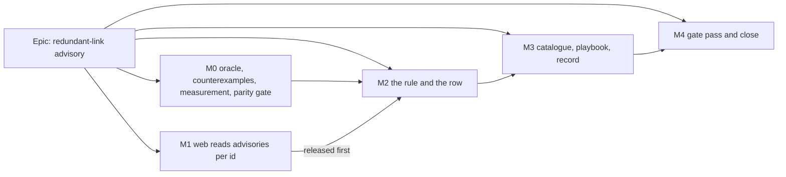

# Implementation Plan: A redundant link is reported when no duration could ever make it matter

- **Feature spec:** [./spec.md](./spec.md)
- **Status:** Draft
- **Owner:** product owner (approval); build by Claude Code sessions (builder agent, Sonnet)

## Breakdown

### Epic

**Redundant-link advisory** — report links that provably cannot affect any date or float, beside
the DCMA assessment, with the rule proven against the engine rather than argued. Roadmap theme:
schedule health (ADR-0116, ADR-0162).

**Standing rules for every milestone.**

- **Engine parity, gated.** From M0-T1, `check:engine-parity` is active with this epic's row: no
  non-test file under `apps/api/src/modules/schedule/engine/` changes, no existing engine spec changes
  beyond comments. `computeSchedule` is byte-identical because it is not touched; the advisory is a
  read over stored rows.
- **No schema change** (spec §4.4). A task that finds it needs one **stops** and runs
  `database-architect` (CLAUDE.md §19.3).
- **No `VITE_` flag** (ADR-0088 D1). Rollback is the commit boundary.
- **Pre-push gate run**: `pnpm prepush`, plus `scripts/e2e-local.sh api` for `apps/api` changes and
  `scripts/e2e-local.sh web:health-check` for the journey. Everything runs in a container with the
  local Postgres; no host step.
- **Every new gate or test is verified red** against the defect it names (ADR-0110 D5).
- **Copy never says "never drives"** (spec E12) and never an unqualified "nothing moves": it names
  dates and float.
- **Every user-visible milestone carries a changeset** (CLAUDE.md §10).

---

### Milestone M0: oracle, counterexamples, measurement, parity gate

**Outcome:** the soundness proof exists and has been made to fail, the cost is measured, and parity
is enforced before any product code lands.
**Entry point:** `Ships dark: tests, a measurement script, a root-gate declaration and a register row. No product surface changes.`
**Journey:** none.

#### Feature: the proof harness

> **Description:** spec §4.7 and §2.2.
> **Complexity:** L
> **Dependencies:** none
> **Risks:** the harness builds the engine input and the health input differently and agrees with
> itself → one plan description, two builders, one shared test helper.
> **Testing requirements:** every counterexample red; the harness red against a deliberately
> unsound rule.

##### M0-T1 — Open the epic row and activate `check:engine-parity`

- **Description:** a detailed row in `docs/TECH_DEBT.md`; `scripts/engine-parity.json` names it.
- **Complexity:** S
- **Dependencies:** none
- **Risks:** declaration outlives the epic → limb 3 fails once the row closes; M4 deactivates it in
  the closing commit.
- **Testing:** `pnpm check:engine-parity` green; verified red by a throwaway edit to an engine file.
- **Development steps:**
  1. Write the row (scope, the spec link, the falsification conditions FC-1–FC-7 below).
  2. Activate the declaration; run the gate; plant and revert an engine edit to see it fail.

##### M0-T2 — The dual builder and the differential oracle

- **Description:** `apps/api/src/modules/schedule/redundant-links.oracle.spec.ts` (outside
  `health/`) and a helper that turns one test-plan description into a `HealthComputeInput` and an
  engine graph through the same calendar resolution the service uses. The oracle takes **any**
  candidate set and reports divergences per activity field (spec §4.7's list; `isDriving` excluded).
  It has no rule of its own yet: M0 drives it with a deliberately unsound "structural" predicate to
  prove it can see a divergence.
- **Complexity:** M
- **Dependencies:** M0-T1
- **Risks:** comparing too few fields makes the proof narrower than its sentence (the ADR-0116 M6
  lesson) → compare every engine-owned per-activity output the recalc persists; verify red against a
  field that only one counterexample moves (free float, CE3).
- **Testing:** the harness reports a divergence for the structural predicate on R2.
- **Development steps:**
  1. Helper; oracle; seeded PRNG generator (no new dependency).
  2. Red run against the structural predicate.

##### M0-T3 — Counterexamples, red first

- **Description:** one hand-built case per exclusion, each predicted to diverge, committed with its
  prediction before running: CE1 finish entry across calendars (spec §2.2 worked example), CE2
  start exit in the backward pass, CE3 pinned successor changes free float, CE4 started intermediate
  under Progress Override, CE5 mandatory intermediate, CE6 positive lags on two keys, CE7 lag sum
  short, CE8 lead on the chain, CE9 LOE intermediate.
- **Complexity:** M
- **Dependencies:** M0-T2
- **Risks:** a counterexample does not diverge → the exclusion stays (conservative) and is marked
  "reasoned, not demonstrated" in ADR-0195; it is **not** silently dropped.
- **Testing:** each case asserts the divergence it predicts.
- **Development steps:**
  1. Write predictions to `docs/specs/redundant-link-advisory/m0-measurement.md` first, commit.
  2. Run; record which diverged.

##### M0-T4 — Cost and prevalence harness

- **Description:** `apps/api/scripts/measure-redundant-links.mts` (the `measure-zero-duration.mts`
  pattern): runs a candidate implementation in-process over `scale-500`, `scale-2000`, a dense
  synthetic (2,000 × 10 links) and the fixture, p50/p95 over 50 runs. Falsification conditions
  committed first: FC-5a ≤ 50 ms p95 at `scale-2000`; FC-5b the dense case is bounded by the cap.
  Also measures the levelling preview on `capability-levelling` with and without flagged links
  (spec §2.6).
- **Complexity:** M
- **Dependencies:** M0-T2 (the script is completed against M2-T2's module; M0 commits the harness
  and the conditions)
- **Risks:** a number is reported before it is measured → `TBD` rows until M2-T2 fills them.
- **Testing:** the script runs in CI-equivalent container; numbers recorded with machine notes.
- **Development steps:** harness; conditions; commit.

---

### Milestone M1: the web reads advisories per id

**Outcome:** the panel, print and announcement render each advisory by its own id and tolerate one
they do not know. The footer becomes true for any advisory.
**Entry point:** `Analysis ▾ ▸ Health check…` → **Beyond the DCMA assessment** (existing). The new
row: `Ships dark: no producer until M2, which merges only after this milestone is released`.
**Journey:** the existing `e2e-health-check` journey passes with the new footer text (one assertion
updated).

#### Feature: per-id advisory rendering

> **Description:** spec §4.6 (web half) and §4.5's version-skew rule.
> **Complexity:** S
> **Dependencies:** none
> **Risks:** the zero-duration row changes → its summary function is reused unchanged and its
> existing cases pass unedited.
> **Testing:** unit, component, print, axe.

##### M1-T1 — Types and view-model

- **Description:** in `@repo/types`, the discriminated union (spec §4.5) with
  `HEALTH_ADVISORY_IDS` still `['ZERO_DURATION_TASKS']` — the union admits the second member, the
  tuple does not yet emit it. `health-rows.ts`: `advisorySummary`, `advisoryCaveat` (token-keyed),
  `advisoryUnjudgedSentence`, new footer, all-advisory announcement; an unknown id renders name and
  count only.
- **Complexity:** S
- **Dependencies:** none
- **Risks:** a client narrowing on `id` fails for a future id → the unknown branch is tested with a
  cast fixture.
- **Testing:** `health-rows.test.ts` cases for each id, an unknown id, and absent `advisories`;
  announcement sentences pinned at 0/1/N; the vocabulary gate (G1/G2) gains `REDUNDANT_LINKS` in its
  disjointness check now, so M2 cannot forget it.
- **Development steps:** types; view-model; tests (red first against today's `zeroDurationSummary`
  call sites).

##### M1-T2 — Panel and print

- **Description:** `HealthAdvisoryRow` and `HealthPrintDocument` call the new functions; caveat and
  "not checked" sentences render under the summary when present.
- **Complexity:** S
- **Dependencies:** M1-T1
- **Risks:** the journey's footer assertion (`health-check.spec.ts:115`) → update to the new
  sentence's fixed half "not part of the DCMA assessment above", which is unchanged.
- **Testing:** component and print tests with a synthetic redundant row; axe with the row expanded.
- **Development steps:**
  1. Wire; tests; run `scripts/e2e-local.sh web:health-check`.
  2. Changeset (patch: web — copy and tolerance).
  3. **Merge and release.** M2-T3 does not merge before this release exists.

---

### Milestone M2: the rule and the row

**Outcome:** a Planner sees redundant links in the health check, can jump to each, and can trust
that deleting one moves nothing.
**Entry point:** `Analysis ▾ ▸ Health check…` → **Beyond the DCMA assessment** → **Redundant links**.
**Journey:** extend `apps/web/e2e-health-check/` support to add an R1 triangle; open the dock,
expand **Redundant links**, assert the summary and caveat, activate the `A → C` offender, assert C is
selected; axe on the open panel.

#### Feature: the pure rule

> **Description:** spec §2.1 and §4.8.
> **Complexity:** L
> **Dependencies:** M0
> **Risks:** see tasks.
> **Testing:** rule unit suite, the M0 oracle green, totality.

##### M2-T1 — `health/redundant-links.ts`

- **Description:** `findRedundantLinks(activities, dependencies, { relaxationBudget })` returning
  sorted offenders with witness labels, `unjudged`, `searchCapped`. Imports `@repo/types` only.
  `HealthDependencyInput` gains `lagCalendarKey`; `HealthActivityInput` gains
  `schedulingCalendarId` and `actualStart` is already present.
- **Complexity:** L
- **Dependencies:** M0-T2
- **Risks:**
  - The rule is unsound → the M0 oracle (populations in spec §4.7) must be green with **zero**
    divergences, alone and all-at-once; one divergence blocks the milestone (FC-2).
  - The top-two-by-first-link bookkeeping misses a parallel witness → R14 and a three-parallel-link
    case pinned.
  - Non-determinism in witness labels or capped order → a case runs the rule twice over shuffled
    input order and asserts identical output.
- **Testing:** one case per spec §2.3 row (R1–R17, N3); cyclic input; unknown endpoint; zero links;
  the budget at 1 (everything unjudged, `searchCapped: true`); the engine-free gate passes.
- **Development steps:**
  1. End graph, Kahn, DP per mode, witness reconstruction, budget.
  2. Unit suite; then the oracle; then a mutation check (drop W2) seen red in the oracle.

##### M2-T2 — Wire into the report and measure

- **Description:** `compute-health.ts` adds `REDUNDANT_LINKS` to `advisoryRows` (typed as a mapped
  record over the union); the service passes `lagCalendarKey` (from `lagCalendar` and the existing
  scheduling-calendar rule) and `schedulingCalendarId` — no new query. Fill M0-T4's `TBD` rows; set
  the budget from them.
- **Complexity:** M
- **Dependencies:** M2-T1, M0-T4
- **Risks:**
  - The lag key disagrees with `toEngineEdge` → a unit case over `capability-resources`
    (resource-dependent endpoint, `PREDECESSOR` key) asserts key equality ⇔ the same calendar object
    the recalc builds.
  - Metrics or summary shift → FC-4: report with and without the advisory, metrics and summary
    deep-equal.
  - Query count grows → the existing service spy asserts the same number of loader calls.
  - FC-5a fails → stop; profile; prune (bitset reachability prefilter) before continuing. Not
    shipped over budget.
- **Testing:** totality (both advisories always present, tuple order); G4 scan of the new DTO
  fields; service spec; measurement recorded.
- **Development steps:** wiring; tests; run the measurement; record.

##### M2-T3 — Contract, DTO, emit

- **Description:** `HEALTH_ADVISORY_IDS` gains `REDUNDANT_LINKS`; DTOs under `oneOf` with the `id`
  discriminator; OpenAPI descriptions name the rule token, the denominator and "not checked";
  `docs/API.md` updated.
- **Complexity:** S
- **Dependencies:** M2-T2; **M1 released** (FC-6)
- **Risks:** merged before M1's release → the PR description states the M1 release tag; the reviewer
  checks it.
- **Testing:** api-reviewer; OpenAPI snapshot if one exists for the route.
- **Development steps:** tuple; DTOs; docs; changeset (minor: api — a new advisory row on a public
  response; minor: web if M2's journey support or copy changed product code, otherwise none).

##### M2-T4 — REST e2e and journey

- **Description:** `apps/api/test/redundant-links.e2e-spec.ts`: build R1, R2, R5, R14, R16 through
  the public API, GET the report, assert the flagged set; **delete each flagged link through the
  API, recalculate, re-read every activity, assert no date or float changed** (ADR-0066's
  write-path half). The journey from the milestone header.
- **Complexity:** M
- **Dependencies:** M2-T3
- **Risks:** the shared e2e database wipes seeded data (ADR-0116 lessons) → the e2e builds its own
  plan.
- **Testing:** `scripts/e2e-local.sh api`; `scripts/e2e-local.sh web:health-check`.
- **Development steps:** e2e; journey; both run locally before push.

---

### Milestone M3: catalogue, playbook, record

**Outcome:** a planner or tester can open a seeded plan that shows every case and what wrong looks
like; the decision is recorded.
**Entry point:** the seeded plan `capability-redundant-logic`, opened in the app, then the M2 entry
point.
**Journey:** none new (M2's covers the surface).

##### M3-T1 — The catalogue plan

- **Description:** `capability-redundant-logic` in `apps/seed-cli/src/capabilities/logic.ts`, one
  disconnected cluster per spec §2.3 row, codes `R1A/R1B/R1C …`, description stating which are
  flagged; a second calendar for R4 and R9; registered in `index.ts`; coverage tags updated.
- **Complexity:** M
- **Dependencies:** M2
- **Risks:** the description and the oracle disagree → the M0 oracle runs over this plan's
  `SeedSpec`, and a unit case asserts the flagged set equals the description's list.
- **Testing:** seed-cli specs; `pnpm check:playbook`.
- **Development steps:** plan; register; tests.

##### M3-T2 — Playbook and terminology

- **Description:** `docs/TEST_PLAYBOOK.md`: a row for the new plan (Correct: R1, R3, R5, R6, R9,
  R13, R14 flagged; Wrong: R2/R4 flagged — the rule went structural; N3 flagged — it went
  "not driving"; R16 flagged — progress ignored); health-section rows for `fixture-p6-torture-v1`
  (R0056 **not** flagged, two in-progress intermediates — CQ-4) and `scale-500` (a non-zero count from
  the generator's skip links, E17; the figure measured, not guessed). Reword `network.ts`'s N3
  description and comment to "a non-driving parallel path".
- **Complexity:** S
- **Dependencies:** M3-T1
- **Testing:** `pnpm check:playbook`, `pnpm check:doc-links`.
- **Development steps:** edit; run gates.

##### M3-T3 — ADR-0195 and the register

- **Description:** ADR-0195 from the spec outline, with M0's counterexample results (which exclusions
  were demonstrated); one line in CLAUDE.md §16; banner ADR count; `docs/ROADMAP.md` entry; spec and
  plan headers move to `Approved` / `Accepted` as the ADR is filed (`check:spec-status` refuses a
  cited Draft).
- **Complexity:** S
- **Dependencies:** M3-T2
- **Testing:** `check:adr-coverage`, `check:counts`, `check:spec-status`.
- **Development steps:** write; run `pnpm prepush`.

---

### Milestone M4: gate pass and close

**Outcome:** reviewed, released, the parity declaration retired.
**Entry point:** as M2.
**Journey:** as M2.

##### M4-T1 — Specialist review

- **Description:** api-reviewer (union DTO, OpenAPI `oneOf`), security-reviewer (CPU bound, scope,
  G4), backend-performance-reviewer (the measurement and budget), test-engineer (oracle coverage —
  does it compare every persisted field?), component-reviewer and accessibility-reviewer (row,
  sentences, announcement, axe), ux-reviewer (copy). Blocking findings folded; suggestions to a
  register row with reasons.
- **Complexity:** M
- **Dependencies:** M3

##### M4-T2 — Close

- **Description:** close the epic row, deactivate the parity declaration in the same commit, run the
  reconciliation checks the epic touched.
- **Complexity:** S
- **Dependencies:** M4-T1

## Sequencing & slices

| Order | Slice | Releasable alone?                                      | Rollback      |
| ----- | ----- | ------------------------------------------------------ | ------------- |
| 1     | M0    | yes (tests, script, gate declaration, register row)    | revert commit |
| 2     | M1    | yes (copy, tolerance; no new data)                     | revert commit |
| 3     | M2    | **only after M1 is released** (spec §4.5, FC-6)         | revert commit (stateless read; nothing stored) |
| 4     | M3    | yes                                                    | revert commit |
| 5     | M4    | —                                                      | —             |

M0 and M1 are independent and may run in parallel. No feature flag. `main` stays releasable.

## Falsification conditions (committed in M0-T1)

- **FC-1** `check:engine-parity` green for the whole epic.
- **FC-2** Zero oracle divergences, alone and all-at-once, over the populations in spec §4.7.
- **FC-3** Each exclusion has a red counterexample or is marked reasoned in ADR-0195.
- **FC-4** Metrics and summary deep-equal with and without the advisory.
- **FC-5** ≤ 50 ms p95 advisory compute at `scale-2000`; the dense case bounded by the budget.
- **FC-6** M2-T3 merges after a release containing M1.
- **FC-7** N3's links and R2/R4/R7/R8 are never flagged.

## Definition of Done (per task)

Each task's PR satisfies the Feature Completion Criteria in [`docs/PROCESS.md`](../../PROCESS.md)
plus the standing rules above. CI is read per CLAUDE.md §19.9 before merge.

## Risks & assumptions (rollup)

| Risk / assumption                                                                       | Likelihood | Impact | Mitigation                                                                                           |
| --------------------------------------------------------------------------------------- | ---------- | ------ | ---------------------------------------------------------------------------------------------------- |
| R1: the rule flags a link that matters                                                  | low        | high   | The oracle is the gate (FC-2); every exclusion tested red (FC-3); conservative defaults (CQ-1/3/4).   |
| R2: coverage is lower than planners expect (progress, mixed calendars, SS chains off a single calendar) | med | low | Stated in copy ("not checked") and ADR; M0's prevalence count over the catalogue says how much.      |
| R3: an old tab misprints the new row                                                    | low        | low    | M1 released first (FC-6); residual tab window stated.                                                 |
| R4: cost on a dense plan                                                                | med        | med    | Measured first; deterministic budget; existing throttle.                                              |
| R5: the levelling preview changes after a deletion                                      | unknown    | low    | Measured in M0-T4 and stated either way; the claim names Pass 1 and Pass 2.                          |
| R6: a per-link conflict reason names one fewer link after a deletion                    | med        | low    | The boolean cannot change (spec §2.6); stated.                                                        |
| R7: "Driving" shown on a flagged link confuses a reader                                 | med        | low    | Copy never claims "never drives"; the caveat says what deleting it changes.                           |
| A1: ADR number 0195                                                                     | —          | —      | Check `docs/adr/` at filing.                                                                          |
| A2: `apps/api` has no property-testing dependency, and none is added                    | —          | —      | Seeded PRNG generator in the test helper.                                                             |
