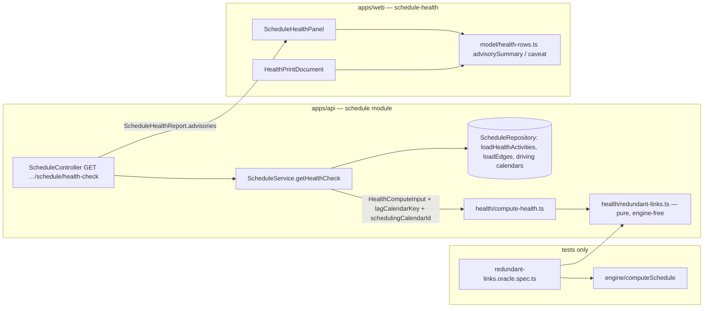
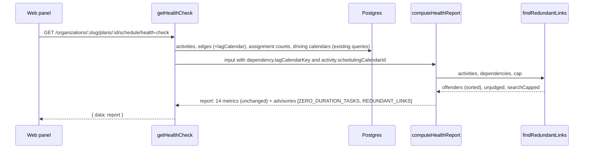
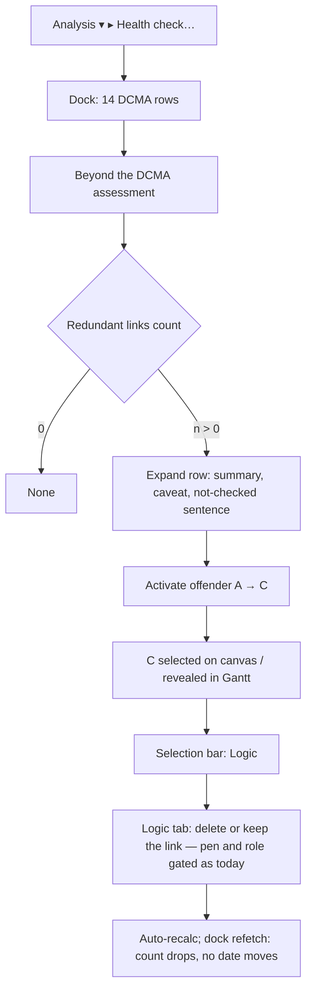

# Feature Spec: A redundant link is reported when no duration could ever make it matter

- **Status:** Draft — awaiting product-owner approval before implementation
- **Author(s):** feature-analyst (for the product owner)
- **Date:** 2026-10-17
- **Tracking issue / epic:** a new `docs/TECH_DEBT.md` detailed row, opened in M0 so the
  `check:engine-parity` declaration has a row to expire against (plan M0-T1)
- **Roadmap link:** a new entry beside the schedule-health line in `docs/ROADMAP.md`, added in M3
- **Related ADR(s):** ADR-0116 (health finding is not a conflict; a report never omits a check),
  ADR-0162 (the advisory section, mirrored here), ADR-0035 §13 (ladders) and §16 (redundant logic
  deferred to a quality report), ADR-0021 (DAG invariant), ADR-0036/0037 (lag calendars and the
  instant axis), ADR-0038 (summaries carry no logic), ADR-0043/0045/0161 (external dates and
  cross-plan links), ADR-0066 (catalogue as oracle), ADR-0070 (sub-day lags), ADR-0081, ADR-0088 D1,
  ADR-0093/0094 (remedy on the object), ADR-0127 (count what you do not know), ADR-0148 (Pass 2).
  Proposed: **ADR-0195** (numbering assumed; `docs/adr/` ends at 0194 today).

## 0. Evidence: what the brief claimed and what was checked

Written with read and search tools only. **Nothing below was run.** Where a claim needs running,
the M0 task that runs it is named.

| #   | Claim                                                                                                                         | Verdict                                       | Established by                                                                                                                                                                                                                                                                                                                                                                                                       |
| --- | ----------------------------------------------------------------------------------------------------------------------------- | --------------------------------------------- | -------------------------------------------------------------------------------------------------------------------------------------------------------------------------------------------------------------------------------------------------------------------------------------------------------------------------------------------------------------------------------------------------------------------- |
| E1  | The only advisory today is `ZERO_DURATION_TASKS`.                                                                             | True                                          | `packages/types/src/index.ts:3044`; built at `compute-health.ts:306-308`, evaluated at `:518-528`.                                                                                                                                                                                                                                                                                                                   |
| E2  | The metrics are DCMA-14 only.                                                                                                 | True                                          | `thresholds.ts:8-33` (names), `:55-70` (thresholds).                                                                                                                                                                                                                                                                                                                                                                 |
| E3  | Nothing in `dependencies/` reasons about transitive links.                                                                    | True, with one neighbour                      | `grep -i "transitiv\|redundan\|implied"` over `apps/api/src/modules/dependencies` finds only the cycle detector's reachability (`cycle-detector.ts:6`). The web's `tsld/render/logic-path.ts:13-20` computes a transitive closure for the isolate overlay; it judges nothing.                                                                                                                                        |
| E4  | "Redundant logic" was named as a later add.                                                                                   | True, in three places                         | ADR-0035 §16 (`0035-…md:143-145`: "a schedule-quality report (danglers, redundant logic, open ends …) is a later, non-blocking add"); ADR-0116 follow-ups (`0116-…md:246-248`: "redundant-logic detection"); `PROJECT_BRIEF.md:265` ("redundant constraints").                                                                                                                                                     |
| E5  | **The advisory contract is typed for one advisory.**                                                                          | True — a contract change is needed            | `HealthAdvisoryResult.detail` is `{ resourced: number }` (`index.ts:3061`); the DTO repeats it (`plan-health-check.dto.ts:180-188`, `:219-220`).                                                                                                                                                                                                                                                                    |
| E6  | **Today's web renders every advisory as a zero-duration row.**                                                                | True — a version-skew defect waiting to fire  | `ScheduleHealthPanel.tsx:490-493` and `HealthPrintDocument.tsx:101` call `zeroDurationSummary(advisory)` for every row; it reads `advisory.detail.resourced` (`health-rows.ts:244`). A second row would print "N zero-duration tasks out of M activities; undefined have resource assignments" under the heading "Redundant links". The footer (`health-rows.ts:228-229`) says "Found from stored durations", which is false for links. |
| E7  | The loader already has every input the rule needs.                                                                            | True — no new query, no schema change         | Links: `loadEdges` selects `type`, `lagMinutes`, `lagCalendar`, in-plan, live (`schedule.repository.ts:512-528`); the service drops `lagCalendar` today (`schedule.service.ts:1046-1052`). Activities: `type`, `status`, `actualStart/Finish`, both constraint slots, `calendarId` (`schedule.repository.ts:568-587`). Driving-resource calendars: already loaded (`schedule.service.ts:996-1001`).                 |
| E8  | The engine's link arithmetic lives in one file.                                                                               | True                                          | `engine/edge-bounds.ts:24-90`: `applyLag`, `forwardLowerBound`, `backwardUpperBound`. FF/SF convert a finish bound to a start bound by walking back the **successor's** duration on the successor's calendar (`:48-59`); SS/SF backward bounds walk forward the predecessor's duration (`:75-87`).                                                                                                                       |
| E9  | A zero lag is the identity on every calendar.                                                                                 | True                                          | `instants.ts:42-45`: `advanceWorking(cal, abs, 0)` returns `abs`.                                                                                                                                                                                                                                                                                                                                                     |
| E10 | MSO/MFO and the mandatory pair override logic in both passes; SNET/FNET/SNLT/FNLT and external dates only tighten.           | True                                          | `constraints.ts:140-162` (forward: MSO/MFO return the pin), `:266-286` (backward), `:217-228` and `:239-263` (external dates are `max`/`min`). Mandatory kinds share the pin arithmetic (`:22-31`).                                                                                                                                                                                                                  |
| E11 | A placement does not break a chain in Pass 2.                                                                                 | True                                          | Pass 2 computes `logicEarliest` from predecessors' **propagated** dates (`compute.ts:323-331`) and propagates `max(placed, logicEarliest)` (`:358`), so an early placement never passes on less than logic. A progressed activity passes Pass 1's instants (`:364-366`).                                                                                                                                              |
| E12 | "Driving" is an engine output decided by equality, so a tied link can read Driving.                                         | True                                          | `compute.ts:408-412`: an edge drives when its rolled bound equals the successor's early start. A link that ties with a longer chain is marked driving and is still removable without changing a date.                                                                                                                                                                                                                 |
| E13 | Free float reads every outgoing link against the successor's **early** dates.                                                | True                                          | `compute.ts:752-760`. A link into a pinned or progressed successor can therefore carry a negative gap the chain does not, so removing it can change the predecessor's free float (§2.4 R-T).                                                                                                                                                                                                                         |
| E14 | The conformance fixture already names a redundant link.                                                                       | True                                          | `relationships.csv:57`: R0056 `A4110 → A4600 FS 0`, "a redundancy report should list it", chain via A4200 → A4210 → A4400 → … → A4450 (`:32-55`).                                                                                                                                                                                                                                                                  |
| E15 | **That chain passes through two in-progress activities.**                                                                     | True — the conservative rule does not flag it on the seeded fixture | `activities.csv:31-33`: A4110 COMPLETED, A4200 IN_PROGRESS (actual start 16 Feb), A4210 IN_PROGRESS (suspended). §2.4 explains why; M2 asserts it is flagged on the **unprogressed** adaptation (the conformance S01 baseline) and not on the seed.                                                                                                                                                                 |
| E16 | **The catalogue uses "redundant" for something else.**                                                                        | True — a terminology collision                 | `apps/seed-cli/src/capabilities/network.ts:17-20,24-26`: N3 is "redundant" because N1→N3→N4 is a **shorter parallel path** than N1→N2→N4. No link there is implied by a chain. Under this spec N3's links are **not** flagged, and the plan's description is corrected (M3-T2).                                                                                                                                    |
| E17 | The scale tier generates transitively implied links by construction.                                                          | True                                          | `packages/seed/src/scale/generator.ts:261-289` (skip links inside a band, "it short-circuits a sequence that already exists"); 82 % FS, 88 % zero lag, 4 % leads (`:477-486`); 1.6 links per activity (`:69-78`). So `scale-500`/`scale-2000` are a ready prevalence and cost bed.                                                                                                                                  |
| E18 | Links are in-plan; cross-plan links live elsewhere.                                                                           | True                                          | `ActivityDependency` carries `plan_id` with an invariant that both endpoints share it (`schema.prisma:1649-1655`); `CrossPlanDependency` is a separate model (`:1763`), not read by `loadEdges`.                                                                                                                                                                                                                        |
| E19 | The health module is engine-free by a gate, and the gate exempts spec files.                                                  | True                                          | `health-engine-free.structural.spec.ts:28-30` scans non-`.spec.ts` files in `health/`. The oracle in §4.7 lives **outside** `health/` anyway (the ADR-0116 M6 precedent).                                                                                                                                                                                                                                            |
| E20 | The canvas has no link selection.                                                                                             | True                                          | No `selected(Link\|Edge\|Dependency)` state in `apps/web/src`; links are touched through the lag anchor (`TsldCanvas.tsx:2663-2690`) and the activity editor's Logic tab (`use-plan-workspace-model.ts:344-354`). So "select the link" is not available as a remedy without new canvas work.                                                                                                                       |
| E21 | Same pair, different type is legal (the ladder).                                                                              | True                                          | ADR-0035 §13 amendment (`0035-…md:129-138`): unique on (pair, type).                                                                                                                                                                                                                                                                                                                                                  |

**What E5, E6, E15 and E16 change.** E5/E6 make this a contract change, not a row added to an
array, and they impose a release order (§4.5). E15 means the most-cited example in the repository is
**not** flagged on the plan people will open, and the spec says so rather than tuning the rule to
catch it. E16 means "redundant" must be defined in the product's words before it is shown.

## 1. Business understanding

### Problem

A planner who imports a programme, or builds one over months, accumulates links that say nothing
the rest of the logic does not already say: A→B→C plus a direct A→C. They clutter the diagram,
inflate DCMA metric 3's denominator and metric 4's mix, and make the network harder to review. Every
serious scheduling review lists them, and SchedulePoint's own engine contract deferred the report
(E4). Today a planner can find one only by tracing chains by eye.

The hard part is that **"implied" has two meanings, and only one of them is safe to tell a planner**:

- **Structural**: C is reachable from A by another path. This flags A→C FS+10d beside A→B→C FS+0,
  where the direct link is very likely the one doing the work.
- **Provable**: whatever the durations, the other path pushes C at least as far as the direct link
  does, so deleting the direct link cannot change any date or float. This is what a planner needs
  before they press Delete.

This spec builds the second, and is explicit about what that costs in coverage.

### Users

| Role                                 | Need                                                                            |
| ------------------------------------ | ------------------------------------------------------------------------------- |
| Planner                              | Find and clean redundant links before issuing or baselining a programme.        |
| Org Admin                            | Same as Planner.                                                                |
| Contributor, Viewer                  | Read the finding in the panel and on paper; the remedy needs a Planner.         |
| External Guest                       | **None.** The report is `schedule:read`, which `GuestPrincipal` cannot satisfy (ADR-0116 follow-ups). |

### Primary use cases

1. Open **Analysis ▾ ▸ Health check…**, read "Redundant links" under **Beyond the DCMA assessment**,
   expand it, activate an offender to select the link's successor, and use **Logic** on the
   selection bar to review or delete the link.
2. Print the health report and hand it to a reviewer with the redundant links listed.
3. After an import, see how much of the imported logic is redundant before tidying it.

### User journeys

Happy path: §4.3 diagram. Alternates: zero relationships ("None"), a plan where some links are not
checked (the "not checked" sentence), a plan too large for the work cap (the "stopped early"
sentence), an API older than the feature (row absent, nothing claimed).

### Expected outcomes

A planner can trust that every listed link is removable without moving a single activity, and can
see how many links the check could not judge and why.

### Success criteria

- **SC-1 Soundness.** Zero divergences in the differential oracle (§4.7): every flagged link,
  removed alone **and** all flagged links removed together, leaves every per-activity date and
  float the engine persists unchanged, over the whole catalogue and over ≥ 500 seeded random plans
  × 5 duration draws each.
- **SC-2 Recall on the canonical class.** Every case in the new catalogue plan the description
  says is redundant is flagged; R0056 is flagged on the unprogressed fixture.
- **SC-3 Cost.** The advisory's compute ≤ 50 ms p95 at 2,000 activities (`scale-2000`, in-process),
  and the health route stays inside the API's 200 ms p95 read target (CLAUDE.md §15). Both measured
  in M0/M2 against falsification conditions committed first.
- **SC-4 No collateral.** The fourteen metric rows and `summary` are byte-identical with and without
  this advisory; `check:engine-parity` is green throughout.
- **SC-5** The journey drives the row in a real browser; axe is clean on the panel with the row
  expanded.

### Open questions

The **critical** ones (answers change design or scope) are in §6 with a recommended default each.
Everything else is decided below with the default stated.

## 2. Functional requirements

### 2.1 The rule (normative)

Notation. A link `t` leaves its predecessor from end **π(t)** and binds its successor's end
**σ(t)**:

| Type | π (predecessor end) | σ (successor end) | Engine bound (`edge-bounds.ts`)          |
| ---- | ------------------- | ----------------- | ---------------------------------------- |
| FS   | F                   | S                 | `S_succ ≥ F_pred ⊕ L`                     |
| SS   | S                   | S                 | `S_succ ≥ S_pred ⊕ L`                     |
| FF   | F                   | F                 | `F_succ ≥ F_pred ⊕ L` (via `−D_succ`)     |
| SF   | S                   | F                 | `F_succ ≥ S_pred ⊕ L` (via `−D_succ`)     |

Ends are ordered **S ≤ F**: every activity's finish is at or after its start, whatever its
duration. `⊕ L` adds `L` working minutes on the link's **lag-calendar key**: `24H` for
`TWENTY_FOUR_HOUR`; the plan calendar's id for `PROJECT_DEFAULT`; the predecessor's or successor's
**scheduling** calendar id (driver → own → plan, the existing `schedulingCalendarId` rule) for
`PREDECESSOR`/`SUCCESSOR` — the identity `toEngineEdge` uses (`schedule.service.ts:1651-1657`,
`:3040-3061`).

**Transparent activity** (may be passed through): not `LEVEL_OF_EFFORT`, not `WBS_SUMMARY`; status
`NOT_STARTED` with no actual start or finish; neither constraint slot is `MSO`, `MFO`,
`MANDATORY_START` or `MANDATORY_FINISH`. Every other constraint (SNET, FNET, SNLT, FNLT), an external
date, an expected finish, an ALAP flag and a placement leave an activity transparent (E10, E11).

**Candidate link** `D = A → C`: neither endpoint is a level of effort or a summary, and **C** is
transparent. `A` may be anything else — started, complete, pinned. A non-candidate link is
**not checked** and is counted (`detail.unjudged`, ADR-0127).

**Witness** for D: a path `A = X0 →t1 X1 → … →tk Xk = C`, `k ≥ 1`, not using D itself (so at
`k = 1` it is another link between the same pair), such that:

- **W1 — no leads on the chain.** Every `L(ti) ≥ 0`.
- **W2 — pass-through.** Every intermediate `Xj` is transparent and is **entered at its start and
  left at its finish**: `σ(tj) = S` and `π(tj+1) = F`. In **single-calendar mode** (W5) the weaker
  `σ(tj) ≤ π(tj+1)` applies (S→S, S→F and F→F; never F→S).
- **W3 — ends.** `π(D) ≤ π(t1)` and `σ(tk) ≤ σ(D)`.
- **W4 — lag.** If `L(D) ≤ 0`, nothing more. If `L(D) > 0`: `Σ L(ti) ≥ L(D)`, and every `ti` with
  `L(ti) > 0` has the same lag-calendar key as D.
- **W5 — single-calendar mode** (only needed to use W2's weaker form): A, C and every intermediate
  share one scheduling calendar `K`, and every link on the chain and D with a non-zero lag has key
  `K`.

**D is redundant iff a witness exists.**

### 2.2 Why each clause is there (informative, checked in M0)

- **W1, W4 with `L(D) ≤ 0`.** A non-negative lag on any calendar moves an instant later or not at
  all (E9), and every within-activity step used is `F ≥ S` or a roll forward. So the chain's bound
  on C is at or after `e_A`, and D's is at or before it. Calendar-free.
- **W4 with `L(D) > 0`.** Working-time addition on one calendar is monotone and associative, so
  `(t ⊕K a) …then later… ⊕K b ≥ t ⊕K (a+b)`. Across two calendars there is no such inequality.
- **W2's general form.** Entering an intermediate at its **finish** goes through the FF/SF
  conversion `S_B = retreat(x, D_B)` then `F_B = advance(S_B, D_B)` on B's calendar
  (`edge-bounds.ts:48-59`). When `x` falls in B's non-working time that round trip lands **before**
  `x` (worked example: A on a Mon–Sat calendar finishing Saturday 12:00, B on Mon–Fri entered FF 0
  finishes Friday 17:00, C on Mon–Sat entered FS 0 from B can start Saturday 08:00, so a direct
  FS 0 A→C drives). The backward pass has the mirror case when an intermediate is **left at its
  start** (SS/SF out, `:75-87`). On one calendar both round trips are exact up to non-working gaps
  that the next roll absorbs, which is why W5 relaxes W2.
- **Transparency.** A pinned intermediate ignores its predecessors (E10); a started one keeps its
  actual start whatever its predecessors do; an LOE never drives (ADR-0035 §21).
- **C transparent (R-T).** Free float reads each outgoing link against the successor's early dates
  (E13). If C is pinned earlier than logic, or started early, D's gap is negative while the chain's
  first gap is not, so removing D changes A's free float.
- **Simultaneous removal is safe.** A witness for D can contain another flagged link D′ only if D′
  lies inside D's span; replacing D′ by its own witness keeps W1–W5 and strictly shrinks the span or
  the type strength, so the substitution terminates. (Reasoned; SC-1 tests it by removing all
  flagged links at once.)

### 2.3 Worked examples (each becomes a catalogue case, §4.6)

All lags in working days on the plan calendar unless noted; all activities unprogressed and
unpinned.

| #   | Direct link D        | Other path                                  | Verdict          | Why                                                                     |
| --- | -------------------- | ------------------------------------------- | ---------------- | ----------------------------------------------------------------------- |
| R1  | A→C FS 0             | A→B FS 0, B→C FS 0                          | **Redundant**    | The canonical case.                                                     |
| R2  | A→C FS +5            | A→B FS 0, B→C FS 0                          | Not flagged      | Lag sum 0 < 5: if B is short, D drives.                                 |
| R3  | A→C FS +2            | A→B FS +1, B→C FS +1                        | **Redundant**    | Same key, sum 2 ≥ 2.                                                    |
| R4  | A→C FS +2            | A→B FS +1 (24-hour), B→C FS +1              | Not flagged      | Positive lags on two keys.                                              |
| R5  | A→C SS 0             | A→B FS 0, B→C FS 0                          | **Redundant**    | `π(D)=S ≤ F`; a finish-to-start chain is stronger than a start link.    |
| R6  | A→C FF 0             | A→B FS 0, B→C FS 0                          | **Redundant**    | `σ = S ≤ F`.                                                            |
| R7  | A→C FS 0             | A→B SS 0, B→C SS 0                          | Not flagged      | `π(D)=F`, chain leaves A's start: A's finish can be later.              |
| R8  | A→C FS 0             | A→B FS 0, B→C FF 0                          | Not flagged      | Chain binds C's finish; D binds its start.                              |
| R9  | A→C FS 0             | A→B FF 0, B→C FS 0                          | Single calendar: **Redundant**; otherwise not flagged | W2/W5 (the FF round trip).                     |
| R10 | A→C FS 0             | A→B FS 0, B→C FS 0, **B carries MANDATORY_START** | Not flagged | B ignores A.                                                            |
| R11 | A→C FS 0             | via an LOE                                  | Not flagged      | An LOE never drives.                                                    |
| R12 | A→C FS 0             | A→B FS −1, B→C FS 0                         | Not flagged      | A lead on the chain (W1).                                               |
| R13 | A→C FS −1 (a lead)   | A→B FS 0, B→C FS 0                          | **Redundant**    | `L(D) ≤ 0`. Metric 2 also lists it as a lead.                           |
| R14 | A→B SS 0             | A→B FS 0 (same pair)                        | **Redundant**    | A parallel FS implies the SS (CQ-2).                                    |
| R15 | A→B SS +2, A→B FF +2 | (the ladder)                                | Neither flagged  | Neither implies the other.                                              |
| R16 | A→C FS 0             | A→B FS 0, B→C FS 0, **B in progress**       | Not flagged      | Started work breaks a chain (CQ-4).                                     |
| R17 | A→C FS 0, **C pinned MSO** | A→B FS 0, B→C FS 0                    | Not checked      | Counted in "not checked" (R-T).                                         |
| N3  | (network-shape plan) | N1→N2→N4 and N1→N3→N4                       | Nothing flagged  | Two parallel paths are not an implied link (E16).                       |

### 2.4 User stories & acceptance criteria

> **US-1** — As a Planner, I want the health check to list links already implied by a longer chain,
> so that I can remove them knowing nothing will move.
>
> - **Given** a plan containing R1, **when** I open the health check, **then** "Beyond the DCMA
>   assessment" shows a row **Redundant links** with the count, and the summary line
>   "1 redundant link out of 3 relationships".
> - **Given** the row is expanded, **then** each offender reads `A → C` with the note
>   "FS; already implied through B", and activating it selects C (the existing jump seam) and
>   reveals it in the Gantt when collapsed (`healthRevealId`).
> - **Given** R2, R4, R7, R8, R10–R12, R15, R16 or the network-shape plan, **then** those links are
>   not listed.
> - **Given** the row lists links, **then** it carries the sentence: "Each is already implied by a
>   longer chain of links. Deleting it would not change any activity's dates or float, whatever the
>   durations — though it may start to matter if that chain changes."
> - **Given** any plan, **then** the fourteen DCMA rows and the summary counts are unchanged.

> **US-2** — As any reader, I want to know what the check could not judge.
>
> - **Given** links into started or pinned work, or touching a level of effort, **then** the row
>   says "N links into started or pinned work, or touching a level of effort, were not checked."
> - **Given** the work cap is reached, **then** it says "The check stopped early on a plan this
>   size; N links were not checked." The count is deterministic for a given plan.

> **US-3** — As a reviewer, I want the printed report to carry the same row.
>
> - **Given** I print, **then** the row, its summary, the two sentences when they apply, and the
>   capped offender list with the cap stated appear after the fourteen rows, exactly as the
>   zero-duration row does (ADR-0162 E33).

> **US-4** — As a screen-reader user, I hear the same report.
>
> - **Given** the report settles, **then** the announcement ends "Beyond the DCMA assessment: no
>   zero-duration tasks, 4 redundant links." (all advisories, always; ADR-0116 M5's finding).

### 2.5 Workflows

Read: open dock → GET health-check → section renders. Remedy: activate offender → successor
selected → **Logic** on the selection bar → editor's Logic tab → delete the link (existing,
pen-gated) → recalculate (existing coalesced auto-recalc) → reopen or refetch the dock: the row
count drops, nothing else moves. No new write path.

### 2.6 Edge cases

| Case                                               | Behaviour                                                                                         |
| -------------------------------------------------- | ------------------------------------------------------------------------------------------------- |
| No relationships                                   | Row present, "None", `0 of 0`. Never not-assessable (the ADR-0162 rule).                          |
| Never calculated                                   | Computed: the rule reads stored links and activity facts, never computed dates.                    |
| A link whose endpoint is not among the live activities | Not checked, counted (defensive: soft-delete cascades should prevent it).                     |
| A cycle in stored data (should be impossible, ADR-0021) | Nothing flagged; every link counted "not checked"; a structured `warn` log. Never a 500.     |
| Ties: D reads **Driving** today                    | Still flagged (E12). The copy never says "never drives".                                          |
| Two flagged links on one span                      | Both listed; removing both is safe (§2.2).                                                         |
| A flagged link into a placed activity              | Flagged; its `visualConflict` boolean cannot change (Pass 2's `logicEarliest` is a max over the same bounds), but a per-link conflict **reason** listing may name one fewer link (ADR-0186). Stated, M0 measures. |
| Levelled plans                                     | The claim covers Pass 1 and Pass 2, the persisted schedules. Whether the levelling preview's ghosts are unchanged is **measured** in M0 on `capability-levelling` and stated either way. |
| Cross-plan links                                   | Never candidates and never on a witness (E18). They only raise or lower external dates, which W2's transparency already tolerates. |
| More than `offenderCap` offenders                  | Capped, true total in `offenderCount`, "showing 50 of N" (existing).                              |

### 2.7 Permissions

| Action                         | Permission           | Scope              | Roles                                           |
| ------------------------------ | -------------------- | ------------------ | ----------------------------------------------- |
| Read the advisory              | `schedule:read`      | organisation (slug) | Org Admin, Planner, Contributor, Viewer        |
| Delete a link (the remedy)     | unchanged            | unchanged          | as today; a structural write behind the pen (ADR-0028) |

The advisory is a read: **not structural, no pen, no lock, no audit event** (ADR-0116 D1, ADR-0073).
The report stays role-invariant (ADR-0116 D5); the G4 cost-name scan covers the new fields.

### 2.8 Validation rules

No new input. The rule tolerates any stored row the loader returns.

### 2.9 Error scenarios

| Scenario                               | Detection           | User-facing result                       | Status |
| -------------------------------------- | ------------------- | ---------------------------------------- | ------ |
| Not a member / no `schedule:read`      | existing guard      | existing forbidden state                 | 403    |
| Plan missing or deleted                | existing            | existing                                 | 404    |
| Throttled                              | existing throttle   | existing                                 | 429    |
| Cyclic stored data                     | Kahn leaves nodes   | row reads "not checked" for every link   | 200    |
| Work cap reached                       | relaxation counter  | "stopped early" sentence                 | 200    |
| API older than the feature             | row absent          | nothing rendered for it, nothing claimed | —      |

## 3. Technical analysis

| Area           | Impact | Notes                                                                                                                                                       |
| -------------- | ------ | ----------------------------------------------------------------------------------------------------------------------------------------------------------- |
| Frontend       | low    | `health-rows.ts` per-id summary and caveat; panel and print consume it; footer and announcement generalised. No new component, no new route.                |
| Backend        | med    | New pure module `health/redundant-links.ts`; `compute-health.ts` adds one row; the service passes `lagCalendarKey` and scheduling calendar ids it already has. |
| Database       | **none** | Confirmed against E7. No model, column, index or migration. If any task finds otherwise it **stops** and runs `database-architect` (CLAUDE.md §19.3).     |
| API            | med    | Additive row in `advisories`; `HealthAdvisoryResult` becomes a union discriminated on `id`; OpenAPI `oneOf`. Minor bump.                                    |
| Security       | low    | Same route, guard and scope. CPU cost bounded by a deterministic work cap and the existing throttle.                                                        |
| Performance    | med    | `O(V·(V+E))` worst case; measured before and after (§4.8).                                                                                                  |
| Infrastructure | none   | No env var, no service, no flag (ADR-0088 D1), no CI job.                                                                                                   |
| Observability  | low    | One `warn` log on a cycle or a cap hit, with plan id and counts.                                                                                            |
| Testing        | high   | Unit rule suite, totality, the differential oracle, a REST e2e that deletes the flagged links and re-reads, the journey, axe.                              |

### Dependencies

None to land first. Release order inside the epic: the tolerant web reader (M1) must be **released**
before the API emits the second row (M2) — §4.5.

## 4. Solution design

### 4.1 Architecture overview



The engine is imported by the **oracle test only**, outside `health/`, so the engine-free gate keeps
meaning what it says and `check:engine-parity` stays green.

### 4.2 Data flow



### 4.3 User flow



### 4.4 Database changes

None (E7). The service already loads every field; it stops discarding `lagCalendar`.

### 4.5 API changes

`GET /api/v1/organizations/:slug/plans/:planId/schedule/health-check` — unchanged route, guard and
status codes. `advisories` gains a second row in tuple order:

```ts
export const HEALTH_ADVISORY_IDS = ['ZERO_DURATION_TASKS', 'REDUNDANT_LINKS'] as const;

interface HealthAdvisoryBase {
  name: string;
  measured: HealthMeasured; // percent-shaped; denominator differs per advisory
  offenderCount: number;
  offendersTruncated: boolean;
  offenders: HealthOffender[];
}
export interface ZeroDurationTasksAdvisory extends HealthAdvisoryBase {
  id: 'ZERO_DURATION_TASKS';
  detail: { resourced: number }; // unchanged on the wire
}
export interface RedundantLinksAdvisory extends HealthAdvisoryBase {
  id: 'REDUNDANT_LINKS';
  detail: {
    rule: 'DOMINATED_UNDER_ANY_DURATION'; // token the caveat sentence is keyed on (health-rows precedent)
    unjudged: number; // links not checked: LOE/summary endpoint, started or pinned successor, unknown endpoint
    searchCapped: boolean; // the deterministic work cap was reached
  };
}
export type HealthAdvisoryResult = ZeroDurationTasksAdvisory | RedundantLinksAdvisory;
```

- `measured.denominator` is `relationshipCount` (live in-plan links), not activities; the type's
  docblock is corrected to say the denominator is per advisory.
- Offenders are `kind: 'RELATIONSHIP'`, `id` = link id, `name` = "pred → succ" (the existing
  `relOffender`), `activityId` = successor (existing jump rule), `note` = type, lag when non-zero in
  metric 3's "lag of N min" phrase, and the witness: "already implied through B" / "through B, C and
  4 more" / "already implied by the FS link between the same two activities". Sorted by predecessor
  label, successor label, link id, so the capped 50 are stable on paper.
- OpenAPI: `HealthAdvisoryResultDto` becomes two DTOs under `oneOf` with `discriminator: id`; the
  `id` enums derive from the tuple.

**Version skew (the binding constraint, E6).** An old web bundle meeting the new API misprints the
row. So the web reader that renders per id, and renders an unknown id as name and count only, ships
in **M1 and is released** before M2's producer merges — the ADR-0162 decision 6 pattern. The residual
is a tab opened before M1's release and never reloaded across two releases; accepted and stated. The
converse (new web, old API) renders no row and claims nothing (E32's rule).

### 4.6 Component changes

- `model/health-rows.ts`: `advisorySummary(advisory)` (switch on `id`; zero-duration branch is the
  existing function unchanged; redundant: "N redundant links out of M relationships"; unknown id: the
  count only), `advisoryCaveat(advisory)` keyed on `detail.rule` with the US-1 sentence, an
  unknown token named rather than described (the `caveatFor` precedent, `health-rows.ts:145-161`),
  `advisoryUnjudgedSentence`, `HEALTH_ADVISORY_FOOTER` → "Found from the plan's stored activities
  and links, whether or not the plan has been calculated, and not part of the DCMA assessment
  above.", and `healthAnnouncement` listing every advisory.
- `ScheduleHealthPanel.tsx` `HealthAdvisoryRow` and `HealthPrintDocument.tsx`: call the new
  functions. No new component, token or style; the disclosure and print section are reused.
- Catalogue: new `capability-redundant-logic` plan (§2.3 rows R1–R17) in
  `apps/seed-cli/src/capabilities/logic.ts`, registered in `index.ts`; N3's description reworded to
  "a non-driving parallel path" (E16).

### 4.7 The differential oracle (how soundness is proven, not argued)

A test helper builds **one** small plan description into both a `HealthComputeInput` and an engine
graph, so the two cannot disagree. For each plan: run the rule; recompute the engine with (a) each
flagged link removed alone and (b) all flagged links removed; compare per activity `earlyStart`,
`earlyFinish`, `lateStart`, `lateFinish`, `totalFloat`, `freeFloat`, `isCritical`, the visual pass
outputs and remaining float, plus the project finish. Edge `isDriving` is excluded by design (E12).
Populations: every capability plan, the fixture progressed **and** unprogressed, `scale-500`, and a
seeded deterministic generator (no new dependency; no `fast-check` in `apps/api/package.json`) of
≥ 500 plans × 5 duration draws over the seven catalogue calendar shapes, all four types, the four
lag-calendar sources, leads, pins, progress and LOEs. M0 first builds the counterexamples in §2.2
**red** (each exclusion shown necessary); an exclusion no counterexample can break stays, marked
"reasoned, not demonstrated". An API e2e repeats the check through REST on the catalogue plan:
delete each flagged link, recalculate, re-read every activity, compare (ADR-0066).

### 4.8 Algorithm and cost

1. Build the **end graph**: two nodes per activity (S, F); one edge per in-plan link from
   `π(t)` of the predecessor to `σ(t)` of the successor, weight `L`, key; one zero edge S→F inside
   each activity. Drop links with `L < 0` from witness use (W1).
2. Topological order by Kahn over the activity DAG (ADR-0021), stable by load order.
3. For each source `A` with at least one candidate out-link, and for each search mode needed by its
   candidates (calendar-free for `L(D) ≤ 0`; one per positive-lag key; single-calendar when W5 can
   hold), run a forward max-plus DP over the cone reachable from `A`, stopping at the largest topo
   position among its candidates' targets. Intermediates pass only through transparent activities
   under W2. Each node keeps its **top two values with distinct first links**, split by `π(first)`,
   so "a witness not using D" is one lookup (the second-best when the best's first link is D).
4. D is redundant iff the best admissible value at `σ(D)`'s compatible ends is `≥ L(D)` (W3/W4).
   Witness labels come from parent pointers set on strict improvement only (deterministic).
5. A deterministic **relaxation budget** caps the work; sources are processed in topological order
   so a capped result is stable.

Cost: `O(m · V · (V + E))` with `m` modes per source (1–3 in practice), against `O(V + E)` for the
existing metrics. Reasoned, not run: at `scale-2000` (2,000 activities, ~3,200 links by E17) the
end graph has ~4,000 nodes and ~5,200 edges; a whole-graph cone per source would be ~2×10⁷
relaxations, and the cone stop keeps real cones far smaller because skip links are band-local. The
shipped health compute measured 5.7–5.9 ms at 2,000 activities (ADR-0116 M5). **M0 measures** on
`scale-2000` and on a dense synthetic (2,000 activities × 10 links) with the falsification
conditions committed first; the cap is set from those numbers, never guessed.

### 4.9 Implementation approach & alternatives

**Chosen:** provable dominance (§2.1), computed from stored rows in the engine-free health module,
proven by a differential oracle against the real engine, surfaced as a second advisory.

| Alternative                                                       | Why not                                                                                                                       |
| ----------------------------------------------------------------- | ----------------------------------------------------------------------------------------------------------------------------- |
| Structural transitive reduction (any other path)                  | Flags R2 and R4, where deleting the link moves C. A finding a planner cannot act on safely.                                   |
| "Not driving in the last calculation" (read `isDriving`)          | Reads an engine output, flips on any duration edit, needs a calculated plan, and flags N3's links (E16). ADR-0162 rejected reading one output to label another for the same reasons. |
| What-if: remove each link and recompute (the ADR-0116 M6 shape)   | `E` engine runs per report (~3,200 at 2,000 activities, against a measured 694 ms per recalc); and it answers "now", not "whatever the durations". |
| A fifteenth metric                                                | Not DCMA; ADR-0116 D3 closes the set at fourteen; ADR-0162 placed non-DCMA findings beside it.                                 |
| Join `CONFLICT_FLAGS` / Next conflict                              | A redundant link is not a conflict (ADR-0094, ADR-0116 D2).                                                                   |
| Dashed links on the canvas                                        | A new canvas layer and legend entry; deferred, not rejected (§6 non-critical).                                                |
| Include cross-plan links                                          | Needs the other plan's logic, possibly unreadable by this reader; stays out.                                                  |

**ADR required: ADR-0195** — "A redundant link is one no duration could make matter". Outline:
context (E4, the two meanings); decisions D1 the rule (W1–W5, transparency, candidates), D2 the
oracle as the proof and its exclusions (`isDriving`, levelling preview as measured), D3 the advisory
contract becomes a union discriminated on `id` (notes against ADR-0162 D2), D4 the release order,
D5 the deterministic cap and "not checked" (ADR-0127), D6 no schema, no flag, engine untouched;
consequences (coverage lost to progress and mixed calendars, stated with R0056 as the example);
corrections recorded (E16's terminology). Adds one line to CLAUDE.md §16 and bumps the banner's ADR
count (`check:counts`, `check:adr-coverage`).

## 5. Links

- Implementation plan: [./plan.md](./plan.md)
- Related docs updated by this change: `docs/API.md` (advisories), OpenAPI, `docs/TEST_PLAYBOOK.md`
  (new plan rows; health section rows for the fixture, network-shape and scale tiers),
  `docs/ROADMAP.md`, ADR-0195, CLAUDE.md §16 and banner, `docs/TECH_DEBT.md` (epic row).

## 6. Critical questions for the product owner

| #    | Question                                                                                     | Recommended default                                                                                                                                         |
| ---- | -------------------------------------------------------------------------------------------- | ----------------------------------------------------------------------------------------------------------------------------------------------------------- |
| CQ-1 | Which meaning of "redundant": **provable** (deleting it moves nothing, whatever the durations) or **structural** (any other path)? | **Provable.** Structural flags links that drive (R2, R4). The price is lower coverage, stated in CQ-3/CQ-4.                                    |
| CQ-2 | Flag a link implied by **another link between the same two activities** (an SS beside an FS, R14)? | **Yes.** The same rule, provably removable, and not the SS+FF ladder (R15), which is never flagged.                                              |
| CQ-3 | On plans with **more than one calendar**, accept that chains entering an activity at its finish, or leaving at its start, are not used (R9 off a single calendar)? | **Yes.** The worked counterexample (§2.2) shows the engine's calendar round trip can make such a link drive. Revisit only if M0's prevalence count says real plans lose most findings to it. |
| CQ-4 | Treat **started work** as breaking a chain, so the fixture's R0056 is not flagged on the seeded (progressed) plan? | **Yes.** An actual start ignores its predecessors; the alternative reasons about actual dates and calendars inside an engine-free module.        |
| CQ-5 | Remedy: the existing jump plus **Logic** on the selection bar, or a **Delete link** action in the panel? | **Existing path only.** A panel delete is a new pen-gated structural write with an undo entry and its own spec weight; nothing about the finding needs it. |

Non-critical defaults: no canvas marking in v1; no staff diagnostic (the rule is a graph search, not
a SQL count); the name is "Redundant links"; no `VITE_` flag (ADR-0088 D1), rollback is the commit
boundary.
