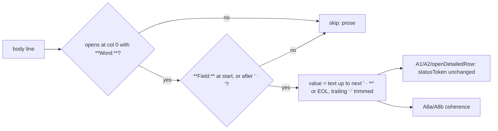

# Feature Spec: Register gate repairs (#247, #302, #410)

- **Status:** Approved — by the product owner, 2026-10-20, with the default for Q1 (`**Verified:**` dates the whole row)
- **Author(s):** feature-analyst (for the product owner)
- **Date:** 2026-10-20
- **Tracking:** `docs/TECH_DEBT.md` #247, #302, #410; register-only fold of #326 (a)
- **Related ADR(s):** ADR-0105 (why this is a spec), ADR-0110 D5, ADR-0120, ADR-0124, ADR-0136, ADR-0164 D5. **No new ADR** (§5).

## 1. Business understanding

Three checking scripts report green over states their own documentation says they refuse. All
three were filed rather than folded because each changes a gate `prepush.sh` derives and CI runs
(ADR-0105). Users: every person and agent who picks work from `docs/TECH_DEBT.md` or cites a
dependency. Outcome: each gate fails on the defect it names, and is shown failing on it (ADR-0110 D5).

**Problems re-verified on `4275e0d1` by reading, not inherited from the rows:**

| Row      | Claim in the row                                                        | Re-verified                                                                                                                                                                                                                                                                                                                                                      |
| -------- | ----------------------------------------------------------------------- | ---------------------------------------------------------------------------------------------------------------------------------------------------------------------------------------------------------------------------------------------------------------------------------------------------------------------------------------------------------------- |
| #247     | A8 can never fire; `Status` returns the rest of the line                | **Holds.** `scripts/lib/doc-register.mjs:225` anchors `^\*\*${field}:\*\*`; Grep `^\*\*Verified:\*\*` in the register = **0** lines, while `^\*\*Status:\*\*.*\*\*Verified:\*\*` = **134**. So `check-debt-status.mjs:332` always reads `null`.                                                                                                                  |
| #247     | `fieldValue` is shared with `check:reconcile-due`                       | **Stale.** `scripts/check-reconcile-due.mjs:35` imports `REPO_ROOT, readRepoDoc, report, sections, tableRows` — no `fieldValue`. Correct the row text when closing it.                                                                                                                                                                                           |
| #247     | `:1235` holds a column-0 `**Unverified:**` near-miss                    | **Gone.** Grep `^\*\*Unverified:\*\*` = 0.                                                                                                                                                                                                                                                                                                                       |
| #302     | No status/date coherence assertion                                      | **Holds.** `check-debt-status.mjs:328-338` is the only assertion touching `Verified`, and it is the dead A8.                                                                                                                                                                                                                                                     |
| #302     | Two rows (#110, #225) carry a non-`unverified` status and no `Verified` | **Now seven.** Grep for column-0 `**Status:**` lines with no `**Verified:**` (141 − 134 = 7, listed by a negated-class regex): `#110` :2481, `#225` :5481, `#261` :6790, `#282` :7837, `#283` :7923, `#284` :7997, `#342` :9363. None carries `Verified` on its continuation line (read). Zero rows are `unverified` (Grep `^\*\*Status:\*\*\s*unverified` = 0). |
| #410     | `note: … registered but no longer cited` exits 0                        | **Holds.** `scripts/check-claims.mjs:405-413` uses `console.warn` and never touches `problems`; the comment at :405-406 says "Reported, not failed". `prepush.sh:33-40` already names this as the ADR-0164 D5 defect.                                                                                                                                            |
| #326 (a) | `DataTable`'s `cellClassName` replaces the default padding              | **Fixed by #335.** `data-table.tsx:146-151` documents the merge, `:182-183` and `:216-217` apply `cn(CELL_DEFAULT, column.cellClassName)`.                                                                                                                                                                                                                       |

How many dead claims entries exist today was **not** measured (needs an installed tree; M0-T2).

## 2. Functional requirements

Roles: none — repository tooling, no product surface, no RBAC, no pen, no recalc input (so the
parity gate is untouched: no engine file changes). No `VITE_*` flag (ADR-0088 D1; nothing ships to a user).

- **FR1 (`fieldValue` reads inline fields).** Given `**Status:** open · **Verified:** 2026-09-13 · **Size:** S`,
  `Status` → `open` and `Verified` → `2026-09-13`. AC: the four header shapes in the register today
  all read correctly — adjacent (:158), non-adjacent (#266 :7230, `Status · Raised · Verified`),
  wrapped with trailing `·` (#410 :9976), and long prose values with commas and backticks (#532 :10322).
- **FR2 (prose stays unread).** A line that does not **open** at column 0 with a `**Field:**` is
  never read, even if it contains ` · **Verified:** …` (e.g. :1942, :1965, :8652 — prose and quotes).
- **FR3 (A8 becomes the coherence rule — #302 and #247 merge).** For each detailed row with a status,
  with `t = statusToken(Status)` and `v = fieldValue(body, 'Verified')`:
  - **A8a** `t === 'unverified'` and `v !== null` → finding: "unverified but carries a Verified field".
  - **A8b** `t !== 'unverified'` and (`v === null` or `v` does not begin `YYYY-MM-DD`) → finding:
    "status `<t>` claims a check; add `**Verified:** <date>`, or restatus `unverified`".
  - Rows with no status are A1's; rows with an out-of-vocabulary token are still A8-checked (the
    token is what A2 reports; A8 does not re-report it).
  - **A8a is the old A8**, made able to fire; A8b is #302's second half. One assertion, two limbs,
    because they are one fact — "does this row claim a check?" — read from two fields.
- **FR4 (`check:claims` fails on a dead registration).** Each registered `ref` not found by the
  completeness scan becomes a `problems` entry; the gate exits 1. Message names the ref, its
  `citedBy`, and both remedies: delete the entry, or restore the citation it protected.

**Edge cases.** A status token followed by a qualifier (`deferred (on a measured trigger)`) passes —
A8 uses `statusToken`, the same extraction as A2 (`doc-register.mjs:182-187`), as #302 asks. A
`Verified` value with trailing prose (`2026-10-19, by reading …`) passes. If the citation walk
finds nothing, every claim reads dead — a loud failure, which is correct (no vacuous pass).

## 3. Technical analysis

**Every `fieldValue` consumer, and whether its behaviour changes** (Grep `fieldValue` over `scripts/`;
the `apps/` hits are unrelated local functions of the same name):

| Consumer                                                                | Reads                 | Changes?                                                                                                     |
| ----------------------------------------------------------------------- | --------------------- | ------------------------------------------------------------------------------------------------------------ |
| `check-debt-status.mjs:236` A1                                          | `Status` null-ness    | No — `Status` always opens its line, so the own-line match fires first, as now.                              |
| `check-debt-status.mjs:243` A2                                          | `statusToken(Status)` | No — `statusToken` takes the first token before `\s`, which never reaches the `·` remainder that is dropped. |
| `check-debt-status.mjs:331-332` A8                                      | `Status`, `Verified`  | **Yes — the point.** Replaced by FR3.                                                                        |
| `doc-register.mjs:199` `openDetailedRow` → `check:engine-parity` limb 3 | `statusToken(Status)` | No, same argument as A2.                                                                                     |
| `headerField` / `check:spec-status`                                     | —                     | Not a consumer (`doc-register.mjs:269`); untouched.                                                          |

The narrower `Status` value is visible only to callers printing the raw value; none does (A2 prints
the token). A9's field limb (`check-debt-status.mjs:169-171`) counts raw lines, not `fieldValue`,
so it is unaffected. M0 proves "no change" by diffing `--report` output and by the token-agreement count.

`check-claims.mjs` runs at module top level with no export, so it has no suite (unlike
`check-debt-status.mjs:60`'s `collectFindings(root)`). FR4 needs a seam: extract a pure
`deadRegistrations(claims, foundRefs)` and guard the CLI body with the
`process.argv[1] === fileURLToPath(import.meta.url)` idiom used at `check-debt-status.mjs:419`.

## 4. Solution design

### 4.1 How `fieldValue` reads an inline field

A **header line** is one that opens at column 0 with some `**Word:**` (`/^\*\*[A-Z][A-Za-z -]*:\*\*/`).
That keeps the shipped guard — prose does not open a line with a field — and widens only _where in
such a line_ a field may sit. On a header line, the field matches either at the start or after a
`·` separator; the value runs to the next ` · **` or end of line, a trailing `·` (wrapped lines)
and whitespace are trimmed. First match in the body wins, as now. Inline code is still not stripped.

**Known blind spot, stated:** a field on a continuation line that does not itself open with a field
(`#282`'s `#75 item 6) · **Size:** S`) is unread. M0's script lists every such `**Verified:**`; on
reading today all 13 non-header occurrences are prose (147 total − 134 header = 13, each read).

**Alternative rejected:** a separate `inlineField` reader (the `headerField` precedent, ADR-0131).
Rejected because the subject document is the same and `Status`'s rest-of-line value is a latent
defect every current caller survives by accident; two readers of one register is the ADR-0093 shape
A2-vs-A8 already exhibits.

### 4.2 Existing failures are fixed in the same PR

Default per row: **correct the fields from the row's own body evidence**, re-reading what it cites.
For the seven A8b rows: re-verify by reading and write `**Verified:** <date>, by reading <what>`
(the #532 form); a row that cannot honestly be re-verified in the PR is restatused `unverified`
with its deferral reason kept in the body — never stamped with a date nobody earned (#312 :8899-8911).
For each dead claims entry: `git log -S'<ref>'` to find where the citation went; **delete the
entry** if the citation was retired with its decision, **restore the citation** if a rewrite
dropped it while a decision still rests on it.

## 5. ADR

**Not needed.** A8 is an existing documented rule made able to fire; FR4 is ADR-0164 D5 applied to
the instance that ADR names (:128-130); FR3's A8b adds no vocabulary and follows ADR-0120 D4's
meaning of `unverified`. Record the A8 widening in `docs/DECISIONS.md` (one entry). If the owner
answers Q1 "no", A8a is deleted instead and _that_ is a decision about a status's meaning — ADR.

## 6. Documentation

- `docs/TECH_DEBT.md`: a short **"Row header fields"** paragraph under `## Detailed items` (:96)
  stating the four-token vocabulary and the A8 rule — the register states neither today (read :1-139).
  Delete rows #247, #302, #410 with ledger lines; rewrite #326 to drop (a) and retitle "Three findings…".
- `docs/TESTING.md:787-799`: add the dead-registration and coherence rules; the "34 citations"
  figure is stale (Grep `"ref"` in `scripts/dependency-claims.json` = 152) — replace with no number.
- `scripts/check-claims.mjs` docblock "What it checks" gains item 4; `:405-406` comment replaced.
- `scripts/prepush.sh:38-40` comment: the `check:claims` sentence becomes past tense.
- `doc-register.mjs` `fieldValue` docblock (:203-215): state the header-line rule and the blind spot.
- `CLAUDE.md`: no change (no section describes A8 or the dead-entry note).

## 7. Implementation plan (Stage 5) — one PR, `fix(repo): …`, no changeset (root scripts and docs; no published package)

**Epic:** register gate repairs. Each milestone is one commit; `main` stays green after each.

**M0 — Measure before turning anything on** (S; no code). Record outputs in the PR body.

- T1 `node /tmp/claude-0/-home-user-SchedulePoint-1/5f95eff3-2795-5be1-b5f3-cbd89b1d6f19/scratchpad/measure-register.mjs /home/user/SchedulePoint_1`
  (copy it into the PR's working notes; it imports the shipped library and inlines §4.1's reader).
  Expected from reading: Verified read shipped 0 / proposed 134; token disagreements 0; A8a 0; A8b 7.
- T2 `pnpm install --frozen-lockfile && node scripts/check-claims.mjs 2>&1 | grep 'registered but no longer cited'`
  (`console.warn` writes stderr, hence `2>&1`); count with `| wc -l`.
- T3 Baseline: `node scripts/check-debt-status.mjs --report > /tmp/ds-before.txt; echo $?` and
  `node scripts/check-engine-parity.mjs; echo $?`.
- Risk: counts differ from the expectations → the spec's numbers are wrong; correct §1 before M1.

**M1 — `fieldValue` reads inline fields** (S; dep M0). Tests in `scripts/lib/doc-register.test.mjs`,
each run against the old function first and seen red: (1) adjacent `Verified` → date; (2) `Status`
→ `open`, not the rest of the line; (3) non-adjacent `Status · Raised · Verified`; (4) wrapped line
ending `·` with a parenthetical value (#410 form); (5) comma-and-backtick value stops at next ` · **`.
Guards, green on both (pinned, not regressions): blockquoted/back-ticked ` · **Verified:**` → null;
column-0 prose line not opening with a field → null. Step: re-run T3; `--report` output byte-identical
(old A8 can now fire, but A8a population is 0).

**M2 — A8 coherence + the seven row repairs** (S; dep M1). `check-debt-status.test.mjs` fixtures
(its helper at :31 already writes `open · **Verified:** 2026-10-05`, so existing cases stay green):
`unverified · Verified` → A8a (red on old code — A8 could not fire); `deferred` with no Verified →
A8b (red: no such rule); `open · **Verified:** not yet` → A8b; `deferred (on a measured trigger) ·
**Verified:** <date>` → clean (pins `statusToken` reuse). Red run on the real register recorded in
the assertion's comment, the way A11's is (`check-debt-status.mjs:358-361`): seven findings, then
zero after the row edits in the same commit.

**M3 — `check:claims` fails on a dead entry** (S; dep M0-T2). Extract `deadRegistrations`, guard the
CLI, add `scripts/check-claims.test.mjs` and chain it into `check:claims` in `package.json:31`.
Red run: on old code, add a fake uncited entry → exit 0; on new → exit 1. Delete/restore entries per §4.2.

**M4 — Docs and register** (S; dep M2, M3). §6 in full, plus the #326 (a) fold — register-only: #335
already shipped the merge, so the text is deleted and #326 stays open for (b)–(d).

**Gates:** `pnpm prepush` (no `apps/` change, so no e2e half). **Reviewers:** test-engineer (red runs),
devops-reviewer (gate exit and `package.json` chain). No database-architect, security or UI review.

**Risks:** a `·`-separated prose line that opens with a field could be misread — the M0 script's
last list is the check; a future header written with `|` or `—` instead of `·` is silently unread
(A9's field limb does not cover `Verified`) — stated in the docblock rather than designed away.

## 8. Questions for the owner

- **Q1 — does `**Verified:**` mean "this whole row was last checked on this date"?** #247 (:2021-2026)
  says settle this first: if yes, `unverified` + a date is a contradiction and A8a stands; if "the
  subject is confirmed", A8a is deleted. **Default: yes** — #312 (:8904) states it as the whole-row
  meaning, #117 was resolved by restatusing to `deferred`, and eighteen rows use it that way (#247 :1991-1995).

Defaults taken without asking: `standing` and `deferred` need a date like `open` (#302's rule as
written); a non-date `Verified` value fails A8b; dead claims entries are deleted unless a decision still
rests on the citation; no flag, no ADR, no changeset.
