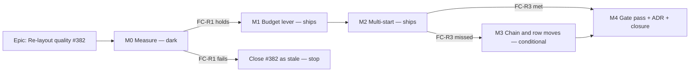

# Implementation Plan: Re-layout quality

- **Feature spec:** [`./spec.md`](./spec.md)
- **Status:** Approved — with the spec, 2026-10-17
- **Owner:** web (builder agent, Sonnet). Planning by feature-analyst.

## Breakdown

### Epic

**Re-layout quality** closes `docs/TECH_DEBT.md` #382 by making Arrange → Re-layout produce a diagram
no worse than a skilled hand layout on the NetPoint reference plan. It is never worse than today on
any catalogue plan, and every figure comes from a container benchmark.

**Ordering rule (ADR-0128 / ADR-0142).** The conditions in spec §1 are committed **alone**, before any
reading. A later reading may not move a bar. A wrong bar is amended in a dated entry that quotes the
first commit's hash.

**Model routing (CLAUDE.md §19.14).** Every task is builder work. The session switches to Opus at the
M0 verdict and at any FC failure.

---

### Milestone M0: Measure (dark)

**Outcome:** a committed corpus, a benchmark that agrees with the dialog (FC-R0), today's figures
re-read on the current router (FC-R1), and each lever measured alone before anything is built.
**Entry point:** `Ships dark: tooling and records only. No product code changes. M1 is the first
milestone a planner can reach, through the existing Arrange → Re-layout.`
**Journey:** the FC-R0 agreement step (M0-T4) drives the real dialog, but it is a measurement, not a
capability claim.

#### Feature: Conditions and corpus

> **Description:** commit the falsification conditions, then capture the seed catalogue as fixed
> scenes through the public API.
> **Complexity:** M
> **Dependencies:** spec approved; CQ-1–CQ-3 answered
> **Risks:** capture differs from what the canvas draws → mitigated by using the canvas's own mapping
> (`toRenderActivities(…, 'visual')`) and by FC-R0.
> **Testing requirements:** the capture's own controls throw on vacuity. Re-running capture
> reproduces the digests.

##### Task M0-T1 — Commit the conditions alone (≈ one PR)

- **Description:** copy spec §1's FC-R0–R9 table verbatim into `docs/specs/relayout-quality/conditions.md`,
  `Status: Approved — committed alone before any measurement`, with the CQ answers recorded.
- **Complexity:** S
- **Dependencies:** approval
- **Risks:** someone takes a reading first → the PR contains only this file. Every later record quotes
  its hash.
- **Testing:** none (documentation). `check:spec-status` stays green.
- **Development steps:**
  1. Write `conditions.md`, including the CQ answers and the default list.
  2. Commit with no other file.

##### Task M0-T2 — Corpus capture (`measure-relayout-capture.mjs`)

- **Description:** a script in `apps/web/scripts/` that, against the local API
  (`scripts/e2e-local.sh` stack):
  - seeds `--tier all` plus `--tier scale --activities 300` as a Planner (seed-http, ADR-0066);
  - recalculates each plan;
  - reads activities and dependencies;
  - maps them with `toRenderActivities(…, 'visual')` / `toRenderEdges` (`to-render-model.ts:37-117`);
  - records the hand lanes (as seeded) and the dialog's pack seed (`computeLaneArrangement`,
    `arrange-lanes.ts:76-111`);
  - writes `apps/web/scripts/fixtures/relayout-corpus.json` with a SHA-256 per scene and the capture
    commit.
- **Complexity:** M
- **Dependencies:** M0-T1
- **Risks:** pagination of activities → read every page (the list is cursor-paginated,
  `plan-activities.controller.ts:63-77`). Some capability plans have no drawn activity → recorded,
  never dropped silently.
- **Testing:** controls throw if any plan has 0 drawn activities where its seed spec has > 0, if the
  reference plan's lanes differ from `netpoint-power-plant.ts`'s `laneIndex`, or if the plan count
  differs from `--list-plans`.
- **Development steps:**
  1. Write the capture over seed-http, reusing the seed-cli's tier loader.
  2. Add the controls and verify each one red once (mutate a lane, drop a plan).
  3. Commit the corpus and a README paragraph in the script docblock.

#### Feature: The benchmark

> **Description:** score hand / Tidy / today's Re-layout / candidate levers on the corpus in headless
> Chromium with the product's own modules and widths.
> **Complexity:** L
> **Dependencies:** M0-T2
> **Risks:** the benchmark becomes a copy of the product → it imports `optimiseLayout`,
> `evaluateLayout`, `layoutLines`, `textWidthTable` and `compareObjectives` from `src/`, bundled by
> esbuild, the way `measure-route-cost.mjs:56-134` already does.
> **Testing requirements:** FC-R0 agreement, controls verified red, determinism re-run.

##### Task M0-T3 — `measure-relayout.mjs` + `relayout-bench.ts`

- **Description:**
  - Bundle the product modules for the browser and load them into a Playwright page with
    `globals.css` and the repo's woff2. Wait for `document.fonts.ready` before measuring.
  - Build each plan's width table with `textWidthTable`.
  - For each plan, emit:
    - the 7-term vector for hand, Tidy and today's Re-layout;
    - bends (interior vertices of `layoutLines`) and the critical spine;
    - mean and max |Δlane|;
    - evaluations and ms.
  - Write `relayout-<commit>.json` and a Markdown table. Compare with a committed baseline and print
    the verdict per FC.
  - Options to measure a lever without shipping it: `--budget=current`, `--starts=0,1,2,3`.
    Prototypes live in the script, never in `src/`.
- **Complexity:** L
- **Dependencies:** M0-T2
- **Risks:** a long `page.evaluate` → run plan by plan, with a per-plan timeout that fails loudly.
  `scale-300` cost → two runs, spread printed beside each figure (ADR-0128).
- **Testing:** self-test on hand-built lines for the bends and spine counters (the
  `attachment-probe.ts` self-test pattern). Vacuity controls: edges > 0 on the reference plan; the
  routed line count equals the edge count; the width table is non-empty. Each control verified red
  once.
- **Development steps:**
  1. Write the browser entry and the node driver.
  2. Write the counters and their self-test.
  3. Add the lever prototypes behind flags of the script.
  4. Run twice; confirm the vectors are identical (FC-R7 on the instrument).

##### Task M0-T4 — FC-R0: the instrument agrees with the dialog

- **Description:** a Playwright script (`e2e-arrange` support helpers) seeds the reference plan through
  the API, opens Arrange, and reads the five figures for each option (`arrangeFigures`,
  `ArrangeDialog.tsx:56-66`). It compares them with the benchmark's figures for the same captured
  scene.
- **Complexity:** M
- **Dependencies:** M0-T3
- **Risks:** a disagreement means the benchmark is not measuring the product → nothing is built
  until fixed (FC-R0's "if it fails").
- **Testing:** verified red by planting a one-crossing error in the benchmark's copy of the vector.
- **Development steps:**
  1. Write the read-out step.
  2. Run it in the container.
  3. Record the 15 figures in `m0-baseline.md`.

##### Task M0-T5 — Re-read and decompose (the M0 record)

- **Description:**
  - Write `docs/specs/relayout-quality/m0-baseline.md`: today's figures on every corpus plan.
  - FC-R1's verdict.
  - The lever frontier, each alone and combined: budget only; each start alone at today's budget;
    all starts; budget + starts. All on the reference plan, the fixture and `scale-300`.
  - FC-R5 spread figures and pictures (made in the container with `shoot-layouts.mjs`'s method).
  - FC-R6 cost per lever.
- **Complexity:** M
- **Dependencies:** M0-T4
- **Risks:** FC-R1 fails (Re-layout already meets the target) → close #382 with the re-read figures,
  update `TEST_PLAYBOOK.md:193-198`, and stop the epic. That is a success, not a failure.
- **Testing:** n/a (record). Every figure carries its command and commit.
- **Development steps:**
  1. Run the benchmark for each lever setting.
  2. Write the record with the verdicts.
  3. **Stop and show the product owner the frontier and the pictures** if any lever trips FC-R5's
     50 % travel bar. Otherwise continue to M1 in the same turn (§19.12).

---

### Milestone M1: The budget lever (ships)

**Outcome:** Re-layout may use as many lanes as the diagram has now (CQ-1 B), so on a plan taller than
its pack it can spend rows on readability.
**Entry point:** plan workspace → toolbar **Arrange** (`[data-toolbar-item="auto-arrange"]`) →
dialog "Arrange the diagram" → radio **Re-layout** → button "Re-layout: move N activities".
**Journey:** `e2e-arrange/arrange.spec.ts`: the existing "Re-layout packs scattered rows" case stays
green **unedited**, and a new case seeds the reference plan through the API, opens Arrange, reads
Re-layout's figures, and asserts them against M1's recorded result.

_If CQ-1 is answered (A), M1 is dropped and M2 is the first shipping milestone._

#### Feature: Re-layout budget

> **Description:** pass `budget = max(currentRows, packRows)` for Re-layout only.
> **Complexity:** S
> **Dependencies:** M0 verdict; FC-R2 and FC-R4 hold for "budget only" in `m0-baseline.md`
> **Risks:** spread (the 2026-09-23 objection) → FC-R5 was judged at M0, with pictures.
> **Testing requirements:** unit, journey, benchmark.

##### Task M1-T1 — Budget in `use-arrange-search.ts`

- **Description:** compute both row counts from the activities already in hand
  (`use-arrange-search.ts:121-123`). Pass `{ budget }` in Re-layout's request only. Tidy's request is
  unchanged.
- **Complexity:** S
- **Dependencies:** M0-T5
- **Risks:** a bounded plan (> 300) → `passes: 0`, so the budget has no effect; asserted.
- **Testing:**
  - `use-arrange-search` unit: the Re-layout request carries the budget and the Tidy request does not.
  - `optimise-layout.test.ts`: a new case where the budget lets a bar take a new row and that
    strictly lowers `occluded`.
  - The FC-N3 sweep, unedited and green.
- **Development steps:**
  1. Add the budget.
  2. Add the tests; verify the new case red against the old call.
  3. Update the `optimise-layout.ts` docblock's "The budget is the seed's row count" paragraph
     (`:35-36`).

##### Task M1-T2 — Copy

- **Description:** Re-layout's description (spec §4.6). ux-reviewer signs off the wording.
- **Complexity:** S
- **Dependencies:** M1-T1
- **Risks:** none material.
- **Testing:** `ArrangeDialog.test.tsx` asserts the new description; the Tidy text is unchanged.
- **Development steps:**
  1. Change the string.
  2. Update the test.
  3. Run ux-reviewer.

##### Task M1-T3 — The regression hold (unit tier)

- **Description:** commit the reference plan's captured scene and its Chromium width table as a test
  fixture. A vitest case runs Re-layout through the product's own path with `tableMeasure` and pins the
  resulting vector. A second case pins Tidy's lanes on the same scene (FC-R8 digest).
- **Complexity:** S
- **Dependencies:** M0-T2, M1-T1
- **Risks:** run time → measured; if over 5 s it moves to a `*.slow.test.ts` under the same `pnpm test`.
  A stale width table → `tableMeasure` throws on a missing key (ADR-0159 decision 3), so it fails
  loudly.
- **Testing:** verified red by reverting M1-T1.
- **Development steps:**
  1. Add the fixture.
  2. Write both cases.
  3. Verify red, then green.

##### Task M1-T4 — Benchmark record and release

- **Description:** run the benchmark and write `m1-verdict.md` (FC-R2, R4, R5, R6, R7, R8). Update the
  baseline JSON. Add a changeset (`@repo/web`, patch). Update `TEST_PLAYBOOK.md` Tier 6's figures and
  `TECH_DEBT.md` #382 (progress, not closure unless FC-R3 holds).
- **Complexity:** S
- **Dependencies:** M1-T1 to T3
- **Risks:** FC-R2 violation → defect; do not ship.
- **Testing:** `pnpm prepush`, plus `scripts/e2e-local.sh web:arrange`.
- **Development steps:**
  1. Run the benchmark.
  2. Write the verdict.
  3. Prepush and e2e.
  4. Open the PR.

---

### Milestone M2: Multi-start (ships)

**Outcome:** Re-layout tries up to four structurally different starts and keeps the best. The
critical spine has a start built for it.
**Entry point:** as M1 (Arrange → Re-layout).
**Journey:** `e2e-arrange`:

- the M1 reference case updated to M2's recorded figures;
- a new case: open Arrange, close it during computing, and assert no worker survives (the
  `optimise-layout` named workers are gone, read through the page's worker list);
- the existing Re-layout case, unedited.

#### Feature: Start seeds

> **Description:** `render/relayout-starts.ts`, pure builders for starts 0–3 (spec §4.5 D3). Only the
> starts that won on at least one corpus plan at M0 are kept.
> **Complexity:** M
> **Dependencies:** M0-T5's per-start frontier
> **Risks:** a seed reimplements `packLanes` → seeds 0 and 3 call `packLanes` itself. Seeds 1 and 2
> pack their remainder with `packLanes` too (ADR-0069's one-packer rule, `packages/layout/src/index.ts:11-14`).
> **Testing requirements:** unit: each seed is overlap-free, deterministic under permuted input, and
> covers every drawn activity. Seed 0 equals `computeLaneArrangement`'s result exactly.

##### Task M2-T1 — `relayout-starts.ts`

- **Description:** the builders, promoted from the M0 prototypes. Inputs are drawn spans and links
  (`isDriving` from `RenderEdge`). Output is a lane map per start.
- **Complexity:** M
- **Dependencies:** M0-T5
- **Risks:** chain-first on a plan with no driving links → it degenerates to seed 0; dropped from the
  run when identical (no wasted search).
- **Testing:** as above, plus a structural test that the module imports no engine.
- **Development steps:**
  1. Write the builders.
  2. Write the tests.
  3. Delete the prototypes from the script and point the benchmark at `src/`.

#### Feature: Parallel orchestration

> **Description:** run the starts in a worker pool and keep the best.
> **Complexity:** M
> **Dependencies:** M2-T1
> **Risks:** nondeterminism by finishing order → selection happens only after all starts finish, by
> `compareObjectives`, with ties to the lowest k. Orphaned workers → one `AbortController` for the run.
> **Testing requirements:** unit with a fake runner (results in shuffled order give the same pick);
> FC-R7 in the benchmark with 1 and N workers; the abort journey.

##### Task M2-T2 — Pool and selection in `use-arrange-search.ts` / `run-optimise-layout.ts`

- **Description:** `runOptimiseLayoutPool(requests, {concurrency, signal, onProgress})`, with progress
  summed. Re-layout's result becomes the best of S. The `changes` / `before` / `after` contract is
  unchanged (`use-arrange-search.ts:25-30`).
- **Complexity:** M
- **Dependencies:** M2-T1
- **Risks:** low-core devices wait longer → FC-R6. Single-worker time is reported too.
- **Testing:**
  - Unit: shuffled completion order; one start throws → the run errors; abort terminates every
    worker.
  - Journey as above.
- **Development steps:**
  1. Write the pool.
  2. Wire it into the hook.
  3. Write the tests.
  4. Check the CSP journey (`e2e-csp`) stays green with N workers.

##### Build notes for M2-T1 and M2-T2 (2026-10-17, as built)

- **Starts 1 and 2 place with a first-fit of their own, not `packLanes`.** `packLanes` orders by start
  date and these two exist to change the order, so the plan's "pack their remainder with `packLanes`"
  cannot hold without changing the construction that was measured. Starts 0 and 3 are `packLanes`.
- **Start 0 is the M1 run (budget: the taller of the diagram and the pack), not today's seed budget.**
  "Never worse than today" is therefore checked by FC-R2 on the corpus (`--candidate=product`), not true
  by construction: a larger budget changes which moves the search can make.
- **`RELAYOUT_MULTISTART_MAX_ACTIVITIES` is provisional** (300, the search limit). The pool is
  `min(starts, max(1, cores - 1))`, so on a 4-core machine four starts wait two waves; FC-R6 with real
  workers (`measure-relayout.mjs`, default candidate) is what says whether 300 stands, and if not the
  constant is lowered to the largest size that passes.
- **Which starts run depends on the drawn count alone**, never on the machine, so FC-R7 (1 vs N workers)
  holds by construction and the benchmark checks it.

##### Task M2-T3 — Verdict and release

- **Description:** run the benchmark and write `m2-verdict.md` with FC-R2 to R8, plus FC-R3's verdict.
  Update the M1-T3 pinned vector. Changeset. Update #382 and the Tier 6 figures.
- **Complexity:** S
- **Dependencies:** M2-T2
- **Risks:** FC-R6 fails → extra starts are gated below a measured size (constant documented with its
  measurement, like `OPTIMISE_MAX_ACTIVITIES` at `optimise-layout.ts:80-102`); start 0 always runs.
- **Testing:** prepush, `e2e-local.sh web:arrange`, `web:csp`.
- **Development steps:**
  1. Run the benchmark.
  2. Write the verdict.
  3. If FC-R3 holds, skip M3 and go to M4 in the same turn.

---

### Milestone M3: Chain and row moves (conditional; ships only if M2 misses FC-R3)

**Outcome:** Re-layout can move a whole linked run, or a whole row, in one step.
**Entry point:** as M1.
**Journey:** the M2 reference case updated to M3's figures.

#### Feature: Re-layout-only moves

> **Description:** `moves: 'relayout'` option in `optimiseLayout`, adding chain moves and row
> relocation (spec §4.5 D5). Tidy does not pass the option.
> **Complexity:** L
> **Dependencies:** M2 shipped
> **Risks:** cost per pass rises → the same count caps apply; FC-R6 is re-measured. Tidy drift → FC-R8
> digest test (M1-T3).
> **Testing requirements:** unit: never worse than the repaired seed over the 200-plan sweep with the
> option on; a hand-built case that only a chain move solves; Tidy digest unchanged.

##### Task M3-T1 — Chain move

- **Description:** identify maximal same-row linked runs. Try each run in every row where all members
  fit, plus one new row while `rows < budget`. Accept the best strict improvement.
- **Complexity:** M
- **Dependencies:** M2
- **Risks:** large runs on big plans → candidate rows are limited to the run's link neighbours' rows
  and ±2, mirroring phase 2's set (`optimise-layout.ts:197-206`).
- **Testing:** as the feature.
- **Development steps:**
  1. Write the move.
  2. Write the tests.
  3. Run the benchmark.

##### Task M3-T2 — Row relocation

- **Description:** generalise phase 1's adjacent swap (`optimise-layout.ts:187-190`) to "move row r to
  position k", under the option only.
- **Complexity:** S
- **Dependencies:** M3-T1
- **Risks:** O(rows²) candidates → bounded by the per-pass cap.
- **Testing:** unit and sweep.
- **Development steps:**
  1. Write the move.
  2. Write the tests.
  3. Run the benchmark and write `m3-verdict.md`.

---

### Milestone M4: Gate pass, ADR and closure

**Outcome:** reviewed, recorded and closed (or the residue recorded).
**Entry point:** no new surface. The M1–M3 entry point stands.
**Journey:** the `e2e-arrange` cases from M1–M3, green.

##### Task M4-T1 — Reviews

- **Description:**
  - performance-reviewer: worker pool, evaluation counts, FC-R6 record.
  - component-reviewer: hook, pool and seeds module.
  - ux-reviewer: copy, and the wait at 300.
  - accessibility-reviewer: only if copy or the progress announcement changed beyond the description
    string. The `RadioCardGroup` keyboard contract is not touched, so ADR-0111 is not triggered.
  - security-reviewer: a light pass on the extra workers and CSP.
    Fold the blocking findings. File the non-blocking ones as a TECH_DEBT row.
- **Complexity:** M
- **Dependencies:** M1–M3
- **Risks:** a late blocking finding → fold before closure.
- **Testing:** as each fold requires.
- **Development steps:**
  1. Run the reviewers in parallel.
  2. Fold the findings.
  3. Re-run the benchmark if any fold touches the search.

##### Task M4-T2 — ADR, register, closure

- **Description:**
  - Write the ADR (spec §4.9) with the measured verdicts, and add its CLAUDE.md §16 line.
  - Close #382 if FC-R3 holds; otherwise leave it open with the measured gap.
  - Update `TEST_PLAYBOOK.md:193-198`.
  - Set the spec header to `Accepted — shipped (ADR-NNNN)` (ADR-0131).
- **Complexity:** S
- **Dependencies:** M4-T1
- **Risks:** `check:adr-coverage` / `check:spec-status` → run `pnpm prepush`.
- **Testing:** prepush.
- **Development steps:**
  1. Write the ADR.
  2. Update the register and the playbook.
  3. Update the header.
  4. Prepush and PR.

---

## Sequencing & slices

1. **M0** lands as tooling and records only. `main` stays releasable, with no product change.
2. **M1** is the first improvement a planner sees, and it is about a five-line product change plus
   tests. It is releasable on its own. If CQ-1 is (A), it is skipped.
3. **M2** is releasable on its own and never worse than M1 by construction (start 0 is M1's search).
4. **M3** only if needed.
5. **M4** closes.

No `VITE_*` flag (ADR-0088 D1). Each milestone is one or more PRs whose revert is the rollback. Do not
land a router change between M0 and M2 without re-baselining in its own PR.

## Definition of Done (per task)

Each task's PR satisfies the Feature Completion Criteria in [`docs/PROCESS.md`](../../PROCESS.md):
code, tests, docs, security, performance, accessibility, Docker build, CI, changelog, version impact.
"Tests" means `pnpm prepush` was run, plus `scripts/e2e-local.sh web:arrange` (and `web:csp` at M2),
in the container. Every benchmark figure in a record names its command and commit (ADR-0076).

## Risks & assumptions (rollup)

| Risk / assumption                                                             | Likelihood | Impact | Mitigation                                                                                      |
| ----------------------------------------------------------------------------- | ---------- | ------ | ----------------------------------------------------------------------------------------------- |
| #382's figures are stale and the problem is smaller (or gone)                 | med        | high   | FC-R1 at M0. Stop early if gone.                                                                |
| No bounded search reaches the hand layout (FC-R3)                             | med        | med    | Ship on FC-R2 + FC-R4. Record the gap. #382 stays open with numbers.                            |
| Multi-start cost on low-core devices                                          | med        | med    | FC-R6, size gate for extra starts, start 0 always runs.                                         |
| The budget lever spreads plans (the 2026-09-23 objection)                     | med        | med    | Budget anchored on current rows; FC-R5 pictures to the owner before shipping.                   |
| Benchmark disagrees with the dialog                                           | low        | high   | FC-R0 blocks everything until they agree.                                                       |
| Tidy changes by accident                                                      | low        | med    | FC-R8 digest test; Re-layout-only option.                                                       |
| Corpus thin at realistic sizes                                                | high       | low    | `scale-300` added. FC-R4 names the three plans that carry signal.                               |
| Assumption: the container has Postgres, the API stack and Playwright Chromium | low        | high   | `scripts/e2e-local.sh` and `/opt/pw-browsers` are already used by existing measurement scripts. |
