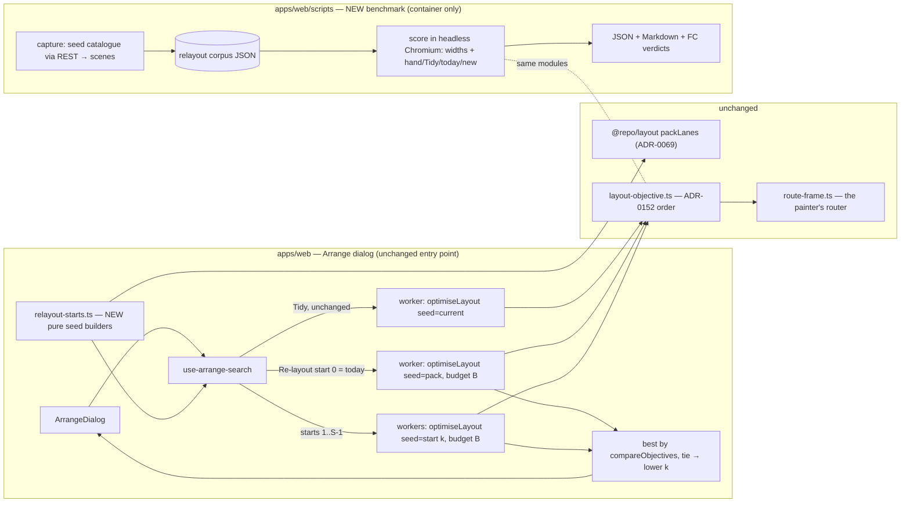
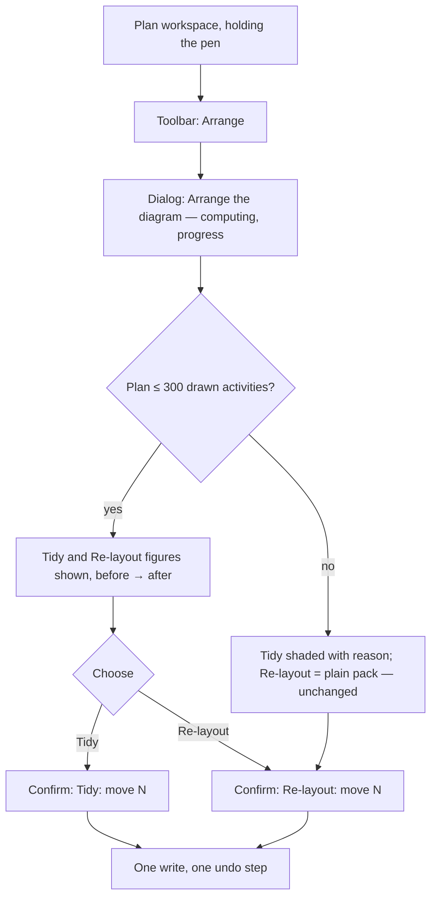

# Feature Spec: Re-layout quality — a from-scratch layout that reads as well as a hand-drawn one

- **Status:** Approved — by the product owner, 2026-10-17, with the recommended defaults (CQ-1: as many rows as the diagram has now; CQ-2: up to four starts within 1.5× today's wait at 300 activities; CQ-3: report only)
- **Author(s):** feature-analyst (Claude Code), for James Ewbank
- **Date:** 2026-10-17
- **Tracking issue / epic:** `docs/TECH_DEBT.md` #382 ("Re-layout from scratch cannot find the layout
  a skilled planner drew", `docs/TECH_DEBT.md:10531-10550`)
- **Roadmap link:** diagram legibility (the NetPoint comparison line of work: ADR-0149 → ADR-0159)
- **Related ADR(s):** ADR-0069 (`packLanes`), ADR-0149, ADR-0150, ADR-0151, **ADR-0152** (the layout
  objective and the Tidy / Re-layout search, which this spec amends), ADR-0153, ADR-0158, ADR-0159,
  ADR-0066 (the seed catalogue), ADR-0128 / ADR-0142 (measure before building), ADR-0088 D1 (no flag).
  **A new ADR is required** (outline in §4.9).

---

## 1. Business understanding

### Problem

The plan workspace's **Arrange** dialog offers two choices (ADR-0152 decision 4,
`docs/adr/0152-a-row-is-chosen-for-how-its-links-will-route.md:49-53`):

- **Tidy** improves the rows the planner already has.
- **Re-layout** throws the rows away, starts from `packLanes` (the fewest-rows time pack, ADR-0069),
  and improves from there.

On the NetPoint reference programme (`plan:reference-netpoint-power-plant`, a transcription of a
published, hand-drawn NetPoint layout, `apps/seed-cli/src/references/netpoint-power-plant.ts:5-43`),
the register records these figures from the dialog's own scores (`docs/TECH_DEBT.md:10536-10542`,
`docs/TEST_PLAYBOOK.md:193-198`):

| Layout                        | Lanes | Links behind a bar | Crossings | Critical path              |
| ----------------------------- | ----: | -----------------: | --------: | -------------------------- |
| Hand layout (as seeded)       |    14 |                  1 |         3 | reads along its rows       |
| **Tidy** (from the hand rows) |    14 |                  0 |         1 | intact                     |
| **Re-layout** (from scratch)  |    11 |                  3 |    **14** | split across separate rows |

So "start again" makes a much worse picture than a skilled planner drew. A planner who presses
Re-layout on a messy plan, hoping for a clean diagram, gets one with nearly five times the crossings
of a good hand layout.

**Why it happens — two causes, read from the code, and they must be measured apart:**

1. **The search may not add rows.** The row budget defaults to the seed's row count
   (`apps/web/src/features/tsld/render/optimise-layout.ts:35-36` and `:134`). Re-layout's seed is the
   pack, which has the fewest rows possible, so Re-layout is held to 11 rows where the hand layout
   spends 14. The "new row" move only exists while `rows < budget`
   (`optimise-layout.ts:202`), so it never fires for Re-layout. The product owner's rule puts
   readability ahead of rows (ADR-0149, `docs/adr/0149-…:17-19`), and rows are already the last
   tie-break (`apps/web/src/features/tsld/render/layout-objective.ts:84-94`), but a search that
   cannot add rows cannot spend them.
2. **The search starts in one place and moves one bar at a time.** It is a strict-improvement local
   search (`optimise-layout.ts:13-33`): adjacent-row swaps, one bar to its neighbours' rows or ±1/±2,
   and compaction. Moving a whole chain of linked bars to another row needs several moves that are
   each worse on their own, so the search never takes them. It ends wherever the time pack's local
   minimum is.

**The figures above are stale and must be re-read before anything is built.** The row says so itself
(`docs/TECH_DEBT.md:10548-10550`): they were taken before ADR-0159 (2026-09-25) made the router score
text and split two-way tracks, and Tidy and Re-layout score layouts through that router
(`layout-objective.ts:34-35`, `:125-147`). Milestone M0 re-reads them, and **if Re-layout already
meets the target on the current router, #382 closes as stale and the epic stops there** (FC-R1).

**An earlier decision has to be revisited, and the spec says so plainly.** On 2026-09-23 the product
owner set the budget to the seed's row count after seeing a frontier of budgets on Unit 300 and
`scale-2000`: more rows bought fewer hidden links and crossings, but "only by spreading the plan out,
with links climbing about 25 rows", and on `scale-2000` every budget above the seed made crossings
worse (`docs/specs/netpoint-layout/conditions.md:18-26`). Raising Re-layout's budget reopens that
decision. This spec proposes a narrower budget than the one rejected (§4.8, CQ-1) and measures the
same spread the owner objected to (FC-R5).

### Users

| Role                                    | Need                                                                                                                                                                                                                                                           |
| --------------------------------------- | -------------------------------------------------------------------------------------------------------------------------------------------------------------------------------------------------------------------------------------------------------------- |
| **Planner / Org Admin** (with the pen)  | A Re-layout that produces a readable diagram from scratch, close to what a skilled planner would draw.                                                                                                                                                         |
| **Contributor, Viewer, External Guest** | Nothing changes. They cannot open Arrange: the offer is left out without the pen (`apps/web/e2e-arrange/arrange.spec.ts:176`) and the write needs Planner or Org Admin plus the pen (`apps/api/src/modules/activities/plan-activities.controller.ts:102-119`). |
| **Product owner**                       | Proof that the diagram improved, produced on a machine that is not theirs.                                                                                                                                                                                     |

### Primary use cases

1. A planner opens a plan whose rows have drifted into a mess (many manual drops, an old import),
   presses **Arrange**, chooses **Re-layout**, and gets a diagram with few hidden links and crossings
   and the critical path reading along a row.
2. A planner compares Tidy and Re-layout in the dialog and can reasonably pick Re-layout, because it
   is no longer always the worse picture.
3. An engineer changing the router or the optimiser runs one command in the container and sees, for
   every catalogue plan, whether Re-layout got better or worse.

### User journeys

There is no new screen. The existing journey (ADR-0152 decision 4; `arrange.spec.ts:104-134`) is:
toolbar **Arrange** (`[data-toolbar-item="auto-arrange"]`) → dialog **"Arrange the diagram"** →
radio **Re-layout** → button **"Re-layout: move N activities"** → one undo step. What changes is the
answer the dialog shows, and possibly one sentence of its description (§4.6). See the user flow in
§4.3.

### Expected outcomes

- Re-layout on the NetPoint reference plan scores no worse than the hand layout on overlaps, links
  behind bars and crossings (the register's own target, `docs/TECH_DEBT.md:10544-10546`).
- Re-layout is **never worse** than today's Re-layout on any catalogue plan.
- A repeatable benchmark, run in the container, that anybody can re-run.

### Success criteria

The objective is ADR-0152's, **unchanged in terms and order** (`layout-objective.ts:20-32`,
`:84-94`), with lower always better:

`overlaps → links behind a bar (occluded) → crossings → unlinked contacts → −same-row links → travel → rows`

Two figures are **reported but not ranked** (§4.5 says why): **bends** (interior vertices of the
routed lines) and the **critical spine** (how many rows the critical activities use, and how many
critical links are not same-row).

Each criterion below is a falsification condition; M0-T1 commits them alone, before any reading
(ADR-0128 ordering, as `docs/specs/netpoint-layout/conditions.md:3-10` did).

| ID        | Condition                                                                                                                                                                                                                                                           | Bar                                                                                                                                                                                                                       | If it fails                                                                                                                            |
| --------- | ------------------------------------------------------------------------------------------------------------------------------------------------------------------------------------------------------------------------------------------------------------------- | ------------------------------------------------------------------------------------------------------------------------------------------------------------------------------------------------------------------------- | -------------------------------------------------------------------------------------------------------------------------------------- |
| **FC-R0** | The instrument agrees with the product. The benchmark's figures for the reference plan (before, Tidy, Re-layout) equal the five figures the Arrange dialog shows for the same seeded plan, read by a Playwright step in the same container. Vacuity controls throw. | **Exact equality** on all 15 figures. Each control verified red once.                                                                                                                                                     | Nothing is built until they agree.                                                                                                     |
| **FC-R1** | The problem is real on the current router.                                                                                                                                                                                                                          | Today's Re-layout on the reference plan is **worse** (lexicographically, on overlaps → occluded → crossings) than the hand layout as re-read.                                                                             | #382 closes as stale with the re-read figures; the epic stops after M0.                                                                |
| **FC-R2** | Never worse than today.                                                                                                                                                                                                                                             | New Re-layout ≤lex today's Re-layout (all seven terms) on **every** corpus plan. **0 violations.** ADR-0152's 200-plan sweep stays green.                                                                                 | A violation is a defect; the milestone does not ship.                                                                                  |
| **FC-R3** | The register's target.                                                                                                                                                                                                                                              | Reference plan: new Re-layout's (overlaps, occluded, crossings) ≤lex the hand layout's, as re-read at M0.                                                                                                                 | The milestone may still ship on FC-R2 + FC-R4. #382 stays open with the gap recorded.                                                  |
| **FC-R4** | It helps more than one plan.                                                                                                                                                                                                                                        | Strictly better (lex) than today's Re-layout on **at least two of three**: the reference plan, the fixture, and generated `scale-300`.                                                                                    | The lever is withdrawn, not shipped.                                                                                                   |
| **FC-R5** | It does not spread the plan out (the 2026-09-23 objection).                                                                                                                                                                                                         | For each plan, report rows, mean and maximum \|Δlane\| per link against today's Re-layout and the hand layout. Pictures made in the container.                                                                            | If a lever raises the maximum \|Δlane\| by more than 50 % on any plan, it goes to the product owner with the pictures before it ships. |
| **FC-R6** | Its cost is known and bounded.                                                                                                                                                                                                                                      | Re-layout wall time at 300 drawn activities, headless Chromium in the container, two runs (spread beside the figure): **≤ 1.5×** today's in the same sitting, using parallel workers. Total evaluations ≤ starts × 2,000. | Extra starts are offered only below a measured size. The pack start always runs. Never a time cap (§4.5).                              |
| **FC-R7** | Deterministic.                                                                                                                                                                                                                                                      | Byte-identical lanes across two runs, reversed input order, and 1 vs N workers.                                                                                                                                           | Defect.                                                                                                                                |
| **FC-R8** | Tidy is untouched.                                                                                                                                                                                                                                                  | Tidy's lanes on every corpus plan match today's (digest).                                                                                                                                                                 | Defect: Tidy's change belongs to another spec.                                                                                         |
| **FC-R9** | Engine and import parity.                                                                                                                                                                                                                                           | No file under `apps/api/` or `packages/layout/src/` changes. `pack-lanes.spec.ts` and the layout-interchange e2e stay green, unedited.                                                                                    | Defect.                                                                                                                                |

**Nothing here needs the product owner's hardware.** The quality figures (FC-R0–R5, R7, R8) are
counts from a deterministic search with count caps, never a time cap
(`optimise-layout.ts:29-33`), so any machine gives the same numbers. Only FC-R6 is a time, and it is
taken in headless Chromium in the container, the way `apps/web/scripts/measure-route-cost.mjs:10-24`
and ADR-0160's gate (`docs/adr/0160-…:59-62`, "the 4-core Claude Code container") were. It bounds the
algorithm, not a planner's laptop (`docs/TECH_DEBT.md` #75, ADR-0152 consequences,
`0152:88-91`).

### Open questions

**Critical. The answer changes scope.**

- **CQ-1 — How many rows may Re-layout use?** Today: the pack's count (the 2026-09-23 decision).
  - (A) Keep it. M1 then has nothing to ship, and the epic leans entirely on multi-start (M2).
  - **(B) Recommended: as many rows as the diagram has now**, `max(current rows, pack rows)`. On the
    reference plan that is 14, which is the hand layout's height. It is anchored on a height the
    planner already accepted, never a formula. Tidy keeps its current budget. Rows remain the last
    tie-break, so a row is added only when it buys fewer overlaps, hidden links, crossings or
    contacts.
  - (C) The rejected formula, pack + max(4, ⌈50 %⌉) (`conditions.md:12-14`).

  Under (B), a **freshly imported plan gains nothing from this lever**, because its rows already are
  a pack (`packAroundCarried`, ADR-0069). Only a plan taller than its pack benefits. That is stated so
  nobody expects more of M1 than it can give.

- **CQ-2 — May Re-layout do several searches at once?** The recommended design (§4.5) runs up to
  four starts. That is up to 4× the computation, run in parallel module workers so the wait stays
  close to today's on a machine with four or more cores. **Recommended: yes, bounded by FC-R6
  (≤ 1.5× today's wall time in the container at 300 activities).** If it fails, extra starts run
  only below a measured size, and the pack start always runs.
  - **Owner amendment 2026-10-18.** The 1.5× bar is replaced by a size limit. The measured sizes
    (`m2-verdict.md`) showed the starts cannot stay within 1.5× above 10 activities, which would
    have withheld them from every plan worth pressing Re-layout on. The owner, having seen the
    reference-plan pictures (today 9 crossings, candidate 1, hand layout 1), decided: the several
    starts run on plans up to about 150 drawn activities (a wait the planner can cancel), and
    bigger plans keep the single pack start (M1's behaviour). FC-R6's 1.5× bar is superseded by that
    size limit. The owner, re-asked and confirming, accepted knowingly that `fixture-p6-torture-v1`
    (147 drawn, inside the limit) spreads from 24 to 35 rows (FC-R5); its pictures
    (`pictures/fixture-p6-torture-v1-today.png` / `-candidate.png`) are the evidence decided on.
    The text above and `conditions.md` (committed at `5f8e5cf9`) are left as approved.
- **CQ-3 — Should "the critical path on one row" become a ranked term?** **Recommended: no.** It is
  reported, and one of the extra starts (a chain-first seed) is built to find it. A ranked term would
  change Tidy, and the owner's ranking (`layout-objective.ts:20-32`) does not include it. Choose yes
  only if you want a picture that keeps the spine whole even at the cost of a crossing. That is a
  different product promise and needs its own ADR term.

**Defaults, stated so work is not blocked:**

- Bends are reported, not ranked (§4.5).
- No `VITE_*` flag (ADR-0088 D1). The rollback is a commit boundary.
- No new CI job or root `check:*` gate. Adding one in CI would oblige `prepush` to run it
  (ADR-0160). The regression hold is a fast unit test on a committed reference scene (plan M1-T3).
  The full benchmark is a command you run on purpose.
- The benchmark corpus is the catalogue's `--tier all` (fixture + capability + reference;
  `apps/seed-cli/src/args.ts:36`, scale excluded from `all` per `args.spec.ts:87-90`), plus
  generated `scale-300` for cost and breadth.
- Text widths come from the product's own `textWidthTable` in headless Chromium with the repo's
  woff2 loaded, never a characters × width estimate (ADR-0159 alternatives,
  `docs/adr/0159-…:71-73`).
- Tidy is out of scope and stays byte-identical (FC-R8).

---

## 2. Functional requirements

### User stories & acceptance criteria

> **US-1 — A from-scratch layout worth choosing.** As a Planner holding the pen, I want Re-layout to
> produce a diagram at least as readable as a skilled hand layout, so that "start again" is a real
> option.
>
> - **Given** `plan:reference-netpoint-power-plant` seeded as published, **when** I press Arrange and
>   read the Re-layout figures, **then** its links behind bars and crossings are no worse than the
>   "before" figures (the hand layout) — FC-R3.
> - **Given** any plan of ≤ 300 drawn activities, **when** Re-layout runs, **then** its result is
>   ≤lex what today's Re-layout gives — FC-R2.
> - **Given** I confirm Re-layout, **then** exactly the moves the figures came from are written, as
>   one undo step (unchanged, ADR-0152 decision 8).

> **US-2 — The dialog says what Re-layout does.** As a Planner, I want Re-layout's description to say
> whether it may use more lanes than a time pack, so that a taller result is not a surprise.
>
> - **Given** CQ-1 (B) or (C), **when** the dialog opens, **then** Re-layout's description says it may
>   use up to the lanes the diagram has now (copy in §4.6), and Tidy's description is unchanged.
> - **Given** a plan over 300 drawn activities, **then** the bounded description is unchanged
>   (`ArrangeDialog.tsx:164-165`).

> **US-3 — Waiting is no worse.** As a Planner, I want the dialog to be ready about as fast as today.
>
> - **Given** a 300-activity plan, **when** the dialog computes, **then** progress is shown as today
>   (`use-arrange-search.ts:127-130`), and the container measurement holds FC-R6.
> - **Given** I close the dialog, **then** every worker is terminated (today's contract,
>   `run-optimise-layout.ts:21-24`, extended to N workers).

> **US-4 — A benchmark anyone can run.** As an engineer, I want one command that seeds the catalogue,
> scores hand / Tidy / today's Re-layout / new Re-layout, and prints a verdict, so that improvements
> and regressions are visible without anyone's own hardware.
>
> - **Given** the dev container with the local Postgres and API, **when** I run the benchmark,
>   **then** it writes a JSON and a Markdown table per plan and the FC verdicts, and exits non-zero on
>   a failed control.

### Workflows

1. **Dialog (product).** `useArrangeSearch` builds today's pack seed (`use-arrange-search.ts:121-123`),
   runs Tidy (unchanged), then Re-layout. Re-layout now runs **S starts** (§4.5), each a call to
   `optimiseLayout` in its own worker with the same budget and caps, and keeps the best final by
   `compareObjectives`, with ties going to the earlier start. Start 0 is today's pack seed with
   today's caps, so the result is never worse than today's (FC-R2), by construction.
2. **Benchmark (tooling).** Capture → widths → score → report (§4.2).

### Edge cases

| Case                                             | Behaviour                                                                                                                                         |
| ------------------------------------------------ | ------------------------------------------------------------------------------------------------------------------------------------------------- |
| Plan over 300 drawn activities                   | Unchanged: Re-layout is the plain pack, scored but not searched (`use-arrange-search.ts:124-125`, `:154-157`). No extra starts, no budget effect. |
| Current rows < pack rows (the plan has overlaps) | Budget is `max(current, pack)` = pack rows, which is today.                                                                                       |
| Freshly imported plan (already a pack)           | Budget equals today's. Only multi-start can help (§1 CQ-1 note).                                                                                  |
| No links                                         | Every term above `rows` depends on links or contacts, so the starts tie and start 0 wins: identical to today.                                     |
| WBS band on                                      | Only the scene's activities are searched, as today (`arrange-lanes.ts:95-97`). Band summaries are untouched.                                      |
| A start's seed has overlaps                      | Phase 0 repair resolves them (`optimise-layout.ts:244-255`), as today.                                                                            |
| Result would move more than 2,000 rows           | Shaded with the reason, unchanged (`ArrangeDialog.tsx:42-47`).                                                                                    |
| Plan changes while the dialog is open            | A new input reads as "computing" and every worker of the old run is aborted (`use-arrange-search.ts:108-113`, `:181`).                            |
| Fewer cores than starts                          | Workers are capped at `min(S, max(1, hardwareConcurrency − 1))`. Extra starts queue. The result is identical (FC-R7).                             |
| A worker fails                                   | The whole search reports the existing error state (`use-arrange-search.ts:172-178`). A partial "best of the starts that finished" is never shown. |

### Permissions

Unchanged. Arrange is reachable only with the pen. The write is `PATCH …/activities/positions`:
Planner or Org Admin, organisation-scoped, pen-gated (`plan-activities.controller.ts:102-119`). The
benchmark is a developer script that talks to a local API as a seeded Planner; it adds no endpoint
and no role.

### Validation rules

None new. Lane indices remain the positions DTO's (`@ArrayMaxSize(2000)`).

### Error scenarios

| Scenario                                                 | Detection                        | User-facing result                                             | Status     |
| -------------------------------------------------------- | -------------------------------- | -------------------------------------------------------------- | ---------- |
| A worker throws (for example a missing width key)        | `worker.onerror` / `type: error` | Today's dialog error message (`use-arrange-search.ts:175-177`) | — (client) |
| Pen lost before confirm                                  | API 423                          | Today's handling, unchanged                                    | 423        |
| Stale version on write                                   | API 409                          | Today's handling, unchanged                                    | 409        |
| Benchmark: the dialog and the benchmark disagree (FC-R0) | the M0 agreement step            | The run fails and prints both vectors                          | exit 1     |

---

## 3. Technical analysis

| Area           | Impact | Notes                                                                                                                                                                                                                                                                               |
| -------------- | ------ | ----------------------------------------------------------------------------------------------------------------------------------------------------------------------------------------------------------------------------------------------------------------------------------- |
| Frontend       | med    | `use-arrange-search.ts` (budget, multi-start orchestration), `optimise-layout.ts` (new optional moves in M3, behind an option Tidy does not pass), a new `relayout-starts.ts` (seed builders), `run-optimise-layout.ts` (N workers), one description string in `ArrangeDialog.tsx`. |
| Backend        | none   | No module, service or endpoint. Evidence: the search imports no engine (`optimise-layout.ts:1-11`; asserted by `optimise-layout.test.ts:187-189`).                                                                                                                                  |
| Database       | none   | `laneIndex` is presentation only (ADR-0152 decision 6, `0152:67-68`). No migration, so database-architect is not needed.                                                                                                                                                            |
| API            | none   | Reuses the positions batch.                                                                                                                                                                                                                                                         |
| Security       | low    | More same-origin module workers. CSP unchanged: no `worker-src`, so it falls back to `script-src 'self'` (ADR-0152 decision 5, `0152:62-65`). No new input surface.                                                                                                                 |
| Performance    | med    | Up to S× the evaluations. Mitigated by parallel workers and FC-R6. Today's single search is already 15.6 s at 300 generated activities on node (`optimise-layout.ts:93-97`), so this is the risk to watch.                                                                          |
| Infrastructure | low    | Benchmark scripts under `apps/web/scripts/`. A committed scene corpus (JSON). No CI job (default).                                                                                                                                                                                  |
| Observability  | none   | Client-only. The dialog already reports evaluations as progress.                                                                                                                                                                                                                    |
| Testing        | med    | Unit (seed builders, multi-start selection, determinism across worker counts, Tidy fingerprint, reference-scene regression), the existing 200-plan sweep, `e2e-arrange` (existing Re-layout case unedited, plus a reference-plan case), benchmark controls.                         |

**Recalc parity gate.** This adds no scheduling input. `computeSchedule` is not touched, so it is
byte-identical when the feature is "absent" because nothing reaches it: no file under `apps/api/`
changes (FC-R9), and the search's no-engine-import test stays green.

**The pen.** The write is the existing structural-adjacent lane batch, already pen-gated. Nothing
new is written.

**Flag.** None, citing ADR-0088 D1. The surface (Arrange → Re-layout) already exists and is reached
by every planner. A second code path kept forever would be the only thing a flag bought.

### Dependencies

- The local Postgres + API stack in the container (`scripts/e2e-local.sh`) for corpus capture, and
  Playwright's Chromium (`/opt/pw-browsers/chromium-*`, the lookup in `measure-route-cost.mjs:135-141`).
- `@repo/seed-http` / `@repo/seed-cli` to seed the catalogue through the public REST API (ADR-0066).
- The prototype assignment rules already in `apps/web/scripts/crossing-probe.ts:1234-1399` (chain
  rows, near predecessors, depth-first pack) are the starting point for the extra seeds. They are
  read as prior art, not imported by product code.
- Nothing in flight blocks this. It must not land in the same release as a router change, or FC-R2's
  "today" baseline moves under it (§4.10 risk).

---

## 4. Solution design

### 4.1 Architecture overview



### 4.2 Data flow

**The benchmark.** It feeds the product's own code everything, so it measures the product and not a
copy of it (ADR-0149 D1's lesson, `0149:30-36`):

```mermaid
sequenceDiagram
  participant B as measure-relayout.mjs (node)
  participant API as local API (container)
  participant C as headless Chromium (woff2 loaded)
  B->>API: seed --tier all + scale-300 as a Planner (seed-http, ADR-0066)
  B->>API: recalculate each plan; GET activities + dependencies
  B->>B: toRenderActivities(…, 'visual') + toRenderEdges (the canvas's own mapping)
  B->>B: computeLaneArrangement → pack seed (the dialog's own)
  B->>B: write corpus JSON (scenes + hand lanes + pack seed + digest)
  B->>C: load bundled product modules + corpus
  C->>C: textWidthTable per plan (the dialog's widths)
  C->>C: evaluate hand; Tidy; today's Re-layout; new Re-layout (S starts)
  C-->>B: vectors + bends + spine + evaluations + ms
  B->>B: compare with committed baseline; print FC verdicts; exit code
```

- **Scenes come from the API, not from an in-process mapper.** `specToEngineInput` is known to
  schedule differently from the product on the fixture (`apps/api/scripts/measure-finish-milestone.mts:12-16`).
  A layout benchmark needs the drawn spans the canvas draws (`to-render-model.ts:37-59`, which reads
  `visualEffectiveStart` through `bar-dates.ts:73-92`). REST is the only path that gives those.
- **The corpus is committed** (one JSON, plans ≤ 300 drawn activities, with a SHA-256 of each scene),
  so a later optimiser change is measured on fixed inputs, and re-capture is a separate command whose
  digest change is visible in review. Scene capture needs the database. Scoring does not.
- **Widths come from Chromium.** The worker cannot measure text and is sent a width table
  (`text-width-table.ts:6-18`). The benchmark builds the same table the same way, with the repo's
  IBM Plex Sans woff2 loaded first (the method in `measure-width-table.mjs:13-14`). The existing
  harnesses' `text.length * 6` (`crossing-probe.ts:234-237`) is exactly the second opinion ADR-0159
  refused, and is not used.
- **FC-R0 closes the loop.** A Playwright step seeds the reference plan through the same API, opens
  Arrange, and reads the dialog's five figures for each option. They must equal the benchmark's.

**The product (Re-layout with S starts):**

```mermaid
sequenceDiagram
  participant P as Planner
  participant D as ArrangeDialog
  participant H as use-arrange-search
  participant W as module workers (≤ S)
  P->>D: Arrange
  D->>H: open
  H->>W: Tidy (seed = current) — unchanged
  W-->>H: Tidy result
  H->>H: B = max(currentRows, packRows) (CQ-1 B)
  par start 0 (today's pack, today's caps)
    H->>W: optimiseLayout(pack, {budget: B})
  and starts 1..S-1
    H->>W: optimiseLayout(seed_k, {budget: B})
  end
  W-->>H: S results
  H->>H: best by compareObjectives; tie → lowest k
  H-->>D: figures (before = current, after = best)
  P->>D: Re-layout: move N activities
  D->>D: autoArrangeCommand → PATCH positions (one undo step)
```

### 4.3 User flow



### 4.4 Database / API changes

**None.** No schema, no migration, no endpoint, no DTO.

### 4.5 The design, in detail

**D1 — The objective is unchanged.** ADR-0152's seven terms and their order stay as they are
(`layout-objective.ts:84-94`). Changing them would change Tidy and the owner's ranking. Two
**reported-only** figures are added to the benchmark (never to the product objective):

- **Bends**: the number of interior vertices across the routed lines from `layoutLines`
  (`layout-objective.ts:126-147`). The router already prefers fewer bends inside its own link score
  (ADR-0158 decision 4, `0158:50-52`). At the layout level, more same-row links already means fewer
  bends, and same-row is ranked. Ranking bends separately would put a number the owner never ranked
  into a lexicographic order.
- **Critical spine**: distinct rows holding critical activities, and critical links not same-row
  (from `RenderActivity.isCritical`, `to-render-model.ts:61`). The register's complaint "splits the
  critical path across separate rows" (`TECH_DEBT.md:10539-10540`) becomes a number.

**D2 — Re-layout's budget is `max(current rows, pack rows)` (CQ-1 B).** `optimiseLayout` already takes
`budget` (`optimise-layout.ts:47-48`). Only `use-arrange-search.ts` changes: Re-layout passes it, and
Tidy does not. The "one new row" candidate (`optimise-layout.ts:202`) then becomes reachable. FC-N3's
guarantee against the pack is unaffected, because a strict improvement is still required.

**D3 — Multi-start, with today as start 0.** Re-layout runs S (≤ 4) independent searches. The seeds
are built by a new pure module, `render/relayout-starts.ts`, from the drawn spans and links:

| k   | Seed                                                                                                                                                                | Why                                                                    |
| --- | ------------------------------------------------------------------------------------------------------------------------------------------------------------------- | ---------------------------------------------------------------------- |
| 0   | **Today's pack**, `packLanes` with the predecessor hint (`arrange-lanes.ts:104-111`), today's caps                                                                  | Guarantees ≤ today (FC-R2) by construction.                            |
| 1   | **Chain-first**: driving chains longest-first, each on one row where it fits; the rest packed (ADR-0150 D5's "chain rows", prototype `crossing-probe.ts:1234-1242`) | Targets the critical spine and same-row chains, which the pack splits. |
| 2   | **Depth-first pack** (prototype `crossing-probe.ts:1357`)                                                                                                           | Keeps subnetworks together.                                            |
| 3   | **Unhinted pack** (`packLanes` without `predecessorsOf`, which is "point for point" the original, `pack-lanes.ts:50-53`)                                            | A cheap, different basin.                                              |

ADR-0149 D5 and ADR-0150 D5 rejected these as **rules applied to every plan**
(`docs/adr/0150-…:106-125`). Here each is only a **starting point** for the same strict-improvement
search, and it wins only on a plan where its final is better. That is exactly the distinction
ADR-0152 drew ("a search that keeps a move only when it measurably helps", `0152:82-83`). M0 measures
each start alone. A start that wins on no corpus plan is not shipped.

Selection is `compareObjectives`, with ties going to the lowest k. That is deterministic and
independent of finishing order and worker count (FC-R7).

**D4 — Parallel workers, deterministic result.** `runOptimiseLayout` is called once per start. A small
pool runs `min(S, max(1, navigator.hardwareConcurrency − 1))` at a time. Progress reports the summed
evaluations. Abort terminates every worker (today's per-worker contract,
`run-optimise-layout.ts:16-24`). The dialog does not render a start's result until all have finished,
so nobody ever sees a partial best.

**D5 — Richer moves, only if M2 misses FC-R3 (conditional M3).** Two new move families in
`optimiseLayout`, enabled by a new option `moves: 'relayout'` that Tidy does not pass (FC-R8):

- **Chain move**: a maximal run of same-row linked bars moves as one block to another row (or a new
  row while `rows < budget`) where every member fits. This is the multi-step move the single-bar
  neighbourhood cannot make (§1, cause 2).
- **Row relocation**: a whole row moves to any position k, not only to its neighbour. This
  generalises the adjacent swap at `optimise-layout.ts:187-190`.

Both are scored by the same `evaluate`, and accepted on strict improvement only, within the same
count caps. So "never worse than its repaired seed" holds as it does today (`optimise-layout.ts:29-31`).

**D6 — Caps are counts, never time.** The existing rule (`optimise-layout.ts:31-33`) stands. A time
budget would make two planners' diagrams differ by machine. FC-R6 is enforced by choosing S and the
offer size, never by a stopwatch in the product.

### 4.6 Component changes

- `ArrangeDialog.tsx:166`, Re-layout's description. Today: "Start again from lanes packed by time,
  then improve them the same way." Proposed under CQ-1 (B): **"Start again from scratch and improve
  the lanes the same way. It may use as many lanes as the diagram has now."** If CQ-1 (A) is chosen,
  the text is unchanged. ux-reviewer owns the final wording. The `RadioCardGroup` contract, its
  figures and its focus behaviour are unchanged (no ADR-0111 trigger).
- Nothing else is visible. Loading, error and empty states are today's.

### 4.7 Approach & alternatives

**Chosen:** measure first (M0), then ship the cheapest lever that passes (budget, M1), then
multi-start (M2), then richer moves only if still short (M3). Each slice is never worse than today
by construction, and each is judged on the same committed corpus.

**Alternatives considered:**

| Alternative                                                | Why not                                                                                                                                                                                                      |
| ---------------------------------------------------------- | ------------------------------------------------------------------------------------------------------------------------------------------------------------------------------------------------------------ |
| **Include the current layout as a Re-layout start**        | It meets the reference target trivially (the hand layout is the current layout), and defeats the meaning of "from scratch". It would make Re-layout a slower Tidy. Rejected.                                 |
| **Change `packLanes`**                                     | It is the importer's packer too (ADR-0069, `packages/layout/src/index.ts:4-14`). Changing it changes every import's layout and fails FC-R9. Rejected.                                                        |
| **Simulated annealing / random restarts**                  | ADR-0152 rejected annealing because it can end worse than its seed (`0152:98-99`). Random restarts break "same press, same diagram" unless the seeds are fixed, and then they are D3's deterministic starts. |
| **Exact ILP/SAT**                                          | Unbounded cost and a dependency (`0152:96-97`). Rejected again.                                                                                                                                              |
| **Rank bends, or the critical spine, in the objective**    | Changes Tidy and the owner's order (CQ-3). Reported instead.                                                                                                                                                 |
| **A time budget for the extra starts**                     | Machine-dependent diagrams (D6). Rejected.                                                                                                                                                                   |
| **Benchmark in node with an approximate text width**       | Its figures would not match the dialog's (ADR-0159, `0159:71-73`), so FC-R0 could never pass. Rejected.                                                                                                      |
| **Benchmark through the full UI (press Arrange per plan)** | Correct but slow, and it couples the measurement to dialog timing. Used once, for FC-R0's agreement check only.                                                                                              |

### 4.8 What changes against the 2026-09-23 decision, said once

The owner chose `B = seedRows` for **both** options after seeing that larger budgets spread the plan
(`conditions.md:18-26`). This spec keeps that for Tidy and proposes, for Re-layout only, a budget
equal to the rows the diagram **already has**. That is not a percentage of the pack. It is the
height the planner is looking at when they press the button. FC-R5 reports the same spread measure
the owner objected to (link travel), beside pictures, before anything ships.

### 4.9 ADR required — outline

**ADR-0198** (or the next free number at landing): _"Re-layout starts from several places and may use
the rows the diagram already has."_

- **Amends** ADR-0152 decision 1's budget sentence (for Re-layout only), decision 3 (adds
  multi-start; and, if M3 ships, the new moves under a Re-layout-only option) and decision 4
  (Re-layout's guarantee becomes "never worse than the pack-seeded search", which is today's result).
- **Context:** #382's figures re-read at M0. The two causes separated by measurement.
- **Decisions:** D1–D6 above, with the measured FC-R verdicts.
- **Alternatives:** §4.7.
- **Consequences:** cost (FC-R6 figures), what Tidy does not get, and imports unchanged.
- One line added to CLAUDE.md §16 (`check:adr-coverage`, ADR-0147).

### 4.10 Risks

| Risk                                                                                                                                                                           | Mitigation                                                                                                                                                                  |
| ------------------------------------------------------------------------------------------------------------------------------------------------------------------------------ | --------------------------------------------------------------------------------------------------------------------------------------------------------------------------- |
| **The target may be out of reach for any bounded local search.** The hand layout encodes a planner's knowledge (which chains belong together), not only geometry.              | FC-R3 is a closure condition, not a ship gate. Every milestone ships on FC-R2 + FC-R4 and records the gap. The register row stays open with numbers.                        |
| **Cost.** One search is already 15.6 s at 300 generated activities on node (`optimise-layout.ts:93-97`). With S starts, single-core machines wait about S× as long.            | Parallel workers. FC-R6 bar. Extra starts offered only below a measured size if FC-R6 fails. Start 0 always runs.                                                           |
| **The baseline moves.** A router change landing between M0 and M2 changes "today" and every figure.                                                                            | The corpus and baseline JSON are committed with the commit hash. A router change re-baselines in its own PR, with a reason.                                                 |
| **The corpus is thin at size.** Capability plans are capped at 15 activities (`netpoint-power-plant.ts:104-106`). Only the fixture (147) and the reference (58) are realistic. | `scale-300` added. FC-R4 names the three that carry signal. Small plans serve FC-R2 (never worse) and FC-R7.                                                                |
| **Chromium text metrics differ by platform.** That would break FC-R0 off-container.                                                                                            | The bundled woff2 is loaded before measuring. FC-R0 is judged in the container only. The unit regression test uses a committed width table, so it does not depend on fonts. |
| **Over-fitting to one reference plan.**                                                                                                                                        | FC-R2 over the whole corpus. FC-R4 needs two of three plans. No constant is tuned to the reference plan (seeds are structural).                                             |

---

## 5. Links

- Implementation plan: [`./implementation-plan.md`](./implementation-plan.md)
- Prior art: [`docs/specs/netpoint-layout/`](../netpoint-layout/) (conditions, M0, M4, M5),
  [`docs/specs/links-and-labels/`](../links-and-labels/), [`docs/specs/node-to-node-links/`](../node-to-node-links/)
- Docs this change will update: `docs/TECH_DEBT.md` #382 (re-read figures; closure or residue),
  `docs/TEST_PLAYBOOK.md` Tier 6 (`:193-198`, the layout benchmark paragraph), the new ADR and its
  CLAUDE.md §16 line, the `optimise-layout.ts` docblock (budget and starts), and `apps/web` CHANGELOG
  via a changeset.
