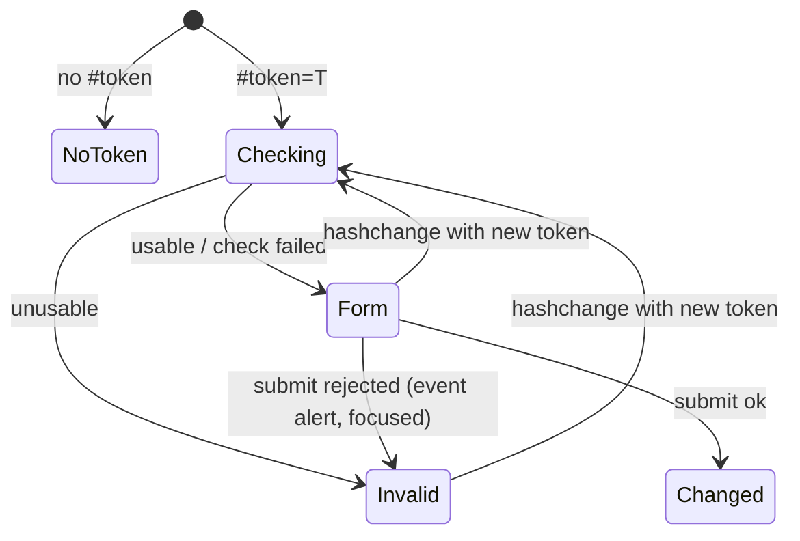

# Feature Spec: A reset link says on arrival whether it still works

- **Status:** Approved by the product owner, 2026-11-16 ("Approve as written"), in the session that ran runbook section 1 (ADR-0131).
- **Author(s):** feature-analyst · **Date:** 2026-11-16 · **Base:** branch `claude/zen-cannon-b1jgby`
- **Tracking:** product-owner runbook step 1.9 (2026-11-16); reverses the cost accepted in
  `docs/TECH_DEBT.md` #537 · **Precedent:** `docs/specs/reset-link-fragment/`, `docs/specs/verify-email-confirm/spec.md`
- **Related ADRs:** ADR-0074 (reset; its line "learned on submit, not on arrival" is amended here),
  ADR-0072/0073 (audit: a read records nothing), ADR-0077 (public screens), ADR-0081 (entry point +
  journey), ADR-0088 D1 (no flag), ADR-0105 (why a spec), ADR-0132 (event vs condition), ADR-0202
  (loading state)

**ADR-0105 triggers crossed:** a **new public API endpoint** (a new anonymous, token-gated route) and a
changed user-facing behaviour of an existing entry point (`/reset-password`). No schema change, no new
Playwright config or CI step, no shared-component contract change.

## 1. Problem (re-verified 2026-11-16)

- The page does not ask the server about the token until submit. Its docblock says so: "Whether the
  token is still good is learned on submit, not on arrival" (`apps/web/src/routes/reset-password.tsx:38-41`);
  the only token-bearing call is the submit (`ResetPasswordForm token={token}`, `:139`).
- So a spent or expired link shows **Choose a new password**; the reader types twice, presses save, and
  only then meets "That link has already been used or has expired, so your password has not been
  changed." (`:98`). The journey pins exactly this today (`apps/web/e2e-account/account.spec.ts:175-186`).
- That cost was **accepted** when the token moved into the fragment (TECH_DEBT #537: "Cost, accepted by
  the product owner: a spent or expired link is reported when the form is submitted … not on
  arrival"). ADR-0074 records it (`docs/adr/0074-…-csp.md:508`). The owner now asks to remove it.
- Nothing on the server answers "is this token usable" over a POST body. Better Auth's
  `GET /reset-password/:token` does the lookup but puts the token in a URL (`password.mjs:92-128`), and
  this app shadows that route with a lookup-free redirect (`apps/api/src/app-setup.ts:139-150`).

**Users:** anyone who has forgotten a password — anonymous, pre-session, no organisation role.
**Outcome:** a spent, expired or unknown link says so on arrival; a good link shows the form; the token
still never travels in a URL.

## 2. Functional requirements

**Story.** As a locked-out user who opens an old reset link, I am told at once that it no longer works
and offered a new one — before I type anything.

| #   | Acceptance criterion                                                                                                                                                                                                                                                                           |
| --- | ---------------------------------------------------------------------------------------------------------------------------------------------------------------------------------------------------------------------------------------------------------------------------------------------- |
| C1  | Arriving on `/reset-password#token=T` captures and strips the token exactly as today, then sends **one** `POST /api/v1/password-reset/check` with body `{ "token": T }`. The token is never put in a URL, query or header.                                                                     |
| C2  | While the check is in flight the screen shows the settled shape with one sentence (ADR-0202): heading **Choose a new password**, body "Checking your link…", `aria-busy`, no form fields.                                                                                                      |
| C3  | `usable: true` → the form, unchanged.                                                                                                                                                                                                                                                          |
| C4  | `usable: false` → the existing **That link is no longer valid** screen and **Send a new link**, with a `condition` alert (ADR-0132; nothing just happened): "This link has already been used or has expired." No form is ever drawn. Focus is not moved (no action of the reader's caused it). |
| C5  | The check fails (network, 5xx, 429, 422) → the form, as today. The reader is never blocked by the check.                                                                                                                                                                                       |
| C6  | The on-submit rejection path stays: a link that becomes unusable between arrival and submit is still reported by the existing `event` alert, focused (`reset-password.tsx:94-100`).                                                                                                            |
| C7  | A token pasted into the open tab (`hashchange`, `:65-77`) is checked afresh; a result for the old token never decides the new one.                                                                                                                                                             |
| C8  | The document title follows the heading in every state (today it is fixed at "Choose a new password" even on the invalid screen, `:50`).                                                                                                                                                        |
| C9  | A legacy link (`/api/auth/reset-password/T`) still 303s to the fragment form with no lookup (unchanged); the arrival check then decides, so a spent legacy link now lands on the invalid screen.                                                                                               |

**API.** `POST /api/v1/password-reset/check`, `@Public()`, body `{ token: string }` (non-empty, ≤ 2048,
the same bounds as `/email-verification/confirm`, `docs/API.md:2646-2648`), `200 { data: { usable: boolean } }`.

- `usable` is `true` **iff** the reset POST would get past every token check it makes before writing:
  a verification row for `reset-password:T` exists and has not expired (`password.mjs:155-156`), and the
  user it names exists (`password.mjs:158-159`). Password length is not part of it.
- **Identical answer** for never-existed, expired, used and user-gone: `200 { data: { usable: false } }`,
  same body, same status. USER_NOT_FOUND folds into `false`, as the confirm endpoint folds it into
  "invalid" (`email-verification.service.ts:91-96`) and the web already treats it (`reset-password.tsx:26`).
- **Never consumes.** Only the POST consumes (`password.mjs:162`); the check calls no consume path.
- **Not an account oracle.** The input is a token, never an email or user id; the output is one bit about
  that token. Anyone who learns `true` holds a live credential minted for that account, so learns
  nothing they could not learn by submitting. Brute-forcing is not a realistic threat: tokens are
  `generateId(24)` (`password.mjs:74`), and the route is throttled.
- **Rate limited:** `@Throttle({ default: { ttl: 60_000, limit: 10 } })`, the confirm route's ceiling
  (`email-verification.controller.ts:37`). Better Auth's own limiter does not apply (the check does not
  go through `/api/auth`), and the check cannot spend the reset POST's budget, which is Better Auth's.
- **Never logged.** The body's `token` is removed by Pino's redact list (`apps/api/src/app.module.ts:88`);
  the service takes no logger and puts the token in no error message; Prisma query logging is off
  (no `log:` in `apps/api/src/prisma`). No audit row (a read; ADR-0073).
- Validation errors: missing/empty/over-long/non-string token → `422 VALIDATION_FAILED` in the standard `{ error }` envelope. _(Amended 2026-11-16: this said `400`; the API's convention is 422, `docs/API.md:158,176`.)_
  `429` when throttled. No `401`/`403`: public by design, the token is the only input.

**Edge cases.** Two tabs on one link: both see the form; the first submit wins, the second meets C6.
A link that expires while the reader types: C6. Check slow: the sentence shows until it settles, no
timeout of our own (react-query's request stays as long as `apiFetch` lets it). StrictMode double
mount: one request (the query is deduplicated by key).

## 3. Technical analysis

**How Better Auth stores and checks a reset token (read in installed `better-auth@1.7.18`).**

| Claim | Source                         | What it says                                                                                                                                                    |
| ----- | ------------------------------ | --------------------------------------------------------------------------------------------------------------------------------------------------------------- |
| K1    | `password.mjs:77`              | the row is keyed `reset-password:${token}`, `value` = user id                                                                                                   |
| K2    | `password.mjs:155-156`         | the POST looks it up with `internalAdapter.findVerificationValue(id)` and refuses `!verification \|\| expiresAt < now`                                          |
| K3    | `password.mjs:158-159`         | then refuses `USER_NOT_FOUND` if the user is gone                                                                                                               |
| K4    | `password.mjs:162`             | consumption (`consumeVerificationValue`) is the POST's alone, after the checks                                                                                  |
| K5    | `internal-adapter.mjs:768-770` | `findVerificationValue` hashes the identifier with the configured `storeIdentifier` before lookup — so it finds our hashed rows (`better-auth.ts:263-268`)      |
| K6    | `internal-adapter.mjs:801-808` | it falls back to the plain identifier, then deletes **all** already-expired verification rows (a cleanup the POST also triggers); it does not delete a live row |
| K7    | `base.mjs:58`                  | the auth instance exposes `$context` (typed `Promise<AuthContext>` in `types/auth.d.mts`), which carries `internalAdapter`                                      |

All seven are registered in `scripts/dependency-claims.json`.

**Approach — call the library's own lookup, not its HTTP route.** A `PasswordResetCheckService` in
`apps/api/src/common/auth/` awaits `auth.$context` and runs K2's lookup and predicate and K3's user
lookup through `internalAdapter`. It reuses Better Auth's identifier hashing (K5) rather than our
`hashToken` directly, so a change in storage format moves with the library. The predicate is two lines
copied from K2; the e2e cases (used / expired / unknown / user-gone) are what keep the copy honest.

**Alternatives rejected.**

- _Synthetic `GET /reset-password/:token` through `auth.handler`_ (the confirm endpoint's move,
  `email-verification.service.ts:80`). Reuses the predicate verbatim, but puts the token in a request
  URL (in-process, yet the property this app has spent two specs protecting), depends on `originCheck`
  accepting a `callbackURL` from `trustedOrigins`, and needs the answer parsed back out of a redirect
  `Location`. It also skips K3. More coupling, not less.
- _Prisma `verification.findFirst({ identifier: hashToken('reset-password:'+T) })`_. Simple, but
  re-implements K5 and the plain-identifier fallback (K6) in our code; a library change to identifier
  processing would silently make every link read "unusable".
- _Re-enable the library's GET from the web._ Puts the token back in a URL — reverses #537.

**Areas.** API: one controller + service + DTO in `common/auth`, `AuthModule` registration, one line in
the audit census (`UNAUDITED_ROUTES`, `READ`). Web: `useResetLinkCheck` in `features/auth/api`, screen
states in `routes/reset-password.tsx`. Public-screens suite: its `#token=e2e` row
(`apps/web/e2e-public/support.ts:76-80`) runs against a real API and would now land on the invalid
screen — it gets a `page.route` stub for the check (precedent: `public-screens.spec.ts:168`). No schema,
no migration, no flag (ADR-0088 D1). Performance: at most three indexed reads per arrival
(`@@index([identifier])`, `apps/api/prisma/schema.prisma:102`; the user by primary key) plus K6's cleanup, which the POST already runs.

**Web data.** `useQuery({ queryKey: ['password-reset-check', token], enabled: token !== '', retry: false,
staleTime: Infinity, gcTime: 0, refetchOnWindowFocus: false })`. Keyed by token so C7 holds by
construction. The token in the key lives only in memory, where component state already holds it; there
is no query persister (no `persistQueryClient` in `apps/web/src`). It is a POST-as-query because the
token must be in a body (C1); it changes nothing, so a query, not a mutation.

## 4. Solution design

```mermaid
sequenceDiagram
  participant U as Browser /reset-password
  participant A as API POST /api/v1/password-reset/check
  participant B as Better Auth internalAdapter
  participant D as Postgres verification, user
  Note over U: #token=T captured, stripped (unchanged)
  U->>A: POST {token:T} (body; Pino redacts req.body.token)
  A->>B: findVerificationValue("reset-password:"+T)
  B->>D: lookup by hashed identifier (then plain), clean expired
  alt row and not expired
    A->>B: findUserById(row.value)
  end
  A-->>U: 200 {data:{usable}} (same body for every unusable case)
  alt usable
    Note over U: form, then the unchanged POST /api/auth/reset-password
  else unusable
    Note over U: "That link is no longer valid" + condition alert
  else check failed
    Note over U: form (submit still rejects a bad token)
  end
```



**No ADR.** This is a second instance of an existing pattern (a public, token-gated, throttled POST
beside Better Auth in `common/auth`, TECH_DEBT #88) and reverses a product cost, not an architectural
decision. It is recorded as a dated amendment to ADR-0074's reset section (its line 508), the §16
suffix for ADR-0074, a `docs/DECISIONS.md` line, and a note on #537. One thing edges towards an ADR:
it is the first application use of `auth.$context.internalAdapter`. Default: recorded in the service
docblock and the claims register; if the security review judges reaching into the adapter a pattern
others will copy, it becomes an ADR before M1 merges.

## 5. Questions

None critical. Defaults, stated for approval:

1. **Loading heading** is "Choose a new password" (what a good link settles to; no heading shift on the
   common path). A spent link's heading changes once when the check answers.
2. **USER_NOT_FOUND reads as unusable**, identical to the other three.
3. **Check failure shows the form** (C5), not an error.
4. **No ADR**, as above.
