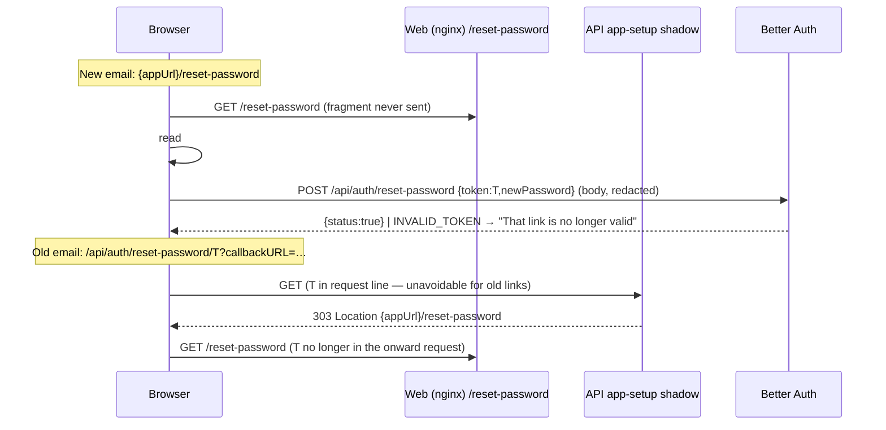

# Feature Spec: The reset link carries its token in the fragment

- **Status:** Approved — by the product owner, 2026-10-21, with all defaults
- **Author(s):** feature-analyst · **Date:** 2026-10-21 · **Base:** `46edeb5`
- **Tracking:** `docs/TECH_DEBT.md` #537 · **Precedent:** #88 / PR #1087, `docs/specs/verify-email-confirm/spec.md`
- **Related ADRs:** ADR-0074 (reset), ADR-0077 (public screens), ADR-0081 (entry point + journey),
  ADR-0088 D1 (no flag), ADR-0105 (why a spec: the emailed link changes)

## 1. Problem (re-verified 2026-10-21 against installed `better-auth@1.7.10`)

- The reset email carries Better Auth's own URL unchanged: `sendResetPassword: async ({ user, url })
=> options.sendPasswordReset({ to, resetUrl: url })` (`apps/api/src/common/auth/better-auth.ts:193-195`).
- The library builds it as `${baseURL}/reset-password/${token}?callbackURL=${redirectTo}` and hands the
  callback `{ user, url, token: verificationToken }` (**R1**, `password.mjs:74,80-86`). `redirectTo` is
  the web's `${window.location.origin}/reset-password` (`apps/web/src/features/auth/api/use-session.ts:358`).
- `GET /reset-password/:token` looks the token up, does **not** consume it, and `throw ctx.redirect(…{ token })`
  — a 302 to `/reset-password?token=…` (**R2**, `password.mjs:92-128`; `redirectCallback` sets it as a
  query param, `:15-19`).
- So a live token appears in: the API request line (path), the `Location` header, and the onward web
  request line `/reset-password?token=…` (any proxy/nginx access log). The page then strips it
  (`apps/web/src/routes/reset-password.tsx:40-47`), so history/referrer are already handled.
- The token is the one the POST accepts: both sides key `reset-password:${token}` (**R3**,
  `password.mjs:77` and `:149-155`). So the callback's `token` can be put in our own link.

**Users:** anyone who has forgotten a password (pre-session; no org role). **Outcome:** a newly
emailed token is never sent to any server until the person submits the form (in a POST body, already
redacted from Pino as `req.body.token`, `apps/api/src/app.module.ts:86`).

## 2. Functional requirements

**Story.** As a locked-out user I open the reset link, choose a new password, and sign in — and no
server or proxy log along the way holds my reset token in a URL.

| #   | Acceptance criterion                                                                                                                                                                                                                       |
| --- | ------------------------------------------------------------------------------------------------------------------------------------------------------------------------------------------------------------------------------------------ |
| A1  | A new reset email links to `{appUrl}/reset-password#token=<token>`; nothing under `/api/` appears in it.                                                                                                                                   |
| A2  | `/reset-password#token=…` shows **Choose a new password**; the fragment is stripped on arrival (`replace`), so the address bar reads `/reset-password`.                                                                                    |
| A3  | A link pasted into a tab already on `/reset-password` (fragment-only change, no remount) is picked up — the `hashchange` precedent, `apps/web/src/routes/verify-email.tsx:225-234`.                                                        |
| A4  | Legacy link `GET`/`HEAD /api/auth/reset-password/<token>?callbackURL=…` answers **303** to `{appUrl}/reset-password#token=<token>`, `Cache-Control: no-store`, `Referrer-Policy: no-referrer`; it performs **no** token lookup.            |
| A5  | Legacy link with an unusable token (empty / > 2048 chars) → 303 to `{appUrl}/reset-password?error=INVALID_TOKEN`.                                                                                                                          |
| A6  | Submitting a spent/expired/garbage token: the screen moves to the existing **That link is no longer valid** state (`reset-password.tsx:53-62`), focus on its heading region — not a generic error under the form. (Was: known on arrival.) |
| A7  | `POST /api/auth/reset-password` is untouched (the shadow is `GET` with a `:token` segment; Express does not match the POST).                                                                                                               |
| A8  | After M2 nothing produces or reads `/reset-password?token=` — `validateSearch` drops `token`; `error` stays (A5).                                                                                                                          |

Edge cases: no fragment and no error → existing "no longer valid" state (unchanged). `429` / network on
submit → existing `ServerError` path (`ResetPasswordForm.tsx:54`), unchanged. Permissions: public,
token is the authority (unchanged). No pen, no org scope, no recalc input — parity gate untouched.

## 3. Technical analysis

- **Email composition** (API): `sendResetPassword: async ({ user, token }) => …({ resetUrl:
`${resetPageUrl}#token=${encodeURIComponent(token)}` })`, mirroring `better-auth.ts:268-273`. New
  `CreateAuthOptions.resetPageUrl`, wired as `${config.appUrl}/reset-password` beside `verifyPageUrl`
  (`apps/api/src/common/auth/auth.module.ts:41`). The library's `url` is ignored.
- **`redirectTo` becomes inert.** It only fed the library's `url`. `originCheck` skips an absent value
  (**R4**, `origin-check.mjs:76`), so the web stops sending it (`use-session.ts:349-359` + docblock).
  API tests that still send it keep passing (it is still origin-checked, `password.mjs:49`).
- **Legacy shadow** (API): `express.get('/api/auth/reset-password/:token', …)` registered in
  `apps/api/src/app-setup.ts` beside the verify shadow (`:104-124`) and **before** the Better Auth mount
  (`:125`) — Express matches in registration order; `.get` also answers `HEAD`. Same `usable` rule as the
  verify shadow (`:115`). No DB access, so no new rate-limit surface (today's route does a lookup per GET).
- **Expiry is 1 hour** (`resetPasswordTokenExpiresIn || 3600`, **R5** `password.mjs:73`; not configured
  here — grep `resetPasswordTokenExpiresIn` in `apps/api/src`: no match). Legacy links therefore all die
  within an hour of the API deploy; the shadow is permanent only because removing it later costs a
  review for no gain. (Default: keep it; see Q-defaults.)
- **Web:** `ResetPasswordScreen` reads `#token` via a `tokenFromHash()` like `verify-email.tsx:78-80`,
  captured in the `useState` initialiser (`reset-password.tsx:37-42` reasoning). The existing
  `navigate({ to: '/reset-password', search: {}, replace: true })` (`:46`) is the same call that strips
  the verify fragment (`verify-email.tsx:238`). On a submit error with code `INVALID_TOKEN` or
  `USER_NOT_FOUND` (**R6**, `password.mjs:150,156,159,161`) render the invalid state (A6).

## 4. Solution design

**Legacy-hop options, weighed honestly.** The old link already puts T in the API request line; nothing
we do can retract that. What a shadow can change is the **onward** hop.

| Option                                                  | T on a response header     | T in onward request line | Cost                                                                                                                 |
| ------------------------------------------------------- | -------------------------- | ------------------------ | -------------------------------------------------------------------------------------------------------------------- |
| Leave Better Auth's 302 (today)                         | yes (`Location`, query)    | **yes**                  | none                                                                                                                 |
| **303 → `#token=` (recommended)**                       | yes (`Location`, fragment) | no                       | ~15 lines, identical to the verify shadow                                                                            |
| 200 HTML with `<meta refresh>` / inline JS to `#token=` | no (in body)               | no                       | an HTML response from the API; inline JS needs a CSP hash under `helmet()` (`app-setup.ts:91`); body still carries T |
| 410 / redirect to `/forgot-password`                    | no                         | no                       | strands every in-flight email for up to an hour                                                                      |

The 200-hop moves T from a header to a body — both are response content, and access logs record
neither by default; it buys nothing measurable over the 303 and adds the API's only HTML response.
The 303 removes the one exposure that is routinely logged (the onward request line) and matches the
shipped verify precedent, so a reviewer reads one pattern twice. **Recommended: 303.**

**Components.** API: `better-auth.ts` (option + composition), `auth.module.ts` (wiring), `app-setup.ts`
(shadow). Web: `routes/reset-password.tsx`, `app/router.tsx:589-600` (`validateSearch` drops `token`),
`features/auth/api/use-session.ts` (drop `redirectTo`). No schema, no new endpoint, no new component,
no `VITE_` flag (ADR-0088 D1; `VITE_PASSWORD_RESET` already gates the routes, `config/env.ts:1238`).
Accessibility: A6 reuses an existing state; focus moves to its outcome as on success
(`useOutcomeFocus`, `reset-password.tsx:35`). No ADR: a second instance of an existing pattern; record
in `docs/DECISIONS.md` and ADR-0074's reset section.

**Security notes for security-reviewer (mandatory before ship).** (1) Fragment never sent to a server
and never in `Referer`. (2) Shadow does no lookup → no validity oracle and no DB cost per GET (today's
route has both). (3) Open-redirect: the target is `config.appUrl` only; `callbackURL` is ignored, so
the shadow is _less_ steerable than the library route. (4) Residual: old-link request lines for ≤ 1 h
after deploy; the fragment survives in the browser's session history entry until stripped (as today
for the query). (5) `encodeURIComponent` on T; Express has already decoded the path param.

### 4.1 Dependency claims to register (`scripts/dependency-claims.json`, `better-auth`)

Some already exist (`password.mjs:83` → `82`, `:50` → `49`, `:75` → `74`); add or extend:

| Id  | Path                                    | Lines          | Claim / anchor                                                                     |
| --- | --------------------------------------- | -------------- | ---------------------------------------------------------------------------------- |
| R1  | `dist/api/routes/password.mjs`          | 80-86          | `url = …/reset-password/${verificationToken}?callbackURL=…`; callback gets `token` |
| R2  | `dist/api/routes/password.mjs`          | 92-93, 125-127 | `GET /reset-password/:token`; lookup, no consume; `ctx.redirect(… { token })`      |
| R3  | `dist/api/routes/password.mjs`          | 77, 154        | both key `reset-password:${token}` — same token                                    |
| R4  | `dist/api/middlewares/origin-check.mjs` | 76             | `if (!url) return;` — absent `redirectTo` passes                                   |
| R5  | `dist/api/routes/password.mjs`          | 73             | `resetPasswordTokenExpiresIn \|\| 3600 * 1`                                        |
| R6  | `dist/api/routes/password.mjs`          | 150, 156, 159  | `INVALID_TOKEN` / `USER_NOT_FOUND` codes on POST                                   |

## 5. Testing

- **API Supertest** `apps/api/test/password-reset.e2e-spec.ts`: `tokenFromLastEmail` (`:106-113`) parses
  `#token=` from `{appUrl}/reset-password#token=…`; new cases: legacy `GET` and `HEAD` → 303 with
  fragment Location, `no-store`, `no-referrer`, and the token still resets afterwards (proves no
  consume); unusable token → `?error=INVALID_TOKEN`. Model: `email-verification-confirm.e2e-spec.ts:111`.
  `mail-background-dispatch` / `mail-failure` only count URLs — no change expected; confirm by running.
- **Unit:** `better-auth.spec.ts` (composition from `token`, `url` ignored); `reset-password.test.tsx`
  (hash capture + strip, hashchange, A6); `router-search.test.ts:82-84` and the two search censuses.
- **Playwright** `e2e-account/account.spec.ts:119-176` (config `playwright.account.config.ts`,
  `test:e2e:account`): expect `/reset-password#token=` (`:120,122`), assert no `token` in hash after
  arrival (`:130-131`), add a legacy-URL leg; spent-link leg (`:171-176`) now submits then sees A6.
  `e2e-public/support.ts:77` → `/reset-password#token=e2e` (`test:e2e:public`).
  `apps/web/scripts/shoot.mjs:615` is tokenless — unchanged.
- Pre-push: `pnpm prepush`, `scripts/e2e-local.sh api`, `web:account`, `web:public`.

## 6. Questions for the owner

1. **An expired link is now found out on submit, not on arrival.** Default: **accept** (A6) — one
   wasted password entry on a stale link. The alternative is a new token-check endpoint (a POST that
   validates without consuming), which is new public surface for a one-hour edge.

Defaults taken without asking: 303 legacy shadow (not a 200 HTML hop); shadow kept permanently;
no token lookup in the shadow; web drops `redirectTo`; no flag; no ADR; changeset **minor** for
`@repo/api` and `@repo/web` (user-visible link change, pre-1.0).
