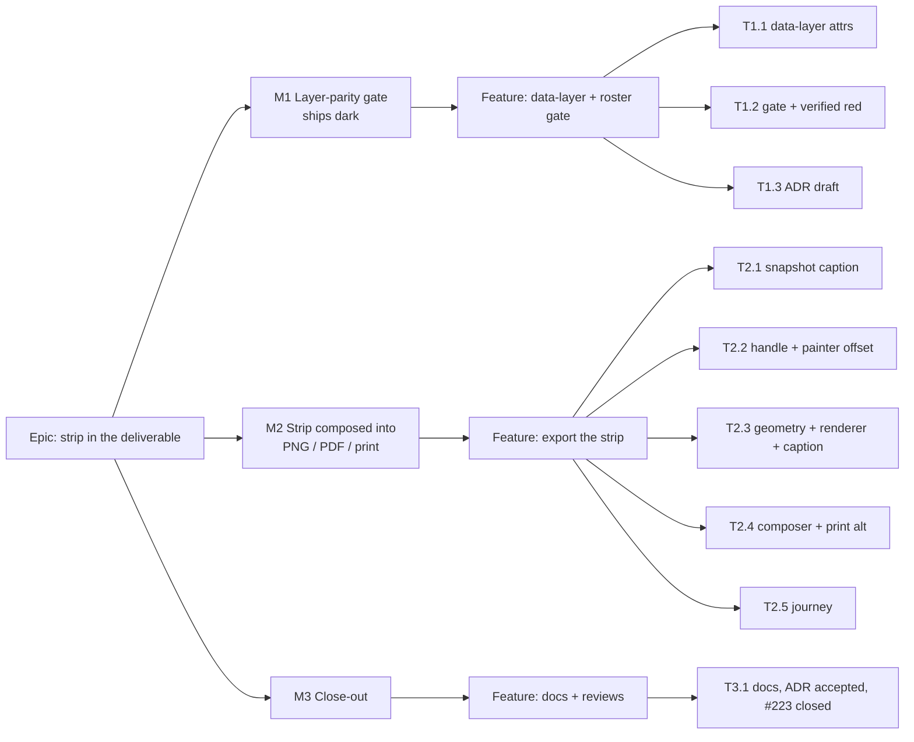

# Implementation Plan: The resource strip in the exported and printed diagram

- **Feature spec:** [`spec.md`](./spec.md)
- **Status:** Approved — with the spec, 2026-10-17. Built 2026-10-17 (milestones 1 to 3)
- **Owner:** web (builder agent, Sonnet, per CLAUDE.md §19.14), reviewed as listed per milestone

**Nothing in this plan asks the product owner to test on their own devices.** Every check is a unit suite, a
structural gate, or a Playwright journey run by `pnpm prepush` / `scripts/e2e-local.sh` and CI. No ADR-0026 §9
frame-rate reading is owed, because the live painter does not change (spec §3, parity statements).

## Breakdown

### Epic

**The resource strip reaches the deliverable, and the gate can see layers** — closes `docs/TECH_DEBT.md` #223.

---

### Milestone 1: The layer-parity gate (shippable, no user-visible change)

**Outcome:** the build knows every diagram layer and whether the export composes it. The strip's omission becomes
a **named, visible** entry instead of an absence.
**Entry point:** `Ships dark: a structural test and four inert DOM attributes; nothing a planner can reach. M2
surfaces the capability.`
**Journey:** none in this milestone (no user-facing claim). M2 carries it.

#### Feature: Layer roster derived from the canvases

> **Description:** Spec §4.7 CQ-2(a).
> **Complexity:** M
> **Dependencies:** CQ-2 answered.
> **Risks:** the parser is gameable (comments, spreads, conditional JSX) → reuse `sceneKeys`'s comment-strip-first
> rule and its refuse-on-unreadable behaviour; add a floor on the roster.
> **Testing requirements:** structural suite, verified red twice (below).

##### Task 1.1 — `data-layer` on every diagram canvas

- **Description:** add `data-layer="wbs-band" | "scene" | "interaction" | "resource-strip"` to the four canvases in
  `TsldCanvas.tsx` (`:2579`, `:2599`, `:2921`, `:2933`) and `data-layer="minimap"` to `TsldMinimap.tsx:438`.
- **Complexity:** S
- **Dependencies:** none
- **Risks:** an existing selector or snapshot keyed on attribute order → grep `e2e*/` and `*.test.tsx` for
  `canvas` attribute snapshots first; existing `data-testid`s stay.
- **Testing:** existing `TsldCanvas*.test.tsx` and `TsldMinimap*.test.tsx` green; one assertion per canvas that the
  attribute is present.
- **Development steps:**
  1. Add the attributes.
  2. Run the web unit suite.

##### Task 1.2 — The layer half of `scene-parity.structural.test.ts`

- **Description:** spec §4.7 points 1–4. In M1 the composed set is `scene` and `wbs-band`;
  `EXPORT_LAYER_INPUTS` is exported from `render-export-image.ts` with those two. `resource-strip` sits in a
  third record, **`KNOWN_GAPS`**, keyed to `docs/TECH_DEBT.md #223` — deliberately **not** `SCREEN_ONLY_LAYERS`,
  whose docblock warns that a wrong reason closes a question (`scene-parity.structural.test.ts:38-45`). A
  `KNOWN_GAPS` entry fails the build once the composer composes it (so it cannot outlive its fix).
- **Complexity:** M
- **Dependencies:** T1.1
- **Risks:** the composer's `renderExportImage` call uses a conditional spread for `wbsBand`
  (`use-diagram-image.ts:240-251`), which a top-level-key parser cannot read → the "proves composition" check
  searches the call's brace-matched, comment-stripped extent for a literal `wbsBand:` key rather than parsing
  top-level keys; document why in the test.
- **Testing:** **verified red, recorded in the PR body (ADR-0110):** (1) delete `resource-strip` from
  `KNOWN_GAPS` → red naming `resource-strip`; (2) remove `data-layer` from one canvas → red naming the file and
  line; (3) rename `wbsBand:` in the composer to a variable → red naming `wbs-band`. Restore each.
- **Development steps:**
  1. Extract the existing comment-stripping/brace-matching into helpers inside the test file (no new package).
  2. Add the four layer assertions (refuse, classify, prove composition, stale + floor ≥ 5).
  3. Run the three red checks; record results.
  4. `pnpm prepush`.

##### Task 1.3 — Draft ADR-0198

- **Description:** the outline in spec §4.8, Status `Proposed`; add its one line to CLAUDE.md §16
  (`check:adr-coverage`, ADR-0147).
- **Complexity:** S
- **Dependencies:** T1.2
- **Risks:** number collision → take the next free number at write time.
- **Testing:** `pnpm check:adr-coverage`, `pnpm check:counts` (ADR count in the banner).

---

### Milestone 2: The strip is in PNG, PDF and print (user-facing)

**Outcome:** with Resource view open, every Diagram export and Print… carries the strip, its caption and legend;
with it closed, nothing changes.
**Entry point:** plan workspace → toolbar **Resource view** (icon button, accessible name "Resource view") on →
**Share & export ▾ → Diagram — whole plan (PNG)** (same for the other three Diagram items and **Print…**).
**Journey:** T2.5 — drives that exact path in `apps/web/e2e-export/` and decodes the PNG (ADR-0081, ADR-0103 D8).

#### Feature: Compose the strip into the export

> **Description:** spec §4.6.
> **Complexity:** L
> **Dependencies:** M1, CQ-1 answered.
> **Risks:** see per task and the rollup.
> **Testing requirements:** unit (renderer, geometry, panel, palette), structural (gate goes green, `KNOWN_GAPS`
> emptied), contrast matrix, one decoded-artefact journey.

##### Task 2.1 — The snapshot carries its caption

- **Description:** `StripCaption` on `ResourceStripSnapshot` (`render/resource-strip.ts:68-93`);
  `ResourceStripPanel` fills it and publishes a segment-less captioned snapshot for loading / error / empty.
- **Complexity:** M
- **Dependencies:** none
- **Risks:** the live band changes for the three empty states → the painter's early return
  (`paint.ts:3024`) covers `segments.length === 0 && max === 0`; assert it with a draw-call test comparing `null`
  to the empty snapshot.
- **Testing:** panel unit tests for each status and each mode (stacked by resource/group/kind, isolated,
  truncated); painter parity test above; `paint.strip-stack.test.ts` and `strip-fill-resolution.test.ts` unchanged.
- **Development steps:**
  1. Add the type; 2. build the caption from existing state (`granularity`, `stackBy`, `stacked.segments`,
     `histogram.data`); 3. replace the three `null` returns with captioned empties; keep the unmount `null`.

##### Task 2.2 — The handle exposes the strip; the painter takes an offset

- **Description:** `TsldCanvasHandle.getResourceStrip()` (null unless `resourceStripActive`), and
  `paintResourceStrip(…, dpr = 1, offsetY = 0)`.
- **Complexity:** S
- **Dependencies:** T2.1
- **Risks:** typed test doubles of the handle break → follow `getSceneLenses`'s optional-call tolerance in the
  composer (`use-diagram-image.ts:135-141`).
- **Testing:** handle returns the published snapshot when active and `null` when not
  (`TsldCanvas.resource-strip.test.tsx`); painter draw-calls with `offsetY` omitted are identical to today's.

##### Task 2.3 — Geometry, renderer, caption row, paper palette

- **Description:** `bottomBand` in `buildExportViewport`; `resourceStrip` input in `renderExportImage`; band painted
  before the paper ground; `drawStripCaption` after it; `resolvePrintResourceStripPalette`; `STACK_GROUNDS` gains
  paper.
- **Complexity:** M
- **Dependencies:** T2.2
- **Risks:** (a) caption overflow on a narrow `view` crop → AC-1.6 `+N more`, unit-tested at a 320 px raster;
  (b) the scene's full-height rules bleed into the band → the painter's `clearRect` and the caption row's opaque
  fill remove them, as the WBS band does (`render-export-image.ts:218-221`); asserted by a draw-order test.
- **Testing:** `render-export-image.resource-strip.test.ts` (new): absent ⇒ identical call sequence; present ⇒
  strip painted at `size.height - height`, caption text per mode/status, legend in stack order, truncation and
  basis text. `export-image.test.ts`: `bottomBand` adds height in both extents and leaves `viewport` unchanged.
  `token-contrast.test.ts`: fills on paper ≥ 3:1. `palette.test.ts`: the paper strip palette's ground equals the
  print ground.

##### Task 2.4 — Composer, gate green, print alt

- **Description:** `useDiagramImage` reads the strip and passes `bottomBand` + `resourceStrip:` (literal key);
  move `resource-strip` from `KNOWN_GAPS` to `EXPORT_LAYER_INPUTS`, deleting `KNOWN_GAPS` if empty; print alt
  override.
- **Complexity:** S
- **Dependencies:** T2.3
- **Risks:** stale closure — the strip is read through the handle at call time, so no new dependency-array entry is
  needed; state this in a comment, as the file does for its other reads.
- **Testing:** gate green; `use-diagram-image` unit test passes the strip through; `PrintSurface.test.tsx` alt.

##### Task 2.5 — The journey

- **Description:** new test in `apps/web/e2e-export/exported-diagram.spec.ts`: create two resources and assign
  them (reuse `e2e-resource-view/support.ts:38`, `:108`), recalculate, press **Resource view**, export **Diagram —
  whole plan (PNG)**, decode, and assert by property (no golden, ADR-0103 D8): (1) the bottom band holds pixels
  of at least two distinct non-ground hues; (2) the caption row holds dark ink; (3) toggling Resource view off and
  exporting again yields no strip hues in the bottom rows. Print… inherits the blob (`PrintSurface.tsx:17-21`) and
  its alt is asserted on the mounted document.
- **Complexity:** M
- **Dependencies:** T2.4
- **Risks:** histogram still loading at export → wait for the panel's legend to be visible before exporting
  (the journey would otherwise assert the loading caption); dpr — assert `devicePixelRatio === 1` as the file's
  second test does (`:428-431`).
- **Testing:** `scripts/e2e-local.sh web:export` locally before push; CI's e2e shards.

---

### Milestone 3: Close-out

**Outcome:** the decision is recorded and the register is honest.
**Entry point:** `Ships dark: documentation only.`

##### Task 3.1 — Docs, ADR, register, reviews

- **Description:** ADR-0198 → `Accepted`; amended-by notes on ADR-0049 and ADR-0103; close #223 with the commit;
  file a new register row for spec §0.2's two findings; spec status line updated; web **minor** changeset
  ("Exports and prints now include the resource loading strip when it is open").
- **Complexity:** S
- **Dependencies:** M2
- **Testing:** `pnpm prepush` (includes `check:adr-coverage`, `check:spec-status`, `check:counts`).
- **Reviews (before merge of M2, not after):** **component-reviewer** (handle and snapshot contract),
  **accessibility-reviewer** (paper contrast, legend not colour-only, print alt per ADR-0122),
  **performance-reviewer** (confirm the live path is unchanged), **ux-reviewer** (caption copy). No
  database-architect, api-, security- or backend-performance-reviewer: no schema, endpoint or server change.

## Sequencing & slices

M1 lands first and alone: the gate is green on `main` because the gap is declared in `KNOWN_GAPS`, and the
product is unchanged. M2 is one PR or T2.1–T2.4 then T2.5; each keeps `main` releasable because every new input is
absent-equals-today. M3 follows. **No `VITE_` flag** (ADR-0088 D1); rollback is reverting M2's commit.

## Definition of Done (per task)

Each task's PR satisfies the Feature Completion Criteria in [`docs/PROCESS.md`](../../PROCESS.md): code, tests,
docs, security, performance, accessibility, Docker build, CI green (§19.9 roster read), changeset, version impact.

## Risks & assumptions (rollup)

| Risk / assumption                                                                 | Likelihood | Impact | Mitigation                                                                                          |
| --------------------------------------------------------------------------------- | ---------- | ------ | --------------------------------------------------------------------------------------------------- |
| The gate is silenced by a parse it cannot read                                    | med        | high   | Refuse on missing `data-layer`, comment-strip first, roster floor; three verified-red checks (T1.2) |
| `KNOWN_GAPS` becomes a permanent parking lot                                      | low        | med    | It fails once its gap is composed; M2 empties and deletes it                                        |
| Live strip changes for empty states                                               | low        | med    | Draw-call parity test null vs empty snapshot (T2.1)                                                 |
| Fills fail 3:1 on paper                                                           | low        | med    | Paper is lighter than every ground already gated, but asserted, not argued (T2.3)                   |
| Caption copy unclear on paper                                                     | med        | low    | ux-reviewer before merge                                                                            |
| Journey flakes on histogram load timing                                           | med        | low    | Wait on the legend; property assertions, no golden                                                  |
| Assumption: the Gantt shows no strip band, so the printed programme needs nothing | —          | —      | Verified by grep (spec §0.1); revisit if a Gantt strip is ever specified                            |
