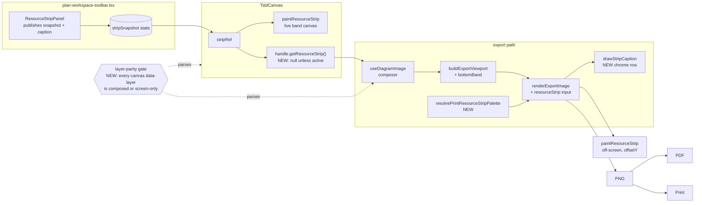
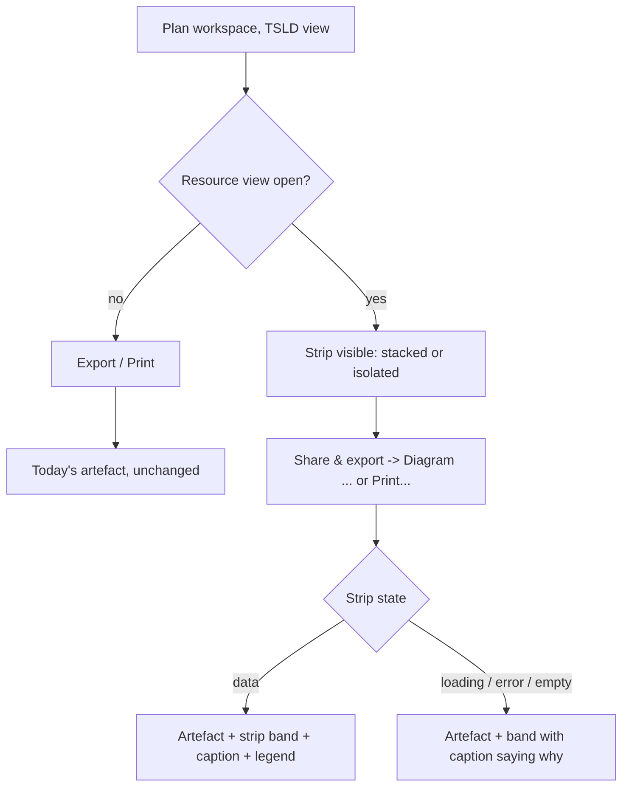

# Feature Spec: The resource strip in the exported and printed diagram (`docs/TECH_DEBT.md` #223)

- **Status:** Approved — by the product owner, 2026-10-17, CQ-1: included when open on screen; CQ-2: the full layer roster. Built 2026-10-17 (milestones 1 to 3).
- **Author(s):** Claude Code (feature-analyst), for James Ewbank (product owner)
- **Date:** 2026-10-17
- **Tracking issue / epic:** `docs/TECH_DEBT.md` #223 (a register row, not a GitHub issue)
- **Roadmap link:** none. Follow-on debt from the stacked-histogram epic (ADR-0121) against ADR-0103's export contract
- **Related ADR(s):** ADR-0049, ADR-0103 (D7, D8), ADR-0106, ADR-0121, ADR-0122, ADR-0127 (D3, D7), ADR-0059 §6 (M4), ADR-0063 §M5, ADR-0088 D1, ADR-0081, ADR-0105, ADR-0110. **A new ADR is needed** (outline in §4.8): it amends ADR-0103 D7 (the parity gate) and ADR-0049 (the strip's deliverable).
- **Implementation plan:** [`plan.md`](./implementation-plan.md)

## 0. What was re-verified before designing

CLAUDE.md §19 says a problem statement goes stale in the direction nobody checks, and that the brief is not
evidence. Everything below was read from source in this clone on 2026-10-17. **No shell was available to this
session: nothing was run, rendered or measured.** Where a claim needs a browser it is marked _to measure_ and
lands in the plan as a test, never as a request for the owner to try something on a device.

### 0.1 The problem, re-checked

| Claim (row #223 or the brief)                                                 | What the tree says                                                                                                                                                                                                                                                                                                                                                                                                                 | Verdict                                            |
| ----------------------------------------------------------------------------- | ---------------------------------------------------------------------------------------------------------------------------------------------------------------------------------------------------------------------------------------------------------------------------------------------------------------------------------------------------------------------------------------------------------------------------------- | -------------------------------------------------- |
| The strip is painted from `stripRef`, a ref separate from `sceneRef`          | `TsldCanvas.tsx:913` declares `stripRef`; `:1623-1626` publishes the prop into it; `:2112-2125` paints it with `paintResourceStrip` on its own canvas (`:2932-2940`, `data-testid="tsld-resource-strip"`)                                                                                                                                                                                                                          | **True**                                           |
| The export never reads it                                                     | A grep for `stripRef\|resourceStrip\|ResourceStripSnapshot` across `apps/web/src` matches ten files; **none is under `features/tsld/export/` and none is `features/tsld/toolbar/commands/use-diagram-image.ts`**. The composer's `renderExportImage({ … })` call (`use-diagram-image.ts:222-252`) passes `scene`, `wbsBand` and chrome, nothing else                                                                               | **True**                                           |
| PNG, PDF and print are all affected                                           | PDF embeds the same PNG (`tsld-toolbar-items.tsx:1931-1934` comment; `export/pdf.ts`); print embeds the same blob (`export/PrintSurface.tsx:17-21`, `:80-95`). One composer, three artefacts                                                                                                                                                                                                                                       | **True — one fix covers all three**                |
| The parity gate parses exactly two files, `CANVAS` on :30 and `EXPORT` on :31 | `export/scene-parity.structural.test.ts:30-31`. Its roster is the top-level keys of `useRef<TsldScene>({` and `sceneRef.current = {` in the canvas and `const scene = {` in the composer (`:130-133`)                                                                                                                                                                                                                              | **True**                                           |
| The gate cannot see the strip in either direction                             | The strip is not a key of `TsldScene`; it is a prop (`TsldCanvas.tsx:416-421`) and a ref. The gate has no vocabulary that could name it, so it can be neither "exported" nor "screen-only with a reason"                                                                                                                                                                                                                           | **True**                                           |
| The export lives in `apps/web/src/features/tsld/export/` (the brief)          | **Half true.** The renderer, geometry, PDF and print live there; the **composer** that decides what goes in is `features/tsld/toolbar/commands/use-diagram-image.ts` (the gate's own `:31`). The row's "verified by grep across `features/tsld/export/`" therefore never covered the file that matters — the conclusion still holds (the wider grep above), but the stated sweep did not establish it                              | **Corrected**                                      |
| "Today's cost is low: one grey bar for one resource" (row, 2026-08-31)        | **Stale.** The strip now opens on the stacked view by default (`resource-strip-panel.tsx:138-142`, `:152`): up to three coloured resources plus an "Other (N resources)" aggregate (`STRIP_STACK_CAP = 3`, `features/resources/model/stack-series.ts:73`), stackable by resource, group or kind (`:133`). The row predicted exactly this — the stacked epic shipped — so the cost it described as future is present                | **Problem is worse than the row says**             |
| The gate's blind spot is "a consequence of where the state lives"             | Confirmed, and it is broader than the strip. `features/tsld/components/` renders **five** `<canvas>` elements: the WBS band (`TsldCanvas.tsx:2579`), the scene (`:2599`), the interaction layer (`:2921`), the resource strip (`:2933`) and the minimap (`TsldMinimap.tsx:438`). Only the scene's _contents_ are gated. The WBS band reaches the export by hand (`use-diagram-image.ts:240-251`); nothing would fail if it stopped | **True, and generalises to every non-scene layer** |

### 0.2 Two things found on the way, out of scope and reported rather than fixed

1. **The export legend has no over-allocation entry while the export draws the badge.** `flaggedIds` is
   composed (`use-diagram-image.ts:213`), so the badge prints; `EXPORT_LEGEND` (`render-export-image.ts:159-179`)
   carries no "Over-allocated" entry, while the screen legend does (`TsldLegend.tsx:175-177`). `EXPORT_LEGEND` is
   a hand mirror by its own admission (`:155-158`). Recommend a new register row; not folded here.
2. **The export legend drops entries silently on a narrow crop.** `drawLegend` `break`s when the next entry
   would overflow (`render-export-image.ts:446-447`) and says nothing. ADR-0127 D3's rule — count what you do not
   draw — applies. This spec's own strip legend is held to that rule (§2, AC-1.6); the existing legend is
   recommended for the same register row as item 1.

## 1. Business understanding

### Problem

A planner who opens **Resource view** sees a stacked resource-loading histogram under the diagram, aligned to
its time axis (ADR-0049). When they export the diagram (PNG or PDF) or print it, **the histogram is not in the
file**, and nothing says so. The picture a planner hands to someone who was not in the room is missing the one
panel that answers "can we resource this?" — the shape ADR-0103 exists to remove (#164: layers on the screen,
absent from the deliverable, nobody told).

The second half is the sharper one. The gate built for this exact defect class (ADR-0103 D7) is structurally
unable to report it, and will be unable to report the next layer that gets its own canvas for the same reason.

### Users

| Role (ADR-0016)                        | Need                                                                                                                                                     |
| -------------------------------------- | -------------------------------------------------------------------------------------------------------------------------------------------------------- |
| **Planner**                            | Export or print the diagram **with** the loading strip they are looking at, for a meeting or a report                                                    |
| **Org Admin**                          | As Planner                                                                                                                                               |
| **Contributor**, **Viewer**            | Same export menu, same rule: the file is the picture on their screen. No new capability, no new data                                                     |
| **External Guest** (ADR-0051/0163)     | **Unaffected.** The strip and its panel are mounted only by the plan workspace (`plan-workspace-toolbar.tsx:1489-1498`); this spec adds no guest surface |
| **Recipient of the file** (not a user) | Read the loading under the bars on paper, know which colour is which, and know if anything was left out                                                  |

### Primary use cases

1. A planner with Resource view open exports **Diagram — whole plan (PNG/PDF)** and gets the strip under the
   whole programme, stacked as on screen, with its legend.
2. The same planner exports **Diagram — current view** and gets the strip cropped to the same window.
3. The same planner presses **Print…** and the printed diagram carries the strip.
4. A planner with Resource view **closed** exports and gets exactly today's file.
5. An engineer adds a sixth canvas layer next year and the build tells them, before merge, that the export has not
   been told what to do with it.

### User journeys

Happy path: Resource view (toolbar, `ChartColumnStacked` icon, accessible name "Resource view",
`tsld-toolbar-items.tsx:434-462`) → strip appears → **Share & export ▾ → Diagram — whole plan (PNG)**
(`tsld-toolbar-items.tsx:1923-1926`) → the downloaded PNG has the strip band at the bottom, a caption row above
it naming the mode, bucket size and peak, and the legend. See §4.3.

### Expected outcomes

- The exported/printed diagram **is the planner's picture** including the strip — the rule #167 already applied to
  the five lens keys (`scene-parity.structural.test.ts:61-66`).
- The parity gate covers **layers**, not only the scene's keys, so this class of omission fails a build.

### Success criteria

| #    | Criterion                                                                                                                   | How it is proven                                                                                                         |
| ---- | --------------------------------------------------------------------------------------------------------------------------- | ------------------------------------------------------------------------------------------------------------------------ |
| SC-1 | With the strip open, the exported PNG contains the strip's segment fills in the bottom band and a caption row with dark ink | Decoded-artefact journey in `apps/web/e2e-export/` (ADR-0103 D8)                                                         |
| SC-2 | With the strip closed, the export is unchanged                                                                              | Unit: `renderExportImage` draw-call sequence identical with the input absent; journey: no strip fills in the bottom rows |
| SC-3 | The widened gate goes **red** on today's tree naming `resource-strip`, and green after the composer carries it              | Verified-red step recorded in the PR (ADR-0110)                                                                          |
| SC-4 | The live strip paint is byte-identical                                                                                      | Existing `paint.strip-stack.test.ts` and `strip-fill-resolution.test.ts` unchanged and green                             |
| SC-5 | `computeSchedule` is untouched                                                                                              | No file under `apps/api` changes; the engine is not in the web module graph                                              |

### Open questions

**Critical (answers change design or scope):**

- **CQ-1 — When does the export carry the strip?** Options: (a) **when it is visible on screen, exactly as
  shown**; (b) always; (c) a new export option. **Recommended: (a).** Reasoning in §4.7.
- **CQ-2 — How wide is the gate fix?** Options: (a) **a layer roster derived from every `<canvas>` the diagram
  renders**, each either composed by the export or named screen-only with a reason; (b) widen the existing scene
  gate to also read `stripRef`. **Recommended: (a).** (b) closes #223 and leaves the row's own "honest half"
  open: the next layer with its own ref is invisible again. Reasoning in §4.7.

**Defaults taken (say if any is wrong):**

- **D-1** Open-but-empty strip (loading, error, or no resources assigned): the band is exported with its caption
  stating why, never silently dropped and never an unexplained empty band (ADR-0127 D3).
- **D-2** The strip goes at the **bottom** of the picture, where it is on screen (`TsldCanvas.tsx:208-212`).
- **D-3** The strip's caption and legend are **painted chrome** in a reserved row above the band (ADR-0106: the
  label is chrome; the export draws chrome into reserved rows, as the marker row does, `render-export-image.ts:331-383`).
- **D-4** Segment **fills** are reused from the published snapshot (so picture and legend cannot disagree); the
  band's **ground, rule and tick** are re-resolved for paper.
- **D-5** **No `VITE_` flag** (ADR-0088 D1). The strip itself stays behind `VITE_CANVAS_RESOURCE_VIEW`
  (default-on, `config/env.ts:614-615`); with it off the strip can never be open, so the export is unchanged.
- **D-6** The Gantt's printed programme (ADR-0059 §6) is **out of scope**: the Gantt renders no strip band (no
  `resourceStrip` reference anywhere under `features/gantt/` — the ten-file grep in §0.1), so the programme
  already matches its screen.
- **D-7** The printed diagram's `alt` text says the strip is included when it is (ADR-0122).

## 2. Functional requirements

### User stories & acceptance criteria

> **US-1** — As a **Planner**, I want the exported and printed diagram to carry the resource strip I am looking
> at, so that the person I send it to sees the loading under the work.
>
> - **AC-1.1** **Given** Resource view is open with a stacked strip, **when** I choose any of the four Diagram
>   items or Print…, **then** the artefact has the strip band at the bottom, aligned to the diagram's time axis
>   (same `screenXOfDay` projection, `render/resource-strip.ts:144-166`), and the caption row above it.
> - **AC-1.2** **Given** the same, **then** the strip is exactly as configured on screen: the same stack-by mode,
>   the same bucket size, the same isolated resource if one is picked, the same scale (whole-series peak,
>   ADR-0049 §6).
> - **AC-1.3** **Given** a **whole plan** export, **then** the strip spans the whole framed width; **given** a
>   **current view** export, **then** it is cropped to the same window as the diagram above it.
> - **AC-1.4** **Given** a stacked strip, **then** the caption row carries a legend naming every drawn segment in
>   stack order with its swatch, including `Other (N resources)` when present. Isolated: the caption names the
>   resource and draws no legend (the screen's own rule, `resource-strip-panel.tsx:307-309`).
> - **AC-1.5** **Given** the histogram is truncated (`hasMore`), **then** the caption says
>   `Showing N of M resources` (the screen's notice, `resource-strip-panel.tsx:315-320`).
> - **AC-1.6** **Given** a crop too narrow for the whole caption, **then** any legend entry not drawn is counted
>   (`+N more`), never dropped silently (ADR-0127 D3).
> - **AC-1.7** **Given** the caption, **then** it states the load basis (`Load is counted where each bar is
drawn.`, `ResourceHistogram.tsx:41`) and the peak value with its unit.
> - **AC-1.8** **Given** Print…, **then** the image's `alt` names the strip (D-7).
>
> **US-2** — As a **Planner** with Resource view **closed**, I want my exports unchanged.
>
> - **AC-2.1** **Given** the strip is not open, **then** PNG, PDF and print are identical to today's for the same
>   plan and view (no bottom reservation, no caption).
> - **AC-2.2** **Given** the strip was open and I close it, **then** the next export carries no strip (the panel
>   publishes `null` on unmount, `resource-strip-panel.tsx:235-236`, and the canvas stops painting it).
>
> **US-3** — As an **engineer**, I want the build to refuse a diagram layer the export has not been told about.
>
> - **AC-3.1** **Given** a `<canvas>` under `features/tsld/components/` without a literal `data-layer`, **then**
>   the gate fails naming the file and line (refuse rather than answer, ADR-0103 D7).
> - **AC-3.2** **Given** a layer name the export neither composes nor lists screen-only with a reason, **then** the
>   gate fails naming the layer.
> - **AC-3.3** **Given** a screen-only entry naming a layer that no longer exists, **then** the gate fails (stale
>   check, same shape as `scene-parity.structural.test.ts:176-183`).
> - **AC-3.4** **Given** the roster parses fewer layers than the known floor, **then** the gate fails (ADR-0093's
>   second assertion — a truncated parse must not read as parity).

### Workflows

1. Planner opens Resource view → panel publishes a snapshot (now carrying a caption) → canvas paints the band.
2. Planner exports → `useDiagramImage` asks the canvas handle for the strip it is painting → if non-null,
   `buildExportViewport` reserves a bottom band; `renderExportImage` paints the strip off-screen at that offset and
   draws the caption row → PNG → (PDF embeds it | print mounts it).

### Edge cases

| Case                              | Behaviour                                                                                                      |
| --------------------------------- | -------------------------------------------------------------------------------------------------------------- |
| Strip open, histogram loading     | Band exported with caption `Resource loading: still loading when exported` (D-1)                               |
| Strip open, histogram error       | Caption `Resource loading: could not be loaded`                                                                |
| Strip open, no resources assigned | Caption carries the screen's empty message (`NO_RESOURCE_LOADING_MESSAGE`, `resource-strip-panel.tsx:339`)     |
| Isolated resource                 | One band in `palette.bar`, caption names the resource, no legend                                               |
| Truncated histogram               | `Showing N of M resources` in the caption                                                                      |
| Bucket wider than the crop        | Culled exactly as on screen (`resource-strip.ts:159-160`)                                                      |
| Raster over `EXPORT_MAX_PX`       | Scaled to fit as today (`export-image.ts:167-176`); the band adds ~100 CSS px of height, inside the same clamp |
| Gantt view showing                | Print branches to the programme (`exported-diagram.spec.ts:588-590`); no strip there by design (D-6)           |
| WBS band and strip both on        | Both reserved: WBS band at top (existing), strip at bottom (new); independent                                  |

### Permissions

**No change.** Export is a client-side rasterisation of what the caller's screen already shows; the histogram data
is fetched by the panel under the existing org-scoped read (`useResourceHistogram`, `resource-strip-panel.tsx:84`).
No new endpoint, permission, or data path. **Not a structural write**, so the pen (ADR-0028) is not involved.

### Validation rules

None (no input). The caption formats the peak with the painter's existing `formatStripUnits` rule (≤ 4 dp,
`paint.ts:2982-2985`) — shared, not restated.

### Error scenarios

| Scenario                           | Detection                                     | User-facing result                                                                                        | Status |
| ---------------------------------- | --------------------------------------------- | --------------------------------------------------------------------------------------------------------- | ------ |
| 2D context unavailable off-screen  | `renderExportImage` throws (existing, `:205`) | Existing user-safe export error                                                                           | n/a    |
| An unresolved `var()` segment fill | Painter's dev throw (`paint.ts:3031-3040`)    | Dev: fails loud. Prod: unreachable — fills are resolved by the panel (`resource-strip-panel.tsx:174-178`) | n/a    |

## 3. Technical analysis

| Area           | Impact | Notes                                                                                                                                                                                    |
| -------------- | ------ | ---------------------------------------------------------------------------------------------------------------------------------------------------------------------------------------- |
| Frontend       | med    | Handle method, composer, geometry, renderer, caption painter, print palette resolver, panel publishes a caption. No new route, control or component                                      |
| Backend        | none   | No `apps/api` change                                                                                                                                                                     |
| Database       | none   | No schema change, so database-architect is not engaged (CLAUDE.md §19.3 applies only to schema)                                                                                          |
| API            | none   |                                                                                                                                                                                          |
| Security       | none   | No new data, endpoint, or permission; export rasterises on-screen state                                                                                                                  |
| Performance    | low    | Off-screen only: O(visible buckets × ≤ 4 segments) once per export. **Live painter unchanged** except an optional offset parameter defaulting to 0, so no ADR-0026 §9 re-reading is owed |
| Infrastructure | none   | No new Playwright config or CI step: the journey extends `apps/web/e2e-export/` (`playwright.export.config.ts:21`)                                                                       |
| Observability  | none   |                                                                                                                                                                                          |
| Testing        | med    | Gate rewrite (structural), renderer/geometry units, contrast-matrix extension, one decoded-artefact journey                                                                              |

### Dependencies

- None blocking. Reuses `paintResourceStrip` (`paint.ts:3008`), `bucketBarsFromDays` (`resource-strip.ts:144`),
  `resolvePrintPalette` (`palette.ts:338`), the `getSceneLenses` handle pattern (`TsldCanvas.tsx:187-197`,
  `:1472-1493`), and the WBS-band export precedent (`use-diagram-image.ts:240-251`, `render-export-image.ts:222-238`).
- ADR-0105 triggers crossed, which is why this is a spec and not a row fix: a **shared gate** changes
  (`scene-parity.structural.test.ts`), and a **component's public contract** changes (`TsldCanvasHandle`,
  `ResourceStripSnapshot`).

### Parity statements (each with its evidence)

- **Recalculation parity gate:** untouched by construction. No file under `apps/api/src/modules/schedule/engine/`
  changes, and nothing in this design adds a scheduling input.
- **Live screen:** byte-identical. (1) `paintResourceStrip` gains an optional `offsetY = 0`; at 0 its first call
  is today's `ctx.setTransform(dpr, 0, 0, dpr, 0, 0)` (`paint.ts:3016`). (2) The snapshot's new `caption` field is
  read by no painter. (3) The panel publishes a segment-less snapshot instead of `null` for loading/error/empty;
  the painter's early return (`paint.ts:3024`: `!snapshot || snapshot.max <= 0 || segments.length === 0`) treats
  both identically after the same axis rule.
- **Export with the strip closed:** byte-identical. The handle returns `null` when `resourceStripActive` is false;
  every new geometry term is `?? 0` and every new draw is behind the input's presence — the same idiom as
  `wbsBand` (`render-export-image.ts:222`, `export-image.ts:134`).

## 4. Solution design

### 4.1 Architecture overview



### 4.2 Data flow

```mermaid
sequenceDiagram
  participant Pl as Planner
  participant Panel as ResourceStripPanel
  participant Cv as TsldCanvas
  participant Hook as useDiagramImage
  participant R as renderExportImage
  Pl->>Panel: open Resource view, pick stack-by / bucket
  Panel->>Cv: onSnapshot({segments, totals, dayOffsets, max, caption})
  Cv->>Cv: stripRef = snapshot; paint live band
  Pl->>Hook: Share & export -> Diagram (PNG/PDF) or Print
  Hook->>Cv: getViewport(), getSceneLenses(), getResourceStrip()
  Cv-->>Hook: snapshot (or null when strip closed)
  Hook->>R: scene, viewport (bottomBand reserved), resourceStrip{snapshot, palette}
  R->>R: paintScene; paintWbsBand?; paintResourceStrip(offsetY); ground; title; marker row; strip caption
  R-->>Pl: PNG blob (PDF embeds it; print mounts it with alt naming the strip)
```

### 4.3 User flow



### 4.4 Database changes

None.

### 4.5 API changes

None.

### 4.6 Component and module changes

| Module                                                 | Change                                                                                                                                                                                                                                                                                       |
| ------------------------------------------------------ | -------------------------------------------------------------------------------------------------------------------------------------------------------------------------------------------------------------------------------------------------------------------------------------------- |
| `features/tsld/render/resource-strip.ts`               | `ResourceStripSnapshot` gains optional `caption: StripCaption` — `{ status: 'ready' \| 'loading' \| 'error' \| 'empty'; mode: StackBy \| 'isolated'; granularity; resourceName?; legend: { label, fill }[]; shown?; total?; emptyMessage? }`. Pure data; no painter reads it                 |
| `components/layout/workspace/resource-strip-panel.tsx` | Builds `caption` from state it already holds (`granularity :83`, `stackBy :88`, `stacked.segments` labels, `histogram.data.hasMore/total`); publishes a segment-less captioned snapshot for loading/error/empty instead of `null`. Unmount still publishes `null` (`:236`)                   |
| `features/tsld/components/TsldCanvas.tsx`              | `TsldCanvasHandle.getResourceStrip(): ResourceStripSnapshot \| null` — returns `stripRef.current` when `resourceStripActive`, else `null`. Every `<canvas>` gains a literal `data-layer` (`wbs-band`, `scene`, `interaction`, `resource-strip`); `TsldMinimap.tsx:438` gets `minimap`        |
| `features/tsld/render/paint.ts`                        | `paintResourceStrip(…, dpr = 1, offsetY = 0)`; first line becomes `setTransform(dpr, 0, 0, dpr, 0, offsetY * dpr)`                                                                                                                                                                           |
| `features/tsld/render/palette.ts`                      | `resolvePrintResourceStripPalette(root)`: `bar` from the strip resolver, `ground` = print `ground` (`--print`), `axis` = print `gridLine`, `tick` = print `mutedInk` (`PRINT_TOKEN_SOURCES`, `:262-267`). Paper's ground is what the 1.4.11 boundary hairline must be (`paint.ts:3070-3091`) |
| `features/tsld/export/export-image.ts`                 | `EXPORT_STRIP_CAPTION_ROW` (constant) and `bottomBand?: number` on `buildExportViewport`, added to `size.height` in both extents; `viewport` unchanged (the band is below the diagram)                                                                                                       |
| `features/tsld/export/render-export-image.ts`          | Input `resourceStrip?: { snapshot; palette; height }`. Paints the band at `size.height - height` **before** the paper ground (same reason as the WBS band, `:218-221`), then `drawStripCaption` after the ground. Caption honours AC-1.4–1.7                                                 |
| `features/tsld/toolbar/commands/use-diagram-image.ts`  | Reads `getResourceStrip?.()` (optional-call tolerance, as `:135-141`), passes `bottomBand` and `resourceStrip`; `resourceStrip:` written as a literal key so the gate can see it                                                                                                             |
| `features/tsld/export/PrintSurface.tsx` + caller       | `alt` accepts an override; the caller passes `Diagram of <plan>, with resource loading` when the strip is in the blob                                                                                                                                                                        |
| `features/tsld/export/scene-parity.structural.test.ts` | Keeps the scene-key half unchanged; gains the **layer** half (§4.7, CQ-2)                                                                                                                                                                                                                    |
| `styles/token-contrast.test.ts`                        | `STACK_GROUNDS` (`:886-892`) gains `['paper', '--print']`; the isolated band (`--primary` under canvas) and the aggregate (`--muted-foreground` under canvas) asserted ≥ 3:1 on paper                                                                                                        |

### 4.7 Approach and alternatives

**CQ-1 — when the export carries the strip. Recommended: when it is visible, exactly as shown.**

| Option                         | For                                                                                                                                                                                                                                                                                                | Against                                                                                                                                                                                                                                                                                                                      |
| ------------------------------ | -------------------------------------------------------------------------------------------------------------------------------------------------------------------------------------------------------------------------------------------------------------------------------------------------- | ---------------------------------------------------------------------------------------------------------------------------------------------------------------------------------------------------------------------------------------------------------------------------------------------------------------------------- |
| **(a) As shown** (recommended) | It is the rule this product already chose for lenses: "the export is MY picture" (#167, `scene-parity.structural.test.ts:61-66`; ADR-0127 D7). One source — the handle reads what the canvas painted, like `getSceneLenses` — so the file and screen cannot disagree. No new control, no new fetch | A planner who wants loading on paper must open Resource view first. That is the same as every other lens today                                                                                                                                                                                                               |
| (b) Always                     | Loading is always in the handout                                                                                                                                                                                                                                                                   | Changes **every** export for every user who never asked. Needs a histogram fetch in the export path when the panel is not mounted, and invented defaults (stack-by, bucket) nobody saw. On a plan with no resources it prints an empty band. The panel is the only owner of that query today (`resource-strip-panel.tsx:84`) |
| (c) Export option              | Explicit                                                                                                                                                                                                                                                                                           | A new menu control (ADR-0105 surface, ADR-0090 menu budget) plus all of (b)'s fetch-and-defaults cost when the strip is closed; a second way to say what the toolbar toggle already says                                                                                                                                     |

**CQ-2 — the gate. Recommended: a layer roster derived from the canvases.**

The row names the honest half: _a gate keyed on one ref name will go blind again the next time a layer gets its
own ref._ A layer that does not share the scene's bitmap must have its own `<canvas>` — that is what makes it a
layer (ADR-0049's sibling canvas, ADR-0063's band canvas). So the roster is taken from there, not from a ref name:

1. **Parse** every `.tsx` under `features/tsld/components/` (comments stripped first — ADR-0103 D7's lesson) for
   `<canvas`. Each must carry `data-layer="<literal>"`; one without it **refuses** (AC-3.1).
2. **Classify** each name as **composed** — `EXPORT_LAYER_INPUTS`, exported from `render-export-image.ts` as
   `{ scene: 'scene', 'wbs-band': 'wbsBand', 'resource-strip': 'resourceStrip' } as const satisfies Record<string, keyof RenderExportImageInput>`, so the compiler refuses a mapping to a field that does not exist — or
   **screen-only** in a `SCREEN_ONLY_LAYERS` record with a reason per entry: `interaction` (hover, selection and
   drag feedback; a raster has no pointer), `minimap` (a navigation instrument for a viewport the paper does not
   have).
3. **Prove composition**: for every composed layer, the composer's `renderExportImage({ … })` call (brace-matched
   in `use-diagram-image.ts`) names its input field as a literal key. This is what would have caught #223 and what
   stops the WBS band regressing silently.
4. Stale check both ways, and a floor on the roster (≥ 5 today) so a broken parse cannot read as parity.

**What this still cannot see, stated rather than implied:** DOM chrome (the ruler, the legend panel, the strip's
chrome panel). Those are not layers; ADR-0106 says their export equivalents are painted rows, and the marker row and
this spec's caption row are hand-built mirrors. That residue is recorded in the ADR, not claimed covered.

Rejected for the gate: **(b) also read `stripRef`** — closes #223 and leaves the mechanism blind to the next one;
**a hand-written layer list** — the ADR-0073 C4 shape ADR-0103 D7 already rejected; **keying on `paint*` imports**
— the minimap paints through `buildMinimapBitmap` (`render/minimap.ts:344`), so a naming convention misses a real
layer today.

**Other alternatives rejected:**

- **Paint the strip's DOM panel into the export** (picker, selects). Controls are interaction chrome; paper needs
  the _facts_ the panel states (mode, bucket, legend, truncation, basis), which the caption carries.
- **Re-resolve segment fills for paper.** `--chart-*` is outside the rebind closure and identical in every scope
  (`token-contrast.test.ts:895-898`), so re-resolving buys nothing and risks a legend/picture mismatch. The paper
  sweep is the guard.
- **Put the strip at the top under the WBS band.** The screen puts it at the bottom; the export follows the screen.

### 4.8 ADR outline (required)

**ADR-0198 (next free number at the time of writing) — "A layer is a canvas, and the export accounts for every
one."** Amends ADR-0103 D7 and ADR-0049.

- **Context:** #223; the five canvases; the gate's scene-key-only roster.
- **D1** The resource strip is part of the exported and printed diagram **iff** it is open, exactly as configured,
  read from the canvas handle (the #167 rule extended from scene keys to layers).
- **D2** The parity gate's roster is every `<canvas>` under the diagram's components, named by a literal
  `data-layer`; each is composed (mapped to a typed renderer input and named in the composer) or screen-only with a
  reason. The scene-key half stays.
- **D3** A band's chrome travels with it as a painted row: mode, bucket, legend, truncation count and load basis.
  What does not fit is counted (ADR-0127 D3).
- **D4** Paper re-resolves the band's ground, rule and tick; fills come from the snapshot, guarded by a paper
  contrast sweep.
- **D5** No `VITE_` flag (ADR-0088 D1); rollback is the commit boundary.
- **Not decided:** DOM chrome remains a hand mirror; the export legend's silent truncation and missing
  over-allocation key (§0.2) are filed separately.

## 5. Links

- Implementation plan: [`plan.md`](./implementation-plan.md)
- Docs updated by this change: `docs/TECH_DEBT.md` #223 (closed), ADR-0198 (new) and its one line in CLAUDE.md
  §16, ADR-0049 and ADR-0103 (amended-by notes), `docs/TEST_PLAYBOOK.md` only if the journey adopts a catalogue
  plan.
