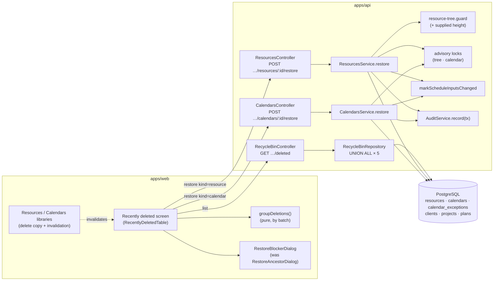
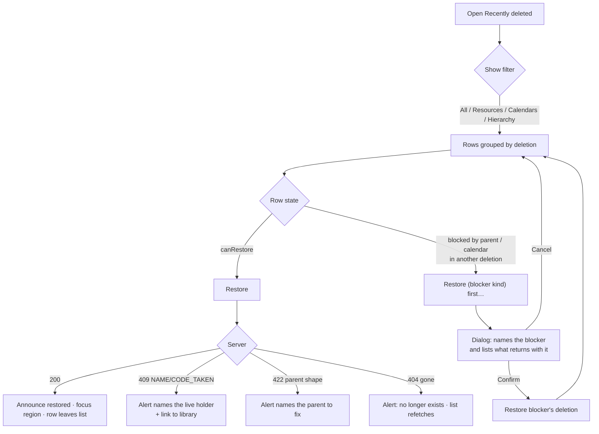

# Feature Spec: Restore deleted resources and calendars from Recently deleted

- **Status:** Approved — by the product owner, 2026-10-17, with the recommended defaults (Q1: refuse a name or code clash; Q2: block with "Restore calendar first"; Q3: list dissolved groups as "Empty resource group"; Q4: record the restored-after-calendar-deleted bug as a debt row)
- **Author(s):** feature-analyst (Claude Code), for the product owner
- **Date:** 2026-10-17
- **Tracking issue / epic:** `docs/BACKLOG.md:322-325` ("Resources still have no restore"), chosen by the product owner on 2026-10-17
- **Roadmap link:** resource and calendar library manageability (ADR-0053 follow-on); recycle bin (ADR-0096 follow-on)
- **Related ADR(s):** ADR-0053 §2–§4 (calendar tiers, resource tree, archive — amended), ADR-0096 (the recycle bin and what expires — amended), ADR-0193 (expiry preview — untouched), ADR-0072 / ADR-0073 (audit), ADR-0012 (RBAC + scope), ADR-0028 (the pen — not required), ADR-0081 (entry point + journey), ADR-0088 D1 (no flag), ADR-0105 (why this is full-spec work), ADR-0119 / ADR-0123 (the filter control and its URL param). A new **ADR-0195** is proposed (§4 "ADR").

---

## In plain English (for the product owner)

Today, deleting a **resource** (a crew, a crane) or a **calendar** in the libraries is final in
practice: the rows are only hidden in the database, but nothing on screen can bring them back, and
the group-delete confirmation says so ("deleted resources can't be restored"). This work puts
deleted resources and calendars on the **Recently deleted** screen beside clients, projects and
plans, each with a **Restore** button.

Restoring brings back exactly what was deleted together: a resource group comes back with
everything that was inside it, and a calendar comes back with its holidays and exceptions. Three
things can stop a restore, and the screen says which one and what to do. (1) **Something else now
has the name.** The restore is refused and the message names the live item to rename. Nothing is
renamed automatically. (2) **Its parent is still deleted.** That is a group for a resource, or a
project for a project calendar. The screen offers "Restore … first", the same way it does for plans
today. (3) **The resource's own calendar is deleted.** The screen offers "Restore calendar first".

Restoring a calendar also marks any plan that uses it as "edited since calculated", so the next
recalculation picks it up. Deleted resources and calendars **do not count down to permanent
deletion**. The 90-day clear-out only ever covered clients, projects and plans, and this work leaves
that alone, so these rows show no "Expires in …" line. Only Planners and Org Admins can restore. Any
member can see the list. **No database change is expected.** One index may turn out to be needed,
and that is decided by measurement and by the database-architect agent, not by this document.

---

## 0. What the code actually says (verified, not assumed)

The brief's starting facts and every fact the design rests on were checked against the source
(CLAUDE.md §19.11 — "the brief is not evidence", "re-verify a spec's PROBLEM statement"). **Every
row below was established by reading the file named; nothing was run.** Rows marked ⚠ are
findings the brief did not contain and that change the design.

| #   | Claim                                                                                                          | Verdict                                                             | Established by                                                                                                                                                                                                                                                                                                                                                                                                                                                                                                                                            |
| --- | -------------------------------------------------------------------------------------------------------------- | ------------------------------------------------------------------- | --------------------------------------------------------------------------------------------------------------------------------------------------------------------------------------------------------------------------------------------------------------------------------------------------------------------------------------------------------------------------------------------------------------------------------------------------------------------------------------------------------------------------------------------------------- |
| F1  | The recycle bin lists only clients, projects and plans.                                                        | **True**                                                            | One `UNION ALL` of three branches, `recycle-bin.repository.ts:89-136`; `DeletedHierarchyItem.kind` is `'client' \| 'project' \| 'plan'` (`packages/types/src/index.ts:924-925`); the DTO enum likewise (`deleted-item-response.dto.ts:39-43`).                                                                                                                                                                                                                                                                                                            |
| F2  | Resources have no restore.                                                                                     | **True**                                                            | Routes `resources.controller.ts:57-255` (list/create/get/patch/archive/unarchive/dissolve/delete); the dissolve description says so in terms (`:213`); `resources.service.ts:548-549`; `docs/BACKLOG.md:325`; `apps/api/test/resource-hierarchy.e2e-spec.ts:34`.                                                                                                                                                                                                                                                                                          |
| F3  | Calendars have delete/archive/unarchive but no restore.                                                        | **True**                                                            | `calendars.controller.ts:161-235`; `calendars.service.ts:428-559`. The only calendar restore is **inside a project restore**: the project cascade stamps the project's PROJECT-scoped calendars and their exceptions with the project's batch (`hierarchy-lifecycle.service.ts:335-354`) and `restoreBatch` brings them back (`:721-735`).                                                                                                                                                                                                                |
| F4  | A resource delete is one batch; a GROUP delete is the whole active subtree under ONE batch id.                 | **True**                                                            | Leaf: `resource.repository.ts:303-316` mints a batch per row. Group: `resources.service.ts:463-497` resolves the active subtree under the org tree lock and calls `softDeleteMany` with one batch (`resource.repository.ts:330-342`). Audit row carries `deleteBatchId` and `resourceCount` (`resources.service.ts:502-519`).                                                                                                                                                                                                                             |
| F5  | ⚠ **A deleted resource never has an active assignment**, so restoring one brings no assignment back.           | **True, by two guards**                                             | Delete is refused while ANY non-deleted assignment references it — the count has **no** join to the activity or plan, so an assignment on an activity in a deleted plan still blocks it (`resource.repository.ts:432-453`, `resources.service.ts:476-487`). Assigning a deleted resource is a 404, re-checked under the resource lock (`resource-assignment.service.spec.ts:233-243`). No cascade stamps `resource_assignments` (`hierarchy-lifecycle.service.ts:139-489`; ADR-0096 D5).                                                                  |
| F6  | A calendar delete takes its exceptions in the same batch; shifts and exception windows have no `deleted_at`.   | **True**                                                            | `calendar.repository.ts:711-726` (`softDeleteWithExceptions`); `schema.prisma:2013-2037` (`CalendarShift` is an owned value row, FK `Cascade`); `hierarchy-lifecycle.service.ts:325-329` states the same for the project sweep.                                                                                                                                                                                                                                                                                                                           |
| F7  | Name uniqueness is partial on `deleted_at IS NULL`, so a restore can clash with a live row.                    | **True — and on `code` too, and archived rows hold both**           | `uq_resources_org_name`, `uq_resources_org_code` (`20260717020000_m7_resource_model/migration.sql:138,143`); `uq_calendars_org_name` (ORG tier) and `uq_calendars_project_name` (PROJECT tier) (`20260725120000_calendar_scope_tier/migration.sql:90-91`). Archived rows keep their name and code by decision (ADR-0053 §4, `0053-…md:294-305`).                                                                                                                                                                                                          |
| F8  | ADR-0053 already chose "refuse" over "auto-rename" in principle.                                               | **True**                                                            | ADR-0053 §4: "soft delete may free its name precisely because _restore_ is already a guarded, conflict-capable operation" (`0053-…md:300-302`). The hierarchy restore refuses with 409 `NAME_TAKEN` (`hierarchy-lifecycle.service.ts:759-764`).                                                                                                                                                                                                                                                                                                           |
| F9  | ⚠ **A deleted resource can point at a calendar that has since been deleted.**                                  | **True**                                                            | `CALENDAR_IN_USE` counts only **active** resources (`resource.repository.ts:461-466`, used at `calendars.service.ts:519-533`). So: delete resource R (calendar C), then delete C — allowed. Restoring R would make an active resource on a deleted calendar.                                                                                                                                                                                                                                                                                              |
| F10 | ⚠ **A resource can be restored under a parent that is no longer a GROUP, or too deep.**                        | **True**                                                            | Turning a GROUP into a leaf is refused only while it has **active** children (`resources.service.ts:275-287`); deleted children do not count. The parent can also be reparented deeper meanwhile. The tree rules are `assertValidResourceParent` (`resource-tree.guard.ts:95-168`); its height walk reads **active** children only (`:53-71`), so for a restore the batch's height must be supplied, not walked.                                                                                                                                          |
| F11 | ⚠ **A plan or activity can already be live on a deleted calendar, scheduling on 24-hour time.**                | **True — a pre-existing gap this epic remedies but does not close** | `CALENDAR_IN_USE` counts only **active** plans and activities (`calendar.repository.ts:513-530`). Plan restore checks no calendar (`plans.service.ts:306-351`; `restoreBatch` `hierarchy-lifecycle.service.ts:601-774`). The engine treats a soft-deleted calendar as absent and falls back to all-minutes (`schedule.repository.ts:478-487`, `plan-calendar.ts:44`). Delete a plan, delete its ORG calendar, restore the plan: it schedules round the clock. **Not run** — M2-T1 reproduces it as a characterisation test before anything depends on it. |
| F12 | Project-scoped calendars expire with their project; ORG calendars and resources never expire.                  | **True**                                                            | The expiry runner deletes **every** calendar of an expiring project, in any state (`hierarchy-expiry.runner.ts:191-209`). The runner never touches `resources` (`hierarchy-expiry.structural.spec.ts:143-164`, the `Resource→Calendar` exempt edge). `RETENTION_HIERARCHY_*` covers clients, projects and plans only (ADR-0096 D2).                                                                                                                                                                                                                       |
| F13 | ⚠ The bin's countdown is computed **client-side from `deletedAt`**, so library rows would show a false one.    | **True**                                                            | `RecentlyDeletedTable.tsx:228-233` calls `expirySentence(group.root.deletedAt, retentionDays, retentionActive)` for every group. Listing a resource as-is would print "Expires in N days" on something that never expires.                                                                                                                                                                                                                                                                                                                                |
| F14 | The web groups bin rows by `deleteBatchId` and picks the root as "the row whose blocker is outside the batch". | **True**                                                            | `group-deletions.ts:38-88`. This rule is what lets a resource group's children and a project's calendars fold into one row with no new grouping logic. It also means **a per-row blocker that is not a parent would break root selection** (see §4 "Blockers").                                                                                                                                                                                                                                                                                           |
| F15 | Restores are writer-only; the bin read is any member.                                                          | **True**                                                            | `client:restore`/`project:restore`/`plan:restore` are in `HIERARCHY_WRITE` (Planner + Org Admin) (`org-permissions.ts:189-225`); the bin asserts `client:read` (`recycle-bin.service.ts:33-36`); the screen gates the Restore column on `canManageHierarchy` (`routes/recently-deleted.tsx:15`). There is no `resource:restore` or `calendar:restore` code today (`org-permissions.ts:76-110`).                                                                                                                                                           |
| F16 | Writing to an ORG calendar needs `calendar:manage_org` as well as the plain code.                              | **True**                                                            | `calendars.service.ts:497-506` (delete), `:437-443` (archive).                                                                                                                                                                                                                                                                                                                                                                                                                                                                                            |
| F17 | A new audit action needs no migration, but is keyed in four places.                                            | **True**                                                            | `audit_events.action` is TEXT with a format CHECK (`schema.prisma:3813-3816`). Keyed in `AUDIT_ACTIONS` + `AUDIT_ACTION_CATEGORY` (`packages/types/src/index.ts:2398-2461, 2573-2618`), the redactor allow-list (`audit-redactor.ts:152-166`), the route census (`audit-coverage.structural.spec.ts`), and the web copy (`audit-copy.ts:76-85`). Restore earns an event (ADR-0073 `0073-…md:48-49`).                                                                                                                                                      |
| F18 | Every delete hook must invalidate the bin's query, and this is pinned by a gate.                               | **True — for three hooks; the library deletes are not in it**       | `delete-invalidations.structural.test.ts:24-28` lists `useDeleteClient`/`useDeleteProject`/`useDeletePlan` only. `useDeleteResource` (`use-resources.ts:319`), `useDissolveResourceGroup` (`:338`) and `useDeleteCalendar` (`use-calendars.ts:365`) will move rows into the bin and must join it.                                                                                                                                                                                                                                                         |
| F19 | Delete copy for libraries is currently wrong in the other direction once this ships.                           | **True**                                                            | `group-action-copy.ts:41-43` ("deleted resources can't be restored") and `:56-59`; the shared hierarchy sentence is `lib/delete-copy.ts:51` ("You can restore it from Recently deleted."), which is true on every host for a library row because those never expire (F12).                                                                                                                                                                                                                                                                                |
| F20 | The bin query needs no new index for the two new tables, provisionally.                                        | **Likely; to be measured (M1-T1)**                                  | Both tables carry a full, non-partial `(organization_id, created_at, id)` index (`schema.prisma:1971, 3334`), so a deleted-rows read is bounded to one tenant's library (ADR-0053's ceiling is 5,000 rows per tenant). The batch-restore indexes already exist: `idx_resources_delete_batch_id`, `idx_calendars_delete_batch_id`, `idx_calendar_exceptions_delete_batch_id` (`…m7_resource_model/migration.sql:154`, `…add_calendars/migration.sql:84,87`).                                                                                               |
| F21 | Nothing here is plan-structural, so the pen does not apply.                                                    | **True**                                                            | Both libraries are org-scoped (`resources.controller.ts:53`, `calendars.controller.ts:59`). No `assertHoldsPen` in either service. Calendar edits stamp plans "edited since calculated" without the pen (`calendars.service.ts:622-626`), which is what a restore will do too.                                                                                                                                                                                                                                                                            |

**Why this is full-spec work, not a register row** (ADR-0105, CLAUDE.md §19.1): it adds two public
API endpoints, widens a public response contract, adds two permission codes and two audit actions,
and changes a user-facing screen. Possible index (F20), decided by measurement.

## 1. Business understanding

### Problem

A planner who deletes the wrong crew, or a whole resource group, has no way back. The group
confirmation tells them so honestly (F19). The same applies to an organisation calendar, which a
planner may delete expecting the recycle bin they already know from plans. A project calendar comes
back only if the whole project was deleted and restored (F3). The bin exists, it is grouped by
deletion (ADR-0096), and both libraries already stamp `delete_batch_id` so that "a future restore"
could use it (`resources.service.ts:490-491`, ADR-0053 §3). This is that restore.

Doing it is not just adding two `restore` routes. Four of the findings above are hazards that a
naive restore would create: an active resource on a deleted calendar (F9), a resource under a
non-group parent (F10), a false expiry countdown (F13), and grouping that breaks on a non-parent
blocker (F14).

### Users

| Role                        | Needs                                                                                                                                                 |
| --------------------------- | ----------------------------------------------------------------------------------------------------------------------------------------------------- |
| **Planner**, **Org Admin**  | See deleted resources and calendars, restore them, and be told plainly why a restore cannot happen and what to do instead.                            |
| **Contributor**, **Viewer** | See the same list (they can already read both libraries, F15). No Restore control is shown, which matches how clients, projects and plans work today. |
| **External Guest**          | Nothing. A share link reaches one plan (ADR-0051), never the organisation's libraries or bin.                                                         |

### Primary use cases

1. Restore a resource deleted by mistake.
2. Restore a resource group and everything that was deleted with it.
3. Restore an organisation calendar, or a project calendar deleted on its own.
4. Understand and resolve a blocked restore: name taken, parent deleted, or calendar deleted.
5. Narrow a long bin to "just resources" or "just calendars".

### User journeys

**Happy path:** Resources library → delete "Crane A" → the confirmation says it can be restored from
Recently deleted → open Recently deleted → row "Resource · Crane A" → **Restore** → announcement
"Resource “Crane A” restored." → Crane A is back in the library, with the same calendar, rate,
ceiling, code, parent group and archived state.

**Alternates:** a group row "and 3 resources" restores all four. A row blocked by a deleted group
offers "Restore resource group first…", which opens the existing confirmation listing what comes
back. A resource whose calendar was deleted offers "Restore calendar first…". A name clash shows an
alert naming the live holder and linking to the library. See §4 "User flow".

### Expected outcomes

- Deleting a resource or calendar is recoverable. The confirmations can say so, and they do.
- The bin is the one place to recover deleted work. It no longer covers some libraries and not others.
- No restore can leave the database in a state the forward paths forbid: no orphan, no active row on
  a deleted calendar, no non-group parent, no over-deep tree, and no duplicate name.

### Success criteria

- Every case in §2's error table is covered by an API e2e test against real Postgres, and each one is
  verified to fail against a naive restore first (M1-T3, M2-T2).
- The base Playwright journey deletes a resource and a calendar through the UI, restores both from
  Recently deleted, and passes an axe check on the screen with library rows present (ADR-0081).
- `GET …/deleted` p95 stays within the docs/PERFORMANCE.md read target on the largest seeded
  tenant. This is measured in M1-T1, before and after, not asserted.
- No line under `apps/api/src/modules/schedule/engine/` changes, so the ADR-0034 parity gate has nothing to hold (§3).

### Open questions

**Critical** (the answer changes the design):

- **Q1 — Name clash: refuse, or auto-rename?** _Recommended default: **refuse** with 409, naming the
  live holder (including an archived one) and linking to the library._ Reasons: ADR-0053 §4 already
  made this choice in principle (F8). A resource `code` is the interchange identity across imports
  (ADR-0129), so an automatic "(restored)" suffix on a code would quietly break a re-import match.
  And a renamed restore is no longer "what was deleted". The cost is that the planner renames one row
  first. A typed "Restore as…" name is a possible follow-on and is **not** in scope.
- **Q2 — A resource whose own calendar has since been deleted: block, or restore it onto the plan's
  calendar?** _Recommended default: **block** ("Restore calendar “X” first"), with the same two-press
  flow the bin uses for a deleted parent._ Clearing the calendar would silently change how that
  resource schedules the next time it is assigned, and once restored the original calendar can no
  longer re-attach. The cost is one more press and a small widening of the bin's blocker contract
  (§4 "Blockers").
- **Q3 — Should a dissolved group appear in the bin?** A dissolve soft-deletes the emptied group row
  (`resources.service.ts:597`), so it would be listed. Restoring it brings back an **empty** group.
  The resources that moved up stay where they are. _Recommended default: **list it**, with the row
  labelled "Empty resource group" and the dissolve confirmation still saying "This can't be undone"_.
  Hiding it would need the bin to tell a dissolve from a delete, and today only the audit log can.
- **Q4 — The pre-existing gap (F11): fix it here, or record it?** Plans and activities can already be
  live on a deleted calendar and schedule round the clock. _Recommended default: **record it** as a
  `docs/TECH_DEBT.md` row and keep it out of scope._ This epic remedies the symptom: restoring the
  calendar stamps those plans and fixes their next recalculation. Closing the cause would change
  **plan** restore, which is a different surface with its own review.

**Defaults stated, not asked:**

- **D1 — No expiry change.** Deleted resources and ORG calendars never expire. A PROJECT calendar
  expires when its project does (F12). The bin serves this per row as `expiresAt` (§4), so the
  countdown is the server's statement, not an assumption on the client.
- **D2 — New permission codes** `resource:restore` and `calendar:restore`, in `HIERARCHY_WRITE`
  (Planner + Org Admin). This is the `client:restore` precedent: revocable on its own with a one-line
  move. An ORG calendar additionally needs `calendar:manage_org` (F16).
- **D3 — Restore is batch-keyed and all-or-nothing.** If any row in the batch is blocked, nothing is
  restored. Rows deleted separately (their own batch) never come back with it. This is the hierarchy
  rule (`hierarchy-lifecycle.service.ts:109-121`).
- **D4 — Restore by a member row's id is refused** with `PARENT_DELETED`, exactly as restoring a plan
  inside a deleted client's batch is today. The bin acts on the group root.
- **D5 — Restore returns `200` plus the restored root row** (docs/API.md:158-163, "a sub-action that
  changes what the resource is returns it"). Restoring an already-active row is a no-op `200`.
- **D6 — No `VITE_*` flag** (ADR-0088 D1). The rollback is the commit boundary.
- **D7 — Archived state survives.** A row deleted while archived comes back archived.
- **D8 — A type filter on the bin, client-side, stored in the URL** (`?show=`). The bin pages to
  exhaustion and groups in memory (TECH_DEBT #57), so a server-side `kind` filter would split a
  project's group from its calendars.
- **D9 — No new seed-catalogue plan.** The API e2e and the journey build their own fixtures through the public API.
- **D10 — Staff console, org export and the ADR-0193 expiry preview are untouched.** Library rows
  never expire, so the preview has nothing new to show. The export already includes deleted rows.

## 2. Functional requirements

### User stories & acceptance criteria

> **US-1 — Restore a resource.** As a Planner, I want to restore a deleted resource from Recently
> deleted, so that a mistaken delete costs me nothing.
>
> - **Given** a resource deleted on its own **when** I press Restore **then** it is active again with
>   every field it had (name, code, kind, parent, calendar, ceiling, rate, archived state), and the
>   row leaves the bin.
> - **Given** it was assigned to nothing when deleted (always true, F5) **then** no assignment comes
>   back and no plan's inputs change. The service still stamps any plan that does reference it, as
>   defence in depth (§4 "Parity").
> - **Given** the row is shown **then** it reads "Resource" (or "Resource group") in Type, and its
>   Deleted cell has **no** expiry line.

> **US-2 — Restore a resource group with its contents.** As a Planner, I want restoring a group to
> bring back everything deleted with it.
>
> - **Given** a group deleted with N descendants **then** the bin shows one row "Resource group ·
>   Groundworks — and N resources", and Restore brings back all N+1 under their original parents.
> - **Given** a child was deleted **separately before** the group **then** it is its own bin row, it
>   stays deleted after the group is restored, and it can then be restored on its own.
> - **Given** a child was deleted separately and its group was deleted **later** **then** the child's
>   row says "Blocked by a deleted resource group “G”" and offers "Restore resource group first…".

> **US-3 — Restore a calendar.** As a Planner, I want to restore a deleted calendar with its exceptions.
>
> - **Given** an ORG calendar deleted on its own **when** a Planner (who holds `calendar:manage_org`)
>   presses Restore **then** it is active with its weekly pattern, hours-per-day and every exception
>   that was live at deletion. Exceptions removed earlier stay removed.
> - **Given** active plans, activities or assigned resources reference it (F11) **then** each such
>   plan is marked "edited since calculated" in the same transaction.
> - **Given** a PROJECT calendar deleted with its project **then** it appears **inside** the project's
>   bin row ("and 2 plans, 1 calendar") and comes back only with the project. That is today's
>   behaviour, now made visible.
> - **Given** a PROJECT calendar deleted on its own while its project is live **then** it restores on
>   its own. **Given** its project was deleted later **then** it is blocked by that project.

> **US-4 — Be told why a restore cannot happen.** As a Planner, I want a blocked restore to tell me
> what is in the way and what to press.
>
> - Name or code taken → an alert: "A resource named “Crane A” already exists. Rename or delete that
>   one, then restore this." It includes a link to the library. If the holder is archived, the alert
>   says so ("…an archived resource named…"). Nothing is written.
> - Parent deleted → the row's sub-line names the blocker, and the action is "Restore <kind> first…"
>   (the existing dialog, with copy that fits the relation).
> - Calendar deleted (Q2) → the sub-line "Uses deleted calendar “Crane hours”" and the action
>   "Restore calendar first…".
> - Parent no longer a group / tree too deep → an alert naming the parent, telling the planner to
>   move or change it first. These are rare, so they get no bespoke control.

> **US-5 — Filter the bin.** As any member, I want to show only one kind of deletion.
>
> - A "Show" segmented control: **All · Clients, projects & plans · Resources · Calendars**. It
>   filters by the **group root's** kind. The choice is kept in the URL (`?show=resources`), and an
>   unknown value reads as All (ADR-0123).
> - The section count is the count shown. An empty filter says what is empty ("No deleted
>   resources.") and does not reuse the whole-bin empty state.

### Workflows

**Restore a resource batch** (server, one transaction):

1. Resolve org scope; assert `resource:restore` (403 otherwise); load the row **in any state**,
   org-scoped (404 if unknown, foreign or gone); if active → 200 no-op.
2. Take the org resource-tree lock (`acquireResourceTreeWriteLock`): restoring re-attaches rows to a
   parent, which is a tree-shape write.
3. Re-read the root under the lock (the `dissolveGroup` lesson, `resources.service.ts:569-578`);
   gone → 404.
4. Load the batch (`delete_batch_id = root.batch`, org-scoped). If the root's own parent is deleted
   (in another batch, or in this one when a member's id was given), refuse with **409
   `PARENT_DELETED`**, with `details.blockedBy`.
5. If the root's parent is active: it must be a `GROUP` (422 `RESOURCE_PARENT_NOT_GROUP`), and
   `depth(parent) + height(batch subtree) ≤ RESOURCE_TREE_MAX_DEPTH` (422
   `RESOURCE_TREE_TOO_DEEP`). The height is computed from the batch rows in memory (F10).
6. For each distinct non-null `calendarId` in the batch: take the calendar advisory lock (the one the
   delete-in-use guard takes) and require the calendar active. If not → **409 `CALENDAR_DELETED`**,
   with `details.calendar {id, name, deleteBatchId}`. (The lock is what stops a concurrent calendar
   delete from passing its active-resource count while this restore is in flight.)
7. Name/code pre-check in one query against active rows (archived included). If clashes → **409
   `NAME_TAKEN` / `CODE_TAKEN`**, with `details.conflicts[] {field, value, id, archived}`, capped,
   with the total stated. The unique index's P2002 is the backstop and maps to the same 409.
8. Reactivate the batch (`deleted_at = NULL, delete_batch_id = NULL, version + 1, updated_by`).
9. Stamp any active plan that assigns a restored resource (`findActivePlanIdsAssigning`, one set
   query; expected empty, F5).
10. One `resource.restored` audit row in the transaction: subject is the root;
    `{name, kind, deleteBatchId, resourceCount}`.

**Restore a calendar batch:** steps 1, 3 and 7 as above with `calendar:restore`. Then
`calendar:manage_org` if ORG. For PROJECT scope, the project must be active, or **409
`PARENT_DELETED`** with blocker `{kind: 'project', …}`. Reactivate the calendar and the exceptions
stamped with its batch. Stamp `findActivePlanIdsUsing(calendarId)`. One `calendar.restored` row:
`{name, scope, deleteBatchId, exceptionCount}`.

**List:** `GET …/deleted` returns the union of five tables, ordered `(deleted_at DESC, id)` (§4
"Data flow").

### Edge cases

| Case                                                                            | Behaviour                                                                                                                                                                                                                                                   |
| ------------------------------------------------------------------------------- | ----------------------------------------------------------------------------------------------------------------------------------------------------------------------------------------------------------------------------------------------------------- |
| Child deleted alone, then its group deleted                                     | Two rows. The child's row is blocked by the group, which is in a different batch. The group restores without it, then the child can be restored.                                                                                                            |
| Group dissolved, and a child had been deleted alone before the dissolve         | The child's parent is the dissolved (deleted) group. It is blocked until the empty group is restored (Q3), or it stays in the bin. Stated in the row's blocker line.                                                                                        |
| Parent group turned into a leaf after the child was deleted                     | 422 `RESOURCE_PARENT_NOT_GROUP`. The alert names the parent.                                                                                                                                                                                                |
| Parent group moved deeper meanwhile                                             | 422 `RESOURCE_TREE_TOO_DEEP`, with `resultingDepth`.                                                                                                                                                                                                        |
| Resource on an **archived** calendar                                            | Allowed. Archived bindings stay live (ADR-0053 §4).                                                                                                                                                                                                         |
| Child in a group batch whose calendar is deleted                                | The **whole batch** is refused with `CALENDAR_DELETED`. The bin shows the blocker on the **group's** row (§4 "Blockers").                                                                                                                                   |
| Restore by a member's id (API caller)                                           | 409 `PARENT_DELETED` (D4).                                                                                                                                                                                                                                  |
| Concurrent restore of the same row                                              | The tree lock serialises. The second sees an active row → 200 no-op.                                                                                                                                                                                        |
| Concurrent calendar delete vs. resource restore onto it                         | Serialised by the calendar advisory lock. Either the delete counts the restored resource (409 `CALENDAR_IN_USE`), or the restore sees the calendar deleted (409).                                                                                           |
| Concurrent project delete vs. standalone project-calendar restore               | ⚠ **Possibly a pre-existing window.** The hierarchy's parent check reads without a lock (`hierarchy-lifecycle.service.ts:877-899`). M2-T1 establishes by reading whether project delete serialises against it. If not, a debt row, not a fix here (§Risks). |
| ORG calendar restored by a Planner whose `calendar:manage_org` has been revoked | 403 after the row is located. The order is: `calendar:restore` (403), load (404), `manage_org` (403). This mirrors `remove`.                                                                                                                                |
| Very large group batch (thousands of rows)                                      | Set-wise statements only. The name pre-check and the reactivation are chunked at the bind-parameter ceiling (`common/db/id-chunks.ts`, ADR-0096 D11). No per-row loop.                                                                                      |
| Bin page boundary between a resource row and a plan row with equal `deleted_at` | The `id` tiebreak is total across the union (uuids are global, `recycle-bin.repository.ts:50-55`).                                                                                                                                                          |

### Permissions

| Action                      | Permission (org-scoped, deny-by-default, ADR-0012)                                     | Roles                    |
| --------------------------- | -------------------------------------------------------------------------------------- | ------------------------ |
| See library rows in the bin | `client:read` (unchanged; every member also holds `resource:read` and `calendar:read`) | Viewer ↑                 |
| Restore a resource batch    | `resource:restore` (**new**, `HIERARCHY_WRITE`)                                        | Planner, Org Admin       |
| Restore a PROJECT calendar  | `calendar:restore` (**new**, `HIERARCHY_WRITE`)                                        | Planner, Org Admin       |
| Restore an ORG calendar     | `calendar:restore` **and** `calendar:manage_org`                                       | Planner, Org Admin today |

The org is always resolved from the caller's own memberships (`resolveScope`). Every load filters by
`organization_id`, and a foreign id is a 404 indistinguishable from an unknown one. The pen is **not**
required (F21). The response DTO keeps cost-gating `costPerUnit` (`cost:read`).

### Validation rules

- Path ids are `ParseUUIDPipe`. There is **no request body**: the restore takes no input beyond the
  id, so there is nothing to validate and nothing to tamper with.
- Bin query is unchanged (`limit`, `cursor`). `?show=` is web-only router state:
  `all | hierarchy | resources | calendars`, and anything else reads as `all`.

### Error scenarios

| Scenario                                         | Detection                                        | User-facing result                                                 | Status                          |
| ------------------------------------------------ | ------------------------------------------------ | ------------------------------------------------------------------ | ------------------------------- |
| Not a member / foreign id / unknown id           | `resolveScope`, org-scoped any-state load        | Generic not found                                                  | 404                             |
| Viewer or Contributor                            | `assertCan(resource:restore / calendar:restore)` | No control is shown. The API answers forbidden                     | 403                             |
| ORG calendar without `calendar:manage_org`       | second `assertCan`                               | Forbidden                                                          | 403                             |
| Retention expiry removed the row first           | root re-read under lock / zero rows restored     | "This item no longer exists." Do not retry (docs/API.md:1341-1346) | 404                             |
| Parent (group / project) still deleted           | parent state read under lock                     | Row sub-line + "Restore … first…"                                  | 409 `PARENT_DELETED`            |
| Resource's calendar deleted                      | calendar state read under calendar lock          | Row sub-line + "Restore calendar first…"                           | 409 `CALENDAR_DELETED`          |
| Name or code held by a live row (incl. archived) | pre-check query; P2002 backstop                  | Alert naming the holder + library link                             | 409 `NAME_TAKEN` / `CODE_TAKEN` |
| Parent is no longer a GROUP                      | `kind` check                                     | Alert naming the parent                                            | 422 `RESOURCE_PARENT_NOT_GROUP` |
| Tree would exceed the depth cap                  | depth + batch height                             | Alert with the depths                                              | 422 `RESOURCE_TREE_TOO_DEEP`    |
| Already active                                   | `deletedAt === null`                             | Nothing changes. The list refetches                                | 200                             |

## 3. Technical analysis

| Area           | Impact            | Notes                                                                                                                                                                                                                                                                                                                                            |
| -------------- | ----------------- | ------------------------------------------------------------------------------------------------------------------------------------------------------------------------------------------------------------------------------------------------------------------------------------------------------------------------------------------------ |
| Frontend       | med               | `features/recently-deleted`: kinds, sub-type labels, relation-aware blockers, `expiresAt`, filter, error alerts, restore routing and invalidations. `lib/delete-copy.ts` + `resources/lib/group-action-copy.ts` copy. `delete-invalidations.structural.test.ts` gains three hooks. `audit-copy.ts` gains two lines.                              |
| Backend        | med               | `ResourcesService.restore`, `CalendarsService.restore` (each in its own module, which already owns its soft delete, `resources.module.ts:19`, `calendars.module.ts:15`). `RecycleBinRepository` gains two `UNION ALL` branches plus blocker and expiry columns. `assertValidResourceParent` gains an optional supplied height. Permission codes. |
| Database       | **none expected** | No model, column or constraint. **One conditional index per new table** (`(organization_id, deleted_at DESC, id) WHERE deleted_at IS NOT NULL`, the ADR-0096 D6 shape) **only if** M1-T1 measures a need. If so it goes through **database-architect**, without exception (CLAUDE.md §19.3).                                                     |
| API            | med               | Two `POST …/:id/restore` routes. `GET …/deleted` items: `kind` widens, `subtype` and `expiresAt` are added, `blockedBy.kind` widens and gains `relation`. Additive for JSON readers. The enum widening is a contract change, and pre-1.0 that means a **minor** (CLAUDE.md §10). docs/API.md + OpenAPI.                                          |
| Security       | med               | New permission codes, org-scoped any-state loads, no body, uniform 404, audit inside the transaction. **security-reviewer** on the RBAC matrix and the any-state loads (IDOR).                                                                                                                                                                   |
| Performance    | low–med           | Bin query: two more branches, plus one lateral lookup for the calendar blocker. Measured (M1-T1). Group restore is set-wise and chunked.                                                                                                                                                                                                         |
| Infrastructure | none              | No env var, no service, no CI step, no Playwright config (the base journey and `e2e-library` already exist).                                                                                                                                                                                                                                     |
| Observability  | low               | Pino `info` lines `resource restored` / `calendar restored` with org, id, counts and user, matching the delete lines.                                                                                                                                                                                                                            |
| Testing        | med–high          | Unit, API e2e (new `test/library-restore.e2e-spec.ts`, plus additions to `recycle-bin`, `audit-coverage` and `resource-hierarchy`), and the base Playwright journey with axe.                                                                                                                                                                    |

**Recalc parity (ADR-0034).** This adds **no scheduling input**. `computeSchedule` is not touched or
imported. Its inputs differ only where the database already says they should: a restored calendar
becomes resolvable again for plans that already reference it (F11). That is the input a working-time
edit changes, and it is stamped the same way (`markScheduleInputsChanged`). A restored resource has
no active assignments (F5), so it reaches no engine input. Absent a restore, every recalculation is
byte-identical because nothing on the recalculation path changes. The evidence owed is a `git diff
--stat` showing no file under `apps/api/src/modules/schedule/` changed (gate pass, M3).

### Dependencies

- None blocking. It builds on ADR-0096's grouped bin (shipped), ADR-0053's batch stamping (shipped)
  and the dissolve epic's copy (shipped 2026-10-03).
- **ADR-0195** is filed at M1-T0, after this spec is Approved. An ADR that cites a `Draft` spec fails
  `check:spec-status` S3.

## 4. Solution design

### Architecture overview



The restore lives in the module that owns the entity, as today. The recycle bin stays a read model
with no write path (`recycle-bin.service.ts:13-18`). `HierarchyLifecycleService` is **not** extended:
its `restoreBatch` walks the hierarchy tables, and resources are deliberately not a hierarchy level
(`resources.module.ts:19`). The hierarchy restore of a project already brings its calendars back
(F3), and that path does not change.

### Data flow

```mermaid
sequenceDiagram
  autonumber
  actor P as Planner
  participant W as Recently deleted (web)
  participant A as ResourcesService.restore
  participant DB as Postgres (one transaction)
  P->>W: Restore "Groundworks and 3 resources"
  W->>A: POST /api/v1/organizations/acme/resources/{rootId}/restore
  A->>A: resolveScope · assertCan(resource:restore)
  A->>DB: any-state load (org-scoped) — active? → 200 no-op
  A->>DB: acquireResourceTreeWriteLock(org)
  A->>DB: re-read root · load batch rows (delete_batch_id)
  alt parent deleted
    A-->>W: 409 PARENT_DELETED {blockedBy}
  else parent not GROUP / too deep
    A-->>W: 422 RESOURCE_PARENT_NOT_GROUP / RESOURCE_TREE_TOO_DEEP
  end
  A->>DB: acquireCalendarWriteLock(each calendarId) · calendars active?
  alt a calendar is deleted
    A-->>W: 409 CALENDAR_DELETED {calendar}
  end
  A->>DB: name/code clash pre-check (active incl. archived)
  alt clash
    A-->>W: 409 NAME_TAKEN / CODE_TAKEN {conflicts[]}
  end
  A->>DB: UPDATE resources SET deleted_at=NULL… WHERE delete_batch_id=…
  A->>DB: markScheduleInputsChanged(plans assigning restored ids — expected none)
  A->>DB: INSERT audit_events resource.restored {resourceCount}
  A-->>W: 200 { data: ResourceResponseDto (root) }
  W->>W: invalidate deleted · resources · histogram keys; announce; focus region
```

### User flow



### Blockers — the one contract change that needs care

The web picks a group's root as "the row whose blocker is outside this batch" (F14). If a member row
carried a calendar blocker from another batch, it would be chosen as the root and the group would
display wrongly. So the server computes **one blocker per row**, in this order:

1. **Parent relation** (`relation: 'parent'`): the row's immediate parent is deleted. That is a
   client, project or plan's parent as today, a resource's parent group (`kind: 'resource'`), or a
   PROJECT calendar's project (`kind: 'project'`). This is computed whatever batch the parent is in,
   exactly as today. That keeps members as members.
2. **Otherwise, a dependency** (`relation: 'calendar'`, resources only): the first deleted calendar
   referenced by **any row in this row's batch**. For a group root this surfaces a child's deleted
   calendar on the root, which is the row the reader acts on. Groups themselves cannot hold a
   calendar (`ck_resources_group_no_scheduling_fields`). `canRestore` is false when either is present.

`blockedBy` gains `relation: 'parent' | 'calendar'`, and `kind` widens to `'client' | 'project' |
'resource' | 'calendar'`. The dialog copy branches on `relation`. "Sits inside X" is false for a
calendar, so a calendar blocker reads "uses calendar X, which is also deleted". Computing the
batch-wide calendar blocker is a lateral lookup bounded by `idx_resources_delete_batch_id`. Its cost
is measured in M1-T1.

### Database changes

**None expected.** No model, column, constraint or data migration. Everything the restore needs is
already stamped (F4, F6) and indexed (F20). Audit actions are TEXT (F17), and permission codes are
code, not rows (`org-permissions.ts`).

**One conditional change:** if M1-T1's `EXPLAIN (ANALYZE, BUFFERS)` of the widened bin query on the
largest seeded tenant shows the two new branches materially above the hierarchy branches, then
`(organization_id, deleted_at DESC, id) WHERE deleted_at IS NOT NULL` on `resources` and/or
`calendars` (the ADR-0096 D6 shape) is proposed. **It goes through the database-architect agent,
without exception, and this spec does not design it** (CLAUDE.md §19.3). If that agent returns
nothing, it is re-run. It is never skipped.

### API changes

New (both `@HttpCode(200)`, no body, `ParseUUIDPipe`, `@RequestContext()` for audit):

| Method | Path                                                           | 200 body                                          | Errors                                                                                                                                           |
| ------ | -------------------------------------------------------------- | ------------------------------------------------- | ------------------------------------------------------------------------------------------------------------------------------------------------ |
| POST   | `/api/v1/organizations/:orgSlug/resources/:resourceId/restore` | `ResourceResponseDto` (root, cost-gated)          | 403 · 404 · 409 `PARENT_DELETED` / `CALENDAR_DELETED` / `NAME_TAKEN` / `CODE_TAKEN` · 422 `RESOURCE_PARENT_NOT_GROUP` / `RESOURCE_TREE_TOO_DEEP` |
| POST   | `/api/v1/organizations/:orgSlug/calendars/:calendarId/restore` | the calendar detail DTO `GET :calendarId` returns | 403 · 404 · 409 `PARENT_DELETED` / `NAME_TAKEN`                                                                                                  |

Conflicts use the standard `{ error: { code: 'CONFLICT', message, details: { reason, … } } }` envelope
(docs/API.md). `details` shapes: `blockedBy` (as in the bin), `calendar {id, name, deleteBatchId}`,
and `conflicts [{field: 'name'|'code', value, id, archived}]` with `total`.

Changed — `GET /api/v1/organizations/:orgSlug/deleted` items (type renamed `DeletedItem`, with
`DeletedHierarchyItem` kept as an alias until the web stops importing it):

| Field                      | Change                                                                                                                                                                                                                                                                                                                                                                                                        |
| -------------------------- | ------------------------------------------------------------------------------------------------------------------------------------------------------------------------------------------------------------------------------------------------------------------------------------------------------------------------------------------------------------------------------------------------------------- |
| `kind`                     | `+ 'resource' \| 'calendar'`                                                                                                                                                                                                                                                                                                                                                                                  |
| `subtype` (new)            | `ResourceKind` for a resource (`GROUP` drives "Resource group"), `CalendarScope` for a calendar, `null` otherwise. Display only, never authorisation.                                                                                                                                                                                                                                                         |
| `expiresAt` (new)          | ISO instant the retention timer **would** remove this row, or `null` if no timer ever does. Hierarchy rows: `deletedAt + retentionDays`. Resources and ORG calendars: `null`. PROJECT calendar: its project's `deletedAt + retentionDays` if the project is deleted, else `null` (F12). Served whatever `retentionActive` is; the web still withholds every sentence unless `retentionActive` (ADR-0096 D11). |
| `blockedBy.kind`           | `+ 'resource' \| 'calendar'`                                                                                                                                                                                                                                                                                                                                                                                  |
| `blockedBy.relation` (new) | `'parent' \| 'calendar'` (see "Blockers")                                                                                                                                                                                                                                                                                                                                                                     |

docs/API.md's "The recycle bin, and what expires" section is rewritten. The ADR-0096 D11 lesson is
that this endpoint went undocumented once already.

### Component changes

All in `apps/web/src/features/recently-deleted/` unless named. Primitives only, no one-off styling.

- **`RecentlyDeletedTable`**: `KIND_LABEL` gains Resource / Resource group / Calendar
  (organisation) / Calendar (project) from `kind` + `subtype`. The expiry line reads
  `item.expiresAt`, with no line when it is `null`. The blocker sub-line is relation-aware. The
  Restore and "Restore … first…" buttons are unchanged in shape. Their accessible names are built
  from the new labels ("Restore resource group Groundworks and 3 resources"), with the visible label
  leading (WCAG 2.5.3). Errors stay in the existing `role="alert"`. A clash adds a `TextLink` to the
  library. Empty state copy covers all five kinds.
- **Filter**: `SegmentedControl` (`components/ui/segmented-control.tsx`, the APG radiogroup,
  ADR-0119: these are alternatives) labelled "Show", above the table, bound to `?show=` in the route's
  `validateSearch` (ADR-0123). It filters `groupDeletions` output by root kind (a pure function, unit
  tested). The `SectionCard` count follows the filter. Each filter has its own empty sentence.
- **`RestoreAncestorDialog` → `RestoreBlockerDialog`** (rename, same component): the description
  branches on `relation`, and `KIND_LABEL` widens. Focus handling is unchanged (ADR-0096 D11).
- **`group-deletions.ts`**: no rule change (the server's blocker order keeps it correct).
  `describeMembers` gains `resource`/`calendar`, in a fixed order.
- **`use-deleted-items.ts`**: `useRestoreItem` routes `kind` → `resources|calendars|clients|…`. On
  settle it also invalidates resource, calendar and histogram keys (the restore is in
  `delete-invalidations.structural.test.ts`'s "and the restore" assertion).
- **Library hooks**: `useDeleteResource`, `useDissolveResourceGroup` and `useDeleteCalendar` invalidate
  `deletedItemKeys.all(orgSlug)`, and the structural test's `HOOKS` gains them (F18).
- **Copy**: `group-action-copy.ts` group delete now says "You can restore them from Recently deleted."
  The leaf delete and the calendar delete use `lib/delete-copy.ts`'s shared sentence. The dissolve
  copy keeps "This can't be undone" (Q3: restore brings back the empty group, not the grouping) and
  its docblock's "resources are not in Recently deleted" is corrected.
- **`routes/recently-deleted.tsx`**: the description names all five kinds.
- **`features/audit/model/audit-copy.ts`**: "Resource restored", "Calendar restored", with detail
  lines carrying the counts.

States: loading, error and empty are unchanged (`DataTable`). Per-row pending is unchanged
(`aria-disabled` + `aria-busy`). Success is announced and focus moves to the region, as today.
**accessibility-reviewer** reviews the new filter + table combination (ADR-0111 applies only if a
primitive's keyboard contract changes, and none does).

### Implementation approach & alternatives

**Chosen:** a per-entity restore in each owning module, batch-keyed, all-or-nothing, run under the
locks the forward paths already take. The bin grows from three tables to five, and blockers and
expiry are served by the server.

| Alternative                                                        | Why not                                                                                                                                                                                            |
| ------------------------------------------------------------------ | -------------------------------------------------------------------------------------------------------------------------------------------------------------------------------------------------- |
| Extend `HierarchyLifecycleService.restoreBatch` to cover resources | Resources are not a hierarchy level. Folding them in couples the tree lock and the calendar guard into a service that knows neither, and its `rootRestored` and endpoint-guard logic does not fit. |
| Auto-rename on clash ("Name (restored)")                           | See Q1: it breaks the `code` identity (ADR-0129), it is not "what was deleted", and ADR-0053 §4 already chose refuse.                                                                              |
| Restore a resource onto the plan calendar when its own is deleted  | See Q2: a silent behaviour change at the next assignment, and the original binding cannot be recovered afterwards.                                                                                 |
| Compute expiry on the client from `kind`                           | ADR-0096: "served, never assumed". The PROJECT-calendar case depends on another row's `deleted_at` (F12), which the client does not hold.                                                          |
| Server-side `?kind=` filter                                        | It would split a project's group from its calendars, and the screen depends on whole groups (TECH_DEBT #57).                                                                                       |
| A `VITE_*` flag                                                    | ADR-0088 D1: every published image carries the default, so a flag is never a rollback.                                                                                                             |
| Restore partially (skip clashing rows)                             | A group would come back with holes and children would need re-homing. Neither the hierarchy nor the bin's grouping model allows partial batches.                                                   |

### ADR

**Architecturally significant: yes.** It widens a public read contract that ADR-0096 owns, sets the
library restore rules that ADR-0053 §3's 2026-10-03 amendment says do not exist, and introduces a
non-ancestor blocker. **Proposed ADR-0195 — "A library row comes back as it was, or not at all"**
(filed at M1-T0, after approval; one line in CLAUDE.md §16, `check:adr-coverage`):

- **Context:** F2, F3, F5, F9–F14.
- **D1** Resources and calendars join the bin. The restore is per-entity, batch-keyed and all-or-nothing.
- **D2** A clash is refused and names the holder. There is no auto-rename (amends nothing; applies ADR-0053 §4).
- **D3** A blocker is a parent **or** a dependency, served per row, parent first. That order is what
  keeps grouping correct (amends ADR-0096's bin contract).
- **D4** Library rows do not expire. `expiresAt` is served per row (amends ADR-0096 D2's scope statement, without changing it).
- **D5** `resource:restore` / `calendar:restore`, plus `calendar:manage_org` for the shared tier.
- **D6** A dissolved group restores empty. Dissolve stays not undoable (amends ADR-0053 §3, 2026-10-03).
- **D7** A calendar restore stamps the plans that already reference it. The engine is untouched (parity).
- **Consequences:** F11 is remedied but not closed (debt row). The bin can grow with library rows,
  because they have no expiry.

## 5. Links

- Implementation plan: [`./implementation-plan.md`](./implementation-plan.md)
- Related docs updated by this change: `docs/API.md` (recycle bin section and both libraries'
  endpoint tables), `docs/adr/0195-…` (new), `docs/adr/0053-…` (amendment note §3), `docs/adr/0096-…`
  (amendment note), `CLAUDE.md` §16 (one line) and §17 ("Every deletion a user can reach is a soft
  delete" bullet if wording changes), `docs/BACKLOG.md:322-325`, `docs/TECH_DEBT.md` (new row for F11;
  possibly one for the project-delete window), `docs/DECISIONS.md`, `apps/api` + `apps/web` changesets.
