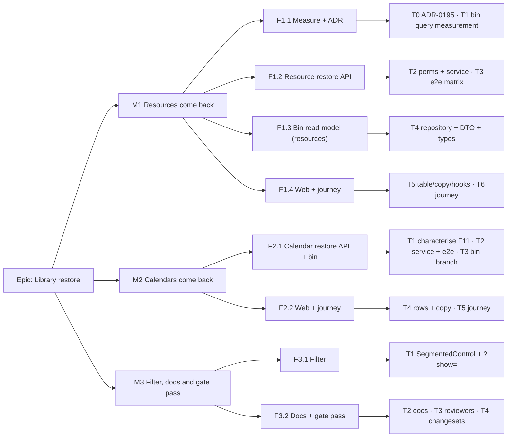

# Implementation Plan: Restore deleted resources and calendars from Recently deleted

- **Feature spec:** [feature-spec.md](./feature-spec.md)
- **Status:** Draft
- **Owner:** product owner (approval); builder agent (implementation); feature-analyst (this plan)

Everything below can be built and verified **inside the development container**. That means unit
tests (Vitest), API e2e against the local Postgres (`scripts/e2e-local.sh api`), and headless Chromium
Playwright (`scripts/e2e-local.sh web` for the base journey, `web:library` for the library suite).
No step needs the owner's server, a device or a deployed host.

## Breakdown

### Epic

**Library restore**: deleted resources and calendars become recoverable from Recently deleted
under the same rules as the hierarchy. It maps to the ADR-0053 / ADR-0096 follow-on theme.

---

### Milestone M1: Resources come back (shippable slice)

**Outcome:** a Planner restores a deleted resource or resource group from Recently deleted, and is
told why when it cannot be restored.
**Entry point:** Recently deleted (`/orgs/$orgSlug/recently-deleted`, rail item "Recently deleted")
→ row "Resource · <name>" → button with accessible name **"Restore resource <name>"** (or "Restore
resource group <name> and N resources").
**Journey:** `apps/web/e2e/recently-deleted.spec.ts` (base journey). It creates a resource through
the API, deletes it in the Resources library through the UI, opens Recently deleted, presses that
button, asserts the announcement, and asserts the resource is listed in the library again. axe
passes on the screen with the row present. Lands **in this milestone** (ADR-0081 §2).

#### Feature F1.1: Measure first, decide in the record

> **Description:** Take the bin's cost reading before the query grows, and file ADR-0195.
> **Complexity:** S
> **Dependencies:** spec Approved
> **Risks:** the index question is answered by intuition → the reading is taken on the largest seeded tenant and recorded, before and after.
> **Testing requirements:** none beyond the readings. `pnpm check:adr-coverage` and `pnpm check:spec-status` pass.

##### Task M1-T0: File ADR-0195 (≈ one PR, docs-only)

- **Description:** Write `docs/adr/0195-a-library-row-comes-back-as-it-was-or-not-at-all.md` from
  the spec's §4 "ADR" outline, with the owner's Q1–Q4 answers recorded. Add the CLAUDE.md §16 line.
  Add amendment notes to ADR-0053 §3 (the 2026-10-03 "no restore" paragraph) and ADR-0096 (the bin
  contract and the scope of D2's sentence).
- **Complexity:** S
- **Dependencies:** spec header flipped to `- **Status:** Approved — …` **first**, because S3
  refuses an ADR that cites a Draft spec.
- **Risks:** the ADR restates the spec and the two drift → the ADR cites spec sections and records
  only the decisions.
- **Testing:** `pnpm check:adr-coverage`, `pnpm check:spec-status`, `pnpm prepush`.
- **Development steps:**
  1. Flip the spec header to `Approved — by the product owner, <date>; Q1 …, Q2 …, Q3 …, Q4 …`.
  2. Write ADR-0195 (Status: Accepted on approval; Spec: `../specs/restore-resources-calendars/`).
  3. Add the amendment notes to ADR-0053 and ADR-0096 and the CLAUDE.md §16 line.
  4. Add a `docs/DECISIONS.md` entry. No changeset (docs only).

##### Task M1-T1: Measure the bin query (folded into T4's PR)

- **Description:** `EXPLAIN (ANALYZE, BUFFERS)` of today's union and of the widened five-branch
  union, including the batch-wide calendar blocker lookup, on the largest seeded tenant (the scale
  seed, ADR-0066). Record both in the PR and in ADR-0195's evidence.
- **Complexity:** S
- **Dependencies:** M1-T0
- **Risks:** the reading shows a seq scan worth fixing → **stop**. Run the **database-architect**
  agent for the conditional index (spec §4 "Database changes"). It lands as its own migration
  PR before T4, and that agent is re-run if it returns nothing (CLAUDE.md §19.3). Not
  self-assessed.
- **Testing:** none (measurement). The reading is the evidence.
- **Development steps:**
  1. Seed the scale catalogue locally; pick the tenant with the most soft-deleted rows.
  2. Capture the current plan and timing; draft the widened SQL; capture again.
  3. Decide: no index (default) or hand off to database-architect.

#### Feature F1.2: Resource restore API

> **Description:** `POST …/resources/:resourceId/restore`: batch-keyed, all-or-nothing, under the tree and calendar locks, with one audit row.
> **Complexity:** L
> **Dependencies:** F1.1
> **Risks:** an invariant breaks under a race → every guard runs inside the transaction under the lock the forward path uses, and the concurrency cases are tested against real Postgres.
> **Testing requirements:** unit (service), API e2e (full matrix), structural (audit census, permission bundles).

##### Task M1-T2: Permission code, service, controller, audit (≈ one PR)

- **Description:** Add `resource:restore` to `OrgPermission` and `HIERARCHY_WRITE`
  (`org-permissions.ts:106-110, 189-225`) and update `org-permissions.spec.ts`.
  `ResourcesService.restore` follows the spec §2 workflow steps 1–10. The repository gains
  `findByIdInOrgAnyState`, `findBatchInOrg`, `findActiveNameOrCodeClashes` (chunked) and
  `restoreBatch` (one `updateMany` by `deleteBatchId`, org-scoped, `version` increment).
  `assertValidResourceParent` gains an optional `movedHeight` so a restore supplies the batch's
  height computed in memory (spec F10). `ResourcesController.restore` returns `200` plus a
  cost-gated `ResourceResponseDto`, with OpenAPI responses for every error in spec §2. Audit:
  `resource.restored` is added to `AUDIT_ACTIONS` and `AUDIT_ACTION_CATEGORY` (`deletions`), the
  redactor allow-list (`name, kind, deleteBatchId, resourceCount`) and the route census. Fix the
  stale "no restore" text in `resources.controller.ts:213` and `resources.service.ts:548-549`.
- **Complexity:** L
- **Dependencies:** M1-T0, M1-T1
- **Risks:**
  - The lock order deadlocks with delete → take the tree lock first, then the calendar locks in
    ascending id order. Write the order into the method docblock beside `remove`'s (`resources.service.ts:450-452`).
  - The P2002 backstop hides which row clashed → the pre-check is the primary path and P2002 maps
    to the same 409 without `conflicts`.
  - Restoring by a member id resurrects part of a branch → refuse with `PARENT_DELETED` (spec D4).
- **Testing:** `resources.service.spec.ts` (each refusal, no-op, gate order 403 → 404 → 409/422,
  audit payload, stamp call), `org-permissions.spec.ts`, `audit-coverage.structural.spec.ts`,
  `audit-redactor` spec.
- **Development steps:**
  1. Permission code + bundle + spec.
  2. Repository methods (soft-delete annotations per ADR-0172: `soft-delete: any-state` / `deleted-only` with reasons).
  3. Guard `movedHeight` parameter + its unit test.
  4. Service `restore`, controller route, DTO wiring, OpenAPI.
  5. Audit vocabulary in all four places; web `audit-copy.ts` line "Resource restored".
  6. `docs/API.md` resources table row. Changeset `@repo/api` minor.

##### Task M1-T3: API e2e matrix (≈ one PR, may ride with T2)

- **Description:** New `apps/api/test/library-restore.e2e-spec.ts` against real Postgres. **Every
  refusal test is first run red against a naive restore** (an `updateMany` by batch with no guards),
  and the PR states that it was.
- **Complexity:** M
- **Dependencies:** M1-T2
- **Risks:** fixtures are slow to build by hand → build through the public API (create, delete),
  with no direct DB writes except where a state is unreachable through the API.
- **Testing:** the cases:
  1. Leaf restore restores every field, including the archived state; `version` increments.
  2. Group restore brings back the whole batch; a child deleted earlier stays deleted.
  3. Child blocked by a later-deleted group → 409 `PARENT_DELETED` with a `blockedBy` naming the group's batch.
  4. Restore by a member's id → 409 `PARENT_DELETED`.
  5. Parent turned into a leaf → 422 `RESOURCE_PARENT_NOT_GROUP`. Parent moved deeper → 422 `RESOURCE_TREE_TOO_DEEP`.
  6. Name clash and code clash, including an **archived** holder → 409, with `conflicts`; nothing is written.
  7. Own calendar deleted → 409 `CALENDAR_DELETED`. A child's calendar deleted in a group batch → the whole batch is refused.
  8. Archived calendar → allowed.
  9. RBAC: Viewer/Contributor 403; non-member 404; another org's id 404; External Guest has no route.
  10. Already active → 200 no-op, no audit row.
  11. One `resource.restored` row with the right counts (extend `audit-coverage.e2e-spec.ts`).
  12. Concurrency: a restore racing a calendar delete for the same calendar. One of the two refuses (two connections, the existing e2e concurrency pattern).
  13. Update `resource-hierarchy.e2e-spec.ts:34`'s "no restore endpoint" note.
- **Development steps:** write the cases red against the naive restore, then green against T2; run
  `scripts/e2e-local.sh api`.

#### Feature F1.3: Bin read model — resources

> **Description:** The bin lists resources with `subtype`, `expiresAt` and relation-aware blockers.
> **Complexity:** M
> **Dependencies:** F1.1 (measurement); F1.2 merged first, so a listed row's Restore never 404s
> **Risks:** the root selection breaks (spec F14) → server blocker order: parent first, then batch-wide calendar. A unit test in `group-deletions.test.ts` pins the shapes the server can emit.
> **Testing requirements:** `recycle-bin.service.spec.ts`; `recycle-bin.e2e-spec.ts` (kinds, blockers, `expiresAt` for each row type, keyset paging across kinds with equal `deleted_at`).

##### Task M1-T4: Repository branch, DTO, shared types (≈ one PR)

- **Description:** Add the `resources` branch to `findDeletedPage`
  (`recycle-bin.repository.ts:89-136`): the parent blocker from a self-join on `parent_id`, and the
  calendar blocker from a lateral lookup over the row's batch. Add `subtype` and `expires_at`, and
  add `expiresAt` to the three hierarchy branches (`deleted_at + retentionDays`, computed in the
  service from config rather than in SQL). In `@repo/types`, `DeletedItem` gets the widened `kind`,
  `subtype`, `expiresAt` and `DeletedItemBlocker.relation`, and `DeletedHierarchyItem` becomes an
  alias. Update the DTO enums and descriptions (`deleted-item-response.dto.ts`).
- **Complexity:** M
- **Dependencies:** M1-T1, **M1-T2 merged first** (see "Sequencing")
- **Risks:** expiry drifts between the server and the timer → `expiresAt` is derived from the same
  `AppConfigService.retentionHierarchyDays` the sweep reads, and an e2e asserts the hierarchy rows'
  `expiresAt − deletedAt` equals the configured period.
- **Testing:** service spec (mapping, `expiresAt` per kind), e2e (above). The `pnpm typecheck` across
  web confirms nothing breaks on the widened union.
- **Development steps:** SQL branch → mapping → DTO → types → docs/API.md recycle-bin section (the
  first half, resources) → changeset `@repo/api` minor (same release as T2 is fine).

#### Feature F1.4: Web surface and journey (resources)

> **Description:** Rows, labels, expiry from the server, blocker copy, restore routing, invalidations and delete copy.
> **Complexity:** M
> **Dependencies:** F1.2, F1.3
> **Risks:** a stale cache hides the restored row or the new bin row → the structural invalidation test gains the library hooks (spec F18).
> **Testing requirements:** unit (`RecentlyDeletedTable.test.tsx`, `group-deletions.test.ts`, `expiry-copy.test.ts`, `group-action-copy.test.ts`, `delete-copy.test.ts`, `delete-invalidations.structural.test.ts`); Playwright base journey + axe.

##### Task M1-T5: Table, dialog, hooks, copy (≈ one PR)

- **Description:** Make the spec §4 "Component changes" edits for resources. The `KIND_LABEL`
  widening is shared between table and dialog, so move it to one `model/kind-label.ts`. Expiry reads
  `expiresAt`. The blocker sub-line and the dialog description are relation-aware.
  `RestoreAncestorDialog` is renamed `RestoreBlockerDialog`. `useRestoreItem` routes by kind and
  invalidates resource/histogram keys. `useDeleteResource` and `useDissolveResourceGroup` invalidate
  the bin. Clash and 422 alerts render the server message, with a `TextLink` to `/resources` on a
  clash. Group-delete copy now says the group can be restored; the dissolve docblock is corrected.
  The route description and the empty-state copy are updated.
- **Complexity:** M
- **Dependencies:** M1-T4 (types), M1-T2 (route)
- **Risks:** accessible names lose their WCAG 2.5.3 shape → existing tests assert that the visible
  label leads the accessible name; extend them to the new kinds.
- **Testing:** unit suites listed above; `pnpm prepush`.
- **Development steps:** model → table/dialog → hooks → copy → tests → changeset `@repo/web` minor.

##### Task M1-T6: Journey (≈ rides with T5)

- **Description:** Extend `apps/web/e2e/recently-deleted.spec.ts` with the M1 journey (header
  above), plus one blocked case: the group deleted after its child, then "Restore resource group
  first…", then confirm, then restore the child. Add an axe check with library rows present.
- **Complexity:** S
- **Dependencies:** M1-T5
- **Risks:** the base journey is not in the shard list a reader assumes → run it locally with
  `scripts/e2e-local.sh web` (ADR-0096 D11: the base journey is a target of its own). The delete
  step in the library uses the existing `e2e-library` locators, so also run `web:library`.
- **Testing:** `scripts/e2e-local.sh web`, `scripts/e2e-local.sh web:library`.
- **Development steps:** fixture via API → UI delete → bin → restore → assert → axe.

---

### Milestone M2: Calendars come back (shippable slice)

**Outcome:** a Planner restores a deleted organisation or project calendar with its exceptions.
Plans already pointing at it are marked for recalculation. A project's own calendars appear inside
the project's deletion row.
**Entry point:** Recently deleted → row "Calendar (organisation) · <name>" → button **"Restore
calendar <name>"**. For a calendar swept with its project, the project row's existing Restore, whose
name now includes "… 1 calendar".
**Journey:** `apps/web/e2e/recently-deleted.spec.ts` gains these steps: create an ORG calendar
through the API, delete it in the Calendars library, restore it from Recently deleted, and assert it
is back in the library. Plus one project-calendar step: delete a project that has a project calendar
and assert the project row says "and 1 calendar". Lands in this milestone.

#### Feature F2.1: Calendar restore API and bin branch

> **Description:** `POST …/calendars/:calendarId/restore`, the `calendars` bin branch, and the schedule-input stamp.
> **Complexity:** M
> **Dependencies:** M1 (shared contract and helpers)
> **Risks:** a restored PROJECT calendar is orphaned by a concurrent project delete → T1 establishes, by reading, whether that window exists (spec §2 edge cases). If it does, it is a pre-existing class shared with plan restore, so it gets a debt row and is not a silent fix here.
> **Testing requirements:** unit, API e2e, characterisation of F11.

##### Task M2-T1: Characterise the pre-existing gap and the race (≈ one small PR, tests + debt rows)

- **Description:** (a) An API e2e that **reproduces F11** against today's code: delete a plan, delete
  its ORG calendar, restore the plan, recalculate, then assert the plan schedules on all-minutes
  time. Kept as a characterisation test and inverted in T2 once calendar restore re-dates it. (b)
  Read the project-delete path and record whether a standalone project-calendar restore can
  interleave with it. (c) Open `docs/TECH_DEBT.md` rows for F11 (per the owner's Q4 answer) and, if
  established, the race.
- **Complexity:** S
- **Dependencies:** M1 merged
- **Risks:** the reproduction fails because F11 is wrong → then the spec's F11 is corrected in place
  and Q4 is moot. That is a finding, not a failure.
- **Testing:** the characterisation e2e.
- **Development steps:** fixture → assertion → debt rows → `pnpm prepush` + `scripts/e2e-local.sh api`.

##### Task M2-T2: Permission code, service, controller, audit, e2e (≈ one PR)

- **Description:** Add `calendar:restore` to `HIERARCHY_WRITE`. `CalendarsService.restore`
  follows the spec §2 calendar workflow: gate order `calendar:restore` → load → `calendar:manage_org`
  if ORG. A PROJECT calendar needs its project active (409 `PARENT_DELETED`, blocker
  `{kind:'project'}`). The tier-aware clash pre-check runs with the P2002 backstop. The calendar and
  the exceptions stamped with its batch are reactivated, and `markScheduleInputsChanged(tx, org,
findActivePlanIdsUsing(calendarId))` is called. One `calendar.restored` row
  (`name, scope, deleteBatchId, exceptionCount`) goes into the four audit places plus web copy.
  The response is the same detail DTO that `GET :calendarId` returns.
- **Complexity:** M
- **Dependencies:** M2-T1
- **Risks:** exceptions collide with the btree_gist EXCLUDE on restore → impossible by construction
  (no exception can be added to a deleted calendar, `calendars.service.ts:571-572`); an e2e pins it.
- **Testing:** `calendars.service.spec.ts`; `library-restore.e2e-spec.ts` calendar cases:
  1. ORG restore with exceptions; an exception deleted earlier stays deleted.
  2. Planner without `manage_org` → 403 (via a test principal with the code withheld).
  3. Standalone PROJECT calendar restored under a live project; blocked under a deleted project.
  4. A calendar swept with its project is **not** restorable on its own (`PARENT_DELETED`) and comes back with the project (the existing path, now asserted).
  5. Clash per tier, including an archived holder.
  6. F11 inverted: after the calendar is restored, the plan is stamped "edited since calculated" and its recalculation uses the calendar.
  7. Audit row; no-op 200; RBAC 403/404.
- **Development steps:** permission → repository (any-state load, batch restore incl. exceptions)
  → service → controller/OpenAPI → audit → e2e → `docs/API.md` calendars row → changeset `@repo/api` minor.

##### Task M2-T3: Bin branch for calendars (≈ rides with T2)

- **Description:** Add the `calendars` branch: parent blocker = the project when scope is PROJECT
  and the project is deleted; `subtype` = scope; `expiresAt` = the project's `deleted_at + days` when
  it is a PROJECT calendar under a deleted project, else null (spec F12).
- **Complexity:** S
- **Dependencies:** M2-T2
- **Risks:** a project-batch calendar becomes the group root → it carries the project as its
  blocker, in the same batch, so it is a member. Pinned in `group-deletions.test.ts` and in the e2e.
- **Testing:** `recycle-bin.e2e-spec.ts` (project row with a calendar member; standalone calendar
  row; `expiresAt` for each).
- **Development steps:** SQL branch → mapping → tests → docs/API.md recycle-bin section (calendars).

#### Feature F2.2: Web surface and journey (calendars)

> **Description:** Calendar rows and labels, `describeMembers` with calendars, `useDeleteCalendar` invalidation, calendar delete copy, and a restore that invalidates calendar keys.
> **Complexity:** S
> **Dependencies:** F2.1
> **Risks:** the project-calendars section in project detail (`ProjectCalendarsSection.tsx`) also deletes → its delete path goes through `useDeleteCalendar` and is covered by the same structural test. Verify this, don't assume it.
> **Testing requirements:** unit suites as in M1-T5; base journey + axe.

##### Task M2-T4: Rows, copy, hooks (≈ one PR)

- **Description:** Calendar labels (organisation / project). The calendar delete confirmation uses
  `lib/delete-copy.ts`'s sentence (`CalendarsTable.tsx:487` today reads only `Delete “X”?`).
  `useDeleteCalendar` joins `delete-invalidations.structural.test.ts`. The restore invalidates
  calendar keys. The empty state and the route description name calendars.
- **Complexity:** S
- **Dependencies:** M2-T3
- **Risks:** none beyond M1-T5's.
- **Testing:** unit suites; `pnpm prepush`.
- **Development steps:** labels → copy → hooks → tests → changeset `@repo/web` minor.

##### Task M2-T5: Journey (≈ rides with T4)

- **Description:** Add the M2 journey steps (header above) to the base journey.
- **Complexity:** S
- **Dependencies:** M2-T4
- **Testing:** `scripts/e2e-local.sh web`, `scripts/e2e-local.sh web:library`.

---

### Milestone M3: Filter, documentation and the gate pass

**Outcome:** any member can narrow the bin to one kind, and the epic's documentation and review are complete.
**Entry point:** Recently deleted → the radiogroup **"Show"** with options "All", "Clients, projects
& plans", "Resources", "Calendars".
**Journey:** the base journey selects "Resources" by keyboard (Arrow keys, per the APG radiogroup),
asserts that only resource rows remain and that the URL carries `?show=resources`, reloads, and
asserts the filter persisted.

#### Feature F3.1: Type filter

> **Description:** A `SegmentedControl` filter over grouped rows, stored in the URL.
> **Complexity:** S
> **Dependencies:** M2
> **Risks:** the count reads as the whole-bin total → `SectionCard` counts the filtered groups, and each filter has its own empty sentence (spec US-5).
> **Testing requirements:** unit (pure filter function, route search validation with an unknown value → all), journey step, axe.

##### Task M3-T1: Filter (≈ one PR)

- **Description:** Add `validateSearch` on the recently-deleted route (`show`, ADR-0123), a pure
  `filterGroups(groups, show)`, the `SegmentedControl` above the table, filtered counts and empty states.
- **Complexity:** S
- **Dependencies:** M2-T4
- **Risks:** none material.
- **Testing:** unit + the journey step above; `pnpm prepush`; `scripts/e2e-local.sh web`.
- **Development steps:** route search → pure function → UI → tests → changeset `@repo/web` minor.

#### Feature F3.2: Documentation and gate pass

> **Description:** Bring every claim into line with the shipped behaviour, then run the specialist review over the combined diff.
> **Complexity:** M
> **Dependencies:** F3.1
> **Risks:** a stale "no restore" sentence survives somewhere → grep for `no restore`, `can’t be restored`, `not in Recently deleted` and `clients, projects and plans` across `apps/` and `docs/` and fix each hit or justify it.
> **Testing requirements:** `pnpm prepush` (all `check:*` gates), the full e2e set touched.

##### Task M3-T2: Documentation (≈ one PR)

- **Description:** `docs/API.md` (final read of the recycle-bin section and both endpoint tables),
  `docs/BACKLOG.md:322-325` (mark done), CLAUDE.md §17's soft-delete bullet (if its wording no
  longer holds), `docs/DECISIONS.md`, and ADR-0195's acceptance ledger. Flip the spec header to
  `Accepted — shipped (ADR-0195)`.
- **Complexity:** S
- **Dependencies:** M3-T1
- **Testing:** `pnpm check:spec-status`, `pnpm check:adr-coverage`, `pnpm check:counts` (no count
  changes expected unless an index migration landed, in which case the CLAUDE.md banner migration
  count moves).

##### Task M3-T3: Specialist gate pass (≈ review, fixes as their own commits)

- **Description:** Run **api-reviewer**, **security-reviewer** and **backend-performance-reviewer**
  over the two endpoints and the bin query. Run **component-reviewer**, **accessibility-reviewer**
  and **ux-reviewer** over the screen. Run **test-engineer** over the e2e matrix. Every blocking
  finding is fixed with a regression test verified red first. Record the parity evidence:
  `git diff --stat origin/main -- apps/api/src/modules/schedule/` is empty.
- **Complexity:** M
- **Dependencies:** M3-T2
- **Testing:** whatever the findings require; `pnpm prepush`; `scripts/e2e-local.sh api`, `web`, `web:library`.

##### Task M3-T4: Release

- **Description:** Confirm the changesets (`@repo/api` minor, `@repo/web` minor), merge per §19.9
  (deduped check runs on the current head, SHA pin obtained from the API), and confirm the release
  and publish jobs.
- **Complexity:** S
- **Dependencies:** M3-T3

## Sequencing & slices

1. **M1-T0** (ADR, docs-only) → **M1-T1** (measurement; a database-architect detour only if the reading demands it).
2. **M1-T2 + T3** (resource API, dark until T5: `Ships dark — the endpoint is reachable only by API
until M1-T4 lists resource rows`) can land before or alongside **M1-T4** (bin branch). Both are
   additive. The widened `kind` union cannot ship ahead of the web: `KIND_LABEL` is a
   `Record<DeletedHierarchyItem['kind'], string>` (`RecentlyDeletedTable.tsx:21-25`,
   `RestoreAncestorDialog.tsx:12-16`), so widening the type in `@repo/types` fails `pnpm typecheck`
   until the labels exist. **M1-T4 therefore adds the labels and the `expiresAt` read in the same
   PR.** That is the minimum needed to render a resource row honestly (no false countdown). **Land T2
   before T4.** The existing `useRestoreItem` already builds `/${kind}s/:id/restore`
   (`use-deleted-items.ts:53`), so a visible resource row's Restore button reaches the route the
   moment both are merged, and the wrong order would ship a button that 404s. **M1-T5/T6** finish
   the copy, the blockers, the invalidations and the journey. **M1 is releasable after T6.**
3. **M2** repeats the shape for calendars. It is releasable after T5.
4. **M3** is the filter, the documentation and the review.

`main` stays releasable after every task: each one is additive, nothing is removed until its
replacement exists, and there is **no feature flag** (ADR-0088 D1). The rollback is reverting the
commit.

## Definition of Done (per task)

Each task's PR satisfies the Feature Completion Criteria in [`docs/PROCESS.md`](../../PROCESS.md):
code, tests, docs, security, performance, accessibility, Docker build, CI, changelog and version
impact. "Tests" means **`pnpm prepush` was run**, plus `scripts/e2e-local.sh api` for any `apps/api`
change and `scripts/e2e-local.sh web` (and `web:library` where the library is driven) for any change
to the screen or a journey. All of it runs in the container.

## Risks & assumptions (rollup)

| Risk / assumption                                                                    | Likelihood | Impact | Mitigation                                                                                                                                                                                       |
| ------------------------------------------------------------------------------------ | ---------- | ------ | ------------------------------------------------------------------------------------------------------------------------------------------------------------------------------------------------ |
| F5 ("a deleted resource has no active assignments") is false through a path not read | low        | med    | The service stamps plans assigning restored ids anyway (expected empty), and an e2e asserts zero assignments come back.                                                                          |
| F11 reproduction fails (the engine does not fall back as read)                       | low        | low    | M2-T1 runs it first. The spec is corrected in place and Q4 becomes moot.                                                                                                                         |
| The bin query regresses on large tenants                                             | low        | med    | M1-T1 measures before and after. A conditional index goes through database-architect.                                                                                                            |
| A project delete interleaves with a standalone project-calendar restore (orphan)     | unknown    | med    | M2-T1 establishes it by reading. If real, it is a shared pre-existing class (plan restore too), so a debt row, not a silent fix here.                                                            |
| Lock-order deadlock between restore, delete and reparent                             | low        | high   | One documented order (tree → calendar locks ascending), stated beside `remove`'s, plus the e2e concurrency case.                                                                                 |
| The bin grows without bound with library rows (no expiry)                            | med        | low    | Stated in ADR-0195's consequences. The filter makes it navigable. Revisit if a tenant's library bin passes ~1,000 rows.                                                                          |
| The widened `kind` union breaks a third-party API reader                             | low        | low    | Pre-1.0 minor. Recorded in the changeset and docs/API.md. The only known consumer is this web client.                                                                                            |
| A Q1/Q2 answer differs from the default                                              | med        | med    | Q1 "auto-rename" adds a name-picking step to T2 (≈ +S) and drops `conflicts`. Q2 "clear calendar" drops `CALENDAR_DELETED` and the calendar blocker (≈ −S). Neither changes the milestone shape. |
